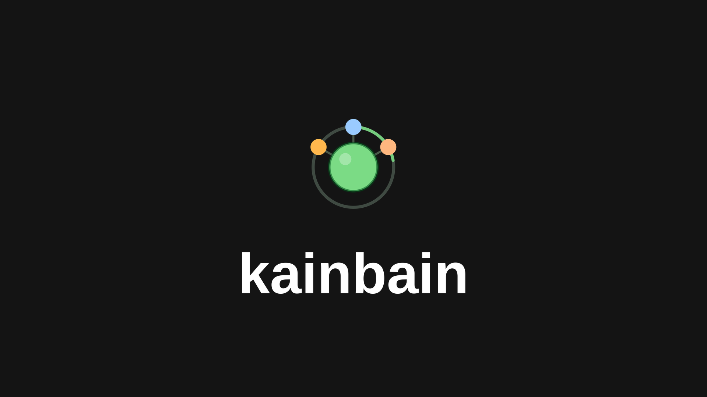

# KainBain




An AI orchestrator designed around being anything but a chat up. Inspired from CI and agile tools to help you orchestrate many agents, clean, transparent and easily. 

Built for the Meta AI Developer hackathon 2026

## Useful links

- [The whistle stop tour/Quick demo](https://youtu.be/_K_ANTUADPk)
- [Full walkthrough of Kainbain, its story and how to use it](https://youtu.be/aUao7rw4qGo)
- [Written blogpost announcing kainbain](https://ewrdad.substack.com/p/kainbain-how-im-taking-vibe-coding?r=2mgyhl&utm_campaign=post&utm_medium=web&showWelcomeOnShare=true)
- [Kainbain promotional site/install wizard](https://kainbain.ewrdad.uk/)

## Core Values

### User Friendly
- A ground up reconsideration of how AI fits into your workflow
- Adjust the tools to fit you, not you to the tools
- Built upon decades of agile and project managment knowledge

### Compute Friendly 
- Easy scalability through adding runners
- Allows small models to punch above their weight
- The perfect space to harness your custom finetunes

### Confidence Friendly
- Build assurance into the process, not an after thought
- Auto resolving CI loops, integrated with existing tools
- Clear auditable history of all work done. 


## Get Started

! Full warning this is in early BETA and I can't guarentee fully working, Continous updates are being rolled out. I apprecate greatly however if you do use this and help me develop it further ! 

Use the kainbain configuration wizard at: https://kainbain.ewrdad.uk/

or get started with the defaults with:
```bash
curl -fsSL https://kainbain.ewrdad.uk/install.sh | bash
```

pass in flags like:
```bash
curl -fsSL https://kainbain.ewrdad.uk/install.sh | bash -s -- --backend-port 3001 --frontend-port 3002 --runners 2 --install-dir ~/kainbain
```

After install, open the printed URL (default http://localhost:3100):
- Approve the Runner in Settings > Harness > Runners — one click; it collects its own credential, no paste needed.
- The board greets you with a setup checklist: connect the Runner, create or adopt a project, run your first task.
- New projects need a fetchable git remote — paste it into the creation dialog, or adopt an existing checkout instead (no remote needed).
- Installs seed a Welcome Tour project unless you pass `--no-seed`; pass `--adopt-from DIR` to adopt existing checkouts at install time.

Start over / remove a broken install (state-preserving by default; `--purge --yes` deletes everything):
```bash
curl -fsSL https://kainbain.ewrdad.uk/uninstall.sh | bash -s -- --install-dir ~/apps/kainbain --dry-run
```

## Security

Despite best efforts this is is a BETA project and should not be exsposed on general internet. Best efforts have been made to ensure that good security practices are implmented such as:
- Static code analysis (Semgrep)
- Package and supply chain analysis (trivy)
- General AI lead security scans (Kainbain itself)

To make this viable for full production use work left to do but is planned is:
- OpenID/OAuth integration to allow for account level access controls
- A fresh audit and comprehsive review of the backend to runner handshake
-  Artefact PII scans 

My background is in security and I do take it seriously, at this point it is more to prove the functionality than to work on this. Advice and help is always apprecaited. 

## Support needed

This is in early beta and we (I as of writing) need support in many key areas. Please reach out either here or on threads @Ewrdad if interested.

### Graphics and design
- Visual/Brand idenity needed, although the existing UX is personally how I like it the entire colour scheme,branding and ratios come from an agent hallucinating based on an excalidraw drawing. 

### Accesibility
- Users with different disabilities or accesibility needs should try and use this and then get in contact to provide guidance or raise issues. Currently we have run automated tests on accesibility but need time to be taken to implement properly
- General experts , whether thats testers,devs or designers, are needed to make sure it is fine and usable

### Infrastructure and Architecture experts
- I want the backend to be independantly scalable while still being able to orchestrate machines. Easiest option would be some kind of sharding but that would inherently leave compute on the table so creative options wanted


## Timeline

### September 2026
- Development started locally 
- Basic functionality 

### Early October 2026
- Basic proof of concept
- Fragile monilith
- Highly integrated to local homelab

### Meta AI Developer Hackathon 2026 (Late October early November)
- Complete rearchitecture to service style design
- Dockerised and packaged components
- Implementation of easy install scripts
- Implemented runners to allow for massive scaling
- Deployment of support architecture
- Creation of addsite and configuration wizard
- Complete removal of references to my homelab (if you see silverbullet mentioned please report)
- Tested external deployment
