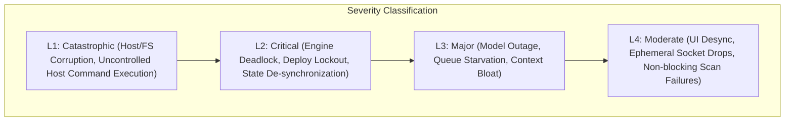
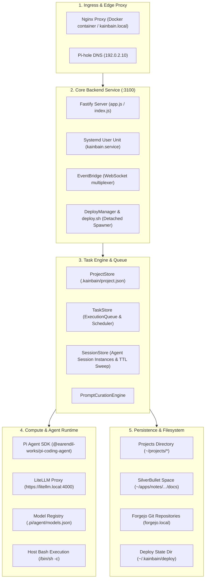
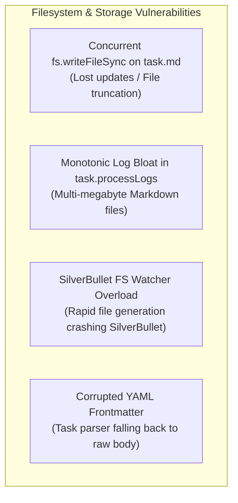
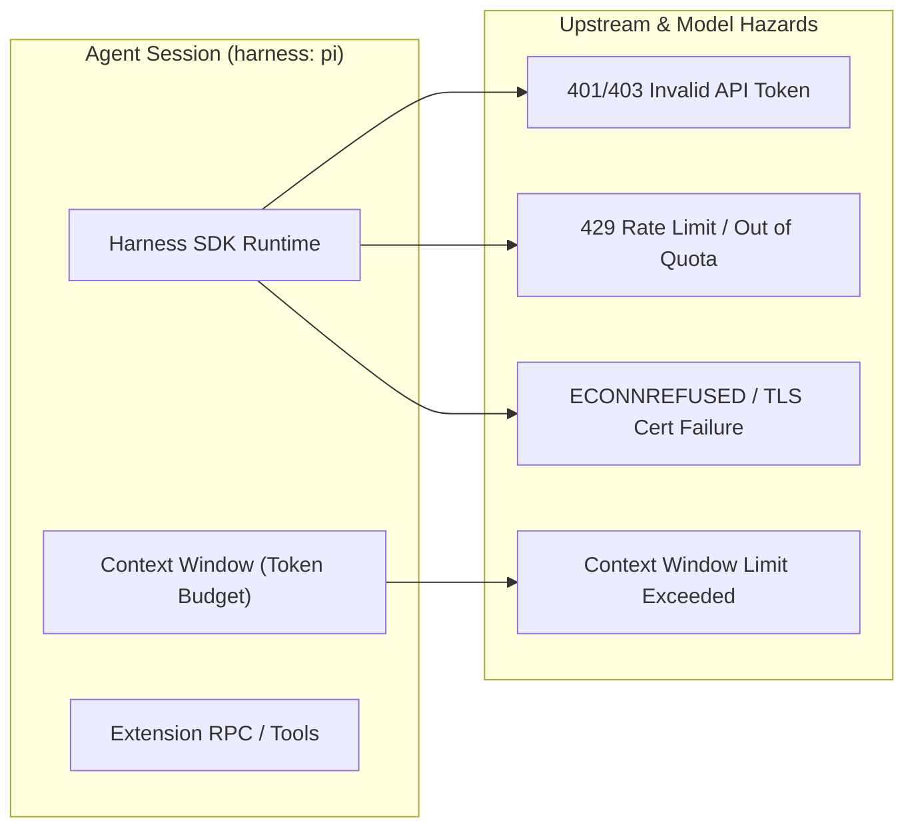
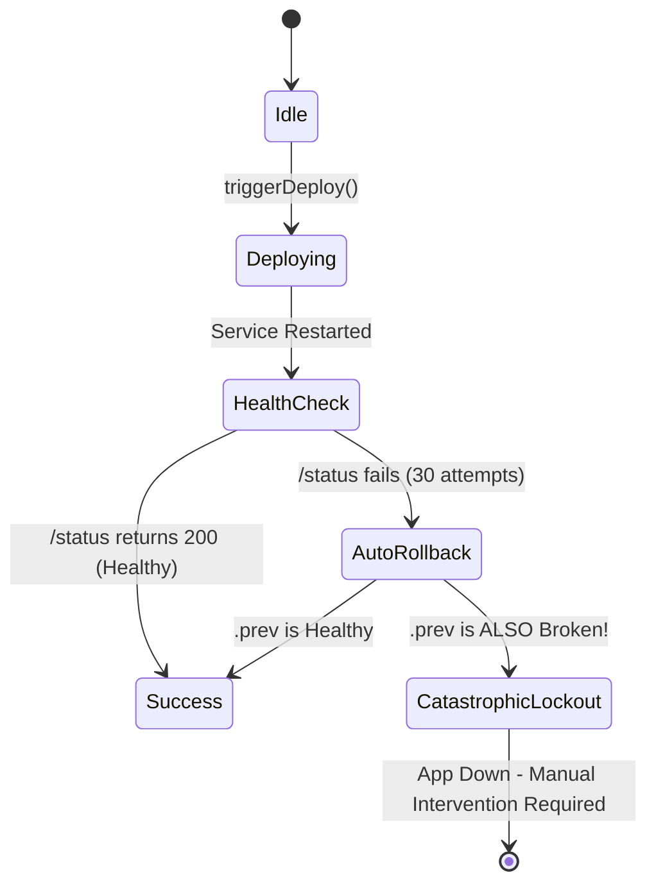
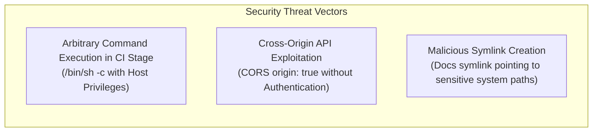
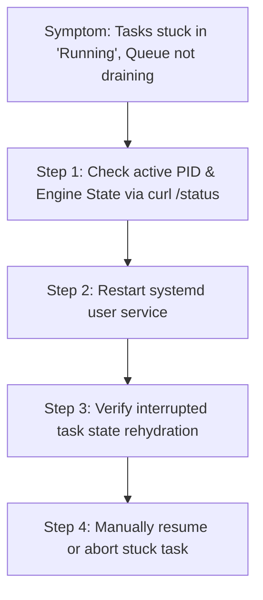
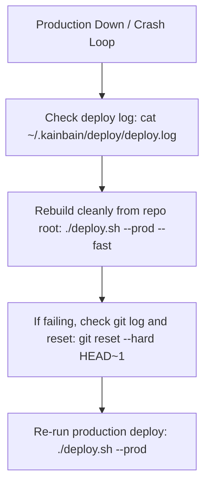

# KainBain — Disaster Model Plan & Failure Mode Analysis

> **Document Version:** 1.0.0  
> **Last Updated:** 2026-08-23  
> **Status:** Active Reference & Runbook  
> **Scope:** Comprehensive disaster analysis, failure mode catalog, hazard mitigation strategies, and disaster recovery (DR) runbooks for the KainBain AI task orchestrator ecosystem.

---

## 1. Executive Summary & Threat Classification

KainBain is a **local-first, server-authoritative AI task orchestrator** operating across a multi-component environment: a Node.js/Fastify backend (`api/`), a React/Vite web UI (`frontend/`), an embedded Pi Agent SDK runtime (`@earendil-works/pi-coding-agent`, default harness), local compute/LiteLLM endpoints, a self-referential deployment engine (`deploy.sh`), and the local filesystem backed by SilverBullet notes (`~/apps/notes/silverbullet/space/...`) and Forgejo Git repositories (`forgejo.local`).

Because KainBain is **autonomous, self-deploying, and directly executes shell commands and AI agent tool invocations against the host operating system**, systemic failures can cascade across the development environment.



### Threat & Failure Severity Matrix

| Level | Severity | Impact Description | Primary Triggers | Recovery Objective |
| :--- | :--- | :--- | :--- | :--- |
| **L1** | **Catastrophic** | Data loss on host, destructive agent filesystem operations, unauthenticated remote code execution via CI stages, host resource starvation. | Malicious/hallucinated agent tool actions, unsanitized CI script execution (`/bin/sh -c`), infinite file report proliferation filling storage. | **RTO < 10m / RPO = 0** (Immediate kill switch, FS restore from snapshot). |
| **L2** | **Critical** | Engine freeze, complete pipeline stall, poisoned self-deploy rollback loop, locked execution queues, corrupted `project.json` or `task.md`. | Poisoned `.prev` build backup, execution queue deadlock, unhandled crash during file write, cyclic task blocking (`blockedBy` deadlock). | **RTO < 5m** (Service restart, queue flush, state repair). |
| **L3** | **Major** | Agent execution failure, model unreachable, context window overflow, WebSocket storm, slow disk I/O from bloated logs. | LiteLLM outage, TLS cert expiry, missing agent timeout causing indefinite socket hold, `task.processLogs` memory bloat. | **RTO < 15m** (Model failover, log truncation, stage failback). |
| **L4** | **Moderate** | UI out-of-sync, temporary toast spam, benign lint/scan failure during fast deploy, cosmetic metric glitch. | Client network reconnect lag, non-fatal security scan exit code, stale cache in `HealthChecker`. | Self-healing on reconnect or page refresh. |

---

## 2. Architectural Threat Surface & Failure Domains



> **Harness boundary:** the engine does not talk to the agent SDK directly.
> Every session, model lookup, and history read flows through the
> `AgentHarness` contract in `api/agent/harnessContract.js` — pi is the
> default harness implementation (`api/agent/harnesses/pi/piHarness.js`), but
> any future harness that satisfies the contract slots in unchanged. Harnesses
> report their own identity metadata (`name`/`label`); engine log prose (e.g.
> the session-init message) is composed from that metadata, never hard-coded
> to a vendor name.

---

## 3. Detailed Failure Modes & Disaster Scenarios

### Domain 1: Orchestration Engine & Autonomous Scheduling Failures

```mermaid
sequenceDiagram
    autonumber
    actor User as Operator / Scheduler
    participant TS as TaskStore
    participant EQ as ExecutionQueue
    participant AR as AgentRunner
    participant LLM as LiteLLM / Provider

    User->>TS: scheduleTick() / executeStage()
    TS->>EQ: enqueue(executeTaskAction)
    EQ->>AR: agentRunner(curatedPrompt)
    AR->>LLM: session.prompt() [No Hard Timeout!]
    Note over LLM: Connection Drops or Provider Hangs Forever
    Note over EQ: ExecutionQueue is BLOCKED indefinitely
    Note over TS: Entire scheduler stalls; all projects queued behind it
```

#### 1.1 Missing Agent Execution Hard-Timeout (Queue Deadlock)
* **Vulnerability Source:** `api/agentRunner.js` (lines 227-238) and `api/taskStore.js` (lines 1861-1868).
* **Failure Mechanism:** While CI stages enforce a configurable timeout (`stage.timeout || 60000`), agent execution via `session.prompt()` relies entirely on the upstream model socket. If LiteLLM or an upstream LLM provider hangs without emitting chunks or terminating the HTTP/2 stream, `agentRunner` awaits indefinitely.
* **Impact (Severity: L2):** Because `ExecutionQueue` processes tasks serially (`this.active = true`), a single hung agent stage blocks all subsequent stages across **all** projects. The scheduler cannot pick up new tasks.
* **Mitigation / Guardrail:** Wrap `session.prompt()` in `Promise.race()` with an explicit `stage.timeout` (defaulting to 300 seconds), throwing an `AgentTimeoutError` and classifying the failure for auto-failback.

#### 1.2 Dependency Cycle Deadlock in `blockedBy`
* **Vulnerability Source:** `api/taskStore.js` (lines 899-924) (`isTaskBlocked`).
* **Failure Mechanism:** If Task A is set to `blockedBy: ["Task-B"]` and Task B is set to `blockedBy: ["Task-A"]` (or a larger transitive cycle `A -> B -> C -> A`), both tasks are perpetually skipped by `findNextCandidateTask()`.
* **Impact (Severity: L3):** Tasks remain stuck in `in_stage` forever with no error logged, consuming queue slots without executing.
* **Mitigation / Guardrail:** Add cycle detection (Depth-First Search with visited set) when creating or updating `blockedBy` dependencies; reject cyclic relationships with HTTP 400.

#### 1.3 Rapid-Tick Double Dispatch Race Condition
* **Vulnerability Source:** `api/taskStore.js` (lines 2596-2618) (`scheduleTick`), `onIdleTimer`, and stage completion callbacks.
* **Failure Mechanism:** `scheduleTick` checks `if (this.executionQueue.isRunning || this.engineState.status === "running") return null;`. However, between `findNextCandidateTask()` discovering a candidate and `executeStage()` enqueuing the action into `ExecutionQueue`, multiple asynchronous microtasks (e.g. from `setInterval` + `onIdleTimer`) can fire concurrently, evaluating `isRunning` as `false` before `_drain()` sets `active = true`.
* **Impact (Severity: L2):** Duplicate concurrent dispatches of the same task, causing conflicting file operations and corrupted stage history.
* **Mitigation / Guardrail:** Implement an atomic lock flag (`this.isDispatching = true`) in `scheduleTick` before candidate resolution, releasing it only after enqueueing.

---

### Domain 2: Data Persistence, Filesystem & Concurrency Hazards



#### 2.1 Unlocked Concurrent Writes to `task.md` & `project.json`
* **Vulnerability Source:** `api/taskStore.js` (lines 376-435) (`_saveTaskMarkdown`) and `api/projectStore.js` (lines 240-299) (`_saveProjectFile`).
* **Failure Mechanism:** Both methods use direct synchronous `fs.writeFileSync()` without file locking (`flock`) or write-to-temp-then-rename atomic patterns. If an API request (e.g. user editing title) occurs simultaneously with an agent streaming progress logs or a stage completing, race conditions can cause half-written files, zero-byte files, or overwritten updates.
* **Impact (Severity: L2):** Task metadata loss, corruption of stage transition timelines, and parser failures during subsequent server scans.
* **Mitigation / Guardrail:** Adopt atomic write patterns (`write to <file>.tmp`, then `fs.renameSync`) and in-process mutexes keyed by file path.

#### 2.2 Unbounded `task.processLogs` Memory and Disk Bloat
* **Vulnerability Source:** `api/taskStore.js` (lines 1850-1858) (`task.processLogs = ...\n${chunk}`).
* **Failure Mechanism:** Every stdout chunk, tool call argument, and agent token is concatenated directly to `task.processLogs`. In complex multi-stage tasks or tasks with repetitive tool loops, `task.processLogs` grows to tens of megabytes. Because `task.md` is re-parsed via regex and re-saved to disk on every state mutation, CPU time and memory allocation skyrocket.
* **Impact (Severity: L3):** Event loop blocking, excessive memory consumption, and slow WebSocket payloads when client requests task lists.
* **Mitigation / Guardrail:** Implement log rotation/truncation capping in-memory logs (e.g. keeping only the last 100KB or 1,000 lines), while streaming full raw logs to a dedicated append-only `.log` file in the task directory.

#### 2.3 Symlink Invalidation & SilverBullet Note Collisions
* **Vulnerability Source:** `api/projectStore.js` (lines 537-553) and `deploy.sh` (line 349).
* **Failure Mechanism:** Projects create a symlink `docs -> ~/apps/notes/silverbullet/space/Projects/Personal/<name>`. If the SilverBullet directory structure is reorganized, permissions change, or if a project is cloned on another machine where paths differ, the symlink becomes broken (dangling).
* **Impact (Severity: L3):** Task reports cannot be written, `_saveTaskMarkdown` silently fails (caught by non-blocking catch block), and task state remains only in volatile memory, disappearing on restart.
* **Mitigation / Guardrail:** Add periodic health checks verifying that `docs/` is a valid, writable directory, emitting a visible warning in the UI if dangling.

---

### Domain 3: Compute, Model Runtime & Upstream Provider Disasters



#### 3.1 Self-Signed TLS & CA Certificate Trust Failure
* **Vulnerability Source:** `api/index.js` (lines 10-16).
* **Failure Mechanism:** The backend sets `process.env.NODE_EXTRA_CA_CERTS = "~/certs/ca/ca.crt"`. If the CA certificate expires, is rotated, or permissions restrict reading, Node's `fetch` fails with `UNABLE_TO_VERIFY_LEAF_SIGNATURE` or `unable to get local issuer certificate`.
* **Impact (Severity: L3):** Complete inability to communicate with `https://litellm.local`, blocking all agent execution across all projects.
* **Mitigation / Guardrail:** `HealthChecker` checks LiteLLM liveliness and reports TLS status. Fallback should alert operator immediately via system log.

#### 3.2 Context Window Exhaustion & Compaction Failures
* **Vulnerability Source:** `api/sessionStore.js` (lines 234-237) (`setAutoCompactionEnabled(true)`).
* **Failure Mechanism:** While automatic compaction is enabled, if a task generates immense tool outputs (e.g. `cat` of large files or deep directory dumps) in a single turn, the context size can exceed the model's physical window before compaction is triggered.
* **Impact (Severity: L3):** Model returns `context_length_exceeded` error; task immediately fails.
* **Mitigation / Guardrail:** Ensure tool execution outputs are clamped at source (e.g. max 50KB per tool return) before appending to LLM message history.

#### 3.3 Zombie Agent (Harness) Subprocesses
* **Vulnerability Source:** `api/sessionStore.js` (lines 309-325) (`dispose`).
* **Failure Mechanism:** When sessions are disposed due to TTL timeout (`startCleanup`), `entry.session.dispose()` is invoked. If the underlying harness SDK (any harness, pi today) has spawned background RPC processes or LSP workers that fail to exit cleanly, orphan processes accumulate in the background.
* **Impact (Severity: L3):** System-wide memory and process descriptor exhaustion over prolonged server uptime.
* **Mitigation / Guardrail:** Enforce child process tracking and send explicit `SIGKILL` to tracked process trees on session disposal.

---

### Domain 4: Deployment & Self-Updating Pipeline Disasters



#### 4.1 The Poisoned Rollback Loop (Consecutive Broken Deploys)
* **Vulnerability Source:** `deploy.sh` (lines 358-367) and `deploy.sh` (lines 198-223) (`do_rollback`).
* **Failure Mechanism:**
  1. Build N is deployed and passes health check (returns HTTP 200 on `/status`), but contains a critical runtime bug that manifests only on task execution.
  2. Build N+1 is deployed with a syntax error that fails health check.
  3. `deploy.sh` auto-rolls back to `~/apps/kainbain.prev` (which is Build N).
  4. Now Build N is running again (with the critical runtime bug), and `kainbain.prev` is overwritten during any subsequent attempt!
* **Impact (Severity: L2):** Production service is locked in a degraded or malfunctioning state with no earlier "known-good" backup to fall back to.
* **Mitigation / Guardrail:** Maintain a multi-version backup archive (e.g. keeping the last 3 verified builds in `~/.kainbain/deploy/releases/build-<id>`) rather than a single `.prev` overwrite.

#### 4.2 Port Conflict & Orphan Process Port Holding
* **Vulnerability Source:** `deploy.sh` (line 183) (`fuser -k ${PROD_API_PORT}/tcp`).
* **Failure Mechanism:** If a user runs a manual test instance on port `3100` with another UID or background process holding the port without systemd managing it, `fuser` may fail to kill the process (if permissions differ), or systemd unit restart may fail with `EADDRINUSE`.
* **Impact (Severity: L2):** Service fails to bind to port, triggering health-check timeout and failed rollback loop.
* **Mitigation / Guardrail:** Systemd service unit should enforce `StandardOutput=journal` and `KillMode=mixed` to guarantee all child processes on the port are reaped before the new binary binds.

#### 4.3 Lock File Abandonment (`deploy.lock`)
* **Vulnerability Source:** `deploy.sh` (lines 270-275) and `api/deployManager.js` (lines 187-195).
* **Failure Mechanism:** `deploy.sh` uses Linux kernel `flock` (file descriptor 9) with a 600s timeout. However, in `DeployManager`, `this.running = true` is set in memory. If the API process is killed mid-deploy, upon restart `DeployManager` reinitializes with `this.running = false`. If a background detached `deploy.sh` is still running and holding `deploy.lock`, a new deploy trigger will wait up to 600 seconds or fail.
* **Impact (Severity: L3):** Deploy operations return "Another deployment is already in progress" until timeout expires.
* **Mitigation / Guardrail:** Inspect the actual PID from `state.json` using `kill -0 <pid>` before rejecting deploy requests.

---

### Domain 5: Security, Boundary & Network Disaster Scenarios



#### 5.1 Arbitrary Command Execution via CI Stages
* **Vulnerability Source:** `api/taskStore.js` (lines 1656-1660).
* **Failure Mechanism:** `stageType === "ci"` executes `spawn("/bin/sh", ["-c", command], { cwd: execCwd, env: sanitizedEnv })`. Because `command` can be defined in `.kainbain/project.json` or manipulated via API endpoints, arbitrary shell commands run under the `server` user account with full local privileges.
* **Impact (Severity: L1):** Accidental or malicious command injection (e.g. `rm -rf /` or credential theft from `~/.ssh` or `~/.secobserve_key`).
* **Mitigation / Guardrail:** Restrict execution directories, run commands within isolated sandbox environments or containers, and sanitize environment variables.

#### 5.2 Unauthenticated Local API & WebSocket Exposure
* **Vulnerability Source:** `api/index.js` (lines 155-160) (`fastifyCors: origin: true`).
* **Failure Mechanism:** The Fastify API does not enforce token-based authentication on REST routes (`/projects`, `/tasks`, `/deploy`) or WebSocket `/ws`. If a user opens a malicious website in their browser, malicious client-side JavaScript on that site can make cross-origin requests to `http://localhost:3100` or `https://kainbain.local` (CSRF / drive-by execution).
* **Impact (Severity: L1/L2):** Unauthorized triggering of self-deploys, task creation, project deletion, or file content extraction.
* **Mitigation / Guardrail:** Restrict CORS `origin` to trusted domains (`https://kainbain.local`, `http://localhost:5173`) and implement a shared secret or bearer token header for API endpoints.

---

## 4. Disaster Recovery (DR) Runbooks

### Runbook 1: Total Engine Freeze / Execution Queue Deadlock



#### Procedure:
1. **Identify the Stuck Task & Engine State:**
   ```bash
   curl -s http://localhost:3100/status/observability | jq '.engineState, .activeTask'
   ```
2. **Force-Restart the Backend Service:**
   ```bash
   systemctl --user restart kainbain.service
   ```
3. **Verify Rehydration & State Recovery:**
   Inspect task state in the project directory:
   ```bash
   # Status will automatically transition from 'running_agent' to 'interrupted'
   cat ~/projects/<project-slug>/docs/tasks/<task-id>/task.md | grep -E '^status:'
   ```
4. **Resume or Retry the Interrupted Stage via API or UI:**
   ```bash
   curl -X POST http://localhost:3100/tasks/<task-id>/resume \
     -H "Content-Type: application/json" \
     -d '{"projectId":"<project-id>"}'
   ```

---

### Runbook 2: Corrupted Task or Project Metadata Recovery

#### Symptoms:
* Fastify fails to scan project on startup with JSON parse error.
* Task is invisible on the Kanban board due to broken frontmatter in `task.md`.

#### Procedure:
1. **Locate Corrupted Frontmatter:**
   ```bash
   head -n 25 ~/projects/<project-slug>/docs/tasks/<task-id>/task.md
   ```
2. **Restore Valid Frontmatter Template:**
   Edit the file and ensure valid YAML between delimiters:
   ```yaml
   ---
   id: "<task-id>"
   projectId: "<project-id>"
   workflowId: "wf-default"
   title: "Restored Task Title"
   status: "in_stage"
   currentStageId: "1"
   createdAt: "2026-08-23T12:00:00.000Z"
   updatedAt: "2026-08-23T12:00:00.000Z"
   enteredStageAt: "2026-08-23T12:00:00.000Z"
   timeInStage: 0
   outputReport: ""
   feedback: ""
   blockedBy: "[]"
   ---
   ```
3. **Trigger Task Scan:**
   Refresh browser or restart service. `TaskStore.scanTasks()` will rehydrate the task cleanly.

---

### Runbook 3: Failed Self-Deploy & Broken `.prev` Manual Recovery

#### Symptoms:
* Production URL `https://kainbain.local` returns 502 Bad Gateway.
* `systemctl --user status kainbain.service` shows crash loop.
* Auto-rollback to `.prev` failed or `.prev` is also corrupted.



#### Procedure:
1. **Inspect Deploy Failure Log:**
   ```bash
   tail -n 100 ~/.kainbain/deploy/deploy.log
   ```
2. **Check Systemd Journal:**
   ```bash
   journalctl --user -u kainbain.service -n 50 --no-pager
   ```
3. **Perform Emergency Clean Rebuild from Source Repository:**
   ```bash
   cd ~/projects/kainbain
   # Clean any lingering temporary directories or node build artifacts
   rm -rf frontend/dist stage*
   # Execute full production build and service restart
   ./deploy.sh --prod
   ```
4. **If Source Repo is Broken, Rollback Git Commit:**
   ```bash
   cd ~/projects/kainbain
   git log -n 5 --oneline
   git checkout <last-known-good-commit>
   ./deploy.sh --prod --fast
   ```

---

### Runbook 4: LiteLLM Outage & Model Failover

#### Symptoms:
* Health light in UI shows RED (`LiteLLM unreachable`).
* Agent stages fail with `[Model Connection Error]`.

#### Procedure:
1. **Verify LiteLLM Status & Certificate:**
   ```bash
   curl -k https://litellm.local/health/liveliness
   curl -I http://localhost:4000/health/liveliness
   ```
2. **If TLS Certificate Expired, Check CA Trust:**
   ```bash
   ls -la ~/certs/ca/ca.crt
   openssl x509 -in ~/certs/ca/ca.crt -noout -dates
   ```
3. **Switch Project to Fallback Model:**
   Update `.kainbain/project.json` or use the UI Settings to set `defaultModel`:
   ```bash
   # Fallback to local Ollama or alternative cloud endpoint
   curl -X PATCH http://localhost:3100/projects/<project-id> \
     -H "Content-Type: application/json" \
     -d '{"defaultModel":"deepseek-v4-flash:0731-cloud"}'
   ```

---

## 5. Active Architectural Guardrails & Resilience Status

The highest-severity disaster vectors have been remediated with active architectural guardrails:

| Guardrail | Status | Implementation Details | Target Failure Mode Eliminated |
| :--- | :--- | :--- | :--- |
| **Agent Execution Hard Timeout** | ✅ **Active** | `api/agentRunner.js` wraps `session.prompt()` in `Promise.race()` enforcing `stage.timeout` (default: 300s). | Prevents hung LLM HTTP/2 sockets from locking the serial `ExecutionQueue` (L2 Deadlock). |
| **Atomic File Operations** | ✅ **Active** | `api/taskStore.js` and `api/projectStore.js` write to unique `.tmp` files before atomic `fs.renameSync()`. | Eliminates file truncation and corruption during concurrent writes on `task.md` & `project.json`. |
| **Log Truncation & Bloat Prevention** | ✅ **Active** | `_appendProcessLog()` caps `task.processLogs` in memory and disk, keeping `task.md` lightweight. | Eliminates regex parse lag, memory spikes, and slow WebSocket payload transfer. |
| **Dependency Cycle Detection** | ✅ **Active** | `isTaskBlocked()` in `api/taskStore.js` executes DFS cycle detection over `blockedBy` chains. | Prevents silent deadlock loops where tasks wait on each other infinitely. |
| **Multi-Version Release Archive** | ✅ **Active** | `deploy.sh` archives the last 5 successful builds in `~/.kainbain/deploy/releases/build-<id>`. | Eliminates the single-point-of-failure in `.prev` and prevents poisoned rollback loops. |
| **CORS Origin Hardening** | ✅ **Active** | `api/index.js` restricts CORS origins to `localhost`, `127.0.0.1`, `*.home`, and RFC1918 private subnets. | Blocks arbitrary public websites from triggering background task/deploy actions (CSRF/RCE). |

---

tags: #aiAuthored #lastUpdated/2026-08-23 #kainbain #disaster-recovery #architecture #reliability #runbook
