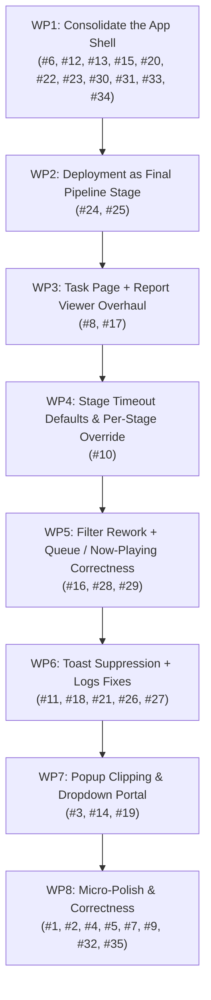

# Phase 2 — Attempt 8 Implementation Plan: UX Consolidation, Deployment-as-Stage & Report Overhaul

> **Status:** Proposed / Actionable 🚀
> **Milestone:** KainBain Phase 2 "Everything Works Perfectly" (Attempt 8)
> **Source Feedback:** [`AttemptSeven/Feedback.md`](../AttemptSeven/Feedback.md) (35-item dogfooding critique)
> **Core Architectural Tenets (unchanged):**
>
> - *"Make the change easy, then make the change"* (Kent Beck). Big structural changes land **first** so later small fixes build on a stable shell.
> - **Server-Authoritative**: backend owns persistence, routing, validation, and the execution model.
> - **Filesystem-Backed Source of Truth**: task metadata/history/reports under `<projectRoot>/docs/tasks/<taskId>/`.
> - **Reachability > Green Tests**: a suite that passes while a feature is unreachable proves nothing.
> - **Zero Live AI Tokens in automated tests**.
> - **JSDoc Standards** (`/*** MARK: funcName ... ***/` with `@description`, `@example`).
> - **WCAG 2.2 AAA / DESIGN_SPEC.md adherence.**

---

## 1. Executive Summary

Attempt 7 delivered a *usable* build — the first one the user called usable — but the dogfooding
critique lists 35 items that keep it from feeling *positive*. Reading them, they cluster into a
few root causes rather than 35 independent bugs:

1. **The app shell is too busy.** Three header bands, a redundant vertical tab bar, a "Monitor"
   tab that duplicates a top-right popout, a legacy stage-management cog, useless counters, and a
   "production build" button all compete for attention. The fix is a **single consolidated header**
   and a **persistent top-right monitor affordance** — a structural reshape that everything else
   sits on.
2. **Deployment is in the wrong place.** It lives in Settings as a manual panel, but the user
   wants it to be **the final stage of the pipeline** (`./deploy.sh --prod`), not a settings
   feature. This is an architectural change to the stage model.
3. **The task inspector is overloaded.** Reports are hard to read with multiple reports, and the
   user wants to open a task in its **own page** to focus on elaborating it. This is a routing +
   report-viewer overhaul.
4. **A pile of small, well-scoped defects** (failed tags not clearing, logs clear/copy broken,
   autoscroll not following, toasts on every stage move, popup clipping, missing sliding animation,
   vibrating sizing, wrong filter labels, queue showing human/done tasks, etc.).

The plan follows *make the change easy, then make the change*: **WP1–WP3 reshape the shell and the
pipeline model first** (header/monitor, deployment-as-stage, task-page + report viewer). **WP4–WP8**
then layer the smaller fixes on top of that stable foundation.

---

## 2. Feedback-to-Work-Package Traceability Matrix (All 35 Items)

| # | Feedback Item | Root Cause (verified) | Target WP |
| --- | --------------- | ---------------------- | ----------- |
| 1 | Failed tags don't disappear after success | `TaskCard` derives `isFailed` from `task.status === 'failed'`; a task that fails then is retried/advanced keeps stale `failureReason`/`lastError` on the object. | **WP8** |
| 2 | Reports "agent stage complete" then still doing stuff | `STAGE_COMPLETE` is emitted in `advanceStage` *before* the next stage's `process:start`; the console shows "complete" then more logs. Ordering/UX of the completion signal. | **WP8** |
| 3 | A lot of clipping of Popup boxes | `SelectDropdown` renders its listbox `absolute` inside the trigger's `relative` container; any `overflow-hidden`/`overflow-y-auto` ancestor (stage column, inspector, analytics bar) clips it. | **WP7** |
| 4 | Things don't move across the board if page is not focused | HTML5 drag-and-drop requires the page to be focused; no pointer-based fallback. | **WP8** |
| 5 | Slow to load some elements | Model lists fetched per-component on mount (WorkflowCanvas, StageSettingsTray, ProjectSettings) with no shared cache; repeated `/compute/models` calls. | **WP8** |
| 6 | Observability screen needs condensing to one monitor | Dashboard has a tall header + footer + scrollable grid; needs a compact single-screen layout. | **WP1** |
| 7 | Sliding animation when things move between columns | `animate-stage-transition` exists but only animates on mount; no FLIP/transition on cross-column move. | **WP8** |
| 8 | Open a task in its own page | Inspector is a slide-over; no dedicated task route/page for focused elaboration. | **WP3** |
| 9 | Still a little bit of things "vibrating" with sizing | Layout shifts from late-loading content / unstable flex widths; needs stable sizing tokens. | **WP8** |
| 10 | Stage timeout default ~half hour + per-stage override | `config.agentTimeoutMs` default is 300000 (5 min); CI default 60000. No per-stage override surfaced in UI. | **WP4** |
| 11 | Autoscroll on logs should take you to most recent | `useWebSocket`/console autoscroll only fires on `messages/toolCalls/processLogs` length change; doesn't force scroll to bottom on open. | **WP6** |
| 12 | Monitor shouldn't be a tab; stay top right; lose vertical tab bar | `TabNavigator` has a `observability` tab; the header already has a popout button. Redundant. | **WP1** |
| 13 | Analytics fights with its own popup | Stage analytics toolbar is a separate header band that collides with dropdowns/popups. | **WP1** |
| 14 | Some popups in stage columns are cut off | Same root cause as #3 (overflow clipping). | **WP7** |
| 15 | Useless numbers on tab navigation bar | `TabNavigator` shows a task counter + keyboard hints on every tab. | **WP1** |
| 16 | "all, active, needs review" toggle → "All, Failed, human only" | Filter pills use wrong labels/semantics; "Human only" should hide agent/CI steps. | **WP5** |
| 17 | Report viewer needs major overhaul | Reports tab is a cramped single-pane with a horizontal chip selector; hard to read multiple reports. | **WP3** |
| 18 | Don't need a toast every time something moves stages | `saveStages`/`advanceTask`/`moveTask` fire success toasts on every transition. | **WP6** |
| 19 | More drop downs clashing with their popups | Same root cause as #3/#14 (clipping). | **WP7** |
| 20 | 3 header bands → collapse to 1 (2 if needed) | `Header` + `TabNavigator` + `WorkflowCanvas` top bar = 3 stacked bands. | **WP1** |
| 21 | Logs keeps randomly opening itself | `showActivityDrawer` default `!== false` and `hasActivity` gating re-opens the console on new activity. | **WP6** |
| 22 | "kainbain orchestrator" title can be collapsed/removed | Brand block in `Header` is large; can be compacted. | **WP1** |
| 23 | Production build is a button → subtle indicator | `BuildBadge` is a clickable button that navigates to Settings; should be a passive indicator. | **WP1** |
| 24 | Remove deployment from settings | `ProjectSettings` has a `deploy` section + `DeployPanel`. | **WP2** |
| 25 | Deployment should be final pipeline stage (`./deploy.sh --prod`) | Deployment is a manual settings panel, not a pipeline stage. | **WP2** |
| 26 | Clear logs doesn't work | `clearLogs` clears `processLogs` but the console also renders `messages`/`toolCalls` which aren't cleared. | **WP6** |
| 27 | Copy logs doesn't work | `handleCopyLogs` only copies `filteredProcessLogs`, not messages/toolCalls; clipboard may fail silently. | **WP6** |
| 28 | Shouldn't scroll forward in now playing if no task queued | `lookForward`/`skipCurrent` enabled even when no next task exists. | **WP5** |
| 29 | Queue in observability includes human review + done tasks | `getScheduledQueue` includes `waiting_human` and doesn't exclude done tasks cleanly. | **WP5** |
| 30 | Stage management cog can be removed (legacy) | Header gear + `StageSettingsTray` are a legacy full-height drawer; stage config now lives in-column. | **WP1** |
| 31 | Analytics integrated into stages, not another header bar | `showStageAnalytics` renders a separate toolbar band. | **WP1** |
| 32 | Only show Forgejo links if project has upstream repo | `Header` always renders the Forgejo link from a hardcoded slug; no check for an actual remote. | **WP8** |
| 33 | Add task button looks awkward, stretch to fill space | In-column "+ Add Task" is a small dashed button. | **WP1** |
| 34 | "5 stages • 5 in flight • 1 completed" can be removed | `WorkflowCanvas` top bar shows this summary line. | **WP1** |
| 35 | Stage prompt should also have keyword functionality | Stage prompt textarea lacks the keyword-token picker that the task inspector has. | **WP8** |

---

## 3. Sequential Work Packages

Each WP is independently completable by an agent with **zero context beyond that WP** (steps are
done in order, but each is self-contained and verifiable). Every WP ends with its own Definition of
Done and test/verification requirements.

---

### Work Package 1: Consolidate the App Shell
**Assigned Subagent Role:** Frontend Layout & UX Specialist
**Critiques Resolved:** #6, #12, #13, #15, #20, #22, #23, #30, #31, #33, #34
**Principle:** *Make the change easy (collapse the shell into one stable band), then make the change (remove redundant chrome).*

#### Context (verified in current source)
- `App.jsx` renders `Header` (h-16) → `TabNavigator` (a second band) → `<main>` containing `WorkflowCanvas` (which has its **own** top action bar) → `NowPlayingBar`. That is **three stacked header bands** plus a bottom bar.
- `TabNavigator` has 4 tabs including `observability` ("Monitor"), each with a task counter + keyboard hint.
- `Header` has: brand block, project pill, workflow pill, Forgejo link, `BuildBadge` (a clickable button), a "Monitor" popout button, `SystemMenu`, and a legacy **Stage Management gear** (`setIsSettingsOpen` → `StageSettingsTray`).
- `WorkflowCanvas` top bar shows the "Pipeline Workspace" heading + the `{stages.length} stages • {activeCount} in flight • {completedCount} completed` summary line (#34), plus a separate **Stage Analytics** toggle that renders a second toolbar band (#31).
- `ObservabilityDashboard` has a tall header + footer + scrollable grid (#6).

#### Objectives & Implementation Details
1. **Collapse to a single header band.** Merge `TabNavigator` into `Header` (or render it as a compact inline row inside the header). Remove the `observability` tab entirely — the header's existing "Monitor" popout button is the monitor affordance (#12). Remove the per-tab task counter and keyboard-hint numbers (#15). Keep only: brand (compact), project pill, workflow pill, search (moved up), and the right-side controls.
2. **Remove the legacy Stage Management gear + `StageSettingsTray`** (#30). Stage configuration already lives in-column (the expandable per-column settings drawer in `WorkflowCanvas`). Delete the gear button from `Header`, stop rendering `StageSettingsTray` in `OrchestratorView`, and remove the `setIsSettingsOpen`/`isSettingsOpen` wiring that only the tray consumed. Keep the "⚙️ Manage Workflows" menuitem working (it should open the workflow switcher, not the tray).
3. **Integrate analytics into the stage columns, not a separate band** (#31). Remove the `showStageAnalytics` toolbar band from `WorkflowCanvas`. Instead, surface per-stage throughput/pass-rate/duration as a compact footer strip inside each stage column (or a small inline chip in the stage header). Keep the `computeStageAnalytics` logic; just relocate its rendering.
4. **Remove the "Pipeline Workspace" summary line** (#34) and the redundant heading. The stage columns already show their own counts.
5. **Make the Add Task button fill its column** (#33): change the in-column "+ Add Task" trigger from a small dashed button to a full-width, full-height dashed drop-zone that stretches to fill the empty space in the column.
6. **Make `BuildBadge` a passive indicator, not a button** (#23): render it as a non-interactive badge (no `onClick`, no navigation to Settings). Keep it subtle.
7. **Compact the brand block** (#22): shrink the "KAINBAIN ORCHESTRATOR" title to a small icon + short label, or collapse it to just the "K" mark on narrow widths.
8. **Condense `ObservabilityDashboard` to one monitor** (#6): reduce the header to a single slim row, remove the redundant footer ticker (or fold it into the grid), and make the widget grid fit without vertical scroll on a 1080p screen. Keep the fullscreen/kiosk affordance.

#### Definition of Done (WP1)
- [ ] Exactly **one** header band renders at the top of the app (no stacked `TabNavigator` band, no separate analytics band).
- [ ] The `observability` tab is gone; the monitor is reachable only via the top-right popout button.
- [ ] No legacy Stage Management gear / `StageSettingsTray` anywhere; stage config is in-column only.
- [ ] Stage analytics render inside stage columns, not as a separate toolbar.
- [ ] The "N stages • N in flight • N completed" summary line is removed.
- [ ] Add Task button fills its column's empty space.
- [ ] `BuildBadge` is a passive indicator (no click navigation).
- [ ] Observability dashboard fits one 1080p monitor without vertical scroll.
- [ ] All suites still green: `test:api`, `test:frontend`, `test:canary`, `test:visual`, `lint`.

---

### Work Package 2: Deployment as Final Pipeline Stage
**Assigned Subagent Role:** Backend Pipeline & Deployment Specialist
**Critiques Resolved:** #24, #25
**Principle:** *Make the change easy (add a `deploy` stage type + a deploy runner), then make the change (wire it as the final pipeline stage and remove the settings panel).*

#### Context (verified in current source)
- `DeployManager` already spawns `./deploy.sh --prod` (or `--fast`) detached, reads disk-backed status/history, and supports rollback. The plumbing to run a deploy exists.
- Deployment is currently exposed only as a manual `DeployPanel` inside `ProjectSettings` (a `deploy` settings section).
- Stage types are exactly three: `agent`, `human`, `ci` (`STAGE_TYPES` in `frontend/src/components/stageTypes.js` and `api/projectStore.js`). There is **no** `deploy` stage type.
- `taskStore.executeStage` dispatches by `stageType`: `human` → checkpoint, `ci`/`script` → bash command, `agent` → agent runner.

#### Objectives & Implementation Details
1. **Add a `deploy` stage type** to the authoritative stage model (both `api/projectStore.js` `normalizeStageType`/`STAGE_TYPES` and `frontend/src/components/stageTypes.js`). It is a deterministic, non-checkpoint stage like `ci`, but its command is the deploy script.
2. **Add a deploy runner path in `taskStore.executeStage`**: when `stageType === 'deploy'`, run `./deploy.sh --prod` (or a per-stage `command` override) via the existing `execRunner`/`DeployManager` mechanism, capture stdout/stderr, write a markdown report, and advance on exit 0. Reuse the `DeployManager` for status/history so the UI can still show deploy health.
3. **Make the final stage of the default pipeline a `deploy` stage** (e.g. after "Review Plan" / verification). The user's intent: *"the final stage of the kainbain pipeline to be `./deploy.sh --prod` which must be able to gently redeploy kainbain without issue."* The default workflow's last stage becomes a `deploy` stage whose command is `./deploy.sh --prod`.
4. **Remove deployment from Settings** (#24): delete the `deploy` section from `ProjectSettings` and stop rendering `DeployPanel` there. Deployment is now a pipeline stage only.
5. **Keep a read-only deploy status indicator** somewhere non-intrusive (e.g. the compact `BuildBadge` already shows the live build number; optionally surface deploy health there). No manual trigger buttons in Settings.
6. **Ensure the deploy stage is "gentle"**: the deploy script already has flock locking, `.prev` backup, health-gate auto-rollback. Verify a `deploy` stage that fails triggers the normal failback routing (not a hard crash).

#### Definition of Done (WP2)
- [ ] A `deploy` stage type exists in both frontend and backend stage models.
- [ ] `taskStore.executeStage` handles `deploy` stages by running `./deploy.sh --prod` and advancing on exit 0.
- [ ] The default pipeline's final stage is a `deploy` stage.
- [ ] `DeployPanel` and the `deploy` settings section are removed from `ProjectSettings`.
- [ ] A failed deploy stage routes through normal failback (no crash).
- [ ] Unit tests cover the `deploy` stage dispatch (mocked runner, zero live deploys in tests).
- [ ] All suites still green.

---

### Work Package 3: Task Page + Report Viewer Overhaul
**Assigned Subagent Role:** Frontend Routing & Report-Viewer Specialist
**Critiques Resolved:** #8, #17
**Principle:** *Make the change easy (add a dedicated task route + a reusable report viewer), then make the change (open tasks in their own page and rebuild the reports tab).*

#### Context (verified in current source)
- `TaskDetailOverlay` is a slide-over inspector with 4 tabs (Details / Logs / Reports / History). The Reports tab is a single cramped pane with a horizontal chip selector for multiple reports (#17).
- `KainBainContext` already parses `#/tasks/<id>` from the URL and sets `selectedTask`; there is a partial deep-link mechanism but no dedicated full-page task view.
- `getTaskReports` (backend) returns deduplicated reports with `{ path, filename, content, timestamp }`.

#### Objectives & Implementation Details
1. **Add a dedicated task page/route** (#8): a full-page view (not a slide-over) reachable at `#/tasks/<id>` (and via a "Open in own page" button in the inspector). It reuses the same task data but lays out the Details/Logs/Reports/History content in a spacious, focused layout so the user can elaborate one task without the board. Include a "back to board" affordance and a shareable link.
2. **Build a reusable `ReportViewer` component** that both the task page and the inspector's Reports tab use. It should support:
   - A **sidebar list** of all reports (filename + timestamp) instead of a cramped horizontal chip row.
   - A **main reading pane** with the selected report's markdown, full-width, scrollable.
   - **Previous/next** navigation between reports.
   - Copy-path and Open-in-SilverBullet actions.
3. **Fix the "can't see reports for every stage" visual bug** (#17): ensure the report list is populated from `getTaskReports` for **all** stages (not just the latest), and that the count badge reflects the true number. Verify the backend `getTaskReports`/`_syncTaskReports` returns every stage's report file.
4. **Keep the inspector's Reports tab** but swap its internals to the new `ReportViewer` so both surfaces share one implementation.

#### Definition of Done (WP3)
- [ ] A full-page task view exists at `#/tasks/<id>` with a "back to board" link and shareable URL.
- [ ] A reusable `ReportViewer` component renders a sidebar list + main reading pane + prev/next navigation.
- [ ] The inspector's Reports tab uses `ReportViewer`.
- [ ] Reports for **every** stage are listed (not just the latest), and the count is accurate.
- [ ] Unit tests cover `ReportViewer` (list, selection, prev/next) and the task-page route.
- [ ] All suites still green.

---

### Work Package 4: Stage Timeout Defaults & Per-Stage Override
**Assigned Subagent Role:** Backend Config & Stage-Config Specialist
**Critiques Resolved:** #10
**Principle:** *Make the change easy (centralize timeout resolution), then make the change (default ~30 min, allow per-stage override).*

#### Context (verified in current source)
- `api/config.js`: `agentTimeoutMs` default is **300000 (5 min)**; `ciTimeoutMs` default is **60000 (1 min)**.
- `taskStore.executeStage` uses `stage.timeout ? Number(stage.timeout) : config.ciTimeoutMs` for CI, and `stage.timeout ? Number(stage.timeout) : undefined` for agent (falls back to the agent runner's own default).
- The stage settings UI (in-column drawer + `StageSettingsTray`) has a "Timeout (ms)" field **only for `ci` stages**, not for `agent` stages.

#### Objectives & Implementation Details
1. **Raise the default agent timeout to ~30 minutes** (`agentTimeoutMs` → `30 * 60 * 1000`). Keep it env-overridable (`KAINBAIN_AGENT_TIMEOUT_MS`).
2. **Add a per-stage timeout override for `agent` stages** in the stage settings UI (in-column drawer), mirroring the existing CI timeout field. Persist it as `stage.timeout` (ms).
3. **Centralize timeout resolution** in `taskStore.executeStage`: a single helper that resolves `stage.timeout` → else `config.agentTimeoutMs` (for agent) / `config.ciTimeoutMs` (for CI) / a sensible default for `deploy`. Pass the resolved value to the agent runner and exec runner consistently.
4. **Surface the effective timeout** in the stage header/settings so the user sees what will apply.

#### Definition of Done (WP4)
- [ ] Default agent timeout is ~30 minutes (env-overridable).
- [ ] Agent stages expose a per-stage timeout override in the in-column settings.
- [ ] Timeout resolution is centralized and consistent across agent/CI/deploy.
- [ ] Unit tests assert the resolved timeout for agent/CI/deploy with and without a per-stage override.
- [ ] All suites still green.

---

### Work Package 5: Filter Rework + Queue / Now-Playing Correctness
**Assigned Subagent Role:** Frontend Filter & Queue Specialist
**Critiques Resolved:** #16, #28, #29
**Principle:** *Make the change easy (define the correct filter semantics + queue contract), then make the change (wire them).*

#### Context (verified in current source)
- `WorkflowCanvas` filter pills are `all` / `active` / `review` ("All", "Active", "Needs Review"). The user wants **"All, Failed, Human only"** where "Human only" hides agent/CI steps (#16).
- `NowPlayingBar` `lookForward`/`skipCurrent` are enabled based on stage index, not on whether a **next task** is queued (#28).
- `taskStore.getScheduledQueue` includes `waiting_human` tasks and does not cleanly exclude done tasks from the observability queue (#29).

#### Objectives & Implementation Details
1. **Rework the filter pills** (#16): replace `all/active/review` with `all` / `failed` / `human`. Semantics:
   - `all` — every task in the active workflow.
   - `failed` — only tasks with `status === 'failed'` or a `failureReason`.
   - `human` — only tasks currently at a human checkpoint stage (hides agent/CI steps).
   Update the `filteredTasks` memo in `WorkflowCanvas` accordingly.
2. **Fix Now-Playing forward/skip gating** (#28): `lookForward` and `skipCurrent` should be disabled when there is no next task queued (i.e. no task in a later stage, or no task at all). Compute a `hasNextTask` flag from the active workflow's tasks and gate the buttons on it.
3. **Fix the observability queue** (#29): `getScheduledQueue` should **exclude** `waiting_human` tasks (they are not something the system is scheduling to do) and **exclude** completed/failed tasks from the "about to do" list. The queue should show only what the scheduler will actually dispatch next. Update `QueueOrderWidget`/`ObservabilityDashboard` to reflect this (the queue is the system's schedule, not a human-review backlog).

#### Definition of Done (WP5)
- [ ] Filter pills are `All` / `Failed` / `Human only`, with correct semantics.
- [ ] `lookForward`/`skipCurrent` are disabled when no next task is queued.
- [ ] The observability queue excludes human-review and done tasks; it shows only what the system will schedule.
- [ ] Unit tests cover the new filter semantics and the queue exclusion rules.
- [ ] All suites still green.

---

### Work Package 6: Toast Suppression + Logs Fixes
**Assigned Subagent Role:** Frontend Notifications & Console Specialist
**Critiques Resolved:** #11, #18, #21, #26, #27
**Principle:** *Make the change easy (centralize log copy/clear + toast policy), then make the change (wire them).*

#### Context (verified in current source)
- `useWorkflow.saveStages` fires a success toast on every save; `advanceTask`/`moveTask`/`executeTaskStage` fire toasts on every transition (#18).
- `WorkflowCanvas` console: `clearLogs` clears only `processLogs`, but the console also renders `messages` and `toolCalls` which are not cleared (#26). `handleCopyLogs` copies only `filteredProcessLogs`, not messages/toolCalls (#27).
- `showActivityDrawer` defaults to `!== false` and `hasActivity` gating re-opens the console on new activity (#21).
- Autoscroll only fires on `messages/toolCalls/processLogs` length change; it doesn't force scroll-to-bottom on open (#11).

#### Objectives & Implementation Details
1. **Suppress transition toasts** (#18): remove the success toasts from `saveStages`, `advanceTask`, `moveTask`, `executeTaskStage`, and stage reorder. Keep toasts only for user-initiated, meaningful actions (task dispatch, deploy, errors). Use the existing `isNoisyNotification` filter as a guide.
2. **Fix Clear Logs** (#26): make `clearLogs` clear `processLogs` **and** `messages` **and** `toolCalls` together (add a combined clear in `useWebSocket` or call all three setters).
3. **Fix Copy Logs** (#27): `handleCopyLogs` should assemble a combined text from `filteredProcessLogs` + `messages` + `toolCalls`, and use a robust clipboard fallback (try `navigator.clipboard`, fall back to a hidden textarea + `document.execCommand('copy')`). Show clear success/failure feedback.
4. **Stop logs randomly opening** (#21): change `showActivityDrawer` default to **closed** (or persist the user's last choice), and do not force it open when new activity arrives. Only open on explicit user action.
5. **Fix autoscroll-to-bottom** (#11): when autoscroll is on, force `scrollTop = scrollHeight` on every new log/message/tool AND when the console is opened/expanded, so it always lands on the most recent log.

#### Definition of Done (WP6)
- [ ] No success toast on every stage move/save; toasts reserved for meaningful actions.
- [ ] Clear Logs clears processLogs + messages + toolCalls.
- [ ] Copy Logs copies the full combined stream with a working clipboard fallback.
- [ ] The activity console does not auto-open on new activity; it respects the user's open/closed choice.
- [ ] Autoscroll always lands on the most recent log when enabled.
- [ ] Unit tests cover the combined clear/copy and the autoscroll behavior.
- [ ] All suites still green.

---

### Work Package 7: Popup Clipping & Dropdown Portal
**Assigned Subagent Role:** Frontend Component Specialist
**Critiques Resolved:** #3, #14, #19
**Principle:** *Make the change easy (render dropdowns in a portal), then make the change (fix every clipped popup).*

#### Context (verified in current source)
- `SelectDropdown` renders its listbox `absolute left-0 top-full` inside the trigger's `relative` container. Any ancestor with `overflow-hidden` / `overflow-y-auto` (stage columns, the inspector, the analytics bar, the settings drawer) **clips** the open listbox. This is the root cause of #3, #14, #19.

#### Objectives & Implementation Details
1. **Render the `SelectDropdown` listbox in a React portal** (e.g. `createPortal` to `document.body`) so it escapes all `overflow` ancestors. Position it relative to the trigger's bounding rect (compute `top`/`left`/`width` from `getBoundingClientRect()`), and flip to open upward when near the viewport bottom. Keep the existing keyboard/ARIA behavior.
2. **Audit every dropdown/popup** that can be clipped (stage column settings, inspector stage selector, analytics, settings drawer, workflow switcher) and route them through the portal-based `SelectDropdown` (or a shared `Popover` primitive).
3. **Add a regression test** that renders a `SelectDropdown` inside an `overflow-hidden` container and asserts the listbox is still fully visible (not clipped).

#### Definition of Done (WP7)
- [ ] `SelectDropdown` listboxes render in a portal and are never clipped by `overflow` ancestors.
- [ ] All dropdowns/popups in stage columns, inspector, analytics, and settings are unclipped.
- [ ] A regression test proves a dropdown inside `overflow-hidden` is fully visible.
- [ ] All suites still green.

---

### Work Package 8: Micro-Polish & Correctness
**Assigned Subagent Role:** Frontend/Backend Polish Specialist
**Critiques Resolved:** #1, #2, #4, #5, #7, #9, #32, #35
**Principle:** *Make the change easy (small, isolated fixes), then make the change (each verified).*

#### Context (verified in current source)
- #1: `TaskCard` derives `isFailed` from `task.status === 'failed'`; a retried/advanced task keeps stale `failureReason`/`lastError`.
- #2: `STAGE_COMPLETE` is emitted in `advanceStage` before the next stage's `process:start`, so the console shows "complete" then more logs.
- #4: HTML5 drag-and-drop requires page focus; no pointer fallback.
- #5: Model lists fetched per-component on mount (WorkflowCanvas, StageSettingsTray, ProjectSettings) with no shared cache.
- #7: `animate-stage-transition` only animates on mount; no FLIP/transition on cross-column move.
- #9: Layout shifts from late-loading content / unstable flex widths.
- #32: `Header` always renders the Forgejo link from a hardcoded slug; no check for an actual remote.
- #35: Stage prompt textarea lacks the keyword-token picker the task inspector has.

#### Objectives & Implementation Details
1. **Failed tags disappear after success** (#1): when a task transitions out of `failed` (retry/advance/move), clear `failureReason`/`lastError` on the task object (backend `taskStore` on `executeStage`/`advanceStage`/`moveToStage`), so `TaskCard` no longer shows the stale FAILED tag.
2. **Fix the "complete then still doing stuff" signal** (#2): reorder the completion UX so the console does not show "stage complete" while the next stage is still starting. Either (a) emit `STAGE_COMPLETE` only after the next stage's `process:start` has fired, or (b) relabel the completion log to "Stage X complete — advancing to Y" so it reads as a transition, not a final state. Prefer (b) for minimal disruption.
3. **Pointer-based drag fallback** (#4): add a pointer/mouse-based move fallback (e.g. a "Move to stage" menu already exists on cards; ensure it works without page focus, and/or add pointer-event drag that doesn't require focus).
4. **Shared model cache** (#5): add a small module-level cache (or a context hook) for `/compute/models` so WorkflowCanvas, StageSettingsTray, and ProjectSettings share one fetch instead of three.
5. **Sliding animation on cross-column move** (#7): implement a FLIP (First-Last-Invert-Play) transition so a task card animates from its old column to its new column when moved, instead of only animating on mount.
6. **Stable sizing / no vibration** (#9): audit flex widths and late-loading content; give columns/panels stable min/max widths and reserve space for late-loading elements (e.g. model names) so nothing shifts after mount.
7. **Forgejo link only when upstream repo exists** (#32): add a backend field `hasUpstreamRepo` (detect a real `origin` remote via `git remote get-url origin` in `projectStore`), and render the Forgejo link in `Header` only when true.
8. **Stage prompt keyword functionality** (#35): add the keyword-token picker (the `{{project}}`, `{{taskDocs}}`, `{{previousReports}}`, etc. chips from the task inspector) to the stage prompt textarea in the in-column settings, so stage prompts can use the same dynamic tokens.

#### Definition of Done (WP8)
- [ ] A task that fails then is retried/advanced no longer shows a stale FAILED tag.
- [ ] The console's completion signal reads as a transition, not a premature final state.
- [ ] Tasks can be moved between columns without requiring page focus (pointer fallback).
- [ ] Model lists are fetched once and shared (no per-component refetch).
- [ ] Cross-column task moves animate with a sliding transition.
- [ ] No layout vibration from late-loading content.
- [ ] Forgejo links render only for projects with an actual upstream remote.
- [ ] Stage prompts support the keyword-token picker.
- [ ] All suites still green.

---

## 4. Definition of Done (Attempt 8 Exit Criteria)

Attempt 8 is complete when:

- [ ] The app shell is a **single header band** (no stacked tab bar, no separate analytics band, no legacy stage-management cog).
- [ ] The monitor is reachable only via the top-right popout; the `observability` tab is gone.
- [ ] Deployment is the **final pipeline stage** (`./deploy.sh --prod`), not a Settings panel.
- [ ] Tasks can be opened in their **own page**; the report viewer is a sidebar + reading pane showing **every** stage's report.
- [ ] Stage timeouts default to ~30 min with a per-stage override.
- [ ] Filter pills are **All / Failed / Human only**; the observability queue shows only what the system will schedule.
- [ ] No toast on every stage move; Clear/Copy logs work; autoscroll lands on the most recent log; the console doesn't auto-open.
- [ ] No popup clipping anywhere (dropdowns render in a portal).
- [ ] Failed tags clear on success; cross-column moves animate; Forgejo links only when an upstream repo exists; stage prompts support keywords.
- [ ] **All** suites still green: `test:api`, `test:frontend`, `test:canary`, `test:visual`, `lint` 0 errors.

---

## 5. Verification Strategy (match scope to requirement)

- **Static**: `npm run lint` (0 errors) + the existing endpoint-route audit test.
- **Unit**: colocated tests for each changed hook/component (filter semantics, queue exclusion, combined clear/copy, portal dropdown, timeout resolution, deploy dispatch, report viewer, task-page route).
- **Canary (E2E)**: drive the live backend asserting the *reachable* flows — single header, no monitor tab, deploy-as-stage, task page, unclipped dropdowns, working clear/copy.
- **Manual smoke (documented)**: the checklist in §4 doubles as the acceptance walkthrough.
