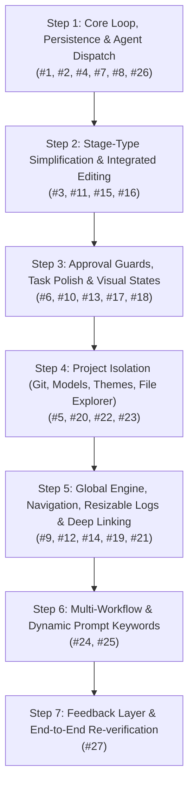

# Phase 2 — Attempt 5 Implementation Plan: Functionality Correction & Dogfood Hardening

> **Status:** Approved / Actionable 🚀
> **Target:** KainBain Phase 2 "Dogfood-Ready" Milestone (post Attempt 4)
> **Source Critiques:** [`AttemptFour/Attempt4Critique.md`](../AttemptFour/Attempt4Critique.md) (the 27-item functional review)
> **Core References:**
>
> - `KB Code Standards.md` (colocated tests, `/*** MARK:` JSDoc with `@description` and `@example`, no live AI in tests, DDD, locality of code)
> - `KB Architecture.md` (server-authoritative, filesystem-backed, no in-memory source of truth)
> - `KB Local Integration details.md` (per-project Forgejo git repos on `forgejo.local`, `~/projects/<name>` layout, SilverBullet symlinks)
> - `UI/DESIGN_SPEC.md` (Now Playing bar 72px, Kanban 280px columns, role-based chromatics, JetBrains Mono)
> - `Phase2/Phase2Scope.md` (dogfood-ready goals)
> - `AttemptFour/Plan.md` + `AttemptFour/ProgressReport.md` (Attempt 4 deliverables audit)

---

## 1. Executive Summary & Scope Discipline

Attempt 4 delivered a **feature-complete, test-green** orchestrator (109 API + 144 frontend unit tests, 38 Playwright canary, lint clean). However, manual dogfooding identified 27 concrete behavioral, visual, and architectural issues ([`Attempt4Critique.md`](../AttemptFour/Attempt4Critique.md)). 

Attempt 5 is a **functionality-hardening and stabilization pass**. It makes the orchestrator truly usable for real-world dogfooding by fixing core execution loops, persisting all task metadata to the project's filesystem docs space, simplifying stage models, and delivering robust global execution observability.

### Core Architectural Guardrails:
1. **Server-Authoritative**: All mutation logic, execution decisions, routing, and persistence live in the API. The frontend reflects server state and guards against double dispatch.
2. **Filesystem-Backed Source of Truth**: All task metadata, history, status, and reports are written to disk at `<projectRoot>/docs/tasks/<taskId>/` (symlinked to SilverBullet at `~/apps/notes/silverbullet/space/Projects/Personal/<projectName>`). In-memory maps serve only as write-through caches rehydrated on startup via `scanTasks()`.
3. **Discrete Tasks with Global Serialization**: Tasks execute discretely per stage. The AI agent execution runner serializes agent invocations globally across projects to match single-agent concurrency constraints while maintaining strict per-project working directory and repository isolation.
4. **Colocated, Black-Box Testing (Zero Live AI Tokens)**: Unit tests live adjacent to their source files (`*.test.js`/`*.test.jsx`), avoid testing log strings, mock AI runtime interactions, and run fast.
5. **JSDoc Standards**: Every changed/added function starts with `/*** MARK: funcName ... ***/` and includes `@description` and `@example` tags.

---

## 2. Critique-to-Resolution Traceability Matrix

Every item from [`Attempt4Critique.md`](../AttemptFour/Attempt4Critique.md) is mapped directly to a sequential execution step below.

| # | Critique (Attempt 4) | Root Cause | Target Step | Resolution Summary |
|---|----------------------|------------|-------------|---------------------|
| 1 | **Creating a task creates two tasks** | Duplicate event handlers in frontend + no backend idempotency lock | **Step 1** | Unify frontend creation into a single authoritative dispatch; add backend deduplication and request token / in-flight lock to `POST /tasks`. |
| 2 | **Tasks stored in kainbain space, not project docs space** | `saveStageReport` fell back to `process.cwd()`; project `cwd` not enforced | **Step 1** | Require `projectCwd` across all task store operations; write strictly to `<projectRoot>/docs/tasks/<taskId>/`. |
| 3 | **Stage management is a side panel; should be integrated** | `StageSettingsTray` rendered as a detached slide `<Modal>` | **Step 2** | Integrate stage editing directly into the workspace page (integrated settings pane / inline column configuration). |
| 4 | **Agent never kicks off; zero logs; no code changes** | `executeStage` for `agent`/`review` only set status `in_stage` and returned without invoking agent session | **Step 1** | Wire `AgentRunner` into `executeStage`: curates prompt, invokes session `prompt()`/`steer()`, streams real `process:*` events, saves report, advances stage. |
| 5 | **Each project should have its own git repo separate to kainbain** | `createProject` made directories but did not initialize git or remotes | **Step 4** | Run `git init`, create `.gitignore`, and provision/link Forgejo remote on `forgejo.local` during project creation per `KB Local Integration details.md`. |
| 6 | **Approve button doesn't fade → accidental double approve skips step** | Approve action had no in-flight/disabled state and backend had no state validation | **Step 3** | Add immediate `isAdvancing` disabled state on UI button; return `409 Conflict` in backend if task is not in `waiting_human` state. |
| 7 | **Reports don't appear on screen** | Reports fetched from wrong base dir and not reloaded on task inspector open | **Step 1** | Read reports directly from project's `docs/tasks/<taskId>/` via API; trigger auto-refresh when opening inspector. |
| 8 | **Tasks should save task details as markdown in task folder too** | Only stage reports were saved; task goal/prompt/history were in-memory only | **Step 1** | Write/update `<projectRoot>/docs/tasks/<taskId>/task.md` on create/update/advance/complete; implement startup rehydration. |
| 9 | **Skip forward/back should be replaced with 4 distinct buttons** | `skip_previous`/`skip_next` directly mutated active stage instead of navigating view | **Step 5** | Implement 4 transport controls: *Look Back* (view previous stage), *Look Forward* (view next stage), *Skip Current* (mutate/advance active stage), *Jump to Active* (focus executing stage). |
| 10 | **Approve/reject at top of human section is unnecessary** | Redundant approve/reject buttons rendered in column header and card | **Step 3** | Remove header-level duplicate controls; keep single authoritative checkpoint banner on card/inspector. |
| 11 | **CI/script stage types can be merged** | `ci` and `script` duplicate identical bash execution logic | **Step 2** | Merge `script` into `ci`; migrate existing configs. |
| 12 | **Now Playing and logs should be global (agent serializes across projects)** | Now Playing and logs were scoped strictly to active project | **Step 5** | Lift engine status and live activity feed to a global scope; serialize agent runs via backend mutex/queue. |
| 13 | **Visual inconsistencies in task keys** | Discrepant ID formatting across card, inspector, and headers | **Step 3** | Standardize task keys everywhere (e.g. `#KB-XXXX` or `#<8-char>` JetBrains Mono, consistent role-based colors). |
| 14 | **Link to specific tasks via query params / hash routing** | No deep-linking mechanism | **Step 5** | Add `#/task/<id>` or `?task=<id>` URL routing; open task on page load; maintain server authority. |
| 15 | **Review and human stage types can be merged** | `review` and `human` duplicate checkpoint logic | **Step 2** | Merge `review` into `human` (retaining optional review criteria prompt); migrate configs. |
| 16 | **Custom stage type can be removed** | `custom` stage type added unnecessary complexity | **Step 2** | Remove `custom` stage type; restrict system to `agent`, `human`, `ci`. |
| 17 | **Pause stage should cause visual change in UI** | `stage.paused` did not render distinct visual state | **Step 3** | Render distinct paused banner, dimmed header, pause badge, and disabled advance for paused stages. |
| 18 | **Tasks shouldn't say "just now"; always show real time** | Fallback string `'Just now'` masked timestamp | **Step 3** | Always render formatted absolute + elapsed timestamp (e.g., `10:42 AM (4m ago)`). |
| 19 | **Live logs should be resizable, not just collapsible** | Console only supported binary open/close | **Step 5** | Add draggable vertical resize handle; persist height to `UiPreferences`. |
| 20 | **Document viewer for project repo (folder/file explorer)** | No in-app file/doc explorer | **Step 4** | Add secure `GET /projects/:id/files` API with path traversal guards + read-only `ProjectExplorer` tab in frontend. |
| 21 | **Active task in Now Playing should switch to paused when paused** | Now Playing badge did not reflect pause state | **Step 5** | Update Now Playing status badge to dynamically show `RUNNING`, `PAUSED`, `CHECKPOINT`, or `IDLE`. |
| 22 | **AI models should be dynamic from Pi + per-project default model** | Static fallback model list; no project-level default | **Step 4** | Dynamically query Pi Agent `models.json` / LiteLLM; add `defaultModel` to project settings; support stage overrides. |
| 23 | **Each project should set custom color/theme** | Global theme only | **Step 4** | Add project `accentColor`/theme field; inject as CSS custom properties when project is active. |
| 24 | **Multiple workflows for the same project** | Project schema assumed single 1:1 stage list | **Step 6** | Support named workflows array (`workflows: [{ id, name, isDefault, stages }]`) in `.kainbain/project.json`. |
| 25 | **Dynamic prompt keywords in stage prompts** | Prompts lacked runtime context replacement | **Step 6** | Add runtime template keywords in `PromptCurationEngine`: `{{project}}`, `{{projectRepo}}`, `{{taskGoal}}`, `{{taskRepo}}`, `{{latestReport:<stage>}}`, `{{taskDocs}}`. |
| 26 | **Hundreds of WebSocket errors in UI** | Reconnect loop lacked backoff/jitter and logged every failure | **Step 1** | Implement capped exponential backoff with jitter (0.5s–10s); collapse errors into single UI status badge; quiet expected closes. |
| 27 | **Even more feedback would be nice** | Insufficient status and progress indications | **Step 7** | Add accessible `aria-live` notification toasts for lifecycle transitions, stage countdown timers, and inline action spinners. |

---

## 3. Chunked Execution Roadmap (Steps 1 – 7)

Execution must be strictly sequential. Each step is a self-contained, reviewable unit of work that must leave all unit tests green, lint passing, and the application buildable.



---

### Step 1: Core Loop, Task Persistence & Real Agent Dispatch
**Purpose:** Fix the fundamental broken loops (#1, #4), correct task/report persistence to the project space (#2, #7, #8), and silence WebSocket errors (#26).

#### 1.1 Double Task Creation Fix (#1)
- **Backend**: Add an in-flight deduplication guard in `api/routes/tasks.js` and `TaskStore.createTask`. Support optional client-supplied `idempotencyKey` or debounce window so rapid duplicate requests return the existing task rather than creating a duplicate.
- **Frontend**: Clean up submission paths. In `KainBainContext.jsx` and `WorkflowCanvas.jsx`, ensure inline `+ Add Task` and modal submission do not trigger overlapping dispatches. Ensure forms use `e.preventDefault()` and button click handlers do not double-invoke submit.
- **Tests**: Colocated unit tests in `api/routes/tasks.test.js` and `api/taskStore.test.js` verifying that identical rapid task creations return a single entity.

#### 1.2 Filesystem-Backed Task Persistence & Startup Rehydration (#2, #8)
- **Task Markdown Writer**: In `api/taskStore.js`, implement `_saveTaskMarkdown(projectCwd, task)`. Whenever a task is created, updated, advanced, failed back, or completed, write `<projectRoot>/docs/tasks/<taskId>/task.md` with YAML frontmatter / Markdown sections:
  ```markdown
  ---
  id: "task-uuid"
  projectId: "project-uuid"
  title: "Implement Auth Flow"
  status: "in_stage"
  currentStageId: "2"
  createdAt: "2026-08-19T09:00:00.000Z"
  updatedAt: "2026-08-19T09:15:00.000Z"
  ---
  # Goal
  Implement JWT authentication for API endpoints.

  # History
  - 2026-08-19T09:00:00.000Z: Created and placed in stage 'Idea'
  - 2026-08-19T09:15:00.000Z: Advanced to stage 'Technical Elab'
  ```
  Stage labels in `# History` and `# Timeline` are human-readable stage names, quoted; stage ids may appear in pre-change entries (read-only legacy, never rewritten).
- **Project Base Directory Enforcement**: Require `projectCwd` in all task operations. If omitted, resolve it via `projectStore.getProject(projectId).cwd`. Never fall back to `process.cwd()`.
- **Disk Rehydration (`scanTasks`)**: Implement `taskStore.scanTasks(projectId, projectCwd)`. On API startup or project load, scan `<projectRoot>/docs/tasks/` to rehydrate tasks from `task.md` into the memory cache.
- **Report Discoverability (#7)**: Ensure `GET /tasks/:id/reports` reads from `<projectRoot>/docs/tasks/<taskId>/` and serves full content for the Task Inspector Reports tab.

#### 1.3 Real Agent Dispatch in `executeStage` (#4)
- **AgentRunner Interface**: In `api/taskStore.js` and `api/routes/tasks.js`, connect `executeStage` to an `agentRunner` function:
  1. Sets task status to `running_agent`.
  2. Resolves stage prompt via `promptEngine.curatePrompt(task, stage)`.
  3. Dispatches to session (`session.prompt(finalPrompt)`).
  4. Pipes streaming text chunks to `bridge.emitProcessEvent(projectId, 'process:stdout', { taskId, chunk })`.
  5. On completion, writes `<projectRoot>/docs/tasks/<taskId>/<stageSlug>-<timestamp>.md` with the agent output.
  6. Emits `stage:complete` and automatically calls `advanceStage(projectId, taskId, stages)`.
- **Mocked Testing**: Mock the `agentRunner` in `api/taskStore.test.js` to assert full lifecycle: `executeStage -> running_agent -> stream chunks -> save report -> advanceStage`.

#### 1.4 WebSocket Reconnection Stabilization (#26)
- In `frontend/src/context/useWebSocket.js`, implement exponential backoff with jitter (initial 500ms, max 10s).
- Add single UI connection state banner (`connected`, `reconnecting`, `disconnected`) rather than console error flooding. Suppress logging for normal/expected disconnections.

#### Step 1 Exit Criteria:
- `npm run test:api` and `npm run test:frontend` all green.
- Creating a task creates exactly 1 task on disk at `<projectRoot>/docs/tasks/<taskId>/task.md`.
- Completing an agent stage writes a markdown report under `<projectRoot>/docs/tasks/<taskId>/` and auto-advances.
- Task Inspector displays real reports from disk.
- WebSocket reconnects quietly without console error spam.

---

### Step 2: Simplify Stage Types & Integrate Stage Editing
**Purpose:** Eliminate unnecessary stage complexity (#11, #15, #16) and convert the stage settings side modal into an integrated in-page interface (#3).

#### 2.1 Collapse to 3 Core Stage Types (#11, #15, #16)
- Collapse stage types into exactly **three**:
  1. `agent`: Automated AI execution (System Prompt + Model override).
  2. `human`: Checkpoint requiring human review (Optional criteria prompt + Approve/Reject with feedback). Absorbs `review`.
  3. `ci`: Automated bash verification command (Command + Timeout). Absorbs `script`.
- Remove `custom` stage type and free-form type input entirely.
- Update `frontend/src/components/stageTypes.js`, `STAGE_TYPES`, `isCheckpoint`, and default stage templates in `api/projectStore.js`.
- Add legacy migration logic in `ProjectStore._loadProjectFile` to normalize `review` $\rightarrow$ `human`, `script` $\rightarrow$ `ci`, and `custom` $\rightarrow$ `agent`.

#### 2.2 In-Page Integrated Stage Management (#3)
- Refactor `StageSettingsTray.jsx` from a detached slide-over `<Modal>` into an **integrated in-page panel**:
  - Option A: Slide-over settings drawer that leaves the Kanban board interactive and visible.
  - Option B: Inline expandable configuration directly within the Stage Column header or dedicated "Workflow Editor" view.
- Ensure all stage configuration inputs (name, type, prompt/command, model, pause toggle, fallback target) operate smoothly within the integrated panel.

#### Step 2 Exit Criteria:
- Only `agent`, `human`, `ci` types appear in UI and schema.
- Legacy project files load and normalize without errors.
- Stage settings can be modified in-page without a blocking modal.
- Colocated unit tests in `frontend/src/components/StageSettingsTray.test.jsx` and `api/projectStore.test.js` pass.

---

### Step 3: Approval Guards, Task Interaction & Visual Polish
**Purpose:** Prevent accidental stage skips (#6, #10), standardize task keys (#13), fix paused stage visuals (#17), and format real timestamps (#18).

#### 3.1 Checkpoint Approval & Skip Guards (#6, #10)
- **Frontend Guard**: In `TaskCard.jsx` and `TaskDetailOverlay.jsx`, add an immediate `isAdvancing` local state to Approve/Reject buttons. Disable the button and display a loading spinner upon click until the server responds.
- **Backend Validation**: In `api/routes/tasks.js`, enforce that `POST /tasks/:id/advance` returns `409 Conflict` if the task is not in a valid stage state or is currently processing.
- **Remove Redundant Controls (#10)**: Remove duplicate Approve/Reject buttons from Kanban column headers; retain single authoritative checkpoint controls on task cards and the task inspector.

#### 3.2 Standardized Task Key Display (#13)
- Display task identifiers consistently across all components (`TaskCard`, `TaskDetailOverlay`, `NowPlayingBar`):
  - Format: `#KB-` prefix followed by first 4 characters of UUID in uppercase (e.g. `#KB-73C4`), or 8-char mono ID.
  - Typography: JetBrains Mono (`font-mono`), consistent subtle role-based accent color.

#### 3.3 Visual States for Paused Stages (#17)
- When `stage.paused === true`:
  - Render a distinct amber/ochre "PAUSED" badge in the column header.
  - Mute column cards with a subtle overlay.
  - Disable automated advance into or out of the stage with a clear tooltip: "Stage is paused".

#### 3.4 Real Timestamp Rendering (#18)
- Replace all hardcoded `'Just now'` fallbacks in `TaskCard` and `TaskDetailOverlay` with standard relative + absolute time formatting (e.g., `formatDistanceToNow` or custom helper: `10:14 AM (2m ago)`).

#### Step 3 Exit Criteria:
- Rapid double-clicking Approve cannot double-advance or skip stages.
- Paused stages are immediately distinguishable visually.
- Task keys and timestamps render consistently across all views.
- Colocated unit tests for `TaskCard`, `TaskDetailOverlay`, and approval endpoints pass.

---

### Step 4: Project Isolation (Git, Models, Theme, File Explorer)
**Purpose:** Give every project its own Git repo (#5), dynamic Pi models with default model (#22), custom theme (#23), and an in-app file/document explorer (#20).

#### 4.1 Per-Project Git Repository Provisioning (#5)
- In `api/projectStore.js` `createProject`:
  1. Execute `git init` within the new project directory.
  2. Create a standard `.gitignore` (ignoring `.kainbain/sessions`, `node_modules`, `.env`).
  3. If Forgejo is configured (`forgejo.local`), attempt to create/link remote repository `https://forgejo.local/ewrdad/<slug>.git` (or local git remote) and store `gitUrl` in `.kainbain/project.json`.
  4. Gracefully fall back to local-only git if the remote service is unreachable.

#### 4.2 Dynamic Model Discovery & Project Default Model (#22)
- In `api/routes/compute.js`, query the local Pi Agent `models.json` / LiteLLM catalog dynamically with cache/refresh.
- Add `defaultModel` field to project configuration in `.kainbain/project.json`.
- In `StageSettingsTray.jsx`, allow stages to select "Inherit project default (`<model>`)" or override with a specific model.

#### 4.3 Per-Project Theme & Chromatics (#23)
- Add `accentColor` (hex code or preset: emerald, sky, amber, violet, rose) to project settings.
- When a project is active, apply the custom accent color to CSS variables (`--project-accent`, `--project-accent-glow`) in `KainBainContext.jsx` while maintaining role-based chromatics for Agent/Human badges per `DESIGN_SPEC.md`.

#### 4.4 In-App Project File & Document Explorer (#20)
- **Backend (`api/routes/files.js`)**:
  - `GET /projects/:id/files?path=<subpath>`: Lists directory entries.
  - `GET /projects/:id/files/content?path=<filepath>`: Reads file content (UTF-8 text/markdown).
  - **Security**: Strict path-traversal validation ensuring resolved paths stay strictly within `<projectRoot>` or `<projectRoot>/docs`. Return `403 Forbidden` if `path.relative(projectCwd, resolvedPath).startsWith('..')`.
- **Frontend (`ProjectExplorer.jsx`)**:
  - Add a "Files / Docs" tab in the main view providing a folder tree and Markdown/code previewer.

#### Step 4 Exit Criteria:
- New projects initialize a clean git repository.
- `GET /compute/models` returns active Pi models; project default model is configurable.
- Switching projects switches UI accent theme.
- In-app file explorer securely lists and reads project files and task reports.
- Colocated tests for `api/routes/files.test.js` and `ProjectExplorer.test.jsx` pass.

---

### Step 5: Global Engine, Navigation, Resizable Logs & Deep Linking
**Purpose:** Global agent serialization (#12), safe navigation transport controls (#9), resizable activity console (#19), deep-linking (#14), and dynamic Now Playing states (#21).

#### 5.1 Global Engine Serialization & Activity Feed (#12, #21)
- **Global Execution Lock**: In backend, implement an `ExecutionQueue` / mutex. Even if tasks from multiple projects are submitted, agent execution is serialized (one active task executing at a time across the server).
- **Global Now Playing**: Now Playing bar renders the globally executing task, active project name, and dynamic state badge (`IDLE`, `RUNNING`, `CHECKPOINT`, `PAUSED`).
- **Global Activity Logs**: Activity console displays events across projects, tagging each event with its project slug (`[Project A] [AGENT] ...`).

#### 5.2 Navigation Transport Controls Redesign (#9)
- Redesign the Now Playing transport section in `NowPlayingBar.jsx` with 4 explicit actions:
  1. `Look Back`: Shifts view focus to the previous stage column without mutating active execution.
  2. `Look Forward`: Shifts view focus to the next stage column without mutating active execution.
  3. `Skip Current`: Mutates active task by advancing it past the current stage.
  4. `Jump to Active`: Resets the view focus back to the currently executing stage.

#### 5.3 Resizable Activity Console (#19)
- In `WorkflowCanvas.jsx`, add a vertical draggable splitter handle above the activity console.
- Allow users to drag-resize console height between 120px and 600px; persist user height preference in `localStorage` via `UiPreferences`.

#### 5.4 Task Deep-Linking (#14)
- Support URL hash/query routing (e.g. `#/projects/:slug/tasks/:taskId` or `?task=<id>`).
- On initial load or URL change, automatically select and open the target task in the Task Inspector.

#### Step 5 Exit Criteria:
- Engine serializes execution globally across projects.
- Navigation transport buttons navigate view without accidentally mutating tasks.
- Activity console is vertically draggable and resizable.
- Direct URL loads and displays the specified task.
- Colocated unit tests for `NowPlayingBar` and routing pass.

---

### Step 6: Multi-Workflow & Dynamic Prompt Keywords
**Purpose:** Support multiple named workflows per project (#24) and dynamic keyword substitution in stage prompts (#25).

#### 6.1 Multiple Named Workflows per Project (#24)
- Update `.kainbain/project.json` schema:
  ```json
  {
    "id": "proj-1",
    "name": "Project A",
    "activeWorkflowId": "wf-default",
    "workflows": [
      {
        "id": "wf-default",
        "name": "Standard Feature Pipeline",
        "isDefault": true,
        "stages": [...]
      },
      {
        "id": "wf-bugfix",
        "name": "Fast Bugfix Pipeline",
        "isDefault": false,
        "stages": [...]
      }
    ]
  }
  ```
- Allow users to create, rename, switch, and delete workflows within `ProjectSettings` / `WorkflowCanvas`.
- Tasks record the `workflowId` they were created under.

#### 6.2 Dynamic Prompt Keyword Interpolation (#25)
- In `PromptCurationEngine.curatePrompt`, support template variables replaced dynamically at stage execution time:
  - `{{project}}`: Project name.
  - `{{projectRepo}}` / `{{taskRepo}}`: Project git repository URL or path.
  - `{{taskGoal}}`: Task goal/title.
  - `{{taskDocs}}`: Absolute or relative path to `<projectRoot>/docs/tasks/<taskId>/`.
  - `{{latestReport:<stageSlug>}}`: Markdown content of the most recent report from `<stageSlug>`.
- Colocated tests in `api/promptCuration.test.js` verifying all keyword replacements and fallback behavior.

#### Step 6 Exit Criteria:
- Projects can hold multiple distinct named workflows.
- Dynamic prompt keywords interpolate correctly at execution time.
- Colocated unit tests for workflow switching and prompt curation pass.

---

### Step 7: Feedback Layer & Full Dogfood Re-verification
**Purpose:** Deliver unified user feedback (#27), run full canary suites, and verify dogfood readiness.

#### 7.1 Unified Accessible Feedback Layer (#27)
- Implement a centralized `NotificationToast` layer in `frontend/src/components/common/Notifications.jsx`.
- Surface clear toasts for: task creation, stage advance, checkpoint rejection, CI pass/fail, and git provisioning status.
- Ensure full WCAG 2.2 AAA accessibility with `role="status"` and `aria-live="polite"`.

#### 7.2 Full Verification Suite
- Run complete test matrix:
  - `npm run test:api`: All backend unit & route tests passing.
  - `npm run test:frontend`: All React unit & component tests passing.
  - `npm run lint`: 0 errors.
  - `npm run test:canary`: Full Playwright E2E suite covering task lifecycle, drag-drop, human checkpoints, file explorer, and mobile responsive views.
- Update `README.md` and `ProjectStatus.md` with final Attempt 5 architecture and usage documentation.

---

## 4. Quality & Execution Standards for Agents

When implementing these steps, all contributing agents must strictly adhere to:

1. **Zero Live AI Tokens in Automated Tests**: All unit, route, and canary tests must mock AI agent interactions (`AgentRunner`, `sessionStore`). Real AI tokens are reserved for manual user dogfooding.
2. **JSDoc Mark Headers**: Every added or updated function must include:
   ```javascript
   /***
    * MARK: functionName
    * @description Plain-English business logic summary.
    * @example functionName(arg1, arg2) => result
    * @param {Type} arg1
    * @returns {Type}
    ***/
   ```
3. **Colocated Black-Box Tests**: Place `*.test.js` / `*.test.jsx` immediately adjacent to the file under test.
4. **Locality of Code**: Avoid sprawling global stores. Keep component-specific state local.
5. **No Regressions**: Run `npm run test:api` and `npm run test:frontend` at the completion of every chunk before proceeding to the next.

---

## 5. Verification Checklist (Definition of Done)

Attempt 5 is complete and dogfood-ready when all the following hold:

- [ ] **1. Task Persistence**: Tasks are saved to `<projectRoot>/docs/tasks/<taskId>/task.md` and rehydrated on startup.
- [ ] **2. Single Task Creation**: One user action creates exactly one task.
- [ ] **3. Real Agent Execution**: Agent stages execute the prompt, stream logs to the UI, generate markdown reports, and auto-advance.
- [ ] **4. Clean 3-Stage Model**: Only `agent`, `human`, `ci` types exist; stage configuration is integrated in-page.
- [ ] **5. Approval Safety**: Human checkpoint Approve button disables immediately on click; double-approval is impossible.
- [ ] **6. Project Isolation**: Projects have their own initialized git repo, custom theme, default model, and secure file explorer.
- [ ] **7. Global Serialization**: Single global agent execution thread with global Now Playing status and tagged activity logs.
- [ ] **8. Safe Navigation**: Transport controls support Look Back, Look Forward, Skip Current, and Jump to Active.
- [ ] **9. Dynamic Templates**: Prompt keywords (`{{project}}`, `{{latestReport:<stage>}}`, etc.) interpolate dynamically.
- [ ] **10. Stable WebSockets**: Capped exponential backoff eliminates console error spam.
- [ ] **11. Test & Quality Gates**: 100% green test suites (`test:api`, `test:frontend`, `test:canary`), zero lint errors.
