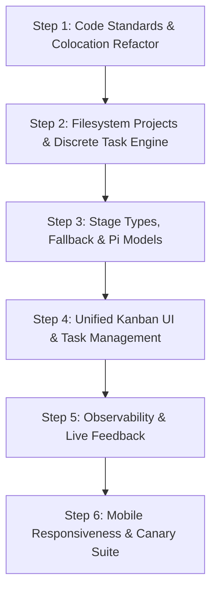

# Phase 2 — Attempt 4 Implementation Plan: Dogfood-Ready Orchestrator

> **Status:** Draft / Planned 🚀  
> **Target:** KainBain Phase 2 "Dogfood-Ready" Milestone  
> **Source Critiques:** [`docs/Phase2/Attempt3Critques.md`](file://~/projects/kainbain/docs/Phase2/Attempt3Critques.md)  
> **Core References:**
> - [`docs/KB Architecture.md`](file://~/projects/kainbain/docs/KB%20Architecture.md)
> - [`docs/KB Code Standards.md`](file://~/projects/kainbain/docs/KB%20Code%20Standards.md)
> - [`docs/KB Local Integration details.md`](file://~/projects/kainbain/docs/KB%20Local%20Integration%20details.md)
> - [`docs/KainBain initial scope.md`](file://~/projects/kainbain/docs/KainBain%20initial%20scope.md)
> - [`docs/Phase2/Phase2Scope.md`](file://~/projects/kainbain/docs/Phase2/Phase2Scope.md)
> - [`docs/Phase2/Investigatory_Conclusions.md`](file://~/projects/kainbain/docs/Phase2/Investigatory_Conclusions.md)
> - [`docs/EngineDetails/PromptCuration.md`](file://~/projects/kainbain/docs/EngineDetails/PromptCuration.md)
> - [`docs/EngineDetails/TaskQueueing.md`](file://~/projects/kainbain/docs/EngineDetails/TaskQueueing.md)
> - [`docs/UI/DESIGN_SPEC.md`](file://~/projects/kainbain/docs/UI/DESIGN_SPEC.md)
> - [`docs/UI/PAPER_DESIGN_SUMMARY.md`](file://~/projects/kainbain/docs/UI/PAPER_DESIGN_SUMMARY.md)

---

## 1. Executive Summary & Design Vision

Following the manual functional review documented in [`Attempt3Critques.md`](file://~/projects/kainbain/docs/Phase2/Attempt3Critques.md), **Attempt 4** rectifies both functional misalignments and unreviewed code standards.

KainBain is an autonomous-yet-supervised **AI Task Orchestrator** structured around a Kanban pipeline. It coordinates discrete, short-session AI and CI executions across configurable project stages (e.g. `Idea` $\to$ `Plan` $\to$ `Human Review` $\to$ `In Progress` $\to$ `CI/Verification` $\to$ `Done`).

### Key Architectural Tenets (Baking in Standards)
1. **Server-Authoritative & Stateless Runs**: Tasks are **discrete execution instances**, not one long continuous session. Each run executes in the project directory, writing artifacts to `./docs/tasks/<taskID>/<stage-name>-<datetime>.md`.
2. **Local Multi-Project Filesystem Model**: Projects reside in `~/projects/` (`~/projects/`). Documentation lives in SilverBullet (`~/apps/notes/silverbullet/space/Projects/Personal/<projectName>`) and is **symlinked** to `<projectRoot>/docs`.
3. **Locality of Code & Rigorous Testing**: Unit tests must be colocated with their source files (`*.test.js` next to `*.js`). Black-box unit tests with 100% mocked AI layers guarantee fast, token-free verification.
4. **Clean, Frictionless UI/UX**: An integrated single-page Kanban board with an in-page sliding inspector for task details/editing (no blocking modal popups), in-line task creation, real-time log streaming, and full mobile responsiveness.

---

## 2. Critique-to-Resolution Traceability Matrix

Every critique from [`Attempt3Critques.md`](file://~/projects/kainbain/docs/Phase2/Attempt3Critques.md) is directly mapped to a specific implementation step below:

| # | Critique from Attempt 3 Review | Root Cause | Target Step | Resolution Summary |
|---|---|---|---|---|
| **1** | Task management should be integrated into the page, not a separate popup | `TaskDetailOverlay` is a fixed full-screen blocking modal | **Step 4** | Convert `TaskDetailOverlay` into an integrated slide-over inspector / split pane within the Kanban workspace. |
| **2** | Quick task / workflow execution panel needs to be removed | `WorkflowControlPanel` duplicates playback controls | **Step 4** | Remove `WorkflowControlPanel` and quick-task duplicates from the canvas. |
| **3** | Remove context section/meter (no shared context between tasks) | Leftover session-tree / context-meter widgets | **Step 2, Step 4** | Remove Context usage meter and `SessionTreeSidebar`; enforce discrete per-stage task isolation. |
| **4** | Fallback selection in stages should be a dropdown of actual project stages | Hardcoded enum options (`"start"`, `"previous"`, `"any"`, `"abort"`) | **Step 3** | Make fallback selector dynamically list the project's actual stages + Abort option. |
| **5** | Projects dropdown should show folders in `~/projects` | Hardcoded / static project list | **Step 2** | Scan and list directories in `~/projects/`. |
| **6** | New project creation creates folder in `~/projects`, docs in SilverBullet, and symlinks `docs` | Project creation was purely database/in-memory | **Step 2** | Automate `mkdir` in `~/projects/<name>`, `mkdir` in `~/apps/notes/silverbullet/space/Projects/Personal/<name>`, and symlink `docs`. |
| **7** | Stage type determines inputs (Human=none, CI=bash command, Agent/Review=prompt+model) | All stages rendered a generic prompt textarea | **Step 3** | Stage-type specific input forms: Human = no prompt; CI/Script = Bash command; Agent/Review = System prompt + Model. |
| **8a** | Settings tab should be per-project (paths & symlinks) | Global mixed settings panel | **Step 4** | Per-project settings view showing project directory, SilverBullet notes path, and Forgejo Git URL. |
| **8b** | Model selection belongs in stage configuration (from Pi Agent) | Hardcoded provider list (Claude/OpenAI) in global settings | **Step 3** | Move model selection into Agent/Review stage settings, querying available models from Pi Agent / LiteLLM. |
| **8c** | Remove arbitrary environment variables section | Unrequested env var table | **Step 4** | Completely remove environment variables section from settings. |
| **9** | No way to create or manage tasks on the board | Task creation was buried in execution dispatch aside | **Step 4** | Add "+ Add Task" button on each column, quick-add input, in-place edit, and delete actions. |
| **10** | Tasks assumed to be one continuous run instead of discrete runs working off `./docs/tasks/<taskID>/...` | Session-based continuous prompt model | **Step 2** | Implement discrete execution runner saving reports to `./docs/tasks/<taskID>/<stage-name>-<datetime>.md`. |
| **11** | Remove shuffle and repeat/loop from Now Playing bar | Media player cliché tropes | **Step 4** | Remove shuffle and loop buttons from `NowPlayingBar.jsx`. |
| **12** | Orchestrator page has duplicate bottom bar | `WorkflowControlPanel` rendered above `NowPlayingBar` | **Step 4** | Remove redundant bottom bar; consolidate engine control into `NowPlayingBar`. |
| **13** | Tasks aren't actually displaying on screen | Data query / stage ID mismatch in board rendering | **Step 2, Step 4** | Fix task hydration, store normalization, and Kanban column filtering. |
| **14** | Lack of feedback to the user on what is happening behind the scenes | Generic idle states without process logs | **Step 5** | Live execution stream with severity tags (`[INFO]`, `[AGENT]`, `[CI]`, `[ERROR]`) and exit status. |
| **15** | Mobile view is unworkable | Fixed desktop column layouts with horizontal clip | **Step 6** | Responsive layout with mobile column switcher / tab selector and responsive drawer inspector. |
| **Code** | API tests in `api/tests/` instead of colocated; missing JSDoc MARKs | Architectural drift from `KB Code Standards.md` | **Step 1** | Colocate all API tests (`*.test.js` next to `*.js`), standardize JSDocs and domain-driven naming. |

---

## 3. Chunked Execution Roadmap (Steps 1 – 6)

### Step 1: Code Standards Alignment, Test Colocation & Domain Architecture
> **Focus:** Code standards, file structure colocation, removing anti-patterns, JSDoc standardization.  
> **Wider Design Reference:** [`KB Code Standards.md`](file://~/projects/kainbain/docs/KB%20Code%20Standards.md), [`KB Architecture.md`](file://~/projects/kainbain/docs/KB%20Architecture.md)

#### 1.1 Colocate All API Unit Tests
- Move all test files from [`api/tests/`](file://~/projects/kainbain/api/tests) to sit directly adjacent to the files they test:
  - `api/projectStore.test.js` next to [`api/projectStore.js`](file://~/projects/kainbain/api/projectStore.js)
  - `api/taskStore.test.js` next to [`api/taskStore.js`](file://~/projects/kainbain/api/taskStore.js)
  - `api/promptCuration.test.js` next to [`api/promptCuration.js`](file://~/projects/kainbain/api/promptCuration.js)
  - `api/eventBridge.test.js` next to [`api/eventBridge.js`](file://~/projects/kainbain/api/eventBridge.js)
  - `api/sessionStore.test.js` next to [`api/sessionStore.js`](file://~/projects/kainbain/api/sessionStore.js)
  - `api/workflowRegistry.test.js` next to [`api/workflowRegistry.js`](file://~/projects/kainbain/api/workflowRegistry.js)
  - `api/routes/projects.test.js` next to [`api/routes/projects.js`](file://~/projects/kainbain/api/routes/projects.js)
  - `api/routes/tasks.test.js` next to [`api/routes/tasks.js`](file://~/projects/kainbain/api/routes/tasks.js)
  - `api/routes/compute.test.js` next to [`api/routes/compute.js`](file://~/projects/kainbain/api/routes/compute.js)
  - `api/routes/sessions.test.js` next to [`api/routes/sessions.js`](file://~/projects/kainbain/api/routes/sessions.js)
  - `api/routes/status.test.js` next to [`api/routes/status.js`](file://~/projects/kainbain/api/routes/status.js)
  - `api/routes/workflows.test.js` next to [`api/routes/workflows.js`](file://~/projects/kainbain/api/routes/workflows.js)
  - `api/routes/ws.test.js` next to [`api/routes/ws.js`](file://~/projects/kainbain/api/routes/ws.js)
- Update [`api/vitest.config.js`](file://~/projects/kainbain/api/vitest.config.js) to discover `**/*.test.js`.
- Remove the empty `api/tests/` directory.

#### 1.2 JSDoc & Minimap Standard
- Audit every backend and frontend file to ensure all functions have standard JSDoc headers:
  ```javascript
  /***
   * MARK: functionName
   * @description Plain english description of business logic.
   * @example functionName(arg1, arg2) => result
   ***/
  ```
- Eliminate technical jargon (e.g. factory patterns, overly complex class abstractions) in favor of clear, domain-driven functional modules.

#### 1.3 Acceptance Criteria for Step 1
- `npm test --prefix api` passes with 100% colocated tests.
- `npm run lint` passes across root, `api/`, and `frontend/`.
- No tests make live calls to AI models (all black-box mock verified).

---

### Step 2: Filesystem-Backed Projects & Discrete Task Engine
> **Focus:** `~/projects` folder scanning, SilverBullet docs symlinking, discrete task report filesystem, and task CRUD.  
> **Wider Design Reference:** [`KB Local Integration details.md`](file://~/projects/kainbain/docs/KB%20Local%20Integration%20details.md), [`Investigatory_Conclusions.md`](file://~/projects/kainbain/docs/Phase2/Investigatory_Conclusions.md), [`PromptCuration.md`](file://~/projects/kainbain/docs/EngineDetails/PromptCuration.md)

#### 2.1 Project Discovery & Automated Symlinked Provisioning
- **Project Discovery**: Update [`api/projectStore.js`](file://~/projects/kainbain/api/projectStore.js) and [`api/routes/projects.js`](file://~/projects/kainbain/api/routes/projects.js):
  - Base directory: `~/projects/` (`~/projects`).
  - Scan and list existing project directories from `~/projects/`.
  - Persist project metadata and custom stage pipelines in `<projectRoot>/.kainbain/project.json`.
- **Project Creation Flow (`POST /projects`)**:
  1. Validate project name (slugified directory name).
  2. Create directory: `~/projects/<projectName>`
  3. Create SilverBullet notes space directory: `~/apps/notes/silverbullet/space/Projects/Personal/<projectName>`
  4. Create symbolic link: `~/projects/<projectName>/docs` $\to$ `~/apps/notes/silverbullet/space/Projects/Personal/<projectName>`
  5. Initialize default `.kainbain/project.json` with default stages.
  6. Return initialized project entity.

#### 2.2 Discrete Task Execution & Storage Model
- Refactor the execution engine to drop the "single continuous session" model in favor of **discrete task instances**:
  - Task reports directory structure: `<projectRoot>/docs/tasks/<taskID>/`
  - When an agent or script completes a stage, it creates a timestamped markdown report:
    `./docs/tasks/<taskID>/<stage-name>-<YYYYMMDD-HHmmss>.md`
  - Update [`api/promptCuration.js`](file://~/projects/kainbain/api/promptCuration.js) to:
    1. Assemble Task Goal (`# Task`).
    2. Assemble Stage Prompt (`# Stage`).
    3. Include path to previous stage reports in `./docs/tasks/<taskID>/` so the agent can read previous outputs without carrying raw context memory.
    4. Set target output report path: `./docs/tasks/<taskID>/<stage-name>-<datetime>.md`.
    5. Append Failure Details / Human Feedback if transitioning from a rejected stage.

#### 2.3 Comprehensive Task Management API
- Enhance [`api/routes/tasks.js`](file://~/projects/kainbain/api/routes/tasks.js) and [`api/taskStore.js`](file://~/projects/kainbain/api/taskStore.js):
  - `POST /tasks`: Create a task directly in a specified stage (e.g. `Idea` or `Backlog`) without forcing immediate agent dispatch.
  - `GET /tasks?projectId=...`: Retrieve all tasks for a project (with correct stage IDs and status).
  - `PATCH /tasks/:id`: Update task title, goal, prompt, or stage.
  - `DELETE /tasks/:id`: Delete a task and clean up references.
  - `POST /tasks/:id/advance`: Move task forward according to stage sequence.
  - `POST /tasks/:id/failback`: Move task back according to stage fallback route.
  - `POST /tasks/:id/reject`: Human review reject with feedback, routing to fallback stage with feedback appended.

#### 2.4 Acceptance Criteria for Step 2
- Creating a new project creates both directories and verifies `docs` is a valid symlink.
- Listing projects returns actual folders from `~/projects/`.
- Tasks can be created, retrieved, edited, and deleted via API.
- Executing a stage writes report files to `<projectRoot>/docs/tasks/<taskID>/<stage-name>-<datetime>.md`.
- Colocated unit tests for `projectStore.test.js` and `tasks.test.js` verify these behaviors.

---

### Step 3: Stage Specialization, Fallback Routing & Pi Model Integration
> **Focus:** Stage-specific inputs (Agent vs Human vs CI/Script vs Review), project stage fallback dropdown, Pi Agent model discovery.  
> **Wider Design Reference:** [`KB Architecture.md`](file://~/projects/kainbain/docs/KB%20Architecture.md), [`Investigatory_Conclusions.md`](file://~/projects/kainbain/docs/Phase2/Investigatory_Conclusions.md)

#### 3.1 Specialized Stage Types & Inputs
Update [`frontend/src/components/StageSettingsTray.jsx`](file://~/projects/kainbain/frontend/src/components/StageSettingsTray.jsx) and backend stage schemas to tailor inputs per stage type:
1. **`human` Stage**:
   - Fields: Stage Name, Description, Fallback Stage.
   - **No prompt input** (it is a checkpoint for human review/approval).
2. **`ci` / `script` Stage**:
   - Fields: Stage Name, Description, **Bash Command** (e.g. `npm test`, `./scripts/check.sh`), Timeout, Fallback Stage.
   - Backend runs command in project `cwd`, captures stdout/stderr, and auto-advances if exit code is 0 (or fails back on error).
3. **`agent` Stage**:
   - Fields: Stage Name, Description, **System Prompt**, **Model Selection**, Fallback Stage.
4. **`review` Stage**:
   - Fields: Stage Name, Description, **Review Prompt / Criteria**, **Model Selection**, Fallback Stage.

#### 3.2 Dynamic Fallback Selection to Actual Project Stages
- Replace static fallback values (`"previous"`, `"start"`, `"any"`, `"abort"`) with a dynamic dropdown listing:
  - All existing stages in the current project (e.g., `1. Idea`, `2. Plan`, `3. Technical Elab`)
  - Plus standard control options (`[Previous Stage]`, `[Start of Pipeline]`, `[Abort Job]`).
- When a task fails or is rejected in stage $N$, it transitions directly to the configured target stage ID.

#### 3.3 Dynamic Pi Agent / LiteLLM Model Discovery
- Add endpoint `GET /compute/models` in [`api/routes/compute.js`](file://~/projects/kainbain/api/routes/compute.js):
  - Queries available models from the local `pi-agent` runtime / LiteLLM proxy (e.g. `gemini-2.5-pro`, `gemini-2.5-flash`, `claude-3-7-sonnet`, `deepseek-r1`, `local-ollama`).
- In `StageSettingsTray.jsx`, render a model picker for `agent` and `review` stages populated from `GET /compute/models`.
- Remove the outdated provider dropdown from global project settings.

#### 3.4 Acceptance Criteria for Step 3
- Stage configuration UI adapts inputs dynamically when switching stage type.
- Human stages display no prompt field.
- CI stages accept bash commands and execute them during workflow runs.
- Fallback dropdown lists actual project stages.
- Unit tests verify stage serialization and CI command execution.

---

### Step 4: Unified Workspace UI & In-Place Task Management
> **Focus:** Single-page Kanban orchestrator, in-page slide-over task inspector (no popups), "+ Add Task" on columns, cleaning up UI fluff.  
> **Wider Design Reference:** [`DESIGN_SPEC.md`](file://~/projects/kainbain/docs/UI/DESIGN_SPEC.md), [`PAPER_DESIGN_SUMMARY.md`](file://~/projects/kainbain/docs/UI/PAPER_DESIGN_SUMMARY.md)

#### 4.1 Consolidate Workspace & Remove Redundant Bars
- **Single Cohesive View**: Consolidate [`frontend/src/components/OrchestratorView.jsx`](file://~/projects/kainbain/frontend/src/components/OrchestratorView.jsx) and [`frontend/src/components/tasks/TaskManagementPage.jsx`](file://~/projects/kainbain/frontend/src/components/tasks/TaskManagementPage.jsx) into one master **Kanban Orchestrator View**.
- **Remove Redundant Widgets**:
  - Remove [`WorkflowControlPanel.jsx`](file://~/projects/kainbain/frontend/src/components/workflow/WorkflowControlPanel.jsx) (unnecessary bottom bar duplicate).
  - Remove [`SessionTreeSidebar.jsx`](file://~/projects/kainbain/frontend/src/components/layout/SessionTreeSidebar.jsx) (since tasks are discrete instances without shared session trees).
  - Remove Context usage meter from [`Header.jsx`](file://~/projects/kainbain/frontend/src/components/layout/Header.jsx).
- **Overhaul [`NowPlayingBar.jsx`](file://~/projects/kainbain/frontend/src/components/layout/NowPlayingBar.jsx)**:
  - Remove the cliché `shuffle` and `repeat` music buttons.
  - Retain true engine controls: Play/Pause/Stop Engine, Skip to Next Stage, Jump to Previous Stage, Progress Bar, Active Task Badge, and live elapsed timer.

#### 4.2 In-Place Task Creation & Direct Kanban Management
- Add an in-line **"+ Add Task"** button and quick-create input directly at the bottom/top of each Kanban stage column.
- Allow operators to:
  - Create a new task in any column with Title & Goal.
  - Drag and drop tasks between columns (`moveTask`).
  - Delete a task directly from the card or inspector.
  - Filter and search tasks by text/tag without navigating away.

#### 4.3 Integrated Slide-Over Task Inspector (No Full-Screen Popup)
- Refactor [`TaskDetailOverlay.jsx`](file://~/projects/kainbain/frontend/src/components/tasks/TaskDetailOverlay.jsx) from a blocking full-screen modal into an **integrated side-panel / slide-over inspector**:
  - Anchored on the right side of the screen (or responsive split pane) without blocking the Kanban view.
  - Allows editing Task Goal, System Prompt override, viewing generated markdown reports from `./docs/tasks/<taskID>/...`, and inspecting stage timeline.
  - Header with close button, task UUID, and status badge.

#### 4.4 Per-Project Settings Tab
- Overhaul [`frontend/src/components/settings/ProjectSettings.jsx`](file://~/projects/kainbain/frontend/src/components/settings/ProjectSettings.jsx):
  - Dedicated to current project configuration: Project Name, Working Directory (`~/projects/<name>`), SilverBullet Docs Symlink Path, Forgejo Git URL.
  - Remove arbitrary "Environment Variables" table.
  - Retain UI Customization sub-tab for themes/preferences.

#### 4.5 Acceptance Criteria for Step 4
- Clicking a task opens the integrated slide-over inspector without a blocking full-screen popup.
- Tasks are visibly rendered in columns with drag-and-drop support.
- "+ Add Task" allows creating tasks directly in any stage.
- Now Playing bar is clean (no shuffle/repeat buttons).
- Header is clean (no context tokens meter).

---

### Step 5: Real-Time Observability, Live Logs & Execution Feedback
> **Focus:** Live execution feedback, streaming stdout/stderr, severity tags, and stage transition visibility.  
> **Wider Design Reference:** [`pi_agent_integration_spike.md`](file://~/projects/kainbain/docs/Phase2/pi_agent_integration_spike.md), [`DESIGN_SPEC.md`](file://~/projects/kainbain/docs/UI/DESIGN_SPEC.md)

#### 5.1 Real-Time Execution Feedback Pipeline
- In [`api/eventBridge.js`](file://~/projects/kainbain/api/eventBridge.js) and [`api/routes/ws.js`](file://~/projects/kainbain/api/routes/ws.js):
  - Stream discrete process events: `process:start`, `process:stdout`, `process:stderr`, `process:exit`.
  - Stream stage transitions: `stage:enter`, `stage:checkpoint_wait`, `stage:complete`, `stage:failback`.

#### 5.2 UI Execution Terminal & Activity Drawer
- In the Kanban workspace and Task Inspector:
  - Collapsible **Live Activity Console** displaying real-time formatted logs with severity color tags:
    - `[AGENT]` (Agent Green `#7bdb85`)
    - `[HUMAN]` (Human Blue `#9acbff`)
    - `[CI/CMD]` (Ochre `#ffb77f`)
    - `[INFO]` (Muted Text `#6e757c`)
    - `[ERROR]` (Error Red `#ffb4ab`)
  - Auto-scroll lock toggle for streaming logs.
  - Stage checkpoint alert banners on `human` / `review` stages with single-click **Approve** and **Reject (with Feedback)**.

#### 5.3 Acceptance Criteria for Step 5
- Running a stage displays real-time streaming output in the Live Activity Console.
- Human checkpoint stages provide clear visual notification and prompt for approval/rejection.
- Completed tasks display links to their generated markdown report files.

---

### Step 6: Mobile Responsiveness, Canary & End-to-End Test Suite
> **Focus:** Mobile layout usability, Playwright canary tests across error boundaries, and multi-viewport visual snapshots.  
> **Wider Design Reference:** [`KB Code Standards.md`](file://~/projects/kainbain/docs/KB%20Code%20Standards.md), [`DESIGN_SPEC.md`](file://~/projects/kainbain/docs/UI/DESIGN_SPEC.md)

#### 6.1 Mobile & Tablet Responsive Layout
- Implement mobile-first responsive adjustments:
  - **Mobile Kanban View (`< 768px`)**: Single-column view with a swipeable / pill-based stage selector tab strip to switch between columns smoothly.
  - **Slide-Over Task Inspector on Mobile**: Full-width slide-over drawer with touch-dismiss and accessible controls.
  - **Now Playing Bar on Mobile**: Compact height with essential playback and status indicators without text clipping.
  - Touch targets minimum $44 \times 44$ px for all buttons.

#### 6.2 Canary E2E & Visual Regression Test Suite
- Update Playwright tests in [`canary-e2e/tests/`](file://~/projects/kainbain/canary-e2e/tests):
  - `task-lifecycle.spec.js`: Test project creation, symlink verification, task creation, stage advance, human rejection, and report generation.
  - `mobile-responsive.spec.js`: Test mobile viewport navigation, stage column switching, and slide-over task inspector.
  - `visual/snapshots.spec.js`: Capture multi-viewport screenshot regression for Desktop (1280px), Tablet (768px), and Mobile (375px).

#### 6.3 Acceptance Criteria for Step 6
- `npm run test:canary` executes and passes all Playwright tests against the local server.
- `npm run test:visual` captures clean visual snapshots across Desktop, Tablet, and Mobile views.
- Mobile view is fully workable and verified with no horizontal overflow or clipped controls.

---

## 4. Subagent Chunk Execution Guide

When delegating this plan to AI agents in chunks, follow this strict execution sequence:



### Agent Execution Rules:
1. **Never use live AI tokens in tests**: All unit and canary tests must mock the agent layer.
2. **Follow JSDoc standards**: Always include `/*** MARK: funcName ... ***/` and `@description` / `@example`.
3. **Colocate new tests immediately**: Keep tests next to their respective `.js` / `.jsx` files.
4. **Preserve documentation integrity**: Reference design documents and update [`ProjectStatus.md`](file://~/projects/kainbain/docs/ProjectStatus.md) upon completing each chunk.
