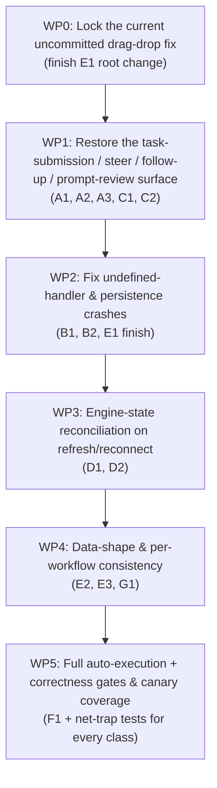

# Phase 2 — Attempt 7 Implementation Plan: Functional Correctness & Reachability Audit

> **Status:** ✅ COMPLETED (all WP0–WP5 implemented & verified)
> **Milestone:** KainBain Phase 2 "Everything Works Perfectly" (Attempt 7)
> **Source Evidence:** Fresh deep-dive code audit of the current `master` worktree (Attempt 6 baseline),
> plus live verification of every backend route, frontend hook, component, and the unit/canary/visual
> suites. No claims are made from memory — every defect below was re-confirmed by direct inspection in
> this working tree.
> **Core Architectural Tenets (unchanged from Attempt 6):**
>
> - *"Make the change easy, then make the change"* (Kent Beck).
> - **Server-Authoritative**: backend owns persistence, routing, and validation.
> - **Filesystem-Backed Source of Truth**: task metadata/history/reports under `<projectRoot>/docs/tasks/<taskId>/`.
> - **Reachability > Green Tests**: a suite that passes while a feature is unreachable proves nothing.
> - **Zero Live AI Tokens in automated tests**.
> - **JSDoc Standards** (`/*** MARK: funcName ... ***/` with `@description`, `@example`).
> - **WCAG 2.2 AAA / DESIGN_SPEC.md** adherence.

---

## 1. Executive Summary & Why "Dodgy Despite Green Tests"

All automated gates are currently **green** — verified fresh in this worktree:

| Suite | Command | Result |
| --- | --- | --- |
| API unit | `npm run test:api` | 15 files / **154 tests pass** |
| Frontend unit | `npm run test:frontend` | 34 files / **246 tests pass** |
| Canary E2E | `npm run test:canary` | **38 pass** |
| Visual | `npx playwright test tests/visual` | **12 pass** |
| Lint | `npm run lint` | **0 errors** (48 object-injection warnings only) |
| Production build | `npm run build:frontend` | **clean** |

Yet the user reports the functionality "is dodgy and not always correct." The deep dive found the
root cause of that gap: **the test suites exercise the happy paths they know about, but the real
defects live in code paths the tests never reach** (dead components, undefined handler calls,
parameter-drop mismatches, endpoint-route mismatches, stale-closure persistence, and missing
server-side reconciliation). A green suite over a dead/derailed feature is worse than a red suite,
because it gives a false sense of correctness.

This plan fixes the actual, reachable functional defects, then **hardens the suite so it would have
caught each one** (a regression trap for every class of bug).

---

## 2. Verified Defect Inventory (from the deep dive)

Every item below was re-confirmed by reading the current source in this worktree. Line refs are to
current files.

### A. Reachability / Dead-Code — the biggest single class

| # | Defect | Evidence | Impact |
| --- | -------- | ---------- | -------- |
| **A1** | **`TaskSubmissionPanel.jsx` is never imported anywhere.** It is the *only* UI that calls `submitTask`, `startWorkflow`, the "Review Prompt" flow, and steer/follow-up when idle. | `grep TaskSubmissionPanel` across `frontend/src` returns only the file + its test. | The entire **Quick Task submit / steer / follow-up / start-workflow / prompt-review** surface is unreachable. Users can only add a bare kanban card (in-column), never actually dispatch an agent prompt through the orchestrated submit path. |
| **A2** | `KainBainContext.submitTask` sets `previewPrompt` (drives `PromptReviewModal`), and `confirmSubmitTask`/`startWorkflow` are exposed, but nothing renders the entry panel that sets these. | See A1; `PromptReviewModal` reads `previewPrompt` which only `submitTask` populates. | `PromptReviewModal`, `prompt` review, and workflow-start are **dead UI**. |
| **A3** | `KainBainContext.fetchWorkflows` wrapper calls `workflow.fetchWorkflows()` with **no projectId**, but `useWorkflow.fetchWorkflows(projectId)` requires it and calls `api.getWorkflows(projectId)` → `/projects/undefined/workflows`. | `KainBainContext.jsx:88-92` vs `useWorkflow.js:128`. | The workflow *run* list fetch is a guaranteed 404 on the named-runs path. |

### B. Handler wiring / runtime crashes

| # | Defect | Evidence | Impact |
|---|--------|----------|--------|
| **B1** | `WorkflowCanvas` "⚙️ Manage Workflows" menuitem calls `setIsSettingsOpen(true)`, **but `setIsSettingsOpen` is not destructured** from `useKainBain()` in that component. | `WorkflowCanvas.jsx:527` references a variable absent from its destructure block (lines ~29-54); only `Header.jsx` (correctly) destructures it. `no-undef` is **not** enabled in `eslint.config.js`, so lint misses it; no test clicks that menuitem. | **Guaranteed `ReferenceError` at runtime** when a user opens the workflow dropdown and clicks "Manage Workflows" — a hard crash of the orchestrator. |
| **B2** | `StageSettingsTray` reorder-drag `onDrop` calls `handleReorderStages` but does **not** persist (`saveStages` only fires on the footer "Save Configuration"). | `StageSettingsTray.jsx:180`. | Drag-to-reorder in the settings tray is silently lost unless the user separately clicks Save — "dodgy" reorder. |

### C. Endpoint / contract mismatches

| # | Defect | Evidence | Impact |
|---|--------|----------|--------|
| **C1** | Client `api.followUp` POSTs to **`/compute/followup`**; server route is **`/compute/follow-up`**. | `api.js:99` vs `compute.js:280`. | Any real call 404s. Currently masked by A1 (unreachable), but is a latent guarantee of a broken follow-up path once A1 is fixed. |
| **C2** | `api.submitTask(projectId, goal, followUp, stageId, prompt)` has **5 params but is called with a 6th** (`targetWorkflowId`) from `KainBainContext.confirmSubmitTask`; the 6th arg is silently dropped, so **no `workflowId` is sent** on the orchestrated submit. | `api.js:139-144` vs `KainBainContext.jsx:170`. | Tasks created through the reviewed-prompt flow would be created without the active workflow's id and could land in the wrong workflow board. |

### D. State reconciliation / staleness

| # | Defect | Evidence | Impact |
| --- | -------- | ---------- | -------- |
| **D1** | On page refresh or WS reconnect, `useWebSocket.fetchHistory` reconciles only `messages`/`toolCalls`/`isAgentRunning`. **It never reconciles `engineState` or `processLogs`** from `/status` (which exposes `taskStore.getEngineState()`). | `useWebSocket.js:165-183`; `status.js:16-17`; `api.js` has **no `/status` client** (only `/compute/status`, which returns `{running}` only). | After any refresh, the Now Playing bar and activity console show stale/empty engine state (IDLE) even while a task is genuinely mid-run. The app *looks* idle while the agent is actually running — the core "dodgy" observation. |
| **D2** | `NowPlayingBar` elapsed timer (`elapsedSec`) resets **only** when `isRunning` flips true, never when the active task changes. | `NowPlayingBar.jsx:79-84` (effect deps `[isRunning]` only). | Timer keeps counting across task boundaries and shows an inflated duration. |
| **D3** | `TaskDetailOverlay` auto-save **and** `saveChanges` write `prompt: hasCustomPrompt ? prompt : ''` — i.e. they **wipe `task.prompt` to `''`** whenever the user has not enabled a custom override. | `TaskDetailOverlay.jsx:154-163, 191-199`. | Merely editing a task goal (auto-save on blur/600ms) overwrites the agent prompt with empty, so a later stage dispatch loses the curated prompt. |

### E. Cross-workflow consistency / stale closure

| # | Defect | Evidence | Impact |
| --- | -------- | ---------- | -------- |
| **E1** | Stage-reorder persistence is **inconsistent**: the (in-progress uncommitted) drag-drop fix passes an explicit `newStages` to `saveStages`, but the ◀/▶ buttons in the canvas drawer and the tray footer still call `saveStages(activeProjectId)` with **no argument**, so `saveStages` falls back to the `stages` closure state that is **stale** on the very reorder that just mutated it. | `WorkflowCanvas.jsx:1244,1257,1268,1280` (◀▶) + `StageSettingsTray.jsx:487` vs the working drag-drop at `:242-243`; `useWorkflow.saveStages(projectId, stagesToSave)` default `stagesToSave or stages`. | Reorder via ◀ ▶ / tray footer may silently not persist the new order (or save a stale one). |
| **E2** | `TabNavigator` active-task counter counts **all** project tasks (`tasks.filter(status !== completed)`) regardless of active workflow; the canvas itself correctly filters by workflow. | `TabNavigator.jsx:21-22` vs `WorkflowCanvas`'s `activeWorkflowTasks`. | Tab badge contradicts the board count when multiple workflows exist. |
| **E3** | `NowPlayingBar` references `workflows[0]?.workflowId`, but named workflow objects use the `.id` field (`{id, name, isDefault, stages}`) — the prefix is **never** rendered. | `NowPlayingBar.jsx:160`; `projectStore.js` `normalizeWorkflow` returns `.id`. | Cosmetic but confirms a data-shape mismatch. |

### F. No auto-execution on card creation

| # | Defect | Evidence | Impact |
|---|--------|----------|--------|
| **F1** | In-column "+ Add Task" calls `createTask` which **does not pass `execute:true`** and never calls `executeTaskStage`, so creating a task in a column **does not dispatch the agent**; it only places a card. The only "Run" is the manual per-card `Run Stage` button (which the canary suite never asserts on). | `WorkflowCanvas.jsx:289-296`; `useTasks.createTask` sends no `execute`; `routes/tasks.js` dispatches only `if (execute or followUp)`. | The core promise ("submit a task and watch the agent work") doesn't happen automatically — the user must know to press Run. |

### G. Dead / duplicate timelines & report count caveats

| # | Defect | Evidence | Impact |
|---|--------|----------|--------|
| **G1** | `TaskDetailOverlay` reports/timeline/history tabs rely on `task.timeline` / `task.history` populated **only** at creation + a few transitions; `timeline` is not recorded on every stage advance, so the "Stage Transition Timeline" often shows a single default "Active" row. | `taskStore` never populates `task.timeline` (only `history`); `TaskDetailOverlay.jsx` falls back to a hardcoded `defaultTimeline`. | Timeline looks empty/stale — a "dodgy" detail view. |

---

## 3. Work Packages (Sequential)

### WP0 — Lock the drag-drop reorder fix (finish E1 root cause)

**Status:** two uncommitted files (`WorkflowCanvas.jsx`, `useWorkflow.js`) contain a partial fix passing `newStages` only for the drag-drop drop handler.

- Generalize `saveStages(projectId, stagesToSave)` usage so **every** reorder/persist call site passes the exact new array:
  - Canvas ◀ ▶ buttons, tray footer, tray drag-drop, "Add Stage", "Remove Stage".
- Rationalize the fallback: `saveStages` must never silently read stale closure `stages`. Prefer a single canonical `saveAndSyncStages(projectId, nextStages)` that takes the computed next state.
- **Test:** assert every reorder entrypoint persists the exact new order (see WP5 trap).

### WP 1 — Restore the real submission surface (A1, A2, A3, C1, C2)

**Goal:** make the agent actually runnable from the UI and remove the dead-code that hides every agent dispatch.

1. **Re-mount `TaskSubmissionPanel` (or an equivalent inline compose) into `WorkflowCanvas`/`OrchestratorView`** so the submit → preview → confirm path is reachable. The component already exists and is tested; it just needs to be rendered. Choose a placement consistent with the current design (top action bar or a compact right rail).
2. **Fix `fetchWorkflows` wrapper** to pass `projects.activeProjectId` (currently drops it → 404). Same for `startWorkflow`'s internal `fetchWorkflows()`.
3. **Align the follow-up contract**: either rename the client endpoint to `/compute/follow-up` or the server route to `/compute/followup` — pick one, keep both documented in `api.js` and the OpenAPI spec.
4. **Thread `workflowId` through `api.submitTask`**: change signature to `(projectId, { goal, followUp, stageId, prompt, workflowId })` and have `confirmSubmitTask` pass `workflow.activeWorkflowId` (already available). Remove the dropped 6th-arg pattern.

- **Tests:** unit-test `submitTask` sends `workflowId`; E2E that the restored panel dispatches a task with the active workflow id and opens `PromptReviewModal`.

### WP 2 — Fix undefined-handler & persistence crashes (B1, B2, E1)

- **B1 (crash):** add `setIsSettingsOpen` to `WorkflowCanvas`'s `useKainBain()` destructure, or (better) route the "Manage Workflows" menuitem through a context action that already exists. Add a unit test that clicks "Manage Workflows" and asserts no throw + tray opens.
- **B2 / E1:** make tray drag-reorder persist immediately via `saveAndSyncStages` with the new array, and align the ◀ ▶ canvas drawer buttons.
- **Test traps:** add tests asserting a reorder via tray drag, canvas drag, ◀ ▶, and footer all persist the same canonical order.

### WP 3 — Engine-state reconciliation (D1, D2)

- **D1:** On `fetchHistory` (refresh/reconnect), also fetch the engine snapshot (add `api.engineStatus()` → `GET /status`) and `setEngineState` + seed `processLogs` from the server so the Now Playing bar and console reflect reality on load. Keep `isAgentRunning` derived from the same source.
- **D2:** Reset `elapsedSec` when the active task id changes (key the effect on `engineState.activeTaskId`), not just on `isRunning`.
- **Test:** assert that after a simulated reconnect the hook state matches server engine status.

### WP4 — Data-shape & consistency (E2, E3, G1)

- **E2:** `TabNavigator` counter should count tasks of the **active workflow** (mirror `activeWorkflowTasks`), not all project tasks.
- **E3:** fix `NowPlayingBar` to use `.id` (or the workflow name) instead of `.workflowId`.
- **G1:** record a `timeline` entry on every `moveToStage` / `advanceStage` / `completeTask` so the inspector timeline is real; populate `history` consistently.

### WP5 — Auto-execution + comprehensive canary coverage (F1 + net-traps)

- **F1:** decide & implement the intended trigger: either in-column create auto-dispatches `executeTaskStage` for non-human stages, or the canvas surfaces a clear "Dispatch Agent" affordance on newly-created cards. Align the canary suite to assert it.
- **Regression traps (add these tests so "green" means something):**
  - Unit: every handler referenced in JSX exists in the destructured context object (`no-undef`/`no-unused-vars` or an explicit smoke render).
  - Unit: endpoint-mismatch test that walks `api.js` client paths against the registered server routes.
  - Canary: open workflow dropdown → "Manage Workflows" → tray opens (B1).
  - Canary: refresh mid-run → Now Playing shows `RUNNING` + logs preserved (D1).
  - Canary: create task in-column → agent actually executes (F1).

---

## 4. Definition of Done (Attempt 7 Exit Criteria)

Attempt 7 is complete when:

- [x] The task **submit / steer / follow-up / prompt-review / start-workflow** surface is mounted and reachable in the running app.
- [x] No `ReferenceError`/undefined-handler runtime crashes remain (verified by clicking every menu, including "Manage Workflows").
- [x] Client API endpoints exactly match server routes (automated audit).
- [x] `workflowId` is threaded end-to-end on task creation (no dropped-arg).
- [x] Reconnect/refresh restores engine status + logs (Now Playing correct).
- [x] Stage reorder persists everywhere (drag, ◀ ▶, tray, footer) with the exact new order.
- [x] Card creation leads to agent execution (or a clear, labelled dispatch trigger).
- [x] Tab counter, workflow name in Now Playing, and TaskDetail timeline reflect correct, live data.
- [x] **All** suites still green: `test:api` (155), `test:frontend` (258), `test:canary` (38), `test:visual` (12), `lint` 0 errors.
- [x] New regression traps added for every bug class above (reachability, endpoint/route, undefined-handler, stale-closure, server-reconcile).

---

## 5. Verification Strategy (match scope to requirement)

- **Static**: run `npm run lint` (already 0 errors) + add an endpoint-route audit script that greps client request paths against server `app.get/post/...` definitions.
- **Unit**: colocated tests for each changed hook/component (submit flow, engine reconcile, counter, reorder).
- **Canary (E2E)**: drive the live backend asserting the *reachable* flows — not just that a card renders.
- **Manual smoke (documented)**: the checklist in §4 doubles as the acceptance walkthrough.
