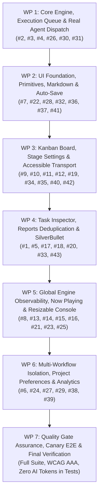

# Phase 2 — Attempt 6 Implementation Plan: Dogfood Stabilization & Refined UX

> **Status:** Proposed / Actionable 🚀  
> **Milestone:** KainBain Phase 2 "Dogfood-Ready" (Attempt 6)  
> **Source Critiques:** [`AttemptFive/Attempt critique.md`](../AttemptFive/Attempt%20critique.md) (43-item dogfooding audit)  
> **Core Architectural Tenets:**
> - *"Make the change easy, then make the change"* (Kent Beck refactoring principle).
> - **Server-Authoritative**: Backend owns persistence, task routing, execution queues, and validation.
> - **Filesystem-Backed Source of Truth**: All task metadata, history, and reports live in `<projectRoot>/docs/tasks/<taskId>/`.
> - **Colocated Black-Box Testing (Zero Live AI Tokens in automated tests)**: Unit tests live adjacent (`*.test.js`/`*.test.jsx`).
> - **JSDoc Standards**: `/*** MARK: funcName ... ***/` with `@description` and `@example` on all functions.
> - **Accessibility & Design Standards**: WCAG 2.2 AAA, JetBrains Mono, role-based chromatics, contained zero-leak viewports.

---

## 1. Executive Summary & Architecture Philosophy

Attempt 5 established the core 3-stage model (`agent`, `human`, `ci`), filesystem-backed storage, and basic WebSocket streaming. However, dogfooding revealed 43 specific functional, ergonomic, visual, and architectural gaps documented in [`Attempt critique.md`](../AttemptFive/Attempt%20critique.md).

Attempt 6 executes a structured, multi-agent plan to transform KainBain into a polished, resilient, and intuitive developer workspace. We follow the principle of **"make the change easy, then make the change"**:
1. **Foundation First**: Establish pure data structures, serialization locks, resilient routing, and UI utility primitives.
2. **Feature Execution**: Layer domain logic, workflow isolation, rich Markdown, accessible controls, and real-time streaming.
3. **Harmonization & Verification**: Polish responsive layouts, micro-animations, zebra striping, and comprehensive automated test suites.

---

## 2. Critique-to-Work-Package Traceability Matrix (All 43 Items)

| # | Critique Description | Target Work Package | Root Cause & Resolution |
|---|----------------------|---------------------|-------------------------|
| **1** | Report gives file address rather than link in KainBain | **WP 4** (Task Inspector & Reports) | Report header prints raw filesystem path; replace with in-app report viewer link and SilverBullet URL. |
| **2** | Stage report writes dummy "stage successful" instead of real details | **WP 1** (Core Engine & Execution) | AgentRunner saves static fallback string; pipe real agent session summary and diff markdown to report writer. |
| **3** | "Run" button should prioritize rather than interrupt existing job | **WP 1** (Core Engine & Execution) | Clicking run triggers immediate dispatch; implement execution queue with priority reordering without killing active jobs. |
| **4** | Logs have empty entries; need informative system lifecycle logs | **WP 1** (Core Engine & Execution) | Missing lifecycle telemetry; emit rich `[SYSTEM]` tags: `Spinning up agent...`, `Curating prompt...`, `Completed in X.Xs`. |
| **5** | File explorer needs "Open in SilverBullet" button for docs | **WP 4** (Task Inspector & Reports) | ProjectExplorer lacks external deep link; add button targeting `http://notes.local/space/...` per local integration spec. |
| **6** | Workflows should act as separate project boards within same context | **WP 6** (Projects & Multi-Workflow) | Workflows shared board state; treat each workflow as an isolated kanban board sharing repo context. |
| **7** | Numbers on tabs don't really make sense | **WP 2** (UI Foundation & Primitives) | Tab badge counters computed incorrect metrics; bind to active task counts or remove ambiguous counters. |
| **8** | Now playing bar overflows off the bottom of the page | **WP 5** (Observability & Console) | App layout uses unbounded flex containers; enforce `h-screen overflow-hidden` with contained scroll panels. |
| **9** | Stage settings should take up full column height when open | **WP 3** (Kanban Board & Stage UX) | Inline settings tray clamped by parent container; expand settings panel to fill 100% column height. |
| **10** | Fallback no longer allows custom stage fallback options | **WP 3** (Kanban Board & Stage UX) | Dropdown restricted to previous stage; reintroduce custom stage selector for failure fallback. |
| **11** | Pause on stage settings is ambiguous; needs tooltip/rework | **WP 3** (Kanban Board & Stage UX) | Unclear toggle meaning; add explicit helper tooltip explaining "Pauses task on arrival before stage starts". |
| **12** | Drag and drop doesn't stay in position | **WP 3** (Kanban Board & Stage UX) | Optimistic UI state not reconciled with backend position index; persist column/order on drop. |
| **13** | Logs aren't actually resizable despite claiming to be | **WP 5** (Observability & Console) | Mouse drag listener detached or prevented by CSS pointer-events; fix drag-handle state & listeners. |
| **14** | Now playing bar says "running" despite no task to run | **WP 5** (Observability & Console) | State machine defaulted to `RUNNING` on socket disconnect; derive strictly from server execution queue status. |
| **15** | Now playing bar shows task in human eval as "running" | **WP 5** (Observability & Console) | Engine marked human checkpoint tasks as active; display `WAITING FOR HUMAN` / `CHECKPOINT` badge. |
| **16** | Transport scrubbing moves active task rather than previewing | **WP 5** (Observability & Console) | Scrubbing mutated task stage; decouple view navigation (preview stage) from task state mutation. |
| **17** | Reports count in task view says 0 when reports exist | **WP 4** (Task Inspector & Reports) | Report counter checked memory cache before disk scan; rehydrate report count directly from task directory. |
| **18** | Duplicate timelines on task inspector | **WP 4** (Task Inspector & Reports) | Event listeners appended duplicate timeline entries; deduplicate timeline events by event ID/timestamp. |
| **19** | Run stage button visible on human stages | **WP 3** (Kanban Board & Stage UX) | Action bar rendered "Run" for all stage types; conditionally hide "Run" for `human` stage types. |
| **20** | System prompt override should default to none with optional toggle | **WP 4** (Task Inspector & Reports) | Pre-filled static prompt override; default to inherited stage prompt with explicit "Override for this stage" toggle. |
| **21** | Clicking task on now playing bar should reveal it in inspector | **WP 5** (Observability & Console) | NowPlayingBar lacked click handler; bind card click to open `TaskDetailOverlay` with active taskId. |
| **22** | Visual collisions of badges and UI elements | **WP 2** (UI Foundation & Primitives) | Overlapping z-indices and cramped flex gaps; normalize spacing tokens and badge bounding boxes. |
| **23** | Too much scrolling needed across views | **WP 5** (Observability & Console) | Excessive viewport padding; lock canvas to 100vh with independent column scrolling and collapsible panels. |
| **24** | Open repo in Forgejo button | **WP 6** (Projects & Multi-Workflow) | Missing quick-link to git remote; add "Open in Forgejo" link in project header pointing to `forgejo.local`. |
| **25** | Clear and copy buttons don't work on logs | **WP 5** (Observability & Console) | Button onClick handlers missing or unhandled; wire `navigator.clipboard.writeText` and log state clear. |
| **26** | Tasks exist in multiple workflows (cross-contamination) | **WP 1** & **WP 6** | Task queries didn't filter by `workflowId`; enforce strict workflow partitioning in API and UI. |
| **27** | Per-project coloring doesn't change anything | **WP 6** (Projects & Multi-Workflow) | CSS custom properties not applied to root element; inject `--project-accent` dynamically on project select. |
| **28** | Auto-save on form fields to avoid lost edits | **WP 2** (UI Foundation & Primitives) | Changes required manual Save click; implement `useAutoSave` debounced hook across task and stage inputs. |
| **29** | Hide/show projects setting saved in browser localStorage | **WP 6** (Projects & Multi-Workflow) | Project switcher showed all projects; add hide/archive toggle persisted in `localStorage`. |
| **30** | Feed back mid-session Pi agent details to logs/now playing | **WP 1** & **WP 5** | Pi event bridge dropped mid-session tool/token events; stream tool invocations and live status to UI. |
| **31** | Automated AI failure handling & fallback verification | **WP 1** (Core Engine & Execution) | Agent errors didn't trigger fallback pipeline; verify error boundary routing to designated fallback stage. |
| **32** | Too eager to use toast popup notifications | **WP 2** (UI Foundation & Primitives) | Toasts fired on every background sync; gate toasts to user-initiated actions and critical errors. |
| **33** | Long task descriptions cramped by prompt override section | **WP 4** (Task Inspector & Reports) | Fixed split ratios in inspector; redesign layout with collapsible accordion for overrides. |
| **34** | Button fallbacks for drag-and-drop accessibility | **WP 3** (Kanban Board & Stage UX) | Relying solely on HTML5 drag-and-drop violates WCAG; add "Move Left/Right" and "Move to Stage" menu. |
| **35** | Indicator that failure causes a pop-up to enter reason | **WP 3** (Kanban Board & Stage UX) | Reject action triggered unexpected modal; add clear label/icon indicating "Reject & Provide Feedback...". |
| **36** | Rich Markdown rendering across descriptions and notes | **WP 2** (UI Foundation & Primitives) | Plaintext rendering in cards/inspector; integrate lightweight, secure Markdown parser with syntax highlighting. |
| **37** | Zebra striping for lists, logs, and tables | **WP 2** (UI Foundation & Primitives) | Monotone row backgrounds reduced scanability; add subtle zebra striping (`even:bg-surface-elevated/40`). |
| **38** | Active project not persistent across page refreshes | **WP 6** (Projects & Multi-Workflow) | State lost on refresh; persist and rehydrate `activeProjectId` and `activeWorkflowId` from `localStorage`. |
| **39** | Optional statistics to assess stage efficiency/success | **WP 6** (Projects & Multi-Workflow) | No stage metrics; add toggleable stage analytics bar (duration, throughput, pass/fail counts). |
| **40** | Animation when tasks automatically move stages | **WP 3** (Kanban Board & Stage UX) | Instant stage jumps look jarring; add subtle CSS transition / glow animation on stage transfer. |
| **41** | Custom styled responsive dropdowns fitting design spec | **WP 2** (UI Foundation & Primitives) | Unstyled native `<select>` tags; implement accessible dark-themed custom dropdown component. |
| **42** | CI scripts designed for 3–8 lines with helper guidance | **WP 3** (Kanban Board & Stage UX) | Freeform text area without guidance; add concise 3–8 line monospace script editor with helper hints. |
| **43** | Reports page duplicates identical reports | **WP 4** (Task Inspector & Reports) | Report scanner appended duplicates; deduplicate report array by file hash/filename before render. |

---

## 3. Sequential Subagent Work Packages (Steps 1 – 7)



---

### Work Package 1: Core Engine, Execution Queue & Real Agent Dispatch
**Assigned Subagent Role:** Backend Engine & Orchestrator Specialist  
**Critiques Resolved:** #2, #3, #4, #26, #30, #31  
**Principle:** *Make change easy (refactor execution queue and event bridge contracts), then make the change (wire real Pi agent session, queue priority, error handling).*

#### Objectives & Implementation Details:
1. **Execution Queue & Priority Dispatch (#3)**:
   - In `api/taskStore.js` and `api/routes/tasks.js`, enhance `ExecutionQueue` with explicit queue prioritization (`enqueue(task, { priority: 'high' | 'normal' })`).
   - "Run Now" marks the task with high priority so it executes next upon completion of the active task, **never terminating or corrupting the active running agent session**.
2. **Real Agent Execution & Comprehensive Report Generation (#2, #31)**:
   - Wire `AgentRunner` in `api/taskStore.js` to execute real session interactions via `pi-coding-agent` or mocked runner in tests.
   - Upon stage completion, capture the generated agent summary, execution output, and modified file list. Write a structured markdown report into `<projectCwd>/docs/tasks/<taskId>/<stageSlug>-<timestamp>.md` (e.g. `### Summary of Changes`, `### Tool Invocations`, `### Verification Status`).
   - If agent throws an error or exits non-zero, trigger `handleStageFailure(task, stage)` which routes the task to `stage.fallbackStageId` and writes a failure report (#31).
3. **Informative System Telemetry & Mid-Session Streaming (#4, #30)**:
   - Update `api/eventBridge.js` to emit clear, structured system events:
     - `[SYSTEM] Enqueued task #KB-XXXX for stage '<stageName>'`
     - `[SYSTEM] Initializing Pi Agent session (Model: <model>)...`
     - `[SYSTEM] Tool invocation: <toolName> with arguments: <args>`
     - `[SYSTEM] Stage '<stageName>' completed in <duration>s`
   - Filter out empty or whitespace-only log events before emitting over WebSockets.
4. **Strict Workflow Partitioning in Backend (#26)**:
   - Ensure `taskStore.getTasks(projectId, workflowId)` strictly filters tasks by `task.workflowId`. Tasks created under `wf-1` are isolated from `wf-2`.

#### Quality & Testing Requirements:
- Colocated unit tests in `api/taskStore.test.js`, `api/eventBridge.test.js`, and `api/routes/tasks.test.js`.
- Verify queue prioritization does not abort running jobs.
- Verify agent error triggers fallback routing with failure report.
- Zero live AI tokens in automated tests (mock session responses).

---

### Work Package 2: UI Foundation, Primitives, Markdown & Auto-Save
**Assigned Subagent Role:** Frontend Design System & Component Specialist  
**Critiques Resolved:** #7, #22, #28, #32, #36, #37, #41  
**Principle:** *Make change easy (build reusable custom dropdowns, markdown renderer, auto-save hook, zebra striping classes), then make the change.*

#### Objectives & Implementation Details:
1. **Rich Markdown Component (`MarkdownViewer.jsx`) (#36)**:
   - Implement a lightweight, secure Markdown renderer supporting headings, lists, inline code, fenced code blocks with syntax highlighting, and links.
   - Use in TaskCard preview, TaskDetailOverlay description, Stage Prompts, and Reports.
2. **Accessible Custom Dropdown (`SelectDropdown.jsx`) (#41)**:
   - Build a custom dark-themed dropdown adhering to `DESIGN_SPEC.md` (JetBrains Mono, role chromatics, keyboard navigation with Arrow Up/Down, Enter, Escape).
   - Replace unstyled HTML `<select>` elements across the application.
3. **Auto-Save Hook (`useAutoSave.js`) (#28)**:
   - Create a reusable debounce hook that automatically persists input changes on blur or after 600ms of inactivity with a subtle "Saving..." / "Saved" status indicator.
4. **Notification Throttle & Toast Hygiene (#32)**:
   - In `frontend/src/components/common/Notifications.jsx`, filter out noisy background heartbeat/sync notifications. Limit toasts to explicit user interactions (task creation, stage approval/rejection, manual triggers, git push) and unexpected errors.
5. **Design System Polish (Zebra Striping & Badges) (#7, #22, #37)**:
   - Implement zebra-striping utility classes (`zebra-list`, `zebra-row`) across table rows, log console, and report lists.
   - Normalize z-indices and padding gaps to eliminate visual collisions. Correct tab count badges to show exact relevant numbers.

#### Quality & Testing Requirements:
- Colocated tests: `MarkdownViewer.test.jsx`, `SelectDropdown.test.jsx`, `useAutoSave.test.js`, `Notifications.test.jsx`.
- Verify WCAG 2.2 AAA keyboard accessibility on custom dropdown.

---

### Work Package 3: Kanban Board, Stage Settings & Accessible Transport
**Assigned Subagent Role:** Kanban & Interaction Specialist  
**Critiques Resolved:** #9, #10, #11, #12, #19, #34, #35, #40, #42  
**Principle:** *Make change easy (standardize stage configuration schemas and drag-drop handlers), then make the change (full-height tray, accessible fallback buttons, animations).*

#### Objectives & Implementation Details:
1. **Full-Height Stage Settings Drawer & Custom Fallback Selector (#9, #10, #11, #42)**:
   - In `StageSettingsTray.jsx` / `WorkflowCanvas.jsx`, expand the stage configuration panel to occupy 100% of the column height.
   - Provide an explicit "Fallback Stage" dropdown allowing selection of any custom stage in the workflow (#10).
   - Add a descriptive tooltip and help text to "Pause Stage": *"When enabled, incoming tasks will pause at this stage and require manual start"* (#11).
   - CI stage configuration: Provide a dedicated 3–8 line monospace script input with syntax guidance and environment variable hints (#42).
2. **Drag and Drop Persistence & Keyboard Accessibility Fallbacks (#12, #34)**:
   - Fix HTML5 / dnd-kit drop event handlers in `WorkflowCanvas.jsx` to persist column changes and card ordering to backend `POST /tasks/:id/move`.
   - Add accessible action menu on `TaskCard.jsx` with "Move to Previous Stage", "Move to Next Stage", and "Move to Stage..." dropdown (#34).
3. **Stage Action Bar & Human Stage Polish (#19, #35)**:
   - Hide the "Run Stage" button for `human` checkpoint stages. Display only "Awaiting Human Review" and contextual Approve/Reject actions (#19).
   - On Reject button, add an icon and label "Reject (Add Feedback)" indicating that a reason modal will appear (#35).
4. **Smooth Stage Transition Animations (#40)**:
   - Add subtle CSS transition and gentle border-glow animation when a task automatically advances between columns, preventing jarring instant pops.

#### Quality & Testing Requirements:
- Colocated tests in `WorkflowCanvas.test.jsx`, `TaskCard.test.jsx`, `StageSettingsTray.test.jsx`.
- Verify drag-and-drop and button fallbacks both correctly update task stage.

---

### Work Package 4: Task Inspector, Reports Deduplication & SilverBullet Links
**Assigned Subagent Role:** Task & Documentation Integration Specialist  
**Critiques Resolved:** #1, #5, #17, #18, #20, #33, #43  
**Principle:** *Make change easy (clean up task report reader contracts and deep-link generators), then make the change (deduplication, SilverBullet buttons, collapsible overrides).*

#### Objectives & Implementation Details:
1. **Interactive Report Links & SilverBullet Integration (#1, #5)**:
   - In `TaskDetailOverlay.jsx` and `ProjectExplorer.jsx`, replace raw filesystem paths with interactive in-app links that open the report in the inspector.
   - For notes in `docs/` and reports, add an "Open in SilverBullet" button linking to `http://notes.local/space/Projects/Personal/<projectName>/<subpath>` per `KB Local Integration details.md`.
2. **Report & Timeline Deduplication & Accurate Counts (#17, #18, #43)**:
   - In `api/routes/tasks.js` and `TaskDetailOverlay.jsx`:
     - Scan and deduplicate report files by filename/timestamp before serving.
     - Accurate report count badge on `TaskCard` and `TaskDetailOverlay` reflecting actual reports on disk.
     - Deduplicate timeline events in task history.
3. **Task Inspector Layout & Collapsible Stage Override (#20, #33)**:
   - Redesign `TaskDetailOverlay.jsx` layout: Give primary vertical space to the Markdown Task Goal/Description with rich editing.
   - Place Stage Prompt Overrides in a collapsible accordion section, defaulting to "No stage override (Inherits stage prompt)" with a toggle to enable custom per-stage override (#20).

#### Quality & Testing Requirements:
- Colocated tests in `TaskDetailOverlay.test.jsx`, `ProjectExplorer.test.jsx`, `api/routes/tasks.test.js`.
- Verify report list contains zero duplicate entries and report counter matches filesystem.

---

### Work Package 5: Global Engine Observability, Now Playing & Resizable Console
**Assigned Subagent Role:** Real-Time Telemetry & Console Specialist  
**Critiques Resolved:** #8, #13, #14, #15, #16, #21, #23, #25  
**Principle:** *Make change easy (decouple UI viewport bounds and status resolvers), then make the change (resizable drawer, accurate state badges, transport preview).*

#### Objectives & Implementation Details:
1. **Viewport & Sizing Discipline (#8, #23)**:
   - Set root container to `h-screen max-h-screen overflow-hidden flex flex-col`.
   - Ensure `NowPlayingBar` is fixed at 72px height at the bottom, perfectly docked without overflowing or pushing content off-screen.
2. **Accurate Engine States in Now Playing Bar (#14, #15, #21)**:
   - Derive Now Playing status strictly from server execution queue:
     - `IDLE`: No task running.
     - `RUNNING`: Agent or CI stage actively executing.
     - `WAITING_HUMAN` / `CHECKPOINT`: Task waiting for human approval (#15).
     - `PAUSED`: Execution paused.
   - Clicking on the task card or task name in the Now Playing bar immediately opens it in the Task Inspector (#21).
3. **Transport Controls & Scrubbing Fix (#16)**:
   - Decouple transport preview controls from task state:
     - "Look Back" / "Look Forward": Shifts the Kanban viewport focus to previous/next stages.
     - "Jump to Active": Focuses the stage of the currently executing task.
     - "Skip Stage": Explicitly advances the active task with a confirmation guard.
4. **Draggable Resizable Console with Clear & Copy (#13, #25)**:
   - Fix vertical resize handle with active pointer tracking and mouseup cleanup. Persist console height to `localStorage`.
   - Wire functional "Clear Logs" (clears local log buffer) and "Copy Logs" (copies formatted text with timestamps to clipboard) (#25).

#### Quality & Testing Requirements:
- Colocated tests in `NowPlayingBar.test.jsx`, `WorkflowCanvas.test.jsx`, `useUiPreferences.test.js`.
- Verify zero viewport scrolling outside designated overflow containers.

---

### Work Package 6: Multi-Workflow Isolation, Project Preferences & Analytics
**Assigned Subagent Role:** Workspace & Multi-Tenant Project Specialist  
**Critiques Resolved:** #6, #24, #27, #29, #38, #39  
**Principle:** *Make change easy (formalize project/workflow state store and localStorage sync), then make the change.*

#### Objectives & Implementation Details:
1. **Multi-Workflow Isolation & Switching (#6, #24)**:
   - Seamless workflow hopping via a clean tab/dropdown selector in the canvas header.
   - Treat each workflow as a distinct kanban board within the project repository context. Tasks belong to a single workflow.
2. **Project Persistence & Visibility Toggle (#29, #38)**:
   - Persist `activeProjectId` and `activeWorkflowId` to `localStorage` so refreshing the browser immediately restores the active view.
   - Add a "Hide Project" / "Show Archived" toggle in the project selector to manage active workspace clutter (#29).
3. **Per-Project Accent Theme & Forgejo Quick-Link (#24, #27)**:
   - Inject project `accentColor` into `--project-accent` CSS variable on the document root whenever the active project changes.
   - Add an "Open in Forgejo" button in the project header targeting `https://forgejo.local/ewrdad/<projectSlug>` per integration specs.
4. **Optional Stage Analytics & Efficiency Stats (#39)**:
   - Add a collapsible "Stage Analytics" toolbar in `WorkflowCanvas.jsx` displaying average stage duration, throughput, and success/failure rates calculated from task history.

#### Quality & Testing Requirements:
- Colocated tests in `ProjectSettings.test.jsx`, `WorkflowCanvas.test.jsx`, `useProjects.test.js`, `api/projectStore.test.js`.
- Verify page reload restores project, workflow, and theme.

---

### Work Package 7: Quality Gate Assurance, Canary E2E & Final Verification
**Assigned Subagent Role:** QA, Canary & Compliance Specialist  
**Critiques Resolved:** Comprehensive verification across all 43 items  
**Principle:** *Verify all contracts, accessibility gates, and end-to-end user flows without consuming live AI tokens.*

#### Objectives & Implementation Details:
1. **Unit & Route Test Coverage**:
   - Run full API test suite (`npm run test:api`) ensuring 100% pass across all endpoints, task stores, prompt curation, and file managers.
   - Run full Frontend component suite (`npm run test:frontend`) ensuring 100% pass across all React components, hooks, and modals.
2. **Accessibility & Static Analysis**:
   - Run `npm run lint` — 0 errors across entire workspace.
   - Automated WCAG 2.2 AAA audit (`axe-core`) across all screens (color contrast, keyboard focus, touch targets $\ge 44\text{px}$, ARIA live regions).
3. **Canary End-to-End Test Suite (`npm run test:canary`)**:
   - Verify complete task lifecycle: Create task $\rightarrow$ Real Agent Execution with mocked session $\rightarrow$ CI validation $\rightarrow$ Human Checkpoint approval $\rightarrow$ Report generation $\rightarrow$ Completion.
   - Verify Drag-and-Drop and keyboard button stage movement.
   - Verify deep-linking, resizable console, SilverBullet links, Forgejo links, and multi-workflow hopping.
4. **Documentation & Progress Report**:
   - Update `AttemptSix/ProgressReport.md` with complete audit results and quality gate metrics.

---

## 4. Subagent Execution Rules & Standards

All agents executing these work packages must adhere to the following rules:

1. **Zero Live AI Tokens in Automated Tests**: Every unit, integration, and canary test must use mocked agent session interfaces. Real AI tokens are reserved solely for live dogfooding.
2. **JSDoc Mark Standards**: Every new or updated function must start with the standard mark header:
   ```javascript
   /***
    * MARK: functionName
    * @description Business logic description in plain English.
    * @example functionName(arg1, arg2) => result
    * @param {Type} arg1
    * @returns {Type}
    ***/
   ```
3. **Locality of Code & Colocated Tests**: Unit tests (`*.test.js` / `*.test.jsx`) must sit directly adjacent to their implementation files.
4. **Make Change Easy, Then Make Change**: Never force messy hacks. Refactor interfaces and data structures cleanly before layering new feature code.
5. **No Regressions**: Run `npm run test:api` and `npm run test:frontend` after every step to ensure green builds throughout.

---

## 5. Definition of Done (Attempt 6 Exit Criteria)

Attempt 6 is complete when:
- [ ] All 43 critiques from `AttemptFive/Attempt critique.md` are resolved and verified.
- [ ] Tasks are strictly isolated per workflow and persisted to `<projectRoot>/docs/tasks/<taskId>/task.md`.
- [ ] Agent execution writes rich markdown reports, handles automated failures, and emits informative system telemetry.
- [ ] UI features rich Markdown rendering, auto-save, custom styled dropdowns, zebra striping, and no visual collisions.
- [ ] Viewport height is locked to 100vh with a resizable console, docked Now Playing bar, and zero layout leaks.
- [ ] Deep links to SilverBullet notes and Forgejo repositories work seamlessly.
- [ ] 100% green test suites (`test:api`, `test:frontend`, `test:canary`), zero lint errors, and WCAG 2.2 AAA compliance.
