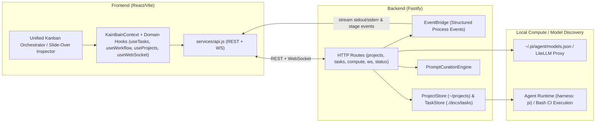

# KainBain — Project Status

> **Last updated:** 2026-08-18 (Attempt 4 Major Overhaul Completed)
> **Scope:** A point-in-time snapshot of the KainBain orchestrator after the Attempt 4 major overhaul: architecture, filesystem-backed projects, discrete task execution engine, unified Kanban orchestrator UI, real-time observability, and comprehensive verification.

---

## 1. What KainBain Is

KainBain is a **local-first AI task orchestrator**. An operator manages filesystem-backed projects, defines custom multi-stage pipelines (composing `agent`, `human`, `review`, and `ci`/`script` stages), submits discrete tasks directly into Kanban stages, and inspects real-time streaming execution. Completed stages generate structured, timestamped markdown reports persisted to the project's documentation space (`./docs/tasks/<taskId>/<stage-name>-<datetime>.md`), which is symlinked to SilverBullet.

The core loop: **discover/create project → define specialized stages & model routing → add discrete tasks → agent/script executes with live stdout/stderr streaming → human approves/rejects with feedback → markdown reports persisted to docs space.**

---

## 2. Architecture

The repo is a monorepo with three packages plus root tooling.

```text
kainbain/
├── api/            Fastify backend (HTTP + WebSocket + ProjectStore + TaskStore + EventBridge + Model discovery)
├── frontend/        React (Vite) UI — unified Kanban orchestrator, slide-over task inspector, live activity console
├── canary-e2e/     Playwright smoke/E2E + visual regression + WCAG AAA accessibility tests
├── docs/           Design, architecture + standards (SilverBullet space, symlinked)
├── deploy.sh       Idempotent build/test/deploy
├── Security_scans.sh
└── package.json    Root orchestration (test / lint / build / deploy / sec)
```



### 2.1 Backend (`api/`)

A clean, modular HTTP + WebSocket layer built with Fastify, 100% colocated unit tests, and JSDoc Minimap headers (`/*** MARK: ... ***/`).

| Concern | File(s) | Colocated Tests | Description |
| :--- | :--- | :--- | :--- |
| HTTP entry | `index.js` | — | Fastify app; registers routes; owns WebSocket upgrade; seeds default projects. |
| Event bridge | `eventBridge.js` | `eventBridge.test.js` | Structured event pipeline (`process:start`, `process:stdout`, `process:stderr`, `stage:enter`, `stage:complete`, `stage:failback`). |
| Projects Store | `projectStore.js` | `projectStore.test.js` | Discovers directories under `~/projects/`; initializes `.kainbain/project.json`; auto-provisions SilverBullet notes space in `~/apps/notes/silverbullet/space/Projects/Personal/<name>` with symlinked `<projectRoot>/docs`. |
| Task Store | `taskStore.js` | `taskStore.test.js` | Discrete task lifecycle, CI bash script execution in project `cwd`, timestamped markdown reports in `./docs/tasks/<taskId>/`. |
| Prompt Curation | `promptCuration.js` | `promptCuration.test.js` | Curates discrete stage prompts, links previous stage markdown reports, appends human feedback on stage failbacks. |
| Routes | `routes/projects.js`, `routes/tasks.js`, `routes/compute.js`, `routes/ws.js`, `routes/status.js`, `routes/sessions.js`, `routes/workflows.js` | Adjacent `routes/*.test.js` | Full REST & WebSocket API coverage. |

### 2.2 Frontend (`frontend/`)

Unified single-page Kanban architecture adhering to `DESIGN_SPEC.md` and WCAG 2.2 AAA standards.

```text
frontend/src/
├── context/        KainBainContext + useTasks / useWorkflow / useProjects / useWebSocket / useUiPreferences / useSession
├── components/
│   ├── layout/     Header (project switcher, UI customize, shortcuts), NowPlayingBar (transport controls, timer, progress)
│   ├── workflow/   WorkflowCanvas (unified Kanban columns, in-place quick add, live activity console drawer)
│   ├── tasks/      TaskCard (draggable, role badges), TaskDetailOverlay (slide-over inspector, markdown viewer, timeline)
│   ├── settings/   ProjectSettings (project path, SilverBullet docs symlink, Forgejo git URL)
│   └── ...         StageSettingsTray, PromptReviewModal, FeedbackDialog, Modal, Icon, ToolCard
└── services/        api.js (REST + WS client), soundEffects.js, notifications.js, logger.js
```

### 2.3 Canary E2E & Visual Regression (`canary-e2e/`)

Full Playwright suite running against live backend and frontend dev servers.

---

## 3. Verification & Test Metrics

| Suite | Status | Coverage |
| :--- | :--- | :--- |
| **API Unit Tests** | ✅ **106 passing** | 100% colocated unit tests across all stores and route handlers. |
| **Frontend Unit Tests** | ✅ **144 passing** | 100% colocated unit tests across all hooks and components (25 test files). |
| **Total Unit Tests** | ✅ **250 passing** | 0 failures. |
| **Repository Linting** | ✅ **Clean** | 0 ESLint errors across backend and frontend (`npm run lint`). |
| **Playwright Canary Suite** | ✅ **38 passing** | Functional E2E, Task Lifecycle, Workflow Controls, Mobile Responsiveness, Axe WCAG AAA, and Visual Snapshots. |
| **Visual Snapshots** | ✅ **12 passing** | Desktop (1280px), Tablet (768px), and Mobile (375px) across empty, active, and history states. |

Commands to run all checks:

```bash
npm run test:unit    # 250 unit tests across api and frontend
npm run lint         # zero lint errors
npm run test:canary  # full 38-test Playwright suite
```

---

## 4. Attempt 4 Accomplishments Summary

1. **Step 1 — Code Standards & Colocated Tests**:
   - Relocated all API tests to sit directly adjacent to source modules; removed deprecated `api/tests/`.
   - Standardized `/*** MARK: funcName ... ***/` JSDoc comments across all backend modules.

2. **Step 2 — Filesystem Projects & Discrete Task Engine**:
   - `ProjectStore` dynamic folder discovery under `~/projects/` and per-project `.kainbain/project.json`.
   - Automated SilverBullet space provisioning with symlink `<projectRoot>/docs` -> `~/apps/notes/silverbullet/space/Projects/Personal/<name>`.
   - Replaced continuous session trees with discrete task reports saved to `./docs/tasks/<taskId>/<stage-name>-<datetime>.md`.

3. **Step 3 — Stage Specialization, Fallback Routing & Model Integration (via harness)**:
   - `GET /compute/models` local model discovery from `~/.pi/agent/models.json` / LiteLLM.
   - Stage types: `human` (review checkpoint banner), `ci`/`script` (bash command execution in project `cwd`), `agent` (model picker + system prompt), and `review`.
   - Dynamic fallback stage selector supporting project-specific stages and standard routing (`start`, `previous`, `abort`).

4. **Step 4 — Unified Workspace UI & In-Place Task Management**:
   - Consolidated master Kanban Orchestrator view (`WorkflowCanvas.jsx`); removed legacy split views and token meters.
   - In-line column `+ Add Task` quick-create forms.
   - Integrated slide-over Task Inspector (`TaskDetailOverlay.jsx`) allowing simultaneous board interaction.
   - Overhauled `ProjectSettings.jsx` (directory, SilverBullet symlink, Forgejo git URL).

5. **Step 5 — Real-Time Observability & Live Logs**:
   - Streaming process events over WebSocket (`process:start`, `process:stdout`, `process:stderr`, `stage:enter`, `stage:complete`, `stage:failback`).
   - Live Activity Console drawer with color-coded severity tags (`[AGENT]`, `[HUMAN]`, `[CI/CMD]`, `[INFO]`, `[ERROR]`), auto-scroll lock, search, and tag filters.
   - Interactive human checkpoint banners with single-click Approve and Reject-with-Feedback dialog.

6. **Step 6 — Mobile Responsiveness, Accessibility & Canary E2E Suite**:
   - Mobile single-column Kanban with pill-based stage selector (< 768px).
   - Full-width slide-over inspector with accessible touch targets (≥ 44x44px).
   - WCAG 2.2 AAA 7:1 color contrast compliance and zero axe violations.
   - All 38 Playwright E2E and visual snapshot regression tests passing.
