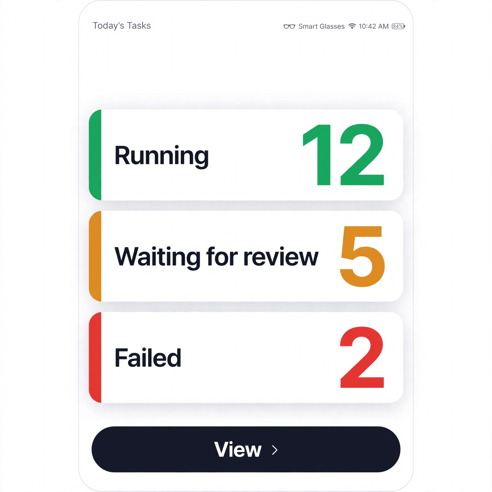
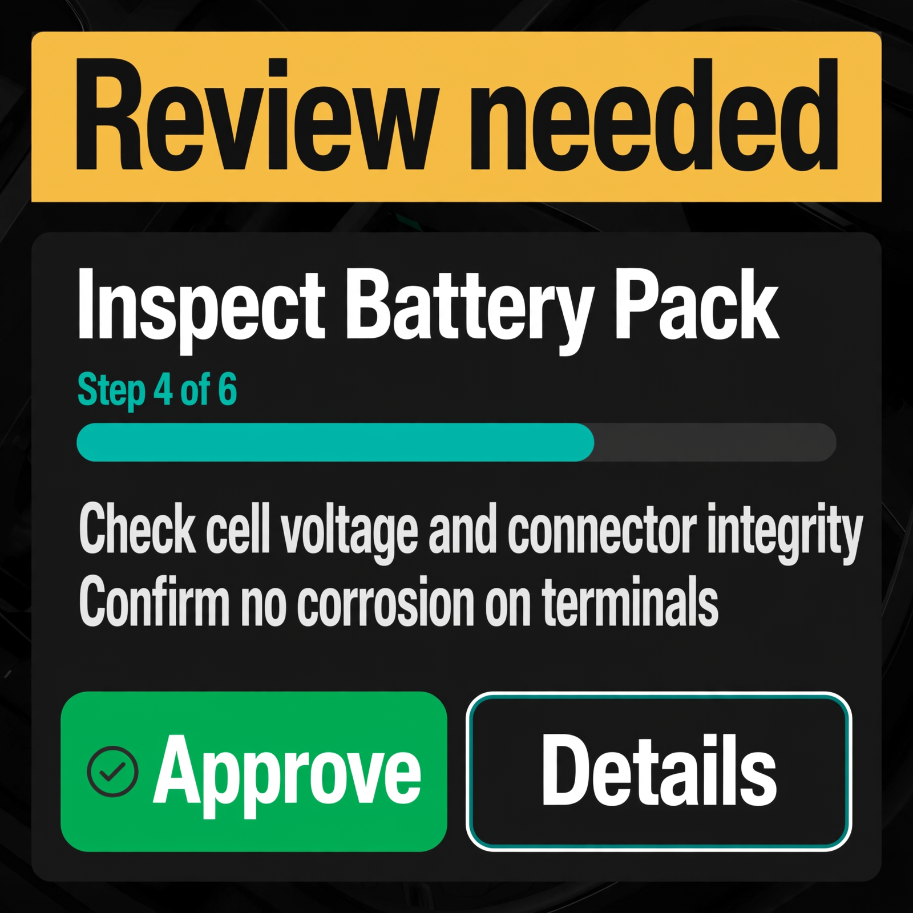

# Meta Ray-Ban display mode — Implementation Plan

**Task:** Add a dedicated UI mode for a ~600×600 canvas so KainBain can be used on a Meta Ray-Ban display. Observability and quick review take priority; full desktop/mobile functionality is intentionally out of scope for this mode. Desktop and mobile views must remain byte-for-byte behaviourally identical.

**Surface:** Frontend only (`frontend/src`). Backend/API contracts are reused unchanged.

**Survey source:** `docs/tasks/202ebd9b-4018-486b-a066-9c8eac3535a3/SURVEY.md` (rounds 1, 3, 4, 5, 6) plus chosen mockups in `assets/`.

## Goal

- Auto-detect a ~600×600 viewport and switch to a purpose-built, big-text, low-clutter wearable mode.
- Wearable mode exposes only two screens: a **task list** (status summary) and a **quick review** screen (one task at a time, approve / details).
- Wearable mode is **additive**: it never activates on desktop widths or on phone-narrow/tall screens, so existing desktop and mobile behaviour and tests stay untouched.
- Information stays **observability-first** (which task is running + its status), refreshes every few seconds, and status changes are conveyed quietly by colour rather than banners.

## Success criteria

1. `npm run test:unit` and `npm run lint` pass without changing any pre-existing desktop/mobile test expectations.
2. On a viewport of ~600×600 (both dimensions 560–680 px and aspect ratio 0.9–1.1) the app renders the wearable mode; on any other viewport it renders exactly as before.
3. Wearable task list shows, in large type: the running task name, current step name, and a counts summary (Running / Waiting for review / Failed), plus a refresh-worthy live status dot that updates on its own every ~5 s.
4. Wearable quick review shows: task name, `Step N of M`, a short (≤2 line) summary, and two extra-large buttons — **Approve** and **Details**.
5. **Approve** is never one-tap: it opens an "Are you sure?" confirmation before calling `advanceTask`.
6. Status changes announce via `aria-live` / colour, without banners or modal interruptions, per survey q9.
7. New behaviour is covered by committed unit tests beside the touched code; user-facing docs mention the mode.
8. Two survey-chosen mockups are referenced in this plan and reused as visual targets:

   
   

## Survey decisions factored in

| Survey item | Answer used |
| --- | --- |
| q1 first thing to see | Which task is running and its overall status |
| q2 must-see details | Task name, current step name, approve/continue buttons |
| q3 actions | Look only, approve/continue, open a bit more detail |
| q4 activation | Automatic on a small ~600×600 screen |
| q5 text style | Big text, few items |
| q6 approve safety | Ask "are you sure?" before approving |
| q7 general look | Light, clean, big status cards (chosen mockup above) |
| q8 freshness | Update by itself every few seconds |
| q9 attention | Just change the status colour quietly |
| q12 screens | Task list plus review screen |
| q13 quick review | Dark high-contrast amber banner, teal progress, Approve/Details |

Reconciliation of the two chosen mockups (deliberate, not a contradiction): the general wearable home uses the **light** summary-card aesthetic from r1/q7 (counts + View), while the wearable **quick-review** screen uses the dark, high-contrast review aesthetic from r6/q13 (amber "Review needed" banner, teal progress, large buttons). This keeps observability readable in daylight (r1) and review deliberate in any lighting (r6).

## Scope

In scope:
- A new wearable/glasses viewport predicate + hook.
- A wearable task-list summary component and a wearable quick-review component.
- Auto-refresh wiring for those two screens.
- Confirmation gating for approve.
- Tests and docs.

Out of scope (deliberately, per "less is more"):
- Full stage editing, drag-and-drop, canvas, diffs, comments threads, settings, docs, explorer.
- Offline/queue management beyond live data already pushed by the socket.
- New backend endpoints.

## Non-goals / non-impact contract

- `isNarrowViewport` / `useIsNarrowViewport` behaviour and breakpoint (639 px, width-only) are **unchanged**.
- Mobile monitor view, phone CSS overrides, and task detail pages keep their current output for every viewport that is not glasses-shaped.
- Glasses mode is a **subset** decision on top of existing modes: a glasses-shaped viewport renders glasses views instead of mobile views; all other viewports render exactly as today.

## Key decisions

- **D1 — Detection is shape-based, not width-only.** A glasses viewport is `560 ≤ w ≤ 680` AND `560 ≤ h ≤ 680` AND `0.9 ≤ w/h ≤ 1.1`. This guarantees phones (tall, narrow) and tablets stay on their current UI; a square-ish ~600 px box alone qualifies.
- **D2 — Detection lives in the shared viewport util**, next to `isNarrowViewport`, with the same override seam so tests stay deterministic. New helper is `isGlassesViewport` / `useIsGlassesViewport`.
- **D3 — Glasses mode is a view-layer overlay, not a new route.** No new router paths. `App`/`OrchestratorView`/`TaskReviewPage` swap their rendered subtree based on the hook. Hash URLs stay valid, so deep links and refresh behave identically.
- **D4 — Reuse existing data hooks**, (`useKainBain`, `useReview`, task board), plus a lightweight 5 s refresh tick driven by an existing polling primitive or a small `useInterval`. No new API surface.
- **D5 — Approve requires confirmation** via a compact confirm step inside the glasses view; the existing `advanceTask` is called only after explicit second tap.
- **D6 — Status is communicated quietly**: colour + a single `aria-live="polite"` line, no banner/modal. This mirrors survey q9 and keeps quick review uninterrupted.
- **D7 — Feature is always on but strictly gated by detection.** No runtime flag; the predicate is the kill switch. This avoids drift between desktop and wearable builds.

## Phase 0 — Research spikes (do first; unblocks everything)

### Step 0.1 — Viewport semantics spike
- Confirm real Meta Ray-Ban canvas reports `window.innerWidth/innerHeight` around 600 each, and that orientation does not flip one dimension to landscape 960. If real-device reports differ, adjust D1 tolerance before code.
- Decide JS-vs-media-query: use JS dimension check (testable, tolerant) rather than CSS media query, to keep override seam parity with `isNarrowViewport`.

### Step 0.2 — Component surface audit
- Enumerate the minimal data each glasses screen needs and confirm it is available without the full `WorkflowCanvas` / `TaskReviewPage` trees:
  - Task list: `tasks`, `engineState`, `stages`, `selectedProjectId` from `useKainBain`; `isMonitorRunning`, running task resolver.
  - Quick review: `useReview({ projectId, taskId })`, task, project stages, `advanceTask`, `rejectTaskWithFeedback`.
- Note which heavy components (diffs, comment threads, settings drawers) must **not** be imported by glasses components, to keep bundle/parse cost low on-device.

### Step 0.3 — Auto-refresh contract
- Inspect existing polling in `ObservabilityDashboard`, `useReview`, and websocket dispatch to decide whether a 5 s tick is already covered or whether a new `useInterval` is needed.
- Define pause rules: pause when `document.visibilityState === 'hidden'`, when a modal/confirm is open, and on unmount. Never overlap in-flight fetches.

### Step 0.4 — Accessibility baseline
- Capture current a11y test patterns (`aria-live`, focus management) to mirror in the new components; confirm 44 px minimum targets (existing convention) and contrast on both chosen mockups.

### Step 0.5 — Collect device evidence
- Optional: use `npm run capture:screenshot` against a 600×600 viewport for before/after; store under task `assets/` only if a new mockup is generated. (Survey already generated the two chosen mockups; no new image generation required unless design changes.)

## Phase 1 — Make the change easy (no behaviour change)

### Step 1.1 — Extend the shared viewport util
- File: `frontend/src/components/util/viewport.js`
- Add `isGlassesViewport(win = …)` and `useIsGlassesViewport()` following the exact shape of `isNarrowViewport`/`useIsNarrowViewport`:
  - Same `glassesViewportOverride` + `setGlassesViewportOverride` test seam.
  - Dimension check per D1; resize listener live toggle.
  - Fails safe to `false` when `window`/dimensions unavailable.
- Keep `viewport.test.js` split into two describe blocks; add glasses cases (narrow-but-tall → false, 600×600 square → true, 600×900 → false, missing window → false, override wins).
- Update `monitorCompact.js` only if needed for re-export; prefer new imports from `util/viewport` to avoid coupling.

### Step 1.2 — Add glass-shaped component shells (render nothing yet or a placeholder behind the hook)
- `frontend/src/components/glasses/GlassesViewportGate.jsx`: accepts `children` for glasses-only content and falls back to `null` otherwise; centralises the hook so call sites stay one line.
- `frontend/src/components/glasses/GlassesTaskListView.jsx`: skeleton props contract (tasks, running task, counts, onOpenTask, onRefresh). No data fetching inside beyond receiving props; fetching stays in parent.
- `frontend/src/components/glasses/GlassesQuickReviewView.jsx`: skeleton props contract (task, review data, progress text, summary lines, onApprove, onOpenDetails, confirming state).
- `frontend/src/components/glasses/GlassesApprovalConfirm.jsx`: compact confirm with two large buttons; pure controlled component.
- `frontend/src/components/glasses/index.js`: barrel.

### Step 1.3 — Add glass-specific stylesheet tokens (minimal)
- Reuse existing Tailwind classes; only add a few wearable utility classes to `index.css` if needed (extra-large text scale, 44 px touch targets). Keep in one block so non-glasses CSS is untouched.

### Step 1.4 — Add pure helpers with unit tests
- Create `frontend/src/components/glasses/glassesHelpers.js` with pure functions:
  - `resolveGlassesCounts(tasks)` → `{ running, waitingReview, failed, total }`.
  - `resolveGlassesProgress(task, stages)` → `Step 3 of 8` style string or `null`.
  - `resolveGlassesSummary(reviewData)` → array of ≤2 short strings.
  - `shouldShowGlassesConfirm(state)` etc.
- Add `glassesHelpers.test.js`.

### Step 1.5 — Wire viewport hook into observability and app shells as no-ops first
- Call `useIsGlassesViewport()` in `ObservabilityDashboard.jsx` and `OrchestratorView`/`TaskReviewPage` but **do not** change rendered output yet.
- Add tests asserting return value passes through props/flags without altering existing snapshots. This step only proves plumbing compiles and tests pass.

### Step 1.6 — Make change easy exit gate
- Run `npm run test:frontend` and `npm run lint:frontend`; fix only plumbing regressions.
- Commit checkpoint: "plumbing only, no behaviour change".

## Phase 2 — Make the change

### Step 2.1 — Wearable observability task-list screen (priority 1)
- In `ObservabilityDashboard.jsx`, change compact decision to:
  - `const isGlasses = useIsGlassesViewport();`
  - `const showCompact = (compactRequested || isNarrow) && !isGlasses;`
  - `const showGlasses = isGlasses;`
- When `showGlasses`, render `GlassesObservabilityTaskList` instead of the widget grid, reusing `resolveRunningTask`, KPI counts, and current engine status. Layout follows r1/q7: top task title + status dot; centre Running/Waiting/Failed cards with counts; bottom wide **View** button routing to the wearable quick review for the selected/review-ready task.
- Add 5 s auto-refresh tick (per 0.3) plus a manual refresh button as backup.
- Status colour changes are the only attention signal (D6); no banners.

### Step 2.2 — Wearable task list from the orchestrator surface
- In `OrchestratorView.jsx`, when glasses mode is detected, render `GlassesTaskListView` instead of `WorkflowCanvas` + `NowPlayingBar`.
- Task list derives from `tasks` + `engineState`: show only tasks that are running or review-ready (limit 3–5 to respect big-text goal); tap a row sets selected task and navigates to its quick review.
- Keep `TaskDetailOverlay` disabled on glasses (details move to the **Details** affordance instead of slide-over).

### Step 2.3 — Wearable quick-review screen (priority 2)
- In `TaskReviewPage.jsx`, when glasses mode is detected, early-return `<GlassesQuickReviewView … />` with props mapped from existing `task`, `project`, `review`:
  - Title (task name first line).
  - Progress text from `resolveGlassesProgress`.
  - Summary lines from `resolveGlassesSummary` (latest message/error, ≤2 lines).
  - **Approve** + **Details** large buttons.
- **Approve** flow: toggle `confirming=true` → `GlassesApprovalConfirm` (D5) → on confirm call existing `handlePass('')`. Details calls `setActiveTab('files')`? In glasses, details opens a simplified read-only report view or links back to desktop mode (preferred: "Open full review on phone/desktop" message + back). Start minimal: **Details** calls the existing `backToTaskDetail`? No — prefer showing the report summary text only, with an explicit "Open on larger screen for full diff" hint.
- Integrate `useReview` auto-refresh tick; do not introduce new network endpoints.

### Step 2.4 — Approval safety and double-submit guard
- Reuse `usePendingAction` (`pendingKey`) to disable both buttons while in-flight.
- Confirmation modal has its own cancel; escaping closes without approving.
- Confirm dialog blocks navigation until resolved.

### Step 2.5 — Accessibility and quiet status
- Use `role="status"` / `aria-live="polite"` for the one-line status text; ensure status colour has text fallback (e.g. "Running", not colour alone).
- Confirmation buttons ≥44 px; focus trap in confirm dialog.
- Reduced-motion respected (no animated banners).

### Step 2.6 — Feature flag/rollback convenience
- No runtime flag per D7, but keep all glasses logic behind `if (isGlasses)` so reverting is a single predicate change. Document this in code comments.

## Phase 3 — Testing plan

### Unit/integration (primary gate)
- Extend `frontend/src/components/util/viewport.test.js` (or add `glassesViewport.test.js`) with: dimension cases, override seam, resize.
- Add `GlassesTaskListView.test.jsx`, `GlassesQuickReviewView.test.jsx`, `GlassesApprovalConfirm.test.jsx`, `glassesHelpers.test.js` covering:
  - counts/progress/summary pure functions;
  - approve requires second tap (no `advanceTask` on first tap);
  - details does not trigger approve;
  - auto-refresh tick calls refetch and pauses when hidden;
  - status text announces via `aria-live`.
- Component plumbing tests in `ObservabilityDashboard`/`OrchestratorView`/`TaskReviewPage` asserting that on a non-glasses viewport output is unchanged (use override `setGlassesViewportOverride(false)`).

### Non-impact (regression) checks
- Run existing suites unchanged; specifically `WorkflowCanvas.*`, `ObservabilityDashboard.*`, `TaskReviewPage.test.jsx`, `viewport.test.js`.
- Add a small "parity" test: with override false, rendered container's `data-testid` set matches a stored list.

### Lint/type
- `npm run lint:frontend`; `npm run build:frontend` (ensures import graph and check-react pass).

### Visual
- Use `npm run capture:screenshot` at 600×600 only; compare against the two chosen mockups. No long-lived servers.

## Phase 4 — Documentation plan

- Update `README`/screen docs to mention Meta Ray-Ban 600×600 auto mode (observability + quick review).
- Add JSDoc to new components following repo conventions (MARK blocks) so `docs:check` stays green.
- Update `a11y` statement if needed (target sizes, live regions).
- Record decisions D1–D7 and mockup references in the task folder (this file is that record).

## Risks and mitigations

- **Risk:** Glasses detection overlaps phone narrow (600 px is below 639). *Mitigation:* shape-based predicate (D1) and explicit `&& !isGlasses` in compact branch; phones remain tall/narrow.
- **Risk:** Heavy review data crashes low-power glasses. *Mitigation:* quick-review renders only title/progress/2-line summary + buttons; full diff remains on other screens via Details hint.
- **Risk:** Auto-refresh spam. *Mitigation:* visibility pause, in-flight guard, 5 s minimum, manual backup button.
- **Risk:** Approve accidental. *Mitigation:* two-step confirm; disable while pending.
- **Risk:** Tests assume wide layout in jsdom. *Mitigation:* glasses override defaults to auto-detect; jsdom has no matchMedia, so `isGlassesViewport` defaults false — existing tests remain unaffected.

## Validation order (verification overall)

1. `cd frontend && npm run check:duplicate-identifiers`
2. `npm run test -- src/components/util/viewport.test.js` (new glasses cases)
3. `npm run test` (full frontend)
4. `npm run lint`
5. `npm run build`
6. `npm run test:unit` (root; includes api, no api changes expected)

## Deliverables

- `frontend/src/components/util/viewport.js` — `isGlassesViewport`, `useIsGlassesViewport`, override seam.
- `frontend/src/components/glasses/*` — gate, task list, quick review, confirm, helpers, barrel.
- Updated `ObservabilityDashboard.jsx`, `OrchestratorView.jsx`, `TaskReviewPage.jsx` with gated substitution.
- Tests listed in Phase 3.
- Docs updates in Phase 4.
- This plan: `docs/tasks/202ebd9b-4018-486b-a066-9c8eac3535a3/IMPLEMENTATION_PLAN.md`.
