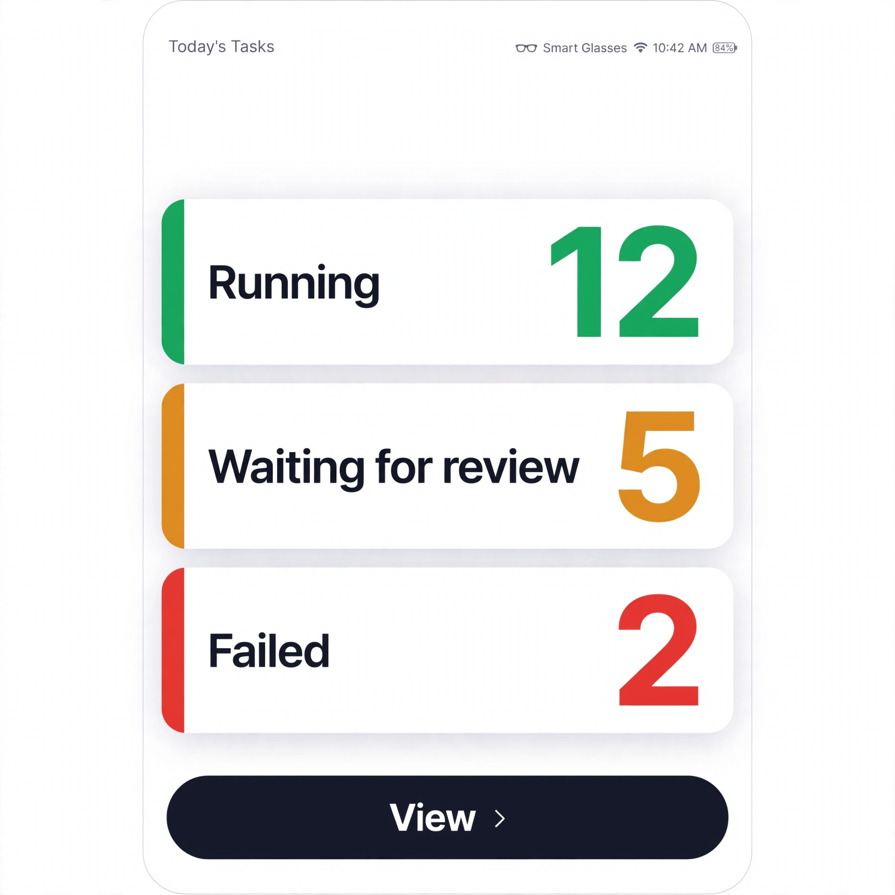
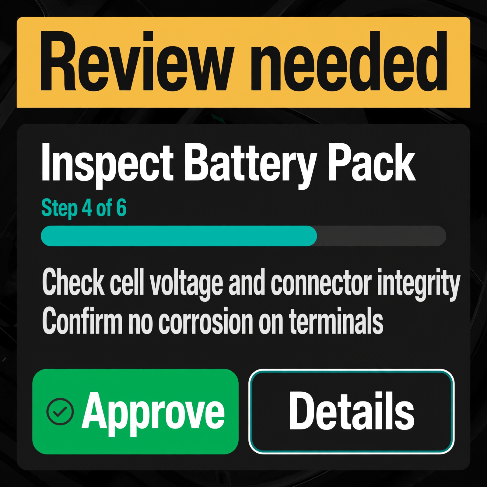

# Survey – generated by the "question‑me" skill

```survey-json
{
  "round": 1,
  "generatedAt": "2026-11-04T14:05:05.000Z",
  "stage": "stage-1792362077711",
  "questions": [
    {
      "id": "q1",
      "type": "single",
      "text": "When you glance at the small glasses screen (about 600 by 600), what is the most important thing to see first?",
      "options": [
        "Which task is running and its overall status",
        "Which step the task is on and how far along it is",
        "Alerts and problems that need attention",
        "A simple list of my tasks to pick from"
      ],
      "required": true,
      "showIf": null
    },
    {
      "id": "q2",
      "type": "multiple",
      "text": "Which small pieces of information must still be easy to see on the glasses screen? (Tick all that matter to you)",
      "options": [
        "Task name",
        "Current step name",
        "Progress (like step 3 of 8)",
        "Status colour (green, red, waiting)",
        "Latest message or error in one or two lines",
        "Buttons to approve or continue"
      ],
      "required": false,
      "showIf": null
    },
    {
      "id": "q3",
      "type": "multiple",
      "text": "What should you be able to DO from the glasses screen? Keep in mind the screen is tiny, so less is more.",
      "options": [
        "Just look — no buttons needed",
        "Approve or continue when asked",
        "Pause or stop a task",
        "Open a bit more detail",
        "Something else (describe in Notes)"
      ],
      "required": false,
      "showIf": null
    },
    {
      "id": "q4",
      "type": "single",
      "text": "How should the glasses view turn on?",
      "options": [
        "On its own when the screen is small (about 600 by 600)",
        "By tapping a button to switch to glasses view",
        "Both — automatic, but with a button to switch back",
        "Not sure — pick the simplest safe way"
      ],
      "required": true,
      "showIf": null
    },
    {
      "id": "q5",
      "type": "single",
      "text": "The glasses screen is small. Which text style do you prefer?",
      "options": [
        "Big text, only a few items — easiest to read",
        "Normal text, more items on screen",
        "Not sure — pick what reads best"
      ],
      "required": false,
      "showIf": null
    },
    {
      "id": "q6",
      "type": "single",
      "text": "If approve buttons are included on the glasses screen, how careful should they be?",
      "options": [
        "One tap approves straight away",
        "Ask 'are you sure?' before approving",
        "Only allow approve for safe steps"
      ],
      "required": false,
      "showIf": {
        "questionId": "q3",
        "value": "Approve or continue when asked"
      }
    },
    {
      "id": "q7",
      "type": "image",
      "text": "Which look should we build for the glasses screen? Pick your favourite picture.",
      "options": [
        "Square 600x600 smart glasses UI mockup, dark high-contrast theme for outdoor readability, top row with large green status dot and task name in big bold white text, middle shows Step 3 of 8 progress bar in teal with current step name below, bottom shows one short alert line and two very large touch buttons labelled Approve and Details, huge readable fonts, minimal clutter, rounded corners, modern wearable app style",
        "Square 600x600 smart glasses UI mockup, light clean theme with white background and dark text, top shows small task title, centre shows three large stacked status cards (Running, Waiting for review, Failed) each with a coloured left edge and a big number, bottom shows one wide View button, generous whitespace, extra-large text, simple friendly rounded style like a phone widget",
        "Square 600x600 smart glasses UI mockup, dark navy dashboard theme, top shows compact task list of 4 rows each with status dot and short name with the selected row highlighted, middle shows mini progress dots for 8 steps, bottom shows a single Details button, condensed but still large text, monospace accents, calm professional monitoring-app style"
      ],
      "required": true,
      "showIf": null,
      "images": [
        {
          "option": 0,
          "file": "assets/survey-r1-q7-0.png",
          "status": "ready"
        },
        {
          "option": 1,
          "file": "assets/survey-r1-q7-1.png",
          "status": "ready"
        },
        {
          "option": 2,
          "file": "assets/survey-r1-q7-2.png",
          "status": "ready"
        }
      ]
    }
  ],
  "answers": {
    "q1": {
      "selected": [
        "Which task is running and its overall status"
      ],
      "notes": ""
    },
    "q2": {
      "selected": [
        "Task name",
        "Current step name",
        "Buttons to approve or continue"
      ],
      "notes": ""
    },
    "q3": {
      "selected": [
        "Approve or continue when asked",
        "Just look — no buttons needed",
        "Open a bit more detail"
      ],
      "notes": ""
    },
    "q4": {
      "selected": [
        "On its own when the screen is small (about 600 by 600)"
      ],
      "notes": ""
    },
    "q5": {
      "selected": [
        "Big text, only a few items — easiest to read"
      ],
      "notes": ""
    },
    "q6": {
      "selected": [
        "Ask 'are you sure?' before approving"
      ],
      "notes": ""
    },
    "q7": {
      "selected": [
        "Square 600x600 smart glasses UI mockup, light clean theme with white background and dark text, top shows small task title, centre shows three large stacked status cards (Running, Waiting for review, Failed) each with a coloured left edge and a big number, bottom shows one wide View button, generous whitespace, extra-large text, simple friendly rounded style like a phone widget"
      ],
      "notes": ""
    }
  }
}
```

## Round 2

```survey-json
{
  "round": 2,
  "generatedAt": "2026-11-04T00:00:00.000Z",
  "stage": "stage-1792362077711",
  "questions": [],
  "answers": {}
}
```

## Round 3

```survey-json
{
  "round": 3,
  "generatedAt": "2026-11-04T18:23:14.000Z",
  "stage": "stage-1792362077711",
  "questions": [
    {
      "id": "q8",
      "type": "single",
      "text": "How fresh should the information on the glasses screen be?",
      "options": [
        "Update by itself every few seconds",
        "Only update when I tap a refresh button",
        "Update by itself, plus a refresh button as backup"
      ],
      "required": false,
      "showIf": null
    },
    {
      "id": "q9",
      "type": "single",
      "text": "When something goes wrong or needs your approval, how should the glasses screen get your attention?",
      "options": [
        "A big red or amber banner at the top",
        "Just change the status colour quietly",
        "Banner plus keep it visible until I act",
        "Not sure — pick the simplest clear way"
      ],
      "required": false,
      "showIf": null
    }
  ],
  "answers": {
    "q8": {
      "selected": [
        "Update by itself every few seconds"
      ],
      "notes": ""
    },
    "q9": {
      "selected": [
        "Just change the status colour quietly"
      ],
      "notes": ""
    }
  }
}
```

## Round 4

```survey-json
{
  "round": 4,
  "generatedAt": "2026-11-04T18:31:17.000Z",
  "stage": "stage-1792362077711",
  "questions": [
    {
      "id": "q10",
      "type": "single",
      "text": "I think these questions are enough to move forward with a plan. Do you agree?",
      "options": [
        "Yes, I have everything I need to answer above and we can go ahead",
        "No, I want to add or change something (describe in Notes)"
      ],
      "required": true,
      "showIf": null
    }
  ],
  "answers": {
    "q10": {
      "selected": [
        "Yes, I have everything I need to answer above and we can go ahead"
      ],
      "notes": ""
    }
  }
}
```

## Round 5

```survey-json
{
  "round": 5,
  "generatedAt": "2026-11-04T14:30:00.000Z",
  "stage": "stage-1792362077711",
  "questions": [
    {
      "id": "q11",
      "type": "single",
      "text": "I think this is simple enough to not require questions. Do you agree?",
      "options": [
        "Yes, move ahead with what is already asked above",
        "No, I still have something to add (describe in Notes)"
      ],
      "required": true,
      "showIf": null
    }
  ],
  "answers": {
    "q11": {
      "selected": [
        "Yes, move ahead with what is already asked above"
      ],
      "notes": ""
    }
  }
}
```

## Round 6

```survey-json
{
  "round": 6,
  "generatedAt": "2026-11-05T00:00:00.000Z",
  "stage": "stage-1792362077711",
  "questions": [
    {
      "id": "q12",
      "type": "single",
      "text": "Which screens should get the small glasses-friendly view? Desktop and phone stay exactly the same.",
      "options": [
        "Only the review screen where I check and approve work",
        "Task list plus review screen (see all tasks, then check one)",
        "One simple summary screen for everything",
        "Not sure - pick the smallest safe starting point"
      ],
      "required": true,
      "showIf": null
    },
    {
      "id": "q13",
      "type": "image",
      "text": "Which quick-review layout should we build for the 600 by 600 glasses screen? Pick your favourite picture.",
      "options": [
        "Square 600x600 smart glasses quick-review UI mockup, dark high-contrast theme for outdoor readability, top shows wide amber banner reading Review needed in very large bold text, centre shows one task card with big white task name and Step 4 of 6 thick teal progress bar plus two lines of large summary text, bottom shows two extra-large side-by-side buttons Approve in green and Details as outline, huge touch targets, minimal clutter, modern wearable app style",
        "Square 600x600 smart glasses observer UI mockup, dark navy theme, top shows large status headline with big green running dot and task name, centre shows a large circular progress ring for Step 4 of 6 with current step name underneath in big text, one short alert line below in amber, bottom shows a single extra-large View details button, very large readable fonts, calm monitoring-app style with generous spacing",
        "Square 600x600 smart glasses summary UI mockup, light clean theme with white background, top shows small title My tasks with a count badge, centre shows two large stacked cards each with a coloured status edge green and amber plus big task names and one-line progress text, bottom shows one wide dark Review button, extra-large text, friendly rounded widget style with generous whitespace"
      ],
      "required": true,
      "showIf": null,
      "images": [
        {
          "option": 0,
          "file": "assets/survey-r6-q13-0.png",
          "status": "ready"
        },
        {
          "option": 1,
          "file": "assets/survey-r6-q13-1.png",
          "status": "ready"
        },
        {
          "option": 2,
          "file": "assets/survey-r6-q13-2.png",
          "status": "ready"
        }
      ]
    }
  ],
  "answers": {
    "q12": {
      "selected": [
        "Task list plus review screen (see all tasks, then check one)"
      ],
      "notes": ""
    },
    "q13": {
      "selected": [
        "Square 600x600 smart glasses quick-review UI mockup, dark high-contrast theme for outdoor readability, top shows wide amber banner reading Review needed in very large bold text, centre shows one task card with big white task name and Step 4 of 6 thick teal progress bar plus two lines of large summary text, bottom shows two extra-large side-by-side buttons Approve in green and Details as outline, huge touch targets, minimal clutter, modern wearable app style"
      ],
      "notes": ""
    }
  }
}
```

## Chosen designs

Image-question selections, saved automatically when the survey is submitted (re-submitting updates this list).

- [r1/q7] 
- [r6/q13] 
