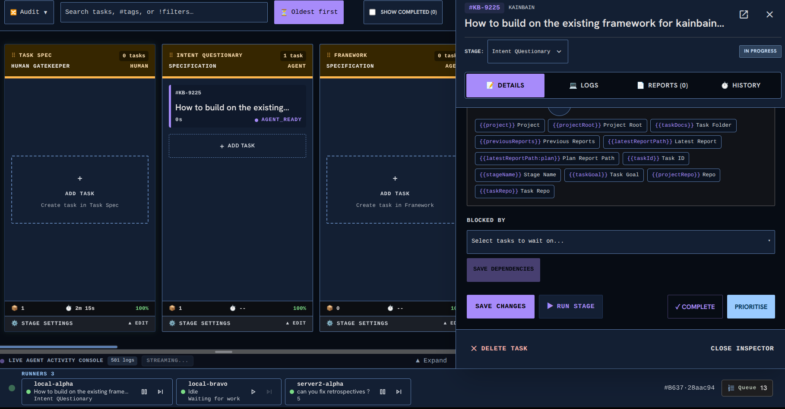

<!-- KAINBAIN AUTO-GENERATED REPORT -->
# Stage Report: automated test 2

**Task:** Runners break when looking at multi pipelines  When on a different pipeline the runners fail to show task and or stage information or seem to imply they are holding steady. Runners should be global and takeup aything from any pipeso therefore need to display details from any pipe
**Stage Type:** `ci`
**Model:** `default`
**Duration:** 1040.072s
**Status:** FAILED

### Summary of Changes
Execution failed: CI command failed with exit code 1

### Execution Output
```
stalling (npm install --prefix frontend)...

added 420 packages, and audited 421 packages in 4s

143 packages are looking for funding
  run `npm fund` for details

found 0 vulnerabilities
Workspace dependencies installed (api, frontend).
✅ Settings duplicate check passed (32 files in 188ms)
▸ started Unit Tests (api)
▸ started Unit Tests (frontend)
▸ started Unit Tests (runner)
▸ started Linting (api)
▸ started Linting (frontend)
▸ started Frontend Build
▸ started Security Script Tests
▸ started Dependency Check
▸ started Dependency Audit Gate
▸ started Harness Self-Tests
▸ started Container Tests
⏳ still running: Unit Tests (api) (30s), Unit Tests (frontend) (30s), Linting (api) (30s), Linting (frontend) (30s), Frontend Build (30s), Dependency Check (30s), Harness Self-Tests (30s)
⏳ still running: Unit Tests (api) (1m00s), Unit Tests (frontend) (1m00s), Linting (api) (1m00s), Linting (frontend) (1m00s)
⏳ still running: Unit Tests (api) (1m30s)
⏳ still running: Unit Tests (api) (2m00s)
⏳ still running: Unit Tests (api) (2m30s)
⏳ still running: Unit Tests (api) (3m00s)
⏳ still running: Unit Tests (api) (3m30s)
⏳ still running: Unit Tests (api) (4m00s)
⏳ still running: Unit Tests (api) (4m30s)
⏳ still running: Unit Tests (api) (5m00s)
⏳ still running: Unit Tests (api) (5m30s)
⏳ still running: Unit Tests (api) (6m00s)
⏳ still running: Unit Tests (api) (6m30s)
⏳ still running: Unit Tests (api) (7m00s)
⏳ still running: Unit Tests (api) (7m30s)
⏳ still running: Unit Tests (api) (8m00s)
⏳ still running: Unit Tests (api) (8m30s)
⏳ still running: Unit Tests (api) (9m00s)
⏳ still running: Unit Tests (api) (9m30s)
⏳ still running: Unit Tests (api) (10m00s)
⏳ still running: Unit Tests (api) (10m30s)
⏳ still running: Unit Tests (api) (11m00s)
⏳ still running: Unit Tests (api) (11m31s)
⏳ still running: Unit Tests (api) (12m01s)
⏳ still running: Unit Tests (api) (12m31s)
⏳ still running: Unit Tests (api) (13m01s)
⏳ still running: Unit Tests (api) (13m31s)
⏳ still running: Unit Tests (api) (14m01s)
⏳ still running: Unit Tests (api) (14m31s)
⏳ still running: Unit Tests (api) (15m01s)
⏳ still running: Unit Tests (api) (15m31s)
⏳ still running: Unit Tests (api) (16m01s)
⏳ still running: Unit Tests (api) (16m31s)
⏳ still running: Unit Tests (api) (17m01s)
Running Unit Tests (api)... FAIL (1023s)
----------------------------------------------------------------------
Details for Unit Tests (api):
(trimmed 3169 of 3289 lines; showing the tail)
 ✓ agent/harnesses/acp/AcpStreamTransport.test.js (7 tests) 9ms
 ✓ project/retrySettings.test.js (10 tests) 7ms
 ✓ flow/dispatch/selectRunnerForTask.test.js (5 tests) 6ms
 ✓ siteDocs.integrity.test.js (3 tests) 18ms
 ✓ stageTags.shared.test.js (8 tests) 7ms
 ✓ flow/runnerBootstrap.test.js (7 tests) 5ms
 ✓ agent/harnesses/muse/museDiscovery.test.js (5 tests) 8ms
 ✓ flow/steerStore.test.js (3 tests) 10ms
{"level":30,"time":1794246653940,"pid":2819994,"hostname":"server-HP-ProDesk-400-G4-SFF","reqId":"req-1","req":{"method":"POST","url":"/projects/register","host":"localhost:80","remoteAddress":"127.0.0.1"},"msg":"incoming request"}
{"level":30,"time":1794246653944,"pid":2819994,"hostname":"server-HP-ProDesk-400-G4-SFF","reqId":"req-1","res":{"statusCode":400},"err":{"type":"Error","message":"body must have required property 'path'","stack":"Error: body must have required property 'path'\n    at defaultSchemaErrorFormatter (/home/[REDACTED]/.kainbain/runner-work/kb-350ca162-afaf-4d33-9d58-25955887db82/api/node_modules/fastify/lib/context.js:92:10)\n    at wrapValidationError (/home/[REDACTED]/.kainbain/runner-work/kb-350ca162-afaf-4d33-9d58-25955887db82/api/node_modules/fastify/lib/validation.js:505:17)\n    at validate (/home/[REDACTED]/.kainbain/runner-work/kb-350ca162-afaf-4d33-9d58-25955887db82/api/node_modules/fastify/lib/validation.js:423:16)\n    at preValidationCallback (/home/[REDACTED]/.kainbain/runner-work/kb-350ca162-afaf-4d33-9d58-25955887db82/api/node_modules/fastify/lib/handle-request.js:115:25)\n    at handler (/home/[REDACTED]/.kainbain/runner-work/kb-350ca162-afaf-4d33-9d58-25955887db82/api/node_modules/fastify/lib/handle-request.js:99:7)\n    at onDone (/home/[REDACTED]/.kainbain/runner-work/kb-350ca162-afaf-4d33-9d58-25955887db82/api/node_modules/fastify/lib/content-type-parser.js:241:5)\n    at AsyncResource.runInAsyncScope (node:async_hooks:226:14)\n    at done (/home/[REDACTED]/.kainbain/runner-work/kb-350ca162-afaf-4d33-9d58-25955887db82/api/node_modules/fastify/lib/content-type-parser.js:211:14)\n    at Parser.defaultJsonParser [as fn] (/home/[REDACTED]/.kainbain/runner-work/kb-350ca162-afaf-4d33-9d58-25955887db82/api/node_modules/fastify/lib/content-type-parser.js:338:7)\n    at Request.onEnd (/home/[REDACTED]/.kainbain/runner-work/kb-350ca162-afaf-4d33-9d58-25955887db82/api/node_modules/fastify/lib/content-type-parser.js:320:27)","statusCode":400,"code":"FST_ERR_VALIDATION","validation":[{"instancePath":"","schemaPath":"#/required","keyword":"required","params":{"missingProperty":"path"},"message":"must have required property 'path'"}],"validationContext":"body"},"msg":"body must have required property 'path'"}
{"level":30,"time":1794246653948,"pid":2819994,"hostname":"server-HP-ProDesk-400-G4-SFF","reqId":"req-1","res":{"statusCode":400},"responseTime":7.209373999998206,"msg":"request completed"}
{"level":30,"time":1794246653949,"pid":2819994,"hostname":"server-HP-ProDesk-400-G4-SFF","reqId":"req-2","req":{"method":"POST","url":"/projects/register","host":"localhost:80","remoteAddress":"127.0.0.1"},"msg":"incoming request"}
{"level":30,"time":1794246653951,"pid":2819994,"hostname":"server-HP-ProDesk-400-G4-SFF","reqId":"req-2","res":{"statusCode":400},"responseTime":1.5340439999999944,"msg":"request completed"}
{"level":30,"time":1794246653951,"pid":2819994,"hostname":"server-HP-ProDesk-400-G4-SFF","reqId":"req-3","req":{"method":"POST","url":"/projects/register","host":"localhost:80","remoteAddress":"127.0.0.1"},"msg":"incoming request"}
{"level":30,"time":1794246654007,"pid":2819994,"hostname":"server-HP-ProDesk-400-G4-SFF","reqId":"req-3","res":{"statusCode":201},"responseTime":55.57988600002136,"msg":"request completed"}
{"level":30,"time":1794246654008,"pid":2819994,"hostname":"server-HP-ProDesk-400-G4-SFF","reqId":"req-4","req":{"method":"POST","url":"/projects/register","host":"localhost:80","remoteAddress":"127.0.0.1"},"msg":"incoming request"}
{"level":30,"time":1794246654009,"pid":2819994,"hostname":"server-HP-ProDesk-400-G4-SFF","reqId":"req-4","res":{"statusCode":200},"responseTime":0.9129039999970701,"msg":"request completed"}
{"level":30,"time":1794246654009,"pid":2819994,"hostname":"server-HP-ProDesk-400-G4-SFF","reqId":"req-5","req":{"method":"GET","url":"/projects","host":"localhost:80","remoteAddress":"127.0.0.1"},"msg":"incoming request"}
{"level":30,"time":1794246654009,"pid":2819994,"hostname":"server-HP-ProDesk-400-G4-SFF","reqId":"req-5","res":{"statusCode":200},"responseTime":0.29313900001579896,"msg":"request completed"}
 ✓ routes/projects.register.test.js (3 tests) 298ms
 ✓ formatPosture.shared.test.js (6 tests) 5ms
{"level":30,"time":1794246654664,"pid":2819994,"hostname":"server-HP-ProDesk-400-G4-SFF","reqId":"req-1","req":{"method":"GET","url":"/onboarding","host":"localhost:80","remoteAddress":"127.0.0.1"},"msg":"incoming request"}
{"level":30,"time":1794246654671,"pid":2819994,"hostname":"server-HP-ProDesk-400-G4-SFF","reqId":"req-1","res":{"statusCode":200},"responseTime":6.500429000006989,"msg":"request completed"}
{"level":30,"time":1794246654673,"pid":2819994,"hostname":"server-HP-ProDesk-400-G4-SFF","reqId":"req-2","req":{"method":"POST","url":"/projects/register","host":"localhost:80","remoteAddress":"127.0.0.1"},"msg":"incoming request"}
{"level":30,"time":1794246654713,"pid":2819994,"hostname":"server-HP-ProDesk-400-G4-SFF","reqId":"req-2","res":{"statusCode":201},"responseTime":39.77847699998529,"msg":"request completed"}
{"level":30,"time":1794246654714,"pid":2819994,"hostname":"server-HP-ProDesk-400-G4-SFF","reqId":"req-3","req":{"method":"GET","url":"/onboarding","host":"localhost:80","remoteAddress":"127.0.0.1"},"msg":"incoming request"}
{"level":30,"time":1794246654715,"pid":2819994,"hostname":"server-HP-ProDesk-400-G4-SFF","reqId":"req-3","res":{"statusCode":200},"responseTime":1.073151999997208,"msg":"request completed"}
 ✓ routes/onboarding.test.js (2 tests) 277ms
{"level":30,"time":1794246655029,"pid":2819994,"hostname":"server-HP-ProDesk-400-G4-SFF","reqId":"req-1","req":{"method":"GET","url":"/docs","host":"localhost:80","remoteAddress":"127.0.0.1"},"msg":"incoming request"}
 ✓ routes/docs.apiCoverage.test.js (2 tests) 263ms
{"level":30,"time":1794246655036,"pid":2819994,"hostname":"server-HP-ProDesk-400-G4-SFF","reqId":"req-1","res":{"statusCode":200},"responseTime":6.202762000000803,"msg":"request completed"}
{"level":30,"time":1794246655037,"pid":2819994,"hostname":"server-HP-ProDesk-400-G4-SFF","reqId":"req-2","req":{"method":"GET","url":"/docs/api-reference","host":"localhost:80","remoteAddress":"127.0.0.1"},"msg":"incoming request"}
{"level":30,"time":1794246655039,"pid":2819994,"hostname":"server-HP-ProDesk-400-G4-SFF","reqId":"req-2","res":{"statusCode":200},"responseTime":2.0707539999857545,"msg":"request completed"}
 ✓ config/docs.envCoverage.test.js (2 tests) 4ms
 ✓ routes/tasks.aliasWiring.test.js (1 test) 10ms
 ✓ project/deployCommands.test.js (7 tests) 5ms
 ✓ flow/dispatch/resolveAliasRequirement.test.js (4 tests) 8ms
 ✓ skills/updateAppStatus.skill.test.js (3 tests) 31ms
 ✓ project/projectConfigDiscovery.test.js (8 tests) 6ms
 ✓ flow/routing/resolvers/didFailbackMoveStages.test.js (7 tests) 4ms
 ✓ agent/verdictContract.test.js (5 tests) 5ms
 ✓ projectStore.discover.test.js (5 tests) 46ms
 ✓ push/atomicWrite.test.js (4 tests) 7ms
 ✓ agent/harnesses/muse/museStreamParser.test.js (4 tests) 7ms
 ✓ project/workflowDefaults.test.js (9 tests) 9ms
 ✓ flow/commandStages.platform.test.js (1 test) 21ms
 ✓ onboardingChecklist.test.js (7 tests) 6ms
 ✓ siteDocs.deploy.test.js (2 tests) 33ms
 ✓ project/gitRemote.test.js (7 tests) 6ms
 ✓ flow/scheduler/noDoubleDispatch.test.js (2 tests) 5ms
stderr | project/aliasRenames.test.js > warnLegacyNoneHarnessModel > reports the first occurrence per project + alias + harness
[projectStore] Alias "x" in /proj-warn-once targets harness "none", which manages its own model — ignoring the stored model "m". Clear the model in Settings › Model Aliases.

 ✓ project/aliasRenames.test.js (7 tests) 6ms
 ✓ flow/routing/tables/routingTables.test.js (7 tests) 6ms
{"level":30,"time":1794246657021,"pid":2819994,"hostname":"server-HP-ProDesk-400-G4-SFF","reqId":"req-1","req":{"method":"GET","url":"/runners/bootstrap","host":"localhost:80","remoteAddress":"127.0.0.1"},"msg":"incoming request"}
 ✓ flow/runnerRoutes.bootstrap.test.js (3 tests) 237ms
{"level":30,"time":1794246657025,"pid":2819994,"hostname":"server-HP-ProDesk-400-G4-SFF","reqId":"req-1","res":{"statusCode":200},"responseTime":3.6870619999826886,"msg":"request completed"}
{"level":30,"time":1794246657027,"pid":2819994,"hostname":"server-HP-ProDesk-400-G4-SFF","reqId":"req-2","req":{"method":"POST","url":"/runners/register","host":"localhost:80","remoteAddress":"127.0.0.1"},"msg":"incoming request"}
{"level":30,"time":1794246657035,"pid":2819994,"hostname":"server-HP-ProDesk-400-G4-SFF","reqId":"req-2","res":{"statusCode":202},"responseTime":8.258651000011014,"msg":"request completed"}
{"level":30,"time":1794246657036,"pid":2819994,"hostname":"server-HP-ProDesk-400-G4-SFF","reqId":"req-3","req":{"method":"GET","url":"/runners/bootstrap","host":"localhost:80","remoteAddress":"127.0.0.1"},"msg":"incoming request"}
{"level":30,"time":1794246657036,"pid":2819994,"hostname":"server-HP-ProDesk-400-G4-SFF","reqId":"req-3","res":{"statusCode":200},"responseTime":0.38147699998808093,"msg":"request completed"}
{"level":30,"time":1794246657037,"pid":2819994,"hostname":"server-HP-ProDesk-400-G4-SFF","reqId":"req-4","req":{"method":"GET","url":"/runners","host":"localhost:80","remoteAddress":"127.0.0.1"},"msg":"incoming request"}
{"level":30,"time":1794246657037,"pid":2819994,"hostname":"server-HP-ProDesk-400-G4-SFF","reqId":"req-4","res":{"statusCode":200},"responseTime":0.3656429999973625,"msg":"request completed"}
 ✓ flow/dispatch/normalizeCapabilities.test.js (4 tests) 5ms
 ✓ workflowRegistry.test.js (4 tests) 10ms
 ✓ project/appStatus.test.js (7 tests) 7ms
 ✓ roleHeaders.test.js (11 tests) 6ms
 ✓ work/settleWedgedEntryForTask.test.js (3 tests) 6ms
 ✓ work/isTaskFilePath.test.js (6 tests) 5ms
{"level":30,"time":1794246657740,"pid":2819994,"hostname":"server-HP-ProDesk-400-G4-SFF","reqId":"req-1","req":{"method":"GET","url":"/projects/discover","host":"localhost:80","remoteAddress":"127.0.0.1"},"msg":"incoming request"}
 ✓ work/setEngineState.test.js (3 tests) 15ms
{"level":30,"time":1794246657744,"pid":2819994,"hostname":"server-HP-ProDesk-400-G4-SFF","reqId":"req-1","res":{"statusCode":200},"responseTime":4.185736999992514,"msg":"request completed"}
{"level":30,"time":1794246657747,"pid":2819994,"hostname":"server-HP-ProDesk-400-G4-SFF","reqId":"req-2","req":{"method":"POST","url":"/projects/register","host":"localhost:80","remoteAddress":"127.0.0.1"},"msg":"incoming request"}
{"level":30,"time":1794246657786,"pid":2819994,"hostname":"server-HP-ProDesk-400-G4-SFF","reqId":"req-2","res":{"statusCode":201},"responseTime":39.846048000006704,"msg":"request completed"}
{"level":30,"time":1794246657787,"pid":2819994,"hostname":"server-HP-ProDesk-400-G4-SFF","reqId":"req-3","req":{"method":"GET","url":"/projects/discover","host":"localhost:80","remoteAddress":"127.0.0.1"},"msg":"incoming request"}
{"level":30,"time":1794246657787,"pid":2819994,"hostname":"server-HP-ProDesk-400-G4-SFF","reqId":"req-3","res":{"statusCode":200},"responseTime":0.3353930000157561,"msg":"request completed"}
 ✓ routes/projects.discover.test.js (1 test) 277ms
 ✓ cleanReportedPosture.shared.test.js (3 tests) 4ms
 ✓ flow/durableState.test.js (3 tests) 5ms
 ✓ sessionResolution.test.js (5 tests) 5ms
 ✓ projectResolution.test.js (5 tests) 6ms
 ✓ testEnvGuard.test.js (3 tests) 4ms
 ✓ work/taskFiles.test.js (3 tests) 9ms
 ✓ work/kickIfRunnable.test.js (3 tests) 8ms
 ✓ work/resolveEngineState.test.js (3 tests) 7ms
 ✓ project/projectSlug.test.js (5 tests) 5ms
 ✓ agent/harnesses/muse/msp/uuidv7.test.js (3 tests) 25ms
 ✓ normalizeBudget.shared.test.js (2 tests) 4ms
 ✓ work/notifySchedulerStall.test.js (1 test) 4ms
 ✓ work/notifyStagePush.test.js (1 test) 4ms
 ✓ work/notifyQueueEmpty.test.js (1 test) 4ms
 ❯ gitGate.test.js (2 tests | 1 failed) 840129ms
   ❯ git() per-repository serialization gate (2)
     × never runs two git processes on the same repo at once 840119ms
     ✓ still runs git for different repos in parallel 8ms

⎯⎯⎯⎯⎯⎯⎯ Failed Tests 1 ⎯⎯⎯⎯⎯⎯⎯

 FAIL  gitGate.test.js > git() per-repository serialization gate > never runs two git processes on the same repo at once
GitError: git checkout kb/task-a timed out after 840000ms
 ❯ Timeout._onTimeout git/exec.js:124:5
    122|    // live-holder check) and recovers only provably stale locks.
    123|    reject(
    124|     new GitError(`git ${args.join(" ")} timed out after ${timeout}ms`,…
       |     ^
    125|      args,
    126|      stdout,

⎯⎯⎯⎯⎯⎯⎯⎯⎯⎯⎯⎯⎯⎯⎯⎯⎯⎯⎯⎯⎯⎯⎯⎯[1/1]⎯


 Test Files  1 failed | 401 passed (402)
      Tests  1 failed | 6610 passed | 1 skipped (6612)
   Start at  17:47:39
   Duration  1021.19s (tests 88%, import 8%, transform 4%)

    Isolate  402 workers spawned · ~138ms startup each (spawn + environment, per file)
             at least ~18.39s faster with isolate: false — reuses workers across files instead of one per file

----------------------------------------------------------------------
Running Unit Tests (frontend)... PASS (1023s)
Running Unit Tests (runner)... PASS (1023s)
Running Linting (api)... PASS (1023s)
Running Linting (frontend)... PASS (1023s)
Running Frontend Build... PASS (1023s)
Running Security Script Tests... PASS (1023s)
Running Dependency Check... PASS (1023s)
Running Dependency Audit Gate... PASS (1023s)
Running Harness Self-Tests... PASS (1023s)
Running Container Tests... PASS (1023s)

```

### Modified Files
- (No files modified / inspection only)

### Verification Status
- Stage execution failed with error: CI command failed with exit code 1
- Triggered fallback routing.