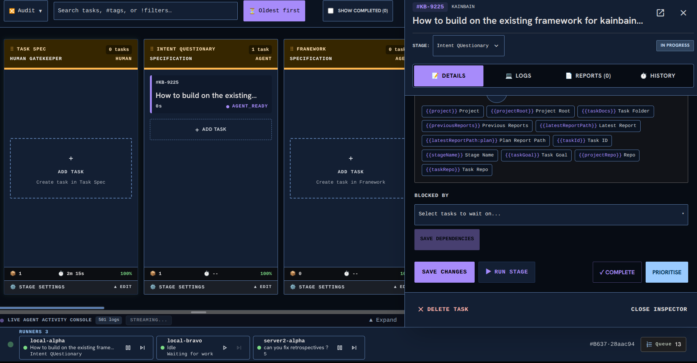

<!-- KAINBAIN AUTO-GENERATED REPORT -->
# Stage Report: Merge

**Task:** Runners break when looking at multi pipelines  When on a different pipeline the runners fail to show task and or stage information or seem to imply they are holding steady. Runners should be global and takeup aything from any pipeso therefore need to display details from any pipe
**Stage Type:** `merge`
**Model:** `default`
**Duration:** 41.438s
**Status:** FAILED

### Summary of Changes
Execution failed: Merge conflicts in: CHANGELOG.md — resolve on 'kb/350ca162-afaf-4d33-9d58-25955887db82' and retry the merge stage

### Execution Output
```
Merge conflicts in: CHANGELOG.md — resolve on 'kb/350ca162-afaf-4d33-9d58-25955887db82' and retry the merge stage
```

### Modified Files
- (No files modified / inspection only)

### Verification Status
- Stage execution failed with error: Merge conflicts in: CHANGELOG.md — resolve on 'kb/350ca162-afaf-4d33-9d58-25955887db82' and retry the merge stage
- Triggered fallback routing.