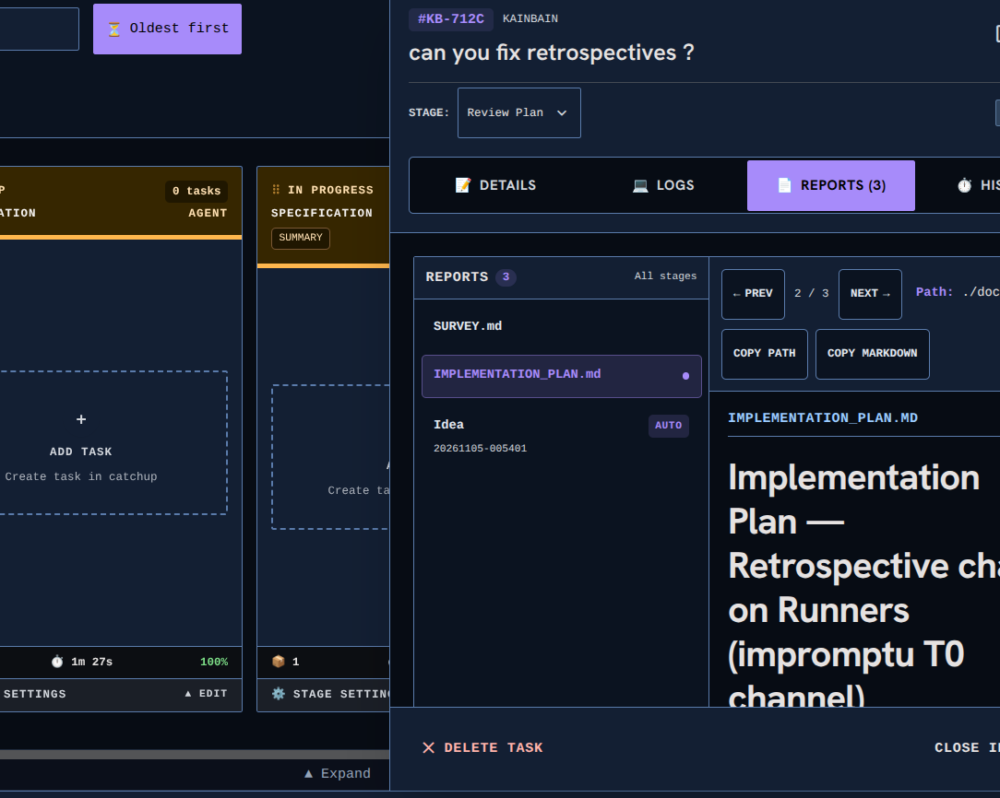

<!-- KAINBAIN AUTO-GENERATED REPORT -->
# Stage Report: automated test 2

**Task:** Make task pannel adjustable  currently it is a static size I would like it to be adjustable
**Stage Type:** `ci`
**Model:** `default`
**Duration:** 161.491s
**Status:** FAILED

### Summary of Changes
Execution failed: CI command failed with exit code 1

### Execution Output
```

up to date, audited 118 packages in 677ms

14 packages are looking for funding
  run `npm fund` for details

found 0 vulnerabilities

> kainbain@1.0.0 test
> node scripts/run-tests.mjs

Starting full project verification...
✅ Settings duplicate check passed (32 files in 90ms)
▸ started Unit Tests (api)
▸ started Unit Tests (frontend)
▸ started Unit Tests (runner)
▸ started Linting (api)
▸ started Linting (frontend)
▸ started Frontend Build
▸ started Security Script Tests
▸ started Dependency Check
▸ started Dependency Audit Gate
▸ started Harness Self-Tests
▸ started Container Tests
⏳ still running: Unit Tests (api) (30s), Unit Tests (frontend) (30s), Linting (frontend) (30s), Frontend Build (30s), Dependency Check (30s), Harness Self-Tests (30s)
⏳ still running: Unit Tests (api) (1m00s), Unit Tests (frontend) (1m00s), Linting (frontend) (1m00s)
⏳ still running: Unit Tests (api) (1m30s)
⏳ still running: Unit Tests (api) (2m00s)
⏳ still running: Unit Tests (api) (2m30s)
Running Unit Tests (api)... PASS (156s)
Running Unit Tests (frontend)... FAIL (156s)
----------------------------------------------------------------------
Details for Unit Tests (frontend):
(trimmed 16638 of 16758 lines; showing the tail)
When testing, code that causes React state updates should be wrapped into act(...):

act(() => {
  /* fire events that update state */
});
/* assert on the output */

This ensures that you're testing the behavior the user would see in the browser. Learn more at https://reactjs.org/link/wrap-tests-with-act
    at StageSkillsPanel (/home/[REDACTED]/.kainbain/runner-work/kb-3c45b620-6cd0-4fab-a30f-a034ca85ed98/frontend/src/components/workflow/StageSkillsPanel.jsx:344:29)
    at Router (/home/[REDACTED]/.kainbain/runner-work/kb-3c45b620-6cd0-4fab-a30f-a034ca85ed98/frontend/node_modules/react-router/dist/development/chunk-GR4NQCSD.js:9996:13)
    at MemoryRouter (/home/[REDACTED]/.kainbain/runner-work/kb-3c45b620-6cd0-4fab-a30f-a034ca85ed98/frontend/node_modules/react-router/dist/development/chunk-GR4NQCSD.js:9906:3)

stderr | src/components/workflow/StageSkillsPanel.test.jsx > remove button drops the skill from stage.skills
Warning: An update to StageSkillsPanel inside a test was not wrapped in act(...).

When testing, code that causes React state updates should be wrapped into act(...):

act(() => {
  /* fire events that update state */
});
/* assert on the output */

This ensures that you're testing the behavior the user would see in the browser. Learn more at https://reactjs.org/link/wrap-tests-with-act
    at StageSkillsPanel (/home/[REDACTED]/.kainbain/runner-work/kb-3c45b620-6cd0-4fab-a30f-a034ca85ed98/frontend/src/components/workflow/StageSkillsPanel.jsx:344:29)
    at Router (/home/[REDACTED]/.kainbain/runner-work/kb-3c45b620-6cd0-4fab-a30f-a034ca85ed98/frontend/node_modules/react-router/dist/development/chunk-GR4NQCSD.js:9996:13)
    at MemoryRouter (/home/[REDACTED]/.kainbain/runner-work/kb-3c45b620-6cd0-4fab-a30f-a034ca85ed98/frontend/node_modules/react-router/dist/development/chunk-GR4NQCSD.js:9906:3)
Warning: An update to StageSkillsPanel inside a test was not wrapped in act(...).

When testing, code that causes React state updates should be wrapped into act(...):

act(() => {
  /* fire events that update state */
});
/* assert on the output */

This ensures that you're testing the behavior the user would see in the browser. Learn more at https://reactjs.org/link/wrap-tests-with-act
    at StageSkillsPanel (/home/[REDACTED]/.kainbain/runner-work/kb-3c45b620-6cd0-4fab-a30f-a034ca85ed98/frontend/src/components/workflow/StageSkillsPanel.jsx:344:29)
    at Router (/home/[REDACTED]/.kainbain/runner-work/kb-3c45b620-6cd0-4fab-a30f-a034ca85ed98/frontend/node_modules/react-router/dist/development/chunk-GR4NQCSD.js:9996:13)
    at MemoryRouter (/home/[REDACTED]/.kainbain/runner-work/kb-3c45b620-6cd0-4fab-a30f-a034ca85ed98/frontend/node_modules/react-router/dist/development/chunk-GR4NQCSD.js:9906:3)
Warning: An update to StageSkillsPanel inside a test was not wrapped in act(...).

When testing, code that causes React state updates should be wrapped into act(...):

act(() => {
  /* fire events that update state */
});
/* assert on the output */

This ensures that you're testing the behavior the user would see in the browser. Learn more at https://reactjs.org/link/wrap-tests-with-act
    at StageSkillsPanel (/home/[REDACTED]/.kainbain/runner-work/kb-3c45b620-6cd0-4fab-a30f-a034ca85ed98/frontend/src/components/workflow/StageSkillsPanel.jsx:344:29)
    at Router (/home/[REDACTED]/.kainbain/runner-work/kb-3c45b620-6cd0-4fab-a30f-a034ca85ed98/frontend/node_modules/react-router/dist/development/chunk-GR4NQCSD.js:9996:13)
    at MemoryRouter (/home/[REDACTED]/.kainbain/runner-work/kb-3c45b620-6cd0-4fab-a30f-a034ca85ed98/frontend/node_modules/react-router/dist/development/chunk-GR4NQCSD.js:9906:3)

stderr | src/components/workflow/StageSkillsPanel.test.jsx > refresh control re-fetches the skills library
Warning: An update to StageSkillsPanel inside a test was not wrapped in act(...).

When testing, code that causes React state updates should be wrapped into act(...):

act(() => {
  /* fire events that update state */
});
/* assert on the output */

This ensures that you're testing the behavior the user would see in the browser. Learn more at https://reactjs.org/link/wrap-tests-with-act
    at StageSkillsPanel (/home/[REDACTED]/.kainbain/runner-work/kb-3c45b620-6cd0-4fab-a30f-a034ca85ed98/frontend/src/components/workflow/StageSkillsPanel.jsx:344:29)
    at Router (/home/[REDACTED]/.kainbain/runner-work/kb-3c45b620-6cd0-4fab-a30f-a034ca85ed98/frontend/node_modules/react-router/dist/development/chunk-GR4NQCSD.js:9996:13)
    at MemoryRouter (/home/[REDACTED]/.kainbain/runner-work/kb-3c45b620-6cd0-4fab-a30f-a034ca85ed98/frontend/node_modules/react-router/dist/development/chunk-GR4NQCSD.js:9906:3)
Warning: An update to StageSkillsPanel inside a test was not wrapped in act(...).

When testing, code that causes React state updates should be wrapped into act(...):

act(() => {
  /* fire events that update state */
});
/* assert on the output */

This ensures that you're testing the behavior the user would see in the browser. Learn more at https://reactjs.org/link/wrap-tests-with-act
    at StageSkillsPanel (/home/[REDACTED]/.kainbain/runner-work/kb-3c45b620-6cd0-4fab-a30f-a034ca85ed98/frontend/src/components/workflow/StageSkillsPanel.jsx:344:29)
    at Router (/home/[REDACTED]/.kainbain/runner-work/kb-3c45b620-6cd0-4fab-a30f-a034ca85ed98/frontend/node_modules/react-router/dist/development/chunk-GR4NQCSD.js:9996:13)
    at MemoryRouter (/home/[REDACTED]/.kainbain/runner-work/kb-3c45b620-6cd0-4fab-a30f-a034ca85ed98/frontend/node_modules/react-router/dist/development/chunk-GR4NQCSD.js:9906:3)
Warning: An update to StageSkillsPanel inside a test was not wrapped in act(...).

When testing, code that causes React state updates should be wrapped into act(...):

act(() => {
  /* fire events that update state */
});
/* assert on the output */

This ensures that you're testing the behavior the user would see in the browser. Learn more at https://reactjs.org/link/wrap-tests-with-act
    at StageSkillsPanel (/home/[REDACTED]/.kainbain/runner-work/kb-3c45b620-6cd0-4fab-a30f-a034ca85ed98/frontend/src/components/workflow/StageSkillsPanel.jsx:344:29)
    at Router (/home/[REDACTED]/.kainbain/runner-work/kb-3c45b620-6cd0-4fab-a30f-a034ca85ed98/frontend/node_modules/react-router/dist/development/chunk-GR4NQCSD.js:9996:13)
    at MemoryRouter (/home/[REDACTED]/.kainbain/runner-work/kb-3c45b620-6cd0-4fab-a30f-a034ca85ed98/frontend/node_modules/react-router/dist/development/chunk-GR4NQCSD.js:9906:3)

 ✓  1  src/components/workflow/StageSkillsPanel.test.jsx (28 tests) 1043ms

⎯⎯⎯⎯⎯⎯⎯ Failed Tests 1 ⎯⎯⎯⎯⎯⎯⎯

 FAIL   0  src/components/tasks/SurveyPage.test.jsx > SurveyPage task context split > renders the read-only task panel beside the survey with desktop-only markers
AssertionError: expected 'hidden md:flex md:flex-[0.4] border-l…' to contain 'md:w-1/2'

Expected: "md:w-1/2"
Received: "hidden md:flex md:flex-[0.4] border-l border-border-standard bg-surface overflow-hidden resize-x"

 ❯ src/components/tasks/SurveyPage.test.jsx:336:30
    334|     expect(column.className).toContain('hidden');
    335|     expect(column.className).toContain('md:flex');
    336|     expect(column.className).toContain('md:w-1/2');
       |                              ^
    337|     // The survey column takes the other half on desktop, full width o…
    338|     const surveyColumn = screen.getByRole('region', { name: 'Task surv…

⎯⎯⎯⎯⎯⎯⎯⎯⎯⎯⎯⎯⎯⎯⎯⎯⎯⎯⎯⎯⎯⎯⎯⎯[1/1]⎯


 Test Files  1 failed | 308 passed (309)
      Tests  1 failed | 4257 passed (4258)
   Start at  23:02:44
   Duration  58.57s (tests 53%, setup 20%, worker 9%, environment 6%, import 6%, transform 6%)

----------------------------------------------------------------------
Running Unit Tests (runner)... PASS (156s)
Running Linting (api)... PASS (156s)
Running Linting (frontend)... PASS (156s)
Running Frontend Build... PASS (156s)
Running Security Script Tests... PASS (156s)
Running Dependency Check... PASS (156s)
Running Dependency Audit Gate... PASS (156s)
Running Harness Self-Tests... PASS (156s)
Running Container Tests... PASS (156s)

```

### Modified Files
- (No files modified / inspection only)

### Verification Status
- Stage execution failed with error: CI command failed with exit code 1
- Triggered fallback routing.