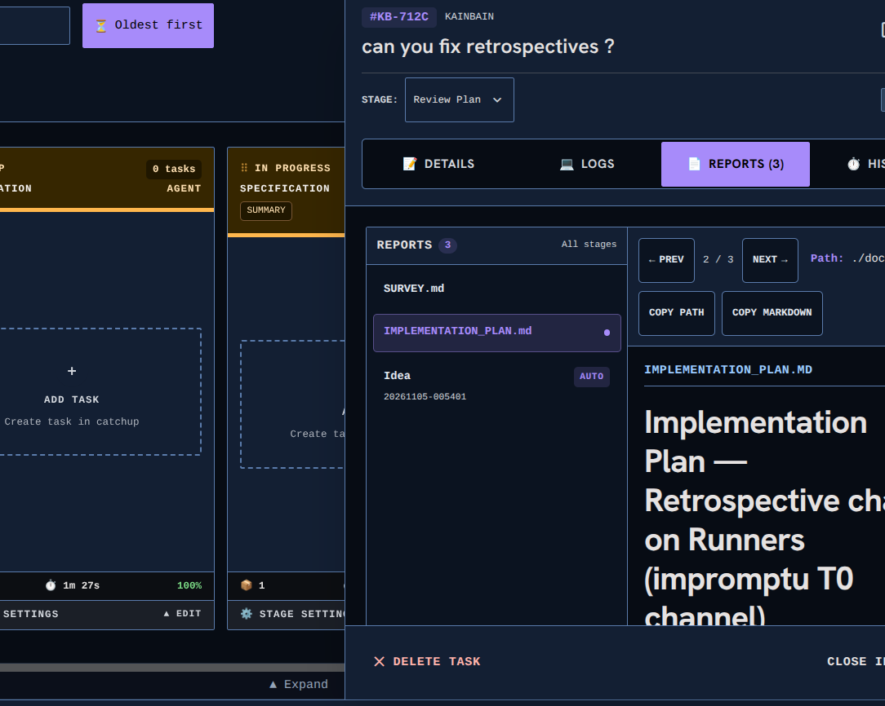

<!-- KAINBAIN AUTO-GENERATED REPORT -->
# Stage Report: Automated tests

**Task:** Make task pannel adjustable  currently it is a static size I would like it to be adjustable
**Stage Type:** `ci`
**Model:** `default`
**Duration:** 7122.28s
**Status:** FAILED

### Summary of Changes
Execution failed: CI command failed with exit code 1

### Execution Output
```

up to date, audited 118 packages in 2s

14 packages are looking for funding
  run `npm fund` for details

found 0 vulnerabilities

> kainbain@1.0.0 test
> node scripts/run-tests.mjs

Starting full project verification...
✅ Settings duplicate check passed (32 files in 92ms)
▸ started Unit Tests (api)
▸ started Unit Tests (frontend)
▸ started Unit Tests (runner)
▸ started Linting (api)
▸ started Linting (frontend)
▸ started Frontend Build
▸ started Security Script Tests
▸ started Dependency Check
▸ started Dependency Audit Gate
▸ started Harness Self-Tests
▸ started Container Tests
⏳ still running: Unit Tests (api) (30s), Unit Tests (frontend) (30s), Dependency Check (30s), Harness Self-Tests (30s)
⏳ still running: Unit Tests (api) (1m00s)
⏳ still running: Unit Tests (api) (1m30s)
⏳ still running: Unit Tests (api) (2m00s)
Running Unit Tests (api)... PASS (150s)
Running Unit Tests (frontend)... PASS (150s)
Running Unit Tests (runner)... PASS (150s)
Running Linting (api)... PASS (150s)
Running Linting (frontend)... PASS (150s)
Running Frontend Build... PASS (150s)
Running Security Script Tests... PASS (150s)
Running Dependency Check... PASS (150s)
Running Dependency Audit Gate... PASS (150s)
Running Harness Self-Tests... FAIL (150s)
----------------------------------------------------------------------
Details for Harness Self-Tests:
(trimmed 513 of 633 lines; showing the tail)
  ✔ sha256FileHex matches the manifest's hashing (0.50665ms)
✔ buildManifest (11.648789ms)
▶ packageRunner
  ✔ packages a canary version under its full name and stamps version.json (25.201042ms)
  ✔ rejects non-semver versions instead of tarring them (16.367786ms)
  ✔ fails closed on unsupported platforms (v1: linux/darwin only) (5.5159ms)
  ✔ agrees with buildManifest on the asset filename grammar (123.19085ms)
✔ packageRunner (170.693358ms)
▶ installSteps
  ✔ installs root, api, frontend, then canary-e2e in order (22.039289ms)
✔ installSteps (27.936154ms)
▶ installSteps npmrc
  ✔ every install dir resolves legacy-peer-deps the way npm actually reads it (0.827365ms)
  ✔ root .npmrc documents the per-dir mirrors (28.427034ms)
✔ installSteps npmrc (29.516326ms)
▶ playwrightAttempts
  ✔ tries system deps first on linux, then the browser alone (0.274509ms)
  ✔ installs the browser alone on macOS and Windows (7.30638ms)
✔ playwrightAttempts (7.836793ms)
▶ npxExecutable
  ✔ uses npx.cmd on Windows, npx elsewhere (9.141734ms)
✔ npxExecutable (9.369251ms)
▶ browserInstallTargets
  ✔ installs the root browser first, then the canary-e2e browser (13.610576ms)
  ✔ keeps Linux --with-deps on the root target and browser-only on canary (5.135145ms)
  ✔ installs the browser alone for every target on macOS and Windows (2.761569ms)
✔ browserInstallTargets (21.812381ms)
[projectStore] recreated missing docs symlink for 'Sanity': '/tmp/kainbain-sanity-projects-vybgIz/Sanity/docs' -> '/tmp/kainbain-sanity-notes-cDCCOX/Sanity'
[projectStore] recreated missing docs symlink for 'Sanity': '/tmp/kainbain-sanity-projects-I4nhcN/Sanity/docs' -> '/tmp/kainbain-sanity-notes-2chP11/Sanity'
[projectStore] '/tmp/kainbain-sanity-projects-I4nhcN/Sanity/docs' is a real directory shadowing the notes space '/tmp/kainbain-sanity-notes-2chP11/Sanity' — task lists read the shadow copy, so most tasks are hidden. Merge any newer files from the shadow 'docs/tasks/' into the notes space, then replace '/tmp/kainbain-sanity-projects-I4nhcN/Sanity/docs' with a symlink to '/tmp/kainbain-sanity-notes-2chP11/Sanity'.
[projectStore] recreated missing docs symlink for 'Sanity': '/tmp/kainbain-sanity-projects-JBn9r9/Sanity/docs' -> '/tmp/kainbain-sanity-notes-EgGjrV/Sanity'
[projectStore] recreated missing docs symlink for 'Sanity': '/tmp/kainbain-sanity-projects-7atujH/Sanity/docs' -> '/tmp/kainbain-sanity-notes-Sg8dn3/Sanity'
[projectStore] '/tmp/kainbain-sanity-projects-7atujH/Sanity/docs' is a real directory shadowing the notes space '/tmp/kainbain-sanity-notes-Sg8dn3/Sanity' — task lists read the shadow copy, so most tasks are hidden. Merge any newer files from the shadow 'docs/tasks/' into the notes space, then replace '/tmp/kainbain-sanity-projects-7atujH/Sanity/docs' with a symlink to '/tmp/kainbain-sanity-notes-Sg8dn3/Sanity'.
[projectStore] recreated missing docs symlink for 'Sanity': '/tmp/kainbain-sanity-projects-BCSalS/Sanity/docs' -> '/tmp/kainbain-sanity-notes-FgH8Sl/Sanity'
[projectStore] recreated missing docs symlink for 'Sanity': '/tmp/kainbain-sanity-projects-7outln/Sanity/docs' -> '/tmp/kainbain-sanity-notes-sjMQDz/Sanity'
[projectStore] '/tmp/kainbain-sanity-projects-7outln/Sanity/docs' is a real directory shadowing the notes space '/tmp/kainbain-sanity-notes-sjMQDz/Sanity' — task lists read the shadow copy, so most tasks are hidden. Merge any newer files from the shadow 'docs/tasks/' into the notes space, then replace '/tmp/kainbain-sanity-projects-7outln/Sanity/docs' with a symlink to '/tmp/kainbain-sanity-notes-sjMQDz/Sanity'.
▶ checkStorageSanity
  ✔ restores every seeded task and arms the shadow detector (153.21515ms)
  ✔ leaves no fixture residue in the OS temp dir (410.500806ms)
✔ checkStorageSanity (566.55503ms)
▶ isMainModule
  ✔ matches URL-encoded entry paths (space decodes via fileURLToPath, not pathname) (0.69617ms)
  ✔ rejects a missing entry path or a different file (0.953899ms)
  ✔ fires on direct run: node scripts/storage-sanity.mjs prints PASS (1179.489711ms)
✔ isMainModule (1181.48511ms)
▶ countNotesTasks
  ✔ counts only folders holding a task.md (1.143993ms)
  ✔ returns 0 when the notes space has no tasks dir (0.531898ms)
✔ countNotesTasks (2.13022ms)
▶ scripts/sync-tip-dist.mjs
  ✔ skips (exit 0, primary untouched) without the tip-worktree marker (269.16495ms)
  ✔ syncs manifest, appends unseen history, copies tarballs, writes the pointer (189.347436ms)
  ✔ syncs build-info.json alongside a moved manifest commit (159.896938ms)
  ✔ leaves build-info.json alone when the primary manifest is already current (308.978985ms)
  ✔ syncs under deploy.sh's tip re-exec marker alone (pipeline Publish path) (133.608661ms)
  ✔ is idempotent: a second run appends no duplicate history (492.661812ms)
  ✔ leaves an already-current primary manifest alone (228.532828ms)
✔ scripts/sync-tip-dist.mjs (1787.821265ms)
ℹ tests 362
ℹ suites 94
ℹ pass 361
ℹ fail 1
ℹ cancelled 0
ℹ skipped 0
ℹ todo 0
ℹ duration_ms 36226.903104

✖ failing tests:

test at tests/check-jsdoc-example.test.mjs:155:2
✖ the baseline covers every currently-missing export (5366.943785ms)
  AssertionError [ERR_ASSERTION]: Expected values to be strictly deep-equal:
  + actual - expected
  
  + [
  +   {
  +     exportName: 'default',
  +     file: 'frontend/src/components/tasks/hooks/useTaskInspectorResize.js',
  +     kind: 'default'
  +   },
  +   {
  +     exportName: 'getTaskInspectorDynamicMax',
  +     file: 'frontend/src/components/tasks/hooks/useTaskInspectorResize.js',
  +     kind: 'function'
  +   },
  +   {
  +     exportName: 'useTaskInspectorResize',
  +     file: 'frontend/src/components/tasks/hooks/useTaskInspectorResize.js',
  +     kind: 'function'
  +   },
  +   {
  +     exportName: 'TASK_INSPECTOR_WIDTH_MAX',
  +     file: 'frontend/src/context/useUiPreferences.js',
  +     kind: 'const'
  +   },
  +   {
  +     exportName: 'TASK_INSPECTOR_WIDTH_MIN',
  +     file: 'frontend/src/context/useUiPreferences.js',
  +     kind: 'const'
  +   }
  + ]
  - []
  
      at TestContext.<anonymous> (file:///home/[REDACTED]/.kainbain/runner-work/kb-3c45b620-6cd0-4fab-a30f-a034ca85ed98/tests/check-jsdoc-example.test.mjs:164:10)
      at Test.runInAsyncScope (node:async_hooks:226:14)
      at Test.run (node:internal/test_runner/test:1382:25)
      at Test.start (node:internal/test_runner/test:1242:17)
      at node:internal/test_runner/test:1867:71
      at node:internal/per_context/primordials:504:82
      at new Promise (<anonymous>)
      at new SafePromise (node:internal/per_context/primordials:478:3)
      at node:internal/per_context/primordials:504:9
      at Array.map (<anonymous>) {
    generatedMessage: true,
    code: 'ERR_ASSERTION',
    actual: [ { file: 'frontend/src/components/tasks/hooks/useTaskInspectorResize.js', exportName: 'default', kind: 'default' }, { file: 'frontend/src/components/tasks/hooks/useTaskInspectorResize.js', exportName: 'getTaskInspectorDynamicMax', kind: 'function' }, { file: 'frontend/src/components/tasks/hooks/useTaskInspectorResize.js', exportName: 'useTaskInspectorResize', kind: 'function' }, { file: 'frontend/src/context/useUiPreferences.js', exportName: 'TASK_INSPECTOR_WIDTH_MAX', kind: 'const' }, { file: 'frontend/src/context/useUiPreferences.js', exportName: 'TASK_INSPECTOR_WIDTH_MIN', kind: 'const' } ],
    expected: [],
    operator: 'deepStrictEqual',
    diff: 'simple'
  }
----------------------------------------------------------------------
Running Container Tests... PASS (150s)
Fast gate complete — starting Canary Tests alone (serial phase, no shared CPUs with the unit suites)...
▸ started Canary Tests
⏳ still running: Canary Tests (30s)
⏳ still running: Canary Tests (1m00s)
⏳ still running: Canary Tests (1m30s)
⏳ still running: Canary Tests (2m00s)
⏳ still running: Canary Tests (2m30s)
⏳ still running: Canary Tests (3m00s)
⏳ still running: Canary Tests (3m30s)
⏳ still running: Canary Tests (4m00s)
⏳ still running: Canary Tests (4m30s)
⏳ still running: Canary Tests (5m00s)
⏳ still running: Canary Tests (5m30s)
⏳ still running: Canary Tests (6m00s)
⏳ still running: Canary Tests (6m30s)
⏳ still running: Canary Tests (7m00s)
⏳ still running: Canary Tests (7m30s)
⏳ still running: Canary Tests (8m00s)
⏳ still running: Canary Tests (8m30s)
⏳ still running: Canary Tests (9m00s)
⏳ still running: Canary Tests (9m30s)
⏳ still running: Canary Tests (10m00s)
⏳ still running: Canary Tests (10m30s)
⏳ still running: Canary Tests (11m00s)
⏳ still running: Canary Tests (11m30s)
⏳ still running: Canary Tests (12m00s)
⏳ still running: Canary Tests (12m30s)
⏳ still running: Canary Tests (13m00s)
⏳ still running: Canary Tests (13m30s)
⏳ still running: Canary Tests (14m00s)
⏳ still running: Canary Tests (14m30s)
Running Canary Tests... PASS (874s)

```

### Modified Files
- (No files modified / inspection only)

### Verification Status
- Stage execution failed with error: CI command failed with exit code 1
- Triggered fallback routing.