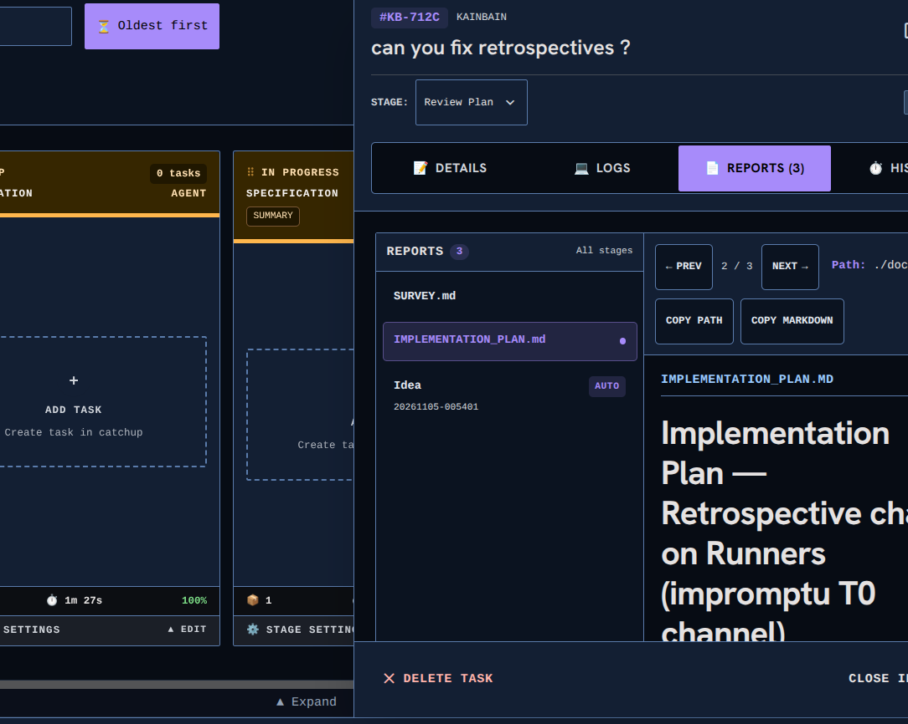

<!-- KAINBAIN AUTO-GENERATED REPORT -->
# Stage Report: Code standards

**Task:** Make task pannel adjustable  currently it is a static size I would like it to be adjustable
**Stage Type:** `agent`
**Model:** `utility`
**Duration:** 155.139s
**Status:** FAILED

### Summary of Changes
Execution failed: [Agent Review Rejection] (1) frontend/src/components/tasks/TaskDetailOverlayContent.jsx line 749 adds a stray `relative` alongside `fixed` (`className={`relative fixed inset-0 ...`}`); Tailwind v3 emits `.relative` after `.fixed`, so `position:relative` wins below the md breakpoint and the mobile slide-over drawer loses its fixed overlay positioning — main had only `fixed`. The guarding mobile canary spec was rewritten in this same diff with no passing re-run in evidence. (2) Dead barrel file frontend/src/components/tasks/useTaskInspectorResize.js (2-line re-export) has zero importers — every consumer imports `./hooks/useTaskInspectorResize` directly — duplicating the export and hurting searchability per co-location standards. (3) Same file converts `const tokenReports = ...ternary...` to `let tokenReports` with if/else reassignment, violating the treat-variables-as-immutable principle for unrelated churn. Fix guidance: Remove the stray `relative` from the aside className (keep `fixed ... md:relative`; `fixed` already anchors the absolute resize handle), delete the unreferenced barrel frontend/src/components/tasks/useTaskInspectorResize.js, restore the `const tokenReports` ternary, then re-run `npx vitest run src/components/tasks/hooks/useTaskInspectorResize.test.jsx src/context/useUiPreferences.test.js src/components/tasks/TaskDetailOverlay.test.jsx` plus eslint on touched files and the task-inspector/mobile-responsive canary specs.

### Execution Output
```
Reviewed the branch against [KB Code Standards](./docs/KB%20Code%20Standards.md). Much complies well: descriptive names, plain-English JSDoc with `@example` on new exports, labelled-data imports, no classes or pattern jargon, co-located unit tests (90/90 pass in [useTaskInspectorResize.test.jsx](/home/[REDACTED]/.kainbain/runner-work/kb-3c45b620-6cd0-4fab-a30f-a034ca85ed98/frontend/src/components/tasks/hooks/useTaskInspectorResize.test.jsx), [useUiPreferences.test.js](/home/[REDACTED]/.kainbain/runner-work/kb-3c45b620-6cd0-4fab-a30f-a034ca85ed98/frontend/src/context/useUiPreferences.test.js), [TaskDetailOverlay.test.jsx](/home/[REDACTED]/.kainbain/runner-work/kb-3c45b620-6cd0-4fab-a30f-a034ca85ed98/frontend/src/components/tasks/TaskDetailOverlay.test.jsx)), clean eslint, and fail-safe preference validation. But the diff introduces a likely mobile-drawer regression plus two smaller standards breaches, none verified fixed by a re-run.

KAINBAIN_VERDICT: FAIL
KAINBAIN_REASON: (1) frontend/src/components/tasks/TaskDetailOverlayContent.jsx line 749 adds a stray `relative` alongside `fixed` (`className={`relative fixed inset-0 ...`}`); Tailwind v3 emits `.relative` after `.fixed`, so `position:relative` wins below the md breakpoint and the mobile slide-over drawer loses its fixed overlay positioning — main had only `fixed`. The guarding mobile canary spec was rewritten in this same diff with no passing re-run in evidence. (2) Dead barrel file frontend/src/components/tasks/useTaskInspectorResize.js (2-line re-export) has zero importers — every consumer imports `./hooks/useTaskInspectorResize` directly — duplicating the export and hurting searchability per co-location standards. (3) Same file converts `const tokenReports = ...ternary...` to `let tokenReports` with if/else reassignment, violating the treat-variables-as-immutable principle for unrelated churn.
KAINBAIN_FIX: Remove the stray `relative` from the aside className (keep `fixed ... md:relative`; `fixed` already anchors the absolute resize handle), delete the unreferenced barrel frontend/src/components/tasks/useTaskInspectorResize.js, restore the `const tokenReports` ternary, then re-run `npx vitest run src/components/tasks/hooks/useTaskInspectorResize.test.jsx src/context/useUiPreferences.test.js src/components/tasks/TaskDetailOverlay.test.jsx` plus eslint on touched files and the task-inspector/mobile-responsive canary specs.
```

### Modified Files
- (No files modified / inspection only)

### Verification Status
- Stage execution failed with error: [Agent Review Rejection] (1) frontend/src/components/tasks/TaskDetailOverlayContent.jsx line 749 adds a stray `relative` alongside `fixed` (`className={`relative fixed inset-0 ...`}`); Tailwind v3 emits `.relative` after `.fixed`, so `position:relative` wins below the md breakpoint and the mobile slide-over drawer loses its fixed overlay positioning — main had only `fixed`. The guarding mobile canary spec was rewritten in this same diff with no passing re-run in evidence. (2) Dead barrel file frontend/src/components/tasks/useTaskInspectorResize.js (2-line re-export) has zero importers — every consumer imports `./hooks/useTaskInspectorResize` directly — duplicating the export and hurting searchability per co-location standards. (3) Same file converts `const tokenReports = ...ternary...` to `let tokenReports` with if/else reassignment, violating the treat-variables-as-immutable principle for unrelated churn. Fix guidance: Remove the stray `relative` from the aside className (keep `fixed ... md:relative`; `fixed` already anchors the absolute resize handle), delete the unreferenced barrel frontend/src/components/tasks/useTaskInspectorResize.js, restore the `const tokenReports` ternary, then re-run `npx vitest run src/components/tasks/hooks/useTaskInspectorResize.test.jsx src/context/useUiPreferences.test.js src/components/tasks/TaskDetailOverlay.test.jsx` plus eslint on touched files and the task-inspector/mobile-responsive canary specs.
- Triggered fallback routing.