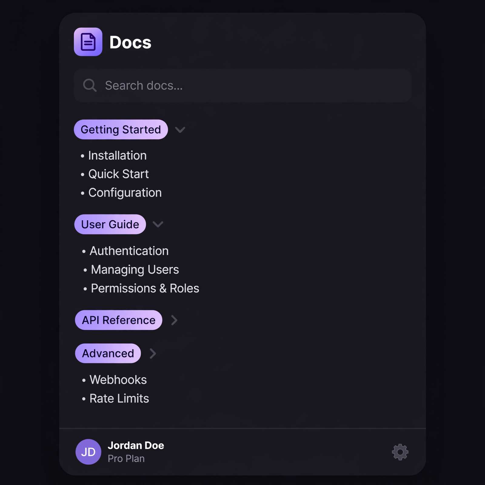

# Survey – generated by the "question‑me" skill

## Round 1

```survey-json
{
  "round": 1,
  "generatedAt": "2026-11-15T00:00:00.000Z",
  "stage": "question-me",
  "questions": [
    {
      "id": "q1",
      "type": "single",
      "text": "How different should the category headers (e.g. 'How Kainbain Works') look from the article names underneath them?",
      "options": [
        "Slightly clearer (bolder text with more spacing is enough)",
        "Much clearer (colour, background, or icon so groups stand out at a glance)",
        "Totally new sidebar style (happy for a fresh look)"
      ],
      "required": true,
      "showIf": null
    },
    {
      "id": "q2",
      "type": "single",
      "text": "Should you be able to collapse (fold away) the articles under a category?",
      "options": [
        "Yes, collapse any category",
        "Yes, but keep it simple (just tap the header to open/close)",
        "No, just make headers clearer"
      ],
      "required": true,
      "showIf": null
    },
    {
      "id": "q3",
      "type": "single",
      "text": "When a category is collapsed, what should happen?",
      "options": [
        "Remember my choice (stays collapsed when I come back)",
        "Reset each visit (always starts expanded)",
        "No preference"
      ],
      "required": false,
      "showIf": {
        "questionId": "q2",
        "values": [
          "Yes, collapse any category",
          "Yes, but keep it simple (just tap the header to open/close)"
        ]
      }
    },
    {
      "id": "q4",
      "type": "single",
      "text": "Are you happy for us to move articles into different groups or rename groups to make them clearer?",
      "options": [
        "Yes, reorganise freely if it makes sense",
        "Small tidy-ups only (keep groups mostly as they are)",
        "No, keep articles where they are"
      ],
      "required": true,
      "showIf": null
    },
    {
      "id": "q5",
      "type": "image",
      "text": "Which sidebar header style do you prefer?",
      "options": [
        "Dark sidebar, small pale capital-letter headers with wide spacing above each group, plain white article names, subtle arrow on each header to collapse the group, clean docs look",
        "Dark sidebar, headers as small rounded badge labels with soft purple background and dark text, article names in lighter grey indented underneath, arrow to collapse each group, modern app look",
        "Dark sidebar, bold white headers with a small folder icon and collapse arrow, thin divider line between groups, article names slightly smaller and indented, classic documentation look"
      ],
      "required": false,
      "showIf": null,
      "images": [
        {
          "option": 0,
          "file": "assets/survey-r1-q5-0.png",
          "status": "ready"
        },
        {
          "option": 1,
          "file": "assets/survey-r1-q5-1.png",
          "status": "ready"
        },
        {
          "option": 2,
          "status": "failed",
          "code": "gen",
          "error": "Generation failed: Muse image request failed: fetch failed"
        }
      ]
    }
  ],
  "answers": {
    "q1": {
      "selected": [
        "Totally new sidebar style (happy for a fresh look)"
      ],
      "notes": ""
    },
    "q2": {
      "selected": [
        "Yes, collapse any category"
      ],
      "notes": ""
    },
    "q3": {
      "selected": [
        "Remember my choice (stays collapsed when I come back)"
      ],
      "notes": ""
    },
    "q4": {
      "selected": [
        "Yes, reorganise freely if it makes sense"
      ],
      "notes": ""
    },
    "q5": {
      "selected": [
        "Dark sidebar, headers as small rounded badge labels with soft purple background and dark text, article names in lighter grey indented underneath, arrow to collapse each group, modern app look"
      ],
      "notes": ""
    }
  }
}
```

## Chosen designs

Image-question selections, saved automatically when the survey is submitted (re-submitting updates this list).

- [r1/q5] 
