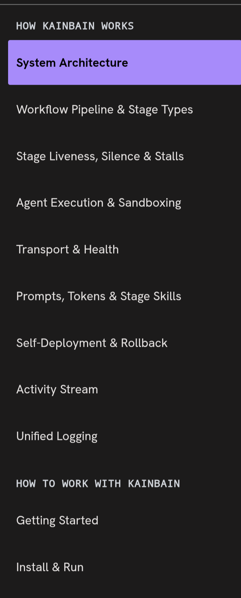

<!-- KAINBAIN AUTO-GENERATED REPORT -->
# Stage Report: automated test 2

**Task:** I'd like more definition between header and articles on the docs viewer sidebar  Currently the headers for the article categories are almost identical to the article names. Can you please make them more pronounced and maybe collapsible for the ones under it so it's easier to scroll through. Feel free to reorganise if wanted to make the categories make sense more especially now we are leaning into the groupings
**Stage Type:** `ci`
**Model:** `default`
**Duration:** 327.156s
**Status:** FAILED

### Summary of Changes
Execution failed: CI command failed with exit code 1

### Execution Output
```

up to date, audited 118 packages in 884ms

14 packages are looking for funding
  run `npm fund` for details

found 0 vulnerabilities

> kainbain@1.0.0 test
> node scripts/run-tests.mjs

Starting full project verification...
✅ Settings duplicate check passed (36 files in 156ms)
✅ Frontend imports check passed (738 files in 303ms)
▸ started Unit Tests (api)
▸ started Unit Tests (frontend)
▸ started Unit Tests (runner)
▸ started Linting (api)
▸ started Linting (frontend)
▸ started Frontend Build
▸ started Security Script Tests
▸ started Dependency Check
▸ started Dependency Audit Gate
▸ started Proof Hygiene
▸ started Harness Self-Tests
▸ started Container Tests
⏳ still running: Unit Tests (api) (30s), Unit Tests (frontend) (30s), Linting (frontend) (30s), Frontend Build (30s), Dependency Check (30s), Harness Self-Tests (30s)
⏳ still running: Unit Tests (api) (1m00s), Unit Tests (frontend) (1m00s), Dependency Check (1m00s), Harness Self-Tests (1m00s)
⏳ still running: Unit Tests (api) (1m30s), Unit Tests (frontend) (1m30s), Harness Self-Tests (1m30s)
⏳ still running: Unit Tests (api) (2m00s)
⏳ still running: Unit Tests (api) (2m30s)
⏳ still running: Unit Tests (api) (3m00s)
⏳ still running: Unit Tests (api) (3m30s)
Running Unit Tests (api)... PASS (234s)
Running Unit Tests (frontend)... PASS (234s)
Running Unit Tests (runner)... FAIL (234s)
----------------------------------------------------------------------
Details for Unit Tests (runner):
(trimmed 546 of 666 lines; showing the tail)
  ✔ rejects a malformed requires shape (0.121076ms)
✔ validateManifest requires (0.627813ms)
▶ versionSatisfiesRange
  ✔ evaluates the repo's own range vocabulary (0.620125ms)
  ✔ supports || alternation (0.210875ms)
  ✔ reads unsupported or malformed ranges as unsatisfied (fail closed) (0.118384ms)
✔ versionSatisfiesRange (1.909223ms)
▶ checkBackendCompat
  ✔ treats legacy manifests and unknown backends as compatible (0.680326ms)
  ✔ gates on the range when both sides are known (0.244999ms)
  ✔ fails closed on unparseable ranges and versions (0.127353ms)
✔ checkBackendCompat (1.217191ms)
▶ filterReleaseCandidate
  ✔ selects a newer compatible release with a platform asset (0.266166ms)
  ✔ never downgrades and skips pre-releases (0.124294ms)
  ✔ skips incompatible releases and missing assets (0.165369ms)
✔ filterReleaseCandidate (4.977185ms)
▶ githubReleasesListUrl / tagVersionFor
  ✔ derives the bounded list URL from the default pointer (0.37287ms)
  ✔ reads versions off runner tags, null when unreadable (0.449893ms)
✔ githubReleasesListUrl / tagVersionFor (0.974699ms)
▶ validateReleasesIndex
  ✔ accepts a well-formed index and an empty one (0.303474ms)
  ✔ rejects malformed indexes and entries (0.238985ms)
✔ validateReleasesIndex (0.692407ms)
(node:2069817) [MODULE_TYPELESS_PACKAGE_JSON] Warning: Module type of file:///home/[REDACTED]/.kainbain/runner-work/kb-68714709-3f50-4e5c-bfa6-bac16a36c393/runner/updates-platform.test.js is not specified and it doesn't parse as CommonJS.
Reparsing as ES module because module syntax was detected. This incurs a performance overhead.
To eliminate this warning, add "type": "module" to /home/[REDACTED]/.kainbain/runner-work/kb-68714709-3f50-4e5c-bfa6-bac16a36c393/package.json.
(Use `node --trace-warnings ...` to show where the warning was created)
▶ detectUpdatePlatform
  ✔ accepts the four v1 targets (9.39951ms)
  ✔ rejects Windows and unknown arches (0.245609ms)
✔ detectUpdatePlatform (22.910746ms)
▶ assetNameFor
  ✔ builds the canonical filename and strips a v prefix (1.089002ms)
  ✔ throws UNSUPPORTED_PLATFORM for Windows (0.591102ms)
✔ assetNameFor (2.028737ms)
(node:2069871) [MODULE_TYPELESS_PACKAGE_JSON] Warning: Module type of file:///home/[REDACTED]/.kainbain/runner-work/kb-68714709-3f50-4e5c-bfa6-bac16a36c393/runner/updates-state.test.js is not specified and it doesn't parse as CommonJS.
Reparsing as ES module because module syntax was detected. This incurs a performance overhead.
To eliminate this warning, add "type": "module" to /home/[REDACTED]/.kainbain/runner-work/kb-68714709-3f50-4e5c-bfa6-bac16a36c393/package.json.
(Use `node --trace-warnings ...` to show where the warning was created)
▶ readUpdateState / writeUpdateState
  ✔ starts idle and round-trips (5.061753ms)
✔ readUpdateState / writeUpdateState (13.637696ms)
▶ acquireUpdateLock
  ✔ grants one holder and releases (6.325457ms)
  ✔ recovers a stale lock left by a dead process instead of bricking updates (2.440966ms)
  ✔ recovers the legacy bare-pid lock format when its holder is gone (2.85565ms)
  ✔ recovers by timestamp when the holder pid is alive but the lock is ancient (1.710851ms)
  ✔ keeps a live holder's lock (same-process contention still loses) (1.987815ms)
✔ acquireUpdateLock (17.067994ms)
▶ pruneOldReleases
  ✔ keeps current + previous and drops older versions (6.408641ms)
  ✔ keeps everything when no link resolves inside releases/ (fail-safe) (1.490025ms)
  ✔ prunes superseded versions on markUpdateSuccess, keeps current + previous (3.215417ms)
✔ pruneOldReleases (13.400158ms)
▶ bootstrapUpdateState
  ✔ passes through when idle (2.257446ms)
  ✔ counts pending-boot attempts without rolling back early (3.270469ms)
  ✔ rolls back to previous on the third crashed boot (4.733468ms)
  ✔ marks success after a good boot (0.546184ms)
✔ bootstrapUpdateState (11.06264ms)
(node:2070022) [MODULE_TYPELESS_PACKAGE_JSON] Warning: Module type of file:///home/[REDACTED]/.kainbain/runner-work/kb-68714709-3f50-4e5c-bfa6-bac16a36c393/runner/updates-verify.test.js is not specified and it doesn't parse as CommonJS.
Reparsing as ES module because module syntax was detected. This incurs a performance overhead.
To eliminate this warning, add "type": "module" to /home/[REDACTED]/.kainbain/runner-work/kb-68714709-3f50-4e5c-bfa6-bac16a36c393/package.json.
(Use `node --trace-warnings ...` to show where the warning was created)
▶ verifyManifestSignature
  ✔ accepts a manifest signed by the test key (6.435218ms)
  ✔ rejects a tampered manifest (version bumped after signing) (1.091598ms)
  ✔ rejects a tampered signature (0.816932ms)
  ✔ rejects a signature from a different key (0.533541ms)
  ✔ rejects against the pinned release key (test sig is not a release sig) (0.677404ms)
✔ verifyManifestSignature (11.066628ms)
▶ verifyAssetBytes / verifyAssetFile
  ✔ accepts matching bytes and rejects flipped bytes (0.793744ms)
  ✔ verifies a file on disk by streaming (115.54055ms)
✔ verifyAssetBytes / verifyAssetFile (116.731541ms)
(node:2070159) [MODULE_TYPELESS_PACKAGE_JSON] Warning: Module type of file:///home/[REDACTED]/.kainbain/runner-work/kb-68714709-3f50-4e5c-bfa6-bac16a36c393/runner/updates-wrapper.test.js is not specified and it doesn't parse as CommonJS.
Reparsing as ES module because module syntax was detected. This incurs a performance overhead.
To eliminate this warning, add "type": "module" to /home/[REDACTED]/.kainbain/runner-work/kb-68714709-3f50-4e5c-bfa6-bac16a36c393/package.json.
(Use `node --trace-warnings ...` to show where the warning was created)
▶ kainbain-runner wrapper restart gate
  ✔ stops after a normal completion instead of re-running finished work (194.125249ms)
  ✔ restarts exactly once into a staged update, then stops (2323.189806ms)
  ✔ propagates a daemon failure without restarting (112.652382ms)
✔ kainbain-runner wrapper restart gate (2635.101393ms)
▶ kainbain-runner doctor
  ✔ reports a healthy wrapper install as ok with the backend record (1309.863645ms)
  ✔ flags a direct node main.js entrypoint with exit 1 (1009.260806ms)
  ✔ flags a missing current symlink with exit 1 (549.893073ms)
  ✔ reports an unreachable backend but keeps exit 0 (network state, not install damage) (986.662414ms)
  ✔ writes nothing: the tree is byte-identical before and after (693.367071ms)
  ✔ supports --verify-install and --unit filtering (2754.682552ms)
✔ kainbain-runner doctor (7304.724025ms)
ℹ tests 412
ℹ suites 74
ℹ pass 411
ℹ fail 1
ℹ cancelled 0
ℹ skipped 0
ℹ todo 0
ℹ duration_ms 21649.958318

✖ failing tests:

test at runner/daemon.test.js:685:2
✖ renews on a cadence with the lease ids and stops on demand (60.468425ms)
  AssertionError [ERR_ASSERTION]: expected renewals, saw 1
      at TestContext.<anonymous> (file:///home/[REDACTED]/.kainbain/runner-work/kb-68714709-3f50-4e5c-bfa6-bac16a36c393/runner/daemon.test.js:706:10)
      at async Test.run (node:internal/test_runner/test:1389:7)
      at async Promise.all (index 0)
      at async Suite.run (node:internal/test_runner/test:1869:7)
      at async Test.processPendingSubtests (node:internal/test_runner/test:960:7) {
    generatedMessage: false,
    code: 'ERR_ASSERTION',
    actual: false,
    expected: true,
    operator: '==',
    diff: 'simple'
  }
----------------------------------------------------------------------
Running Linting (api)... PASS (234s)
Running Linting (frontend)... PASS (234s)
Running Frontend Build... PASS (234s)
Running Security Script Tests... PASS (234s)
Running Dependency Check... PASS (234s)
Running Dependency Audit Gate... PASS (234s)
Running Proof Hygiene... FAIL (234s)
----------------------------------------------------------------------
Details for Proof Hygiene:
proof-and-hygiene check FAILED (3 violation(s)):
  docs/tasks/68714709-3f50-4e5c-bfa6-bac16a36c393/docs-sidebar-collapsed-proof.png: expected magic 89504e47, found efbfbd504e470d0a (binary file was rewritten through a text path; restore binary-safely via git checkout <ref> -- docs/tasks/68714709-3f50-4e5c-bfa6-bac16a36c393/docs-sidebar-collapsed-proof.png, then re-verify with xxd -l 8 and file)
  docs/tasks/68714709-3f50-4e5c-bfa6-bac16a36c393/docs-sidebar-expanded-proof.png: expected magic 89504e47, found efbfbd504e470d0a (binary file was rewritten through a text path; restore binary-safely via git checkout <ref> -- docs/tasks/68714709-3f50-4e5c-bfa6-bac16a36c393/docs-sidebar-expanded-proof.png, then re-verify with xxd -l 8 and file)
  docs/tasks/68714709-3f50-4e5c-bfa6-bac16a36c393/docs-sidebar-filtered-proof.png: expected magic 89504e47, found efbfbd504e470d0a (binary file was rewritten through a text path; restore binary-safely via git checkout <ref> -- docs/tasks/68714709-3f50-4e5c-bfa6-bac16a36c393/docs-sidebar-filtered-proof.png, then re-verify with xxd -l 8 and file)
----------------------------------------------------------------------
Running Harness Self-Tests... PASS (234s)
Running Container Tests... PASS (234s)

```

### Modified Files
- (No files modified / inspection only)

### Verification Status
- Stage execution failed with error: CI command failed with exit code 1
- Triggered fallback routing.