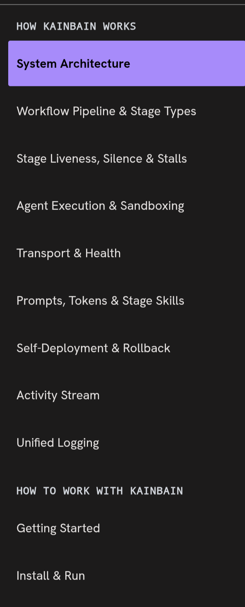

<!-- KAINBAIN AUTO-GENERATED REPORT -->
# Stage Report: Automated tests

**Task:** I'd like more definition between header and articles on the docs viewer sidebar  Currently the headers for the article categories are almost identical to the article names. Can you please make them more pronounced and maybe collapsible for the ones under it so it's easier to scroll through. Feel free to reorganise if wanted to make the categories make sense more especially now we are leaning into the groupings
**Stage Type:** `ci`
**Model:** `default`
**Duration:** 1249.115s
**Status:** FAILED

### Summary of Changes
Execution failed: CI command failed with exit code 1

### Execution Output
```

added 117 packages, and audited 118 packages in 1s

14 packages are looking for funding
  run `npm fund` for details

found 0 vulnerabilities

> kainbain@1.0.0 test
> node scripts/run-tests.mjs

Starting full project verification...
Dependencies missing for api (@earendil-works/pi-coding-agent, @fastify/cors, @fastify/multipart, @fastify/static, @fastify/swagger, @fastify/swagger-ui, @fastify/websocket, @opencode-ai/sdk, adm-zip, eslint-config-prettier, fastify, jose, semver, uuid, web-push, @vitest/coverage-v8, eslint, eslint-plugin-n, eslint-plugin-security, globals, vite, vitest) — installing (npm install --prefix api)...
npm warn deprecated node-domexception@1.0.0: Use your platform's native DOMException instead

added 351 packages, and audited 352 packages in 6s

85 packages are looking for funding
  run `npm fund` for details

found 0 vulnerabilities
npm warn install-scripts 2 packages have install scripts not yet covered by allowScripts:
npm warn install-scripts   @google/genai@2.21.0 (preinstall: echo 'preinstall: no-op')
npm warn install-scripts   protobufjs@7.6.6 (postinstall: node scripts/postinstall)
npm warn install-scripts
npm warn install-scripts Run `npm install-scripts ls` to review, or `npm install-scripts approve <pkg>` to allow.
Dependencies missing for frontend (@testing-library/dom, mermaid, react, react-dom, react-router, @testing-library/jest-dom, @testing-library/react, @vitejs/plugin-react, autoprefixer, eslint, eslint-config-prettier, eslint-plugin-jsx-a11y, eslint-plugin-no-unsanitized, eslint-plugin-react, eslint-plugin-react-hooks, eslint-plugin-security, globals, happy-dom, jsdom, postcss, prettier, tailwindcss, vite, vitest) — installing (npm install --prefix frontend)...

added 535 packages, and audited 536 packages in 7s

146 packages are looking for funding
  run `npm fund` for details

found 0 vulnerabilities
Dependencies missing for canary-e2e (@axe-core/playwright, @playwright/test) — installing (npm install --prefix canary-e2e)...

added 5 packages, and audited 6 packages in 1s

found 0 vulnerabilities
Workspace dependencies installed (api, frontend, canary-e2e).
✅ Settings duplicate check passed (36 files in 166ms)
✅ Frontend imports check passed (738 files in 440ms)
▸ started Unit Tests (api)
▸ started Unit Tests (frontend)
▸ started Unit Tests (runner)
▸ started Linting (api)
▸ started Linting (frontend)
▸ started Frontend Build
▸ started Security Script Tests
▸ started Dependency Check
▸ started Dependency Audit Gate
▸ started Proof Hygiene
▸ started Harness Self-Tests
▸ started Container Tests
⏳ still running: Unit Tests (api) (30s), Unit Tests (frontend) (30s), Linting (api) (30s), Linting (frontend) (30s), Frontend Build (30s), Dependency Check (30s), Dependency Audit Gate (30s), Harness Self-Tests (30s)
⏳ still running: Unit Tests (api) (1m00s), Unit Tests (frontend) (1m00s), Linting (api) (1m00s), Linting (frontend) (1m00s), Frontend Build (1m00s), Dependency Check (1m00s), Harness Self-Tests (1m00s)
⏳ still running: Unit Tests (api) (1m30s), Unit Tests (frontend) (1m30s), Linting (api) (1m30s), Linting (frontend) (1m30s), Harness Self-Tests (1m30s)
⏳ still running: Unit Tests (api) (2m00s), Linting (frontend) (2m00s)
⏳ still running: Unit Tests (api) (2m30s)
⏳ still running: Unit Tests (api) (3m00s)
⏳ still running: Unit Tests (api) (3m30s)
⏳ still running: Unit Tests (api) (4m00s)
Running Unit Tests (api)... PASS (250s)
Running Unit Tests (frontend)... PASS (250s)
Running Unit Tests (runner)... PASS (250s)
Running Linting (api)... PASS (250s)
Running Linting (frontend)... PASS (250s)
Running Frontend Build... PASS (250s)
Running Security Script Tests... PASS (250s)
Running Dependency Check... PASS (250s)
Running Dependency Audit Gate... PASS (250s)
Running Proof Hygiene... PASS (250s)
Running Harness Self-Tests... PASS (250s)
Running Container Tests... PASS (250s)
Fast gate complete — starting Canary Tests alone (serial phase, no shared CPUs with the unit suites)...
▸ started Canary Tests
⏳ still running: Canary Tests (30s)
⏳ still running: Canary Tests (1m00s)
⏳ still running: Canary Tests (1m30s)
⏳ still running: Canary Tests (2m00s)
⏳ still running: Canary Tests (2m30s)
⏳ still running: Canary Tests (3m00s)
⏳ still running: Canary Tests (3m30s)
⏳ still running: Canary Tests (4m00s)
⏳ still running: Canary Tests (4m30s)
⏳ still running: Canary Tests (5m00s)
⏳ still running: Canary Tests (5m30s)
⏳ still running: Canary Tests (6m00s)
⏳ still running: Canary Tests (6m30s)
⏳ still running: Canary Tests (7m00s)
⏳ still running: Canary Tests (7m30s)
⏳ still running: Canary Tests (8m00s)
⏳ still running: Canary Tests (8m30s)
⏳ still running: Canary Tests (9m00s)
⏳ still running: Canary Tests (9m30s)
⏳ still running: Canary Tests (10m00s)
⏳ still running: Canary Tests (10m30s)
⏳ still running: Canary Tests (11m00s)
⏳ still running: Canary Tests (11m30s)
⏳ still running: Canary Tests (12m00s)
⏳ still running: Canary Tests (12m30s)
⏳ still running: Canary Tests (13m00s)
⏳ still running: Canary Tests (13m30s)
⏳ still running: Canary Tests (14m00s)
⏳ still running: Canary Tests (14m30s)
⏳ still running: Canary Tests (15m00s)
⏳ still running: Canary Tests (15m30s)
⏳ still running: Canary Tests (16m00s)
Running Canary Tests... FAIL (970s)
----------------------------------------------------------------------
Details for Canary Tests:
(trimmed 127 of 247 lines; showing the tail)
  ✓   83 tests/retrospective.spec.js:83:6 › retrospective mobile layout › phone controls keep touch-sized targets (2.0s)
  ✓   84 tests/retrospective.spec.js:117:6 › retrospective mobile layout › phone page owns the vertical scroll region (3.4s)
  ✓   85 tests/retrospective.spec.js:151:6 › retrospective mobile layout › phone page never scrolls sideways (2.2s)
  ✓   86 tests/retrospective.spec.js:172:6 › retrospective mobile layout › desktop hides the strip and shows all three panes (2.8s)
  ✓   87 tests/runtime-errors.spec.js:13:5 › app renders without uncaught page errors (2.4s)
  ✓   88 tests/runtime-errors.spec.js:23:5 › app renders without console errors (2.0s)
  ✓   89 tests/settings.spec.js:60:6 › Settings save round-trip › edit, save, reload: values persist across UI and API (3.5s)
  ✓   90 tests/settings.spec.js:83:6 › Settings save round-trip › invalid input blocks the save and keeps the stored config (3.1s)
  ✓   91 tests/survey-verify.spec.js:126:7 › question-me survey verification › engine parks a question-me stage with no survey file; skip advances (2.8s)
survey timings ms: reveal=64 save=82 submit=84
  ✓   92 tests/survey-verify.spec.js:150:7 › question-me survey verification › desktop: conditional reveal, notes, save, submit advances; file stays append-only (4.1s)
  ✓   93 tests/survey-verify.spec.js:265:9 › question-me survey verification › touch context › mobile: survey renders, answers, and fits 375px (2.3s)
  ✓   94 tests/survey-verify.spec.js:296:7 › question-me survey verification › empty round advances via continue without parking (2.2s)
  ✓   95 tests/survey-verify.spec.js:323:7 › question-me survey verification › image questions: mock generation at park, pick one, chosen picture persisted (2.9s)
  ✓   96 tests/system-settings-mobile.spec.js:126:6 › System Settings screen tab bar (task 5ad55777) › tab bar renders at full height on mobile across all tabs (6.5s)
  ✓   97 tests/system-settings-mobile.spec.js:142:6 › System Settings screen tab bar (task 5ad55777) › tab bar renders at full height on a short mobile viewport (2.8s)
  ✓   98 tests/system-settings-mobile.spec.js:155:6 › System Settings screen tab bar (task 5ad55777) › scrolling the details never covers the tab bar (3.0s)
  ✓   99 tests/system-settings-mobile.spec.js:169:6 › System Settings screen tab bar (task 5ad55777) › tab bar renders at full height on desktop (2.7s)
  ✓  100 tests/system-settings-mobile.spec.js:175:6 › System Settings screen tab bar (task 5ad55777) › rotating the viewport never covers the tab bar (3.3s)
  ✓  101 tests/system-settings-mobile.spec.js:192:6 › System Settings screen tab bar (task 5ad55777) › a deep-linked tab survives a refresh and an unknown section falls back (3.2s)
  ✓  102 tests/system-settings-mobile.spec.js:221:6 › System Settings entry opens a screen, not a dialog (task cd669cc3) › no modal dialog shell remains on the settings route (2.4s)
  ✓  103 tests/system-settings-mobile.spec.js:228:6 › System Settings entry opens a screen, not a dialog (task cd669cc3) › desktop System Menu opens System Settings in a new window (2.3s)
  ✓  104 tests/system-settings-mobile.spec.js:253:6 › System Settings entry opens a screen, not a dialog (task cd669cc3) › mobile System Menu falls back to same-tab navigation (no popout trap) (2.0s)
  ✓  105 tests/task-editing.spec.js:34:6 › Task-view editing behaviors › attached image markdown is appended at the end, title line intact (36.0s)
  ✓  106 tests/task-editing.spec.js:71:6 › Task-view editing behaviors › preview/edit round-trip preserves edited content (36.3s)
  ✓  107 tests/task-errors.spec.js:93:6 › Task-view error display › long failure renders capped with a Show more/less toggle (2.2s)
  ✓  108 tests/task-inspector.spec.js:45:6 › Task inspector core behaviors › just-created task opens the goal in edit mode with context tokens (5.8s)
  ✘  109 tests/task-inspector.spec.js:64:6 › Task inspector core behaviors › preview toggle hides the editor and the context tokens, edit restores them (4.0s)
  ✓  110 tests/task-inspector.spec.js:92:6 › Task inspector core behaviors › clicking the task key copies the full task id and keeps the inspector open (5.4s)
  ✓  111 tests/task-inspector.spec.js:124:6 › Task inspector core behaviors › inspector width adjusts via the splitter, keyboard, and persists (7.3s)
  ✓  112 tests/task-inspector.spec.js:200:7 › Task inspector core behaviors › desktop overlay geometry (task f56e9878) › open inspector overlaps the board without squishing the toolbar (5.3s)
  ✓  113 tests/task-lifecycle.spec.js:42:6 › Task Lifecycle E2E › submit -> kanban placement -> advance -> complete (5.1s)
  ✓  114 tests/task-lifecycle.spec.js:85:6 › Task Lifecycle E2E › kanban cards are draggable and columns are drop targets (5.6s)
TEST START: human stage renders Approve/Reject checkpoint controls
projectId: f66659fe-5664-484c-8669-a5d0d6fc82d1
stages count: 6
humanStage: 4 Review Plan
submitting goal: Human review 1794770378268
goal submitted, polling latestTask
task id: 12786fbe-d0f8-4e1a-9ae4-22adb77474d9 stageId before jump: undefined
jump status: 200
Reload attempt 0 starting...
page.reload finished on attempt 0
waitForAppReadyOnProject starting on attempt 0
waitForAppReadyOnProject succeeded on attempt 0
waiting for Approve/Reject buttons...
TEST FINISHED SUCCESSFULLY
  ✓  115 tests/task-lifecycle.spec.js:109:6 › Task Lifecycle E2E › human stage renders Approve/Reject checkpoint controls (36.9s)
  ✘  116 tests/task-lifecycle.spec.js:233:6 › Task Lifecycle E2E › clicking a card opens the slide-over task inspector (3.7s)
  ✓  117 tests/task-logs.spec.js:109:6 › Agent-log readability › structured run output renders readably across feeds (2.7s)
  ✓  118 tests/task-logs.spec.js:146:6 › Agent-log readability › long lines wrap without breaking the inspector layout (2.6s)
  ✓  119 tests/task-logs.spec.js:167:6 › Agent-log readability › a fresh task shows the initialized placeholder, not a blank page (2.8s)
  ✓  120 tests/visual/dashboard.spec.js:65:8 › Dashboard Visuals › Desktop › Empty state (2.7s)
  ✓  121 tests/visual/dashboard.spec.js:82:8 › Dashboard Visuals › Desktop › Active execution (task card in canvas) (4.0s)
  ✓  122 tests/visual/dashboard.spec.js:96:8 › Dashboard Visuals › Desktop › Populated history (tasks + session tree) (4.5s)
  ✓  123 tests/visual/dashboard.spec.js:65:8 › Dashboard Visuals › Tablet › Empty state (2.5s)
  ✓  124 tests/visual/dashboard.spec.js:82:8 › Dashboard Visuals › Tablet › Active execution (task card in canvas) (4.7s)
  ✓  125 tests/visual/dashboard.spec.js:96:8 › Dashboard Visuals › Tablet › Populated history (tasks + session tree) (5.6s)
  ✓  126 tests/visual/dashboard.spec.js:65:8 › Dashboard Visuals › Mobile › Empty state (2.6s)
  ✓  127 tests/visual/dashboard.spec.js:82:8 › Dashboard Visuals › Mobile › Active execution (task card in canvas) (3.8s)
  ✓  128 tests/visual/dashboard.spec.js:96:8 › Dashboard Visuals › Mobile › Populated history (tasks + session tree) (5.6s)
  ✓  129 tests/visual/header.spec.js:23:7 › Header Visuals (task 66ad153f) › header band at Mobile 375px (3.3s)
  ✓  130 tests/visual/header.spec.js:23:7 › Header Visuals (task 66ad153f) › header band at Tablet 1024px (2.9s)
  ✓  131 tests/visual/header.spec.js:23:7 › Header Visuals (task 66ad153f) › header band at Desktop 1280px (2.7s)
  ✓  132 tests/visual/homepage.spec.js:44:7 › Homepage Visuals › visual regression - Desktop (2.6s)
  ✓  133 tests/visual/homepage.spec.js:44:7 › Homepage Visuals › visual regression - Tablet (3.0s)
  ✓  134 tests/visual/homepage.spec.js:44:7 › Homepage Visuals › visual regression - Mobile (2.5s)
  ✓  135 tests/websocket.spec.js:42:5 › frontend connects to the backend WebSocket and receives the handshake (2.9s)
  ✓  136 tests/workflow.spec.js:18:6 › Workflow E2E Tests › Task Creation: In-line add task -> verify card appears in kanban stage (3.6s)
  ✓  137 tests/workflow.spec.js:38:6 › Workflow E2E Tests › Stage types: human stage shows review checkpoint (5.7s)
  ✓  138 tests/workflow.spec.js:66:6 › Workflow E2E Tests › Now Playing bar: runner boxes own play/skip, no global engine controls (3.1s)
  ✓  139 tests/workflow.spec.js:97:6 › Workflow E2E Tests › Project isolation: switching project loads its own workflow (3.3s)
  ✓  140 tests/workflow.spec.js:114:6 › Workflow E2E Tests › Stage skills: GET /skills serves the library and the stage editor exposes the Skills panel (3.7s)


  1) tests/task-inspector.spec.js:64:6 › Task inspector core behaviors › preview toggle hides the editor and the context tokens, edit restores them 

    Error: page.goto: Target page, context or browser has been closed

       at helpers.js:65

      63 | 		if (!/ERR_INSUFFICIENT_RESOURCES|has been closed|Target closed|Page crashed|Target crashed/.test(err?.message || "")) throw err;
      64 | 		await new Promise((r) => setTimeout(r, 1000));
    > 65 | 		await page.goto(APP_URL, { waitUntil: "domcontentloaded" });
         | 		           ^
      66 | 	}
      67 | 	await expect(page).toHaveTitle(/Kainbain/);
      68 | 	const totalBudget = Number.isFinite(readyTimeoutMs) && readyTimeoutMs > 0 ? readyTimeoutMs : APP_READY_TIMEOUT_MS;
        at waitForAppReady (/home/[REDACTED]/.kainbain/runner-work/kb-68714709-3f50-4e5c-bfa6-bac16a36c393/canary-e2e/tests/helpers.js:65:14)
        at waitForAppReadyOnProject (/home/[REDACTED]/.kainbain/runner-work/kb-68714709-3f50-4e5c-bfa6-bac16a36c393/canary-e2e/tests/helpers.js:129:2)
        at /home/[REDACTED]/.kainbain/runner-work/kb-68714709-3f50-4e5c-bfa6-bac16a36c393/canary-e2e/tests/task-inspector.spec.js:72:3

    Error Context: test-results/task-inspector-Task-inspec-3e91e-t-tokens-edit-restores-them/error-context.md

  2) tests/task-lifecycle.spec.js:233:6 › Task Lifecycle E2E › clicking a card opens the slide-over task inspector 

    Error: page.goto: Target page, context or browser has been closed

       at helpers.js:65

      63 | 		if (!/ERR_INSUFFICIENT_RESOURCES|has been closed|Target closed|Page crashed|Target crashed/.test(err?.message || "")) throw err;
      64 | 		await new Promise((r) => setTimeout(r, 1000));
    > 65 | 		await page.goto(APP_URL, { waitUntil: "domcontentloaded" });
         | 		           ^
      66 | 	}
      67 | 	await expect(page).toHaveTitle(/Kainbain/);
      68 | 	const totalBudget = Number.isFinite(readyTimeoutMs) && readyTimeoutMs > 0 ? readyTimeoutMs : APP_READY_TIMEOUT_MS;
        at waitForAppReady (/home/[REDACTED]/.kainbain/runner-work/kb-68714709-3f50-4e5c-bfa6-bac16a36c393/canary-e2e/tests/helpers.js:65:14)
        at waitForAppReadyOnProject (/home/[REDACTED]/.kainbain/runner-work/kb-68714709-3f50-4e5c-bfa6-bac16a36c393/canary-e2e/tests/helpers.js:129:2)
        at submitGoal (/home/[REDACTED]/.kainbain/runner-work/kb-68714709-3f50-4e5c-bfa6-bac16a36c393/canary-e2e/tests/task-lifecycle.spec.js:31:2)
        at /home/[REDACTED]/.kainbain/runner-work/kb-68714709-3f50-4e5c-bfa6-bac16a36c393/canary-e2e/tests/task-lifecycle.spec.js:236:3

    Error Context: test-results/task-lifecycle-Task-Lifecy-47fe1-e-slide-over-task-inspector/error-context.md

  Slow test file: tests/accessibility.spec.js (6.9m)
  Consider running tests from slow files in parallel. See: https://playwright.dev/docs/test-parallel
  2 failed
    tests/task-inspector.spec.js:64:6 › Task inspector core behaviors › preview toggle hides the editor and the context tokens, edit restores them 
    tests/task-lifecycle.spec.js:233:6 › Task Lifecycle E2E › clicking a card opens the slide-over task inspector 
  138 passed (16.1m)
----------------------------------------------------------------------

```

### Modified Files
- (No files modified / inspection only)

### Verification Status
- Stage execution failed with error: CI command failed with exit code 1
- Triggered fallback routing.