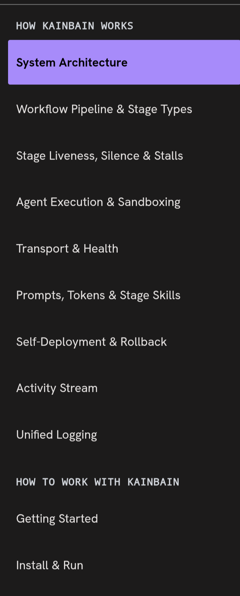

<!-- KAINBAIN AUTO-GENERATED REPORT -->
# Stage Report: Automated tests

**Task:** I'd like more definition between header and articles on the docs viewer sidebar  Currently the headers for the article categories are almost identical to the article names. Can you please make them more pronounced and maybe collapsible for the ones under it so it's easier to scroll through. Feel free to reorganise if wanted to make the categories make sense more especially now we are leaning into the groupings
**Stage Type:** `ci`
**Model:** `default`
**Duration:** 964.374s
**Status:** FAILED

### Summary of Changes
Execution failed: CI command failed with exit code 1

### Execution Output
```

added 117 packages, and audited 118 packages in 1s

14 packages are looking for funding
  run `npm fund` for details

found 0 vulnerabilities

> kainbain@1.0.0 test
> node scripts/run-tests.mjs

Starting full project verification...
✅ Settings duplicate check passed (36 files in 103ms)
✅ Frontend imports check passed (738 files in 278ms)
▸ started Unit Tests (api)
▸ started Unit Tests (frontend)
▸ started Unit Tests (runner)
▸ started Linting (api)
▸ started Linting (frontend)
▸ started Frontend Build
▸ started Security Script Tests
▸ started Dependency Check
▸ started Dependency Audit Gate
▸ started Proof Hygiene
▸ started Harness Self-Tests
▸ started Container Tests
⏳ still running: Unit Tests (api) (30s), Unit Tests (frontend) (30s), Frontend Build (30s), Dependency Check (30s), Harness Self-Tests (30s)
⏳ still running: Unit Tests (api) (1m00s), Unit Tests (frontend) (1m00s), Harness Self-Tests (1m00s)
⏳ still running: Unit Tests (api) (1m30s)
⏳ still running: Unit Tests (api) (2m00s)
⏳ still running: Unit Tests (api) (2m30s)
Running Unit Tests (api)... PASS (174s)
Running Unit Tests (frontend)... PASS (174s)
Running Unit Tests (runner)... PASS (174s)
Running Linting (api)... PASS (174s)
Running Linting (frontend)... PASS (174s)
Running Frontend Build... PASS (174s)
Running Security Script Tests... PASS (174s)
Running Dependency Check... PASS (174s)
Running Dependency Audit Gate... PASS (174s)
Running Proof Hygiene... FAIL (174s)
----------------------------------------------------------------------
Details for Proof Hygiene:
proof-and-hygiene check FAILED (3 violation(s)):
  docs/tasks/68714709-3f50-4e5c-bfa6-bac16a36c393/docs-sidebar-collapsed-proof.png: expected magic 89504e47, found efbfbd504e470d0a (binary file was rewritten through a text path; restore binary-safely via git checkout <ref> -- docs/tasks/68714709-3f50-4e5c-bfa6-bac16a36c393/docs-sidebar-collapsed-proof.png, then re-verify with xxd -l 8 and file)
  docs/tasks/68714709-3f50-4e5c-bfa6-bac16a36c393/docs-sidebar-expanded-proof.png: expected magic 89504e47, found efbfbd504e470d0a (binary file was rewritten through a text path; restore binary-safely via git checkout <ref> -- docs/tasks/68714709-3f50-4e5c-bfa6-bac16a36c393/docs-sidebar-expanded-proof.png, then re-verify with xxd -l 8 and file)
  docs/tasks/68714709-3f50-4e5c-bfa6-bac16a36c393/docs-sidebar-filtered-proof.png: expected magic 89504e47, found efbfbd504e470d0a (binary file was rewritten through a text path; restore binary-safely via git checkout <ref> -- docs/tasks/68714709-3f50-4e5c-bfa6-bac16a36c393/docs-sidebar-filtered-proof.png, then re-verify with xxd -l 8 and file)
----------------------------------------------------------------------
Running Harness Self-Tests... PASS (174s)
Running Container Tests... PASS (174s)
Fast gate complete — starting Canary Tests alone (serial phase, no shared CPUs with the unit suites)...
▸ started Canary Tests
⏳ still running: Canary Tests (30s)
⏳ still running: Canary Tests (1m00s)
⏳ still running: Canary Tests (1m30s)
⏳ still running: Canary Tests (2m00s)
⏳ still running: Canary Tests (2m30s)
⏳ still running: Canary Tests (3m00s)
⏳ still running: Canary Tests (3m30s)
⏳ still running: Canary Tests (4m00s)
⏳ still running: Canary Tests (4m30s)
⏳ still running: Canary Tests (5m00s)
⏳ still running: Canary Tests (5m30s)
⏳ still running: Canary Tests (6m00s)
⏳ still running: Canary Tests (6m30s)
⏳ still running: Canary Tests (7m00s)
⏳ still running: Canary Tests (7m30s)
⏳ still running: Canary Tests (8m00s)
⏳ still running: Canary Tests (8m30s)
⏳ still running: Canary Tests (9m00s)
⏳ still running: Canary Tests (9m30s)
⏳ still running: Canary Tests (10m00s)
⏳ still running: Canary Tests (10m30s)
⏳ still running: Canary Tests (11m00s)
⏳ still running: Canary Tests (11m30s)
⏳ still running: Canary Tests (12m00s)
⏳ still running: Canary Tests (12m30s)
⏳ still running: Canary Tests (13m00s)
Running Canary Tests... PASS (782s)

```

### Modified Files
- (No files modified / inspection only)

### Verification Status
- Stage execution failed with error: CI command failed with exit code 1
- Triggered fallback routing.