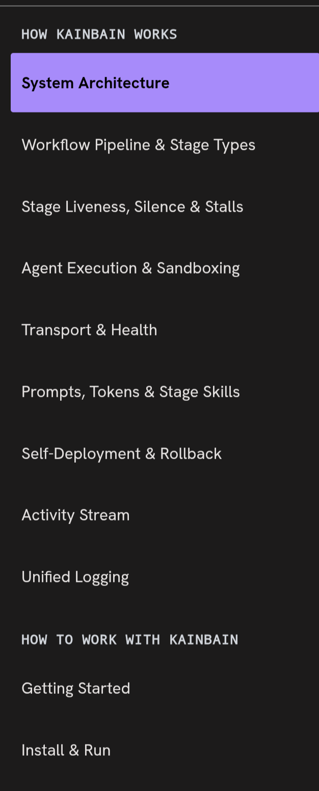

<!-- KAINBAIN AUTO-GENERATED REPORT -->
# Stage Report: Continueity

**Task:** I'd like more definition between header and articles on the docs viewer sidebar  Currently the headers for the article categories are almost identical to the article names. Can you please make them more pronounced and maybe collapsible for the ones under it so it's easier to scroll through. Feel free to reorganise if wanted to make the categories make sense more especially now we are leaning into the groupings
**Stage Type:** `agent`
**Model:** `utility`
**Duration:** 103.608s
**Status:** FAILED

### Summary of Changes
Execution failed: [Agent Review Rejection] api/siteDocs.js:35 renames DOC_SECTIONS from how-it-works/working-with to four new ids and readDocFile api/siteDocs.js:133 returns null for old values; reproduced listDocs returns [] and getDoc returns null on a custom KAINBAIN_SITE_DOCS dir with old sections, so custom articles silently vanish on update with no alias, warning, or DEPRECATIONS.md entry. Fix guidance: Add a backward-compat alias in api/siteDocs.js (map how-it-works/working-with to the new groups or accept them with a warn) so old-section files still index; add a regression test proving listDocs/getDoc with old frontmatter still resolves; document the rename in DEPRECATIONS.md; re-run api/siteDocs tests to confirm.

### Execution Output
```
Audited origin/main...HEAD for upgrade breaks and wrote [upgrade-safety-audit-20261115.md](/home/[REDACTED]/.kainbain/runner-work/kb-68714709-3f50-4e5c-bfa6-bac16a36c393/docs/tasks/68714709-3f50-4e5c-bfa6-bac16a36c393/upgrade-safety-audit-20261115.md). Found a silent data loss: api/siteDocs.js hard-renames DOC_SECTIONS and readDocFile drops old-section custom articles with no alias, warning, or deprecation note, verified by reproduction. No DB, env, volume, or deploy changes were found and localStorage handling is safe, but the docs break alone fails this stage per its criteria.

KAINBAIN_VERDICT: FAIL
KAINBAIN_REASON: api/siteDocs.js:35 renames DOC_SECTIONS from how-it-works/working-with to four new ids and readDocFile api/siteDocs.js:133 returns null for old values; reproduced listDocs returns [] and getDoc returns null on a custom KAINBAIN_SITE_DOCS dir with old sections, so custom articles silently vanish on update with no alias, warning, or DEPRECATIONS.md entry.
KAINBAIN_FIX: Add a backward-compat alias in api/siteDocs.js (map how-it-works/working-with to the new groups or accept them with a warn) so old-section files still index; add a regression test proving listDocs/getDoc with old frontmatter still resolves; document the rename in DEPRECATIONS.md; re-run api/siteDocs tests to confirm.
```

### Modified Files
- (No files modified / inspection only)

### Verification Status
- Stage execution failed with error: [Agent Review Rejection] api/siteDocs.js:35 renames DOC_SECTIONS from how-it-works/working-with to four new ids and readDocFile api/siteDocs.js:133 returns null for old values; reproduced listDocs returns [] and getDoc returns null on a custom KAINBAIN_SITE_DOCS dir with old sections, so custom articles silently vanish on update with no alias, warning, or DEPRECATIONS.md entry. Fix guidance: Add a backward-compat alias in api/siteDocs.js (map how-it-works/working-with to the new groups or accept them with a warn) so old-section files still index; add a regression test proving listDocs/getDoc with old frontmatter still resolves; document the rename in DEPRECATIONS.md; re-run api/siteDocs tests to confirm.
- Triggered fallback routing.