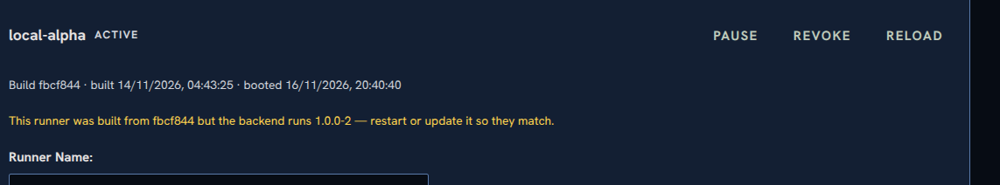

<!-- KAINBAIN AUTO-GENERATED REPORT -->
# Stage Report: automated test 2

**Task:** Add a restart and update as seperate options for runners  Instead of reload mark it as a destructive action that restarts the selected runner with a confirmation window. I would also like some version controls so we can either tie the runner to a specific version or have latest.  If the version in the selector mis-matches the version in the ui it should show a warning with an Update button than will trigger the reinstall/update to the latest version (if set to latest this should show every time a new version is published. and only if it is set to latest do we have autoupdate behaviour, latest should be the default) If there is a newer version it should show the warning that a newer version is available in red to scare them into updating.
**Stage Type:** `ci`
**Model:** `default`
**Duration:** 1507.045s
**Status:** FAILED

### Summary of Changes
Execution failed: CI command failed with exit code 1

### Execution Output
```

up to date, audited 118 packages in 1s

14 packages are looking for funding
  run `npm fund` for details

found 0 vulnerabilities

> kainbain@1.0.0 test
> node scripts/run-tests.mjs

Starting full project verification...
Fast-gate verdict dir: /home/[REDACTED]/.kainbain/runner-work/kb-78e0522a-430d-4659-9e2f-7db6444d13f9/docs/tasks/78e0522a-430d-4659-9e2f-7db6444d13f9/ci-fast-gate-20261117-035740 (verdict.json + untrimmed failed-branch logs land here)
✅ Settings duplicate check passed (37 files in 142ms)
✅ Frontend imports check passed (753 files in 292ms)
▸ started Unit Tests (api)
▸ started Unit Tests (frontend)
▸ started Unit Tests (runner)
▸ started Linting (api)
▸ started Linting (frontend)
▸ started Frontend Build
▸ started Security Script Tests
▸ started Dependency Check
▸ started Dependency Audit Gate
▸ started Proof Hygiene
▸ started Binary Guard
▸ started Harness Self-Tests
▸ started Container Tests
⏳ still running: Unit Tests (api) (30s), Unit Tests (frontend) (30s), Linting (frontend) (30s), Frontend Build (30s), Dependency Check (30s), Harness Self-Tests (30s)
⏳ still running: Unit Tests (api) (1m00s), Unit Tests (frontend) (1m00s), Harness Self-Tests (1m00s)
⏳ still running: Unit Tests (api) (1m30s)
⏳ still running: Unit Tests (api) (2m00s)
⏳ still running: Unit Tests (api) (2m30s)
⏳ still running: Unit Tests (api) (3m00s)
⏳ still running: Unit Tests (api) (3m30s)
⏳ still running: Unit Tests (api) (4m00s)
⏳ still running: Unit Tests (api) (4m30s)
⏳ still running: Unit Tests (api) (5m00s)
⏳ still running: Unit Tests (api) (5m30s)
⏳ still running: Unit Tests (api) (6m00s)
⏳ still running: Unit Tests (api) (6m30s)
⏳ still running: Unit Tests (api) (7m00s)
⏳ still running: Unit Tests (api) (7m30s)
⏳ still running: Unit Tests (api) (8m00s)
⏳ still running: Unit Tests (api) (8m30s)
⏳ still running: Unit Tests (api) (9m00s)
⏳ still running: Unit Tests (api) (9m30s)
⏳ still running: Unit Tests (api) (10m00s)
⏳ still running: Unit Tests (api) (10m30s)
⏳ still running: Unit Tests (api) (11m01s)
⏳ still running: Unit Tests (api) (11m31s)
⏳ still running: Unit Tests (api) (12m01s)
⏳ still running: Unit Tests (api) (12m31s)
⏳ still running: Unit Tests (api) (13m01s)
⏳ still running: Unit Tests (api) (13m31s)
⏳ still running: Unit Tests (api) (14m01s)
⏳ still running: Unit Tests (api) (14m31s)
⏳ still running: Unit Tests (api) (15m01s)
⏳ still running: Unit Tests (api) (15m31s)
⏳ still running: Unit Tests (api) (16m01s)
⏳ still running: Unit Tests (api) (16m31s)
⏳ still running: Unit Tests (api) (17m01s)
⏳ still running: Unit Tests (api) (17m31s)
Running Unit Tests (api)... FAIL (1057s)
----------------------------------------------------------------------
Details for Unit Tests (api):
Full log: Unit Tests (api) → /home/[REDACTED]/.kainbain/runner-work/kb-78e0522a-430d-4659-9e2f-7db6444d13f9/docs/tasks/78e0522a-430d-4659-9e2f-7db6444d13f9/ci-fast-gate-20261117-035740/unit-tests-api.full.log
(trimmed 3778 of 3898 lines; showing the tail)
 ✓ agent/sessionEvents.test.js (31 tests) 9ms
 ✓ skills/questionMeImageGen.test.js (3 tests) 10ms
 ✓ crew/harnessRoster.test.js (9 tests) 14ms
 ✓ flow/execution/executionPure.test.js (11 tests) 11ms
 ✓ agent/harnesses/acp/AcpEventMapper.test.js (12 tests) 11ms
 ✓ agent/harnesses/acp/AcpStreamTransport.test.js (7 tests) 8ms
 ✓ project/stageNormalizers.autoApprove.test.js (8 tests) 8ms
 ✓ flow/humanGitSafety.audit.test.js (8 tests) 8ms
 ✓ flow/runnerRoutes.attribution.test.js (8 tests) 9ms
 ✓ continuity/deployMarkers.test.js (17 tests) 8ms
 ✓ stageTags.shared.test.js (8 tests) 7ms
 ✓ project/workflowDefaults.test.js (9 tests) 8ms
 ✓ flow/dispatch/isDispatchServable.test.js (10 tests) 7ms
 ✓ flow/settleOperatorAbort.marker.test.js (3 tests) 9ms
 ✓ projectRegistry.test.js (7 tests) 8ms
 ✓ appUrl.test.js (20 tests) 8ms
 ✓ kainbainDir.test.js (15 tests) 8ms
 ✓ stageRunnerPolicy.shared.test.js (17 tests) 9ms
 ✓ flow/stageLifecycle.test.js (8 tests) 7ms
 ✓ agent/harnesses/muse/museDiscovery.test.js (5 tests) 8ms
 ✓ project/appStatus.test.js (7 tests) 7ms
 ✓ flow/dispatch/fleetModelCatalog.test.js (8 tests) 7ms
 ✓ continuity/deployStageFailure.test.js (7 tests) 8ms
 ✓ push/atomicWrite.test.js (4 tests) 7ms
 ✓ auth/apiKeyScopes.test.js (6 tests) 7ms
 ✓ reviewDiff.test.js (5 tests) 7ms
 ✓ agent/harnesses/muse/msp/museServeHostPool.test.js (7 tests) 8ms
 ✓ capabilityGuard.test.js (10 tests) 6ms
 ✓ flow/execution/executeStage.cutover.test.js (4 tests) 8ms
 ✓ flow/fastGateMarker.test.js (8 tests) 11ms
 ✓ work/taskWorkingLocation.test.js (9 tests) 6ms
 ✓ deploy.packaging.test.js (19 tests) 7ms
 ✓ flow/scheduler/noDoubleDispatch.test.js (2 tests) 5ms
 ✓ work/setEngineState.test.js (3 tests) 7ms
 ✓ skillConditionals.shared.test.js (27 tests) 7ms
 ✓ agent/harnessSupportTiers.test.js (7 tests) 7ms
 ✓ work/taskPersistence.autoApprove.test.js (2 tests) 7ms
 ✓ flow/runnerAssignmentSummary.test.js (6 tests) 6ms
 ✓ flow/scheduler/centralQueueSeam.test.js (11 tests) 8ms
 ✓ git/validation.test.js (8 tests) 8ms
 ✓ flow/dispatch/selectRunnerForImpromptu.test.js (7 tests) 7ms
 ✓ project/retrySettings.test.js (10 tests) 7ms
 ✓ promptCuration.layoutBaseline.test.js (2 tests) 6ms
 ✓ flow/stageExecution.failureDetails.test.js (6 tests) 8ms
 ✓ domainCompatibility.test.js (17 tests) 7ms
 ✓ auth/roles.test.js (11 tests) 6ms
 ✓ crew/sessionCapabilities.test.js (10 tests) 6ms
 ✓ work/kickIfRunnable.test.js (3 tests) 6ms
 ✓ roleHeaders.test.js (11 tests) 6ms
stderr | project/aliasRenames.test.js > warnLegacyNoneHarnessModel > reports the first occurrence per project + alias + harness
[projectStore] Alias "x" in /proj-warn-once targets harness "none", which manages its own model — keeping the stored model "m" (ignored at dispatch until the harness offers a catalog).

 ✓ project/aliasRenames.test.js (7 tests) 7ms
 ✓ work/taskWorkspace.test.js (8 tests) 6ms
 ✓ project/projectConfigDiscovery.test.js (8 tests) 6ms
 ✓ work/resolveEngineState.test.js (3 tests) 6ms
 ✓ flow/runnerBootstrap.test.js (7 tests) 5ms
 ✓ onboardingChecklist.test.js (7 tests) 6ms
 ✓ agent/harnesses/antigravity/agyRunErrors.test.js (12 tests) 6ms
 ✓ agent/harnesses/muse/museStreamParser.test.js (4 tests) 6ms
 ✓ flow/dispatch/selectRunnerForTask.test.js (5 tests) 6ms
 ✓ flow/dispatch/operatorConfigVerdict.test.js (7 tests) 6ms
 ✓ flow/routing/tables/routingTables.test.js (7 tests) 6ms
 ✓ projectStore.barrel.test.js (3 tests) 5ms
 ✓ flow/runnerPosture.test.js (5 tests) 5ms
 ✓ work/settleWedgedEntryForTask.test.js (3 tests) 6ms
 ✓ agent/harnesses/muse/msp/museMspModelCatalog.test.js (4 tests) 5ms
 ✓ auth/actor.test.js (5 tests) 5ms
 ✓ testIsolation.guard.test.js (8 tests) 6ms
 ✓ projectResolution.test.js (28 tests) 11ms
 ✓ flow/scheduler/schedulerPure.test.js (8 tests) 5ms
 ✓ sessionResolution.test.js (5 tests) 5ms
 ✓ flow/routing/resolvers/didFailbackMoveStages.test.js (7 tests) 4ms
 ✓ project/deployCommands.test.js (7 tests) 6ms
 ✓ formatPosture.shared.test.js (6 tests) 11ms
 ✓ reviewCommentFormatter.autoApprove.test.js (4 tests) 5ms
 ✓ work/isTaskFilePath.test.js (6 tests) 4ms
 ✓ agent/verdictContract.test.js (5 tests) 5ms
 ✓ normalizeBudget.shared.test.js (2 tests) 10ms
 ✓ project/projectSlug.test.js (5 tests) 5ms
 ✓ work/notifyQueueEmpty.test.js (1 test) 5ms
 ✓ work/resolveAttestationStage.test.js (5 tests) 5ms
 ✓ config/docs.envCoverage.test.js (2 tests) 5ms
 ✓ work/taskFiles.test.js (3 tests) 5ms
 ✓ work/notifySchedulerStall.test.js (1 test) 4ms
 ✓ work/notifyStagePush.test.js (1 test) 4ms
 ✓ cleanReportedPosture.shared.test.js (3 tests) 4ms
 ✓ testEnvGuard.test.js (3 tests) 4ms
 ✓ flow/dispatch/staleAdvertReason.test.js (1 test) 3ms
{"level":30,"time":1794888038973,"pid":1033846,"hostname":"server-HP-ProDesk-400-G4-SFF","reqId":"req-1","req":{"method":"GET","url":"/docs","host":"localhost:80","remoteAddress":"127.0.0.1"},"msg":"incoming request"}
 ✓ siteDocs.frontendParity.test.js (4 tests) 263ms
 ❯ gitGate.test.js (2 tests | 1 failed) 900112ms
   ❯ git() per-repository serialization gate (2)
     × never runs two git processes on the same repo at once 900104ms
     ✓ still runs git for different repos in parallel 6ms

⎯⎯⎯⎯⎯⎯⎯ Failed Tests 1 ⎯⎯⎯⎯⎯⎯⎯

 FAIL  gitGate.test.js > git() per-repository serialization gate > never runs two git processes on the same repo at once
Error: Test timed out in 900000ms.
If this is a long-running test, pass a timeout value as the last argument or configure it globally with "testTimeout".
 ❯ gitGate.test.js:82:2
     80|  const opts = { timeout: null };
     81|
     82|  it("never runs two git processes on the same repo at once", { timeout…
       |  ^
     83|   spawnMock.mockReset();
     84|   const first = deferredChild();

⎯⎯⎯⎯⎯⎯⎯⎯⎯⎯⎯⎯⎯⎯⎯⎯⎯⎯⎯⎯⎯⎯⎯⎯[1/1]⎯


 Test Files  1 failed | 451 passed (452)
      Tests  1 failed | 7405 passed | 1 skipped (7407)
   Start at  03:57:42
   Duration  1056.10s (tests 90%, import 7%, transform 3%)

    Isolate  452 workers spawned · ~98ms startup each (spawn + environment, per file)
             at least ~14.61s faster with isolate: false — reuses workers across files instead of one per file

----------------------------------------------------------------------
Running Unit Tests (frontend)... PASS (1057s)
Running Unit Tests (runner)... PASS (1057s)
Running Linting (api)... PASS (1057s)
Running Linting (frontend)... PASS (1057s)
Running Frontend Build... PASS (1057s)
Running Security Script Tests... PASS (1057s)
Running Dependency Check... PASS (1057s)
Running Dependency Audit Gate... PASS (1057s)
Running Proof Hygiene... PASS (1057s)
Running Binary Guard... PASS (1057s)
Running Harness Self-Tests... PASS (1057s)
Running Container Tests... PASS (1057s)
KAINBAIN_FAST_GATE_RESULT ok=false failedBranches="Unit Tests (api)" canary=opted_out verdict="/home/[REDACTED]/.kainbain/runner-work/kb-78e0522a-430d-4659-9e2f-7db6444d13f9/docs/tasks/78e0522a-430d-4659-9e2f-7db6444d13f9/ci-fast-gate-20261117-035740/verdict.json"
Fast-gate verdict: FAILED — Unit Tests (api)
Canary: opted out (--no-canary)
Full log: Unit Tests (api) → /home/[REDACTED]/.kainbain/runner-work/kb-78e0522a-430d-4659-9e2f-7db6444d13f9/docs/tasks/78e0522a-430d-4659-9e2f-7db6444d13f9/ci-fast-gate-20261117-035740/unit-tests-api.full.log
Verdict file: /home/[REDACTED]/.kainbain/runner-work/kb-78e0522a-430d-4659-9e2f-7db6444d13f9/docs/tasks/78e0522a-430d-4659-9e2f-7db6444d13f9/ci-fast-gate-20261117-035740/verdict.json

KAINBAIN_FAST_GATE_RESULT ok=false failedBranches="Unit Tests (api)" canary=opted_out verdict="/home/[REDACTED]/.kainbain/runner-work/kb-78e0522a-430d-4659-9e2f-7db6444d13f9/docs/tasks/78e0522a-430d-4659-9e2f-7db6444d13f9/ci-fast-gate-20261117-035740/verdict.json"
Fast-gate verdict: FAILED — Unit Tests (api)
Canary: opted out (--no-canary)
Full log: Unit Tests (api) → /home/[REDACTED]/.kainbain/runner-work/kb-78e0522a-430d-4659-9e2f-7db6444d13f9/docs/tasks/78e0522a-430d-4659-9e2f-7db6444d13f9/ci-fast-gate-20261117-035740/unit-tests-api.full.log
Verdict file: /home/[REDACTED]/.kainbain/runner-work/kb-78e0522a-430d-4659-9e2f-7db6444d13f9/docs/tasks/78e0522a-430d-4659-9e2f-7db6444d13f9/ci-fast-gate-20261117-035740/verdict.json


```

### Modified Files
- (No files modified / inspection only)

### Verification Status
- Stage execution failed with error: CI command failed with exit code 1
- Triggered fallback routing.