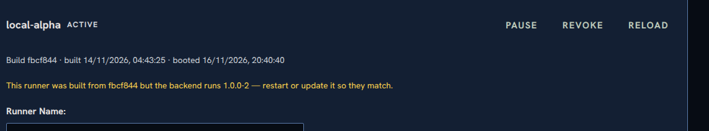

<!-- KAINBAIN AUTO-GENERATED REPORT -->
# Stage Report: Automated tests

**Task:** Add a restart and update as seperate options for runners  Instead of reload mark it as a destructive action that restarts the selected runner with a confirmation window. I would also like some version controls so we can either tie the runner to a specific version or have latest.  If the version in the selector mis-matches the version in the ui it should show a warning with an Update button than will trigger the reinstall/update to the latest version (if set to latest this should show every time a new version is published. and only if it is set to latest do we have autoupdate behaviour, latest should be the default) If there is a newer version it should show the warning that a newer version is available in red to scare them into updating.
**Stage Type:** `ci`
**Model:** `default`
**Duration:** 857.541s
**Status:** FAILED

### Summary of Changes
Execution failed: CI command failed with exit code 1

### Execution Output
```

added 117 packages, and audited 118 packages in 1s

14 packages are looking for funding
  run `npm fund` for details

found 0 vulnerabilities

> kainbain@1.0.0 test
> node scripts/run-tests.mjs

Starting full project verification...
Fast-gate verdict dir: /home/[REDACTED]/.kainbain/runner-work/kb-78e0522a-430d-4659-9e2f-7db6444d13f9/docs/tasks/78e0522a-430d-4659-9e2f-7db6444d13f9/ci-fast-gate-20261117-010508 (verdict.json + untrimmed failed-branch logs land here)
Dependencies missing for api (@earendil-works/pi-coding-agent, @fastify/cors, @fastify/multipart, @fastify/static, @fastify/swagger, @fastify/swagger-ui, @fastify/websocket, @opencode-ai/sdk, adm-zip, eslint-config-prettier, fastify, jose, semver, uuid, web-push, @vitest/coverage-v8, eslint, eslint-plugin-n, eslint-plugin-security, globals, vite, vitest) — installing (npm install --prefix api)...
npm warn deprecated node-domexception@1.0.0: Use your platform's native DOMException instead

added 351 packages, and audited 352 packages in 6s

85 packages are looking for funding
  run `npm fund` for details

found 0 vulnerabilities
npm warn install-scripts 2 packages have install scripts not yet covered by allowScripts:
npm warn install-scripts   @google/genai@2.21.0 (preinstall: echo 'preinstall: no-op')
npm warn install-scripts   protobufjs@7.6.6 (postinstall: node scripts/postinstall)
npm warn install-scripts
npm warn install-scripts Run `npm install-scripts ls` to review, or `npm install-scripts approve <pkg>` to allow.
Dependencies missing for frontend (@testing-library/dom, mermaid, react, react-dom, react-router, @testing-library/jest-dom, @testing-library/react, @vitejs/plugin-react, autoprefixer, eslint, eslint-config-prettier, eslint-plugin-jsx-a11y, eslint-plugin-no-unsanitized, eslint-plugin-react, eslint-plugin-react-hooks, eslint-plugin-security, globals, happy-dom, jsdom, postcss, prettier, tailwindcss, vite, vitest) — installing (npm install --prefix frontend)...

added 535 packages, and audited 536 packages in 7s

146 packages are looking for funding
  run `npm fund` for details

found 0 vulnerabilities
Dependencies missing for canary-e2e (@axe-core/playwright, @playwright/test) — installing (npm install --prefix canary-e2e)...

added 5 packages, and audited 6 packages in 820ms

found 0 vulnerabilities
Workspace dependencies installed (api, frontend, canary-e2e).
✅ Settings duplicate check passed (36 files in 199ms)
✅ Frontend imports check passed (745 files in 438ms)
▸ started Unit Tests (api)
▸ started Unit Tests (frontend)
▸ started Unit Tests (runner)
▸ started Linting (api)
▸ started Linting (frontend)
▸ started Frontend Build
▸ started Security Script Tests
▸ started Dependency Check
▸ started Dependency Audit Gate
▸ started Proof Hygiene
▸ started Binary Guard
▸ started Harness Self-Tests
▸ started Container Tests
⏳ still running: Unit Tests (api) (30s), Unit Tests (frontend) (30s), Linting (api) (30s), Linting (frontend) (30s), Frontend Build (30s), Dependency Check (30s), Dependency Audit Gate (30s), Harness Self-Tests (30s)
⏳ still running: Unit Tests (api) (1m00s), Unit Tests (frontend) (1m00s), Linting (api) (1m00s), Linting (frontend) (1m00s), Frontend Build (1m00s), Dependency Check (1m00s), Harness Self-Tests (1m00s)
⏳ still running: Unit Tests (api) (1m30s), Unit Tests (frontend) (1m30s), Linting (api) (1m30s), Linting (frontend) (1m30s), Dependency Check (1m30s), Harness Self-Tests (1m30s)
⏳ still running: Unit Tests (api) (2m00s), Linting (frontend) (2m00s)
⏳ still running: Unit Tests (api) (2m30s)
⏳ still running: Unit Tests (api) (3m00s)
⏳ still running: Unit Tests (api) (3m30s)
⏳ still running: Unit Tests (api) (4m00s)
Running Unit Tests (api)... PASS (259s)
Running Unit Tests (frontend)... FAIL (259s)
----------------------------------------------------------------------
Details for Unit Tests (frontend):
Full log: Unit Tests (frontend) → /home/[REDACTED]/.kainbain/runner-work/kb-78e0522a-430d-4659-9e2f-7db6444d13f9/docs/tasks/78e0522a-430d-4659-9e2f-7db6444d13f9/ci-fast-gate-20261117-010508/unit-tests-frontend.full.log
(trimmed 24842 of 24962 lines; showing the tail)

act(() => {
  /* fire events that update state */
});
/* assert on the output */

This ensures that you're testing the behavior the user would see in the browser. Learn more at https://reactjs.org/link/wrap-tests-with-act
    at StageSkillsPanel (/home/[REDACTED]/.kainbain/runner-work/kb-78e0522a-430d-4659-9e2f-7db6444d13f9/frontend/src/components/workflow/StageSkillsPanel.jsx:344:29)
    at Router (/home/[REDACTED]/.kainbain/runner-work/kb-78e0522a-430d-4659-9e2f-7db6444d13f9/frontend/node_modules/react-router/dist/development/chunk-GR4NQCSD.js:9996:13)
    at MemoryRouter (/home/[REDACTED]/.kainbain/runner-work/kb-78e0522a-430d-4659-9e2f-7db6444d13f9/frontend/node_modules/react-router/dist/development/chunk-GR4NQCSD.js:9906:3)

stderr | src/components/workflow/StageSkillsPanel.test.jsx > refresh control re-fetches the skills library
Warning: An update to StageSkillsPanel inside a test was not wrapped in act(...).

When testing, code that causes React state updates should be wrapped into act(...):

act(() => {
  /* fire events that update state */
});
/* assert on the output */

This ensures that you're testing the behavior the user would see in the browser. Learn more at https://reactjs.org/link/wrap-tests-with-act
    at StageSkillsPanel (/home/[REDACTED]/.kainbain/runner-work/kb-78e0522a-430d-4659-9e2f-7db6444d13f9/frontend/src/components/workflow/StageSkillsPanel.jsx:344:29)
    at Router (/home/[REDACTED]/.kainbain/runner-work/kb-78e0522a-430d-4659-9e2f-7db6444d13f9/frontend/node_modules/react-router/dist/development/chunk-GR4NQCSD.js:9996:13)
    at MemoryRouter (/home/[REDACTED]/.kainbain/runner-work/kb-78e0522a-430d-4659-9e2f-7db6444d13f9/frontend/node_modules/react-router/dist/development/chunk-GR4NQCSD.js:9906:3)
Warning: An update to StageSkillsPanel inside a test was not wrapped in act(...).

When testing, code that causes React state updates should be wrapped into act(...):

act(() => {
  /* fire events that update state */
});
/* assert on the output */

This ensures that you're testing the behavior the user would see in the browser. Learn more at https://reactjs.org/link/wrap-tests-with-act
    at StageSkillsPanel (/home/[REDACTED]/.kainbain/runner-work/kb-78e0522a-430d-4659-9e2f-7db6444d13f9/frontend/src/components/workflow/StageSkillsPanel.jsx:344:29)
    at Router (/home/[REDACTED]/.kainbain/runner-work/kb-78e0522a-430d-4659-9e2f-7db6444d13f9/frontend/node_modules/react-router/dist/development/chunk-GR4NQCSD.js:9996:13)
    at MemoryRouter (/home/[REDACTED]/.kainbain/runner-work/kb-78e0522a-430d-4659-9e2f-7db6444d13f9/frontend/node_modules/react-router/dist/development/chunk-GR4NQCSD.js:9906:3)
Warning: An update to StageSkillsPanel inside a test was not wrapped in act(...).

When testing, code that causes React state updates should be wrapped into act(...):

act(() => {
  /* fire events that update state */
});
/* assert on the output */

This ensures that you're testing the behavior the user would see in the browser. Learn more at https://reactjs.org/link/wrap-tests-with-act
    at StageSkillsPanel (/home/[REDACTED]/.kainbain/runner-work/kb-78e0522a-430d-4659-9e2f-7db6444d13f9/frontend/src/components/workflow/StageSkillsPanel.jsx:344:29)
    at Router (/home/[REDACTED]/.kainbain/runner-work/kb-78e0522a-430d-4659-9e2f-7db6444d13f9/frontend/node_modules/react-router/dist/development/chunk-GR4NQCSD.js:9996:13)
    at MemoryRouter (/home/[REDACTED]/.kainbain/runner-work/kb-78e0522a-430d-4659-9e2f-7db6444d13f9/frontend/node_modules/react-router/dist/development/chunk-GR4NQCSD.js:9906:3)

 ✓  1  src/components/workflow/StageSkillsPanel.test.jsx (28 tests) 1857ms

⎯⎯⎯⎯⎯⎯⎯ Failed Tests 2 ⎯⎯⎯⎯⎯⎯⎯

 FAIL   0  src/services/api.surface.test.js > api public surface > exposes the pinned non-domain keys plus exactly the registry operations
AssertionError: expected [ 'API_BASE', 'abortTask', …(120) ] to deeply equal [ 'API_BASE', 'abortTask', …(119) ]

- Expected
+ Received

@@ -84,10 +84,11 @@
    "pauseTask",
    "previewTask",
    "registerProject",
    "rejectTaskWithFeedback",
    "requestModelRediscovery",
+   "requestRunnerRestart",
    "requestRunnerUpdate",
    "resetPromptLayout",
    "restoreSession",
    "resumeRunner",
    "resumeTask",

 ❯ src/services/api.surface.test.js:50:37
     48|     ]);
     49|     const expected = [...new Set([...nonDomainKeys, ...registeredNames…
     50|     expect(Object.keys(api).sort()).toEqual(expected);
       |                                     ^
     51|   });
     52|

⎯⎯⎯⎯⎯⎯⎯⎯⎯⎯⎯⎯⎯⎯⎯⎯⎯⎯⎯⎯⎯⎯⎯⎯[1/2]⎯

 FAIL   0  src/services/domainRequests.test.js > Business-owned request lists > exposes exactly the registry operations with no duplicates
AssertionError: runners client keys: expected [ 'approveRunner', …(15) ] to deeply equal [ 'approveRunner', …(14) ]

- Expected
+ Received

@@ -7,10 +7,11 @@
    "getRunnerConfig",
    "getRunnerMonitor",
    "getRunners",
    "pauseRunner",
    "requestModelRediscovery",
+   "requestRunnerRestart",
    "requestRunnerUpdate",
    "resumeRunner",
    "revokeRunner",
    "skipRunner",
    "updateRunnerConfig",

 ❯ src/services/domainRequests.test.js:25:84
     23|     // request list (dropped op) fails here naming the domain.
     24|     for (const entry of domainRegistry) {
     25|       expect(Object.keys(entry.build(deps)).sort(), `${entry.domain} c…
       |                                                                                    ^
     26|         [...entry.operations].sort(),
     27|       );

⎯⎯⎯⎯⎯⎯⎯⎯⎯⎯⎯⎯⎯⎯⎯⎯⎯⎯⎯⎯⎯⎯⎯⎯[2/2]⎯


 Test Files  2 failed | 351 passed (353)
      Tests  2 failed | 4805 passed (4807)
   Start at  01:05:27
   Duration  102.75s (tests 50%, setup 23%, worker 9%, environment 7%, import 7%, transform 5%)

----------------------------------------------------------------------
Running Unit Tests (runner)... PASS (259s)
Running Linting (api)... PASS (259s)
Running Linting (frontend)... PASS (259s)
Running Frontend Build... PASS (259s)
Running Security Script Tests... PASS (259s)
Running Dependency Check... PASS (259s)
Running Dependency Audit Gate... PASS (259s)
Running Proof Hygiene... PASS (259s)
Running Binary Guard... PASS (259s)
Running Harness Self-Tests... PASS (259s)
Running Container Tests... PASS (259s)
KAINBAIN_FAST_GATE_RESULT ok=false failedBranches="Unit Tests (frontend)" canary=skipped_due_to_fast_gate_failure verdict="/home/[REDACTED]/.kainbain/runner-work/kb-78e0522a-430d-4659-9e2f-7db6444d13f9/docs/tasks/78e0522a-430d-4659-9e2f-7db6444d13f9/ci-fast-gate-20261117-010508/verdict.json"
Fast-gate verdict: FAILED — Unit Tests (frontend)
Canary: SKIPPED (fast-gate failed; deferred to the next green gate, never dropped)
Full log: Unit Tests (frontend) → /home/[REDACTED]/.kainbain/runner-work/kb-78e0522a-430d-4659-9e2f-7db6444d13f9/docs/tasks/78e0522a-430d-4659-9e2f-7db6444d13f9/ci-fast-gate-20261117-010508/unit-tests-frontend.full.log
Verdict file: /home/[REDACTED]/.kainbain/runner-work/kb-78e0522a-430d-4659-9e2f-7db6444d13f9/docs/tasks/78e0522a-430d-4659-9e2f-7db6444d13f9/ci-fast-gate-20261117-010508/verdict.json

Running Canary Tests... SKIP (fast-gate failed: Unit Tests (frontend); verdict at /home/[REDACTED]/.kainbain/runner-work/kb-78e0522a-430d-4659-9e2f-7db6444d13f9/docs/tasks/78e0522a-430d-4659-9e2f-7db6444d13f9/ci-fast-gate-20261117-010508/verdict.json)
KAINBAIN_FAST_GATE_RESULT ok=false failedBranches="Unit Tests (frontend)" canary=skipped_due_to_fast_gate_failure verdict="/home/[REDACTED]/.kainbain/runner-work/kb-78e0522a-430d-4659-9e2f-7db6444d13f9/docs/tasks/78e0522a-430d-4659-9e2f-7db6444d13f9/ci-fast-gate-20261117-010508/verdict.json"
Fast-gate verdict: FAILED — Unit Tests (frontend)
Canary: SKIPPED (fast-gate failed; deferred to the next green gate, never dropped)
Full log: Unit Tests (frontend) → /home/[REDACTED]/.kainbain/runner-work/kb-78e0522a-430d-4659-9e2f-7db6444d13f9/docs/tasks/78e0522a-430d-4659-9e2f-7db6444d13f9/ci-fast-gate-20261117-010508/unit-tests-frontend.full.log
Verdict file: /home/[REDACTED]/.kainbain/runner-work/kb-78e0522a-430d-4659-9e2f-7db6444d13f9/docs/tasks/78e0522a-430d-4659-9e2f-7db6444d13f9/ci-fast-gate-20261117-010508/verdict.json


```

### Modified Files
- (No files modified / inspection only)

### Verification Status
- Stage execution failed with error: CI command failed with exit code 1
- Triggered fallback routing.