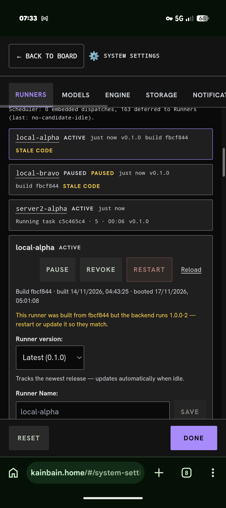

<!-- KAINBAIN AUTO-GENERATED REPORT -->
# Human rejection
**Status:** FAILED

This doesn't seem quite right it's comparing a hash to a build and the latest image seems to not be flagged as latest in the drop-down. Can you just double check everything and make sure it's ergonomic