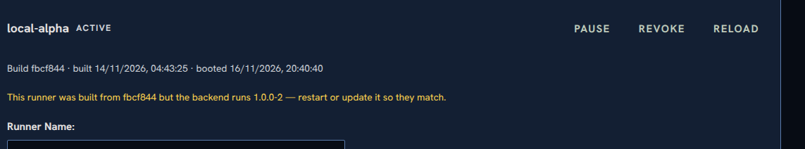

<!-- KAINBAIN AUTO-GENERATED REPORT -->
# Stage Report: Quick review

**Task:** Add a restart and update as seperate options for runners  Instead of reload mark it as a destructive action that restarts the selected runner with a confirmation window. I would also like some version controls so we can either tie the runner to a specific version or have latest.  If the version in the selector mis-matches the version in the ui it should show a warning with an Update button than will trigger the reinstall/update to the latest version (if set to latest this should show every time a new version is published. and only if it is set to latest do we have autoupdate behaviour, latest should be the default) If there is a newer version it should show the warning that a newer version is available in red to scare them into updating.
**Stage Type:** `agent`
**Model:** `utility`
**Duration:** 4289.64s
**Status:** FAILED

### Summary of Changes
Execution failed: [Agent Review Rejection] None of the requested behaviour exists: Reload still ships at frontend/src/components/settings/RunnerConfigurationSection.jsx:892 (reloadSelected :335) with no destructive Restart button or confirmation window; no requestRestart command exists (api/flow/runnerRegistry.js:179 RUNNER_COMMANDS=[requestModelRediscovery,requestUpdate], runner/daemon.js:999 same, frontend/src/services/runners/index.js:40-43 only rediscovery/update, runnerConfigHelpers.test.js:318 asserts canRequestCommand(requestRestart)==false); no per-runner version selector/pin-or-latest policy exists (no requestedVersion/versionPolicy field in defaultRunnerConfig, api/config/schema.js only global runnerMinVersion/runnerRecommendedVersion); no selector-vs-UI mismatch red warning with Update button triggering reinstall to latest, and no latest-default autoupdate gate (existing shouldAutoRequestUpdate in runnerVersionCompat.js:173 auto-nudges all runners behind recommendedVersion regardless of pin, frontend Update at :887-891 is idle-only queue gated only on updateAvailable). Fix guidance: Implement the missing vertical slice then add tests: (1) backend+daemon restart: add requestRestart to RUNNER_COMMANDS and SUPPORTED_RUNNER_COMMANDS, enqueueCommand validation, daemon immediate-restart handling, frontend requestRunnerRestart in frontend/src/services/runners/index.js and UI Restart button replacing Reload with destructive confirmation window; (2) per-runner version policy in operatorConfig (latest default, pinned specific version) via defaultRunnerConfig/runnerConfigHelpers plus PATCH support, rendered as version selector in RunnerConfigurationSection detail panel; (3) mismatch warning: compare selector value vs describeRunnerVersion(runner)/recommendedVersion and render red warning text with Update button that calls requestRunnerUpdate to latest; (4) gate auto-update nudge (shouldAutoRequestUpdate / runnerRegistry heartbeat) on policy==latest only, leaving pinned runners pinned. Verify with npm run test:unit (unit/integration) and keep change scoped to runners UI/API/daemon.

### Execution Output
```
Reviewed task 78e0522a-430d-4659-9e2f-7db6444d13f9 against its brief on branch kb/78e0522a-430d-4659-9e2f-7db6444d13f9. Working tree is clean with zero commits/diff for this task and no docs/tasks/78e0522a-430d-4659-9e2f-7db6444d13f9/ plan or report exists, so the PR contains no change to the live codebase. Inspected RunnerConfigurationSection.jsx, runnerConfigHelpers.js, frontend/src/services/runners/index.js, api/flow/runnerRegistry.js (RUNNER_COMMANDS), runner/daemon.js (SUPPORTED_RUNNER_COMMANDS), runnerVersionCompat.js and related tests read-only; no servers or writes were run.

KAINBAIN_VERDICT: FAIL
KAINBAIN_REASON: None of the requested behaviour exists: Reload still ships at frontend/src/components/settings/RunnerConfigurationSection.jsx:892 (reloadSelected :335) with no destructive Restart button or confirmation window; no requestRestart command exists (api/flow/runnerRegistry.js:179 RUNNER_COMMANDS=[requestModelRediscovery,requestUpdate], runner/daemon.js:999 same, frontend/src/services/runners/index.js:40-43 only rediscovery/update, runnerConfigHelpers.test.js:318 asserts canRequestCommand(requestRestart)==false); no per-runner version selector/pin-or-latest policy exists (no requestedVersion/versionPolicy field in defaultRunnerConfig, api/config/schema.js only global runnerMinVersion/runnerRecommendedVersion); no selector-vs-UI mismatch red warning with Update button triggering reinstall to latest, and no latest-default autoupdate gate (existing shouldAutoRequestUpdate in runnerVersionCompat.js:173 auto-nudges all runners behind recommendedVersion regardless of pin, frontend Update at :887-891 is idle-only queue gated only on updateAvailable).
KAINBAIN_FIX: Implement the missing vertical slice then add tests: (1) backend+daemon restart: add requestRestart to RUNNER_COMMANDS and SUPPORTED_RUNNER_COMMANDS, enqueueCommand validation, daemon immediate-restart handling, frontend requestRunnerRestart in frontend/src/services/runners/index.js and UI Restart button replacing Reload with destructive confirmation window; (2) per-runner version policy in operatorConfig (latest default, pinned specific version) via defaultRunnerConfig/runnerConfigHelpers plus PATCH support, rendered as version selector in RunnerConfigurationSection detail panel; (3) mismatch warning: compare selector value vs describeRunnerVersion(runner)/recommendedVersion and render red warning text with Update button that calls requestRunnerUpdate to latest; (4) gate auto-update nudge (shouldAutoRequestUpdate / runnerRegistry heartbeat) on policy==latest only, leaving pinned runners pinned. Verify with npm run test:unit (unit/integration) and keep change scoped to runners UI/API/daemon.

```

### Modified Files
- (No files modified / inspection only)

### Verification Status
- Stage execution failed with error: [Agent Review Rejection] None of the requested behaviour exists: Reload still ships at frontend/src/components/settings/RunnerConfigurationSection.jsx:892 (reloadSelected :335) with no destructive Restart button or confirmation window; no requestRestart command exists (api/flow/runnerRegistry.js:179 RUNNER_COMMANDS=[requestModelRediscovery,requestUpdate], runner/daemon.js:999 same, frontend/src/services/runners/index.js:40-43 only rediscovery/update, runnerConfigHelpers.test.js:318 asserts canRequestCommand(requestRestart)==false); no per-runner version selector/pin-or-latest policy exists (no requestedVersion/versionPolicy field in defaultRunnerConfig, api/config/schema.js only global runnerMinVersion/runnerRecommendedVersion); no selector-vs-UI mismatch red warning with Update button triggering reinstall to latest, and no latest-default autoupdate gate (existing shouldAutoRequestUpdate in runnerVersionCompat.js:173 auto-nudges all runners behind recommendedVersion regardless of pin, frontend Update at :887-891 is idle-only queue gated only on updateAvailable). Fix guidance: Implement the missing vertical slice then add tests: (1) backend+daemon restart: add requestRestart to RUNNER_COMMANDS and SUPPORTED_RUNNER_COMMANDS, enqueueCommand validation, daemon immediate-restart handling, frontend requestRunnerRestart in frontend/src/services/runners/index.js and UI Restart button replacing Reload with destructive confirmation window; (2) per-runner version policy in operatorConfig (latest default, pinned specific version) via defaultRunnerConfig/runnerConfigHelpers plus PATCH support, rendered as version selector in RunnerConfigurationSection detail panel; (3) mismatch warning: compare selector value vs describeRunnerVersion(runner)/recommendedVersion and render red warning text with Update button that calls requestRunnerUpdate to latest; (4) gate auto-update nudge (shouldAutoRequestUpdate / runnerRegistry heartbeat) on policy==latest only, leaving pinned runners pinned. Verify with npm run test:unit (unit/integration) and keep change scoped to runners UI/API/daemon.
- Triggered fallback routing.