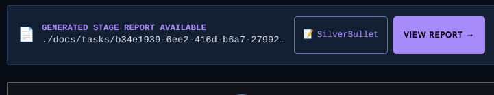

# Goal
# Remove the silverbullet button



Since this will be running on other peoples machines we dont need that button it can be removed entirely

# History
- 2026-10-29T19:06:40.274Z: Created and placed in stage 'Idea'
- 2026-10-29T19:06:41.093Z: Created and checked out task branch 'kb/a5228675-7511-40d1-b20c-c4662322494b' from 'main'
- 2026-10-29T19:06:44.478Z: Task details edited
- 2026-10-29T19:07:11.919Z: Task details edited
- 2026-10-29T19:07:14.465Z: Stage report generated: ./docs/tasks/a5228675-7511-40d1-b20c-c4662322494b/idea-20261029-190714.md
- 2026-10-29T19:07:14.467Z: Advanced to stage 'In Progress'
- 2026-10-29T19:07:14.500Z: Task-branch ref 'kb/a5228675-7511-40d1-b20c-c4662322494b' already exists — no checkout performed (human checkpoint 'Idea'; leaving 3 uncommitted paths in the tree for the next work stage)

# Timeline
- 2026-10-29T19:07:14.467Z: In Progress | Advanced | 34.193s

# Log Entries
```json
[{"id":"log-7636","ts":"2026-10-29T19:06:40.949Z","feed":"main","feeds":["main"],"kind":"system","turn":null,"text":"[WARN] Main-branch sync before task-branch pickup skipped (local-ahead: local 'main' is 1 commit(s) ahead of 'origin/main' — refusing to reset so unpushed work (e.g. a landed merge) is never orphaned; proceeding on the ahead line) — continuing with local state","meta":{"source":"process-log"}},{"id":"log-7637","ts":"2026-10-29T19:06:41.093Z","feed":"main","feeds":["main"],"kind":"system","turn":null,"text":"[GIT] Created and checked out task branch 'kb/a5228675-7511-40d1-b20c-c4662322494b' from 'main'","meta":{"source":"process-log"}},{"id":"log-7638","ts":"2026-10-29T19:07:14.468Z","feed":"main","feeds":["main"],"kind":"system","turn":null,"text":"[INFO] Advanced from stage 'Idea' to stage 'In Progress'","meta":{"source":"process-log"}},{"id":"log-7639","ts":"2026-10-29T19:07:14.500Z","feed":"main","feeds":["main"],"kind":"system","turn":null,"text":"[GIT] Task-branch ref 'kb/a5228675-7511-40d1-b20c-c4662322494b' already exists — no checkout performed (human checkpoint 'Idea'; leaving 3 uncommitted paths in the tree for the next work stage)","meta":{"source":"process-log"}}]
```