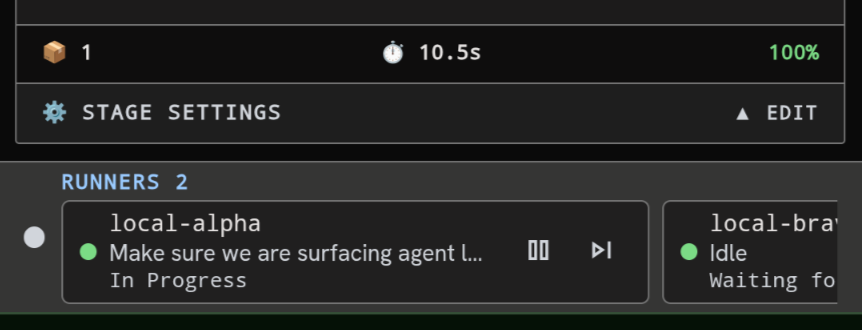

<!-- KAINBAIN AUTO-GENERATED REPORT -->
# Stage Report: Risk review

**Task:** this should be scrollable at the bottom  Currently runners cut off and you can't look at all runners on mobile. So if you can make it horizontal scrollable
**Stage Type:** `agent`
**Model:** `utility`
**Duration:** 92.932s
**Status:** FAILED

### Summary of Changes
Execution failed: git checkout main failed (exit 1): error: The following untracked working tree files would be overwritten by checkout:
	docs/tasks/2b990c4f-1e24-47f6-9c64-8bd239b68c83/task.md
	docs/tasks/8815d13d-e43e-45ec-b013-725c705ae59b/task.md
	docs/tasks/8ded2dfc-0df7-424a-8c19-f2f8b78c0941/task.md
	docs/tasks/b15f4ec4-786a-4edf-9a18-d38d538d825e/task.md
	docs/tasks/dc5ba91d-23c7-423f-8379-7ac2a4b46506/task.md
	docs/tasks/e60de7fa-113f-414c-9192-0ac11973b146/task.md
	docs/tasks/f42d4ab0-15c8-4707-98da-75c26b505bcc/task.md
Please move or remove them before you switch branches.
Aborting

### Execution Output
```
git checkout main failed (exit 1): error: The following untracked working tree files would be overwritten by checkout:
	docs/tasks/2b990c4f-1e24-47f6-9c64-8bd239b68c83/task.md
	docs/tasks/8815d13d-e43e-45ec-b013-725c705ae59b/task.md
	docs/tasks/8ded2dfc-0df7-424a-8c19-f2f8b78c0941/task.md
	docs/tasks/b15f4ec4-786a-4edf-9a18-d38d538d825e/task.md
	docs/tasks/dc5ba91d-23c7-423f-8379-7ac2a4b46506/task.md
	docs/tasks/e60de7fa-113f-414c-9192-0ac11973b146/task.md
	docs/tasks/f42d4ab0-15c8-4707-98da-75c26b505bcc/task.md
Please move or remove them before you switch branches.
Aborting
```

### Modified Files
- (No files modified / inspection only)

### Verification Status
- Stage execution failed with error: git checkout main failed (exit 1): error: The following untracked working tree files would be overwritten by checkout:
	docs/tasks/2b990c4f-1e24-47f6-9c64-8bd239b68c83/task.md
	docs/tasks/8815d13d-e43e-45ec-b013-725c705ae59b/task.md
	docs/tasks/8ded2dfc-0df7-424a-8c19-f2f8b78c0941/task.md
	docs/tasks/b15f4ec4-786a-4edf-9a18-d38d538d825e/task.md
	docs/tasks/dc5ba91d-23c7-423f-8379-7ac2a4b46506/task.md
	docs/tasks/e60de7fa-113f-414c-9192-0ac11973b146/task.md
	docs/tasks/f42d4ab0-15c8-4707-98da-75c26b505bcc/task.md
Please move or remove them before you switch branches.
Aborting
- Triggered fallback routing.