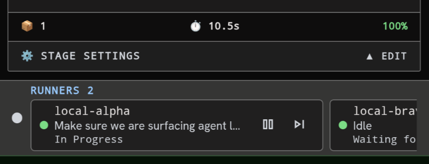

# Goal
#  this should be scrollable at the bottom



Currently runners cut off and you can't look at all runners on mobile. So if you can make it horizontal scrollable

# History
- 2026-10-30T22:55:02.813Z: Created and placed in stage 'Idea'
- 2026-10-30T22:55:04.104Z: Created and checked out task branch 'kb/b15f4ec4-786a-4edf-9a18-d38d538d825e' from 'main'
- 2026-10-30T22:55:08.960Z: Task details edited
- 2026-10-30T22:55:13.261Z: Task details edited
- 2026-10-30T22:55:17.770Z: Task details edited
- 2026-10-30T22:55:31.896Z: Task details edited
- 2026-10-30T22:55:34.558Z: Task details edited
- 2026-10-30T22:56:14.290Z: Task details edited
- 2026-10-30T22:56:17.568Z: Task details edited
- 2026-10-30T22:56:20.128Z: Task details edited
- 2026-10-30T22:56:22.892Z: Task details edited
- 2026-10-30T22:56:25.145Z: Task details edited
- 2026-10-30T22:56:27.297Z: Task details edited
- 2026-10-30T22:56:31.391Z: Task details edited
- 2026-10-30T22:56:33.543Z: Task details edited
- 2026-10-30T22:56:36.512Z: Task details edited
- 2026-10-30T22:56:38.561Z: Task details edited
- 2026-10-30T22:56:41.735Z: Task details edited
- 2026-10-30T22:56:50.446Z: Stage report generated: ./docs/tasks/b15f4ec4-786a-4edf-9a18-d38d538d825e/idea-20261030-225650.md
- 2026-10-30T22:56:50.447Z: Advanced to stage 'Requirement refinement'
- 2026-10-30T22:56:50.510Z: Task-branch ref 'kb/b15f4ec4-786a-4edf-9a18-d38d538d825e' already exists — no checkout performed (human checkpoint 'Idea'; leaving 3 uncommitted paths in the tree for the next work stage)
- 2026-10-30T23:32:12.481Z: Runner local-alpha stage stage-1792362077711: started
- 2026-10-30T23:32:16.094Z: Runner local-alpha stage stage-1792362077711: prompted
- 2026-10-30T23:33:10.877Z: Runner local-alpha stage stage-1792362077711: finished
- 2026-10-30T23:33:15.571Z: Runner completed execution 0b9b1929-f0d1-4af3-a5be-637e0ce049e5 (runner local-alpha, epoch 1, sha f696b20a2ff1539579165bd2cf037552d969a275 (unverified-remote), branch kb/b15f4ec4-786a-4edf-9a18-d38d538d825e, posture T0/T1:muse). Lease released.
- 2026-10-30T23:33:15.572Z: Agent stage completed: Requirement refinement (via Runner local-alpha)
- 2026-10-30T23:33:15.576Z: Survey requested by the 'question-me' skill (unanswered) — awaiting human answers (via Runner local-alpha)
- 2026-10-31T01:25:46.524Z: Survey completed (answered) — advancing
- 2026-10-31T01:25:46.525Z: Advanced to stage 'Plan'
- 2026-11-03T19:55:44.751Z: Runner server2-alpha stage 3: started
- 2026-11-03T19:55:51.342Z: Runner server2-alpha stage 3: prompted
- 2026-11-03T19:58:14.071Z: Runner server2-alpha stage 3: finished
- 2026-11-03T19:58:15.931Z: Runner server2-alpha interrupted execution 08ece521-5988-4759-83f6-328bc80ebb64 — lease dropped, re-queues as interrupted. Reason: Runner server2-alpha failed before reporting: merging origin/kb/b15f4ec4-786a-4edf-9a18-d38d538d825e into kb/b15f4ec4-786a-4edf-9a18-d38d538d825e conflicts (docs/tasks/b15f4ec4-786a-4edf-9a18-d38d538d825e/IMPLEMENTATION_PLAN.md) — refusing to resolve on the push path
- 2026-11-03T19:58:16.614Z: Auto-resumed after server restart — prioritised in queue
- 2026-11-03T21:37:06.526Z: Runner server2-alpha stage 3: started
- 2026-11-03T21:37:09.402Z: Runner server2-alpha stage 3: prompted
- 2026-11-03T21:39:07.935Z: Runner server2-alpha stage 3: finished
- 2026-11-03T21:39:12.904Z: Runner completed execution 2e1c591d-4b36-48e9-aed9-df24fac10188 (runner server2-alpha, epoch 29, sha f52838b4ce46dcd8c52ef6109291b29cb17c8a54 (unverified-remote), branch kb/b15f4ec4-786a-4edf-9a18-d38d538d825e, posture T0/T1:muse). Lease released.
- 2026-11-03T21:39:12.908Z: Agent stage completed: Plan (via Runner server2-alpha)
- 2026-11-03T21:39:12.941Z: Advanced to stage 'Check for plan'

# Timeline
- 2026-10-30T22:56:50.447Z: Requirement refinement | Advanced | 107.634s | +134 -438
- 2026-10-31T01:25:46.525Z: Plan | Advanced | 8936.078s | +0 -0
- 2026-11-03T19:58:16.614Z: Plan | Resumed | 0m
- 2026-11-03T21:39:12.941Z: Check for plan | Advanced | 6056.327s | +0 -0

# Log Entries
```json
[{"id":"log-8001","ts":"2026-10-30T22:55:03.905Z","feed":"main","feeds":["main"],"kind":"system","turn":null,"text":"[WARN] Main-branch sync before task-branch pickup skipped (local-ahead: local 'main' is 1 commit(s) ahead of 'origin/main' — refusing to reset so unpushed work (e.g. a landed merge) is never orphaned; proceeding on the ahead line) — continuing with local state","meta":{"source":"process-log"}},{"id":"log-8002","ts":"2026-10-30T22:55:04.104Z","feed":"main","feeds":["main"],"kind":"system","turn":null,"text":"[GIT] Created and checked out task branch 'kb/b15f4ec4-786a-4edf-9a18-d38d538d825e' from 'main'","meta":{"source":"process-log"}},{"id":"log-8003","ts":"2026-10-30T22:56:50.447Z","feed":"main","feeds":["main"],"kind":"system","turn":null,"text":"[INFO] Advanced from stage 'Idea' to stage 'Requirement refinement'","meta":{"source":"process-log"}},{"id":"log-8004","ts":"2026-10-30T22:56:50.510Z","feed":"main","feeds":["main"],"kind":"system","turn":null,"text":"[GIT] Task-branch ref 'kb/b15f4ec4-786a-4edf-9a18-d38d538d825e' already exists — no checkout performed (human checkpoint 'Idea'; leaving 3 uncommitted paths in the tree for the next work stage)","meta":{"source":"process-log"}},{"id":"log-8136","ts":"2026-10-30T23:33:00.265Z","feed":"main","feeds":["main"],"kind":"runner","turn":null,"text":"[runner local-alpha] I viewed the screenshot and confirmed","meta":{"source":"process-log","runnerId":"local-alpha","executionId":"0b9b1929-f0d1-4af3-a5be-637e0ce049e5","seq":0}},{"id":"log-8137","ts":"2026-10-30T23:33:00.267Z","feed":"main","feeds":["main"],"kind":"runner","turn":null,"text":"[runner local-alpha]  the runner","meta":{"source":"process-log","runnerId":"local-alpha","executionId":"0b9b1929-f0d1-4af3-a5be-637e0ce049e5","seq":1}},{"id":"log-8138","ts":"2026-10-30T23:33:00.276Z","feed":"main","feeds":["main"],"kind":"runner","turn":null,"text":"[runner local-alpha]  cards at","meta":{"source":"process-log","runnerId":"local-alpha","executionId":"0b9b1929-f0d1-4af3-a5be-637e0ce049e5","seq":2}},{"id":"log-8139","ts":"2026-10-30T23:33:00.298Z","feed":"main","feeds":["main"],"kind":"runner","turn":null,"text":"[runner local-alpha]  the bottom are cut off on the right on","meta":{"source":"process-log","runnerId":"local-alpha","executionId":"0b9b1929-f0d1-4af3-a5be-637e0ce049e5","seq":3}},{"id":"log-8140","ts":"2026-10-30T23:33:00.311Z","feed":"main","feeds":["main"],"kind":"runner","turn":null,"text":"[runner local-alpha]  mobile. This looks","meta":{"source":"process-log","runnerId":"local-alpha","executionId":"0b9b1929-f0d1-4af3-a5be-637e0ce049e5","seq":4}},{"id":"log-8141","ts":"2026-10-30T23:33:00.355Z","feed":"main","feeds":["main"],"kind":"runner","turn":null,"text":"[runner local-alpha]  simple enough — just","meta":{"source":"process-log","runnerId":"local-alpha","executionId":"0b9b1929-f0d1-4af3-a5be-637e0ce049e5","seq":5}},{"id":"log-8142","ts":"2026-10-30T23:33:00.358Z","feed":"main","feeds":["main"],"kind":"runner","turn":null,"text":"[runner local-alpha]  make that row scroll sideways —","meta":{"source":"process-log","runnerId":"local-alpha","executionId":"0b9b1929-f0d1-4af3-a5be-637e0ce049e5","seq":6}},{"id":"log-8143","ts":"2026-10-30T23:33:00.459Z","feed":"main","feeds":["main"],"kind":"runner","turn":null,"text":"[runner local-alpha]  so I wrote one","meta":{"source":"process-log","runnerId":"local-alpha","executionId":"0b9b1929-f0d1-4af3-a5be-637e0ce049e5","seq":7}},{"id":"log-8144","ts":"2026-10-30T23:33:00.460Z","feed":"main","feeds":["main"],"kind":"runner","turn":null,"text":"[runner local-alpha]  confirmation","meta":{"source":"process-log","runnerId":"local-alpha","executionId":"0b9b1929-f0d1-4af3-a5be-637e0ce049e5","seq":8}},{"id":"log-8145","ts":"2026-10-30T23:33:00.464Z","feed":"main","feeds":["main"],"kind":"runner","turn":null,"text":"[runner local-alpha]  question to [SURVEY.md","meta":{"source":"process-log","runnerId":"local-alpha","executionId":"0b9b1929-f0d1-4af3-a5be-637e0ce049e5","seq":9}},{"id":"log-8146","ts":"2026-10-30T23:33:00.466Z","feed":"main","feeds":["main"],"kind":"runner","turn":null,"text":"[runner local-alpha] ](/home","meta":{"source":"process-log","runnerId":"local-alpha","executionId":"0b9b1929-f0d1-4af3-a5be-637e0ce049e5","seq":10}},{"id":"log-8147","ts":"2026-10-30T23:33:00.558Z","feed":"main","feeds":["main"],"kind":"runner","turn":null,"text":"[runner local-alpha] /server/.kainbain/runner-work/kb-b15f4ec","meta":{"source":"process-log","runnerId":"local-alpha","executionId":"0b9b1929-f0d1-4af3-a5be-637e0ce049e5","seq":11}},{"id":"log-8148","ts":"2026-10-30T23:33:00.559Z","feed":"main","feeds":["main"],"kind":"runner","turn":null,"text":"[runner local-alpha] 4-786a-4edf-9a18-d38d538","meta":{"source":"process-log","runnerId":"local-alpha","executionId":"0b9b1929-f0d1-4af3-a5be-637e0ce049e5","seq":12}},{"id":"log-8149","ts":"2026-10-30T23:33:00.560Z","feed":"main","feeds":["main"],"kind":"runner","turn":null,"text":"[runner local-alpha] d825e/docs/tasks/b15f4ec4-786a-4","meta":{"source":"process-log","runnerId":"local-alpha","executionId":"0b9b1929-f0d1-4af3-a5be-637e0ce049e5","seq":13}},{"id":"log-8150","ts":"2026-10-30T23:33:00.560Z","feed":"main","feeds":["main"],"kind":"runner","turn":null,"text":"[runner local-alpha] edf-9a18-d38d538d825e/SURVEY","meta":{"source":"process-log","runnerId":"local-alpha","executionId":"0b9b1929-f0d1-4af3-a5be-637e0ce049e5","seq":14}},{"id":"log-8151","ts":"2026-10-30T23:33:00.561Z","feed":"main","feeds":["main"],"kind":"runner","turn":null,"text":"[runner local-alpha] .md) and validated its JSON parses correctly","meta":{"source":"process-log","runnerId":"local-alpha","executionId":"0b9b1929-f0d1-4af3-a5be-637e0ce049e5","seq":15}},{"id":"log-8152","ts":"2026-10-30T23:33:00.661Z","feed":"main","feeds":["main"],"kind":"runner","turn":null,"text":"[runner local-alpha] . No other questions","meta":{"source":"process-log","runnerId":"local-alpha","executionId":"0b9b1929-f0d1-4af3-a5be-637e0ce049e5","seq":16}},{"id":"log-8153","ts":"2026-10-30T23:33:00.661Z","feed":"main","feeds":["main"],"kind":"runner","turn":null,"text":"[runner local-alpha]  were needed.","meta":{"source":"process-log","runnerId":"local-alpha","executionId":"0b9b1929-f0d1-4af3-a5be-637e0ce049e5","seq":17}},{"id":"log-8154","ts":"2026-10-30T23:33:00.663Z","feed":"main","feeds":["main"],"kind":"runner","turn":null,"text":"[runner local-alpha] _VERDICT: PASS","meta":{"source":"process-log","runnerId":"local-alpha","executionId":"0b9b1929-f0d1-4af3-a5be-637e0ce049e5","seq":18}},{"id":"log-8155","ts":"2026-10-30T23:33:00.666Z","feed":"main","feeds":["main"],"kind":"runner","turn":null,"text":"[runner local-alpha] KAINBAIN","meta":{"source":"process-log","runnerId":"local-alpha","executionId":"0b9b1929-f0d1-4af3-a5be-637e0ce049e5","seq":19}},{"id":"log-8156","ts":"2026-10-30T23:33:15.559Z","feed":"main","feeds":["main"],"kind":"runner","turn":null,"text":"[runner local-alpha] stage output: I viewed the screenshot and confirmed the runner cards at the bottom are cut off on the right on mobile. This looks simple enough — just make that row scroll sideways — so I wrote one confirmation question to [SURVEY.md](/home/server/.kainbain/runner-work/kb-b15f4ec4-786a-4edf-9a18-d38d538d825e/docs/tasks/b15f4ec4-786a-4edf-9a18-d38d538d825e/SURVEY.md) and validated its JSON parses correctly. No other questions were needed.","meta":{"source":"process-log","runnerId":"local-alpha","executionId":"0b9b1929-f0d1-4af3-a5be-637e0ce049e5","seq":20}},{"id":"log-8157","ts":"2026-10-30T23:33:15.565Z","feed":"main","feeds":["main"],"kind":"runner","turn":null,"text":"[runner local-alpha] KAINBAIN_VERDICT: PASS","meta":{"source":"process-log","runnerId":"local-alpha","executionId":"0b9b1929-f0d1-4af3-a5be-637e0ce049e5","seq":21}},{"id":"log-8158","ts":"2026-10-30T23:33:15.576Z","feed":"main","feeds":["main"],"kind":"system","turn":null,"text":"[INFO] question-me parked stage 'Requirement refinement' for a human survey (unanswered)","meta":{"source":"process-log"}},{"id":"log-8659","ts":"2026-10-31T01:25:46.525Z","feed":"main","feeds":["main"],"kind":"system","turn":null,"text":"[INFO] Advanced from stage 'Requirement refinement' to stage 'Plan'","meta":{"source":"process-log"}},{"id":1,"ts":"2026-11-03T19:55:58.834Z","feed":"main","feeds":["main","tools"],"kind":"tool","turn":1,"text":"[TOOL] read_file({\"path\":\"docs/tasks/b15f4ec4-786a-4edf-9a18-d38d538d825e/SURVEY.md\"})","meta":{"toolName":"read_file","toolCallId":"call_01a1a2fb88ca72bc9a145160154a4c3c","args":"{\"path\":\"docs/tasks/b15f4ec4-786a-4edf-9a18-d38d538d825e/SURVEY.md\"}","output":"","isError":false,"source":"runner-structured","runnerId":"server2-alpha","executionId":"08ece521-5988-4759-83f6-328bc80ebb64","seq":1},"fidelity":"normalized","seq":1,"blockId":"b1","tool":{"callId":"call_01a1a2fb88ca72bc9a145160154a4c3c","name":"read_file","args":"{\"path\":\"docs/tasks/b15f4ec4-786a-4edf-9a18-d38d538d825e/SURVEY.md\"}"}},{"id":2,"ts":"2026-11-03T19:55:58.834Z","feed":"main","feeds":["main","tools"],"kind":"tool","turn":1,"text":"[TOOL] read_file({\"path\":\"docs/tasks/b15f4ec4-786a-4edf-9a18-d38d538d825e/idea-20261030-225650.md\"})","meta":{"toolName":"read_file","toolCallId":"call_01a1a2fb8a6076bb82441b6456d0ac1f","args":"{\"path\":\"docs/tasks/b15f4ec4-786a-4edf-9a18-d38d538d825e/idea-20261030-225650.md\"}","output":"","isError":false,"source":"runner-structured","runnerId":"server2-alpha","executionId":"08ece521-5988-4759-83f6-328bc80ebb64","seq":1},"fidelity":"normalized","seq":2,"blockId":"b2","tool":{"callId":"call_01a1a2fb8a6076bb82441b6456d0ac1f","name":"read_file","args":"{\"path\":\"docs/tasks/b15f4ec4-786a-4edf-9a18-d38d538d825e/idea-20261030-225650.md\"}"}},{"id":3,"ts":"2026-11-03T19:55:58.834Z","feed":"main","feeds":["main","tools"],"kind":"tool","turn":1,"text":"[TOOL] bash({\"command\":\"ls -R docs/tasks/b15f4ec4-786a-4edf-9a18-d38d538d825e/ 2>&1; echo ---; pwd; git branch --show-current 2>&1; git status --short 2>&1 | head -n 50\",\"description\":\"List task docs and git status\"})","meta":{"toolName":"bash","toolCallId":"call_01a1a2fb8c547287896f032f6571db12","args":"{\"command\":\"ls -R docs/tasks/b15f4ec4-786a-4edf-9a18-d38d538d825e/ 2>&1; echo ---; pwd; git branch --show-current 2>&1; git status --short 2>&1 | head -n 50\",\"description\":\"List task docs and git status\"}","output":"tool failed: No such file or directory (os error 2); requested relative path \"docs/tasks/b15f4ec4-786a-4edf-9a18-d38d538d825e/idea-20261030-225650.md\"; resolved candidate \"/home/[REDACTED]/.kainbain/runner-work/kb-b15f4ec4-786a-4edf-9a18-d38d538d825e/docs/tasks/b15f4ec4-786a-4edf-9a18-d38d538d825e/idea-20261030-225650.md\"; Active Workspace Root \"/home/[REDACTED]/.kainbain/runner-work/kb-b15f4ec4-786a-4edf-9a18-d38d538d825e\". Relative paths resolve from the Active Workspace Root. Shell `cd`/`workdir` affects only that shell call and does not change this root. Absolute paths may be used only when the current filesystem policy allows them.","isError":true,"source":"runner-structured","runnerId":"server2-alpha","executionId":"08ece521-5988-4759-83f6-328bc80ebb64","seq":1},"fidelity":"normalized","seq":3,"blockId":"b3","tool":{"callId":"call_01a1a2fb8c547287896f032f6571db12","name":"bash","args":"{\"command\":\"ls -R docs/tasks/b15f4ec4-786a-4edf-9a18-d38d538d825e/ 2>&1; echo ---; pwd; git branch --show-current 2>&1; git status --short 2>&1 | head -n 50\",\"description\":\"List task docs and git status\"}","result":"tool failed: No such file or directory (os error 2); requested relative path \"docs/tasks/b15f4ec4-786a-4edf-9a18-d38d538d825e/idea-20261030-225650.md\"; resolved candidate \"/home/[REDACTED]/.kainbain/runner-work/kb-b15f4ec4-786a-4edf-9a18-d38d538d825e/docs/tasks/b15f4ec4-786a-4edf-9a18-d38d538d825e/idea-20261030-225650.md\"; Active Workspace Root \"/home/[REDACTED]/.kainbain/runner-work/kb-b15f4ec4-786a-4edf-9a18-d38d538d825e\". Relative paths resolve from the Active Workspace Root. Shell `cd`/`workdir` affects only that shell call and does not change this root. Absolute paths may be used only when the current filesystem policy allows them.","partials":"tool failed: No such file or directory (os error 2); requested relative path \"docs/tasks/b15f4ec4-786a-4edf-9a18-d38d538d825e/idea-20261030-225650.md\"; resolved candidate \"/home/[REDACTED]/.kainbain/runner-work/kb-b15f4ec4-786a-4edf-9a18-d38d538d825e/docs/tasks/b15f4ec4-786a-4edf-9a18-d38d538d825e/idea-20261030-225650.md\"; Active Workspace Root \"/home/[REDACTED]/.kainbain/runner-work/kb-b15f4ec4-786a-4edf-9a18-d38d538d825e\". Relative paths resolve from the Active Workspace Root. Shell `cd`/`workdir` affects only that shell call and does not change this root. Absolute paths may be used only when the current filesystem policy allows them."}},{"id":4,"ts":"2026-11-03T19:55:58.835Z","feed":"main","feeds":["main"],"kind":"error","turn":1,"text":"[ERROR] Tool read_file failed: No such file or directory (os error 2); requested relative path \"docs/tasks/b15f4ec4-786a-4edf-9a18-d38d538d825e/idea-20261030-225650.md\"; resolved candidate \"/home/[REDACTED]/.kainbain/runner-work/kb-b15f4ec4-786a-4edf-9a18-d38d538d825e/docs/tasks/b15f4ec4-786a-4edf-9a18-d38d538d825e/idea-20261030-225650.md\"; Active Workspace Root \"/home/[REDACTED]/.kainbain/runner-work/kb-b15f4ec4-786a-4edf-9a18-d38d538d825e\". Relative paths resolve from the Active Workspace Root. Shell `cd`/`workdir` affects only that shell call and does not change this root. Absolute paths may be used only when the current filesystem policy allows them.","meta":{"toolName":"read_file","toolCallId":"call_01a1a2fb8a6076bb82441b6456d0ac1f","source":"runner-structured","runnerId":"server2-alpha","executionId":"08ece521-5988-4759-83f6-328bc80ebb64","seq":1},"fidelity":"synthesized","seq":4},{"id":5,"ts":"2026-11-03T19:55:58.835Z","feed":"main","feeds":["main"],"kind":"error","turn":1,"text":"[ERROR] Tool read_file failed: No such file or directory (os error 2); requested relative path \"docs/tasks/b15f4ec4-786a-4edf-9a18-d38d538d825e/SURVEY.md\"; resolved candidate \"/home/[REDACTED]/.kainbain/runner-work/kb-b15f4ec4-786a-4edf-9a18-d38d538d825e/docs/tasks/b15f4ec4-786a-4edf-9a18-d38d538d825e/SURVEY.md\"; Active Workspace Root \"/home/[REDACTED]/.kainbain/runner-work/kb-b15f4ec4-786a-4edf-9a18-d38d538d825e\". Relative paths resolve from the Active Workspace Root. Shell `cd`/`workdir` affects only that shell call and does not change this root. Absolute paths may be used only when the current filesystem policy allows them.","meta":{"toolName":"read_file","toolCallId":"call_01a1a2fb88ca72bc9a145160154a4c3c","source":"runner-structured","runnerId":"server2-alpha","executionId":"08ece521-5988-4759-83f6-328bc80ebb64","seq":1},"fidelity":"synthesized","seq":5},{"id":6,"ts":"2026-11-03T19:55:58.836Z","feed":"tools","feeds":["tools"],"kind":"tool","turn":1,"text":"[RESULT] $ ls -R docs/tasks/b15f4ec4-786a-4edf-9a18-d38d538d825e/ 2>&1; echo ---; pwd; git branch --show-current 2>&1; git status --short 2>&1 | head -n 50 (exit 0): kb/b15f4ec4-786a-4edf-9a18-d38d538d825e","meta":{"toolName":"bash","toolCallId":"call_01a1a2fb8c547287896f032f6571db12","source":"runner-structured","runnerId":"server2-alpha","executionId":"08ece521-5988-4759-83f6-328bc80ebb64","seq":1},"fidelity":"normalized","seq":6,"tool":{"callId":"call_01a1a2fb8c547287896f032f6571db12","name":"bash","result":"{\n  \"chunk_id\": \"exec-1-1\",\n  \"command\": \"ls -R docs/tasks/b15f4ec4-786a-4edf-9a18-d38d538d825e/ 2>&1; echo ---; pwd; git branch --show-current 2>&1; git status --short 2>&1 | head -n 50\",\n  \"description\": \"List task docs and git status\",\n  \"exit_code\": 0,\n  \"terminal_status\": \"completed\",\n  \"output\": \"ls: cannot access 'docs/tasks/b15f4ec4-786a-4edf-9a18-d38d538d825e/': No such file or directory\\n---\\n/home/[REDACTED]/.kainbain/runner-work/kb-b15f4ec4-786a-4edf-9a18-d38d538d825e\\nkb/b15f4ec4-786a-4edf-9a18-d38d538d825e\\n\",\n  \"original_output_bytes\": 216,\n  \"original_output_tokens\": 54,\n  \"truncated\": false\n}"}},{"id":7,"ts":"2026-11-03T19:56:02.894Z","feed":"main","feeds":["main","tools"],"kind":"tool","turn":1,"text":"[TOOL] bash({\"command\":\"ls -la; echo ===; find . -maxdepth 4 -name \\\"*.md\\\" 2>/dev/null | head -n 50; echo ===; find /home/[REDACTED]/.kainbain -maxdepth 5 -name \\\"SURVEY.md\\\" 2>/dev/null | head\",\"description\":\"Explore workspace structure\"})","meta":{"toolName":"bash","toolCallId":"call_01a1a2fb9ad971f3b8eac5971833c00c","args":"{\"command\":\"ls -la; echo ===; find . -maxdepth 4 -name \\\"*.md\\\" 2>/dev/null | head -n 50; echo ===; find /home/[REDACTED]/.kainbain -maxdepth 5 -name \\\"SURVEY.md\\\" 2>/dev/null | head\",\"description\":\"Explore workspace structure\"}","output":"total 40044\ndrwxrwxr-x 17 server2 server2   20480 Nov  3 19:55 .\ndrwxrwxr-x  8 server2 server2    4096 Nov  3 19:55 ..\n-rw-rw-r--  1 server2 server2    1679 Nov  3 19:55 .dockerignore\n-rw-rw-r--  1 server2 server2   29073 Nov  3 19:55 .env.example\n-rw-rw-r--  1 server2 server2     116 Nov  3 19:55 .git\n-rw-rw-r--  1 server2 server2     118 Nov  3 19:55 .gitattributes\ndrwxrwxr-x  3 server2 server2    4096 Nov  3 19:55 .github\n-rw-rw-r--  1 server2 server2    2333 Nov  3 19:55 .gitignore\n-rw-rw-r--  1 server2 server2     235 Nov  3 19:55 .knip.json\n-rw-rw-r--  1 server2 server2       3 Nov  3 19:55 .node-version\n-rw-rw-r--  1 server2 server2     745 Nov  3 19:55 .npmrc\n-rw-rw-r--  1 server2 server2       3 Nov  3 19:55 .nvmrc\n-rw-rw-r--  1 server2 server2     206 Nov  3 19:55 .pi-lens.json\n-rw-rw-r--  1 server2 server2    1989 Nov  3 19:55 2026-10-29T00-40-32-145Z_01a18519-f091-77c1-b8d4-c611cfc5e8d8.jsonl\n-rw-rw-r--  1 server2 server2  293779 Nov  3 19:55 2026-10-29T01-06-50-947Z_01a18532-07c3-77c1-b8d4-c61345f433fa.jsonl\n-rw-rw-r--  1 server2 server2  269103 Nov  3 19:55 2026-10-29T01-35-11-781Z_01a1854b-fba4-77c1-b8d4-c6159fa78663.jsonl\n-rw-rw-r--  1 server2 server2  590721 Nov  3 19:55 2026-10-29T01-55-07-872Z_01a1855e-3be0-77c1-b8d4-c616a0c9ff99.jsonl\n-rw-rw-r--  1 server2 server2  112365 Nov  3 19:55 2026-10-29T08-07-09-425Z_01a186b2-d570-72e1-8d8b-711c0d441285.jsonl\n-rw-rw-r--  1 server2 server2  185575 Nov  3 19:55 2026-10-29T08-19-07-696Z_01a186bd-cb30-72e1-8d8b-711e16434f8e.jsonl\n-rw-rw-r--  1 server2 server2  142087 Nov  3 19:55 2026-10-29T08-42-53-520Z_01a186d3-8ccf-72e1-8d8b-7121b3e29d72.jsonl\n-rw-rw-r--  1 server2 server2  222423 Nov  3 19:55 2026-10-29T08-43-16-663Z_01a186d3-e737-72e1-8d8b-7122d3f39217.jsonl\n-rw-rw-r--  1 server2 server2  152583 Nov  3 19:55 2026-10-29T09-08-13-692Z_01a186ea-befb-75bb-ad44-6f6efc962246.jsonl\n-rw-rw-r--  1 server2 server2  307908 Nov  3 19:55 2026-10-29T09-57-49-318Z_01a18718-2685-75bb-ad44-6f7043a60b38.jsonl\n-rw-rw-r--  1 server2 server2  366814 Nov  3 19:55 2026-10-29T10-38-46-627Z_01a1873d-a562-7605-a8d6-88224309ead6.jsonl\n-rw-rw-r--  1 server2 server2   82381 Nov  3 19:55 2026-10-29T12-53-04-520Z_01a187b8-9988-7307-b7d1-cd9945cdbead.jsonl\n-rw-rw-r--  1 server2 server2  185285 Nov  3 19:55 2026-10-29T13-13-38-785Z_01a187cb-6ee0-710a-8c6a-ddda0dbc736c.jsonl\n-rw-rw-r--  1 server2 server2  391774 Nov  3 19:55 2026-10-29T13-33-10-437Z_01a187dd-4fa5-710a-8c6a-dddcd5283e2f.jsonl\n-rw-rw-r--  1 server2 server2  274937 Nov  3 19:55 2026-10-29T14-06-50-048Z_01a187fc-20bf-75ce-8359-90fc864641fe.jsonl\n-rw-rw-r--  1 server2 server2  698145 Nov  3 19:55 2026-10-29T14-15-24-219Z_01a18803-f93a-75e5-b905-938b74beca17.jsonl\n-rw-rw-r--  1 server2 server2  186526 Nov  3 19:55 2026-10-29T14-33-46-418Z_01a18814-cab2-75e5-b905-938ddb7e13f0.jsonl\n-rw-rw-r--  1 server2 server2  171014 Nov  3 19:55 2026-10-29T15-34-12-147Z_01a1884c-1db3-7754-9621-9a4401e08253.jsonl\n-rw-rw-r--  1 server2 server2  393339 Nov  3 19:55 2026-10-29T17-59-36-526Z_01a188d1-3d4d-77fa-b2e3-6496feb4d837.jsonl\n-rw-rw-r--  1 server2 server2  312339 Nov  3 19:55 2026-10-29T18-52-59-149Z_01a18902-1b8c-713e-8f28-6524d619264b.jsonl\n-rw-rw-r--  1 server2 server2  177113 Nov  3 19:55 2026-10-29T19-09-04-831Z_01a18910-d7be-744e-9cfa-9255caa3fe0a.jsonl\n-rw-rw-r--  1 server2 server2  322358 Nov  3 19:55 2026-10-29T19-10-23-411Z_01a18912-0ab3-744e-9cfa-92563563f058.jsonl\n-rw-rw-r--  1 server2 server2  310171 Nov  3 19:55 2026-10-29T19-15-04-189Z_01a18916-537d-744e-9cfa-925979a64f23.jsonl\n-rw-rw-r--  1 server2 server2  202032 Nov  3 19:55 2026-10-29T20-25-35-787Z_01a18956-e52a-717e-bc20-44877c785791.jsonl\n-rw-rw-r--  1 server2 server2  271536 Nov  3 19:55 2026-10-29T21-42-11-259Z_01a1899d-043b-7395-822c-3011f5b16a8c.jsonl\n-rw-rw-r--  1 server2 server2   61493 Nov  3 19:55 2026-10-29T23-16-54-817Z_01a189f3-bda0-772d-8fa1-da508ab891f6.jsonl\n-rw-rw-r--  1 server2 server2  361348 Nov  3 19:55 2026-10-30T00-14-05-043Z_01a18a28-14f2-7562-a10f-5d5196ffb0cf.jsonl\n-rw-rw-r--  1 server2 server2  140743 Nov  3 19:55 2026-10-30T00-19-24-902Z_01a18a2c-f666-7562-a10f-5d524e0d861f.jsonl\n-rw-rw-r--  1 server2 server2  372499 Nov  3 19:55 2026-10-30T06-46-53-767Z_01a18b8f-b646-7562-a10f-5d54b2767e0d.jsonl\n-rw-rw-r--  1 server2 server2  105954 Nov  3 19:55 2026-10-30T07-30-41-526Z_01a18bb7-cef6-7562-a10f-5d57c3b44d90.jsonl\n-rw-rw-r--  1 server2 server2  946689 Nov  3 19:55 2026-10-30T07-44-06-865Z_01a18bc4-18d1-7562-a10f-5d5961ef7333.jsonl\n-rw-rw-r--  1 server2 server2  402070 Nov  3 19:55 2026-10-30T09-47-30-914Z_01a18c35-12e1-7595-aa7e-233452073c4d.jsonl\n-rw-rw-r--  1 server2 server2  170420 Nov  3 19:55 2026-10-30T10-05-38-086Z_01a18c45-a9a6-7595-aa7e-2337d2ef8e09.jsonl\n-rw-rw-r--  1 server2 server2  294715 Nov  3 19:55 2026-10-30T10-22-39-766Z_01a18c55-4096-7595-aa7e-2339f87b76bf.jsonl\n-rw-rw-r--  1 server2 server2  362713 Nov  3 19:55 2026-10-30T11-36-46-622Z_01a18c99-1b1d-71e8-9a27-69a63b89fc82.jsonl\n-rw-rw-r--  1 server2 server2  352063 Nov  3 19:55 2026-10-30T12-18-15-884Z_01a18cbf-16cc-71e8-9a27-69a881b275d9.jsonl\n-rw-rw-r--  1 server2 server2  110111 Nov  3 19:55 2026-10-30T12-50-04-134Z_01a18cdc-34e6-71e8-9a27-69ab905dcc9a.jsonl\n-rw-rw-r--  1 server2 server2 1078563 Nov  3 19:55 2026-10-30T12-50-41-015Z_01a18cdc-c4f7-71e8-9a27-69add2333590.jsonl\n-rw-rw-r--  1 server2 server2   73275 Nov  3 19:55 2026-10-30T13-14-09-748Z_01a18cf2-43d4-71e8-9a27-69ae840dfaaf.jsonl\n-rw-rw-r--  1 server2 server2  499131 Nov  3 19:55 2026-10-30T13-14-35-226Z_01a18cf2-a75a-71e8-9a27-69b05ac77741.jsonl\n-rw-rw-r--  1 server2 server2  269308 Nov  3 19:55 2026-10-30T14-35-27-008Z_01a18d3c-afa0-73d7-a35c-1fc16687a860.jsonl\n-rw-rw-r--  1 server2 server2  185802 Nov  3 19:55 2026-10-30T15-17-19-702Z_01a18d63-06d6-73d7-a35c-1fc22472ff86.jsonl\n-rw-rw-r--  1 server2 server2  426497 Nov  3 19:55 2026-10-30T15-30-33-674Z_01a18d6f-244a-73d7-a35c-1fc4e058a931.jsonl\n-rw-rw-r--  1 server2 server2  390646 Nov  3 19:55 2026-10-30T16-43-40-801Z_01a18db2-1580-73f3-a99a-6e6d3c6480a6.jsonl\n-rw-rw-r--  1 server2 server2  319961 Nov  3 19:55 2026-10-30T16-55-05-944Z_01a18dbc-89d7-734d-a070-02d4276cf5f7.jsonl\n-rw-rw-r--  1 server2 server2   62775 Nov  3 19:55 2026-10-30T17-01-28-291Z_01a18dc2-5f63-734d-a070-02d6d5886ee3.jsonl\n-rw-rw-r--  1 server2 server2  335711 Nov  3 19:55 2026-10-30T17-13-00-196Z_01a18dcc-ee24-734d-a070-02d9ace7c2e9.jsonl\n-rw-rw-r--  1 server2 server2  982660 Nov  3 19:55 2026-10-30T17-24-51-361Z_01a18dd7-c821-734d-a070-02da6699ea67.jsonl\n-rw-rw-r--  1 server2 server2   98297 Nov  3 19:55 2026-10-30T17-56-29-710Z_01a18df4-bf8e-734d-a070-02dd0383b0b7.jsonl\n-rw-rw-r--  1 server2 server2  443829 Nov  3 19:55 2026-10-30T18-48-57-651Z_01a18e24-c833-734d-a070-02dec377b794.jsonl\n-rw-rw-r--  1 server2 server2  189338 Nov  3 19:55 2026-10-30T19-19-38-118Z_01a18e40-dd86-734d-a070-02e072d8bb6e.jsonl\n-rw-rw-r--  1 server2 server2  203912 Nov  3 19:55 2026-10-30T19-25-03-654Z_01a18e45-d526-734d-a070-02e3644f71b7.jsonl\n-rw-rw-r--  1 server2 server2    1949 Nov  3 19:55 2026-10-30T19-26-02-335Z_01a18e46-ba5f-734d-a070-02e50c5a5636.jsonl\n-rw-rw-r--  1 server2 server2    3883 Nov  3 19:55 2026-10-30T19-57-45-714Z_01a18e63-c571-748b-a591-d93f5073dcf7.jsonl\n-rw-rw-r--  1 server2 server2  308140 Nov  3 19:55 2026-10-30T22-35-10-176Z_01a18ef3-e1e0-7107-9cfe-ff129e369768.jsonl\n-rw-rw-r--  1 server2 server2  414792 Nov  3 19:55 2026-10-30T22-38-40-263Z_01a18ef7-1687-7107-9cfe-ff15654569de.jsonl\n-rw-rw-r--  1 server2 server2  125949 Nov  3 19:55 2026-10-30T23-33-19-668Z_01a18f29-20b3-7107-9cfe-ff1bf8ecf24a.jsonl\n-rw-rw-r--  1 server2 server2  259131 Nov  3 19:55 2026-10-31T00-28-37-526Z_01a18f5b-c116-7107-9cfe-ff1df2fc9eca.jsonl\n-rw-rw-r--  1 server2 server2  423248 Nov  3 19:55 2026-10-31T00-29-02-064Z_01a18f5c-20f0-7107-9cfe-ff1f00f33972.jsonl\n-rw-rw-r--  1 server2 server2  491120 Nov  3 19:55 2026-10-31T01-13-35-387Z_01a18f84-eb9b-7107-9cfe-ff208d68f266.jsonl\n-rw-rw-r--  1 server2 server2  326081 Nov  3 19:55 2026-10-31T01-20-53-569Z_01a18f8b-9b41-7107-9cfe-ff2291b19f76.jsonl\n-rw-rw-r--  1 server2 server2  256872 Nov  3 19:55 2026-10-31T01-39-04-880Z_01a18f9c-422e-7107-9cfe-ff25cac68ee6.jsonl\n\n-rw-rw-r--  1 …\n{\n  \"chunk_id\": \"exec-2-1\",\n  \"command\": \"ls -la; echo ===; find . -maxdepth 4 -name \\\"*.md\\\" 2>/dev/null | head -n 50; echo ===; find /home/[REDACTED]/.kainbain -maxdepth 5 -name \\\"SURVEY.md\\\" 2>/dev/null | head\",\n  \"description\": \"Explore workspace structure\",\n  \"exit_code\": 0,\n  \"terminal_status\": \"completed\",\n  \"output\": \"total 40044\\ndrwxrwxr-x 17 server2 server2   20480 Nov  3 19:55 .\\ndrwxrwxr-x  8 server2 server2    4096 Nov  3 19:55 ..\\n-rw-rw-r--  1 server2 server2    1679 Nov  3 19:55 .dockerignore\\n-rw-rw-r--  1 server2 server2   29073 Nov  3 19:55 .env.example\\n-rw-rw-r--  1 server2 server2     116 Nov  3 19:55 .git\\n-rw-rw-r--  1 server2 server2     118 Nov  3 19:55 .gitattributes\\ndrwxrwxr-x  3 server2 server2    4096 Nov  3 19:55 .github\\n-rw-rw-r--  1 server2 server2    2333 Nov  3 19:55 .gitignore\\n-rw-rw-r--  1 server2 server2     235 Nov  3 19:55 .knip.json\\n-rw-rw-r--  1 server2 server2       3 Nov  3 19:55 .node-version\\n-rw-rw-r--  1 server2 server2     745 Nov  3 19:55 .npmrc\\n-rw-rw-r--  1 server2 server2       3 Nov  3 19:55 .nvmrc\\n-rw-rw-r--  1 server2 server2     206 Nov  3 19:55 .pi-lens.json\\n-rw-rw-r--  1 server2 server2    1989 Nov  3 19:55 2026-10-29T00-40-32-145Z_01a18519-f091-77c1-b8d4-c611cfc5e8d8.jsonl\\n-rw-rw-r--  1 server2 server2  293779 Nov  3 19:55 2026-10-29T01-06-50-947Z_01a18532-07c3-77c1-b8d4-c61345f433fa.jsonl\\n-rw-rw-r--  1 server2 server2  269103 Nov  3 19:55 2026-10-29T01-35-11-781Z_01a1854b-fba4-77c1-b8d4-c6159fa78663.jsonl\\n-rw-rw-r--  1 server2 server2  590721 Nov  3 19:55 2026-10-29T01-55-07-872Z_01a1855e-3be0-77c1-b8d4-c616a0c9ff99.jsonl\\n-rw-rw-r--  1 server2 server2  112365 Nov  3 19:55 2026-10-29T08-07-09-425Z_01a186b2-d570-72e1-8d8b-711c0d441285.jsonl\\n-rw-rw-r--  1 server2 server2  185575 Nov  3 19:55 2026-10-29T08-19-07-696Z_01a186bd-cb30-72e1-8d8b-711e16434f8e.jsonl\\n-rw-rw-r--  1 server2 server2  142087 Nov  3 19:55 2026-10-29T08-42-53-520Z_01a186d3-8ccf-72e1-8d8b-7121b3e29d72.jsonl\\n-rw-rw-r--  1 server2 server2  222423 Nov  3 19:55 2026-10-29T08-43-16-663Z_01a186d3-e737-72e1-8d8b-7122d3f39217.jsonl\\n-rw-rw-r--  1 server2 server2  152583 Nov  3 19:55 2026-10-29T09-08-13-692Z_01a186ea-befb-75bb-ad44-6f6efc962246.jsonl\\n-rw-rw-r--  1 server2 server2  307908 Nov  3 19:55 2026-10-29T09-57-49-318Z_01a18718-2685-75bb-ad44-6f7043a60b38.jsonl\\n-rw-rw-r--  1 server2 server2  366814 Nov  3 19:55 2026-10-29T10-38-46-627Z_01a1873d-a562-7605-a8d6-88224309ead6.jsonl\\n-rw-rw-r--  1 server2 server2   82381 Nov  3 19:55 2026-10-29T12-53-04-520Z_01a187b8-9988-7307-b7d1-cd9945cdbead.jsonl\\n-rw-rw-r--  1 server2 server2  185285 Nov  3 19:55 2026-10-29T13-13-38-785Z_01a187cb-6ee0-710a-8c6a-ddda0dbc736c.jsonl\\n-rw-rw-r--  1 server2 server2  391774 Nov  3 19:55 2026-10-29T13-33-10-437Z_01a187dd-4fa5-710a-8c6a-dddcd5283e2f.jsonl\\n-rw-rw-r--  1 server2 server2  274937 Nov  3 19:55 2026-10-29T14-06-50-048Z_01a187fc-20bf-75ce-8359-90fc864641fe.jsonl\\n-rw-rw-r--  1 server2 server2  698145 Nov  3 19:55 2026-10-29T14-15-24-219Z_01a18803-f93a-75e5-b905-938b74beca17.jsonl\\n-rw-rw-r--  1 server2 server2  186526 Nov  3 19:55 2026-10-29T14-33-46-418Z_01a18814-cab2-75e5-b905-938ddb7e13f0.jsonl\\n-rw-rw-r--  1 server2 server2  171014 Nov  3 19:55 2026-10-29T15-34-12-147Z_01a1884c-1db3-7754-9621-9a4401e08253.jsonl\\n-rw-rw-r--  1 server2 server2  393339 Nov  3 19:55 2026-10-29T17-59-36-526Z_01a188d1-3d4d-77fa-b2e3-6496feb4d837.jsonl\\n-rw-rw-r--  1 server2 server2  312339 Nov  3 19:55 2026-10-29T18-52-59-149Z_01a18902-1b8c-713e-8f28-6524d619264b.jsonl\\n-rw-rw-r--  1 server2 server2  177113 Nov  3 19:55 2026-10-29T19-09-04-831Z_01a18910-d7be-744e-9cfa-9255caa3fe0a.jsonl\\n-rw-rw-r--  1 server2 server2  322358 Nov  3 19:55 2026-10-29T19-10-23-411Z_01a18912-0ab3-744e-9cfa-92563563f058.jsonl\\n-rw-rw-r--  1 server2 server2  310171 Nov  3 19:55 2026-10-29T19-15-04-189Z_01a18916-537d-744e-9cfa-925979a64f23.jsonl\\n-rw-rw-r--  1 server2 server2  202032 Nov  3 19:55 2026-10-29T20-25-35-787Z_01a18956-e52a-717e-bc20-44877c785791.jsonl\\n-rw-rw-r--  1 server2 server2  271536 Nov  3 19:55 2026-10-29T21-42-11-259Z_01a1899d-043b-7395-822c-3011f5b16a8c.jsonl\\n-rw-rw-r--  1 server2 server2   61493 Nov  3 19:55 2026-10-29T23-16-54-817Z_01a189f3-bda0-772d-8fa1-da508ab891f6.jsonl\\n-rw-rw-r--  1 server2 server2  361348 Nov  3 19:55 2026-10-30T00-14-05-043Z_01a18a28-14f2-7562-a10f-5d5196ffb0cf.jsonl\\n-rw-rw-r--  1 server2 server2  140743 Nov  3 19:55 2026-10-30T00-19-24-902Z_01a18a2c-f666-7562-a10f-5d524e0d861f.jsonl\\n-rw-rw-r--  1 server2 server2  372499 Nov  3 19:55 2026-10-30T06-46-53-767Z_01a18b8f-b646-7562-a10f-5d54b2767e0d.jsonl\\n-rw-rw-r--  1 server2 server2  105954 Nov  3 19:55 2026-10-30T07-30-41-526Z_01a18bb7-cef6-7562-a10f-5d57c3b44d90.jsonl\\n-rw-rw-r--  1 server2 server2  946689 Nov  3 19:55 2026-10-30T07-44-06-865Z_01a18bc4-18d1-7562-a10f-5d5961ef7333.jsonl\\n-rw-rw-r--  1 server2 server2  402070 Nov  3 19:55 2026-10-30T09-47-30-914Z_01a18c35-12e1-7595-aa7e-233452073c4d.jsonl\\n-rw-rw-r--  1 server2 server2  170420 Nov  3 19:55 2026-10-30T10-05-38-086Z_01a18c45-a9a6-7595-aa7e-2337d2ef8e09.jsonl\\n-rw-rw-r--  1 server2 server2  294715 Nov  3 19:55 2026-10-30T10-22-39-766Z_01a18c55-4096-7595-aa7e-2339f87b76bf.jsonl\\n-rw-rw-r--  1 server2 server2  362713 Nov  3 19:55 2026-10-30T11-36-46-622Z_01a18c99-1b1d-71e8-9a27-69a63b89fc82.jsonl\\n-rw-rw-r--  1 server2 server2  352063 Nov  3 19:55 2026-10-30T12-18-15-884Z_01a18cbf-16cc-71e8-9a27-69a881b275d9.jsonl\\n-rw-rw-r--  1 server2 server2  110111 Nov  3 19:55 2026-10-30T12-50-04-134Z_01a18cdc-34e6-71e8-9a27-69ab905dcc9a.jsonl\\n-rw-rw-r--  1 server2 server2 1078563 Nov  3 19:55 2026-10-30T12-50-41-015Z_01a18cdc-c4f7-71e8-9a27-69add2333590.jsonl\\n-rw-rw-r--  1 server2 server2   73275 Nov  3 19:55 2026-10-30T13-14-09-748Z_01a18cf2-43d4-71e8-9a27-69ae840dfaaf.jsonl\\n-rw-rw-r--  1 server2 server2  499131 Nov  3 19:55 2026-10-30T13-14-35-226Z_01a18cf2-a75a-71e8-9a27-69b05ac77741.jsonl\\n-rw-rw-r--  1 server2 server2  269308 Nov  3 19:55 2026-10-30T14-35-27-008Z_01a18d3c-afa0-73d7-a35c-1fc16687a860.jsonl\\n-rw-rw-r--  1 server2 server2  185802 Nov  3 19:55 2026-10-30T15-17-19-702Z_01a18d63-06d6-73d7-a35c-1fc22472ff86.jsonl\\n-rw-rw-r--  1 server2 server2  426497 Nov  3 19:55 2026-10-30T15-30-33-674Z_01a18d6f-244a-73d7-a35c-1fc4e058a931.jsonl\\n-rw-rw-r--  1 server2 server2  390646 Nov  3 19:55 2026-10-30T16-43-40-801Z_01a18db2-1580-73f3-a99a-6e6d3c6480a6.jsonl\\n-rw-rw-r--  1 server2 server2  319961 Nov  3 19:55 2026-10-30T16-55-05-944Z_01a18dbc-89d7-734d-a070-02d4276cf5f7.jsonl\\n-rw-rw-r--  1 server2 server2   62775 Nov  3 19:55 2026-10-30T17-01-28-291Z_01a18dc2-5f63-734d-a070-02d6d5886ee3.jsonl\\n-rw-rw-r--  1 server2 server2  335711 Nov  3 19:55 2026-10-30T17-13-00-196Z_01a18dcc-ee24-734d-a070-02d9ace7c2e9.jsonl\\n-rw-rw-r--  1 server2 server2  982660 Nov  3 19:55 2026-10-30T17-24-51-361Z_01a18dd7-c821-734d-a070-02da6699ea67.jsonl\\n-rw-rw-r--  1 server2 server2   98297 Nov  3 19:55 2026-10-30T17-56-29-710Z_01a18df4-bf8e-734d-a070-02dd0383b0b7.jsonl\\n-rw-rw-r--  1 server2 server2  443829 Nov  3 19:55 2026-10-30T18-48-57-651Z_01a18e24-c833-734d-a070-02dec377b794.jsonl\\n-rw-rw-r--  1 server2 server2  189338 Nov  3 19:55 2026-10-30T19-19-38-118Z_01a18e40-dd86-734d-a070-02e072d8bb6e.jsonl\\n-rw-rw-r--  1 server2 server2  203912 Nov  3 19:55 2026-10-30T19-25-03-654Z_01a18e45-d526-734d-a070-02e3644f71b7.jsonl\\n-rw-rw-r--  1 server2 server2    1949 Nov  3 19:55 2026-10-30T19-26-02-335Z_01a18e46-ba5f-734d-a070-02e50c5a5636.jsonl\\n-rw-rw-r--  1 server2 server2    3883 Nov  3 19:55 2026-10-30T19-57-45-714Z_01a18e63-c571-748b-a591-d93f5073dcf7.jsonl\\n-rw-rw-r--  1 server2 server2  308140 Nov  3 19:55 2026-10-30T22-35-10-176Z_01a18ef3-e1e0-7107-9cfe-ff129e369768.jsonl\\n-rw-rw-r--  1 server2 server2  414792 Nov  3 19:55 2026-10-30T22-38-40-263Z_01a18ef7-1687-7107-9cfe-ff15654569de.jsonl\\n-rw-rw-r--  1 server2 server2  125949 Nov  3 19:55 2026-10-30T23-33-19-668Z_01a18f29-20b3-7107-9cfe-ff1bf8ecf24a.jsonl\\n-rw-rw-r--  1 server2 server2  259131 Nov  3 19:55 2026-10-31T00-28-37-526Z_01a18f5b-c116-7107-9cfe-ff1df2fc9eca.jsonl\\n-rw-rw-r--  1 server2 server2  423248 Nov  3 19:55 2026-10-31T00-29-02-064Z_01a18f5c-20f0-7107-9cfe-ff1f00f33972.jsonl\\n-rw-rw-r--  1 server2 server2  491120 Nov  3 19:55 2026-10-31T01-13-35-387Z_01a18f84-eb9b-7107-9cfe-ff208d68f266.jsonl\\n-rw-rw-r--  1 server2 server2  326081 Nov  3 19:55 2026-10-31T01-20-53-569Z_01a18f8b-9b41-7107-9cfe-ff2291b19f76.jsonl\\n-rw-rw-r--  1 server2 server2  256872 Nov  3 19:55 2026-10-31T01-39-04-880Z_01a18f9c-422e-7107-9cfe-ff25cac68ee6.jsonl\\n-rw-rw-r--  1 server2 server2  307038 Nov  3 19:55 2026-10-31T03-07-18-286Z_01a18fed-078e-7576-a31d-5fb15d587b8b.jsonl\\n-rw-rw-r--  1 server2 server2  548672 Nov  3 19:55 2026-10-31T04-39-02-961Z_01a19041-0631-7501-b5d7-194191c55582.jsonl\\n-rw-rw-r--  1 server2 server2  179283 Nov  3 19:55 2026-10-31T13-47-40-721Z_01a19237-4f30-760e-b875-b201acd9a1a8.jsonl\\n-rw-rw-r--  1 server2 server2   74676 Nov  3 19:55 2026-10-31T15-46-44-783Z_01a192a4-51ae-76cb-b2f5-a5efdab36417.jsonl\\n-rw-rw-r--  1 server2 server2   90183 Nov  3 19:55 2026-10-31T15-49-46-095Z_01a192a7-15ef-7007-9a70-77242c3f9e79.jsonl\\n-rw-rw-r--  1 server2 server2  103237 Nov  3 19:55 2026-10-31T18-41-04-507Z_01a19343-ebfb-7007-9a70-772e8b6e85df.jsonl\\n-rw-rw-r--  1 server2 server2  455482 Nov  3 19:55 2026-10-31T19-16-27-734Z_01a19364-51d6-7007-9a70-7730eb798617.jsonl\\n-rw-rw-r--  1 server2 server2  381563 Nov  3 19:55 2026-10-31T21-30-30-886Z_01a193df-0c66-7007-9a70-7739f08f9992.jsonl\\n-rw-rw-r--  1 server2 server2  348896 Nov  3 19:55 2026-10-31T23-45-25-542Z_01a1945a-9026-7007-9a70-77408cdae757.jsonl\\n-rw-rw-r--  1 server2 server2  399722 Nov  3 19:55 2026-11-01T00-49-58-799Z_01a19495-aa0f-7007-9a70-77425524ef46.jsonl\\n-rw-rw-r--  1 server2 server2  516703 Nov  3 19:55 2026-11-01T01-12-10-534Z_01a194a9-fc26-7007-9a70-77454a800fad.jsonl\\n-rw-rw-r--  1 server2 server2  308232 Nov  3 19:55 2026-11-01T06-04-44-139Z_01a195b5-d4eb-7007-9a70-774e10ca44b1.jsonl\\n-rw-rw-r--  1 server2 server2  273696 Nov  3 19:55 2026-11-01T08-57-07-020Z_01a19653-a6cc-7007-9a70-7756f11c88eb.jsonl\\n-rw-rw-r--  1 server2 server2  276037 Nov  3 19:55 2026-11-01T09-05-05-236Z_01a1965a-f2d3-7007-9a70-7759d40a3e20.jsonl\\n-rw-rw-r--  1 server2 server2  475598 Nov  3 19:55 2026-11-01T09-29-55-875Z_01a19671-b1a3-7007-9a70-775ae0f19651.jsonl\\n-rw-rw-r--  1 server2 server2  312523 Nov  3 19:55 2026-11-01T11-31-59-445Z_01a196e1-7155-7007-9a70-7761b4caa0a7.jsonl\\n-rw-rw-r--  1 server2 server2  553891 Nov  3 19:55 2026-11-01T12-44-19-702Z_01a19723-ab75-7007-9a70-776486647cf0.jsonl\\n-rw-rw-r--  1 server2 server2  264239 Nov  3 19:55 2026-11-01T13-36-28-002Z_01a19753-6761-7007-9a70-776bb248ca02.jsonl\\n-rw-rw-r--  1 server2 server2  250160 Nov  3 19:55 2026-11-01T16-37-40-358Z_01a197f9-4d85-73ea-8e15-7b17b1478134.jsonl\\n-rw-rw-r--  1 server2 server2  336404 Nov  3 19:55 2026-11-01T17-02-31-342Z_01a19810-0dae-73ea-8e15-7b18e80e16c3.jsonl\\n-rw-rw-r--  1 server2 server2 1215573 Nov  3 19:55 2026-11-01T17-19-07-726Z_01a1981f-41cd-73ea-8e15-7b1af39868c7.jsonl\\n-rw-rw-r--  1 server2 server2  733190 Nov  3 19:55 2026-11-01T18-15-46-175Z_01a19853-1cff-772b-bd5c-f53da8f26ac6.jsonl\\n-rw-rw-r--  1 server2 server2  337336 Nov  3 19:55 2026-11-01T18-16-38-827Z_01a19853-eaab-772b-bd5c-f53f1f7df988.jsonl\\n-rw-rw-r--  1 server2 server2  277537 Nov  3 19:55 2026-11-01T18-47-42-525Z_01a19870-5abd-772b-bd5c-f54150897f2c.jsonl\\n-rw-rw-r--  1 server2 server2  451583 Nov  3 19:55 2026-11-01T19-13-40-684Z_01a19888-214c-7295-b98d-89084ad71d46.jsonl\\n-rw-rw-r--  1 server2 server2    6327 Nov  3 19:55 2026-11-01T19-51-57-765Z_01a198ab-2e45-7295-b98d-890b73be1184.jsonl\\n-rw-rw-r--  1 server2 server2  209499 Nov  3 19:55 2026-11-01T20-35-43-126Z_01a198d3-3d94-7295-b98d-890cc903cc19.jsonl\\n-rw-rw-r--  1 server2 server2  481805 Nov  3 19:55 2026-11-01T21-00-04-266Z_01a198e9-8929-7295-b98d-890fea86d4bf.jsonl\\n-rw-rw-r--  1 server2 server2  295810 Nov  3 19:55 2026-11-01T22-03-54-521Z_01a19923-fb18-7129-98c5-9bf297686e2c.jsonl\\n-rw-rw-r--  1 server2 server2  543709 Nov  3 19:55 2026-11-01T22-06-02-651Z_01a19925-ef9b-7129-98c5-9bf5be0c5309.jsonl\\n-rw-rw-r--  1 server2 server2  527108 Nov  3 19:55 2026-11-02T00-35-50-594Z_01a199af-14c1-7439-9645-5abf39caf7c3.jsonl\\n-rw-rw-r--  1 server2 server2  418550 Nov  3 19:55 2026-11-02T01-22-59-992Z_01a199da-4118-7439-9645-5ac1fde0a57e.jsonl\\n-rw-rw-r--  1 server2 server2  286834 Nov  3 19:55 2026-11-02T01-53-23-452Z_01a199f6-13fb-7080-bf75-5e7295f779e0.jsonl\\n-rw-rw-r--  1 server2 server2  141840 Nov  3 19:55 2026-11-02T02-06-59-832Z_01a19a02-88f8-7080-bf75-5e74a84b6b50.jsonl\\n-rw-rw-r--  1 server2 server2  576669 Nov  3 19:55 2026-11-02T03-25-04-093Z_01a19a4a-02dc-7080-bf75-5e79b8ded308.jsonl\\n-rw-rw-r--  1 server2 server2  290281 Nov  3 19:55 2026-11-02T04-33-20-795Z_01a19a88-859b-7080-bf75-5e7a33a5a6e0.jsonl\\n-rw-rw-r--  1 server2 server2  459290 Nov  3 19:55 2026-11-02T04-37-02-752Z_01a19a8b-e8a0-7080-bf75-5e7d32983ecf.jsonl\\n-rw-rw-r--  1 server2 server2  232947 Nov  3 19:55 2026-11-02T09-53-27-618Z_01a19bad-9842-71c2-8a8b-a293ac77c075.jsonl\\n-rw-rw-r--  1 server2 server2  870290 Nov  3 19:55 2026-11-02T15-34-34-314Z_01a19ce5-e44a-71c2-8a8b-a2a8a50d2721.jsonl\\n-rw-rw-r--  1 server2 server2  351692 Nov  3 19:55 2026-11-02T16-16-52-918Z_01a19d0c-a0b6-71c2-8a8b-a2aee9c92889.jsonl\\n-rw-rw-r--  1 server2 server2  258694 Nov  3 19:55 2026-11-02T17-22-05-103Z_01a19d48-52af-71c2-8a8b-a2b1288ddac2.jsonl\\n-rw-rw-r--  1 server2 server2  224883 Nov  3 19:55 2026-11-02T17-28-27-781Z_01a19d4e-2985-71c2-8a8b-a2b3ffe4d303.jsonl\\n-rw-rw-r--  1 server2 server2  118089 Nov  3 19:55 2026-11-02T17-37-56-738Z_01a19d56-d802-71c2-8a8b-a2b5670cb890.jsonl\\n-rw-rw-r--  1 server2 server2  394681 Nov  3 19:55 2026-11-02T18-02-07-252Z_01a19d6c-fa14-71c2-8a8b-a2b6ff62d93c.jsonl\\n-rw-rw-r--  1 server2 server2  251529 Nov  3 19:55 2026-11-02T20-02-30-134Z_01a19ddb-3075-71c2-8a8b-a2bc12dd6785.jsonl\\n-rw-rw-r--  1 server2 server2   10499 Nov  3 19:55 2026-11-02T21-29-03-739Z_01a19e2a-6ffa-722a-a9bd-1f422d94d03f.jsonl\\n-rw-rw-r--  1 server2 server2  286104 Nov  3 19:55 2026-11-02T21-55-13-341Z_01a19e42-633c-7128-806a-a4f11411148f.jsonl\\n-rw-rw-r--  1 server2 server2  554504 Nov  3 19:55 2026-11-02T21-58-15-508Z_01a19e45-2ad4-7128-806a-a4f390a0c504.jsonl\\n-rw-rw-r--  1 server2 server2   12802 Nov  3 19:55 2026-11-02T22-17-35-878Z_01a19e56-df86-7128-806a-a4f57c51cb4a.jsonl\\n-rw-rw-r--  1 server2 server2  512094 Nov  3 19:55 2026-11-03T00-58-52-742Z_01a19eea-87c5-76bc-b38b-d2c67504ecab.jsonl\\n-rw-rw-r--  1 server2 server2  481576 Nov  3 19:55 2026-11-03T04-29-02-754Z_01a19faa-f1a1-76bc-b38b-d2ce84f9c343.jsonl\\n-rw-rw-r--  1 server2 server2  585891 Nov  3 19:55 2026-11-03T06-47-47-799Z_01a1a029-f957-76bc-b38b-d2d4d126b4d8.jsonl\\n-rw-rw-r--  1 server2 server2    2645 Nov  3 19:55 2026-11-03T09-22-28-032Z_01a1a0b7-943f-7524-a64b-53f92edee304.jsonl\\n-rw-rw-r--  1 server2 server2  451684 Nov  3 19:55 2026-11-03T11-39-14-970Z_01a1a134-ce99-72a9-9658-8fe266046842.jsonl\\n-rw-rw-r--  1 server2 server2  322749 Nov  3 19:55 2026-11-03T12-26-02-751Z_01a1a15f-a67f-72a9-9658-8fe5cbccf514.jsonl\\n-rw-rw-r--  1 server2 server2   85804 Nov  3 19:55 2026-11-03T12-28-47-544Z_01a1a162-2a37-72a9-9658-8fe663b5c964.jsonl\\n-rw-rw-r--  1 server2 server2  265867 Nov  3 19:55 2026-11-03T13-25-49-617Z_01a1a196-61b0-779e-9eb3-bd000110b722.jsonl\\n-rw-rw-r--  1 server2 server2  484712 Nov  3 19:55 2026-11-03T15-37-26-309Z_01a1a20e-e024-7693-bbc8-9818ae6120da.jsonl\\n-rw-rw-r--  1 server2 server2  185714 Nov  3 19:55 2026-11-03T16-22-15-468Z_01a1a237-e8ab-7693-bbc8-981a4d02a295.jsonl\\n-rw-rw-r--  1 server2 server2  111287 Nov  3 19:55 2026-11-03T16-43-03-963Z_01a1a24a-f59b-7693-bbc8-981d2454772f.jsonl\\n-rw-rw-r--  1 server2 server2  483961 Nov  3 19:55 2026-11-03T19-33-23-255Z_01a1a2e6-e4b7-7707-a3c2-41776eb4c800.jsonl\\n-rw-rw-r--  1 server2 server2  266894 Nov  3 19:55 2026-11-03T19-50-20-195Z_01a1a2f6-6923-7707-a3c2-41780d3a39c7.jsonl\\n-rw-rw-r--  1 server2 server2   12415 Nov  3 19:55 AGENTS-MAP.md\\n-rw-rw-r--  1 server2 server2    4298 Nov  3 19:55 CHANGELOG.md\\n-rw-rw-r--  1 server2 server2    4109 Nov  3 19:55 CHANGES_SUMMARY.md\\n-rw-rw-r--  1 server2 server2    3392 Nov  3 19:55 CHECKLIST.md\\n-rw-rw-r--  1 server2 server2    9132 Nov  3 19:55 CI_SCRIPTS.md\\n-rw-rw-r--  1 server2 server2   16676 Nov  3 19:55 DEPRECATIONS.md\\n-rw-rw-r--  1 server2 server2    6545 Nov  3 19:55 Dockerfile\\n-rw-rw-r--  1 server2 server2    6958 Nov  3 19:55 FINAL_SUMMARY.md\\n-rw-rw-r--  1 server2 server2    5266 Nov  3 19:55 IMPLEMENTATION_SUMMARY.md\\n-rw-rw-r--  1 server2 server2    7155 Nov  3 19:55 IMPLEMENTATION_VERIFICATION.md\\n-rw-rw-r--  1 server2 server2    1533 Nov  3 19:55 KAINBAIN_FINAL_VERDICT.txt\\n-rw-rw-r--  1 server2 server2   11244 Nov  3 19:55 LICENSE\\n-rw-rw-r--  1 server2 server2   24491 Nov  3 19:55 PORTABLE_DEPLOYMENT.md\\n-rw-rw-r--  1 server2 server2    6999 Nov  3 19:55 PR_REVIEW_SUMMARY.md\\n-rw-rw-r--  1 server2 server2   41234 Nov  3 19:55 README.md\\n-rw-rw-r--  1 server2 server2    5178 Nov  3 19:55 README_IMPLEMENTATION.md\\n-rw-rw-r--  1 server2 server2    4707 Nov  3 19:55 REVIEW_SUMMARY.md\\n-rw-rw-r--  1 server2 server2    6220 Nov  3 19:55 STAGE_REVIEW_SUMMARY.md\\n-rw-rw-r--  1 server2 server2    2535 Nov  3 19:55 STAGE_VERDICT.md\\n-rwxrwxr-x  1 server2 server2   12364 Nov  3 19:55 Security_scans.sh\\n-rw-rw-r--  1 server2 server2    6300 Nov  3 19:55 VERDICT_WP5.md\\ndrwxrwxr-x  2 server2 server2    4096 Nov  3 19:55 agent-docs\\n-rw-rw-r--  1 server2 server2    5958 Nov  3 19:55 agents.md\\ndrwxrwxr-x 19 server2 server2   12288 Nov  3 19:55 api\\ndrwxrwxr-x  3 server2 server2    4096 Nov  3 19:55 canary-e2e\\ndrwxrwxr-x  2 server2 server2    4096 Nov  3 19:55 deploy\\n-rwxrwxr-x  1 server2 server2   93037 Nov  3 19:55 deploy.sh\\n-rw-rw-r--  1 server2 server2    1888 Nov  3 19:55 docker-compose.prod.yml\\n-rw-rw-r--  1 server2 server2    4641 Nov  3 19:55 docker-compose.yml\\n-rwxrwxr-x  1 server2 server2    3927 Nov  3 19:55 docker-entrypoint.sh\\ndrwxrwxr-x 17 server2 server2    4096 Nov  3 19:55 docs\\ndrwxrwxr-x  5 server2 server2    4096 Nov  3 19:55 frontend\\ndrwxrwxr-x  3 server2 server2    4096 Nov  3 19:55 kainbain-addsite\\n-rw-rw-r--  1 server2 server2  101053 Nov  3 19:55 opencode-ai-sdk-1.18.34.tgz\\n-rw-rw-r--  1 server2 server2   50292 Nov  3 19:55 package-lock.json\\n-rw-rw-r--  1 server2 server2    2264 Nov  3 19:55 package.json\\n-rw-rw-r--  1 server2 server2    5874 Nov  3 19:55 phase2_completion_plan.md\\n-rw-rw-r--  1 server2 server2    5113 Nov  3 19:55 phase2_plan.md\\n-rwxrwxr-x  1 server2 server2   20088 Nov  3 19:55 publish.sh\\ndrwxrwxr-x  2 server2 server2    4096 Nov  3 19:55 research\\n-rwxrwxr-x  1 server2 server2     258 Nov  3 19:55 run-tests.sh\\ndrwxrwxr-x  4 server2 server2    4096 Nov  3 19:55 runner\\ndrwxrwxr-x  6 server2 server2    4096 Nov  3 19:55 scripts\\ndrwxrwxr-x  4 server2 server2    4096 Nov  3 19:55 shared\\ndrwxrwxr-x  3 server2 server2    4096 Nov  3 19:55 site-docs\\ndrwxrwxr-x  9 server2 server2    4096 Nov  3 19:55 skills\\n-rwxrwxr-x  1 server2 server2    6455 Nov  3 19:55 startRunner.sh\\ndrwxrwxr-x  2 server2 server2    4096 Nov  3 19:55 tests\\n===\\n./IMPLEMENTATION_VERIFICATION.md\\n./CHANGES_SUMMARY.md\\n./DEPRECATIONS.md\\n./agent-docs/KB-Code-Standards.md\\n./agent-docs/FLAKY_TEST_GUIDE.md\\n./agent-docs/GATE_PROGRESS_AND_HEARTBEATS.md\\n./agent-docs/KB-Architecture.md\\n./agent-docs/GitGuidance.md\\n./CHANGELOG.md\\n./api/agent/harnesses/README.md\\n./CI_SCRIPTS.md\\n./VERDICT_WP5.md\\n./docs/ARCHITECTURE_DOMAINS.md\\n./docs/ProjectStatus.md\\n./docs/adr/0012-runner-artifact-update-channel.md\\n./docs/adr/0003-cross-platform-process-supervision.md\\n./docs/adr/0001-storage-backend-abstraction.md\\n./docs/adr/0005-harness-model-target-ownership.md\\n./docs/adr/0011-runner-steering.md\\n./docs/adr/0002-schema-driven-config.md\\n./docs/adr/0004-harness-pluggability-and-mock-mode.md\\n./docs/adr/0007-resume-stall-recovery.md\\n./docs/adr/0010-runner-budget-authority.md\\n./docs/adr/0006-git-workspace-isolation.md\\n./docs/adr/0009-runner-protocol-sketch.md\\n./docs/adr/0008-portable-runner-decisions.md\\n./docs/tasks/3d2d07d3-693a-4768-9ae1-0877380f2ae9/merge-20261029-180608.md\\n./docs/tasks/3d2d07d3-693a-4768-9ae1-0877380f2ae9/idea-20261029-174246.md\\n./docs/tasks/3d2d07d3-693a-4768-9ae1-0877380f2ae9/merge-failure-20261029-182222.md\\n./docs/tasks/3d2d07d3-693a-4768-9ae1-0877380f2ae9/idea-20261029-174920.md\\n./docs/tasks/3d2d07d3-693a-4768-9ae1-0877380f2ae9/merge-20261029-185554.md\\n./docs/tasks/3d2d07d3-693a-4768-9ae1-0877380f2ae9/verify-20261029-190159.md\\n./docs/tasks/3d2d07d3-693a-4768-9ae1-0877380f2ae9/task.md\\n./docs/tasks/1594f66a-0e23-4f07-8e0c-d132e1a15c7d/task.md\\n./docs/tasks/a654a254-ba7c-4f38-bb5e-d767fc25b6ff/automated-tests-failure-20261102-131913.md\\n./docs/tasks/a654a254-ba7c-4f38-bb5e-d767fc25b6ff/SURVEY.md\\n./docs/tasks/a654a254-ba7c-4f38-bb5e-d767fc25b6ff/IMPLEMENTATION_PLAN.md\\n./docs/tasks/a654a254-ba7c-4f38-bb5e-d767fc25b6ff/automated-test-2-failure-20261102-161659.md\\n./docs/tasks/e3b2624a-bc24-4698-9c78-86af7f6f3b5b/automated-test-2-failure-20261030-184853.md\\n./docs/tasks/e3b2624a-bc24-4698-9c78-86af7f6f3b5b/automated-test-2-failure-20261030-153030.md\\n./docs/tasks/e3b2624a-bc24-4698-9c78-86af7f6f3b5b/merge-failure-20261030-170119.md\\n./docs/tasks/e3b2624a-bc24-4698-9c78-86af7f6f3b5b/publish-failure-20261030-192459.md\\n./docs/tasks/e3b2624a-bc24-4698-9c78-86af7f6f3b5b/automated-test-2-failure-20261030-154843.md\\n./docs/tasks/e3b2624a-bc24-4698-9c78-86af7f6f3b5b/final-review-20261102-001612.md\\n./docs/tasks/e3b2624a-bc24-4698-9c78-86af7f6f3b5b/idea-20261030-094619.md\\n./docs/tasks/e3b2624a-bc24-4698-9c78-86af7f6f3b5b/SURVEY.md\\n./docs/tasks/e3b2624a-bc24-4698-9c78-86af7f6f3b5b/merge-failure-20261031-124151.md\\n./docs/tasks/e3b2624a-bc24-4698-9c78-86af7f6f3b5b/task.md\\n./docs/tasks/e3b2624a-bc24-4698-9c78-86af7f6f3b5b/automated-tests-failure-20261030-133815.md\\n./docs/tasks/e3b2624a-bc24-4698-9c78-86af7f6f3b5b/IMPLEMENTATION_PLAN.md\\n===\\n\",\n  \"original_output_bytes\": 21521,\n  \"original_output_tokens\": 5381,\n  \"truncated\": false\n}","isError":false,"source":"runner-structured","runnerId":"server2-alpha","executionId":"08ece521-5988-4759-83f6-328bc80ebb64","seq":2},"fidelity":"normalized","seq":7,"blockId":"b4","tool":{"callId":"call_01a1a2fb9ad971f3b8eac5971833c00c","name":"bash","args":"{\"command\":\"ls -la; echo ===; find . -maxdepth 4 -name \\\"*.md\\\" 2>/dev/null | head -n 50; echo ===; find /home/[REDACTED]/.kainbain -maxdepth 5 -name \\\"SURVEY.md\\\" 2>/dev/null | head\",\"description\":\"Explore workspace structure\"}","partials":"total 40044\ndrwxrwxr-x 17 server2 server2   20480 Nov  3 19:55 .\ndrwxrwxr-x  8 server2 server2    4096 Nov  3 19:55 ..\n-rw-rw-r--  1 server2 server2    1679 Nov  3 19:55 .dockerignore\n-rw-rw-r--  1 server2 server2   29073 Nov  3 19:55 .env.example\n-rw-rw-r--  1 server2 server2     116 Nov  3 19:55 .git\n-rw-rw-r--  1 server2 server2     118 Nov  3 19:55 .gitattributes\ndrwxrwxr-x  3 server2 server2    4096 Nov  3 19:55 .github\n-rw-rw-r--  1 server2 server2    2333 Nov  3 19:55 .gitignore\n-rw-rw-r--  1 server2 server2     235 Nov  3 19:55 .knip.json\n-rw-rw-r--  1 server2 server2       3 Nov  3 19:55 .node-version\n-rw-rw-r--  1 server2 server2     745 Nov  3 19:55 .npmrc\n-rw-rw-r--  1 server2 server2       3 Nov  3 19:55 .nvmrc\n-rw-rw-r--  1 server2 server2     206 Nov  3 19:55 .pi-lens.json\n-rw-rw-r--  1 server2 server2    1989 Nov  3 19:55 2026-10-29T00-40-32-145Z_01a18519-f091-77c1-b8d4-c611cfc5e8d8.jsonl\n-rw-rw-r--  1 server2 server2  293779 Nov  3 19:55 2026-10-29T01-06-50-947Z_01a18532-07c3-77c1-b8d4-c61345f433fa.jsonl\n-rw-rw-r--  1 server2 server2  269103 Nov  3 19:55 2026-10-29T01-35-11-781Z_01a1854b-fba4-77c1-b8d4-c6159fa78663.jsonl\n-rw-rw-r--  1 server2 server2  590721 Nov  3 19:55 2026-10-29T01-55-07-872Z_01a1855e-3be0-77c1-b8d4-c616a0c9ff99.jsonl\n-rw-rw-r--  1 server2 server2  112365 Nov  3 19:55 2026-10-29T08-07-09-425Z_01a186b2-d570-72e1-8d8b-711c0d441285.jsonl\n-rw-rw-r--  1 server2 server2  185575 Nov  3 19:55 2026-10-29T08-19-07-696Z_01a186bd-cb30-72e1-8d8b-711e16434f8e.jsonl\n-rw-rw-r--  1 server2 server2  142087 Nov  3 19:55 2026-10-29T08-42-53-520Z_01a186d3-8ccf-72e1-8d8b-7121b3e29d72.jsonl\n-rw-rw-r--  1 server2 server2  222423 Nov  3 19:55 2026-10-29T08-43-16-663Z_01a186d3-e737-72e1-8d8b-7122d3f39217.jsonl\n-rw-rw-r--  1 server2 server2  152583 Nov  3 19:55 2026-10-29T09-08-13-692Z_01a186ea-befb-75bb-ad44-6f6efc962246.jsonl\n-rw-rw-r--  1 server2 server2  307908 Nov  3 19:55 2026-10-29T09-57-49-318Z_01a18718-2685-75bb-ad44-6f7043a60b38.jsonl\n-rw-rw-r--  1 server2 server2  366814 Nov  3 19:55 2026-10-29T10-38-46-627Z_01a1873d-a562-7605-a8d6-88224309ead6.jsonl\n-rw-rw-r--  1 server2 server2   82381 Nov  3 19:55 2026-10-29T12-53-04-520Z_01a187b8-9988-7307-b7d1-cd9945cdbead.jsonl\n-rw-rw-r--  1 server2 server2  185285 Nov  3 19:55 2026-10-29T13-13-38-785Z_01a187cb-6ee0-710a-8c6a-ddda0dbc736c.jsonl\n-rw-rw-r--  1 server2 server2  391774 Nov  3 19:55 2026-10-29T13-33-10-437Z_01a187dd-4fa5-710a-8c6a-dddcd5283e2f.jsonl\n-rw-rw-r--  1 server2 server2  274937 Nov  3 19:55 2026-10-29T14-06-50-048Z_01a187fc-20bf-75ce-8359-90fc864641fe.jsonl\n-rw-rw-r--  1 server2 server2  698145 Nov  3 19:55 2026-10-29T14-15-24-219Z_01a18803-f93a-75e5-b905-938b74beca17.jsonl\n-rw-rw-r--  1 server2 server2  186526 Nov  3 19:55 2026-10-29T14-33-46-418Z_01a18814-cab2-75e5-b905-938ddb7e13f0.jsonl\n-rw-rw-r--  1 server2 server2  171014 Nov  3 19:55 2026-10-29T15-34-12-147Z_01a1884c-1db3-7754-9621-9a4401e08253.jsonl\n-rw-rw-r--  1 server2 server2  393339 Nov  3 19:55 2026-10-29T17-59-36-526Z_01a188d1-3d4d-77fa-b2e3-6496feb4d837.jsonl\n-rw-rw-r--  1 server2 server2  312339 Nov  3 19:55 2026-10-29T18-52-59-149Z_01a18902-1b8c-713e-8f28-6524d619264b.jsonl\n-rw-rw-r--  1 server2 server2  177113 Nov  3 19:55 2026-10-29T19-09-04-831Z_01a18910-d7be-744e-9cfa-9255caa3fe0a.jsonl\n-rw-rw-r--  1 server2 server2  322358 Nov  3 19:55 2026-10-29T19-10-23-411Z_01a18912-0ab3-744e-9cfa-92563563f058.jsonl\n-rw-rw-r--  1 server2 server2  310171 Nov  3 19:55 2026-10-29T19-15-04-189Z_01a18916-537d-744e-9cfa-925979a64f23.jsonl\n-rw-rw-r--  1 server2 server2  202032 Nov  3 19:55 2026-10-29T20-25-35-787Z_01a18956-e52a-717e-bc20-44877c785791.jsonl\n-rw-rw-r--  1 server2 server2  271536 Nov  3 19:55 2026-10-29T21-42-11-259Z_01a1899d-043b-7395-822c-3011f5b16a8c.jsonl\n-rw-rw-r--  1 server2 server2   61493 Nov  3 19:55 2026-10-29T23-16-54-817Z_01a189f3-bda0-772d-8fa1-da508ab891f6.jsonl\n-rw-rw-r--  1 server2 server2  361348 Nov  3 19:55 2026-10-30T00-14-05-043Z_01a18a28-14f2-7562-a10f-5d5196ffb0cf.jsonl\n-rw-rw-r--  1 server2 server2  140743 Nov  3 19:55 2026-10-30T00-19-24-902Z_01a18a2c-f666-7562-a10f-5d524e0d861f.jsonl\n-rw-rw-r--  1 server2 server2  372499 Nov  3 19:55 2026-10-30T06-46-53-767Z_01a18b8f-b646-7562-a10f-5d54b2767e0d.jsonl\n-rw-rw-r--  1 server2 server2  105954 Nov  3 19:55 2026-10-30T07-30-41-526Z_01a18bb7-cef6-7562-a10f-5d57c3b44d90.jsonl\n-rw-rw-r--  1 server2 server2  946689 Nov  3 19:55 2026-10-30T07-44-06-865Z_01a18bc4-18d1-7562-a10f-5d5961ef7333.jsonl\n-rw-rw-r--  1 server2 server2  402070 Nov  3 19:55 2026-10-30T09-47-30-914Z_01a18c35-12e1-7595-aa7e-233452073c4d.jsonl\n-rw-rw-r--  1 server2 server2  170420 Nov  3 19:55 2026-10-30T10-05-38-086Z_01a18c45-a9a6-7595-aa7e-2337d2ef8e09.jsonl\n-rw-rw-r--  1 server2 server2  294715 Nov  3 19:55 2026-10-30T10-22-39-766Z_01a18c55-4096-7595-aa7e-2339f87b76bf.jsonl\n-rw-rw-r--  1 server2 server2  362713 Nov  3 19:55 2026-10-30T11-36-46-622Z_01a18c99-1b1d-71e8-9a27-69a63b89fc82.jsonl\n-rw-rw-r--  1 server2 server2  352063 Nov  3 19:55 2026-10-30T12-18-15-884Z_01a18cbf-16cc-71e8-9a27-69a881b275d9.jsonl\n-rw-rw-r--  1 server2 server2  110111 Nov  3 19:55 2026-10-30T12-50-04-134Z_01a18cdc-34e6-71e8-9a27-69ab905dcc9a.jsonl\n-rw-rw-r--  1 server2 server2 1078563 Nov  3 19:55 2026-10-30T12-50-41-015Z_01a18cdc-c4f7-71e8-9a27-69add2333590.jsonl\n-rw-rw-r--  1 server2 server2   73275 Nov  3 19:55 2026-10-30T13-14-09-748Z_01a18cf2-43d4-71e8-9a27-69ae840dfaaf.jsonl\n-rw-rw-r--  1 server2 server2  499131 Nov  3 19:55 2026-10-30T13-14-35-226Z_01a18cf2-a75a-71e8-9a27-69b05ac77741.jsonl\n-rw-rw-r--  1 server2 server2  269308 Nov  3 19:55 2026-10-30T14-35-27-008Z_01a18d3c-afa0-73d7-a35c-1fc16687a860.jsonl\n-rw-rw-r--  1 server2 server2  185802 Nov  3 19:55 2026-10-30T15-17-19-702Z_01a18d63-06d6-73d7-a35c-1fc22472ff86.jsonl\n-rw-rw-r--  1 server2 server2  426497 Nov  3 19:55 2026-10-30T15-30-33-674Z_01a18d6f-244a-73d7-a35c-1fc4e058a931.jsonl\n-rw-rw-r--  1 server2 server2  390646 Nov  3 19:55 2026-10-30T16-43-40-801Z_01a18db2-1580-73f3-a99a-6e6d3c6480a6.jsonl\n-rw-rw-r--  1 server2 server2  319961 Nov  3 19:55 2026-10-30T16-55-05-944Z_01a18dbc-89d7-734d-a070-02d4276cf5f7.jsonl\n-rw-rw-r--  1 server2 server2   62775 Nov  3 19:55 2026-10-30T17-01-28-291Z_01a18dc2-5f63-734d-a070-02d6d5886ee3.jsonl\n-rw-rw-r--  1 server2 server2  335711 Nov  3 19:55 2026-10-30T17-13-00-196Z_01a18dcc-ee24-734d-a070-02d9ace7c2e9.jsonl\n-rw-rw-r--  1 server2 server2  982660 Nov  3 19:55 2026-10-30T17-24-51-361Z_01a18dd7-c821-734d-a070-02da6699ea67.jsonl\n-rw-rw-r--  1 server2 server2   98297 Nov  3 19:55 2026-10-30T17-56-29-710Z_01a18df4-bf8e-734d-a070-02dd0383b0b7.jsonl\n-rw-rw-r--  1 server2 server2  443829 Nov  3 19:55 2026-10-30T18-48-57-651Z_01a18e24-c833-734d-a070-02dec377b794.jsonl\n-rw-rw-r--  1 server2 server2  189338 Nov  3 19:55 2026-10-30T19-19-38-118Z_01a18e40-dd86-734d-a070-02e072d8bb6e.jsonl\n-rw-rw-r--  1 server2 server2  203912 Nov  3 19:55 2026-10-30T19-25-03-654Z_01a18e45-d526-734d-a070-02e3644f71b7.jsonl\n-rw-rw-r--  1 server2 server2    1949 Nov  3 19:55 2026-10-30T19-26-02-335Z_01a18e46-ba5f-734d-a070-02e50c5a5636.jsonl\n-rw-rw-r--  1 server2 server2    3883 Nov  3 19:55 2026-10-30T19-57-45-714Z_01a18e63-c571-748b-a591-d93f5073dcf7.jsonl\n-rw-rw-r--  1 server2 server2  308140 Nov  3 19:55 2026-10-30T22-35-10-176Z_01a18ef3-e1e0-7107-9cfe-ff129e369768.jsonl\n-rw-rw-r--  1 server2 server2  414792 Nov  3 19:55 2026-10-30T22-38-40-263Z_01a18ef7-1687-7107-9cfe-ff15654569de.jsonl\n-rw-rw-r--  1 server2 server2  125949 Nov  3 19:55 2026-10-30T23-33-19-668Z_01a18f29-20b3-7107-9cfe-ff1bf8ecf24a.jsonl\n-rw-rw-r--  1 server2 server2  259131 Nov  3 19:55 2026-10-31T00-28-37-526Z_01a18f5b-c116-7107-9cfe-ff1df2fc9eca.jsonl\n-rw-rw-r--  1 server2 server2  423248 Nov  3 19:55 2026-10-31T00-29-02-064Z_01a18f5c-20f0-7107-9cfe-ff1f00f33972.jsonl\n-rw-rw-r--  1 server2 server2  491120 Nov  3 19:55 2026-10-31T01-13-35-387Z_01a18f84-eb9b-7107-9cfe-ff208d68f266.jsonl\n-rw-rw-r--  1 server2 server2  326081 Nov  3 19:55 2026-10-31T01-20-53-569Z_01a18f8b-9b41-7107-9cfe-ff2291b19f76.jsonl\n-rw-rw-r--  1 server2 server2  256872 Nov  3 19:55 2026-10-31T01-39-04-880Z_01a18f9c-422e-7107-9cfe-ff25cac68ee6.jsonl\n\n-rw-rw-r--  1 …\n{\n  \"chunk_id\": \"exec-2-1\",\n  \"command\": \"ls -la; echo ===; find . -maxdepth 4 -name \\\"*.md\\\" 2>/dev/null | head -n 50; echo ===; find /home/[REDACTED]/.kainbain -maxdepth 5 -name \\\"SURVEY.md\\\" 2>/dev/null | head\",\n  \"description\": \"Explore workspace structure\",\n  \"exit_code\": 0,\n  \"terminal_status\": \"completed\",\n  \"output\": \"total 40044\\ndrwxrwxr-x 17 server2 server2   20480 Nov  3 19:55 .\\ndrwxrwxr-x  8 server2 server2    4096 Nov  3 19:55 ..\\n-rw-rw-r--  1 server2 server2    1679 Nov  3 19:55 .dockerignore\\n-rw-rw-r--  1 server2 server2   29073 Nov  3 19:55 .env.example\\n-rw-rw-r--  1 server2 server2     116 Nov  3 19:55 .git\\n-rw-rw-r--  1 server2 server2     118 Nov  3 19:55 .gitattributes\\ndrwxrwxr-x  3 server2 server2    4096 Nov  3 19:55 .github\\n-rw-rw-r--  1 server2 server2    2333 Nov  3 19:55 .gitignore\\n-rw-rw-r--  1 server2 server2     235 Nov  3 19:55 .knip.json\\n-rw-rw-r--  1 server2 server2       3 Nov  3 19:55 .node-version\\n-rw-rw-r--  1 server2 server2     745 Nov  3 19:55 .npmrc\\n-rw-rw-r--  1 server2 server2       3 Nov  3 19:55 .nvmrc\\n-rw-rw-r--  1 server2 server2     206 Nov  3 19:55 .pi-lens.json\\n-rw-rw-r--  1 server2 server2    1989 Nov  3 19:55 2026-10-29T00-40-32-145Z_01a18519-f091-77c1-b8d4-c611cfc5e8d8.jsonl\\n-rw-rw-r--  1 server2 server2  293779 Nov  3 19:55 2026-10-29T01-06-50-947Z_01a18532-07c3-77c1-b8d4-c61345f433fa.jsonl\\n-rw-rw-r--  1 server2 server2  269103 Nov  3 19:55 2026-10-29T01-35-11-781Z_01a1854b-fba4-77c1-b8d4-c6159fa78663.jsonl\\n-rw-rw-r--  1 server2 server2  590721 Nov  3 19:55 2026-10-29T01-55-07-872Z_01a1855e-3be0-77c1-b8d4-c616a0c9ff99.jsonl\\n-rw-rw-r--  1 server2 server2  112365 Nov  3 19:55 2026-10-29T08-07-09-425Z_01a186b2-d570-72e1-8d8b-711c0d441285.jsonl\\n-rw-rw-r--  1 server2 server2  185575 Nov  3 19:55 2026-10-29T08-19-07-696Z_01a186bd-cb30-72e1-8d8b-711e16434f8e.jsonl\\n-rw-rw-r--  1 server2 server2  142087 Nov  3 19:55 2026-10-29T08-42-53-520Z_01a186d3-8ccf-72e1-8d8b-7121b3e29d72.jsonl\\n-rw-rw-r--  1 server2 server2  222423 Nov  3 19:55 2026-10-29T08-43-16-663Z_01a186d3-e737-72e1-8d8b-7122d3f39217.jsonl\\n-rw-rw-r--  1 server2 server2  152583 Nov  3 19:55 2026-10-29T09-08-13-692Z_01a186ea-befb-75bb-ad44-6f6efc962246.jsonl\\n-rw-rw-r--  1 server2 server2  307908 Nov  3 19:55 2026-10-29T09-57-49-318Z_01a18718-2685-75bb-ad44-6f7043a60b38.jsonl\\n-rw-rw-r--  1 server2 server2  366814 Nov  3 19:55 2026-10-29T10-38-46-627Z_01a1873d-a562-7605-a8d6-88224309ead6.jsonl\\n-rw-rw-r--  1 server2 server2   82381 Nov  3 19:55 2026-10-29T12-53-04-520Z_01a187b8-9988-7307-b7d1-cd9945cdbead.jsonl\\n-rw-rw-r--  1 server2 server2  185285 Nov  3 19:55 2026-10-29T13-13-38-785Z_01a187cb-6ee0-710a-8c6a-ddda0dbc736c.jsonl\\n-rw-rw-r--  1 server2 server2  391774 Nov  3 19:55 2026-10-29T13-33-10-437Z_01a187dd-4fa5-710a-8c6a-dddcd5283e2f.jsonl\\n-rw-rw-r--  1 server2 server2  274937 Nov  3 19:55 2026-10-29T14-06-50-048Z_01a187fc-20bf-75ce-8359-90fc864641fe.jsonl\\n-rw-rw-r--  1 server2 server2  698145 Nov  3 19:55 2026-10-29T14-15-24-219Z_01a18803-f93a-75e5-b905-938b74beca17.jsonl\\n-rw-rw-r--  1 server2 server2  186526 Nov  3 19:55 2026-10-29T14-33-46-418Z_01a18814-cab2-75e5-b905-938ddb7e13f0.jsonl\\n-rw-rw-r--  1 server2 server2  171014 Nov  3 19:55 2026-10-29T15-34-12-147Z_01a1884c-1db3-7754-9621-9a4401e08253.jsonl\\n-rw-rw-r--  1 server2 server2  393339 Nov  3 19:55 2026-10-29T17-59-36-526Z_01a188d1-3d4d-77fa-b2e3-6496feb4d837.jsonl\\n-rw-rw-r--  1 server2 server2  312339 Nov  3 19:55 2026-10-29T18-52-59-149Z_01a18902-1b8c-713e-8f28-6524d619264b.jsonl\\n-rw-rw-r--  1 server2 server2  177113 Nov  3 19:55 2026-10-29T19-09-04-831Z_01a18910-d7be-744e-9cfa-9255caa3fe0a.jsonl\\n-rw-rw-r--  1 server2 server2  322358 Nov  3 19:55 2026-10-29T19-10-23-411Z_01a18912-0ab3-744e-9cfa-92563563f058.jsonl\\n-rw-rw-r--  1 server2 server2  310171 Nov  3 19:55 2026-10-29T19-15-04-189Z_01a18916-537d-744e-9cfa-925979a64f23.jsonl\\n-rw-rw-r--  1 server2 server2  202032 Nov  3 19:55 2026-10-29T20-25-35-787Z_01a18956-e52a-717e-bc20-44877c785791.jsonl\\n-rw-rw-r--  1 server2 server2  271536 Nov  3 19:55 2026-10-29T21-42-11-259Z_01a1899d-043b-7395-822c-3011f5b16a8c.jsonl\\n-rw-rw-r--  1 server2 server2   61493 Nov  3 19:55 2026-10-29T23-16-54-817Z_01a189f3-bda0-772d-8fa1-da508ab891f6.jsonl\\n-rw-rw-r--  1 server2 server2  361348 Nov  3 19:55 2026-10-30T00-14-05-043Z_01a18a28-14f2-7562-a10f-5d5196ffb0cf.jsonl\\n-rw-rw-r--  1 server2 server2  140743 Nov  3 19:55 2026-10-30T00-19-24-902Z_01a18a2c-f666-7562-a10f-5d524e0d861f.jsonl\\n-rw-rw-r--  1 server2 server2  372499 Nov  3 19:55 2026-10-30T06-46-53-767Z_01a18b8f-b646-7562-a10f-5d54b2767e0d.jsonl\\n-rw-rw-r--  1 server2 server2  105954 Nov  3 19:55 2026-10-30T07-30-41-526Z_01a18bb7-cef6-7562-a10f-5d57c3b44d90.jsonl\\n-rw-rw-r--  1 server2 server2  946689 Nov  3 19:55 2026-10-30T07-44-06-865Z_01a18bc4-18d1-7562-a10f-5d5961ef7333.jsonl\\n-rw-rw-r--  1 server2 server2  402070 Nov  3 19:55 2026-10-30T09-47-30-914Z_01a18c35-12e1-7595-aa7e-233452073c4d.jsonl\\n-rw-rw-r--  1 server2 server2  170420 Nov  3 19:55 2026-10-30T10-05-38-086Z_01a18c45-a9a6-7595-aa7e-2337d2ef8e09.jsonl\\n-rw-rw-r--  1 server2 server2  294715 Nov  3 19:55 2026-10-30T10-22-39-766Z_01a18c55-4096-7595-aa7e-2339f87b76bf.jsonl\\n-rw-rw-r--  1 server2 server2  362713 Nov  3 19:55 2026-10-30T11-36-46-622Z_01a18c99-1b1d-71e8-9a27-69a63b89fc82.jsonl\\n-rw-rw-r--  1 server2 server2  352063 Nov  3 19:55 2026-10-30T12-18-15-884Z_01a18cbf-16cc-71e8-9a27-69a881b275d9.jsonl\\n-rw-rw-r--  1 server2 server2  110111 Nov  3 19:55 2026-10-30T12-50-04-134Z_01a18cdc-34e6-71e8-9a27-69ab905dcc9a.jsonl\\n-rw-rw-r--  1 server2 server2 1078563 Nov  3 19:55 2026-10-30T12-50-41-015Z_01a18cdc-c4f7-71e8-9a27-69add2333590.jsonl\\n-rw-rw-r--  1 server2 server2   73275 Nov  3 19:55 2026-10-30T13-14-09-748Z_01a18cf2-43d4-71e8-9a27-69ae840dfaaf.jsonl\\n-rw-rw-r--  1 server2 server2  499131 Nov  3 19:55 2026-10-30T13-14-35-226Z_01a18cf2-a75a-71e8-9a27-69b05ac77741.jsonl\\n-rw-rw-r--  1 server2 server2  269308 Nov  3 19:55 2026-10-30T14-35-27-008Z_01a18d3c-afa0-73d7-a35c-1fc16687a860.jsonl\\n-rw-rw-r--  1 server2 server2  185802 Nov  3 19:55 2026-10-30T15-17-19-702Z_01a18d63-06d6-73d7-a35c-1fc22472ff86.jsonl\\n-rw-rw-r--  1 server2 server2  426497 Nov  3 19:55 2026-10-30T15-30-33-674Z_01a18d6f-244a-73d7-a35c-1fc4e058a931.jsonl\\n-rw-rw-r--  1 server2 server2  390646 Nov  3 19:55 2026-10-30T16-43-40-801Z_01a18db2-1580-73f3-a99a-6e6d3c6480a6.jsonl\\n-rw-rw-r--  1 server2 server2  319961 Nov  3 19:55 2026-10-30T16-55-05-944Z_01a18dbc-89d7-734d-a070-02d4276cf5f7.jsonl\\n-rw-rw-r--  1 server2 server2   62775 Nov  3 19:55 2026-10-30T17-01-28-291Z_01a18dc2-5f63-734d-a070-02d6d5886ee3.jsonl\\n-rw-rw-r--  1 server2 server2  335711 Nov  3 19:55 2026-10-30T17-13-00-196Z_01a18dcc-ee24-734d-a070-02d9ace7c2e9.jsonl\\n-rw-rw-r--  1 server2 server2  982660 Nov  3 19:55 2026-10-30T17-24-51-361Z_01a18dd7-c821-734d-a070-02da6699ea67.jsonl\\n-rw-rw-r--  1 server2 server2   98297 Nov  3 19:55 2026-10-30T17-56-29-710Z_01a18df4-bf8e-734d-a070-02dd0383b0b7.jsonl\\n-rw-rw-r--  1 server2 server2  443829 Nov  3 19:55 2026-10-30T18-48-57-651Z_01a18e24-c833-734d-a070-02dec377b794.jsonl\\n-rw-rw-r--  1 server2 server2  189338 Nov  3 19:55 2026-10-30T19-19-38-118Z_01a18e40-dd86-734d-a070-02e072d8bb6e.jsonl\\n-rw-rw-r--  1 server2 server2  203912 Nov  3 19:55 2026-10-30T19-25-03-654Z_01a18e45-d526-734d-a070-02e3644f71b7.jsonl\\n-rw-rw-r--  1 server2 server2    1949 Nov  3 19:55 2026-10-30T19-26-02-335Z_01a18e46-ba5f-734d-a070-02e50c5a5636.jsonl\\n-rw-rw-r--  1 server2 server2    3883 Nov  3 19:55 2026-10-30T19-57-45-714Z_01a18e63-c571-748b-a591-d93f5073dcf7.jsonl\\n-rw-rw-r--  1 server2 server2  308140 Nov  3 19:55 2026-10-30T22-35-10-176Z_01a18ef3-e1e0-7107-9cfe-ff129e369768.jsonl\\n-rw-rw-r--  1 server2 server2  414792 Nov  3 19:55 2026-10-30T22-38-40-263Z_01a18ef7-1687-7107-9cfe-ff15654569de.jsonl\\n-rw-rw-r--  1 server2 server2  125949 Nov  3 19:55 2026-10-30T23-33-19-668Z_01a18f29-20b3-7107-9cfe-ff1bf8ecf24a.jsonl\\n-rw-rw-r--  1 server2 server2  259131 Nov  3 19:55 2026-10-31T00-28-37-526Z_01a18f5b-c116-7107-9cfe-ff1df2fc9eca.jsonl\\n-rw-rw-r--  1 server2 server2  423248 Nov  3 19:55 2026-10-31T00-29-02-064Z_01a18f5c-20f0-7107-9cfe-ff1f00f33972.jsonl\\n-rw-rw-r--  1 server2 server2  491120 Nov  3 19:55 2026-10-31T01-13-35-387Z_01a18f84-eb9b-7107-9cfe-ff208d68f266.jsonl\\n-rw-rw-r--  1 server2 server2  326081 Nov  3 19:55 2026-10-31T01-20-53-569Z_01a18f8b-9b41-7107-9cfe-ff2291b19f76.jsonl\\n-rw-rw-r--  1 server2 server2  256872 Nov  3 19:55 2026-10-31T01-39-04-880Z_01a18f9c-422e-7107-9cfe-ff25cac68ee6.jsonl\\n-rw-rw-r--  1 server2 server2  307038 Nov  3 19:55 2026-10-31T03-07-18-286Z_01a18fed-078e-7576-a31d-5fb15d587b8b.jsonl\\n-rw-rw-r--  1 server2 server2  548672 Nov  3 19:55 2026-10-31T04-39-02-961Z_01a19041-0631-7501-b5d7-194191c55582.jsonl\\n-rw-rw-r--  1 server2 server2  179283 Nov  3 19:55 2026-10-31T13-47-40-721Z_01a19237-4f30-760e-b875-b201acd9a1a8.jsonl\\n-rw-rw-r--  1 server2 server2   74676 Nov  3 19:55 2026-10-31T15-46-44-783Z_01a192a4-51ae-76cb-b2f5-a5efdab36417.jsonl\\n-rw-rw-r--  1 server2 server2   90183 Nov  3 19:55 2026-10-31T15-49-46-095Z_01a192a7-15ef-7007-9a70-77242c3f9e79.jsonl\\n-rw-rw-r--  1 server2 server2  103237 Nov  3 19:55 2026-10-31T18-41-04-507Z_01a19343-ebfb-7007-9a70-772e8b6e85df.jsonl\\n-rw-rw-r--  1 server2 server2  455482 Nov  3 19:55 2026-10-31T19-16-27-734Z_01a19364-51d6-7007-9a70-7730eb798617.jsonl\\n-rw-rw-r--  1 server2 server2  381563 Nov  3 19:55 2026-10-31T21-30-30-886Z_01a193df-0c66-7007-9a70-7739f08f9992.jsonl\\n-rw-rw-r--  1 server2 server2  348896 Nov  3 19:55 2026-10-31T23-45-25-542Z_01a1945a-9026-7007-9a70-77408cdae757.jsonl\\n-rw-rw-r--  1 server2 server2  399722 Nov  3 19:55 2026-11-01T00-49-58-799Z_01a19495-aa0f-7007-9a70-77425524ef46.jsonl\\n-rw-rw-r--  1 server2 server2  516703 Nov  3 19:55 2026-11-01T01-12-10-534Z_01a194a9-fc26-7007-9a70-77454a800fad.jsonl\\n-rw-rw-r--  1 server2 server2  308232 Nov  3 19:55 2026-11-01T06-04-44-139Z_01a195b5-d4eb-7007-9a70-774e10ca44b1.jsonl\\n-rw-rw-r--  1 server2 server2  273696 Nov  3 19:55 2026-11-01T08-57-07-020Z_01a19653-a6cc-7007-9a70-7756f11c88eb.jsonl\\n-rw-rw-r--  1 server2 server2  276037 Nov  3 19:55 2026-11-01T09-05-05-236Z_01a1965a-f2d3-7007-9a70-7759d40a3e20.jsonl\\n-rw-rw-r--  1 server2 server2  475598 Nov  3 19:55 2026-11-01T09-29-55-875Z_01a19671-b1a3-7007-9a70-775ae0f19651.jsonl\\n-rw-rw-r--  1 server2 server2  312523 Nov  3 19:55 2026-11-01T11-31-59-445Z_01a196e1-7155-7007-9a70-7761b4caa0a7.jsonl\\n-rw-rw-r--  1 server2 server2  553891 Nov  3 19:55 2026-11-01T12-44-19-702Z_01a19723-ab75-7007-9a70-776486647cf0.jsonl\\n-rw-rw-r--  1 server2 server2  264239 Nov  3 19:55 2026-11-01T13-36-28-002Z_01a19753-6761-7007-9a70-776bb248ca02.jsonl\\n-rw-rw-r--  1 server2 server2  250160 Nov  3 19:55 2026-11-01T16-37-40-358Z_01a197f9-4d85-73ea-8e15-7b17b1478134.jsonl\\n-rw-rw-r--  1 server2 server2  336404 Nov  3 19:55 2026-11-01T17-02-31-342Z_01a19810-0dae-73ea-8e15-7b18e80e16c3.jsonl\\n-rw-rw-r--  1 server2 server2 1215573 Nov  3 19:55 2026-11-01T17-19-07-726Z_01a1981f-41cd-73ea-8e15-7b1af39868c7.jsonl\\n-rw-rw-r--  1 server2 server2  733190 Nov  3 19:55 2026-11-01T18-15-46-175Z_01a19853-1cff-772b-bd5c-f53da8f26ac6.jsonl\\n-rw-rw-r--  1 server2 server2  337336 Nov  3 19:55 2026-11-01T18-16-38-827Z_01a19853-eaab-772b-bd5c-f53f1f7df988.jsonl\\n-rw-rw-r--  1 server2 server2  277537 Nov  3 19:55 2026-11-01T18-47-42-525Z_01a19870-5abd-772b-bd5c-f54150897f2c.jsonl\\n-rw-rw-r--  1 server2 server2  451583 Nov  3 19:55 2026-11-01T19-13-40-684Z_01a19888-214c-7295-b98d-89084ad71d46.jsonl\\n-rw-rw-r--  1 server2 server2    6327 Nov  3 19:55 2026-11-01T19-51-57-765Z_01a198ab-2e45-7295-b98d-890b73be1184.jsonl\\n-rw-rw-r--  1 server2 server2  209499 Nov  3 19:55 2026-11-01T20-35-43-126Z_01a198d3-3d94-7295-b98d-890cc903cc19.jsonl\\n-rw-rw-r--  1 server2 server2  481805 Nov  3 19:55 2026-11-01T21-00-04-266Z_01a198e9-8929-7295-b98d-890fea86d4bf.jsonl\\n-rw-rw-r--  1 server2 server2  295810 Nov  3 19:55 2026-11-01T22-03-54-521Z_01a19923-fb18-7129-98c5-9bf297686e2c.jsonl\\n-rw-rw-r--  1 server2 server2  543709 Nov  3 19:55 2026-11-01T22-06-02-651Z_01a19925-ef9b-7129-98c5-9bf5be0c5309.jsonl\\n-rw-rw-r--  1 server2 server2  527108 Nov  3 19:55 2026-11-02T00-35-50-594Z_01a199af-14c1-7439-9645-5abf39caf7c3.jsonl\\n-rw-rw-r--  1 server2 server2  418550 Nov  3 19:55 2026-11-02T01-22-59-992Z_01a199da-4118-7439-9645-5ac1fde0a57e.jsonl\\n-rw-rw-r--  1 server2 server2  286834 Nov  3 19:55 2026-11-02T01-53-23-452Z_01a199f6-13fb-7080-bf75-5e7295f779e0.jsonl\\n-rw-rw-r--  1 server2 server2  141840 Nov  3 19:55 2026-11-02T02-06-59-832Z_01a19a02-88f8-7080-bf75-5e74a84b6b50.jsonl\\n-rw-rw-r--  1 server2 server2  576669 Nov  3 19:55 2026-11-02T03-25-04-093Z_01a19a4a-02dc-7080-bf75-5e79b8ded308.jsonl\\n-rw-rw-r--  1 server2 server2  290281 Nov  3 19:55 2026-11-02T04-33-20-795Z_01a19a88-859b-7080-bf75-5e7a33a5a6e0.jsonl\\n-rw-rw-r--  1 server2 server2  459290 Nov  3 19:55 2026-11-02T04-37-02-752Z_01a19a8b-e8a0-7080-bf75-5e7d32983ecf.jsonl\\n-rw-rw-r--  1 server2 server2  232947 Nov  3 19:55 2026-11-02T09-53-27-618Z_01a19bad-9842-71c2-8a8b-a293ac77c075.jsonl\\n-rw-rw-r--  1 server2 server2  870290 Nov  3 19:55 2026-11-02T15-34-34-314Z_01a19ce5-e44a-71c2-8a8b-a2a8a50d2721.jsonl\\n-rw-rw-r--  1 server2 server2  351692 Nov  3 19:55 2026-11-02T16-16-52-918Z_01a19d0c-a0b6-71c2-8a8b-a2aee9c92889.jsonl\\n-rw-rw-r--  1 server2 server2  258694 Nov  3 19:55 2026-11-02T17-22-05-103Z_01a19d48-52af-71c2-8a8b-a2b1288ddac2.jsonl\\n-rw-rw-r--  1 server2 server2  224883 Nov  3 19:55 2026-11-02T17-28-27-781Z_01a19d4e-2985-71c2-8a8b-a2b3ffe4d303.jsonl\\n-rw-rw-r--  1 server2 server2  118089 Nov  3 19:55 2026-11-02T17-37-56-738Z_01a19d56-d802-71c2-8a8b-a2b5670cb890.jsonl\\n-rw-rw-r--  1 server2 server2  394681 Nov  3 19:55 2026-11-02T18-02-07-252Z_01a19d6c-fa14-71c2-8a8b-a2b6ff62d93c.jsonl\\n-rw-rw-r--  1 server2 server2  251529 Nov  3 19:55 2026-11-02T20-02-30-134Z_01a19ddb-3075-71c2-8a8b-a2bc12dd6785.jsonl\\n-rw-rw-r--  1 server2 server2   10499 Nov  3 19:55 2026-11-02T21-29-03-739Z_01a19e2a-6ffa-722a-a9bd-1f422d94d03f.jsonl\\n-rw-rw-r--  1 server2 server2  286104 Nov  3 19:55 2026-11-02T21-55-13-341Z_01a19e42-633c-7128-806a-a4f11411148f.jsonl\\n-rw-rw-r--  1 server2 server2  554504 Nov  3 19:55 2026-11-02T21-58-15-508Z_01a19e45-2ad4-7128-806a-a4f390a0c504.jsonl\\n-rw-rw-r--  1 server2 server2   12802 Nov  3 19:55 2026-11-02T22-17-35-878Z_01a19e56-df86-7128-806a-a4f57c51cb4a.jsonl\\n-rw-rw-r--  1 server2 server2  512094 Nov  3 19:55 2026-11-03T00-58-52-742Z_01a19eea-87c5-76bc-b38b-d2c67504ecab.jsonl\\n-rw-rw-r--  1 server2 server2  481576 Nov  3 19:55 2026-11-03T04-29-02-754Z_01a19faa-f1a1-76bc-b38b-d2ce84f9c343.jsonl\\n-rw-rw-r--  1 server2 server2  585891 Nov  3 19:55 2026-11-03T06-47-47-799Z_01a1a029-f957-76bc-b38b-d2d4d126b4d8.jsonl\\n-rw-rw-r--  1 server2 server2    2645 Nov  3 19:55 2026-11-03T09-22-28-032Z_01a1a0b7-943f-7524-a64b-53f92edee304.jsonl\\n-rw-rw-r--  1 server2 server2  451684 Nov  3 19:55 2026-11-03T11-39-14-970Z_01a1a134-ce99-72a9-9658-8fe266046842.jsonl\\n-rw-rw-r--  1 server2 server2  322749 Nov  3 19:55 2026-11-03T12-26-02-751Z_01a1a15f-a67f-72a9-9658-8fe5cbccf514.jsonl\\n-rw-rw-r--  1 server2 server2   85804 Nov  3 19:55 2026-11-03T12-28-47-544Z_01a1a162-2a37-72a9-9658-8fe663b5c964.jsonl\\n-rw-rw-r--  1 server2 server2  265867 Nov  3 19:55 2026-11-03T13-25-49-617Z_01a1a196-61b0-779e-9eb3-bd000110b722.jsonl\\n-rw-rw-r--  1 server2 server2  484712 Nov  3 19:55 2026-11-03T15-37-26-309Z_01a1a20e-e024-7693-bbc8-9818ae6120da.jsonl\\n-rw-rw-r--  1 server2 server2  185714 Nov  3 19:55 2026-11-03T16-22-15-468Z_01a1a237-e8ab-7693-bbc8-981a4d02a295.jsonl\\n-rw-rw-r--  1 server2 server2  111287 Nov  3 19:55 2026-11-03T16-43-03-963Z_01a1a24a-f59b-7693-bbc8-981d2454772f.jsonl\\n-rw-rw-r--  1 server2 server2  483961 Nov  3 19:55 2026-11-03T19-33-23-255Z_01a1a2e6-e4b7-7707-a3c2-41776eb4c800.jsonl\\n-rw-rw-r--  1 server2 server2  266894 Nov  3 19:55 2026-11-03T19-50-20-195Z_01a1a2f6-6923-7707-a3c2-41780d3a39c7.jsonl\\n-rw-rw-r--  1 server2 server2   12415 Nov  3 19:55 AGENTS-MAP.md\\n-rw-rw-r--  1 server2 server2    4298 Nov  3 19:55 CHANGELOG.md\\n-rw-rw-r--  1 server2 server2    4109 Nov  3 19:55 CHANGES_SUMMARY.md\\n-rw-rw-r--  1 server2 server2    3392 Nov  3 19:55 CHECKLIST.md\\n-rw-rw-r--  1 server2 server2    9132 Nov  3 19:55 CI_SCRIPTS.md\\n-rw-rw-r--  1 server2 server2   16676 Nov  3 19:55 DEPRECATIONS.md\\n-rw-rw-r--  1 server2 server2    6545 Nov  3 19:55 Dockerfile\\n-rw-rw-r--  1 server2 server2    6958 Nov  3 19:55 FINAL_SUMMARY.md\\n-rw-rw-r--  1 server2 server2    5266 Nov  3 19:55 IMPLEMENTATION_SUMMARY.md\\n-rw-rw-r--  1 server2 server2    7155 Nov  3 19:55 IMPLEMENTATION_VERIFICATION.md\\n-rw-rw-r--  1 server2 server2    1533 Nov  3 19:55 KAINBAIN_FINAL_VERDICT.txt\\n-rw-rw-r--  1 server2 server2   11244 Nov  3 19:55 LICENSE\\n-rw-rw-r--  1 server2 server2   24491 Nov  3 19:55 PORTABLE_DEPLOYMENT.md\\n-rw-rw-r--  1 server2 server2    6999 Nov  3 19:55 PR_REVIEW_SUMMARY.md\\n-rw-rw-r--  1 server2 server2   41234 Nov  3 19:55 README.md\\n-rw-rw-r--  1 server2 server2    5178 Nov  3 19:55 README_IMPLEMENTATION.md\\n-rw-rw-r--  1 server2 server2    4707 Nov  3 19:55 REVIEW_SUMMARY.md\\n-rw-rw-r--  1 server2 server2    6220 Nov  3 19:55 STAGE_REVIEW_SUMMARY.md\\n-rw-rw-r--  1 server2 server2    2535 Nov  3 19:55 STAGE_VERDICT.md\\n-rwxrwxr-x  1 server2 server2   12364 Nov  3 19:55 Security_scans.sh\\n-rw-rw-r--  1 server2 server2    6300 Nov  3 19:55 VERDICT_WP5.md\\ndrwxrwxr-x  2 server2 server2    4096 Nov  3 19:55 agent-docs\\n-rw-rw-r--  1 server2 server2    5958 Nov  3 19:55 agents.md\\ndrwxrwxr-x 19 server2 server2   12288 Nov  3 19:55 api\\ndrwxrwxr-x  3 server2 server2    4096 Nov  3 19:55 canary-e2e\\ndrwxrwxr-x  2 server2 server2    4096 Nov  3 19:55 deploy\\n-rwxrwxr-x  1 server2 server2   93037 Nov  3 19:55 deploy.sh\\n-rw-rw-r--  1 server2 server2    1888 Nov  3 19:55 docker-compose.prod.yml\\n-rw-rw-r--  1 server2 server2    4641 Nov  3 19:55 docker-compose.yml\\n-rwxrwxr-x  1 server2 server2    3927 Nov  3 19:55 docker-entrypoint.sh\\ndrwxrwxr-x 17 server2 server2    4096 Nov  3 19:55 docs\\ndrwxrwxr-x  5 server2 server2    4096 Nov  3 19:55 frontend\\ndrwxrwxr-x  3 server2 server2    4096 Nov  3 19:55 kainbain-addsite\\n-rw-rw-r--  1 server2 server2  101053 Nov  3 19:55 opencode-ai-sdk-1.18.34.tgz\\n-rw-rw-r--  1 server2 server2   50292 Nov  3 19:55 package-lock.json\\n-rw-rw-r--  1 server2 server2    2264 Nov  3 19:55 package.json\\n-rw-rw-r--  1 server2 server2    5874 Nov  3 19:55 phase2_completion_plan.md\\n-rw-rw-r--  1 server2 server2    5113 Nov  3 19:55 phase2_plan.md\\n-rwxrwxr-x  1 server2 server2   20088 Nov  3 19:55 publish.sh\\ndrwxrwxr-x  2 server2 server2    4096 Nov  3 19:55 research\\n-rwxrwxr-x  1 server2 server2     258 Nov  3 19:55 run-tests.sh\\ndrwxrwxr-x  4 server2 server2    4096 Nov  3 19:55 runner\\ndrwxrwxr-x  6 server2 server2    4096 Nov  3 19:55 scripts\\ndrwxrwxr-x  4 server2 server2    4096 Nov  3 19:55 shared\\ndrwxrwxr-x  3 server2 server2    4096 Nov  3 19:55 site-docs\\ndrwxrwxr-x  9 server2 server2    4096 Nov  3 19:55 skills\\n-rwxrwxr-x  1 server2 server2    6455 Nov  3 19:55 startRunner.sh\\ndrwxrwxr-x  2 server2 server2    4096 Nov  3 19:55 tests\\n===\\n./IMPLEMENTATION_VERIFICATION.md\\n./CHANGES_SUMMARY.md\\n./DEPRECATIONS.md\\n./agent-docs/KB-Code-Standards.md\\n./agent-docs/FLAKY_TEST_GUIDE.md\\n./agent-docs/GATE_PROGRESS_AND_HEARTBEATS.md\\n./agent-docs/KB-Architecture.md\\n./agent-docs/GitGuidance.md\\n./CHANGELOG.md\\n./api/agent/harnesses/README.md\\n./CI_SCRIPTS.md\\n./VERDICT_WP5.md\\n./docs/ARCHITECTURE_DOMAINS.md\\n./docs/ProjectStatus.md\\n./docs/adr/0012-runner-artifact-update-channel.md\\n./docs/adr/0003-cross-platform-process-supervision.md\\n./docs/adr/0001-storage-backend-abstraction.md\\n./docs/adr/0005-harness-model-target-ownership.md\\n./docs/adr/0011-runner-steering.md\\n./docs/adr/0002-schema-driven-config.md\\n./docs/adr/0004-harness-pluggability-and-mock-mode.md\\n./docs/adr/0007-resume-stall-recovery.md\\n./docs/adr/0010-runner-budget-authority.md\\n./docs/adr/0006-git-workspace-isolation.md\\n./docs/adr/0009-runner-protocol-sketch.md\\n./docs/adr/0008-portable-runner-decisions.md\\n./docs/tasks/3d2d07d3-693a-4768-9ae1-0877380f2ae9/merge-20261029-180608.md\\n./docs/tasks/3d2d07d3-693a-4768-9ae1-0877380f2ae9/idea-20261029-174246.md\\n./docs/tasks/3d2d07d3-693a-4768-9ae1-0877380f2ae9/merge-failure-20261029-182222.md\\n./docs/tasks/3d2d07d3-693a-4768-9ae1-0877380f2ae9/idea-20261029-174920.md\\n./docs/tasks/3d2d07d3-693a-4768-9ae1-0877380f2ae9/merge-20261029-185554.md\\n./docs/tasks/3d2d07d3-693a-4768-9ae1-0877380f2ae9/verify-20261029-190159.md\\n./docs/tasks/3d2d07d3-693a-4768-9ae1-0877380f2ae9/task.md\\n./docs/tasks/1594f66a-0e23-4f07-8e0c-d132e1a15c7d/task.md\\n./docs/tasks/a654a254-ba7c-4f38-bb5e-d767fc25b6ff/automated-tests-failure-20261102-131913.md\\n./docs/tasks/a654a254-ba7c-4f38-bb5e-d767fc25b6ff/SURVEY.md\\n./docs/tasks/a654a254-ba7c-4f38-bb5e-d767fc25b6ff/IMPLEMENTATION_PLAN.md\\n./docs/tasks/a654a254-ba7c-4f38-bb5e-d767fc25b6ff/automated-test-2-failure-20261102-161659.md\\n./docs/tasks/e3b2624a-bc24-4698-9c78-86af7f6f3b5b/automated-test-2-failure-20261030-184853.md\\n./docs/tasks/e3b2624a-bc24-4698-9c78-86af7f6f3b5b/automated-test-2-failure-20261030-153030.md\\n./docs/tasks/e3b2624a-bc24-4698-9c78-86af7f6f3b5b/merge-failure-20261030-170119.md\\n./docs/tasks/e3b2624a-bc24-4698-9c78-86af7f6f3b5b/publish-failure-20261030-192459.md\\n./docs/tasks/e3b2624a-bc24-4698-9c78-86af7f6f3b5b/automated-test-2-failure-20261030-154843.md\\n./docs/tasks/e3b2624a-bc24-4698-9c78-86af7f6f3b5b/final-review-20261102-001612.md\\n./docs/tasks/e3b2624a-bc24-4698-9c78-86af7f6f3b5b/idea-20261030-094619.md\\n./docs/tasks/e3b2624a-bc24-4698-9c78-86af7f6f3b5b/SURVEY.md\\n./docs/tasks/e3b2624a-bc24-4698-9c78-86af7f6f3b5b/merge-failure-20261031-124151.md\\n./docs/tasks/e3b2624a-bc24-4698-9c78-86af7f6f3b5b/task.md\\n./docs/tasks/e3b2624a-bc24-4698-9c78-86af7f6f3b5b/automated-tests-failure-20261030-133815.md\\n./docs/tasks/e3b2624a-bc24-4698-9c78-86af7f6f3b5b/IMPLEMENTATION_PLAN.md\\n===\\n\",\n  \"original_output_bytes\": 21521,\n  \"original_output_tokens\": 5381,\n  \"truncated\": false\n}","result":"{\n  \"chunk_id\": \"exec-2-1\",\n  \"command\": \"ls -la; echo ===; find . -maxdepth 4 -name \\\"*.md\\\" 2>/dev/null | head -n 50; echo ===; find /home/[REDACTED]/.kainbain -maxdepth 5 -name \\\"SURVEY.md\\\" 2>/dev/null | head\",\n  \"description\": \"Explore workspace structure\",\n  \"exit_code\": 0,\n  \"terminal_status\": \"completed\",\n  \"output\": \"total 40044\\ndrwxrwxr-x 17 server2 server2   20480 Nov  3 19:55 .\\ndrwxrwxr-x  8 server2 server2    4096 Nov  3 19:55 ..\\n-rw-rw-r--  1 server2 server2    1679 Nov  3 19:55 .dockerignore\\n-rw-rw-r--  1 server2 server2   29073 Nov  3 19:55 .env.example\\n-rw-rw-r--  1 server2 server2     116 Nov  3 19:55 .git\\n-rw-rw-r--  1 server2 server2     118 Nov  3 19:55 .gitattributes\\ndrwxrwxr-x  3 server2 server2    4096 Nov  3 19:55 .github\\n-rw-rw-r--  1 server2 server2    2333 Nov  3 19:55 .gitignore\\n-rw-rw-r--  1 server2 server2     235 Nov  3 19:55 .knip.json\\n-rw-rw-r--  1 server2 server2       3 Nov  3 19:55 .node-version\\n-rw-rw-r--  1 server2 server2     745 Nov  3 19:55 .npmrc\\n-rw-rw-r--  1 server2 server2       3 Nov  3 19:55 .nvmrc\\n-rw-rw-r--  1 server2 server2     206 Nov  3 19:55 .pi-lens.json\\n-rw-rw-r--  1 server2 server2    1989 Nov  3 19:55 2026-10-29T00-40-32-145Z_01a18519-f091-77c1-b8d4-c611cfc5e8d8.jsonl\\n-rw-rw-r--  1 server2 server2  293779 Nov  3 19:55 2026-10-29T01-06-50-947Z_01a18532-07c3-77c1-b8d4-c61345f433fa.jsonl\\n-rw-rw-r--  1 server2 server2  269103 Nov  3 19:55 2026-10-29T01-35-11-781Z_01a1854b-fba4-77c1-b8d4-c6159fa78663.jsonl\\n-rw-rw-r--  1 server2 server2  590721 Nov  3 19:55 2026-10-29T01-55-07-872Z_01a1855e-3be0-77c1-b8d4-c616a0c9ff99.jsonl\\n-rw-rw-r--  1 server2 server2  112365 Nov  3 19:55 2026-10-29T08-07-09-425Z_01a186b2-d570-72e1-8d8b-711c0d441285.jsonl\\n-rw-rw-r--  1 server2 server2  185575 Nov  3 19:55 2026-10-29T08-19-07-696Z_01a186bd-cb30-72e1-8d8b-711e16434f8e.jsonl\\n-rw-rw-r--  1 server2 server2  142087 Nov  3 19:55 2026-10-29T08-42-53-520Z_01a186d3-8ccf-72e1-8d8b-7121b3e29d72.jsonl\\n-rw-rw-r--  1 server2 server2  222423 Nov  3 19:55 2026-10-29T08-43-16-663Z_01a186d3-e737-72e1-8d8b-7122d3f39217.jsonl\\n-rw-rw-r--  1 server2 server2  152583 Nov  3 19:55 2026-10-29T09-08-13-692Z_01a186ea-befb-75bb-ad44-6f6efc962246.jsonl\\n-rw-rw-r--  1 server2 server2  307908 Nov  3 19:55 2026-10-29T09-57-49-318Z_01a18718-2685-75bb-ad44-6f7043a60b38.jsonl\\n-rw-rw-r--  1 server2 server2  366814 Nov  3 19:55 2026-10-29T10-38-46-627Z_01a1873d-a562-7605-a8d6-88224309ead6.jsonl\\n-rw-rw-r--  1 server2 server2   82381 Nov  3 19:55 2026-10-29T12-53-04-520Z_01a187b8-9988-7307-b7d1-cd9945cdbead.jsonl\\n-rw-rw-r--  1 server2 server2  185285 Nov  3 19:55 2026-10-29T13-13-38-785Z_01a187cb-6ee0-710a-8c6a-ddda0dbc736c.jsonl\\n-rw-rw-r--  1 server2 server2  391774 Nov  3 19:55 2026-10-29T13-33-10-437Z_01a187dd-4fa5-710a-8c6a-dddcd5283e2f.jsonl\\n-rw-rw-r--  1 server2 server2  274937 Nov  3 19:55 2026-10-29T14-06-50-048Z_01a187fc-20bf-75ce-8359-90fc864641fe.jsonl\\n-rw-rw-r--  1 server2 server2  698145 Nov  3 19:55 2026-10-29T14-15-24-219Z_01a18803-f93a-75e5-b905-938b74beca17.jsonl\\n-rw-rw-r--  1 server2 server2  186526 Nov  3 19:55 2026-10-29T14-33-46-418Z_01a18814-cab2-75e5-b905-938ddb7e13f0.jsonl\\n-rw-rw-r--  1 server2 server2  171014 Nov  3 19:55 2026-10-29T15-34-12-147Z_01a1884c-1db3-7754-9621-9a4401e08253.jsonl\\n-rw-rw-r--  1 server2 server2  393339 Nov  3 19:55 2026-10-29T17-59-36-526Z_01a188d1-3d4d-77fa-b2e3-6496feb4d837.jsonl\\n-rw-rw-r--  1 server2 server2  312339 Nov  3 19:55 2026-10-29T18-52-59-149Z_01a18902-1b8c-713e-8f28-6524d619264b.jsonl\\n-rw-rw-r--  1 server2 server2  177113 Nov  3 19:55 2026-10-29T19-09-04-831Z_01a18910-d7be-744e-9cfa-9255caa3fe0a.jsonl\\n-rw-rw-r--  1 server2 server2  322358 Nov  3 19:55 2026-10-29T19-10-23-411Z_01a18912-0ab3-744e-9cfa-92563563f058.jsonl\\n-rw-rw-r--  1 server2 server2  310171 Nov  3 19:55 2026-10-29T19-15-04-189Z_01a18916-537d-744e-9cfa-925979a64f23.jsonl\\n-rw-rw-r--  1 server2 server2  202032 Nov  3 19:55 2026-10-29T20-25-35-787Z_01a18956-e52a-717e-bc20-44877c785791.jsonl\\n-rw-rw-r--  1 server2 server2  271536 Nov  3 19:55 2026-10-29T21-42-11-259Z_01a1899d-043b-7395-822c-3011f5b16a8c.jsonl\\n-rw-rw-r--  1 server2 server2   61493 Nov  3 19:55 2026-10-29T23-16-54-817Z_01a189f3-bda0-772d-8fa1-da508ab891f6.jsonl\\n-rw-rw-r--  1 server2 server2  361348 Nov  3 19:55 2026-10-30T00-14-05-043Z_01a18a28-14f2-7562-a10f-5d5196ffb0cf.jsonl\\n-rw-rw-r--  1 server2 server2  140743 Nov  3 19:55 2026-10-30T00-19-24-902Z_01a18a2c-f666-7562-a10f-5d524e0d861f.jsonl\\n-rw-rw-r--  1 server2 server2  372499 Nov  3 19:55 2026-10-30T06-46-53-767Z_01a18b8f-b646-7562-a10f-5d54b2767e0d.jsonl\\n-rw-rw-r--  1 server2 server2  105954 Nov  3 19:55 2026-10-30T07-30-41-526Z_01a18bb7-cef6-7562-a10f-5d57c3b44d90.jsonl\\n-rw-rw-r--  1 server2 server2  946689 Nov  3 19:55 2026-10-30T07-44-06-865Z_01a18bc4-18d1-7562-a10f-5d5961ef7333.jsonl\\n-rw-rw-r--  1 server2 server2  402070 Nov  3 19:55 2026-10-30T09-47-30-914Z_01a18c35-12e1-7595-aa7e-233452073c4d.jsonl\\n-rw-rw-r--  1 server2 server2  170420 Nov  3 19:55 2026-10-30T10-05-38-086Z_01a18c45-a9a6-7595-aa7e-2337d2ef8e09.jsonl\\n-rw-rw-r--  1 server2 server2  294715 Nov  3 19:55 2026-10-30T10-22-39-766Z_01a18c55-4096-7595-aa7e-2339f87b76bf.jsonl\\n-rw-rw-r--  1 server2 server2  362713 Nov  3 19:55 2026-10-30T11-36-46-622Z_01a18c99-1b1d-71e8-9a27-69a63b89fc82.jsonl\\n-rw-rw-r--  1 server2 server2  352063 Nov  3 19:55 2026-10-30T12-18-15-884Z_01a18cbf-16cc-71e8-9a27-69a881b275d9.jsonl\\n-rw-rw-r--  1 server2 server2  110111 Nov  3 19:55 2026-10-30T12-50-04-134Z_01a18cdc-34e6-71e8-9a27-69ab905dcc9a.jsonl\\n-rw-rw-r--  1 server2 server2 1078563 Nov  3 19:55 2026-10-30T12-50-41-015Z_01a18cdc-c4f7-71e8-9a27-69add2333590.jsonl\\n-rw-rw-r--  1 server2 server2   73275 Nov  3 19:55 2026-10-30T13-14-09-748Z_01a18cf2-43d4-71e8-9a27-69ae840dfaaf.jsonl\\n-rw-rw-r--  1 server2 server2  499131 Nov  3 19:55 2026-10-30T13-14-35-226Z_01a18cf2-a75a-71e8-9a27-69b05ac77741.jsonl\\n-rw-rw-r--  1 server2 server2  269308 Nov  3 19:55 2026-10-30T14-35-27-008Z_01a18d3c-afa0-73d7-a35c-1fc16687a860.jsonl\\n-rw-rw-r--  1 server2 server2  185802 Nov  3 19:55 2026-10-30T15-17-19-702Z_01a18d63-06d6-73d7-a35c-1fc22472ff86.jsonl\\n-rw-rw-r--  1 server2 server2  426497 Nov  3 19:55 2026-10-30T15-30-33-674Z_01a18d6f-244a-73d7-a35c-1fc4e058a931.jsonl\\n-rw-rw-r--  1 server2 server2  390646 Nov  3 19:55 2026-10-30T16-43-40-801Z_01a18db2-1580-73f3-a99a-6e6d3c6480a6.jsonl\\n-rw-rw-r--  1 server2 server2  319961 Nov  3 19:55 2026-10-30T16-55-05-944Z_01a18dbc-89d7-734d-a070-02d4276cf5f7.jsonl\\n-rw-rw-r--  1 server2 server2   62775 Nov  3 19:55 2026-10-30T17-01-28-291Z_01a18dc2-5f63-734d-a070-02d6d5886ee3.jsonl\\n-rw-rw-r--  1 server2 server2  335711 Nov  3 19:55 2026-10-30T17-13-00-196Z_01a18dcc-ee24-734d-a070-02d9ace7c2e9.jsonl\\n-rw-rw-r--  1 server2 server2  982660 Nov  3 19:55 2026-10-30T17-24-51-361Z_01a18dd7-c821-734d-a070-02da6699ea67.jsonl\\n-rw-rw-r--  1 server2 server2   98297 Nov  3 19:55 2026-10-30T17-56-29-710Z_01a18df4-bf8e-734d-a070-02dd0383b0b7.jsonl\\n-rw-rw-r--  1 server2 server2  443829 Nov  3 19:55 2026-10-30T18-48-57-651Z_01a18e24-c833-734d-a070-02dec377b794.jsonl\\n-rw-rw-r--  1 server2 server2  189338 Nov  3 19:55 2026-10-30T19-19-38-118Z_01a18e40-dd86-734d-a070-02e072d8bb6e.jsonl\\n-rw-rw-r--  1 server2 server2  203912 Nov  3 19:55 2026-10-30T19-25-03-654Z_01a18e45-d526-734d-a070-02e3644f71b7.jsonl\\n-rw-rw-r--  1 server2 server2    1949 Nov  3 19:55 2026-10-30T19-26-02-335Z_01a18e46-ba5f-734d-a070-02e50c5a5636.jsonl\\n-rw-rw-r--  1 server2 server2    3883 Nov  3 19:55 2026-10-30T19-57-45-714Z_01a18e63-c571-748b-a591-d93f5073dcf7.jsonl\\n-rw-rw-r--  1 server2 server2  308140 Nov  3 19:55 2026-10-30T22-35-10-176Z_01a18ef3-e1e0-7107-9cfe-ff129e369768.jsonl\\n-rw-rw-r--  1 server2 server2  414792 Nov  3 19:55 2026-10-30T22-38-40-263Z_01a18ef7-1687-7107-9cfe-ff15654569de.jsonl\\n-rw-rw-r--  1 server2 server2  125949 Nov  3 19:55 2026-10-30T23-33-19-668Z_01a18f29-20b3-7107-9cfe-ff1bf8ecf24a.jsonl\\n-rw-rw-r--  1 server2 server2  259131 Nov  3 19:55 2026-10-31T00-28-37-526Z_01a18f5b-c116-7107-9cfe-ff1df2fc9eca.jsonl\\n-rw-rw-r--  1 server2 server2  423248 Nov  3 19:55 2026-10-31T00-29-02-064Z_01a18f5c-20f0-7107-9cfe-ff1f00f33972.jsonl\\n-rw-rw-r--  1 server2 server2  491120 Nov  3 19:55 2026-10-31T01-13-35-387Z_01a18f84-eb9b-7107-9cfe-ff208d68f266.jsonl\\n-rw-rw-r--  1 server2 server2  326081 Nov  3 19:55 2026-10-31T01-20-53-569Z_01a18f8b-9b41-7107-9cfe-ff2291b19f76.jsonl\\n-rw-rw-r--  1 server2 server2  256872 Nov  3 19:55 2026-10-31T01-39-04-880Z_01a18f9c-422e-7107-9cfe-ff25cac68ee6.jsonl\\n-rw-rw-r--  1 server2 server2  307038 Nov  3 19:55 2026-10-31T03-07-18-286Z_01a18fed-078e-7576-a31d-5fb15d587b8b.jsonl\\n-rw-rw-r--  1 server2 server2  548672 Nov  3 19:55 2026-10-31T04-39-02-961Z_01a19041-0631-7501-b5d7-194191c55582.jsonl\\n-rw-rw-r--  1 server2 server2  179283 Nov  3 19:55 2026-10-31T13-47-40-721Z_01a19237-4f30-760e-b875-b201acd9a1a8.jsonl\\n-rw-rw-r--  1 server2 server2   74676 Nov  3 19:55 2026-10-31T15-46-44-783Z_01a192a4-51ae-76cb-b2f5-a5efdab36417.jsonl\\n-rw-rw-r--  1 server2 server2   90183 Nov  3 19:55 2026-10-31T15-49-46-095Z_01a192a7-15ef-7007-9a70-77242c3f9e79.jsonl\\n-rw-rw-r--  1 server2 server2  103237 Nov  3 19:55 2026-10-31T18-41-04-507Z_01a19343-ebfb-7007-9a70-772e8b6e85df.jsonl\\n-rw-rw-r--  1 server2 server2  455482 Nov  3 19:55 2026-10-31T19-16-27-734Z_01a19364-51d6-7007-9a70-7730eb798617.jsonl\\n-rw-rw-r--  1 server2 server2  381563 Nov  3 19:55 2026-10-31T21-30-30-886Z_01a193df-0c66-7007-9a70-7739f08f9992.jsonl\\n-rw-rw-r--  1 server2 server2  348896 Nov  3 19:55 2026-10-31T23-45-25-542Z_01a1945a-9026-7007-9a70-77408cdae757.jsonl\\n-rw-rw-r--  1 server2 server2  399722 Nov  3 19:55 2026-11-01T00-49-58-799Z_01a19495-aa0f-7007-9a70-77425524ef46.jsonl\\n-rw-rw-r--  1 server2 server2  516703 Nov  3 19:55 2026-11-01T01-12-10-534Z_01a194a9-fc26-7007-9a70-77454a800fad.jsonl\\n-rw-rw-r--  1 server2 server2  308232 Nov  3 19:55 2026-11-01T06-04-44-139Z_01a195b5-d4eb-7007-9a70-774e10ca44b1.jsonl\\n-rw-rw-r--  1 server2 server2  273696 Nov  3 19:55 2026-11-01T08-57-07-020Z_01a19653-a6cc-7007-9a70-7756f11c88eb.jsonl\\n-rw-rw-r--  1 server2 server2  276037 Nov  3 19:55 2026-11-01T09-05-05-236Z_01a1965a-f2d3-7007-9a70-7759d40a3e20.jsonl\\n-rw-rw-r--  1 server2 server2  475598 Nov  3 19:55 2026-11-01T09-29-55-875Z_01a19671-b1a3-7007-9a70-775ae0f19651.jsonl\\n-rw-rw-r--  1 server2 server2  312523 Nov  3 19:55 2026-11-01T11-31-59-445Z_01a196e1-7155-7007-9a70-7761b4caa0a7.jsonl\\n-rw-rw-r--  1 server2 server2  553891 Nov  3 19:55 2026-11-01T12-44-19-702Z_01a19723-ab75-7007-9a70-776486647cf0.jsonl\\n-rw-rw-r--  1 server2 server2  264239 Nov  3 19:55 2026-11-01T13-36-28-002Z_01a19753-6761-7007-9a70-776bb248ca02.jsonl\\n-rw-rw-r--  1 server2 server2  250160 Nov  3 19:55 2026-11-01T16-37-40-358Z_01a197f9-4d85-73ea-8e15-7b17b1478134.jsonl\\n-rw-rw-r--  1 server2 server2  336404 Nov  3 19:55 2026-11-01T17-02-31-342Z_01a19810-0dae-73ea-8e15-7b18e80e16c3.jsonl\\n-rw-rw-r--  1 server2 server2 1215573 Nov  3 19:55 2026-11-01T17-19-07-726Z_01a1981f-41cd-73ea-8e15-7b1af39868c7.jsonl\\n-rw-rw-r--  1 server2 server2  733190 Nov  3 19:55 2026-11-01T18-15-46-175Z_01a19853-1cff-772b-bd5c-f53da8f26ac6.jsonl\\n-rw-rw-r--  1 server2 server2  337336 Nov  3 19:55 2026-11-01T18-16-38-827Z_01a19853-eaab-772b-bd5c-f53f1f7df988.jsonl\\n-rw-rw-r--  1 server2 server2  277537 Nov  3 19:55 2026-11-01T18-47-42-525Z_01a19870-5abd-772b-bd5c-f54150897f2c.jsonl\\n-rw-rw-r--  1 server2 server2  451583 Nov  3 19:55 2026-11-01T19-13-40-684Z_01a19888-214c-7295-b98d-89084ad71d46.jsonl\\n-rw-rw-r--  1 server2 server2    6327 Nov  3 19:55 2026-11-01T19-51-57-765Z_01a198ab-2e45-7295-b98d-890b73be1184.jsonl\\n-rw-rw-r--  1 server2 server2  209499 Nov  3 19:55 2026-11-01T20-35-43-126Z_01a198d3-3d94-7295-b98d-890cc903cc19.jsonl\\n-rw-rw-r--  1 server2 server2  481805 Nov  3 19:55 2026-11-01T21-00-04-266Z_01a198e9-8929-7295-b98d-890fea86d4bf.jsonl\\n-rw-rw-r--  1 server2 server2  295810 Nov  3 19:55 2026-11-01T22-03-54-521Z_01a19923-fb18-7129-98c5-9bf297686e2c.jsonl\\n-rw-rw-r--  1 server2 server2  543709 Nov  3 19:55 2026-11-01T22-06-02-651Z_01a19925-ef9b-7129-98c5-9bf5be0c5309.jsonl\\n-rw-rw-r--  1 server2 server2  527108 Nov  3 19:55 2026-11-02T00-35-50-594Z_01a199af-14c1-7439-9645-5abf39caf7c3.jsonl\\n-rw-rw-r--  1 server2 server2  418550 Nov  3 19:55 2026-11-02T01-22-59-992Z_01a199da-4118-7439-9645-5ac1fde0a57e.jsonl\\n-rw-rw-r--  1 server2 server2  286834 Nov  3 19:55 2026-11-02T01-53-23-452Z_01a199f6-13fb-7080-bf75-5e7295f779e0.jsonl\\n-rw-rw-r--  1 server2 server2  141840 Nov  3 19:55 2026-11-02T02-06-59-832Z_01a19a02-88f8-7080-bf75-5e74a84b6b50.jsonl\\n-rw-rw-r--  1 server2 server2  576669 Nov  3 19:55 2026-11-02T03-25-04-093Z_01a19a4a-02dc-7080-bf75-5e79b8ded308.jsonl\\n-rw-rw-r--  1 server2 server2  290281 Nov  3 19:55 2026-11-02T04-33-20-795Z_01a19a88-859b-7080-bf75-5e7a33a5a6e0.jsonl\\n-rw-rw-r--  1 server2 server2  459290 Nov  3 19:55 2026-11-02T04-37-02-752Z_01a19a8b-e8a0-7080-bf75-5e7d32983ecf.jsonl\\n-rw-rw-r--  1 server2 server2  232947 Nov  3 19:55 2026-11-02T09-53-27-618Z_01a19bad-9842-71c2-8a8b-a293ac77c075.jsonl\\n-rw-rw-r--  1 server2 server2  870290 Nov  3 19:55 2026-11-02T15-34-34-314Z_01a19ce5-e44a-71c2-8a8b-a2a8a50d2721.jsonl\\n-rw-rw-r--  1 server2 server2  351692 Nov  3 19:55 2026-11-02T16-16-52-918Z_01a19d0c-a0b6-71c2-8a8b-a2aee9c92889.jsonl\\n-rw-rw-r--  1 server2 server2  258694 Nov  3 19:55 2026-11-02T17-22-05-103Z_01a19d48-52af-71c2-8a8b-a2b1288ddac2.jsonl\\n-rw-rw-r--  1 server2 server2  224883 Nov  3 19:55 2026-11-02T17-28-27-781Z_01a19d4e-2985-71c2-8a8b-a2b3ffe4d303.jsonl\\n-rw-rw-r--  1 server2 server2  118089 Nov  3 19:55 2026-11-02T17-37-56-738Z_01a19d56-d802-71c2-8a8b-a2b5670cb890.jsonl\\n-rw-rw-r--  1 server2 server2  394681 Nov  3 19:55 2026-11-02T18-02-07-252Z_01a19d6c-fa14-71c2-8a8b-a2b6ff62d93c.jsonl\\n-rw-rw-r--  1 server2 server2  251529 Nov  3 19:55 2026-11-02T20-02-30-134Z_01a19ddb-3075-71c2-8a8b-a2bc12dd6785.jsonl\\n-rw-rw-r--  1 server2 server2   10499 Nov  3 19:55 2026-11-02T21-29-03-739Z_01a19e2a-6ffa-722a-a9bd-1f422d94d03f.jsonl\\n-rw-rw-r--  1 server2 server2  286104 Nov  3 19:55 2026-11-02T21-55-13-341Z_01a19e42-633c-7128-806a-a4f11411148f.jsonl\\n-rw-rw-r--  1 server2 server2  554504 Nov  3 19:55 2026-11-02T21-58-15-508Z_01a19e45-2ad4-7128-806a-a4f390a0c504.jsonl\\n-rw-rw-r--  1 server2 server2   12802 Nov  3 19:55 2026-11-02T22-17-35-878Z_01a19e56-df86-7128-806a-a4f57c51cb4a.jsonl\\n-rw-rw-r--  1 server2 server2  512094 Nov  3 19:55 2026-11-03T00-58-52-742Z_01a19eea-87c5-76bc-b38b-d2c67504ecab.jsonl\\n-rw-rw-r--  1 server2 server2  481576 Nov  3 19:55 2026-11-03T04-29-02-754Z_01a19faa-f1a1-76bc-b38b-d2ce84f9c343.jsonl\\n-rw-rw-r--  1 server2 server2  585891 Nov  3 19:55 2026-11-03T06-47-47-799Z_01a1a029-f957-76bc-b38b-d2d4d126b4d8.jsonl\\n-rw-rw-r--  1 server2 server2    2645 Nov  3 19:55 2026-11-03T09-22-28-032Z_01a1a0b7-943f-7524-a64b-53f92edee304.jsonl\\n-rw-rw-r--  1 server2 server2  451684 Nov  3 19:55 2026-11-03T11-39-14-970Z_01a1a134-ce99-72a9-9658-8fe266046842.jsonl\\n-rw-rw-r--  1 server2 server2  322749 Nov  3 19:55 2026-11-03T12-26-02-751Z_01a1a15f-a67f-72a9-9658-8fe5cbccf514.jsonl\\n-rw-rw-r--  1 server2 server2   85804 Nov  3 19:55 2026-11-03T12-28-47-544Z_01a1a162-2a37-72a9-9658-8fe663b5c964.jsonl\\n-rw-rw-r--  1 server2 server2  265867 Nov  3 19:55 2026-11-03T13-25-49-617Z_01a1a196-61b0-779e-9eb3-bd000110b722.jsonl\\n-rw-rw-r--  1 server2 server2  484712 Nov  3 19:55 2026-11-03T15-37-26-309Z_01a1a20e-e024-7693-bbc8-9818ae6120da.jsonl\\n-rw-rw-r--  1 server2 server2  185714 Nov  3 19:55 2026-11-03T16-22-15-468Z_01a1a237-e8ab-7693-bbc8-981a4d02a295.jsonl\\n-rw-rw-r--  1 server2 server2  111287 Nov  3 19:55 2026-11-03T16-43-03-963Z_01a1a24a-f59b-7693-bbc8-981d2454772f.jsonl\\n-rw-rw-r--  1 server2 server2  483961 Nov  3 19:55 2026-11-03T19-33-23-255Z_01a1a2e6-e4b7-7707-a3c2-41776eb4c800.jsonl\\n-rw-rw-r--  1 server2 server2  266894 Nov  3 19:55 2026-11-03T19-50-20-195Z_01a1a2f6-6923-7707-a3c2-41780d3a39c7.jsonl\\n-rw-rw-r--  1 server2 server2   12415 Nov  3 19:55 AGENTS-MAP.md\\n-rw-rw-r--  1 server2 server2    4298 Nov  3 19:55 CHANGELOG.md\\n-rw-rw-r--  1 server2 server2    4109 Nov  3 19:55 CHANGES_SUMMARY.md\\n-rw-rw-r--  1 server2 server2    3392 Nov  3 19:55 CHECKLIST.md\\n-rw-rw-r--  1 server2 server2    9132 Nov  3 19:55 CI_SCRIPTS.md\\n-rw-rw-r--  1 server2 server2   16676 Nov  3 19:55 DEPRECATIONS.md\\n-rw-rw-r--  1 server2 server2    6545 Nov  3 19:55 Dockerfile\\n-rw-rw-r--  1 server2 server2    6958 Nov  3 19:55 FINAL_SUMMARY.md\\n-rw-rw-r--  1 server2 server2    5266 Nov  3 19:55 IMPLEMENTATION_SUMMARY.md\\n-rw-rw-r--  1 server2 server2    7155 Nov  3 19:55 IMPLEMENTATION_VERIFICATION.md\\n-rw-rw-r--  1 server2 server2    1533 Nov  3 19:55 KAINBAIN_FINAL_VERDICT.txt\\n-rw-rw-r--  1 server2 server2   11244 Nov  3 19:55 LICENSE\\n-rw-rw-r--  1 server2 server2   24491 Nov  3 19:55 PORTABLE_DEPLOYMENT.md\\n-rw-rw-r--  1 server2 server2    6999 Nov  3 19:55 PR_REVIEW_SUMMARY.md\\n-rw-rw-r--  1 server2 server2   41234 Nov  3 19:55 README.md\\n-rw-rw-r--  1 server2 server2    5178 Nov  3 19:55 README_IMPLEMENTATION.md\\n-rw-rw-r--  1 server2 server2    4707 Nov  3 19:55 REVIEW_SUMMARY.md\\n-rw-rw-r--  1 server2 server2    6220 Nov  3 19:55 STAGE_REVIEW_SUMMARY.md\\n-rw-rw-r--  1 server2 server2    2535 Nov  3 19:55 STAGE_VERDICT.md\\n-rwxrwxr-x  1 server2 server2   12364 Nov  3 19:55 Security_scans.sh\\n-rw-rw-r--  1 server2 server2    6300 Nov  3 19:55 VERDICT_WP5.md\\ndrwxrwxr-x  2 server2 server2    4096 Nov  3 19:55 agent-docs\\n-rw-rw-r--  1 server2 server2    5958 Nov  3 19:55 agents.md\\ndrwxrwxr-x 19 server2 server2   12288 Nov  3 19:55 api\\ndrwxrwxr-x  3 server2 server2    4096 Nov  3 19:55 canary-e2e\\ndrwxrwxr-x  2 server2 server2    4096 Nov  3 19:55 deploy\\n-rwxrwxr-x  1 server2 server2   93037 Nov  3 19:55 deploy.sh\\n-rw-rw-r--  1 server2 server2    1888 Nov  3 19:55 docker-compose.prod.yml\\n-rw-rw-r--  1 server2 server2    4641 Nov  3 19:55 docker-compose.yml\\n-rwxrwxr-x  1 server2 server2    3927 Nov  3 19:55 docker-entrypoint.sh\\ndrwxrwxr-x 17 server2 server2    4096 Nov  3 19:55 docs\\ndrwxrwxr-x  5 server2 server2    4096 Nov  3 19:55 frontend\\ndrwxrwxr-x  3 server2 server2    4096 Nov  3 19:55 kainbain-addsite\\n-rw-rw-r--  1 server2 server2  101053 Nov  3 19:55 opencode-ai-sdk-1.18.34.tgz\\n-rw-rw-r--  1 server2 server2   50292 Nov  3 19:55 package-lock.json\\n-rw-rw-r--  1 server2 server2    2264 Nov  3 19:55 package.json\\n-rw-rw-r--  1 server2 server2    5874 Nov  3 19:55 phase2_completion_plan.md\\n-rw-rw-r--  1 server2 server2    5113 Nov  3 19:55 phase2_plan.md\\n-rwxrwxr-x  1 server2 server2   20088 Nov  3 19:55 publish.sh\\ndrwxrwxr-x  2 server2 server2    4096 Nov  3 19:55 research\\n-rwxrwxr-x  1 server2 server2     258 Nov  3 19:55 run-tests.sh\\ndrwxrwxr-x  4 server2 server2    4096 Nov  3 19:55 runner\\ndrwxrwxr-x  6 server2 server2    4096 Nov  3 19:55 scripts\\ndrwxrwxr-x  4 server2 server2    4096 Nov  3 19:55 shared\\ndrwxrwxr-x  3 server2 server2    4096 Nov  3 19:55 site-docs\\ndrwxrwxr-x  9 server2 server2    4096 Nov  3 19:55 skills\\n-rwxrwxr-x  1 server2 server2    6455 Nov  3 19:55 startRunner.sh\\ndrwxrwxr-x  2 server2 server2    4096 Nov  3 19:55 tests\\n===\\n./IMPLEMENTATION_VERIFICATION.md\\n./CHANGES_SUMMARY.md\\n./DEPRECATIONS.md\\n./agent-docs/KB-Code-Standards.md\\n./agent-docs/FLAKY_TEST_GUIDE.md\\n./agent-docs/GATE_PROGRESS_AND_HEARTBEATS.md\\n./agent-docs/KB-Architecture.md\\n./agent-docs/GitGuidance.md\\n./CHANGELOG.md\\n./api/agent/harnesses/README.md\\n./CI_SCRIPTS.md\\n./VERDICT_WP5.md\\n./docs/ARCHITECTURE_DOMAINS.md\\n./docs/ProjectStatus.md\\n./docs/adr/0012-runner-artifact-update-channel.md\\n./docs/adr/0003-cross-platform-process-supervision.md\\n./docs/adr/0001-storage-backend-abstraction.md\\n./docs/adr/0005-harness-model-target-ownership.md\\n./docs/adr/0011-runner-steering.md\\n./docs/adr/0002-schema-driven-config.md\\n./docs/adr/0004-harness-pluggability-and-mock-mode.md\\n./docs/adr/0007-resume-stall-recovery.md\\n./docs/adr/0010-runner-budget-authority.md\\n./docs/adr/0006-git-workspace-isolation.md\\n./docs/adr/0009-runner-protocol-sketch.md\\n./docs/adr/0008-portable-runner-decisions.md\\n./docs/tasks/3d2d07d3-693a-4768-9ae1-0877380f2ae9/merge-20261029-180608.md\\n./docs/tasks/3d2d07d3-693a-4768-9ae1-0877380f2ae9/idea-20261029-174246.md\\n./docs/tasks/3d2d07d3-693a-4768-9ae1-0877380f2ae9/merge-failure-20261029-182222.md\\n./docs/tasks/3d2d07d3-693a-4768-9ae1-0877380f2ae9/idea-20261029-174920.md\\n./docs/tasks/3d2d07d3-693a-4768-9ae1-0877380f2ae9/merge-20261029-185554.md\\n./docs/tasks/3d2d07d3-693a-4768-9ae1-0877380f2ae9/verify-20261029-190159.md\\n./docs/tasks/3d2d07d3-693a-4768-9ae1-0877380f2ae9/task.md\\n./docs/tasks/1594f66a-0e23-4f07-8e0c-d132e1a15c7d/task.md\\n./docs/tasks/a654a254-ba7c-4f38-bb5e-d767fc25b6ff/automated-tests-failure-20261102-131913.md\\n./docs/tasks/a654a254-ba7c-4f38-bb5e-d767fc25b6ff/SURVEY.md\\n./docs/tasks/a654a254-ba7c-4f38-bb5e-d767fc25b6ff/IMPLEMENTATION_PLAN.md\\n./docs/tasks/a654a254-ba7c-4f38-bb5e-d767fc25b6ff/automated-test-2-failure-20261102-161659.md\\n./docs/tasks/e3b2624a-bc24-4698-9c78-86af7f6f3b5b/automated-test-2-failure-20261030-184853.md\\n./docs/tasks/e3b2624a-bc24-4698-9c78-86af7f6f3b5b/automated-test-2-failure-20261030-153030.md\\n./docs/tasks/e3b2624a-bc24-4698-9c78-86af7f6f3b5b/merge-failure-20261030-170119.md\\n./docs/tasks/e3b2624a-bc24-4698-9c78-86af7f6f3b5b/publish-failure-20261030-192459.md\\n./docs/tasks/e3b2624a-bc24-4698-9c78-86af7f6f3b5b/automated-test-2-failure-20261030-154843.md\\n./docs/tasks/e3b2624a-bc24-4698-9c78-86af7f6f3b5b/final-review-20261102-001612.md\\n./docs/tasks/e3b2624a-bc24-4698-9c78-86af7f6f3b5b/idea-20261030-094619.md\\n./docs/tasks/e3b2624a-bc24-4698-9c78-86af7f6f3b5b/SURVEY.md\\n./docs/tasks/e3b2624a-bc24-4698-9c78-86af7f6f3b5b/merge-failure-20261031-124151.md\\n./docs/tasks/e3b2624a-bc24-4698-9c78-86af7f6f3b5b/task.md\\n./docs/tasks/e3b2624a-bc24-4698-9c78-86af7f6f3b5b/automated-tests-failure-20261030-133815.md\\n./docs/tasks/e3b2624a-bc24-4698-9c78-86af7f6f3b5b/IMPLEMENTATION_PLAN.md\\n===\\n\",\n  \"original_output_bytes\": 21521,\n  \"original_output_tokens\": 5381,\n  \"truncated\": false\n}"}},{"id":8,"ts":"2026-11-03T19:56:02.900Z","feed":"tools","feeds":["tools"],"kind":"tool","turn":1,"text":"[RESULT] $ ls -la; echo ===; find . -maxdepth 4 -name \"*.md\" 2>/dev/null | head -n 50; echo ===; find /home/[REDACTED]/.kainbain -maxdepth 5 -name \"SURVEY.md\" 2>/dev/null | head (exit 0): ===","meta":{"toolName":"bash","toolCallId":"call_01a1a2fb9ad971f3b8eac5971833c00c","source":"runner-structured","runnerId":"server2-alpha","executionId":"08ece521-5988-4759-83f6-328bc80ebb64","seq":2},"fidelity":"normalized","seq":8,"tool":{"callId":"call_01a1a2fb9ad971f3b8eac5971833c00c","name":"bash","result":"{\n  \"chunk_id\": \"exec-2-1\",\n  \"command\": \"ls -la; echo ===; find . -maxdepth 4 -name \\\"*.md\\\" 2>/dev/null | head -n 50; echo ===; find /home/[REDACTED]/.kainbain -maxdepth 5 -name \\\"SURVEY.md\\\" 2>/dev/null | head\",\n  \"description\": \"Explore workspace structure\",\n  \"exit_code\": 0,\n  \"terminal_status\": \"completed\",\n  \"output\": \"total 40044\\ndrwxrwxr-x 17 server2 server2   20480 Nov  3 19:55 .\\ndrwxrwxr-x  8 server2 server2    4096 Nov  3 19:55 ..\\n-rw-rw-r--  1 server2 server2    1679 Nov  3 19:55 .dockerignore\\n-rw-rw-r--  1 server2 server2   29073 Nov  3 19:55 .env.example\\n-rw-rw-r--  1 server2 server2     116 Nov  3 19:55 .git\\n-rw-rw-r--  1 server2 server2     118 Nov  3 19:55 .gitattributes\\ndrwxrwxr-x  3 server2 server2    4096 Nov  3 19:55 .github\\n-rw-rw-r--  1 server2 server2    2333 Nov  3 19:55 .gitignore\\n-rw-rw-r--  1 server2 server2     235 Nov  3 19:55 .knip.json\\n-rw-rw-r--  1 server2 server2       3 Nov  3 19:55 .node-version\\n-rw-rw-r--  1 server2 server2     745 Nov  3 19:55 .npmrc\\n-rw-rw-r--  1 server2 server2       3 Nov  3 19:55 .nvmrc\\n-rw-rw-r--  1 server2 server2     206 Nov  3 19:55 .pi-lens.json\\n-rw-rw-r--  1 server2 server2    1989 Nov  3 19:55 2026-10-29T00-40-32-145Z_01a18519-f091-77c1-b8d4-c611cfc5e8d8.jsonl\\n-rw-rw-r--  1 server2 server2  293779 Nov  3 19:55 2026-10-29T01-06-50-947Z_01a18532-07c3-77c1-b8d4-c61345f433fa.jsonl\\n-rw-rw-r--  1 server2 server2  269103 Nov  3 19:55 2026-10-29T01-35-11-781Z_01a1854b-fba4-77c1-b8d4-c6159fa78663.jsonl\\n-rw-rw-r--  1 server2 server2  590721 Nov  3 19:55 2026-10-29T01-55-07-872Z_01a1855e-3be0-77c1-b8d4-c616a0c9ff99.jsonl\\n-rw-rw-r--  1 server2 server2  112365 Nov  3 19:55 2026-10-29T08-07-09-425Z_01a186b2-d570-72e1-8d8b-711c0d441285.jsonl\\n-rw-rw-r--  1 server2 server2  185575 Nov  3 19:55 2026-10-29T08-19-07-696Z_01a186bd-cb30-72e1-8d8b-711e16434f8e.jsonl\\n-rw-rw-r--  1 server2 server2  142087 Nov  3 19:55 2026-10-29T08-42-53-520Z_01a186d3-8ccf-72e1-8d8b-7121b3e29d72.jsonl\\n-rw-rw-r--  1 server2 server2  222423 Nov  3 19:55 2026-10-29T08-43-16-663Z_01a186d3-e737-72e1-8d8b-7122d3f39217.jsonl\\n-rw-rw-r--  1 server2 server2  152583 Nov  3 19:55 2026-10-29T09-08-13-692Z_01a186ea-befb-75bb-ad44-6f6efc962246.jsonl\\n-rw-rw-r--  1 server2 server2  307908 Nov  3 19:55 2026-10-29T09-57-49-318Z_01a18718-2685-75bb-ad44-6f7043a60b38.jsonl\\n-rw-rw-r--  1 server2 server2  366814 Nov  3 19:55 2026-10-29T10-38-46-627Z_01a1873d-a562-7605-a8d6-88224309ead6.jsonl\\n-rw-rw-r--  1 server2 server2   82381 Nov  3 19:55 2026-10-29T12-53-04-520Z_01a187b8-9988-7307-b7d1-cd9945cdbead.jsonl\\n-rw-rw-r--  1 server2 server2  185285 Nov  3 19:55 2026-10-29T13-13-38-785Z_01a187cb-6ee0-710a-8c6a-ddda0dbc736c.jsonl\\n-rw-rw-r--  1 server2 server2  391774 Nov  3 19:55 2026-10-29T13-33-10-437Z_01a187dd-4fa5-710a-8c6a-dddcd5283e2f.jsonl\\n-rw-rw-r--  1 server2 server2  274937 Nov  3 19:55 2026-10-29T14-06-50-048Z_01a187fc-20bf-75ce-8359-90fc864641fe.jsonl\\n-rw-rw-r--  1 server2 server2  698145 Nov  3 19:55 2026-10-29T14-15-24-219Z_01a18803-f93a-75e5-b905-938b74beca17.jsonl\\n-rw-rw-r--  1 server2 server2  186526 Nov  3 19:55 2026-10-29T14-33-46-418Z_01a18814-cab2-75e5-b905-938ddb7e13f0.jsonl\\n-rw-rw-r--  1 server2 server2  171014 Nov  3 19:55 2026-10-29T15-34-12-147Z_01a1884c-1db3-7754-9621-9a4401e08253.jsonl\\n-rw-rw-r--  1 server2 server2  393339 Nov  3 19:55 2026-10-29T17-59-36-526Z_01a188d1-3d4d-77fa-b2e3-6496feb4d837.jsonl\\n-rw-rw-r--  1 server2 server2  312339 Nov  3 19:55 2026-10-29T18-52-59-149Z_01a18902-1b8c-713e-8f28-6524d619264b.jsonl\\n-rw-rw-r--  1 server2 server2  177113 Nov  3 19:55 2026-10-29T19-09-04-831Z_01a18910-d7be-744e-9cfa-9255caa3fe0a.jsonl\\n-rw-rw-r--  1 server2 server2  322358 Nov  3 19:55 2026-10-29T19-10-23-411Z_01a18912-0ab3-744e-9cfa-92563563f058.jsonl\\n-rw-rw-r--  1 server2 server2  310171 Nov  3 19:55 2026-10-29T19-15-04-189Z_01a18916-537d-744e-9cfa-925979a64f23.jsonl\\n-rw-rw-r--  1 server2 server2  202032 Nov  3 19:55 2026-10-29T20-25-35-787Z_01a18956-e52a-717e-bc20-44877c785791.jsonl\\n-rw-rw-r--  1 server2 server2  271536 Nov  3 19:55 2026-10-29T21-42-11-259Z_01a1899d-043b-7395-822c-3011f5b16a8c.jsonl\\n-rw-rw-r--  1 server2 server2   61493 Nov  3 19:55 2026-10-29T23-16-54-817Z_01a189f3-bda0-772d-8fa1-da508ab891f6.jsonl\\n-rw-rw-r--  1 server2 server2  361348 Nov  3 19:55 2026-10-30T00-14-05-043Z_01a18a28-14f2-7562-a10f-5d5196ffb0cf.jsonl\\n-rw-rw-r--  1 server2 server2  140743 Nov  3 19:55 2026-10-30T00-19-24-902Z_01a18a2c-f666-7562-a10f-5d524e0d861f.jsonl\\n-rw-rw-r--  1 server2 server2  372499 Nov  3 19:55 2026-10-30T06-46-53-767Z_01a18b8f-b646-7562-a10f-5d54b2767e0d.jsonl\\n-rw-rw-r--  1 server2 server2  105954 Nov  3 19:55 2026-10-30T07-30-41-526Z_01a18bb7-cef6-7562-a10f-5d57c3b44d90.jsonl\\n-rw-rw-r--  1 server2 server2  946689 Nov  3 19:55 2026-10-30T07-44-06-865Z_01a18bc4-18d1-7562-a10f-5d5961ef7333.jsonl\\n-rw-rw-r--  1 server2 server2  402070 Nov  3 19:55 2026-10-30T09-47-30-914Z_01a18c35-12e1-7595-aa7e-233452073c4d.jsonl\\n-rw-rw-r--  1 server2 server2  170420 Nov  3 19:55 2026-10-30T10-05-38-086Z_01a18c45-a9a6-7595-aa7e-2337d2ef8e09.jsonl\\n-rw-rw-r--  1 server2 server2  294715 Nov  3 19:55 2026-10-30T10-22-39-766Z_01a18c55-4096-7595-aa7e-2339f87b76bf.jsonl\\n-rw-rw-r--  1 server2 server2  362713 Nov  3 19:55 2026-10-30T11-36-46-622Z_01a18c99-1b1d-71e8-9a27-69a63b89fc82.jsonl\\n-rw-rw-r--  1 server2 server2  352063 Nov  3 19:55 2026-10-30T12-18-15-884Z_01a18cbf-16cc-71e8-9a27-69a881b275d9.jsonl\\n-rw-rw-r--  1 server2 server2  110111 Nov  3 19:55 2026-10-30T12-50-04-134Z_01a18cdc-34e6-71e8-9a27-69ab905dcc9a.jsonl\\n-rw-rw-r--  1 server2 server2 1078563 Nov  3 19:55 2026-10-30T12-50-41-015Z_01a18cdc-c4f7-71e8-9a27-69add2333590.jsonl\\n-rw-rw-r--  1 server2 server2   73275 Nov  3 19:55 2026-10-30T13-14-09-748Z_01a18cf2-43d4-71e8-9a27-69ae840dfaaf.jsonl\\n-rw-rw-r--  1 server2 server2  499131 Nov  3 19:55 2026-10-30T13-14-35-226Z_01a18cf2-a75a-71e8-9a27-69b05ac77741.jsonl\\n-rw-rw-r--  1 server2 server2  269308 Nov  3 19:55 2026-10-30T14-35-27-008Z_01a18d3c-afa0-73d7-a35c-1fc16687a860.jsonl\\n-rw-rw-r--  1 server2 server2  185802 Nov  3 19:55 2026-10-30T15-17-19-702Z_01a18d63-06d6-73d7-a35c-1fc22472ff86.jsonl\\n-rw-rw-r--  1 server2 server2  426497 Nov  3 19:55 2026-10-30T15-30-33-674Z_01a18d6f-244a-73d7-a35c-1fc4e058a931.jsonl\\n-rw-rw-r--  1 server2 server2  390646 Nov  3 19:55 2026-10-30T16-43-40-801Z_01a18db2-1580-73f3-a99a-6e6d3c6480a6.jsonl\\n-rw-rw-r--  1 server2 server2  319961 Nov  3 19:55 2026-10-30T16-55-05-944Z_01a18dbc-89d7-734d-a070-02d4276cf5f7.jsonl\\n-rw-rw-r--  1 server2 server2   62775 Nov  3 19:55 2026-10-30T17-01-28-291Z_01a18dc2-5f63-734d-a070-02d6d5886ee3.jsonl\\n-rw-rw-r--  1 server2 server2  335711 Nov  3 19:55 2026-10-30T17-13-00-196Z_01a18dcc-ee24-734d-a070-02d9ace7c2e9.jsonl\\n-rw-rw-r--  1 server2 server2  982660 Nov  3 19:55 2026-10-30T17-24-51-361Z_01a18dd7-c821-734d-a070-02da6699ea67.jsonl\\n-rw-rw-r--  1 server2 server2   98297 Nov  3 19:55 2026-10-30T17-56-29-710Z_01a18df4-bf8e-734d-a070-02dd0383b0b7.jsonl\\n-rw-rw-r--  1 server2 server2  443829 Nov  3 19:55 2026-10-30T18-48-57-651Z_01a18e24-c833-734d-a070-02dec377b794.jsonl\\n-rw-rw-r--  1 server2 server2  189338 Nov  3 19:55 2026-10-30T19-19-38-118Z_01a18e40-dd86-734d-a070-02e072d8bb6e.jsonl\\n-rw-rw-r--  1 server2 server2  203912 Nov  3 19:55 2026-10-30T19-25-03-654Z_01a18e45-d526-734d-a070-02e3644f71b7.jsonl\\n-rw-rw-r--  1 server2 server2    1949 Nov  3 19:55 2026-10-30T19-26-02-335Z_01a18e46-ba5f-734d-a070-02e50c5a5636.jsonl\\n-rw-rw-r--  1 server2 server2    3883 Nov  3 19:55 2026-10-30T19-57-45-714Z_01a18e63-c571-748b-a591-d93f5073dcf7.jsonl\\n-rw-rw-r--  1 server2 server2  308140 Nov  3 19:55 2026-10-30T22-35-10-176Z_01a18ef3-e1e0-7107-9cfe-ff129e369768.jsonl\\n-rw-rw-r--  1 server2 server2  414792 Nov  3 19:55 2026-10-30T22-38-40-263Z_01a18ef7-1687-7107-9cfe-ff15654569de.jsonl\\n-rw-rw-r--  1 server2 server2  125949 Nov  3 19:55 2026-10-30T23-33-19-668Z_01a18f29-20b3-7107-9cfe-ff1bf8ecf24a.jsonl\\n-rw-rw-r--  1 server2 server2  259131 Nov  3 19:55 2026-10-31T00-28-37-526Z_01a18f5b-c116-7107-9cfe-ff1df2fc9eca.jsonl\\n-rw-rw-r--  1 server2 server2  423248 Nov  3 19:55 2026-10-31T00-29-02-064Z_01a18f5c-20f0-7107-9cfe-ff1f00f33972.jsonl\\n-rw-rw-r--  1 server2 server2  491120 Nov  3 19:55 2026-10-31T01-13-35-387Z_01a18f84-eb9b-7107-9cfe-ff208d68f266.jsonl\\n-rw-rw-r--  1 server2 server2  326081 Nov  3 19:55 2026-10-31T01-20-53-569Z_01a18f8b-9b41-7107-9cfe-ff2291b19f76.jsonl\\n-rw-rw-r--  1 server2 server2  256872 Nov  3 19:55 2026-10-31T01-39-04-880Z_01a18f9c-422e-7107-9cfe-ff25cac68ee6.jsonl\\n-rw-rw-r--  1 server2 server2  307038 Nov  3 19:55 2026-10-31T03-07-18-286Z_01a18fed-078e-7576-a31d-5fb15d587b8b.jsonl\\n-rw-rw-r--  1 server2 server2  548672 Nov  3 19:55 2026-10-31T04-39-02-961Z_01a19041-0631-7501-b5d7-194191c55582.jsonl\\n-rw-rw-r--  1 server2 server2  179283 Nov  3 19:55 2026-10-31T13-47-40-721Z_01a19237-4f30-760e-b875-b201acd9a1a8.jsonl\\n-rw-rw-r--  1 server2 server2   74676 Nov  3 19:55 2026-10-31T15-46-44-783Z_01a192a4-51ae-76cb-b2f5-a5efdab36417.jsonl\\n-rw-rw-r--  1 server2 server2   90183 Nov  3 19:55 2026-10-31T15-49-46-095Z_01a192a7-15ef-7007-9a70-77242c3f9e79.jsonl\\n-rw-rw-r--  1 server2 server2  103237 Nov  3 19:55 2026-10-31T18-41-04-507Z_01a19343-ebfb-7007-9a70-772e8b6e85df.jsonl\\n-rw-rw-r--  1 server2 server2  455482 Nov  3 19:55 2026-10-31T19-16-27-734Z_01a19364-51d6-7007-9a70-7730eb798617.jsonl\\n-rw-rw-r--  1 server2 server2  381563 Nov  3 19:55 2026-10-31T21-30-30-886Z_01a193df-0c66-7007-9a70-7739f08f9992.jsonl\\n-rw-rw-r--  1 server2 server2  348896 Nov  3 19:55 2026-10-31T23-45-25-542Z_01a1945a-9026-7007-9a70-77408cdae757.jsonl\\n-rw-rw-r--  1 server2 server2  399722 Nov  3 19:55 2026-11-01T00-49-58-799Z_01a19495-aa0f-7007-9a70-77425524ef46.jsonl\\n-rw-rw-r--  1 server2 server2  516703 Nov  3 19:55 2026-11-01T01-12-10-534Z_01a194a9-fc26-7007-9a70-77454a800fad.jsonl\\n-rw-rw-r--  1 server2 server2  308232 Nov  3 19:55 2026-11-01T06-04-44-139Z_01a195b5-d4eb-7007-9a70-774e10ca44b1.jsonl\\n-rw-rw-r--  1 server2 server2  273696 Nov  3 19:55 2026-11-01T08-57-07-020Z_01a19653-a6cc-7007-9a70-7756f11c88eb.jsonl\\n-rw-rw-r--  1 server2 server2  276037 Nov  3 19:55 2026-11-01T09-05-05-236Z_01a1965a-f2d3-7007-9a70-7759d40a3e20.jsonl\\n-rw-rw-r--  1 server2 server2  475598 Nov  3 19:55 2026-11-01T09-29-55-875Z_01a19671-b1a3-7007-9a70-775ae0f19651.jsonl\\n-rw-rw-r--  1 server2 server2  312523 Nov  3 19:55 2026-11-01T11-31-59-445Z_01a196e1-7155-7007-9a70-7761b4caa0a7.jsonl\\n-rw-rw-r--  1 server2 server2  553891 Nov  3 19:55 2026-11-01T12-44-19-702Z_01a19723-ab75-7007-9a70-776486647cf0.jsonl\\n-rw-rw-r--  1 server2 server2  264239 Nov  3 19:55 2026-11-01T13-36-28-002Z_01a19753-6761-7007-9a70-776bb248ca02.jsonl\\n-rw-rw-r--  1 server2 server2  250160 Nov  3 19:55 2026-11-01T16-37-40-358Z_01a197f9-4d85-73ea-8e15-7b17b1478134.jsonl\\n-rw-rw-r--  1 server2 server2  336404 Nov  3 19:55 2026-11-01T17-02-31-342Z_01a19810-0dae-73ea-8e15-7b18e80e16c3.jsonl\\n-rw-rw-r--  1 server2 server2 1215573 Nov  3 19:55 2026-11-01T17-19-07-726Z_01a1981f-41cd-73ea-8e15-7b1af39868c7.jsonl\\n-rw-rw-r--  1 server2 server2  733190 Nov  3 19:55 2026-11-01T18-15-46-175Z_01a19853-1cff-772b-bd5c-f53da8f26ac6.jsonl\\n-rw-rw-r--  1 server2 server2  337336 Nov  3 19:55 2026-11-01T18-16-38-827Z_01a19853-eaab-772b-bd5c-f53f1f7df988.jsonl\\n-rw-rw-r--  1 server2 server2  277537 Nov  3 19:55 2026-11-01T18-47-42-525Z_01a19870-5abd-772b-bd5c-f54150897f2c.jsonl\\n-rw-rw-r--  1 server2 server2  451583 Nov  3 19:55 2026-11-01T19-13-40-684Z_01a19888-214c-7295-b98d-89084ad71d46.jsonl\\n-rw-rw-r--  1 server2 server2    6327 Nov  3 19:55 2026-11-01T19-51-57-765Z_01a198ab-2e45-7295-b98d-890b73be1184.jsonl\\n-rw-rw-r--  1 server2 server2  209499 Nov  3 19:55 2026-11-01T20-35-43-126Z_01a198d3-3d94-7295-b98d-890cc903cc19.jsonl\\n-rw-rw-r--  1 server2 server2  481805 Nov  3 19:55 2026-11-01T21-00-04-266Z_01a198e9-8929-7295-b98d-890fea86d4bf.jsonl\\n-rw-rw-r--  1 server2 server2  295810 Nov  3 19:55 2026-11-01T22-03-54-521Z_01a19923-fb18-7129-98c5-9bf297686e2c.jsonl\\n-rw-rw-r--  1 server2 server2  543709 Nov  3 19:55 2026-11-01T22-06-02-651Z_01a19925-ef9b-7129-98c5-9bf5be0c5309.jsonl\\n-rw-rw-r--  1 server2 server2  527108 Nov  3 19:55 2026-11-02T00-35-50-594Z_01a199af-14c1-7439-9645-5abf39caf7c3.jsonl\\n-rw-rw-r--  1 server2 server2  418550 Nov  3 19:55 2026-11-02T01-22-59-992Z_01a199da-4118-7439-9645-5ac1fde0a57e.jsonl\\n-rw-rw-r--  1 server2 server2  286834 Nov  3 19:55 2026-11-02T01-53-23-452Z_01a199f6-13fb-7080-bf75-5e7295f779e0.jsonl\\n-rw-rw-r--  1 server2 server2  141840 Nov  3 19:55 2026-11-02T02-06-59-832Z_01a19a02-88f8-7080-bf75-5e74a84b6b50.jsonl\\n-rw-rw-r--  1 server2 server2  576669 Nov  3 19:55 2026-11-02T03-25-04-093Z_01a19a4a-02dc-7080-bf75-5e79b8ded308.jsonl\\n-rw-rw-r--  1 server2 server2  290281 Nov  3 19:55 2026-11-02T04-33-20-795Z_01a19a88-859b-7080-bf75-5e7a33a5a6e0.jsonl\\n-rw-rw-r--  1 server2 server2  459290 Nov  3 19:55 2026-11-02T04-37-02-752Z_01a19a8b-e8a0-7080-bf75-5e7d32983ecf.jsonl\\n-rw-rw-r--  1 server2 server2  232947 Nov  3 19:55 2026-11-02T09-53-27-618Z_01a19bad-9842-71c2-8a8b-a293ac77c075.jsonl\\n-rw-rw-r--  1 server2 server2  870290 Nov  3 19:55 2026-11-02T15-34-34-314Z_01a19ce5-e44a-71c2-8a8b-a2a8a50d2721.jsonl\\n-rw-rw-r--  1 server2 server2  351692 Nov  3 19:55 2026-11-02T16-16-52-918Z_01a19d0c-a0b6-71c2-8a8b-a2aee9c92889.jsonl\\n-rw-rw-r--  1 server2 server2  258694 Nov  3 19:55 2026-11-02T17-22-05-103Z_01a19d48-52af-71c2-8a8b-a2b1288ddac2.jsonl\\n-rw-rw-r--  1 server2 server2  224883 Nov  3 19:55 2026-11-02T17-28-27-781Z_01a19d4e-2985-71c2-8a8b-a2b3ffe4d303.jsonl\\n-rw-rw-r--  1 server2 server2  118089 Nov  3 19:55 2026-11-02T17-37-56-738Z_01a19d56-d802-71c2-8a8b-a2b5670cb890.jsonl\\n-rw-rw-r--  1 server2 server2  394681 Nov  3 19:55 2026-11-02T18-02-07-252Z_01a19d6c-fa14-71c2-8a8b-a2b6ff62d93c.jsonl\\n-rw-rw-r--  1 server2 server2  251529 Nov  3 19:55 2026-11-02T20-02-30-134Z_01a19ddb-3075-71c2-8a8b-a2bc12dd6785.jsonl\\n-rw-rw-r--  1 server2 server2   10499 Nov  3 19:55 2026-11-02T21-29-03-739Z_01a19e2a-6ffa-722a-a9bd-1f422d94d03f.jsonl\\n-rw-rw-r--  1 server2 server2  286104 Nov  3 19:55 2026-11-02T21-55-13-341Z_01a19e42-633c-7128-806a-a4f11411148f.jsonl\\n-rw-rw-r--  1 server2 server2  554504 Nov  3 19:55 2026-11-02T21-58-15-508Z_01a19e45-2ad4-7128-806a-a4f390a0c504.jsonl\\n-rw-rw-r--  1 server2 server2   12802 Nov  3 19:55 2026-11-02T22-17-35-878Z_01a19e56-df86-7128-806a-a4f57c51cb4a.jsonl\\n-rw-rw-r--  1 server2 server2  512094 Nov  3 19:55 2026-11-03T00-58-52-742Z_01a19eea-87c5-76bc-b38b-d2c67504ecab.jsonl\\n-rw-rw-r--  1 server2 server2  481576 Nov  3 19:55 2026-11-03T04-29-02-754Z_01a19faa-f1a1-76bc-b38b-d2ce84f9c343.jsonl\\n-rw-rw-r--  1 server2 server2  585891 Nov  3 19:55 2026-11-03T06-47-47-799Z_01a1a029-f957-76bc-b38b-d2d4d126b4d8.jsonl\\n-rw-rw-r--  1 server2 server2    2645 Nov  3 19:55 2026-11-03T09-22-28-032Z_01a1a0b7-943f-7524-a64b-53f92edee304.jsonl\\n-rw-rw-r--  1 server2 server2  451684 Nov  3 19:55 2026-11-03T11-39-14-970Z_01a1a134-ce99-72a9-9658-8fe266046842.jsonl\\n-rw-rw-r--  1 server2 server2  322749 Nov  3 19:55 2026-11-03T12-26-02-751Z_01a1a15f-a67f-72a9-9658-8fe5cbccf514.jsonl\\n-rw-rw-r--  1 server2 server2   85804 Nov  3 19:55 2026-11-03T12-28-47-544Z_01a1a162-2a37-72a9-9658-8fe663b5c964.jsonl\\n-rw-rw-r--  1 server2 server2  265867 Nov  3 19:55 2026-11-03T13-25-49-617Z_01a1a196-61b0-779e-9eb3-bd000110b722.jsonl\\n-rw-rw-r--  1 server2 server2  484712 Nov  3 19:55 2026-11-03T15-37-26-309Z_01a1a20e-e024-7693-bbc8-9818ae6120da.jsonl\\n-rw-rw-r--  1 server2 server2  185714 Nov  3 19:55 2026-11-03T16-22-15-468Z_01a1a237-e8ab-7693-bbc8-981a4d02a295.jsonl\\n-rw-rw-r--  1 server2 server2  111287 Nov  3 19:55 2026-11-03T16-43-03-963Z_01a1a24a-f59b-7693-bbc8-981d2454772f.jsonl\\n-rw-rw-r--  1 server2 server2  483961 Nov  3 19:55 2026-11-03T19-33-23-255Z_01a1a2e6-e4b7-7707-a3c2-41776eb4c800.jsonl\\n-rw-rw-r--  1 server2 server2  266894 Nov  3 19:55 2026-11-03T19-50-20-195Z_01a1a2f6-6923-7707-a3c2-41780d3a39c7.jsonl\\n-rw-rw-r--  1 server2 server2   12415 Nov  3 19:55 AGENTS-MAP.md\\n-rw-rw-r--  1 server2 server2    4298 Nov  3 19:55 CHANGELOG.md\\n-rw-rw-r--  1 server2 server2    4109 Nov  3 19:55 CHANGES_SUMMARY.md\\n-rw-rw-r--  1 server2 server2    3392 Nov  3 19:55 CHECKLIST.md\\n-rw-rw-r--  1 server2 server2    9132 Nov  3 19:55 CI_SCRIPTS.md\\n-rw-rw-r--  1 server2 server2   16676 Nov  3 19:55 DEPRECATIONS.md\\n-rw-rw-r--  1 server2 server2    6545 Nov  3 19:55 Dockerfile\\n-rw-rw-r--  1 server2 server2    6958 Nov  3 19:55 FINAL_SUMMARY.md\\n-rw-rw-r--  1 server2 server2    5266 Nov  3 19:55 IMPLEMENTATION_SUMMARY.md\\n-rw-rw-r--  1 server2 server2    7155 Nov  3 19:55 IMPLEMENTATION_VERIFICATION.md\\n-rw-rw-r--  1 server2 server2    1533 Nov  3 19:55 KAINBAIN_FINAL_VERDICT.txt\\n-rw-rw-r--  1 server2 server2   11244 Nov  3 19:55 LICENSE\\n-rw-rw-r--  1 server2 server2   24491 Nov  3 19:55 PORTABLE_DEPLOYMENT.md\\n-rw-rw-r--  1 server2 server2    6999 Nov  3 19:55 PR_REVIEW_SUMMARY.md\\n-rw-rw-r--  1 server2 server2   41234 Nov  3 19:55 README.md\\n-rw-rw-r--  1 server2 server2    5178 Nov  3 19:55 README_IMPLEMENTATION.md\\n-rw-rw-r--  1 server2 server2    4707 Nov  3 19:55 REVIEW_SUMMARY.md\\n-rw-rw-r--  1 server2 server2    6220 Nov  3 19:55 STAGE_REVIEW_SUMMARY.md\\n-rw-rw-r--  1 server2 server2    2535 Nov  3 19:55 STAGE_VERDICT.md\\n-rwxrwxr-x  1 server2 server2   12364 Nov  3 19:55 Security_scans.sh\\n-rw-rw-r--  1 server2 server2    6300 Nov  3 19:55 VERDICT_WP5.md\\ndrwxrwxr-x  2 server2 server2    4096 Nov  3 19:55 agent-docs\\n-rw-rw-r--  1 server2 server2    5958 Nov  3 19:55 agents.md\\ndrwxrwxr-x 19 server2 server2   12288 Nov  3 19:55 api\\ndrwxrwxr-x  3 server2 server2    4096 Nov  3 19:55 canary-e2e\\ndrwxrwxr-x  2 server2 server2    4096 Nov  3 19:55 deploy\\n-rwxrwxr-x  1 server2 server2   93037 Nov  3 19:55 deploy.sh\\n-rw-rw-r--  1 server2 server2    1888 Nov  3 19:55 docker-compose.prod.yml\\n-rw-rw-r--  1 server2 server2    4641 Nov  3 19:55 docker-compose.yml\\n-rwxrwxr-x  1 server2 server2    3927 Nov  3 19:55 docker-entrypoint.sh\\ndrwxrwxr-x 17 server2 server2    4096 Nov  3 19:55 docs\\ndrwxrwxr-x  5 server2 server2    4096 Nov  3 19:55 frontend\\ndrwxrwxr-x  3 server2 server2    4096 Nov  3 19:55 kainbain-addsite\\n-rw-rw-r--  1 server2 server2  101053 Nov  3 19:55 opencode-ai-sdk-1.18.34.tgz\\n-rw-rw-r--  1 server2 server2   50292 Nov  3 19:55 package-lock.json\\n-rw-rw-r--  1 server2 server2    2264 Nov  3 19:55 package.json\\n-rw-rw-r--  1 server2 server2    5874 Nov  3 19:55 phase2_completion_plan.md\\n-rw-rw-r--  1 server2 server2    5113 Nov  3 19:55 phase2_plan.md\\n-rwxrwxr-x  1 server2 server2   20088 Nov  3 19:55 publish.sh\\ndrwxrwxr-x  2 server2 server2    4096 Nov  3 19:55 research\\n-rwxrwxr-x  1 server2 server2     258 Nov  3 19:55 run-tests.sh\\ndrwxrwxr-x  4 server2 server2    4096 Nov  3 19:55 runner\\ndrwxrwxr-x  6 server2 server2    4096 Nov  3 19:55 scripts\\ndrwxrwxr-x  4 server2 server2    4096 Nov  3 19:55 shared\\ndrwxrwxr-x  3 server2 server2    4096 Nov  3 19:55 site-docs\\ndrwxrwxr-x  9 server2 server2    4096 Nov  3 19:55 skills\\n-rwxrwxr-x  1 server2 server2    6455 Nov  3 19:55 startRunner.sh\\ndrwxrwxr-x  2 server2 server2    4096 Nov  3 19:55 tests\\n===\\n./IMPLEMENTATION_VERIFICATION.md\\n./CHANGES_SUMMARY.md\\n./DEPRECATIONS.md\\n./agent-docs/KB-Code-Standards.md\\n./agent-docs/FLAKY_TEST_GUIDE.md\\n./agent-docs/GATE_PROGRESS_AND_HEARTBEATS.md\\n./agent-docs/KB-Architecture.md\\n./agent-docs/GitGuidance.md\\n./CHANGELOG.md\\n./api/agent/harnesses/README.md\\n./CI_SCRIPTS.md\\n./VERDICT_WP5.md\\n./docs/ARCHITECTURE_DOMAINS.md\\n./docs/ProjectStatus.md\\n./docs/adr/0012-runner-artifact-update-channel.md\\n./docs/adr/0003-cross-platform-process-supervision.md\\n./docs/adr/0001-storage-backend-abstraction.md\\n./docs/adr/0005-harness-model-target-ownership.md\\n./docs/adr/0011-runner-steering.md\\n./docs/adr/0002-schema-driven-config.md\\n./docs/adr/0004-harness-pluggability-and-mock-mode.md\\n./docs/adr/0007-resume-stall-recovery.md\\n./docs/adr/0010-runner-budget-authority.md\\n./docs/adr/0006-git-workspace-isolation.md\\n./docs/adr/0009-runner-protocol-sketch.md\\n./docs/adr/0008-portable-runner-decisions.md\\n./docs/tasks/3d2d07d3-693a-4768-9ae1-0877380f2ae9/merge-20261029-180608.md\\n./docs/tasks/3d2d07d3-693a-4768-9ae1-0877380f2ae9/idea-20261029-174246.md\\n./docs/tasks/3d2d07d3-693a-4768-9ae1-0877380f2ae9/merge-failure-20261029-182222.md\\n./docs/tasks/3d2d07d3-693a-4768-9ae1-0877380f2ae9/idea-20261029-174920.md\\n./docs/tasks/3d2d07d3-693a-4768-9ae1-0877380f2ae9/merge-20261029-185554.md\\n./docs/tasks/3d2d07d3-693a-4768-9ae1-0877380f2ae9/verify-20261029-190159.md\\n./docs/tasks/3d2d07d3-693a-4768-9ae1-0877380f2ae9/task.md\\n./docs/tasks/1594f66a-0e23-4f07-8e0c-d132e1a15c7d/task.md\\n./docs/tasks/a654a254-ba7c-4f38-bb5e-d767fc25b6ff/automated-tests-failure-20261102-131913.md\\n./docs/tasks/a654a254-ba7c-4f38-bb5e-d767fc25b6ff/SURVEY.md\\n./docs/tasks/a654a254-ba7c-4f38-bb5e-d767fc25b6ff/IMPLEMENTATION_PLAN.md\\n./docs/tasks/a654a254-ba7c-4f38-bb5e-d767fc25b6ff/automated-test-2-failure-20261102-161659.md\\n./docs/tasks/e3b2624a-bc24-4698-9c78-86af7f6f3b5b/automated-test-2-failure-20261030-184853.md\\n./docs/tasks/e3b2624a-bc24-4698-9c78-86af7f6f3b5b/automated-test-2-failure-20261030-153030.md\\n./docs/tasks/e3b2624a-bc24-4698-9c78-86af7f6f3b5b/merge-failure-20261030-170119.md\\n./docs/tasks/e3b2624a-bc24-4698-9c78-86af7f6f3b5b/publish-failure-20261030-192459.md\\n./docs/tasks/e3b2624a-bc24-4698-9c78-86af7f6f3b5b/automated-test-2-failure-20261030-154843.md\\n./docs/tasks/e3b2624a-bc24-4698-9c78-86af7f6f3b5b/final-review-20261102-001612.md\\n./docs/tasks/e3b2624a-bc24-4698-9c78-86af7f6f3b5b/idea-20261030-094619.md\\n./docs/tasks/e3b2624a-bc24-4698-9c78-86af7f6f3b5b/SURVEY.md\\n./docs/tasks/e3b2624a-bc24-4698-9c78-86af7f6f3b5b/merge-failure-20261031-124151.md\\n./docs/tasks/e3b2624a-bc24-4698-9c78-86af7f6f3b5b/task.md\\n./docs/tasks/e3b2624a-bc24-4698-9c78-86af7f6f3b5b/automated-tests-failure-20261030-133815.md\\n./docs/tasks/e3b2624a-bc24-4698-9c78-86af7f6f3b5b/IMPLEMENTATION_PLAN.md\\n===\\n\",\n  \"original_output_bytes\": 21521,\n  \"original_output_tokens\": 5381,\n  \"truncated\": false\n}"}},{"id":9,"ts":"2026-11-03T19:56:05.394Z","feed":"main","feeds":["main","tools"],"kind":"tool","turn":1,"text":"[TOOL] read_skill({\"name\":\"bundled:plan\"})","meta":{"toolName":"read_skill","toolCallId":"call_01a1a2fba911751c9ad40d7af8708d93","args":"{\"name\":\"bundled:plan\"}","output":"<read-skill-result name=\"bundled:plan\" status=\"ok\">\n<metadata>\npath: /home/[REDACTED]/.local/share/muse/skills/bundled/muse-core~v1/skills/plan/SKILL.md\nlocator: file:///home/[REDACTED]/.local/share/muse/skills/bundled/muse-core~v1/skills/plan/SKILL.md\nsource: bundled\nbytes_returned: 23054\nbytes_total: 23054\ntruncated: false\nnote: muse.request_user_input waits for a user response or its configured timeout. Preserve its waiting and timeout behavior. Use auto_resolution_ms only with muse.request_user_input.\nnote: a skill body names entry points, not resolved behavior: before describing what named code does or ultimately runs, read that code and any saved record or setting that decides the outcome. Answer with the entry point and the concrete final result for this session in plain words. Do not replay the helpers, templates, or file citations in between, and never leave a placeholder where the final result belongs.\n</metadata>\n\nRelative paths in a skill body resolve against that skill's directory (the `skill-dir` value on its wrapper, or the parent of SKILL.md); use absolute paths in tool calls.\n\n<skill-body id=\"bundled:plan\" skill-dir=\"/home/[REDACTED]/.local/share/muse/skills/bundled/muse-core~v1/skills/plan\">\n---\nname: plan\ndescription: On an explicit planning request, always call `read_skill` for this skill before answering. Research first, then return one concise inline plan; do not create a plan file unless the user explicitly asks or a governing workflow requires one. Start and end the reply by saying this is not a special mode and `go` executes the plan; do not implement in the planning turn. When the user asks for the plan in a file and says what the chat reply should contain, save the file and reply only as asked, without that handoff or an inline copy of the plan. For ordinary implement, build, fix, debug, or refactor requests, work directly. When an explicit plan divides work into separate diffs, commits, or PRs and the user asks to publish, preserve that split and tell the user before deviating.\n---\n\n# Plan\n\nCreate a grounded, decision-complete plan before complex work.\n\n## Scope\n\n- How this body reached you decides whether this turn plans — the task text\n  after it does not. When this body arrived inside your user message (the host\n  expanded an explicit `/plan`, `/skill plan`, or &quot;plan this&quot; invocation), that\n  invocation IS the explicit planning request: plan the subject named after it\n  and stop at the plan, however small or implement-shaped that subject looks. Do\n  not re-classify implement-shaped task text as an implement request — the user\n  already chose planning by invoking. The use/skip trigger test in the bullets\n  below applies only when you loaded this body yourself via `muse.read_skill` or it\n  arrived as preloaded standing instructions.\n- Use this skill ONLY when the user explicitly asks to plan — they request a plan,\n  design, approach, rollout or migration strategy, or PR breakdown, or invoke the\n  plan skill directly (/skill plan).\n- Do NOT use this skill for ordinary implement, build, fix, debug, or refactor\n  requests. When asked to make a code change, do the work directly without planning\n  first — even when the task is complex. Task complexity alone is not a trigger; the\n  explicit planning request is.\n- Once planning, adapt to the plan TYPE the request implies — implementation, design,\n  debugging, rollout or migration, eval or research, or PR split (see Plan Shape).\n  The plan type is a separate axis from the trigger: a debugging, implementation, or\n  evaluation plan type is never itself a reason to invoke the skill on an ordinary\n  coding task.\n- An explicit invocation (`/plan`, `/skill plan`, &quot;plan this&quot;) always ends in a\n  plan and never in the change itself, however small the change: a user who\n  types `/plan` for a one-line edit wants the plan, not the edit. Only when the\n  skill was offered automatically, skip it for simple one-step edits, obvious\n  bug fixes, formatting, copy changes, and direct questions that can be\n  answered without planning.\n- Treat this as planning guidance, not a host-enforced mode. Do not call this a\n  mode in user-facing text or claim that the host is blocking write tools,\n  commands, edits, or approvals for you.\n- Do not write a plan file unless the user explicitly asks for persistence or a\n  governing workspace workflow requires a named plan artifact. You may write at\n  most one such markdown file.\n- Do not edit code, apply\n  patches, format, generate code, commit, push, open PRs, or run commands whose\n  purpose is to carry out the implementation while planning.\n- You may run non-mutating discovery: read and search files, inspect docs and\n  specs, check git status, run dry-run commands, and run tests or builds only\n  when they do not change tracked files.\n- Resolve facts that can be discovered locally before asking the user.\n- Ask only for product preferences or tradeoffs that cannot be discovered from\n  the workspace.\n\n## Research Before Drafting\n\nFor an explicit plan, follow these steps in order. Do not write plan prose or a plan\nfile until the applicable research in steps 1-5 is complete:\n\n1. **Map the decisions.** Identify the material choices the plan must make and the\n   information needed for each. Separate workspace facts, external facts, user\n   preferences, and assumptions.\n2. **Research workspace facts.** Establish current behavior, constraints, reuse options,\n   and validation paths with targeted reads of applicable instructions, decisions,\n   owning code or docs, callers, tests, configuration, and existing utilities. Treat a\n   prior plan as navigation, not evidence; verify the sources it cites.\n3. **Ask only when necessary.** A user requests a collaborative checkpoint only when\n   they explicitly ask you to work through unresolved plan or design choices with them\n   before the plan is drafted. Merely requesting a plan, design, review, or later\n   go-ahead does not qualify. For that checkpoint, after researching discoverable\n   facts, ask a remaining material user-owned product preference or tradeoff before\n   drafting when it would otherwise appear as an open question at the end of the plan.\n   For this checkpoint only, that overrides the reversible-default guidance below;\n   all question-shaping and unavailable-tool rules still apply.\n   Otherwise follow the ordinary rule below. Before using a question tool, research any\n   factual unknown that could eliminate the question; this may include bounded,\n   preference-independent external research. Do not ask merely because scope, platform,\n   or experience is unspecified. Ask only when a remaining\n   user-owned preference cannot be resolved from the request, workspace, or research and\n   its answer would materially change the research or recommendation, or avoid substantial\n   rework. If a reasonable, reversible default lets planning continue safely, state it as\n   an assumption and continue instead of asking. Phrase necessary questions as desired\n   outcomes or experience, not\n   named methods, libraries, engines, or frameworks: ask &quot;arcade feel or realistic\n   simulation,&quot; not &quot;custom physics or Matter.js.&quot; Research and recommend the technical\n   implementation yourself. When input is necessary, ask only one necessary question per\n   turn. Do not set `auto_resolution_ms` for a necessary question; wait for the answer. If a\n   choice can safely take a reversible default, do not open a prompt: state the assumption\n   in the plan instead. If the tool is unavailable, carry the missing choice as an open\n   question and keep dependent recommendations conditional.\n   Prefer `request_user_input_async` when offered.\n   If only `muse.request_user_input` is offered, use it and preserve its waiting and timeout behavior.\n   An `accepted` result is neither a user answer nor approval.\n   Use `auto_resolution_ms` only with `muse.request_user_input`.\n   Continue independent work while awaiting an answer.\n4. **Research external facts when they matter.** A substantial greenfield or unfamiliar\n   plan must use available external research capabilities and inspect relevant authoritative\n   primary sources for key technical decisions about current domain practice, libraries,\n   engines, APIs, platforms, or standards before recommending an approach. If input is\n   necessary, wait for its response before branch-specific external\n   research. Research the path selected by the user&apos;s preferences; a preference constrains\n   the research, but does not replace it. Source discovery is not source inspection. Search\n   summaries, indexes, candidate lists, and similar discovery artifacts only locate sources;\n   they do not complete research. Before a key external recommendation, inspect the\n   underlying content of an authoritative or primary source. Every material external claim\n   or decision must trace to source content inspected during this run. A source counts as\n   inspected only when its underlying content was successfully returned and non-empty. A failed,\n   redirected, not-found, empty, or discovery-only result does not qualify. If underlying content\n   is unavailable, record the evidence gap and keep the recommendation conditional. An empty\n   workspace, discovery summaries, and model memory are not sufficient evidence. Skip\n   external research when binding workspace evidence already answers the decision. Cite only\n   source content inspected during this run, keep claims within what those sources support,\n   and prefer an official primary source when sources conflict. Use roundup, comparison, or\n   tutorial pages only to discover candidates, never as the authority for a final key\n   decision; verify candidates against official documentation, standards, or project\n   repositories. Do not turn a source into a stronger claim than it makes or invent versions,\n   sizes, performance thresholds, or retry behavior.\n5. **Close delegated research.** Immediately before writing plan prose or a plan file,\n   inspect every research child you spawned. A wait call timing out is not a terminal\n   child state. While any child remains pending, check its status and keep waiting.\n   Receive every terminal result and incorporate relevant findings before drafting;\n   record failed, cancelled, or unavailable research as a gap. A plan-directory creation\n   or plan-file write while a research child is nonterminal is forbidden. If you cancel a\n   child, wait for terminal cancellation and record its result or evidence gap before\n   drafting.\n6. **Synthesize, then draft.** Immediately before drafting, build a private decision-evidence\n   map. Every external candidate that will appear anywhere in the plan as a choice,\n   alternative, fallback, risk, or rejection must map to successfully inspected authoritative\n   content. Remove any candidate without that evidence; discovery pages cannot fill the map.\n   Store the exact inspected URL in that map; do not reconstruct, abbreviate, or infer a\n   citation. Only then recommend the approach. Keep assumptions and unresolved questions\n   explicit, and make the Key Decisions, Work Plan, and Validation Plan agree with the user&apos;s\n   constraints and the gathered facts.\n\nStop researching when the decision map is supported well enough to plan. Use direct\ntools for bounded research; delegate only when parallel work materially improves the\nevidence. If the user explicitly asks to stop or shorten research, follow the latest\ninstruction and label the remaining gaps.\n\n## Quality Bar\n\nA plan is ready only when it is:\n\n- **Grounded**: cite the user goal, current facts, docs, nearby code, tests,\n  commands, logs, specs, issues, or PRs that shaped the plan when those sources\n  exist. Mark guesses as assumptions.\n- **Decision-complete**: name the key choices, the recommended choice, and why\n  reasonable alternatives were rejected when they matter.\n- **Purpose-fit**: choose the plan type that matches the work: implementation,\n  design, debug, migration/rollout, eval/research, or review/PR split.\n- **Executable**: turn the approach into ordered work units with clear\n  dependencies, owners or surfaces, and no unrelated cleanup.\n- **Verifiable**: each work unit has a focused validation command or real manual\n  check. Include E2E, black-box, or release-binary checks when the surface needs\n  them.\n- **Scope-safe**: state non-goals, risks, rollback, and compatibility impact\n  when they affect the implementation.\n- **Question-minimal**: include open questions only when local discovery cannot\n  answer them.\n- **Not just a task list**: explain the context, recommended approach, and\n  evidence path clearly enough that another person can critique the plan before\n  execution.\n\n## Explicit File Output\n\nDeliver the plan inline by default. Do not write a plan file unless the user\nexplicitly asks to save it or a governing workspace workflow requires a named\nplan artifact. Complexity, possible reuse, or a possible later handoff is not\npermission to write.\n\nWhen persistence is authorized:\n\n- If the user gives a path or the governing workflow names one, use that path.\n- If the workspace has an established durable plan location, follow it. Prefer,\n  in order: an active `specs/&lt;feature&gt;/plan.md` for Spec Kit work, an existing\n  docs or project plan convention such as `docs/plans/`, or a documented plan\n  directory.\n- If saving and no stronger convention exists, save to\n  `.agents/plans/YYYY-MM-DD-&lt;slug&gt;.md`.\n- Create parent directories as needed.\n- You may update an active `specs/&lt;feature&gt;/plan.md`, an existing\n  user-specified plan path, or a plan file you saved this session. Never\n  overwrite any other existing file unless the user explicitly asks. When\n  creating a new dated file and the chosen file exists, add a short numeric\n  suffix.\n- Do not use `/tmp` for the final plan. Temporary scratch is not a durable user\n  artifact.\n\n## User-Visible Delivery\n\nException: when the user asks for the plan in a file and also says what the chat reply should\ncontain (for example, just a one-line confirmation), the file is the delivery. Write the complete\nplan to that file and audit it as Conversational Handoff requires, then reply only as the user\nasked, with no handoff sentence at the start or end and no copy of the plan. The rule below that\nsaves a file only when the next reply can repeat it does not apply. A request that only asks for\nthe plan in a file, even a file meant to stand on its own, says nothing about the chat reply and\ndoes not trigger this exception: give the handoff and the complete plan inline as below.\n\nOtherwise, start the final reply with this exact sentence on one line so the next action stays\nvisible even when a long plan is collapsed:\n\nThis is a plan, not a special mode; I haven’t started implementation. Reply `go` to execute this plan, or tell me what to change.\n\nThen present the complete reviewable Markdown plan exactly once in that normal user-visible\nassistant reply. Saving or rereading a plan file is not presenting it.\n\nUse one canonical Markdown plan body. Keep it concise, but do not impose a fixed character or\ntoken limit or truncate material decisions, work phases, validation steps, risks, or open\nquestions. Compress supporting evidence into concise citations, never the material decisions,\nphases, validation, risks, or open questions. If you save a plan file, its content must be\nexactly the canonical body. Copy the canonical body verbatim into the normal assistant reply.\nChoose that body before writing the file; never put a longer or different plan in the file.\nSave only when you can reproduce the entire exact body in the next normal reply. If you cannot,\nskip the file and deliver the complete plan inline. Do not create two independently expanded\nversions of the plan. If you save the plan, put its path after the visible plan. The saved file\nis supplementary and never replaces the normal assistant reply, except under the exception above.\nWhen external research informs the plan, include a compact `## Sources` section containing only\nexact URLs from successful non-empty underlying-content results. Each material external decision\nmust cite one of those URLs.\n\n## Conversational Handoff\n\nBefore delivery:\n\n- Audit the saved plan through complete readback and correction until it is stable; do not\n  present the plan during this audit loop. Read the entire saved plan back after its final\n  write; do not use `head`, a partial range, or another truncated read, then check the user&apos;s\n  constraints, Key Decisions, Work Plan, and Validation Plan for contradictions.\n- From the exact final canonical body, build a final external-name inventory. Across every\n  section, include each named library, engine, API, platform, standard, product, or project that\n  supports a material external claim or recommendation, especially in decisions, alternatives,\n  fallbacks, risks, rejections, and Sources. A name that only restates a user constraint or a\n  binding workspace fact needs no external URL; keep its user or local evidence explicit instead.\n  Match every other name to an exact URL whose authoritative underlying content was successfully\n  returned and non-empty during this run. Search or discovery output, redirects, failures,\n  not-found results, and empty results do not qualify. If a name has no qualifying result, inspect\n  authoritative content now or remove the name and keep the affected claim conditional. Do not\n  deliver until every inventory entry is resolved.\n- Audit each material external decision against its matched source. Discovery pages may record\n  candidate provenance but never serve as final decision evidence. Research, correct, remove,\n  or keep conditional any claim that the inspected authoritative content does not support.\n- If either final audit changes the canonical body, repeat the consistency and external-name\n  audits. When a file is saved, rewrite it and read the entire saved plan again first. Deliver\n  only after one complete pass makes no changes.\n- Start the next normal assistant reply with the one-line conversational handoff above, then the\n  exact stable canonical body. For a saved plan, use the stable readback content directly; for an\n  inline-only plan, use the stable audited body. Do not regenerate, shorten, summarize, or omit\n  any part. Put the saved path, when one exists, after the complete body. Under the User-Visible\n  Delivery exception, reply only as the user asked instead.\n\nAfter delivery:\n\n- Do not use question tools for the final handoff. They remain reserved for\n  necessary pre-draft user-owned choices in Research step 3.\n- After the canonical plan and any saved path, repeat: “Reply `go` to execute this plan,\n  or tell me what to change.” Under the User-Visible Delivery exception, do not repeat it.\n- Stop after the handoff; do not start implementation in the planning turn.\n- On `go`, execute the preceding plan directly without regenerating it. On a change request,\n  revise and present the complete plan again.\n\n## Plan Shape\n\nWrite the plan so the next person can act without guessing. Use the smallest\nsubset of this shape that carries the decisions needed for execution:\n\n```markdown\n## Goal\n## Success Criteria\n## Approach\n## Steps\n## Validation Plan\n## Risks / Open Questions (only when material)\n```\n\nWrite `None` for open questions only after checking the repo for answers.\nKeep `Success Criteria` outcome-oriented: what must be true for the work to be\ndone. Keep `Validation Plan` evidence-oriented: exact focused commands, E2E or\nblack-box checks when relevant, expected evidence, and manual checks that\ncannot be automated.\n\nAdapt the sections to the plan type:\n\n- For implementation work, `Steps` should name the code surfaces, data flow,\n  compatibility impact, existing utilities to reuse, and test strategy. Add PR\n  slices only when the workspace workflow or review risk calls for them.\n- For design work, emphasize interfaces, invariants, alternatives rejected, and\n  migration or compatibility rules.\n- For debugging work, list hypotheses, observations needed, instrumentation or\n  logs to inspect, reproduction steps, and the evidence that will confirm or\n  falsify each hypothesis.\n- For rollout or migration work, include phases, gates, rollback, data safety,\n  monitoring, and user-visible impact.\n- For eval or research work, include the benchmark/question, corpus or sources,\n  comparison arms, success metrics, confounders, and reproducibility evidence.\n\nDo not invent an issue, spec, PR, or file path just to fill a section. If the\nworkspace rules require them, cite the real item or state the missing prerequisite\nas an open question or blocker. Do not repeat background the user already knows or\nadd empty sections. Keep the plan decision-complete enough that an implementer does\nnot need to invent scope, interfaces, or verification.\n\n## Workflow\n\n1. Classify whether planning is actually needed. If the task is simple AND the\n   skill was offered automatically, say so and answer or implement under normal\n   rules instead. On an explicit invocation, plan it regardless of size.\n2. Complete Research Before Drafting when it applies. Ground the plan in\n   available truth: user request, repo/docs/code, logs, configs, prior\n   decisions, and issue/spec/PR context when it exists.\n3. Identify the plan type and the smallest viable path that proves the approach.\n4. Choose the approach that matches existing patterns with the least new\n   abstraction or process.\n5. Split work only where sequencing, risk, ownership, review, or validation\n   needs a real boundary.\n6. Map every work unit to validation evidence or a real manual check.\n7. If the user or workflow requested a saved plan, briefly report its path. Do not\n   announce the absence of a file for the normal inline case.\n8. Highlight the highest-risk validation step.\n9. Present the plan in the User-Visible Delivery form and stop for the user&apos;s\n   ordinary next message before implementation.\n\n## Exit\n\n- After generating the plan, present the conversational handoff, the complete canonical\n  Markdown, and the repeated handoff in one normal assistant reply. Under the User-Visible\n  Delivery exception, reply only as the user asked instead.\n- Stop for the user&apos;s ordinary next message. Do not treat planning text as permission to edit.\n- If the user says go, continue, implement, or otherwise starts execution, use the\n  preceding plan directly: leave planning and do the work under the normal workspace\n  rules, carrying the plan&apos;s structural commitments (see Executing The Plan).\n- Re-check the latest user message before editing so stale plan assumptions do\n  not override a new instruction.\n\n## Executing The Plan\n\nThese rules bind during execution whether the plan came from this skill or was\nsupplied by the user, and whether or not this skill was ever invoked. If you\nloaded this skill at publish time, only this section applies — the planning\nrestrictions above do not.\n\n- A plan&apos;s structural commitments survive into execution: the diff/commit/PR\n  split and the unit ordering stay binding while the work is carried out and\n  published.\n- This governs the shape of publication, never its authorization: [redacted]\n  pushing, or publishing still needs the user&apos;s ask, per source-control\n  safety. A plan step that says &quot;commit&quot; does not by itself authorize a\n  commit.\n- When the user has you publish work the plan divides into N separate diffs,\n  commits, or PRs, publish exactly that split: commit each planned unit\n  separately, in the planned order, even when one combined commit would\n  satisfy the literal request (&quot;commit this&quot;, &quot;publish it&quot;).\n- Work already finished in one mixed working tree still gets split at publish\n  time: group the changed files by plan unit and commit unit by unit. If one\n  file&apos;s changes span units, split at the hunk level (`git add -p`) or assign\n  the file to the earliest unit and say so.\n- A later explicit user instruction about the structure supersedes the plan —\n  follow it; the deviation notice is for deviations you initiate.\n- Deviate from the planned structure — collapse, merge, reorder, or skip\n  units — only after telling the user what you are changing and why, before\n  publishing a different structure than the plan promised.\n\n</skill-body>\n</read-skill-result>","isError":false,"source":"runner-structured","runnerId":"server2-alpha","executionId":"08ece521-5988-4759-83f6-328bc80ebb64","seq":3},"fidelity":"normalized","seq":9,"blockId":"b5","tool":{"callId":"call_01a1a2fba911751c9ad40d7af8708d93","name":"read_skill","args":"{\"name\":\"bundled:plan\"}","result":"<read-skill-result name=\"bundled:plan\" status=\"ok\">\n<metadata>\npath: /home/[REDACTED]/.local/share/muse/skills/bundled/muse-core~v1/skills/plan/SKILL.md\nlocator: file:///home/[REDACTED]/.local/share/muse/skills/bundled/muse-core~v1/skills/plan/SKILL.md\nsource: bundled\nbytes_returned: 23054\nbytes_total: 23054\ntruncated: false\nnote: muse.request_user_input waits for a user response or its configured timeout. Preserve its waiting and timeout behavior. Use auto_resolution_ms only with muse.request_user_input.\nnote: a skill body names entry points, not resolved behavior: before describing what named code does or ultimately runs, read that code and any saved record or setting that decides the outcome. Answer with the entry point and the concrete final result for this session in plain words. Do not replay the helpers, templates, or file citations in between, and never leave a placeholder where the final result belongs.\n</metadata>\n\nRelative paths in a skill body resolve against that skill's directory (the `skill-dir` value on its wrapper, or the parent of SKILL.md); use absolute paths in tool calls.\n\n<skill-body id=\"bundled:plan\" skill-dir=\"/home/[REDACTED]/.local/share/muse/skills/bundled/muse-core~v1/skills/plan\">\n---\nname: plan\ndescription: On an explicit planning request, always call `read_skill` for this skill before answering. Research first, then return one concise inline plan; do not create a plan file unless the user explicitly asks or a governing workflow requires one. Start and end the reply by saying this is not a special mode and `go` executes the plan; do not implement in the planning turn. When the user asks for the plan in a file and says what the chat reply should contain, save the file and reply only as asked, without that handoff or an inline copy of the plan. For ordinary implement, build, fix, debug, or refactor requests, work directly. When an explicit plan divides work into separate diffs, commits, or PRs and the user asks to publish, preserve that split and tell the user before deviating.\n---\n\n# Plan\n\nCreate a grounded, decision-complete plan before complex work.\n\n## Scope\n\n- How this body reached you decides whether this turn plans — the task text\n  after it does not. When this body arrived inside your user message (the host\n  expanded an explicit `/plan`, `/skill plan`, or &quot;plan this&quot; invocation), that\n  invocation IS the explicit planning request: plan the subject named after it\n  and stop at the plan, however small or implement-shaped that subject looks. Do\n  not re-classify implement-shaped task text as an implement request — the user\n  already chose planning by invoking. The use/skip trigger test in the bullets\n  below applies only when you loaded this body yourself via `muse.read_skill` or it\n  arrived as preloaded standing instructions.\n- Use this skill ONLY when the user explicitly asks to plan — they request a plan,\n  design, approach, rollout or migration strategy, or PR breakdown, or invoke the\n  plan skill directly (/skill plan).\n- Do NOT use this skill for ordinary implement, build, fix, debug, or refactor\n  requests. When asked to make a code change, do the work directly without planning\n  first — even when the task is complex. Task complexity alone is not a trigger; the\n  explicit planning request is.\n- Once planning, adapt to the plan TYPE the request implies — implementation, design,\n  debugging, rollout or migration, eval or research, or PR split (see Plan Shape).\n  The plan type is a separate axis from the trigger: a debugging, implementation, or\n  evaluation plan type is never itself a reason to invoke the skill on an ordinary\n  coding task.\n- An explicit invocation (`/plan`, `/skill plan`, &quot;plan this&quot;) always ends in a\n  plan and never in the change itself, however small the change: a user who\n  types `/plan` for a one-line edit wants the plan, not the edit. Only when the\n  skill was offered automatically, skip it for simple one-step edits, obvious\n  bug fixes, formatting, copy changes, and direct questions that can be\n  answered without planning.\n- Treat this as planning guidance, not a host-enforced mode. Do not call this a\n  mode in user-facing text or claim that the host is blocking write tools,\n  commands, edits, or approvals for you.\n- Do not write a plan file unless the user explicitly asks for persistence or a\n  governing workspace workflow requires a named plan artifact. You may write at\n  most one such markdown file.\n- Do not edit code, apply\n  patches, format, generate code, commit, push, open PRs, or run commands whose\n  purpose is to carry out the implementation while planning.\n- You may run non-mutating discovery: read and search files, inspect docs and\n  specs, check git status, run dry-run commands, and run tests or builds only\n  when they do not change tracked files.\n- Resolve facts that can be discovered locally before asking the user.\n- Ask only for product preferences or tradeoffs that cannot be discovered from\n  the workspace.\n\n## Research Before Drafting\n\nFor an explicit plan, follow these steps in order. Do not write plan prose or a plan\nfile until the applicable research in steps 1-5 is complete:\n\n1. **Map the decisions.** Identify the material choices the plan must make and the\n   information needed for each. Separate workspace facts, external facts, user\n   preferences, and assumptions.\n2. **Research workspace facts.** Establish current behavior, constraints, reuse options,\n   and validation paths with targeted reads of applicable instructions, decisions,\n   owning code or docs, callers, tests, configuration, and existing utilities. Treat a\n   prior plan as navigation, not evidence; verify the sources it cites.\n3. **Ask only when necessary.** A user requests a collaborative checkpoint only when\n   they explicitly ask you to work through unresolved plan or design choices with them\n   before the plan is drafted. Merely requesting a plan, design, review, or later\n   go-ahead does not qualify. For that checkpoint, after researching discoverable\n   facts, ask a remaining material user-owned product preference or tradeoff before\n   drafting when it would otherwise appear as an open question at the end of the plan.\n   For this checkpoint only, that overrides the reversible-default guidance below;\n   all question-shaping and unavailable-tool rules still apply.\n   Otherwise follow the ordinary rule below. Before using a question tool, research any\n   factual unknown that could eliminate the question; this may include bounded,\n   preference-independent external research. Do not ask merely because scope, platform,\n   or experience is unspecified. Ask only when a remaining\n   user-owned preference cannot be resolved from the request, workspace, or research and\n   its answer would materially change the research or recommendation, or avoid substantial\n   rework. If a reasonable, reversible default lets planning continue safely, state it as\n   an assumption and continue instead of asking. Phrase necessary questions as desired\n   outcomes or experience, not\n   named methods, libraries, engines, or frameworks: ask &quot;arcade feel or realistic\n   simulation,&quot; not &quot;custom physics or Matter.js.&quot; Research and recommend the technical\n   implementation yourself. When input is necessary, ask only one necessary question per\n   turn. Do not set `auto_resolution_ms` for a necessary question; wait for the answer. If a\n   choice can safely take a reversible default, do not open a prompt: state the assumption\n   in the plan instead. If the tool is unavailable, carry the missing choice as an open\n   question and keep dependent recommendations conditional.\n   Prefer `request_user_input_async` when offered.\n   If only `muse.request_user_input` is offered, use it and preserve its waiting and timeout behavior.\n   An `accepted` result is neither a user answer nor approval.\n   Use `auto_resolution_ms` only with `muse.request_user_input`.\n   Continue independent work while awaiting an answer.\n4. **Research external facts when they matter.** A substantial greenfield or unfamiliar\n   plan must use available external research capabilities and inspect relevant authoritative\n   primary sources for key technical decisions about current domain practice, libraries,\n   engines, APIs, platforms, or standards before recommending an approach. If input is\n   necessary, wait for its response before branch-specific external\n   research. Research the path selected by the user&apos;s preferences; a preference constrains\n   the research, but does not replace it. Source discovery is not source inspection. Search\n   summaries, indexes, candidate lists, and similar discovery artifacts only locate sources;\n   they do not complete research. Before a key external recommendation, inspect the\n   underlying content of an authoritative or primary source. Every material external claim\n   or decision must trace to source content inspected during this run. A source counts as\n   inspected only when its underlying content was successfully returned and non-empty. A failed,\n   redirected, not-found, empty, or discovery-only result does not qualify. If underlying content\n   is unavailable, record the evidence gap and keep the recommendation conditional. An empty\n   workspace, discovery summaries, and model memory are not sufficient evidence. Skip\n   external research when binding workspace evidence already answers the decision. Cite only\n   source content inspected during this run, keep claims within what those sources support,\n   and prefer an official primary source when sources conflict. Use roundup, comparison, or\n   tutorial pages only to discover candidates, never as the authority for a final key\n   decision; verify candidates against official documentation, standards, or project\n   repositories. Do not turn a source into a stronger claim than it makes or invent versions,\n   sizes, performance thresholds, or retry behavior.\n5. **Close delegated research.** Immediately before writing plan prose or a plan file,\n   inspect every research child you spawned. A wait call timing out is not a terminal\n   child state. While any child remains pending, check its status and keep waiting.\n   Receive every terminal result and incorporate relevant findings before drafting;\n   record failed, cancelled, or unavailable research as a gap. A plan-directory creation\n   or plan-file write while a research child is nonterminal is forbidden. If you cancel a\n   child, wait for terminal cancellation and record its result or evidence gap before\n   drafting.\n6. **Synthesize, then draft.** Immediately before drafting, build a private decision-evidence\n   map. Every external candidate that will appear anywhere in the plan as a choice,\n   alternative, fallback, risk, or rejection must map to successfully inspected authoritative\n   content. Remove any candidate without that evidence; discovery pages cannot fill the map.\n   Store the exact inspected URL in that map; do not reconstruct, abbreviate, or infer a\n   citation. Only then recommend the approach. Keep assumptions and unresolved questions\n   explicit, and make the Key Decisions, Work Plan, and Validation Plan agree with the user&apos;s\n   constraints and the gathered facts.\n\nStop researching when the decision map is supported well enough to plan. Use direct\ntools for bounded research; delegate only when parallel work materially improves the\nevidence. If the user explicitly asks to stop or shorten research, follow the latest\ninstruction and label the remaining gaps.\n\n## Quality Bar\n\nA plan is ready only when it is:\n\n- **Grounded**: cite the user goal, current facts, docs, nearby code, tests,\n  commands, logs, specs, issues, or PRs that shaped the plan when those sources\n  exist. Mark guesses as assumptions.\n- **Decision-complete**: name the key choices, the recommended choice, and why\n  reasonable alternatives were rejected when they matter.\n- **Purpose-fit**: choose the plan type that matches the work: implementation,\n  design, debug, migration/rollout, eval/research, or review/PR split.\n- **Executable**: turn the approach into ordered work units with clear\n  dependencies, owners or surfaces, and no unrelated cleanup.\n- **Verifiable**: each work unit has a focused validation command or real manual\n  check. Include E2E, black-box, or release-binary checks when the surface needs\n  them.\n- **Scope-safe**: state non-goals, risks, rollback, and compatibility impact\n  when they affect the implementation.\n- **Question-minimal**: include open questions only when local discovery cannot\n  answer them.\n- **Not just a task list**: explain the context, recommended approach, and\n  evidence path clearly enough that another person can critique the plan before\n  execution.\n\n## Explicit File Output\n\nDeliver the plan inline by default. Do not write a plan file unless the user\nexplicitly asks to save it or a governing workspace workflow requires a named\nplan artifact. Complexity, possible reuse, or a possible later handoff is not\npermission to write.\n\nWhen persistence is authorized:\n\n- If the user gives a path or the governing workflow names one, use that path.\n- If the workspace has an established durable plan location, follow it. Prefer,\n  in order: an active `specs/&lt;feature&gt;/plan.md` for Spec Kit work, an existing\n  docs or project plan convention such as `docs/plans/`, or a documented plan\n  directory.\n- If saving and no stronger convention exists, save to\n  `.agents/plans/YYYY-MM-DD-&lt;slug&gt;.md`.\n- Create parent directories as needed.\n- You may update an active `specs/&lt;feature&gt;/plan.md`, an existing\n  user-specified plan path, or a plan file you saved this session. Never\n  overwrite any other existing file unless the user explicitly asks. When\n  creating a new dated file and the chosen file exists, add a short numeric\n  suffix.\n- Do not use `/tmp` for the final plan. Temporary scratch is not a durable user\n  artifact.\n\n## User-Visible Delivery\n\nException: when the user asks for the plan in a file and also says what the chat reply should\ncontain (for example, just a one-line confirmation), the file is the delivery. Write the complete\nplan to that file and audit it as Conversational Handoff requires, then reply only as the user\nasked, with no handoff sentence at the start or end and no copy of the plan. The rule below that\nsaves a file only when the next reply can repeat it does not apply. A request that only asks for\nthe plan in a file, even a file meant to stand on its own, says nothing about the chat reply and\ndoes not trigger this exception: give the handoff and the complete plan inline as below.\n\nOtherwise, start the final reply with this exact sentence on one line so the next action stays\nvisible even when a long plan is collapsed:\n\nThis is a plan, not a special mode; I haven’t started implementation. Reply `go` to execute this plan, or tell me what to change.\n\nThen present the complete reviewable Markdown plan exactly once in that normal user-visible\nassistant reply. Saving or rereading a plan file is not presenting it.\n\nUse one canonical Markdown plan body. Keep it concise, but do not impose a fixed character or\ntoken limit or truncate material decisions, work phases, validation steps, risks, or open\nquestions. Compress supporting evidence into concise citations, never the material decisions,\nphases, validation, risks, or open questions. If you save a plan file, its content must be\nexactly the canonical body. Copy the canonical body verbatim into the normal assistant reply.\nChoose that body before writing the file; never put a longer or different plan in the file.\nSave only when you can reproduce the entire exact body in the next normal reply. If you cannot,\nskip the file and deliver the complete plan inline. Do not create two independently expanded\nversions of the plan. If you save the plan, put its path after the visible plan. The saved file\nis supplementary and never replaces the normal assistant reply, except under the exception above.\nWhen external research informs the plan, include a compact `## Sources` section containing only\nexact URLs from successful non-empty underlying-content results. Each material external decision\nmust cite one of those URLs.\n\n## Conversational Handoff\n\nBefore delivery:\n\n- Audit the saved plan through complete readback and correction until it is stable; do not\n  present the plan during this audit loop. Read the entire saved plan back after its final\n  write; do not use `head`, a partial range, or another truncated read, then check the user&apos;s\n  constraints, Key Decisions, Work Plan, and Validation Plan for contradictions.\n- From the exact final canonical body, build a final external-name inventory. Across every\n  section, include each named library, engine, API, platform, standard, product, or project that\n  supports a material external claim or recommendation, especially in decisions, alternatives,\n  fallbacks, risks, rejections, and Sources. A name that only restates a user constraint or a\n  binding workspace fact needs no external URL; keep its user or local evidence explicit instead.\n  Match every other name to an exact URL whose authoritative underlying content was successfully\n  returned and non-empty during this run. Search or discovery output, redirects, failures,\n  not-found results, and empty results do not qualify. If a name has no qualifying result, inspect\n  authoritative content now or remove the name and keep the affected claim conditional. Do not\n  deliver until every inventory entry is resolved.\n- Audit each material external decision against its matched source. Discovery pages may record\n  candidate provenance but never serve as final decision evidence. Research, correct, remove,\n  or keep conditional any claim that the inspected authoritative content does not support.\n- If either final audit changes the canonical body, repeat the consistency and external-name\n  audits. When a file is saved, rewrite it and read the entire saved plan again first. Deliver\n  only after one complete pass makes no changes.\n- Start the next normal assistant reply with the one-line conversational handoff above, then the\n  exact stable canonical body. For a saved plan, use the stable readback content directly; for an\n  inline-only plan, use the stable audited body. Do not regenerate, shorten, summarize, or omit\n  any part. Put the saved path, when one exists, after the complete body. Under the User-Visible\n  Delivery exception, reply only as the user asked instead.\n\nAfter delivery:\n\n- Do not use question tools for the final handoff. They remain reserved for\n  necessary pre-draft user-owned choices in Research step 3.\n- After the canonical plan and any saved path, repeat: “Reply `go` to execute this plan,\n  or tell me what to change.” Under the User-Visible Delivery exception, do not repeat it.\n- Stop after the handoff; do not start implementation in the planning turn.\n- On `go`, execute the preceding plan directly without regenerating it. On a change request,\n  revise and present the complete plan again.\n\n## Plan Shape\n\nWrite the plan so the next person can act without guessing. Use the smallest\nsubset of this shape that carries the decisions needed for execution:\n\n```markdown\n## Goal\n## Success Criteria\n## Approach\n## Steps\n## Validation Plan\n## Risks / Open Questions (only when material)\n```\n\nWrite `None` for open questions only after checking the repo for answers.\nKeep `Success Criteria` outcome-oriented: what must be true for the work to be\ndone. Keep `Validation Plan` evidence-oriented: exact focused commands, E2E or\nblack-box checks when relevant, expected evidence, and manual checks that\ncannot be automated.\n\nAdapt the sections to the plan type:\n\n- For implementation work, `Steps` should name the code surfaces, data flow,\n  compatibility impact, existing utilities to reuse, and test strategy. Add PR\n  slices only when the workspace workflow or review risk calls for them.\n- For design work, emphasize interfaces, invariants, alternatives rejected, and\n  migration or compatibility rules.\n- For debugging work, list hypotheses, observations needed, instrumentation or\n  logs to inspect, reproduction steps, and the evidence that will confirm or\n  falsify each hypothesis.\n- For rollout or migration work, include phases, gates, rollback, data safety,\n  monitoring, and user-visible impact.\n- For eval or research work, include the benchmark/question, corpus or sources,\n  comparison arms, success metrics, confounders, and reproducibility evidence.\n\nDo not invent an issue, spec, PR, or file path just to fill a section. If the\nworkspace rules require them, cite the real item or state the missing prerequisite\nas an open question or blocker. Do not repeat background the user already knows or\nadd empty sections. Keep the plan decision-complete enough that an implementer does\nnot need to invent scope, interfaces, or verification.\n\n## Workflow\n\n1. Classify whether planning is actually needed. If the task is simple AND the\n   skill was offered automatically, say so and answer or implement under normal\n   rules instead. On an explicit invocation, plan it regardless of size.\n2. Complete Research Before Drafting when it applies. Ground the plan in\n   available truth: user request, repo/docs/code, logs, configs, prior\n   decisions, and issue/spec/PR context when it exists.\n3. Identify the plan type and the smallest viable path that proves the approach.\n4. Choose the approach that matches existing patterns with the least new\n   abstraction or process.\n5. Split work only where sequencing, risk, ownership, review, or validation\n   needs a real boundary.\n6. Map every work unit to validation evidence or a real manual check.\n7. If the user or workflow requested a saved plan, briefly report its path. Do not\n   announce the absence of a file for the normal inline case.\n8. Highlight the highest-risk validation step.\n9. Present the plan in the User-Visible Delivery form and stop for the user&apos;s\n   ordinary next message before implementation.\n\n## Exit\n\n- After generating the plan, present the conversational handoff, the complete canonical\n  Markdown, and the repeated handoff in one normal assistant reply. Under the User-Visible\n  Delivery exception, reply only as the user asked instead.\n- Stop for the user&apos;s ordinary next message. Do not treat planning text as permission to edit.\n- If the user says go, continue, implement, or otherwise starts execution, use the\n  preceding plan directly: leave planning and do the work under the normal workspace\n  rules, carrying the plan&apos;s structural commitments (see Executing The Plan).\n- Re-check the latest user message before editing so stale plan assumptions do\n  not override a new instruction.\n\n## Executing The Plan\n\nThese rules bind during execution whether the plan came from this skill or was\nsupplied by the user, and whether or not this skill was ever invoked. If you\nloaded this skill at publish time, only this section applies — the planning\nrestrictions above do not.\n\n- A plan&apos;s structural commitments survive into execution: the diff/commit/PR\n  split and the unit ordering stay binding while the work is carried out and\n  published.\n- This governs the shape of publication, never its authorization: [redacted]\n  pushing, or publishing still needs the user&apos;s ask, per source-control\n  safety. A plan step that says &quot;commit&quot; does not by itself authorize a\n  commit.\n- When the user has you publish work the plan divides into N separate diffs,\n  commits, or PRs, publish exactly that split: commit each planned unit\n  separately, in the planned order, even when one combined commit would\n  satisfy the literal request (&quot;commit this&quot;, &quot;publish it&quot;).\n- Work already finished in one mixed working tree still gets split at publish\n  time: group the changed files by plan unit and commit unit by unit. If one\n  file&apos;s changes span units, split at the hunk level (`git add -p`) or assign\n  the file to the earliest unit and say so.\n- A later explicit user instruction about the structure supersedes the plan —\n  follow it; the deviation notice is for deviations you initiate.\n- Deviate from the planned structure — collapse, merge, reorder, or skip\n  units — only after telling the user what you are changing and why, before\n  publishing a different structure than the plan promised.\n\n</skill-body>\n</read-skill-result>","partials":"<read-skill-result name=\"bundled:plan\" status=\"ok\">\n<metadata>\npath: /home/[REDACTED]/.local/share/muse/skills/bundled/muse-core~v1/skills/plan/SKILL.md\nlocator: file:///home/[REDACTED]/.local/share/muse/skills/bundled/muse-core~v1/skills/plan/SKILL.md\nsource: bundled\nbytes_returned: 23054\nbytes_total: 23054\ntruncated: false\nnote: muse.request_user_input waits for a user response or its configured timeout. Preserve its waiting and timeout behavior. Use auto_resolution_ms only with muse.request_user_input.\nnote: a skill body names entry points, not resolved behavior: before describing what named code does or ultimately runs, read that code and any saved record or setting that decides the outcome. Answer with the entry point and the concrete final result for this session in plain words. Do not replay the helpers, templates, or file citations in between, and never leave a placeholder where the final result belongs.\n</metadata>\n\nRelative paths in a skill body resolve against that skill's directory (the `skill-dir` value on its wrapper, or the parent of SKILL.md); use absolute paths in tool calls.\n\n<skill-body id=\"bundled:plan\" skill-dir=\"/home/[REDACTED]/.local/share/muse/skills/bundled/muse-core~v1/skills/plan\">\n---\nname: plan\ndescription: On an explicit planning request, always call `read_skill` for this skill before answering. Research first, then return one concise inline plan; do not create a plan file unless the user explicitly asks or a governing workflow requires one. Start and end the reply by saying this is not a special mode and `go` executes the plan; do not implement in the planning turn. When the user asks for the plan in a file and says what the chat reply should contain, save the file and reply only as asked, without that handoff or an inline copy of the plan. For ordinary implement, build, fix, debug, or refactor requests, work directly. When an explicit plan divides work into separate diffs, commits, or PRs and the user asks to publish, preserve that split and tell the user before deviating.\n---\n\n# Plan\n\nCreate a grounded, decision-complete plan before complex work.\n\n## Scope\n\n- How this body reached you decides whether this turn plans — the task text\n  after it does not. When this body arrived inside your user message (the host\n  expanded an explicit `/plan`, `/skill plan`, or &quot;plan this&quot; invocation), that\n  invocation IS the explicit planning request: plan the subject named after it\n  and stop at the plan, however small or implement-shaped that subject looks. Do\n  not re-classify implement-shaped task text as an implement request — the user\n  already chose planning by invoking. The use/skip trigger test in the bullets\n  below applies only when you loaded this body yourself via `muse.read_skill` or it\n  arrived as preloaded standing instructions.\n- Use this skill ONLY when the user explicitly asks to plan — they request a plan,\n  design, approach, rollout or migration strategy, or PR breakdown, or invoke the\n  plan skill directly (/skill plan).\n- Do NOT use this skill for ordinary implement, build, fix, debug, or refactor\n  requests. When asked to make a code change, do the work directly without planning\n  first — even when the task is complex. Task complexity alone is not a trigger; the\n  explicit planning request is.\n- Once planning, adapt to the plan TYPE the request implies — implementation, design,\n  debugging, rollout or migration, eval or research, or PR split (see Plan Shape).\n  The plan type is a separate axis from the trigger: a debugging, implementation, or\n  evaluation plan type is never itself a reason to invoke the skill on an ordinary\n  coding task.\n- An explicit invocation (`/plan`, `/skill plan`, &quot;plan this&quot;) always ends in a\n  plan and never in the change itself, however small the change: a user who\n  types `/plan` for a one-line edit wants the plan, not the edit. Only when the\n  skill was offered automatically, skip it for simple one-step edits, obvious\n  bug fixes, formatting, copy changes, and direct questions that can be\n  answered without planning.\n- Treat this as planning guidance, not a host-enforced mode. Do not call this a\n  mode in user-facing text or claim that the host is blocking write tools,\n  commands, edits, or approvals for you.\n- Do not write a plan file unless the user explicitly asks for persistence or a\n  governing workspace workflow requires a named plan artifact. You may write at\n  most one such markdown file.\n- Do not edit code, apply\n  patches, format, generate code, commit, push, open PRs, or run commands whose\n  purpose is to carry out the implementation while planning.\n- You may run non-mutating discovery: read and search files, inspect docs and\n  specs, check git status, run dry-run commands, and run tests or builds only\n  when they do not change tracked files.\n- Resolve facts that can be discovered locally before asking the user.\n- Ask only for product preferences or tradeoffs that cannot be discovered from\n  the workspace.\n\n## Research Before Drafting\n\nFor an explicit plan, follow these steps in order. Do not write plan prose or a plan\nfile until the applicable research in steps 1-5 is complete:\n\n1. **Map the decisions.** Identify the material choices the plan must make and the\n   information needed for each. Separate workspace facts, external facts, user\n   preferences, and assumptions.\n2. **Research workspace facts.** Establish current behavior, constraints, reuse options,\n   and validation paths with targeted reads of applicable instructions, decisions,\n   owning code or docs, callers, tests, configuration, and existing utilities. Treat a\n   prior plan as navigation, not evidence; verify the sources it cites.\n3. **Ask only when necessary.** A user requests a collaborative checkpoint only when\n   they explicitly ask you to work through unresolved plan or design choices with them\n   before the plan is drafted. Merely requesting a plan, design, review, or later\n   go-ahead does not qualify. For that checkpoint, after researching discoverable\n   facts, ask a remaining material user-owned product preference or tradeoff before\n   drafting when it would otherwise appear as an open question at the end of the plan.\n   For this checkpoint only, that overrides the reversible-default guidance below;\n   all question-shaping and unavailable-tool rules still apply.\n   Otherwise follow the ordinary rule below. Before using a question tool, research any\n   factual unknown that could eliminate the question; this may include bounded,\n   preference-independent external research. Do not ask merely because scope, platform,\n   or experience is unspecified. Ask only when a remaining\n   user-owned preference cannot be resolved from the request, workspace, or research and\n   its answer would materially change the research or recommendation, or avoid substantial\n   rework. If a reasonable, reversible default lets planning continue safely, state it as\n   an assumption and continue instead of asking. Phrase necessary questions as desired\n   outcomes or experience, not\n   named methods, libraries, engines, or frameworks: ask &quot;arcade feel or realistic\n   simulation,&quot; not &quot;custom physics or Matter.js.&quot; Research and recommend the technical\n   implementation yourself. When input is necessary, ask only one necessary question per\n   turn. Do not set `auto_resolution_ms` for a necessary question; wait for the answer. If a\n   choice can safely take a reversible default, do not open a prompt: state the assumption\n   in the plan instead. If the tool is unavailable, carry the missing choice as an open\n   question and keep dependent recommendations conditional.\n   Prefer `request_user_input_async` when offered.\n   If only `muse.request_user_input` is offered, use it and preserve its waiting and timeout behavior.\n   An `accepted` result is neither a user answer nor approval.\n   Use `auto_resolution_ms` only with `muse.request_user_input`.\n   Continue independent work while awaiting an answer.\n4. **Research external facts when they matter.** A substantial greenfield or unfamiliar\n   plan must use available external research capabilities and inspect relevant authoritative\n   primary sources for key technical decisions about current domain practice, libraries,\n   engines, APIs, platforms, or standards before recommending an approach. If input is\n   necessary, wait for its response before branch-specific external\n   research. Research the path selected by the user&apos;s preferences; a preference constrains\n   the research, but does not replace it. Source discovery is not source inspection. Search\n   summaries, indexes, candidate lists, and similar discovery artifacts only locate sources;\n   they do not complete research. Before a key external recommendation, inspect the\n   underlying content of an authoritative or primary source. Every material external claim\n   or decision must trace to source content inspected during this run. A source counts as\n   inspected only when its underlying content was successfully returned and non-empty. A failed,\n   redirected, not-found, empty, or discovery-only result does not qualify. If underlying content\n   is unavailable, record the evidence gap and keep the recommendation conditional. An empty\n   workspace, discovery summaries, and model memory are not sufficient evidence. Skip\n   external research when binding workspace evidence already answers the decision. Cite only\n   source content inspected during this run, keep claims within what those sources support,\n   and prefer an official primary source when sources conflict. Use roundup, comparison, or\n   tutorial pages only to discover candidates, never as the authority for a final key\n   decision; verify candidates against official documentation, standards, or project\n   repositories. Do not turn a source into a stronger claim than it makes or invent versions,\n   sizes, performance thresholds, or retry behavior.\n5. **Close delegated research.** Immediately before writing plan prose or a plan file,\n   inspect every research child you spawned. A wait call timing out is not a terminal\n   child state. While any child remains pending, check its status and keep waiting.\n   Receive every terminal result and incorporate relevant findings before drafting;\n   record failed, cancelled, or unavailable research as a gap. A plan-directory creation\n   or plan-file write while a research child is nonterminal is forbidden. If you cancel a\n   child, wait for terminal cancellation and record its result or evidence gap before\n   drafting.\n6. **Synthesize, then draft.** Immediately before drafting, build a private decision-evidence\n   map. Every external candidate that will appear anywhere in the plan as a choice,\n   alternative, fallback, risk, or rejection must map to successfully inspected authoritative\n   content. Remove any candidate without that evidence; discovery pages cannot fill the map.\n   Store the exact inspected URL in that map; do not reconstruct, abbreviate, or infer a\n   citation. Only then recommend the approach. Keep assumptions and unresolved questions\n   explicit, and make the Key Decisions, Work Plan, and Validation Plan agree with the user&apos;s\n   constraints and the gathered facts.\n\nStop researching when the decision map is supported well enough to plan. Use direct\ntools for bounded research; delegate only when parallel work materially improves the\nevidence. If the user explicitly asks to stop or shorten research, follow the latest\ninstruction and label the remaining gaps.\n\n## Quality Bar\n\nA plan is ready only when it is:\n\n- **Grounded**: cite the user goal, current facts, docs, nearby code, tests,\n  commands, logs, specs, issues, or PRs that shaped the plan when those sources\n  exist. Mark guesses as assumptions.\n- **Decision-complete**: name the key choices, the recommended choice, and why\n  reasonable alternatives were rejected when they matter.\n- **Purpose-fit**: choose the plan type that matches the work: implementation,\n  design, debug, migration/rollout, eval/research, or review/PR split.\n- **Executable**: turn the approach into ordered work units with clear\n  dependencies, owners or surfaces, and no unrelated cleanup.\n- **Verifiable**: each work unit has a focused validation command or real manual\n  check. Include E2E, black-box, or release-binary checks when the surface needs\n  them.\n- **Scope-safe**: state non-goals, risks, rollback, and compatibility impact\n  when they affect the implementation.\n- **Question-minimal**: include open questions only when local discovery cannot\n  answer them.\n- **Not just a task list**: explain the context, recommended approach, and\n  evidence path clearly enough that another person can critique the plan before\n  execution.\n\n## Explicit File Output\n\nDeliver the plan inline by default. Do not write a plan file unless the user\nexplicitly asks to save it or a governing workspace workflow requires a named\nplan artifact. Complexity, possible reuse, or a possible later handoff is not\npermission to write.\n\nWhen persistence is authorized:\n\n- If the user gives a path or the governing workflow names one, use that path.\n- If the workspace has an established durable plan location, follow it. Prefer,\n  in order: an active `specs/&lt;feature&gt;/plan.md` for Spec Kit work, an existing\n  docs or project plan convention such as `docs/plans/`, or a documented plan\n  directory.\n- If saving and no stronger convention exists, save to\n  `.agents/plans/YYYY-MM-DD-&lt;slug&gt;.md`.\n- Create parent directories as needed.\n- You may update an active `specs/&lt;feature&gt;/plan.md`, an existing\n  user-specified plan path, or a plan file you saved this session. Never\n  overwrite any other existing file unless the user explicitly asks. When\n  creating a new dated file and the chosen file exists, add a short numeric\n  suffix.\n- Do not use `/tmp` for the final plan. Temporary scratch is not a durable user\n  artifact.\n\n## User-Visible Delivery\n\nException: when the user asks for the plan in a file and also says what the chat reply should\ncontain (for example, just a one-line confirmation), the file is the delivery. Write the complete\nplan to that file and audit it as Conversational Handoff requires, then reply only as the user\nasked, with no handoff sentence at the start or end and no copy of the plan. The rule below that\nsaves a file only when the next reply can repeat it does not apply. A request that only asks for\nthe plan in a file, even a file meant to stand on its own, says nothing about the chat reply and\ndoes not trigger this exception: give the handoff and the complete plan inline as below.\n\nOtherwise, start the final reply with this exact sentence on one line so the next action stays\nvisible even when a long plan is collapsed:\n\nThis is a plan, not a special mode; I haven’t started implementation. Reply `go` to execute this plan, or tell me what to change.\n\nThen present the complete reviewable Markdown plan exactly once in that normal user-visible\nassistant reply. Saving or rereading a plan file is not presenting it.\n\nUse one canonical Markdown plan body. Keep it concise, but do not impose a fixed character or\ntoken limit or truncate material decisions, work phases, validation steps, risks, or open\nquestions. Compress supporting evidence into concise citations, never the material decisions,\nphases, validation, risks, or open questions. If you save a plan file, its content must be\nexactly the canonical body. Copy the canonical body verbatim into the normal assistant reply.\nChoose that body before writing the file; never put a longer or different plan in the file.\nSave only when you can reproduce the entire exact body in the next normal reply. If you cannot,\nskip the file and deliver the complete plan inline. Do not create two independently expanded\nversions of the plan. If you save the plan, put its path after the visible plan. The saved file\nis supplementary and never replaces the normal assistant reply, except under the exception above.\nWhen external research informs the plan, include a compact `## Sources` section containing only\nexact URLs from successful non-empty underlying-content results. Each material external decision\nmust cite one of those URLs.\n\n## Conversational Handoff\n\nBefore delivery:\n\n- Audit the saved plan through complete readback and correction until it is stable; do not\n  present the plan during this audit loop. Read the entire saved plan back after its final\n  write; do not use `head`, a partial range, or another truncated read, then check the user&apos;s\n  constraints, Key Decisions, Work Plan, and Validation Plan for contradictions.\n- From the exact final canonical body, build a final external-name inventory. Across every\n  section, include each named library, engine, API, platform, standard, product, or project that\n  supports a material external claim or recommendation, especially in decisions, alternatives,\n  fallbacks, risks, rejections, and Sources. A name that only restates a user constraint or a\n  binding workspace fact needs no external URL; keep its user or local evidence explicit instead.\n  Match every other name to an exact URL whose authoritative underlying content was successfully\n  returned and non-empty during this run. Search or discovery output, redirects, failures,\n  not-found results, and empty results do not qualify. If a name has no qualifying result, inspect\n  authoritative content now or remove the name and keep the affected claim conditional. Do not\n  deliver until every inventory entry is resolved.\n- Audit each material external decision against its matched source. Discovery pages may record\n  candidate provenance but never serve as final decision evidence. Research, correct, remove,\n  or keep conditional any claim that the inspected authoritative content does not support.\n- If either final audit changes the canonical body, repeat the consistency and external-name\n  audits. When a file is saved, rewrite it and read the entire saved plan again first. Deliver\n  only after one complete pass makes no changes.\n- Start the next normal assistant reply with the one-line conversational handoff above, then the\n  exact stable canonical body. For a saved plan, use the stable readback content directly; for an\n  inline-only plan, use the stable audited body. Do not regenerate, shorten, summarize, or omit\n  any part. Put the saved path, when one exists, after the complete body. Under the User-Visible\n  Delivery exception, reply only as the user asked instead.\n\nAfter delivery:\n\n- Do not use question tools for the final handoff. They remain reserved for\n  necessary pre-draft user-owned choices in Research step 3.\n- After the canonical plan and any saved path, repeat: “Reply `go` to execute this plan,\n  or tell me what to change.” Under the User-Visible Delivery exception, do not repeat it.\n- Stop after the handoff; do not start implementation in the planning turn.\n- On `go`, execute the preceding plan directly without regenerating it. On a change request,\n  revise and present the complete plan again.\n\n## Plan Shape\n\nWrite the plan so the next person can act without guessing. Use the smallest\nsubset of this shape that carries the decisions needed for execution:\n\n```markdown\n## Goal\n## Success Criteria\n## Approach\n## Steps\n## Validation Plan\n## Risks / Open Questions (only when material)\n```\n\nWrite `None` for open questions only after checking the repo for answers.\nKeep `Success Criteria` outcome-oriented: what must be true for the work to be\ndone. Keep `Validation Plan` evidence-oriented: exact focused commands, E2E or\nblack-box checks when relevant, expected evidence, and manual checks that\ncannot be automated.\n\nAdapt the sections to the plan type:\n\n- For implementation work, `Steps` should name the code surfaces, data flow,\n  compatibility impact, existing utilities to reuse, and test strategy. Add PR\n  slices only when the workspace workflow or review risk calls for them.\n- For design work, emphasize interfaces, invariants, alternatives rejected, and\n  migration or compatibility rules.\n- For debugging work, list hypotheses, observations needed, instrumentation or\n  logs to inspect, reproduction steps, and the evidence that will confirm or\n  falsify each hypothesis.\n- For rollout or migration work, include phases, gates, rollback, data safety,\n  monitoring, and user-visible impact.\n- For eval or research work, include the benchmark/question, corpus or sources,\n  comparison arms, success metrics, confounders, and reproducibility evidence.\n\nDo not invent an issue, spec, PR, or file path just to fill a section. If the\nworkspace rules require them, cite the real item or state the missing prerequisite\nas an open question or blocker. Do not repeat background the user already knows or\nadd empty sections. Keep the plan decision-complete enough that an implementer does\nnot need to invent scope, interfaces, or verification.\n\n## Workflow\n\n1. Classify whether planning is actually needed. If the task is simple AND the\n   skill was offered automatically, say so and answer or implement under normal\n   rules instead. On an explicit invocation, plan it regardless of size.\n2. Complete Research Before Drafting when it applies. Ground the plan in\n   available truth: user request, repo/docs/code, logs, configs, prior\n   decisions, and issue/spec/PR context when it exists.\n3. Identify the plan type and the smallest viable path that proves the approach.\n4. Choose the approach that matches existing patterns with the least new\n   abstraction or process.\n5. Split work only where sequencing, risk, ownership, review, or validation\n   needs a real boundary.\n6. Map every work unit to validation evidence or a real manual check.\n7. If the user or workflow requested a saved plan, briefly report its path. Do not\n   announce the absence of a file for the normal inline case.\n8. Highlight the highest-risk validation step.\n9. Present the plan in the User-Visible Delivery form and stop for the user&apos;s\n   ordinary next message before implementation.\n\n## Exit\n\n- After generating the plan, present the conversational handoff, the complete canonical\n  Markdown, and the repeated handoff in one normal assistant reply. Under the User-Visible\n  Delivery exception, reply only as the user asked instead.\n- Stop for the user&apos;s ordinary next message. Do not treat planning text as permission to edit.\n- If the user says go, continue, implement, or otherwise starts execution, use the\n  preceding plan directly: leave planning and do the work under the normal workspace\n  rules, carrying the plan&apos;s structural commitments (see Executing The Plan).\n- Re-check the latest user message before editing so stale plan assumptions do\n  not override a new instruction.\n\n## Executing The Plan\n\nThese rules bind during execution whether the plan came from this skill or was\nsupplied by the user, and whether or not this skill was ever invoked. If you\nloaded this skill at publish time, only this section applies — the planning\nrestrictions above do not.\n\n- A plan&apos;s structural commitments survive into execution: the diff/commit/PR\n  split and the unit ordering stay binding while the work is carried out and\n  published.\n- This governs the shape of publication, never its authorization: [redacted]\n  pushing, or publishing still needs the user&apos;s ask, per source-control\n  safety. A plan step that says &quot;commit&quot; does not by itself authorize a\n  commit.\n- When the user has you publish work the plan divides into N separate diffs,\n  commits, or PRs, publish exactly that split: commit each planned unit\n  separately, in the planned order, even when one combined commit would\n  satisfy the literal request (&quot;commit this&quot;, &quot;publish it&quot;).\n- Work already finished in one mixed working tree still gets split at publish\n  time: group the changed files by plan unit and commit unit by unit. If one\n  file&apos;s changes span units, split at the hunk level (`git add -p`) or assign\n  the file to the earliest unit and say so.\n- A later explicit user instruction about the structure supersedes the plan —\n  follow it; the deviation notice is for deviations you initiate.\n- Deviate from the planned structure — collapse, merge, reorder, or skip\n  units — only after telling the user what you are changing and why, before\n  publishing a different structure than the plan promised.\n\n</skill-body>\n</read-skill-result>"}},{"id":10,"ts":"2026-11-03T19:56:05.395Z","feed":"tools","feeds":["tools"],"kind":"tool","turn":1,"text":"[RESULT] <read-skill-result name=\"bundled:plan\" status=\"ok\"> <metadata> path: /home/[REDACTED]/.local/share/muse/skills/bundled/muse-core~v1/skills/plan/SKILL.md locator: file:///home/[REDACTED]/.local/share/muse/skills/bundled/muse-core~v1/skills/plan/SKILL.md source: bundled bytes_returned: 23054 bytes_total: 23054 truncated: false note: muse.request_user_input waits for a user response or its configured timeout. Preserve its waiting and timeout behavior. Use auto_resolution_ms only with muse.request_user_input. note: a skill body names entry points, not resolved behavior: before describing what…","meta":{"toolName":"read_skill","toolCallId":"call_01a1a2fba911751c9ad40d7af8708d93","source":"runner-structured","runnerId":"server2-alpha","executionId":"08ece521-5988-4759-83f6-328bc80ebb64","seq":3},"fidelity":"normalized","seq":10,"tool":{"callId":"call_01a1a2fba911751c9ad40d7af8708d93","name":"read_skill","result":"<read-skill-result name=\"bundled:plan\" status=\"ok\">\n<metadata>\npath: /home/[REDACTED]/.local/share/muse/skills/bundled/muse-core~v1/skills/plan/SKILL.md\nlocator: file:///home/[REDACTED]/.local/share/muse/skills/bundled/muse-core~v1/skills/plan/SKILL.md\nsource: bundled\nbytes_returned: 23054\nbytes_total: 23054\ntruncated: false\nnote: muse.request_user_input waits for a user response or its configured timeout. Preserve its waiting and timeout behavior. Use auto_resolution_ms only with muse.request_user_input.\nnote: a skill body names entry points, not resolved behavior: before describing what named code does or ultimately runs, read that code and any saved record or setting that decides the outcome. Answer with the entry point and the concrete final result for this session in plain words. Do not replay the helpers, templates, or file citations in between, and never leave a placeholder where the final result belongs.\n</metadata>\n\nRelative paths in a skill body resolve against that skill's directory (the `skill-dir` value on its wrapper, or the parent of SKILL.md); use absolute paths in tool calls.\n\n<skill-body id=\"bundled:plan\" skill-dir=\"/home/[REDACTED]/.local/share/muse/skills/bundled/muse-core~v1/skills/plan\">\n---\nname: plan\ndescription: On an explicit planning request, always call `read_skill` for this skill before answering. Research first, then return one concise inline plan; do not create a plan file unless the user explicitly asks or a governing workflow requires one. Start and end the reply by saying this is not a special mode and `go` executes the plan; do not implement in the planning turn. When the user asks for the plan in a file and says what the chat reply should contain, save the file and reply only as asked, without that handoff or an inline copy of the plan. For ordinary implement, build, fix, debug, or refactor requests, work directly. When an explicit plan divides work into separate diffs, commits, or PRs and the user asks to publish, preserve that split and tell the user before deviating.\n---\n\n# Plan\n\nCreate a grounded, decision-complete plan before complex work.\n\n## Scope\n\n- How this body reached you decides whether this turn plans — the task text\n  after it does not. When this body arrived inside your user message (the host\n  expanded an explicit `/plan`, `/skill plan`, or &quot;plan this&quot; invocation), that\n  invocation IS the explicit planning request: plan the subject named after it\n  and stop at the plan, however small or implement-shaped that subject looks. Do\n  not re-classify implement-shaped task text as an implement request — the user\n  already chose planning by invoking. The use/skip trigger test in the bullets\n  below applies only when you loaded this body yourself via `muse.read_skill` or it\n  arrived as preloaded standing instructions.\n- Use this skill ONLY when the user explicitly asks to plan — they request a plan,\n  design, approach, rollout or migration strategy, or PR breakdown, or invoke the\n  plan skill directly (/skill plan).\n- Do NOT use this skill for ordinary implement, build, fix, debug, or refactor\n  requests. When asked to make a code change, do the work directly without planning\n  first — even when the task is complex. Task complexity alone is not a trigger; the\n  explicit planning request is.\n- Once planning, adapt to the plan TYPE the request implies — implementation, design,\n  debugging, rollout or migration, eval or research, or PR split (see Plan Shape).\n  The plan type is a separate axis from the trigger: a debugging, implementation, or\n  evaluation plan type is never itself a reason to invoke the skill on an ordinary\n  coding task.\n- An explicit invocation (`/plan`, `/skill plan`, &quot;plan this&quot;) always ends in a\n  plan and never in the change itself, however small the change: a user who\n  types `/plan` for a one-line edit wants the plan, not the edit. Only when the\n  skill was offered automatically, skip it for simple one-step edits, obvious\n  bug fixes, formatting, copy changes, and direct questions that can be\n  answered without planning.\n- Treat this as planning guidance, not a host-enforced mode. Do not call this a\n  mode in user-facing text or claim that the host is blocking write tools,\n  commands, edits, or approvals for you.\n- Do not write a plan file unless the user explicitly asks for persistence or a\n  governing workspace workflow requires a named plan artifact. You may write at\n  most one such markdown file.\n- Do not edit code, apply\n  patches, format, generate code, commit, push, open PRs, or run commands whose\n  purpose is to carry out the implementation while planning.\n- You may run non-mutating discovery: read and search files, inspect docs and\n  specs, check git status, run dry-run commands, and run tests or builds only\n  when they do not change tracked files.\n- Resolve facts that can be discovered locally before asking the user.\n- Ask only for product preferences or tradeoffs that cannot be discovered from\n  the workspace.\n\n## Research Before Drafting\n\nFor an explicit plan, follow these steps in order. Do not write plan prose or a plan\nfile until the applicable research in steps 1-5 is complete:\n\n1. **Map the decisions.** Identify the material choices the plan must make and the\n   information needed for each. Separate workspace facts, external facts, user\n   preferences, and assumptions.\n2. **Research workspace facts.** Establish current behavior, constraints, reuse options,\n   and validation paths with targeted reads of applicable instructions, decisions,\n   owning code or docs, callers, tests, configuration, and existing utilities. Treat a\n   prior plan as navigation, not evidence; verify the sources it cites.\n3. **Ask only when necessary.** A user requests a collaborative checkpoint only when\n   they explicitly ask you to work through unresolved plan or design choices with them\n   before the plan is drafted. Merely requesting a plan, design, review, or later\n   go-ahead does not qualify. For that checkpoint, after researching discoverable\n   facts, ask a remaining material user-owned product preference or tradeoff before\n   drafting when it would otherwise appear as an open question at the end of the plan.\n   For this checkpoint only, that overrides the reversible-default guidance below;\n   all question-shaping and unavailable-tool rules still apply.\n   Otherwise follow the ordinary rule below. Before using a question tool, research any\n   factual unknown that could eliminate the question; this may include bounded,\n   preference-independent external research. Do not ask merely because scope, platform,\n   or experience is unspecified. Ask only when a remaining\n   user-owned preference cannot be resolved from the request, workspace, or research and\n   its answer would materially change the research or recommendation, or avoid substantial\n   rework. If a reasonable, reversible default lets planning continue safely, state it as\n   an assumption and continue instead of asking. Phrase necessary questions as desired\n   outcomes or experience, not\n   named methods, libraries, engines, or frameworks: ask &quot;arcade feel or realistic\n   simulation,&quot; not &quot;custom physics or Matter.js.&quot; Research and recommend the technical\n   implementation yourself. When input is necessary, ask only one necessary question per\n   turn. Do not set `auto_resolution_ms` for a necessary question; wait for the answer. If a\n   choice can safely take a reversible default, do not open a prompt: state the assumption\n   in the plan instead. If the tool is unavailable, carry the missing choice as an open\n   question and keep dependent recommendations conditional.\n   Prefer `request_user_input_async` when offered.\n   If only `muse.request_user_input` is offered, use it and preserve its waiting and timeout behavior.\n   An `accepted` result is neither a user answer nor approval.\n   Use `auto_resolution_ms` only with `muse.request_user_input`.\n   Continue independent work while awaiting an answer.\n4. **Research external facts when they matter.** A substantial greenfield or unfamiliar\n   plan must use available external research capabilities and inspect relevant authoritative\n   primary sources for key technical decisions about current domain practice, libraries,\n   engines, APIs, platforms, or standards before recommending an approach. If input is\n   necessary, wait for its response before branch-specific external\n   research. Research the path selected by the user&apos;s preferences; a preference constrains\n   the research, but does not replace it. Source discovery is not source inspection. Search\n   summaries, indexes, candidate lists, and similar discovery artifacts only locate sources;\n   they do not complete research. Before a key external recommendation, inspect the\n   underlying content of an authoritative or primary source. Every material external claim\n   or decision must trace to source content inspected during this run. A source counts as\n   inspected only when its underlying content was successfully returned and non-empty. A failed,\n   redirected, not-found, empty, or discovery-only result does not qualify. If underlying content\n   is unavailable, record the evidence gap and keep the recommendation conditional. An empty\n   workspace, discovery summaries, and model memory are not sufficient evidence. Skip\n   external research when binding workspace evidence already answers the decision. Cite only\n   source content inspected during this run, keep claims within what those sources support,\n   and prefer an official primary source when sources conflict. Use roundup, comparison, or\n   tutorial pages only to discover candidates, never as the authority for a final key\n   decision; verify candidates against official documentation, standards, or project\n   repositories. Do not turn a source into a stronger claim than it makes or invent versions,\n   sizes, performance thresholds, or retry behavior.\n5. **Close delegated research.** Immediately before writing plan prose or a plan file,\n   inspect every research child you spawned. A wait call timing out is not a terminal\n   child state. While any child remains pending, check its status and keep waiting.\n   Receive every terminal result and incorporate relevant findings before drafting;\n   record failed, cancelled, or unavailable research as a gap. A plan-directory creation\n   or plan-file write while a research child is nonterminal is forbidden. If you cancel a\n   child, wait for terminal cancellation and record its result or evidence gap before\n   drafting.\n6. **Synthesize, then draft.** Immediately before drafting, build a private decision-evidence\n   map. Every external candidate that will appear anywhere in the plan as a choice,\n   alternative, fallback, risk, or rejection must map to successfully inspected authoritative\n   content. Remove any candidate without that evidence; discovery pages cannot fill the map.\n   Store the exact inspected URL in that map; do not reconstruct, abbreviate, or infer a\n   citation. Only then recommend the approach. Keep assumptions and unresolved questions\n   explicit, and make the Key Decisions, Work Plan, and Validation Plan agree with the user&apos;s\n   constraints and the gathered facts.\n\nStop researching when the decision map is supported well enough to plan. Use direct\ntools for bounded research; delegate only when parallel work materially improves the\nevidence. If the user explicitly asks to stop or shorten research, follow the latest\ninstruction and label the remaining gaps.\n\n## Quality Bar\n\nA plan is ready only when it is:\n\n- **Grounded**: cite the user goal, current facts, docs, nearby code, tests,\n  commands, logs, specs, issues, or PRs that shaped the plan when those sources\n  exist. Mark guesses as assumptions.\n- **Decision-complete**: name the key choices, the recommended choice, and why\n  reasonable alternatives were rejected when they matter.\n- **Purpose-fit**: choose the plan type that matches the work: implementation,\n  design, debug, migration/rollout, eval/research, or review/PR split.\n- **Executable**: turn the approach into ordered work units with clear\n  dependencies, owners or surfaces, and no unrelated cleanup.\n- **Verifiable**: each work unit has a focused validation command or real manual\n  check. Include E2E, black-box, or release-binary checks when the surface needs\n  them.\n- **Scope-safe**: state non-goals, risks, rollback, and compatibility impact\n  when they affect the implementation.\n- **Question-minimal**: include open questions only when local discovery cannot\n  answer them.\n- **Not just a task list**: explain the context, recommended approach, and\n  evidence path clearly enough that another person can critique the plan before\n  execution.\n\n## Explicit File Output\n\nDeliver the plan inline by default. Do not write a plan file unless the user\nexplicitly asks to save it or a governing workspace workflow requires a named\nplan artifact. Complexity, possible reuse, or a possible later handoff is not\npermission to write.\n\nWhen persistence is authorized:\n\n- If the user gives a path or the governing workflow names one, use that path.\n- If the workspace has an established durable plan location, follow it. Prefer,\n  in order: an active `specs/&lt;feature&gt;/plan.md` for Spec Kit work, an existing\n  docs or project plan convention such as `docs/plans/`, or a documented plan\n  directory.\n- If saving and no stronger convention exists, save to\n  `.agents/plans/YYYY-MM-DD-&lt;slug&gt;.md`.\n- Create parent directories as needed.\n- You may update an active `specs/&lt;feature&gt;/plan.md`, an existing\n  user-specified plan path, or a plan file you saved this session. Never\n  overwrite any other existing file unless the user explicitly asks. When\n  creating a new dated file and the chosen file exists, add a short numeric\n  suffix.\n- Do not use `/tmp` for the final plan. Temporary scratch is not a durable user\n  artifact.\n\n## User-Visible Delivery\n\nException: when the user asks for the plan in a file and also says what the chat reply should\ncontain (for example, just a one-line confirmation), the file is the delivery. Write the complete\nplan to that file and audit it as Conversational Handoff requires, then reply only as the user\nasked, with no handoff sentence at the start or end and no copy of the plan. The rule below that\nsaves a file only when the next reply can repeat it does not apply. A request that only asks for\nthe plan in a file, even a file meant to stand on its own, says nothing about the chat reply and\ndoes not trigger this exception: give the handoff and the complete plan inline as below.\n\nOtherwise, start the final reply with this exact sentence on one line so the next action stays\nvisible even when a long plan is collapsed:\n\nThis is a plan, not a special mode; I haven’t started implementation. Reply `go` to execute this plan, or tell me what to change.\n\nThen present the complete reviewable Markdown plan exactly once in that normal user-visible\nassistant reply. Saving or rereading a plan file is not presenting it.\n\nUse one canonical Markdown plan body. Keep it concise, but do not impose a fixed character or\ntoken limit or truncate material decisions, work phases, validation steps, risks, or open\nquestions. Compress supporting evidence into concise citations, never the material decisions,\nphases, validation, risks, or open questions. If you save a plan file, its content must be\nexactly the canonical body. Copy the canonical body verbatim into the normal assistant reply.\nChoose that body before writing the file; never put a longer or different plan in the file.\nSave only when you can reproduce the entire exact body in the next normal reply. If you cannot,\nskip the file and deliver the complete plan inline. Do not create two independently expanded\nversions of the plan. If you save the plan, put its path after the visible plan. The saved file\nis supplementary and never replaces the normal assistant reply, except under the exception above.\nWhen external research informs the plan, include a compact `## Sources` section containing only\nexact URLs from successful non-empty underlying-content results. Each material external decision\nmust cite one of those URLs.\n\n## Conversational Handoff\n\nBefore delivery:\n\n- Audit the saved plan through complete readback and correction until it is stable; do not\n  present the plan during this audit loop. Read the entire saved plan back after its final\n  write; do not use `head`, a partial range, or another truncated read, then check the user&apos;s\n  constraints, Key Decisions, Work Plan, and Validation Plan for contradictions.\n- From the exact final canonical body, build a final external-name inventory. Across every\n  section, include each named library, engine, API, platform, standard, product, or project that\n  supports a material external claim or recommendation, especially in decisions, alternatives,\n  fallbacks, risks, rejections, and Sources. A name that only restates a user constraint or a\n  binding workspace fact needs no external URL; keep its user or local evidence explicit instead.\n  Match every other name to an exact URL whose authoritative underlying content was successfully\n  returned and non-empty during this run. Search or discovery output, redirects, failures,\n  not-found results, and empty results do not qualify. If a name has no qualifying result, inspect\n  authoritative content now or remove the name and keep the affected claim conditional. Do not\n  deliver until every inventory entry is resolved.\n- Audit each material external decision against its matched source. Discovery pages may record\n  candidate provenance but never serve as final decision evidence. Research, correct, remove,\n  or keep conditional any claim that the inspected authoritative content does not support.\n- If either final audit changes the canonical body, repeat the consistency and external-name\n  audits. When a file is saved, rewrite it and read the entire saved plan again first. Deliver\n  only after one complete pass makes no changes.\n- Start the next normal assistant reply with the one-line conversational handoff above, then the\n  exact stable canonical body. For a saved plan, use the stable readback content directly; for an\n  inline-only plan, use the stable audited body. Do not regenerate, shorten, summarize, or omit\n  any part. Put the saved path, when one exists, after the complete body. Under the User-Visible\n  Delivery exception, reply only as the user asked instead.\n\nAfter delivery:\n\n- Do not use question tools for the final handoff. They remain reserved for\n  necessary pre-draft user-owned choices in Research step 3.\n- After the canonical plan and any saved path, repeat: “Reply `go` to execute this plan,\n  or tell me what to change.” Under the User-Visible Delivery exception, do not repeat it.\n- Stop after the handoff; do not start implementation in the planning turn.\n- On `go`, execute the preceding plan directly without regenerating it. On a change request,\n  revise and present the complete plan again.\n\n## Plan Shape\n\nWrite the plan so the next person can act without guessing. Use the smallest\nsubset of this shape that carries the decisions needed for execution:\n\n```markdown\n## Goal\n## Success Criteria\n## Approach\n## Steps\n## Validation Plan\n## Risks / Open Questions (only when material)\n```\n\nWrite `None` for open questions only after checking the repo for answers.\nKeep `Success Criteria` outcome-oriented: what must be true for the work to be\ndone. Keep `Validation Plan` evidence-oriented: exact focused commands, E2E or\nblack-box checks when relevant, expected evidence, and manual checks that\ncannot be automated.\n\nAdapt the sections to the plan type:\n\n- For implementation work, `Steps` should name the code surfaces, data flow,\n  compatibility impact, existing utilities to reuse, and test strategy. Add PR\n  slices only when the workspace workflow or review risk calls for them.\n- For design work, emphasize interfaces, invariants, alternatives rejected, and\n  migration or compatibility rules.\n- For debugging work, list hypotheses, observations needed, instrumentation or\n  logs to inspect, reproduction steps, and the evidence that will confirm or\n  falsify each hypothesis.\n- For rollout or migration work, include phases, gates, rollback, data safety,\n  monitoring, and user-visible impact.\n- For eval or research work, include the benchmark/question, corpus or sources,\n  comparison arms, success metrics, confounders, and reproducibility evidence.\n\nDo not invent an issue, spec, PR, or file path just to fill a section. If the\nworkspace rules require them, cite the real item or state the missing prerequisite\nas an open question or blocker. Do not repeat background the user already knows or\nadd empty sections. Keep the plan decision-complete enough that an implementer does\nnot need to invent scope, interfaces, or verification.\n\n## Workflow\n\n1. Classify whether planning is actually needed. If the task is simple AND the\n   skill was offered automatically, say so and answer or implement under normal\n   rules instead. On an explicit invocation, plan it regardless of size.\n2. Complete Research Before Drafting when it applies. Ground the plan in\n   available truth: user request, repo/docs/code, logs, configs, prior\n   decisions, and issue/spec/PR context when it exists.\n3. Identify the plan type and the smallest viable path that proves the approach.\n4. Choose the approach that matches existing patterns with the least new\n   abstraction or process.\n5. Split work only where sequencing, risk, ownership, review, or validation\n   needs a real boundary.\n6. Map every work unit to validation evidence or a real manual check.\n7. If the user or workflow requested a saved plan, briefly report its path. Do not\n   announce the absence of a file for the normal inline case.\n8. Highlight the highest-risk validation step.\n9. Present the plan in the User-Visible Delivery form and stop for the user&apos;s\n   ordinary next message before implementation.\n\n## Exit\n\n- After generating the plan, present the conversational handoff, the complete canonical\n  Markdown, and the repeated handoff in one normal assistant reply. Under the User-Visible\n  Delivery exception, reply only as the user asked instead.\n- Stop for the user&apos;s ordinary next message. Do not treat planning text as permission to edit.\n- If the user says go, continue, implement, or otherwise starts execution, use the\n  preceding plan directly: leave planning and do the work under the normal workspace\n  rules, carrying the plan&apos;s structural commitments (see Executing The Plan).\n- Re-check the latest user message before editing so stale plan assumptions do\n  not override a new instruction.\n\n## Executing The Plan\n\nThese rules bind during execution whether the plan came from this skill or was\nsupplied by the user, and whether or not this skill was ever invoked. If you\nloaded this skill at publish time, only this section applies — the planning\nrestrictions above do not.\n\n- A plan&apos;s structural commitments survive into execution: the diff/commit/PR\n  split and the unit ordering stay binding while the work is carried out and\n  published.\n- This governs the shape of publication, never its authorization: [redacted]\n  pushing, or publishing still needs the user&apos;s ask, per source-control\n  safety. A plan step that says &quot;commit&quot; does not by itself authorize a\n  commit.\n- When the user has you publish work the plan divides into N separate diffs,\n  commits, or PRs, publish exactly that split: commit each planned unit\n  separately, in the planned order, even when one combined commit would\n  satisfy the literal request (&quot;commit this&quot;, &quot;publish it&quot;).\n- Work already finished in one mixed working tree still gets split at publish\n  time: group the changed files by plan unit and commit unit by unit. If one\n  file&apos;s changes span units, split at the hunk level (`git add -p`) or assign\n  the file to the earliest unit and say so.\n- A later explicit user instruction about the structure supersedes the plan —\n  follow it; the deviation notice is for deviations you initiate.\n- Deviate from the planned structure — collapse, merge, reorder, or skip\n  units — only after telling the user what you are changing and why, before\n  publishing a different structure than the plan promised.\n\n</skill-body>\n</read-skill-result>"}},{"id":11,"ts":"2026-11-03T19:56:09.152Z","feed":"main","feeds":["main","tools"],"kind":"tool","turn":1,"text":"[TOOL] bash({\"command\":\"ls docs/tasks/ | head -n 100; echo ===; ls frontend/ 2>&1; echo ===; cat package.json\",\"description\":\"List tasks and frontend layout\"})","meta":{"toolName":"bash","toolCallId":"call_01a1a2fbb695741e93880cc47a6d8696","args":"{\"command\":\"ls docs/tasks/ | head -n 100; echo ===; ls frontend/ 2>&1; echo ===; cat package.json\",\"description\":\"List tasks and frontend layout\"}","output":"1594f66a-0e23-4f07-8e0c-d132e1a15c7d\n2b2c7858-604c-42dc-8a16-6b0f97210a3a\n2b990c4f-1e24-47f6-9c64-8bd239b68c83\n3c16ce9c-b9dd-4b2a-b661-6e2dbedfbfc5\n3d2d07d3-693a-4768-9ae1-0877380f2ae9\n4bda7321-3aef-4ca9-b746-42b8c6969630\n5c3497b5-dace-441d-8350-75b59108a7fc\n8d58af12-2cae-4c1e-b856-224de143773f\n9010e2e0-f128-4679-b1a0-3efdf226906c\n91257d62-f181-4ee0-ab91-f00188221c78\n99709f05-1136-4b25-b8c4-68aee6929dd6\na3753643-7aa5-49da-8201-4499615200b6\na5228675-7511-40d1-b20c-c4662322494b\na654a254-ba7c-4f38-bb5e-d767fc25b6ff\nactive\nb21f8658-b2a8-4c1f-836a-a5397e5fc1b2\nb34e1939-6ee2-416d-b6a7-279920f8573c\nb4b86592-4920-4c7e-86e3-63f004e603d9\nb5716327-d950-4e3d-b430-4a1c15a75e66\nbafc4c11-f74f-48af-8e6e-c149d9392f35\ndf67e477-e6ae-4165-ad2b-2253a687a9df\ne3b2624a-bc24-4698-9c78-86af7f6f3b5b\ne79b1d25-8d9b-4849-acb4-08c95cbc1085\nf42d4ab0-15c8-4707-98da-75c26b505bcc\nf9ec19a8-a930-4fdf-ad2c-cbf9ef8b9b5f\n\n===\nDockerfile\neslint.config.js\nindex.html\nnginx.conf\npackage-lock.json\npackage.json\npostcss.config.cjs\npublic\nscripts\nsrc\ntailwind.config.js\nversion.json\nvite.config.js\nvitest.config.js\n===\n\n{\n  \"name\": \"kainbain\",\n  \"version\": \"1.0.0\",\n  \"private\": true,\n  \"engines\": {\n    \"node\": \"^20.19.0 || >=22.12.0\",\n    \"npm\": \">=10.0.0\"\n  },\n  \"scripts\": {\n    \"docs:check\": \"npm run test --prefix api -- siteDocs docs.apiCoverage agentGuide docs.envCoverage && node scripts/check-doc-links.mjs && node scripts/check-jsdoc-example.mjs\",\n    \"check:one-function\": \"node scripts/check-one-function-per-file.mjs\",\n    \"check:jsdoc-example\": \"node scripts/check-jsdoc-example.mjs\",\n    \"test\": \"node scripts/run-tests.mjs\",\n    \"audit:deprecations\": \"node scripts/check-dep-audit.mjs --report\",\n    \"dev\": \"node scripts/dev.mjs\",\n    \"setup\": \"node scripts/setup.mjs\",\n    \"depcheck\": \"node scripts/depcheck.mjs\",\n    \"depcheck:api\": \"depcheck api --ignore-dirs=node_modules\",\n    \"depcheck:frontend\": \"depcheck frontend --ignores=autoprefixer,postcss,tailwindcss --ignore-dirs=node_modules,dist\",\n    \"depcheck:root\": \"depcheck . --ignores=depcheck,playwright,@playwright/test,vitest --ignore-dirs=.pi-subagents,.pi-lens,.git,node_modules,scratch,frontend/dist,api,frontend\",\n    \"test:unit\": \"npm run test:api && npm run test:frontend\",\n    \"test:coverage\": \"npm run test:coverage --prefix api\",\n    \"test:api\": \"npm run test --prefix api\",\n    \"test:frontend\": \"npm run test --prefix frontend\",\n    \"test:canary\": \"npm run test --prefix canary-e2e --\",\n    \"test:repeat\": \"node scripts/repeat-tests.mjs\",\n    \"test:visual\": \"npm run test --prefix canary-e2e -- tests/visual\",\n    \"capture:screenshot\": \"node scripts/capture-screenshot.mjs\",\n    \"lint\": \"npm run lint:api && npm run lint:frontend\",\n    \"lint:api\": \"npm run lint --prefix api\",\n    \"lint:frontend\": \"npm run lint --prefix frontend\",\n    \"build\": \"npm run build:api && npm run build:frontend\",\n    \"build:api\": \"npm run build --prefix api\",\n    \"build:frontend\": \"npm run build --prefix frontend\",\n    \"deploy\": \"./deploy.sh\",\n    \"deploy:fast\": \"./deploy.sh --prod --fast\",\n    \"deploy:rollback\": \"./deploy.sh --rollback\",\n    \"sec\": \"./Security_scans.sh\",\n    \"check:duplicate-settings\": \"node scripts/check-duplicate-settings.mjs\"\n  },\n  \"dependencies\": {\n    \"@playwright/test\": \"^1.62.1\"\n  },\n  \"devDependencies\": {\n    \"depcheck\": \"^1.4.7\"\n  },\n  \"overrides\": {\n    \"js-yaml\": \"^3.15.2\"\n  }\n}\n\n{\n  \"chunk_id\": \"exec-3-1\",\n  \"command\": \"ls docs/tasks/ | head -n 100; echo ===; ls frontend/ 2>&1; echo ===; cat package.json\",\n  \"description\": \"List tasks and frontend layout\",\n  \"exit_code\": 0,\n  \"terminal_status\": \"completed\",\n  \"output\": \"1594f66a-0e23-4f07-8e0c-d132e1a15c7d\\n2b2c7858-604c-42dc-8a16-6b0f97210a3a\\n2b990c4f-1e24-47f6-9c64-8bd239b68c83\\n3c16ce9c-b9dd-4b2a-b661-6e2dbedfbfc5\\n3d2d07d3-693a-4768-9ae1-0877380f2ae9\\n4bda7321-3aef-4ca9-b746-42b8c6969630\\n5c3497b5-dace-441d-8350-75b59108a7fc\\n8d58af12-2cae-4c1e-b856-224de143773f\\n9010e2e0-f128-4679-b1a0-3efdf226906c\\n91257d62-f181-4ee0-ab91-f00188221c78\\n99709f05-1136-4b25-b8c4-68aee6929dd6\\na3753643-7aa5-49da-8201-4499615200b6\\na5228675-7511-40d1-b20c-c4662322494b\\na654a254-ba7c-4f38-bb5e-d767fc25b6ff\\nactive\\nb21f8658-b2a8-4c1f-836a-a5397e5fc1b2\\nb34e1939-6ee2-416d-b6a7-279920f8573c\\nb4b86592-4920-4c7e-86e3-63f004e603d9\\nb5716327-d950-4e3d-b430-4a1c15a75e66\\nbafc4c11-f74f-48af-8e6e-c149d9392f35\\ndf67e477-e6ae-4165-ad2b-2253a687a9df\\ne3b2624a-bc24-4698-9c78-86af7f6f3b5b\\ne79b1d25-8d9b-4849-acb4-08c95cbc1085\\nf42d4ab0-15c8-4707-98da-75c26b505bcc\\nf9ec19a8-a930-4fdf-ad2c-cbf9ef8b9b5f\\n===\\nDockerfile\\neslint.config.js\\nindex.html\\nnginx.conf\\npackage-lock.json\\npackage.json\\npostcss.config.cjs\\npublic\\nscripts\\nsrc\\ntailwind.config.js\\nversion.json\\nvite.config.js\\nvitest.config.js\\n===\\n{\\n  \\\"name\\\": \\\"kainbain\\\",\\n  \\\"version\\\": \\\"1.0.0\\\",\\n  \\\"private\\\": true,\\n  \\\"engines\\\": {\\n    \\\"node\\\": \\\"^20.19.0 || >=22.12.0\\\",\\n    \\\"npm\\\": \\\">=10.0.0\\\"\\n  },\\n  \\\"scripts\\\": {\\n    \\\"docs:check\\\": \\\"npm run test --prefix api -- siteDocs docs.apiCoverage agentGuide docs.envCoverage && node scripts/check-doc-links.mjs && node scripts/check-jsdoc-example.mjs\\\",\\n    \\\"check:one-function\\\": \\\"node scripts/check-one-function-per-file.mjs\\\",\\n    \\\"check:jsdoc-example\\\": \\\"node scripts/check-jsdoc-example.mjs\\\",\\n    \\\"test\\\": \\\"node scripts/run-tests.mjs\\\",\\n    \\\"audit:deprecations\\\": \\\"node scripts/check-dep-audit.mjs --report\\\",\\n    \\\"dev\\\": \\\"node scripts/dev.mjs\\\",\\n    \\\"setup\\\": \\\"node scripts/setup.mjs\\\",\\n    \\\"depcheck\\\": \\\"node scripts/depcheck.mjs\\\",\\n    \\\"depcheck:api\\\": \\\"depcheck api --ignore-dirs=node_modules\\\",\\n    \\\"depcheck:frontend\\\": \\\"depcheck frontend --ignores=autoprefixer,postcss,tailwindcss --ignore-dirs=node_modules,dist\\\",\\n    \\\"depcheck:root\\\": \\\"depcheck . --ignores=depcheck,playwright,@playwright/test,vitest --ignore-dirs=.pi-subagents,.pi-lens,.git,node_modules,scratch,frontend/dist,api,frontend\\\",\\n    \\\"test:unit\\\": \\\"npm run test:api && npm run test:frontend\\\",\\n    \\\"test:coverage\\\": \\\"npm run test:coverage --prefix api\\\",\\n    \\\"test:api\\\": \\\"npm run test --prefix api\\\",\\n    \\\"test:frontend\\\": \\\"npm run test --prefix frontend\\\",\\n    \\\"test:canary\\\": \\\"npm run test --prefix canary-e2e --\\\",\\n    \\\"test:repeat\\\": \\\"node scripts/repeat-tests.mjs\\\",\\n    \\\"test:visual\\\": \\\"npm run test --prefix canary-e2e -- tests/visual\\\",\\n    \\\"capture:screenshot\\\": \\\"node scripts/capture-screenshot.mjs\\\",\\n    \\\"lint\\\": \\\"npm run lint:api && npm run lint:frontend\\\",\\n    \\\"lint:api\\\": \\\"npm run lint --prefix api\\\",\\n    \\\"lint:frontend\\\": \\\"npm run lint --prefix frontend\\\",\\n    \\\"build\\\": \\\"npm run build:api && npm run build:frontend\\\",\\n    \\\"build:api\\\": \\\"npm run build --prefix api\\\",\\n    \\\"build:frontend\\\": \\\"npm run build --prefix frontend\\\",\\n    \\\"deploy\\\": \\\"./deploy.sh\\\",\\n    \\\"deploy:fast\\\": \\\"./deploy.sh --prod --fast\\\",\\n    \\\"deploy:rollback\\\": \\\"./deploy.sh --rollback\\\",\\n    \\\"sec\\\": \\\"./Security_scans.sh\\\",\\n    \\\"check:duplicate-settings\\\": \\\"node scripts/check-duplicate-settings.mjs\\\"\\n  },\\n  \\\"dependencies\\\": {\\n    \\\"@playwright/test\\\": \\\"^1.62.1\\\"\\n  },\\n  \\\"devDependencies\\\": {\\n    \\\"depcheck\\\": \\\"^1.4.7\\\"\\n  },\\n  \\\"overrides\\\": {\\n    \\\"js-yaml\\\": \\\"^3.15.2\\\"\\n  }\\n}\\n\",\n  \"original_output_bytes\": 3350,\n  \"original_output_tokens\": 838,\n  \"truncated\": false\n}","isError":false,"source":"runner-structured","runnerId":"server2-alpha","executionId":"08ece521-5988-4759-83f6-328bc80ebb64","seq":4},"fidelity":"normalized","seq":11,"blockId":"b6","tool":{"callId":"call_01a1a2fbb695741e93880cc47a6d8696","name":"bash","args":"{\"command\":\"ls docs/tasks/ | head -n 100; echo ===; ls frontend/ 2>&1; echo ===; cat package.json\",\"description\":\"List tasks and frontend layout\"}","partials":"1594f66a-0e23-4f07-8e0c-d132e1a15c7d\n2b2c7858-604c-42dc-8a16-6b0f97210a3a\n2b990c4f-1e24-47f6-9c64-8bd239b68c83\n3c16ce9c-b9dd-4b2a-b661-6e2dbedfbfc5\n3d2d07d3-693a-4768-9ae1-0877380f2ae9\n4bda7321-3aef-4ca9-b746-42b8c6969630\n5c3497b5-dace-441d-8350-75b59108a7fc\n8d58af12-2cae-4c1e-b856-224de143773f\n9010e2e0-f128-4679-b1a0-3efdf226906c\n91257d62-f181-4ee0-ab91-f00188221c78\n99709f05-1136-4b25-b8c4-68aee6929dd6\na3753643-7aa5-49da-8201-4499615200b6\na5228675-7511-40d1-b20c-c4662322494b\na654a254-ba7c-4f38-bb5e-d767fc25b6ff\nactive\nb21f8658-b2a8-4c1f-836a-a5397e5fc1b2\nb34e1939-6ee2-416d-b6a7-279920f8573c\nb4b86592-4920-4c7e-86e3-63f004e603d9\nb5716327-d950-4e3d-b430-4a1c15a75e66\nbafc4c11-f74f-48af-8e6e-c149d9392f35\ndf67e477-e6ae-4165-ad2b-2253a687a9df\ne3b2624a-bc24-4698-9c78-86af7f6f3b5b\ne79b1d25-8d9b-4849-acb4-08c95cbc1085\nf42d4ab0-15c8-4707-98da-75c26b505bcc\nf9ec19a8-a930-4fdf-ad2c-cbf9ef8b9b5f\n\n===\nDockerfile\neslint.config.js\nindex.html\nnginx.conf\npackage-lock.json\npackage.json\npostcss.config.cjs\npublic\nscripts\nsrc\ntailwind.config.js\nversion.json\nvite.config.js\nvitest.config.js\n===\n\n{\n  \"name\": \"kainbain\",\n  \"version\": \"1.0.0\",\n  \"private\": true,\n  \"engines\": {\n    \"node\": \"^20.19.0 || >=22.12.0\",\n    \"npm\": \">=10.0.0\"\n  },\n  \"scripts\": {\n    \"docs:check\": \"npm run test --prefix api -- siteDocs docs.apiCoverage agentGuide docs.envCoverage && node scripts/check-doc-links.mjs && node scripts/check-jsdoc-example.mjs\",\n    \"check:one-function\": \"node scripts/check-one-function-per-file.mjs\",\n    \"check:jsdoc-example\": \"node scripts/check-jsdoc-example.mjs\",\n    \"test\": \"node scripts/run-tests.mjs\",\n    \"audit:deprecations\": \"node scripts/check-dep-audit.mjs --report\",\n    \"dev\": \"node scripts/dev.mjs\",\n    \"setup\": \"node scripts/setup.mjs\",\n    \"depcheck\": \"node scripts/depcheck.mjs\",\n    \"depcheck:api\": \"depcheck api --ignore-dirs=node_modules\",\n    \"depcheck:frontend\": \"depcheck frontend --ignores=autoprefixer,postcss,tailwindcss --ignore-dirs=node_modules,dist\",\n    \"depcheck:root\": \"depcheck . --ignores=depcheck,playwright,@playwright/test,vitest --ignore-dirs=.pi-subagents,.pi-lens,.git,node_modules,scratch,frontend/dist,api,frontend\",\n    \"test:unit\": \"npm run test:api && npm run test:frontend\",\n    \"test:coverage\": \"npm run test:coverage --prefix api\",\n    \"test:api\": \"npm run test --prefix api\",\n    \"test:frontend\": \"npm run test --prefix frontend\",\n    \"test:canary\": \"npm run test --prefix canary-e2e --\",\n    \"test:repeat\": \"node scripts/repeat-tests.mjs\",\n    \"test:visual\": \"npm run test --prefix canary-e2e -- tests/visual\",\n    \"capture:screenshot\": \"node scripts/capture-screenshot.mjs\",\n    \"lint\": \"npm run lint:api && npm run lint:frontend\",\n    \"lint:api\": \"npm run lint --prefix api\",\n    \"lint:frontend\": \"npm run lint --prefix frontend\",\n    \"build\": \"npm run build:api && npm run build:frontend\",\n    \"build:api\": \"npm run build --prefix api\",\n    \"build:frontend\": \"npm run build --prefix frontend\",\n    \"deploy\": \"./deploy.sh\",\n    \"deploy:fast\": \"./deploy.sh --prod --fast\",\n    \"deploy:rollback\": \"./deploy.sh --rollback\",\n    \"sec\": \"./Security_scans.sh\",\n    \"check:duplicate-settings\": \"node scripts/check-duplicate-settings.mjs\"\n  },\n  \"dependencies\": {\n    \"@playwright/test\": \"^1.62.1\"\n  },\n  \"devDependencies\": {\n    \"depcheck\": \"^1.4.7\"\n  },\n  \"overrides\": {\n    \"js-yaml\": \"^3.15.2\"\n  }\n}\n\n{\n  \"chunk_id\": \"exec-3-1\",\n  \"command\": \"ls docs/tasks/ | head -n 100; echo ===; ls frontend/ 2>&1; echo ===; cat package.json\",\n  \"description\": \"List tasks and frontend layout\",\n  \"exit_code\": 0,\n  \"terminal_status\": \"completed\",\n  \"output\": \"1594f66a-0e23-4f07-8e0c-d132e1a15c7d\\n2b2c7858-604c-42dc-8a16-6b0f97210a3a\\n2b990c4f-1e24-47f6-9c64-8bd239b68c83\\n3c16ce9c-b9dd-4b2a-b661-6e2dbedfbfc5\\n3d2d07d3-693a-4768-9ae1-0877380f2ae9\\n4bda7321-3aef-4ca9-b746-42b8c6969630\\n5c3497b5-dace-441d-8350-75b59108a7fc\\n8d58af12-2cae-4c1e-b856-224de143773f\\n9010e2e0-f128-4679-b1a0-3efdf226906c\\n91257d62-f181-4ee0-ab91-f00188221c78\\n99709f05-1136-4b25-b8c4-68aee6929dd6\\na3753643-7aa5-49da-8201-4499615200b6\\na5228675-7511-40d1-b20c-c4662322494b\\na654a254-ba7c-4f38-bb5e-d767fc25b6ff\\nactive\\nb21f8658-b2a8-4c1f-836a-a5397e5fc1b2\\nb34e1939-6ee2-416d-b6a7-279920f8573c\\nb4b86592-4920-4c7e-86e3-63f004e603d9\\nb5716327-d950-4e3d-b430-4a1c15a75e66\\nbafc4c11-f74f-48af-8e6e-c149d9392f35\\ndf67e477-e6ae-4165-ad2b-2253a687a9df\\ne3b2624a-bc24-4698-9c78-86af7f6f3b5b\\ne79b1d25-8d9b-4849-acb4-08c95cbc1085\\nf42d4ab0-15c8-4707-98da-75c26b505bcc\\nf9ec19a8-a930-4fdf-ad2c-cbf9ef8b9b5f\\n===\\nDockerfile\\neslint.config.js\\nindex.html\\nnginx.conf\\npackage-lock.json\\npackage.json\\npostcss.config.cjs\\npublic\\nscripts\\nsrc\\ntailwind.config.js\\nversion.json\\nvite.config.js\\nvitest.config.js\\n===\\n{\\n  \\\"name\\\": \\\"kainbain\\\",\\n  \\\"version\\\": \\\"1.0.0\\\",\\n  \\\"private\\\": true,\\n  \\\"engines\\\": {\\n    \\\"node\\\": \\\"^20.19.0 || >=22.12.0\\\",\\n    \\\"npm\\\": \\\">=10.0.0\\\"\\n  },\\n  \\\"scripts\\\": {\\n    \\\"docs:check\\\": \\\"npm run test --prefix api -- siteDocs docs.apiCoverage agentGuide docs.envCoverage && node scripts/check-doc-links.mjs && node scripts/check-jsdoc-example.mjs\\\",\\n    \\\"check:one-function\\\": \\\"node scripts/check-one-function-per-file.mjs\\\",\\n    \\\"check:jsdoc-example\\\": \\\"node scripts/check-jsdoc-example.mjs\\\",\\n    \\\"test\\\": \\\"node scripts/run-tests.mjs\\\",\\n    \\\"audit:deprecations\\\": \\\"node scripts/check-dep-audit.mjs --report\\\",\\n    \\\"dev\\\": \\\"node scripts/dev.mjs\\\",\\n    \\\"setup\\\": \\\"node scripts/setup.mjs\\\",\\n    \\\"depcheck\\\": \\\"node scripts/depcheck.mjs\\\",\\n    \\\"depcheck:api\\\": \\\"depcheck api --ignore-dirs=node_modules\\\",\\n    \\\"depcheck:frontend\\\": \\\"depcheck frontend --ignores=autoprefixer,postcss,tailwindcss --ignore-dirs=node_modules,dist\\\",\\n    \\\"depcheck:root\\\": \\\"depcheck . --ignores=depcheck,playwright,@playwright/test,vitest --ignore-dirs=.pi-subagents,.pi-lens,.git,node_modules,scratch,frontend/dist,api,frontend\\\",\\n    \\\"test:unit\\\": \\\"npm run test:api && npm run test:frontend\\\",\\n    \\\"test:coverage\\\": \\\"npm run test:coverage --prefix api\\\",\\n    \\\"test:api\\\": \\\"npm run test --prefix api\\\",\\n    \\\"test:frontend\\\": \\\"npm run test --prefix frontend\\\",\\n    \\\"test:canary\\\": \\\"npm run test --prefix canary-e2e --\\\",\\n    \\\"test:repeat\\\": \\\"node scripts/repeat-tests.mjs\\\",\\n    \\\"test:visual\\\": \\\"npm run test --prefix canary-e2e -- tests/visual\\\",\\n    \\\"capture:screenshot\\\": \\\"node scripts/capture-screenshot.mjs\\\",\\n    \\\"lint\\\": \\\"npm run lint:api && npm run lint:frontend\\\",\\n    \\\"lint:api\\\": \\\"npm run lint --prefix api\\\",\\n    \\\"lint:frontend\\\": \\\"npm run lint --prefix frontend\\\",\\n    \\\"build\\\": \\\"npm run build:api && npm run build:frontend\\\",\\n    \\\"build:api\\\": \\\"npm run build --prefix api\\\",\\n    \\\"build:frontend\\\": \\\"npm run build --prefix frontend\\\",\\n    \\\"deploy\\\": \\\"./deploy.sh\\\",\\n    \\\"deploy:fast\\\": \\\"./deploy.sh --prod --fast\\\",\\n    \\\"deploy:rollback\\\": \\\"./deploy.sh --rollback\\\",\\n    \\\"sec\\\": \\\"./Security_scans.sh\\\",\\n    \\\"check:duplicate-settings\\\": \\\"node scripts/check-duplicate-settings.mjs\\\"\\n  },\\n  \\\"dependencies\\\": {\\n    \\\"@playwright/test\\\": \\\"^1.62.1\\\"\\n  },\\n  \\\"devDependencies\\\": {\\n    \\\"depcheck\\\": \\\"^1.4.7\\\"\\n  },\\n  \\\"overrides\\\": {\\n    \\\"js-yaml\\\": \\\"^3.15.2\\\"\\n  }\\n}\\n\",\n  \"original_output_bytes\": 3350,\n  \"original_output_tokens\": 838,\n  \"truncated\": false\n}","result":"{\n  \"chunk_id\": \"exec-3-1\",\n  \"command\": \"ls docs/tasks/ | head -n 100; echo ===; ls frontend/ 2>&1; echo ===; cat package.json\",\n  \"description\": \"List tasks and frontend layout\",\n  \"exit_code\": 0,\n  \"terminal_status\": \"completed\",\n  \"output\": \"1594f66a-0e23-4f07-8e0c-d132e1a15c7d\\n2b2c7858-604c-42dc-8a16-6b0f97210a3a\\n2b990c4f-1e24-47f6-9c64-8bd239b68c83\\n3c16ce9c-b9dd-4b2a-b661-6e2dbedfbfc5\\n3d2d07d3-693a-4768-9ae1-0877380f2ae9\\n4bda7321-3aef-4ca9-b746-42b8c6969630\\n5c3497b5-dace-441d-8350-75b59108a7fc\\n8d58af12-2cae-4c1e-b856-224de143773f\\n9010e2e0-f128-4679-b1a0-3efdf226906c\\n91257d62-f181-4ee0-ab91-f00188221c78\\n99709f05-1136-4b25-b8c4-68aee6929dd6\\na3753643-7aa5-49da-8201-4499615200b6\\na5228675-7511-40d1-b20c-c4662322494b\\na654a254-ba7c-4f38-bb5e-d767fc25b6ff\\nactive\\nb21f8658-b2a8-4c1f-836a-a5397e5fc1b2\\nb34e1939-6ee2-416d-b6a7-279920f8573c\\nb4b86592-4920-4c7e-86e3-63f004e603d9\\nb5716327-d950-4e3d-b430-4a1c15a75e66\\nbafc4c11-f74f-48af-8e6e-c149d9392f35\\ndf67e477-e6ae-4165-ad2b-2253a687a9df\\ne3b2624a-bc24-4698-9c78-86af7f6f3b5b\\ne79b1d25-8d9b-4849-acb4-08c95cbc1085\\nf42d4ab0-15c8-4707-98da-75c26b505bcc\\nf9ec19a8-a930-4fdf-ad2c-cbf9ef8b9b5f\\n===\\nDockerfile\\neslint.config.js\\nindex.html\\nnginx.conf\\npackage-lock.json\\npackage.json\\npostcss.config.cjs\\npublic\\nscripts\\nsrc\\ntailwind.config.js\\nversion.json\\nvite.config.js\\nvitest.config.js\\n===\\n{\\n  \\\"name\\\": \\\"kainbain\\\",\\n  \\\"version\\\": \\\"1.0.0\\\",\\n  \\\"private\\\": true,\\n  \\\"engines\\\": {\\n    \\\"node\\\": \\\"^20.19.0 || >=22.12.0\\\",\\n    \\\"npm\\\": \\\">=10.0.0\\\"\\n  },\\n  \\\"scripts\\\": {\\n    \\\"docs:check\\\": \\\"npm run test --prefix api -- siteDocs docs.apiCoverage agentGuide docs.envCoverage && node scripts/check-doc-links.mjs && node scripts/check-jsdoc-example.mjs\\\",\\n    \\\"check:one-function\\\": \\\"node scripts/check-one-function-per-file.mjs\\\",\\n    \\\"check:jsdoc-example\\\": \\\"node scripts/check-jsdoc-example.mjs\\\",\\n    \\\"test\\\": \\\"node scripts/run-tests.mjs\\\",\\n    \\\"audit:deprecations\\\": \\\"node scripts/check-dep-audit.mjs --report\\\",\\n    \\\"dev\\\": \\\"node scripts/dev.mjs\\\",\\n    \\\"setup\\\": \\\"node scripts/setup.mjs\\\",\\n    \\\"depcheck\\\": \\\"node scripts/depcheck.mjs\\\",\\n    \\\"depcheck:api\\\": \\\"depcheck api --ignore-dirs=node_modules\\\",\\n    \\\"depcheck:frontend\\\": \\\"depcheck frontend --ignores=autoprefixer,postcss,tailwindcss --ignore-dirs=node_modules,dist\\\",\\n    \\\"depcheck:root\\\": \\\"depcheck . --ignores=depcheck,playwright,@playwright/test,vitest --ignore-dirs=.pi-subagents,.pi-lens,.git,node_modules,scratch,frontend/dist,api,frontend\\\",\\n    \\\"test:unit\\\": \\\"npm run test:api && npm run test:frontend\\\",\\n    \\\"test:coverage\\\": \\\"npm run test:coverage --prefix api\\\",\\n    \\\"test:api\\\": \\\"npm run test --prefix api\\\",\\n    \\\"test:frontend\\\": \\\"npm run test --prefix frontend\\\",\\n    \\\"test:canary\\\": \\\"npm run test --prefix canary-e2e --\\\",\\n    \\\"test:repeat\\\": \\\"node scripts/repeat-tests.mjs\\\",\\n    \\\"test:visual\\\": \\\"npm run test --prefix canary-e2e -- tests/visual\\\",\\n    \\\"capture:screenshot\\\": \\\"node scripts/capture-screenshot.mjs\\\",\\n    \\\"lint\\\": \\\"npm run lint:api && npm run lint:frontend\\\",\\n    \\\"lint:api\\\": \\\"npm run lint --prefix api\\\",\\n    \\\"lint:frontend\\\": \\\"npm run lint --prefix frontend\\\",\\n    \\\"build\\\": \\\"npm run build:api && npm run build:frontend\\\",\\n    \\\"build:api\\\": \\\"npm run build --prefix api\\\",\\n    \\\"build:frontend\\\": \\\"npm run build --prefix frontend\\\",\\n    \\\"deploy\\\": \\\"./deploy.sh\\\",\\n    \\\"deploy:fast\\\": \\\"./deploy.sh --prod --fast\\\",\\n    \\\"deploy:rollback\\\": \\\"./deploy.sh --rollback\\\",\\n    \\\"sec\\\": \\\"./Security_scans.sh\\\",\\n    \\\"check:duplicate-settings\\\": \\\"node scripts/check-duplicate-settings.mjs\\\"\\n  },\\n  \\\"dependencies\\\": {\\n    \\\"@playwright/test\\\": \\\"^1.62.1\\\"\\n  },\\n  \\\"devDependencies\\\": {\\n    \\\"depcheck\\\": \\\"^1.4.7\\\"\\n  },\\n  \\\"overrides\\\": {\\n    \\\"js-yaml\\\": \\\"^3.15.2\\\"\\n  }\\n}\\n\",\n  \"original_output_bytes\": 3350,\n  \"original_output_tokens\": 838,\n  \"truncated\": false\n}"}},{"id":12,"ts":"2026-11-03T19:56:09.153Z","feed":"tools","feeds":["tools"],"kind":"tool","turn":1,"text":"[RESULT] $ ls docs/tasks/ | head -n 100; echo ===; ls frontend/ 2>&1; echo ===; cat package.json (exit 0): }","meta":{"toolName":"bash","toolCallId":"call_01a1a2fbb695741e93880cc47a6d8696","source":"runner-structured","runnerId":"server2-alpha","executionId":"08ece521-5988-4759-83f6-328bc80ebb64","seq":4},"fidelity":"normalized","seq":12,"tool":{"callId":"call_01a1a2fbb695741e93880cc47a6d8696","name":"bash","result":"{\n  \"chunk_id\": \"exec-3-1\",\n  \"command\": \"ls docs/tasks/ | head -n 100; echo ===; ls frontend/ 2>&1; echo ===; cat package.json\",\n  \"description\": \"List tasks and frontend layout\",\n  \"exit_code\": 0,\n  \"terminal_status\": \"completed\",\n  \"output\": \"1594f66a-0e23-4f07-8e0c-d132e1a15c7d\\n2b2c7858-604c-42dc-8a16-6b0f97210a3a\\n2b990c4f-1e24-47f6-9c64-8bd239b68c83\\n3c16ce9c-b9dd-4b2a-b661-6e2dbedfbfc5\\n3d2d07d3-693a-4768-9ae1-0877380f2ae9\\n4bda7321-3aef-4ca9-b746-42b8c6969630\\n5c3497b5-dace-441d-8350-75b59108a7fc\\n8d58af12-2cae-4c1e-b856-224de143773f\\n9010e2e0-f128-4679-b1a0-3efdf226906c\\n91257d62-f181-4ee0-ab91-f00188221c78\\n99709f05-1136-4b25-b8c4-68aee6929dd6\\na3753643-7aa5-49da-8201-4499615200b6\\na5228675-7511-40d1-b20c-c4662322494b\\na654a254-ba7c-4f38-bb5e-d767fc25b6ff\\nactive\\nb21f8658-b2a8-4c1f-836a-a5397e5fc1b2\\nb34e1939-6ee2-416d-b6a7-279920f8573c\\nb4b86592-4920-4c7e-86e3-63f004e603d9\\nb5716327-d950-4e3d-b430-4a1c15a75e66\\nbafc4c11-f74f-48af-8e6e-c149d9392f35\\ndf67e477-e6ae-4165-ad2b-2253a687a9df\\ne3b2624a-bc24-4698-9c78-86af7f6f3b5b\\ne79b1d25-8d9b-4849-acb4-08c95cbc1085\\nf42d4ab0-15c8-4707-98da-75c26b505bcc\\nf9ec19a8-a930-4fdf-ad2c-cbf9ef8b9b5f\\n===\\nDockerfile\\neslint.config.js\\nindex.html\\nnginx.conf\\npackage-lock.json\\npackage.json\\npostcss.config.cjs\\npublic\\nscripts\\nsrc\\ntailwind.config.js\\nversion.json\\nvite.config.js\\nvitest.config.js\\n===\\n{\\n  \\\"name\\\": \\\"kainbain\\\",\\n  \\\"version\\\": \\\"1.0.0\\\",\\n  \\\"private\\\": true,\\n  \\\"engines\\\": {\\n    \\\"node\\\": \\\"^20.19.0 || >=22.12.0\\\",\\n    \\\"npm\\\": \\\">=10.0.0\\\"\\n  },\\n  \\\"scripts\\\": {\\n    \\\"docs:check\\\": \\\"npm run test --prefix api -- siteDocs docs.apiCoverage agentGuide docs.envCoverage && node scripts/check-doc-links.mjs && node scripts/check-jsdoc-example.mjs\\\",\\n    \\\"check:one-function\\\": \\\"node scripts/check-one-function-per-file.mjs\\\",\\n    \\\"check:jsdoc-example\\\": \\\"node scripts/check-jsdoc-example.mjs\\\",\\n    \\\"test\\\": \\\"node scripts/run-tests.mjs\\\",\\n    \\\"audit:deprecations\\\": \\\"node scripts/check-dep-audit.mjs --report\\\",\\n    \\\"dev\\\": \\\"node scripts/dev.mjs\\\",\\n    \\\"setup\\\": \\\"node scripts/setup.mjs\\\",\\n    \\\"depcheck\\\": \\\"node scripts/depcheck.mjs\\\",\\n    \\\"depcheck:api\\\": \\\"depcheck api --ignore-dirs=node_modules\\\",\\n    \\\"depcheck:frontend\\\": \\\"depcheck frontend --ignores=autoprefixer,postcss,tailwindcss --ignore-dirs=node_modules,dist\\\",\\n    \\\"depcheck:root\\\": \\\"depcheck . --ignores=depcheck,playwright,@playwright/test,vitest --ignore-dirs=.pi-subagents,.pi-lens,.git,node_modules,scratch,frontend/dist,api,frontend\\\",\\n    \\\"test:unit\\\": \\\"npm run test:api && npm run test:frontend\\\",\\n    \\\"test:coverage\\\": \\\"npm run test:coverage --prefix api\\\",\\n    \\\"test:api\\\": \\\"npm run test --prefix api\\\",\\n    \\\"test:frontend\\\": \\\"npm run test --prefix frontend\\\",\\n    \\\"test:canary\\\": \\\"npm run test --prefix canary-e2e --\\\",\\n    \\\"test:repeat\\\": \\\"node scripts/repeat-tests.mjs\\\",\\n    \\\"test:visual\\\": \\\"npm run test --prefix canary-e2e -- tests/visual\\\",\\n    \\\"capture:screenshot\\\": \\\"node scripts/capture-screenshot.mjs\\\",\\n    \\\"lint\\\": \\\"npm run lint:api && npm run lint:frontend\\\",\\n    \\\"lint:api\\\": \\\"npm run lint --prefix api\\\",\\n    \\\"lint:frontend\\\": \\\"npm run lint --prefix frontend\\\",\\n    \\\"build\\\": \\\"npm run build:api && npm run build:frontend\\\",\\n    \\\"build:api\\\": \\\"npm run build --prefix api\\\",\\n    \\\"build:frontend\\\": \\\"npm run build --prefix frontend\\\",\\n    \\\"deploy\\\": \\\"./deploy.sh\\\",\\n    \\\"deploy:fast\\\": \\\"./deploy.sh --prod --fast\\\",\\n    \\\"deploy:rollback\\\": \\\"./deploy.sh --rollback\\\",\\n    \\\"sec\\\": \\\"./Security_scans.sh\\\",\\n    \\\"check:duplicate-settings\\\": \\\"node scripts/check-duplicate-settings.mjs\\\"\\n  },\\n  \\\"dependencies\\\": {\\n    \\\"@playwright/test\\\": \\\"^1.62.1\\\"\\n  },\\n  \\\"devDependencies\\\": {\\n    \\\"depcheck\\\": \\\"^1.4.7\\\"\\n  },\\n  \\\"overrides\\\": {\\n    \\\"js-yaml\\\": \\\"^3.15.2\\\"\\n  }\\n}\\n\",\n  \"original_output_bytes\": 3350,\n  \"original_output_tokens\": 838,\n  \"truncated\": false\n}"}},{"id":13,"ts":"2026-11-03T19:56:14.084Z","feed":"main","feeds":["main","tools"],"kind":"tool","turn":1,"text":"[TOOL] search({\"output_mode\":\"files_with_matches\",\"paths\":[\"frontend/src\"],\"pattern\":\"runner\"})","meta":{"toolName":"search","toolCallId":"call_01a1a2fbc544762f8ca6a2ee066756b6","args":"{\"output_mode\":\"files_with_matches\",\"paths\":[\"frontend/src\"],\"pattern\":\"runner\"}","output":"","isError":false,"source":"runner-structured","runnerId":"server2-alpha","executionId":"08ece521-5988-4759-83f6-328bc80ebb64","seq":5},"fidelity":"normalized","seq":13,"blockId":"b7","tool":{"callId":"call_01a1a2fbc544762f8ca6a2ee066756b6","name":"search","args":"{\"output_mode\":\"files_with_matches\",\"paths\":[\"frontend/src\"],\"pattern\":\"runner\"}"}},{"id":14,"ts":"2026-11-03T19:56:14.084Z","feed":"main","feeds":["main","tools"],"kind":"tool","turn":1,"text":"[TOOL] bash({\"command\":\"ls frontend/src/; echo ===; ls frontend/src/components/ 2>/dev/null | head -n 60; echo ===; ls docs/tasks/active/ 2>/dev/null | head\",\"description\":\"List frontend source files\"})","meta":{"toolName":"bash","toolCallId":"call_01a1a2fbc71c73d3acf2c5c6c9b6847b","args":"{\"command\":\"ls frontend/src/; echo ===; ls frontend/src/components/ 2>/dev/null | head -n 60; echo ===; ls docs/tasks/active/ 2>/dev/null | head\",\"description\":\"List frontend source files\"}","output":"frontend/src/context/wsMessageDispatch.js\nfrontend/src/context/wsMessageDispatch.test.js\nfrontend/src/context/useWebSocket.js\nfrontend/src/context/KainBainContext.jsx\nfrontend/src/hooks/useFleetModelCatalog.js\nfrontend/src/hooks/useFleetModelCatalog.test.js\nfrontend/src/hooks/useTaskGoalDraft.js\nfrontend/src/hooks/useFleetModelCatalog/fleetCountsById.js\nfrontend/src/hooks/useNow.js\nfrontend/src/components/App.test.jsx\nfrontend/src/components/SystemGuideModal.jsx\nfrontend/src/components/observability/MobileMonitorView.test.jsx\nfrontend/src/components/observability/mobileHeaderMode.test.js\nfrontend/src/components/observability/widgets/QueueOrderWidget.test.jsx\nfrontend/src/components/observability/widgets/PerRunnerTasksWidget.test.jsx\nfrontend/src/components/observability/widgets/PerRunnerTasksWidget.jsx\nfrontend/src/components/observability/ObservabilityDashboard.test.jsx\nfrontend/src/components/observability/widgetRegistry.js\nfrontend/src/components/observability/MobileMonitorView.jsx\nfrontend/src/components/observability/ObservabilityDashboard.jsx\nfrontend/src/components/observability/mobileHeaderMode.js\nfrontend/src/components/tasks/StuckCheck.jsx\nfrontend/src/components/tasks/runningTask.js\nfrontend/src/components/tasks/logEntryModel.test.js\nfrontend/src/components/tasks/logEntryModel.js\nfrontend/src/components/tasks/RunnerBanner.test.jsx\nfrontend/src/components/tasks/runningTask.test.js\nfrontend/src/components/tasks/TaskDetailPageContent.jsx\nfrontend/src/components/tasks/RunnerBanner.jsx\nfrontend/src/components/tasks/TaskCard.jsx\nfrontend/src/components/tasks/TaskCard.test.jsx\nfrontend/src/components/common/ModelSelector.test.jsx\nfrontend/src/components/common/ModelSelector.jsx\nfrontend/src/components/layout/activeTaskVisibility.test.js\nfrontend/src/components/layout/activeTaskVisibility.js\nfrontend/src/components/layout/NowPlayingBar.test.jsx\nfrontend/src/components/layout/BuildHashTrigger.jsx\nfrontend/src/components/layout/NowPlayingBar.jsx\nfrontend/src/components/settings/settingsTabs.test.js\nfrontend/src/components/settings/ProjectSettings.test.jsx\nfrontend/src/components/settings/RunnerConfigurationSection.jsx\nfrontend/src/components/settings/SystemSettingsContent.test.jsx\nfrontend/src/components/settings/ProjectSettingsForm.jsx\nfrontend/src/components/settings/settingsTabs.js\nfrontend/src/components/settings/runnerConfigHelpers.js\nfrontend/src/components/settings/SystemSettingsContent.jsx\nfrontend/src/components/settings/RunnerConfigurationSection.test.jsx\nfrontend/src/components/settings/ModelAliasesSection.test.jsx\nfrontend/src/components/settings/SystemSettingsPage.jsx\nfrontend/src/components/settings/SystemSettingsPage.test.jsx\nfrontend/src/components/settings/runnerConfigHelpers.test.js\nfrontend/src/components/workflow/pipelineTransfer.js\nfrontend/src/components/workflow/StageSettingsDrawer.jsx\nfrontend/src/components/workflow/StageTypeConfig.jsx\nfrontend/src/components/workflow/pipelineTransfer.test.js\nfrontend/src/components/workflow/WorkflowCanvas.jsx\nfrontend/src/components/workflow/StageSettingsDrawer.test.jsx\nfrontend/src/components/workflow/WorkflowCanvasModels.test.jsx\nfrontend/src/components/workflow/StageRunnerPolicyEditor.test.jsx\nfrontend/src/components/workflow/StageRunnerPolicyEditor.jsx\nfrontend/src/components/logs/adapters.test.js\nfrontend/src/components/logs/logCategories.js\nfrontend/src/components/logs/logCategories.test.js\nfrontend/src/components/logs/adapters.js\nfrontend/src/components/retrospective/RetrospectivePage.mobile.test.jsx\nfrontend/src/components/retrospective/RetrospectiveChat.jsx\nfrontend/src/routing.test.js\nfrontend/src/services/api.js\nfrontend/src/services/fleetModelOptions.test.js\nfrontend/src/services/fleetModelOptions/fleetModelsForHarness.js\nfrontend/src/services/modelStatus.js\nfrontend/src/services/domainRequests.test.js\nfrontend/src/services/runners/index.js\nfrontend/src/services/modelStatus.test.js\nfrontend/src/services/fleetModelOptions.js","isError":false,"source":"runner-structured","runnerId":"server2-alpha","executionId":"08ece521-5988-4759-83f6-328bc80ebb64","seq":5},"fidelity":"normalized","seq":14,"blockId":"b8","tool":{"callId":"call_01a1a2fbc71c73d3acf2c5c6c9b6847b","name":"bash","args":"{\"command\":\"ls frontend/src/; echo ===; ls frontend/src/components/ 2>/dev/null | head -n 60; echo ===; ls docs/tasks/active/ 2>/dev/null | head\",\"description\":\"List frontend source files\"}","result":"frontend/src/context/wsMessageDispatch.js\nfrontend/src/context/wsMessageDispatch.test.js\nfrontend/src/context/useWebSocket.js\nfrontend/src/context/KainBainContext.jsx\nfrontend/src/hooks/useFleetModelCatalog.js\nfrontend/src/hooks/useFleetModelCatalog.test.js\nfrontend/src/hooks/useTaskGoalDraft.js\nfrontend/src/hooks/useFleetModelCatalog/fleetCountsById.js\nfrontend/src/hooks/useNow.js\nfrontend/src/components/App.test.jsx\nfrontend/src/components/SystemGuideModal.jsx\nfrontend/src/components/observability/MobileMonitorView.test.jsx\nfrontend/src/components/observability/mobileHeaderMode.test.js\nfrontend/src/components/observability/widgets/QueueOrderWidget.test.jsx\nfrontend/src/components/observability/widgets/PerRunnerTasksWidget.test.jsx\nfrontend/src/components/observability/widgets/PerRunnerTasksWidget.jsx\nfrontend/src/components/observability/ObservabilityDashboard.test.jsx\nfrontend/src/components/observability/widgetRegistry.js\nfrontend/src/components/observability/MobileMonitorView.jsx\nfrontend/src/components/observability/ObservabilityDashboard.jsx\nfrontend/src/components/observability/mobileHeaderMode.js\nfrontend/src/components/tasks/StuckCheck.jsx\nfrontend/src/components/tasks/runningTask.js\nfrontend/src/components/tasks/logEntryModel.test.js\nfrontend/src/components/tasks/logEntryModel.js\nfrontend/src/components/tasks/RunnerBanner.test.jsx\nfrontend/src/components/tasks/runningTask.test.js\nfrontend/src/components/tasks/TaskDetailPageContent.jsx\nfrontend/src/components/tasks/RunnerBanner.jsx\nfrontend/src/components/tasks/TaskCard.jsx\nfrontend/src/components/tasks/TaskCard.test.jsx\nfrontend/src/components/common/ModelSelector.test.jsx\nfrontend/src/components/common/ModelSelector.jsx\nfrontend/src/components/layout/activeTaskVisibility.test.js\nfrontend/src/components/layout/activeTaskVisibility.js\nfrontend/src/components/layout/NowPlayingBar.test.jsx\nfrontend/src/components/layout/BuildHashTrigger.jsx\nfrontend/src/components/layout/NowPlayingBar.jsx\nfrontend/src/components/settings/settingsTabs.test.js\nfrontend/src/components/settings/ProjectSettings.test.jsx\nfrontend/src/components/settings/RunnerConfigurationSection.jsx\nfrontend/src/components/settings/SystemSettingsContent.test.jsx\nfrontend/src/components/settings/ProjectSettingsForm.jsx\nfrontend/src/components/settings/settingsTabs.js\nfrontend/src/components/settings/runnerConfigHelpers.js\nfrontend/src/components/settings/SystemSettingsContent.jsx\nfrontend/src/components/settings/RunnerConfigurationSection.test.jsx\nfrontend/src/components/settings/ModelAliasesSection.test.jsx\nfrontend/src/components/settings/SystemSettingsPage.jsx\nfrontend/src/components/settings/SystemSettingsPage.test.jsx\nfrontend/src/components/settings/runnerConfigHelpers.test.js\nfrontend/src/components/workflow/pipelineTransfer.js\nfrontend/src/components/workflow/StageSettingsDrawer.jsx\nfrontend/src/components/workflow/StageTypeConfig.jsx\nfrontend/src/components/workflow/pipelineTransfer.test.js\nfrontend/src/components/workflow/WorkflowCanvas.jsx\nfrontend/src/components/workflow/StageSettingsDrawer.test.jsx\nfrontend/src/components/workflow/WorkflowCanvasModels.test.jsx\nfrontend/src/components/workflow/StageRunnerPolicyEditor.test.jsx\nfrontend/src/components/workflow/StageRunnerPolicyEditor.jsx\nfrontend/src/components/logs/adapters.test.js\nfrontend/src/components/logs/logCategories.js\nfrontend/src/components/logs/logCategories.test.js\nfrontend/src/components/logs/adapters.js\nfrontend/src/components/retrospective/RetrospectivePage.mobile.test.jsx\nfrontend/src/components/retrospective/RetrospectiveChat.jsx\nfrontend/src/routing.test.js\nfrontend/src/services/api.js\nfrontend/src/services/fleetModelOptions.test.js\nfrontend/src/services/fleetModelOptions/fleetModelsForHarness.js\nfrontend/src/services/modelStatus.js\nfrontend/src/services/domainRequests.test.js\nfrontend/src/services/runners/index.js\nfrontend/src/services/modelStatus.test.js\nfrontend/src/services/fleetModelOptions.js","partials":"frontend/src/context/wsMessageDispatch.js\nfrontend/src/context/wsMessageDispatch.test.js\nfrontend/src/context/useWebSocket.js\nfrontend/src/context/KainBainContext.jsx\nfrontend/src/hooks/useFleetModelCatalog.js\nfrontend/src/hooks/useFleetModelCatalog.test.js\nfrontend/src/hooks/useTaskGoalDraft.js\nfrontend/src/hooks/useFleetModelCatalog/fleetCountsById.js\nfrontend/src/hooks/useNow.js\nfrontend/src/components/App.test.jsx\nfrontend/src/components/SystemGuideModal.jsx\nfrontend/src/components/observability/MobileMonitorView.test.jsx\nfrontend/src/components/observability/mobileHeaderMode.test.js\nfrontend/src/components/observability/widgets/QueueOrderWidget.test.jsx\nfrontend/src/components/observability/widgets/PerRunnerTasksWidget.test.jsx\nfrontend/src/components/observability/widgets/PerRunnerTasksWidget.jsx\nfrontend/src/components/observability/ObservabilityDashboard.test.jsx\nfrontend/src/components/observability/widgetRegistry.js\nfrontend/src/components/observability/MobileMonitorView.jsx\nfrontend/src/components/observability/ObservabilityDashboard.jsx\nfrontend/src/components/observability/mobileHeaderMode.js\nfrontend/src/components/tasks/StuckCheck.jsx\nfrontend/src/components/tasks/runningTask.js\nfrontend/src/components/tasks/logEntryModel.test.js\nfrontend/src/components/tasks/logEntryModel.js\nfrontend/src/components/tasks/RunnerBanner.test.jsx\nfrontend/src/components/tasks/runningTask.test.js\nfrontend/src/components/tasks/TaskDetailPageContent.jsx\nfrontend/src/components/tasks/RunnerBanner.jsx\nfrontend/src/components/tasks/TaskCard.jsx\nfrontend/src/components/tasks/TaskCard.test.jsx\nfrontend/src/components/common/ModelSelector.test.jsx\nfrontend/src/components/common/ModelSelector.jsx\nfrontend/src/components/layout/activeTaskVisibility.test.js\nfrontend/src/components/layout/activeTaskVisibility.js\nfrontend/src/components/layout/NowPlayingBar.test.jsx\nfrontend/src/components/layout/BuildHashTrigger.jsx\nfrontend/src/components/layout/NowPlayingBar.jsx\nfrontend/src/components/settings/settingsTabs.test.js\nfrontend/src/components/settings/ProjectSettings.test.jsx\nfrontend/src/components/settings/RunnerConfigurationSection.jsx\nfrontend/src/components/settings/SystemSettingsContent.test.jsx\nfrontend/src/components/settings/ProjectSettingsForm.jsx\nfrontend/src/components/settings/settingsTabs.js\nfrontend/src/components/settings/runnerConfigHelpers.js\nfrontend/src/components/settings/SystemSettingsContent.jsx\nfrontend/src/components/settings/RunnerConfigurationSection.test.jsx\nfrontend/src/components/settings/ModelAliasesSection.test.jsx\nfrontend/src/components/settings/SystemSettingsPage.jsx\nfrontend/src/components/settings/SystemSettingsPage.test.jsx\nfrontend/src/components/settings/runnerConfigHelpers.test.js\nfrontend/src/components/workflow/pipelineTransfer.js\nfrontend/src/components/workflow/StageSettingsDrawer.jsx\nfrontend/src/components/workflow/StageTypeConfig.jsx\nfrontend/src/components/workflow/pipelineTransfer.test.js\nfrontend/src/components/workflow/WorkflowCanvas.jsx\nfrontend/src/components/workflow/StageSettingsDrawer.test.jsx\nfrontend/src/components/workflow/WorkflowCanvasModels.test.jsx\nfrontend/src/components/workflow/StageRunnerPolicyEditor.test.jsx\nfrontend/src/components/workflow/StageRunnerPolicyEditor.jsx\nfrontend/src/components/logs/adapters.test.js\nfrontend/src/components/logs/logCategories.js\nfrontend/src/components/logs/logCategories.test.js\nfrontend/src/components/logs/adapters.js\nfrontend/src/components/retrospective/RetrospectivePage.mobile.test.jsx\nfrontend/src/components/retrospective/RetrospectiveChat.jsx\nfrontend/src/routing.test.js\nfrontend/src/services/api.js\nfrontend/src/services/fleetModelOptions.test.js\nfrontend/src/services/fleetModelOptions/fleetModelsForHarness.js\nfrontend/src/services/modelStatus.js\nfrontend/src/services/domainRequests.test.js\nfrontend/src/services/runners/index.js\nfrontend/src/services/modelStatus.test.js\nfrontend/src/services/fleetModelOptions.js"}},{"id":15,"ts":"2026-11-03T19:56:14.084Z","feed":"tools","feeds":["tools"],"kind":"tool","turn":1,"text":"[RESULT] frontend/src/context/wsMessageDispatch.js frontend/src/context/wsMessageDispatch.test.js frontend/src/context/useWebSocket.js frontend/src/context/KainBainContext.jsx frontend/src/hooks/useFleetModelCatalog.js frontend/src/hooks/useFleetModelCatalog.test.js frontend/src/hooks/useTaskGoalDraft.js frontend/src/hooks/useFleetModelCatalog/fleetCountsById.js frontend/src/hooks/useNow.js frontend/src/components/App.test.jsx frontend/src/components/SystemGuideModal.jsx frontend/src/components/observability/MobileMonitorView.test.jsx frontend/src/components/observability/mobileHeaderMode.test.js…","meta":{"toolName":"search","toolCallId":"call_01a1a2fbc544762f8ca6a2ee066756b6","source":"runner-structured","runnerId":"server2-alpha","executionId":"08ece521-5988-4759-83f6-328bc80ebb64","seq":5},"fidelity":"normalized","seq":15,"tool":{"callId":"call_01a1a2fbc544762f8ca6a2ee066756b6","name":"search","result":"frontend/src/context/wsMessageDispatch.js\nfrontend/src/context/wsMessageDispatch.test.js\nfrontend/src/context/useWebSocket.js\nfrontend/src/context/KainBainContext.jsx\nfrontend/src/hooks/useFleetModelCatalog.js\nfrontend/src/hooks/useFleetModelCatalog.test.js\nfrontend/src/hooks/useTaskGoalDraft.js\nfrontend/src/hooks/useFleetModelCatalog/fleetCountsById.js\nfrontend/src/hooks/useNow.js\nfrontend/src/components/App.test.jsx\nfrontend/src/components/SystemGuideModal.jsx\nfrontend/src/components/observability/MobileMonitorView.test.jsx\nfrontend/src/components/observability/mobileHeaderMode.test.js\nfrontend/src/components/observability/widgets/QueueOrderWidget.test.jsx\nfrontend/src/components/observability/widgets/PerRunnerTasksWidget.test.jsx\nfrontend/src/components/observability/widgets/PerRunnerTasksWidget.jsx\nfrontend/src/components/observability/ObservabilityDashboard.test.jsx\nfrontend/src/components/observability/widgetRegistry.js\nfrontend/src/components/observability/MobileMonitorView.jsx\nfrontend/src/components/observability/ObservabilityDashboard.jsx\nfrontend/src/components/observability/mobileHeaderMode.js\nfrontend/src/components/tasks/StuckCheck.jsx\nfrontend/src/components/tasks/runningTask.js\nfrontend/src/components/tasks/logEntryModel.test.js\nfrontend/src/components/tasks/logEntryModel.js\nfrontend/src/components/tasks/RunnerBanner.test.jsx\nfrontend/src/components/tasks/runningTask.test.js\nfrontend/src/components/tasks/TaskDetailPageContent.jsx\nfrontend/src/components/tasks/RunnerBanner.jsx\nfrontend/src/components/tasks/TaskCard.jsx\nfrontend/src/components/tasks/TaskCard.test.jsx\nfrontend/src/components/common/ModelSelector.test.jsx\nfrontend/src/components/common/ModelSelector.jsx\nfrontend/src/components/layout/activeTaskVisibility.test.js\nfrontend/src/components/layout/activeTaskVisibility.js\nfrontend/src/components/layout/NowPlayingBar.test.jsx\nfrontend/src/components/layout/BuildHashTrigger.jsx\nfrontend/src/components/layout/NowPlayingBar.jsx\nfrontend/src/components/settings/settingsTabs.test.js\nfrontend/src/components/settings/ProjectSettings.test.jsx\nfrontend/src/components/settings/RunnerConfigurationSection.jsx\nfrontend/src/components/settings/SystemSettingsContent.test.jsx\nfrontend/src/components/settings/ProjectSettingsForm.jsx\nfrontend/src/components/settings/settingsTabs.js\nfrontend/src/components/settings/runnerConfigHelpers.js\nfrontend/src/components/settings/SystemSettingsContent.jsx\nfrontend/src/components/settings/RunnerConfigurationSection.test.jsx\nfrontend/src/components/settings/ModelAliasesSection.test.jsx\nfrontend/src/components/settings/SystemSettingsPage.jsx\nfrontend/src/components/settings/SystemSettingsPage.test.jsx\nfrontend/src/components/settings/runnerConfigHelpers.test.js\nfrontend/src/components/workflow/pipelineTransfer.js\nfrontend/src/components/workflow/StageSettingsDrawer.jsx\nfrontend/src/components/workflow/StageTypeConfig.jsx\nfrontend/src/components/workflow/pipelineTransfer.test.js\nfrontend/src/components/workflow/WorkflowCanvas.jsx\nfrontend/src/components/workflow/StageSettingsDrawer.test.jsx\nfrontend/src/components/workflow/WorkflowCanvasModels.test.jsx\nfrontend/src/components/workflow/StageRunnerPolicyEditor.test.jsx\nfrontend/src/components/workflow/StageRunnerPolicyEditor.jsx\nfrontend/src/components/logs/adapters.test.js\nfrontend/src/components/logs/logCategories.js\nfrontend/src/components/logs/logCategories.test.js\nfrontend/src/components/logs/adapters.js\nfrontend/src/components/retrospective/RetrospectivePage.mobile.test.jsx\nfrontend/src/components/retrospective/RetrospectiveChat.jsx\nfrontend/src/routing.test.js\nfrontend/src/services/api.js\nfrontend/src/services/fleetModelOptions.test.js\nfrontend/src/services/fleetModelOptions/fleetModelsForHarness.js\nfrontend/src/services/modelStatus.js\nfrontend/src/services/domainRequests.test.js\nfrontend/src/services/runners/index.js\nfrontend/src/services/modelStatus.test.js\nfrontend/src/services/fleetModelOptions.js"}},{"id":16,"ts":"2026-11-03T19:56:14.085Z","feed":"tools","feeds":["tools"],"kind":"tool","turn":1,"text":"[RESULT] $ ls frontend/src/; echo ===; ls frontend/src/components/ 2>/dev/null | head -n 60; echo ===; ls docs/tasks/active/ 2>/dev/null | head (exit 0): 6dedb44a-be38-43fb-8766-c97c53577d42","meta":{"toolName":"bash","toolCallId":"call_01a1a2fbc71c73d3acf2c5c6c9b6847b","source":"runner-structured","runnerId":"server2-alpha","executionId":"08ece521-5988-4759-83f6-328bc80ebb64","seq":5},"fidelity":"normalized","seq":16,"tool":{"callId":"call_01a1a2fbc71c73d3acf2c5c6c9b6847b","name":"bash","result":"{\n  \"chunk_id\": \"exec-4-1\",\n  \"command\": \"ls frontend/src/; echo ===; ls frontend/src/components/ 2>/dev/null | head -n 60; echo ===; ls docs/tasks/active/ 2>/dev/null | head\",\n  \"description\": \"List frontend source files\",\n  \"exit_code\": 0,\n  \"terminal_status\": \"completed\",\n  \"output\": \"a11y\\ncomponents\\ncontext\\nhooks\\nindex.css\\nmain.jsx\\nroutes.jsx\\nroutes.test.jsx\\nrouting.js\\nrouting.test.js\\nservices\\nsetupTests.asyncBudget.test.js\\nsetupTests.js\\ntestUtils.jsx\\ntheme\\nutils\\n===\\nApp.jsx\\nApp.test.jsx\\nBrandMark.jsx\\nBrandMark.test.jsx\\nFeedbackDialog.jsx\\nFeedbackDialog.test.jsx\\nIcon.jsx\\nIcon.test.jsx\\nKeyboardShortcutsModal.jsx\\nKeyboardShortcutsModal.test.jsx\\nModal.jsx\\nModal.test.jsx\\nOrchestratorView.jsx\\nOrchestratorView.test.jsx\\nPromptReviewModal.jsx\\nPromptReviewModal.test.jsx\\nSystemGuideModal.jsx\\nSystemGuideModal.test.jsx\\nToolCard.jsx\\nToolCard.test.jsx\\naccessibility\\ncommon\\ndocs\\nexplorer\\nlayout\\nlogs\\nobservability\\nreports\\nretrospective\\nreview\\nsettings\\nstageTypes.js\\nstageTypes.test.js\\ntasks\\nutil\\nworkflow\\n===\\n03597350-aca3-4451-bc90-448a00a73957\\n3702a525-9630-4ba3-8768-9eefca4dfb23\\n6dedb44a-be38-43fb-8766-c97c53577d42\\n\",\n  \"original_output_bytes\": 832,\n  \"original_output_tokens\": 208,\n  \"truncated\": false\n}"}},{"id":17,"ts":"2026-11-03T19:56:18.662Z","feed":"main","feeds":["main","tools"],"kind":"tool","turn":1,"text":"[TOOL] read_file({\"path\":\"frontend/src/components/layout/NowPlayingBar.jsx\"})","meta":{"toolName":"read_file","toolCallId":"call_01a1a2fbd7ea70f7a74f91290d95871c","args":"{\"path\":\"frontend/src/components/layout/NowPlayingBar.jsx\"}","output":"","isError":false,"source":"runner-structured","runnerId":"server2-alpha","executionId":"08ece521-5988-4759-83f6-328bc80ebb64","seq":6},"fidelity":"normalized","seq":17,"blockId":"b9","tool":{"callId":"call_01a1a2fbd7ea70f7a74f91290d95871c","name":"read_file","args":"{\"path\":\"frontend/src/components/layout/NowPlayingBar.jsx\"}"}},{"id":18,"ts":"2026-11-03T19:56:18.662Z","feed":"main","feeds":["main","tools"],"kind":"tool","turn":1,"text":"[TOOL] search({\"context_after\":3,\"context_before\":3,\"output_mode\":\"text\",\"paths\":[\"frontend/src\"],\"pattern\":\"overflow-x|overflow.*scroll|horizontal.*scroll|scrollable\"})","meta":{"toolName":"search","toolCallId":"call_01a1a2fbd930718aa134d9e8a4c45c86","args":"{\"context_after\":3,\"context_before\":3,\"output_mode\":\"text\",\"paths\":[\"frontend/src\"],\"pattern\":\"overflow-x|overflow.*scroll|horizontal.*scroll|scrollable\"}","output":"Read text file `frontend/src/components/layout/NowPlayingBar.jsx`.\n1|import { useEffect, useState, useRef } from 'react';\n2|\n3|import { useKainBain } from '../../context/KainBainContext';\n4|import { formatTaskKey, formatTaskTitleFirstLine } from '../tasks/taskFormatters';\n5|import { resolveDisplayedStage } from '../tasks/runningTask';\n6|import { resolveActiveTaskDisplay, resolveUniversalNowPlaying } from './activeTaskVisibility';\n7|import { InfoTooltip } from '../common/InfoTooltip';\n8|import { BuildHashTrigger } from './BuildHashTrigger';\n9|import { QueuePopupModal } from './QueuePopupModal';\n10|import { api } from '../../services/api';\n11|\n12|/***\n13| * MARK: NowPlayingBar\n14| * @description The persistent \"Now Playing\" bar. Anchored to the bottom of\n15| * the viewport (72px height). Shows the global engine state (status badge:\n16| * IDLE, RUNNING, CHECKPOINT, PAUSED), one box per configured Runner (fleet\n17| * roster, running or idle) with its own play/pause + skip, and the live\n18| * execution queue depth (right rail, queue chip only).\n19| *\n20| * There is no global transport cluster: the Runner boxes own play/pause\n21| * (pause parks a Runner, resume re-arms it) and skip (advances that\n22| * Runner's held task one stage). The right rail shows honest, live data:\n23| * the open-task count across all pipelines (queue depth) only.\n24| *\n25| * Universal contract: the engine owns a single queue fed by every pipeline,\n26| * so this bar never follows the selected pipeline. The named task and badge\n27| * resolve from the engine owner (engineState.activeTaskId).\n28| * Switching pipelines only changes the board/canvas view. The owning\n29| * pipeline's name is kept purely as a provenance chip in the title.\n30| *\n31| * Idle contract: with no Runners configured and no running task, no task\n32| * title, goal text, or task key is shown — the bar shows a plain \"No active\n33| * task — engine idle\" hint and the inspector button is disabled with\n34| * aria-label \"No active task\". The name reappears (with a short fade/slide\n35| * entrance on its wrapper only — never on the badge text) as soon as the\n36| * engine leaves idle. Paused, failed, interrupted, and checkpoint states\n37| * keep naming their task so the user knows what needs attention.\n38| *\n39| * @example <NowPlayingBar />\n40| ***/\n41|\n42|/***\n43| * MARK: runnerBoxHealth\n44| * @description Heartbeat freshness behind each runner box's colour dot. A\n45| *   Runner heartbeats every 15s, so anything seen within 60s counts as live\n46| *   (green). Older than that is stale (amber); a missing/unparseable\n47| *   timestamp stays grey (unknown) rather than alarming.\n48| * @example runnerBoxHealth(new Date().toISOString(), Date.now()) => 'live'\n49| ***/\n50|export const runnerBoxHealth = (lastSeenAt, nowMs) => {\n51|  const seen = Date.parse(lastSeenAt || '');\n52|  if (!Number.isFinite(seen)) return 'unknown';\n53|  return nowMs - seen <= 60000 ? 'live' : 'stale';\n54|};\n55|\n56|/***\n57| * MARK: runnerBoxDotClass / runnerBoxHealthLabel\n58| * @description Explicit branches (never dynamic indexing) for the box colour\n59| * dot and its accessible health text: live green, stale amber, unknown grey.\n60| ***/\n61|const runnerBoxDotClass = (health) => {\n62|  if (health === 'stale') return 'bg-warning';\n63|  if (health === 'unknown') return 'bg-text-muted';\n64|  return 'bg-[#7bdb85]';\n65|};\n66|\n67|const runnerBoxHealthLabel = (health) => {\n68|  if (health === 'stale') return 'stale heartbeat';\n69|  if (health === 'unknown') return 'health unknown';\n70|  return 'healthy';\n71|};\n72|\n73|/***\n74| * MARK: runnerStripOwnsOverflow\n75| * @description Every configured Runner renders its own box in the 72px\n76| *   bar — no render cap, no \"+N more\" chip. The strip container owns\n77| *   overflow: it scrolls horizontally (touch swipe) only when the fleet\n78| *   overflows, so the full roster stays reachable on every viewport.\n79| * ***/\n80|\n81|/***\n82| * MARK: resolveRunnerBoxes\n83| * @description Builds the per-runner box models for the Now Playing bar's\n84| *   left side. Boxes show for every configured (active) Runner — idle ones\n85| *   included — so the bar always reads as the fleet roster, never as an\n86| *   empty \"nothing running\" state. Live assignments overlay task, stage,\n87| *   and freshness; a Runner with no assignment renders an honest idle box\n88| *   (`idle: true`, task \"Idle\", stage \"Waiting for work\"). Always returns\n89| *   an array (empty only when no Runners are configured at all).\n90| * @example resolveRunnerBoxes({ assignments: [], tasks: [], stages: [], runners: [] }) => []\n91| ***/\n92|export const resolveRunnerBoxes = ({ assignments, tasks, stages, runners }) => {\n93|  const list = Array.isArray(assignments) ? assignments.filter((a) => a && a.runnerId) : [];\n94|  const byRunner = new Map();\n95|  for (const a of list) {\n96|    const key = String(a.runnerId);\n97|    if (!byRunner.has(key)) byRunner.set(key, a);\n98|  }\n99|  // Union: every configured active Runner in registry order, then any\n100|  // assignment-only ids (registry unknown, e.g. list fetch missed) after.\n101|  const ids = [];\n102|  if (Array.isArray(runners)) {\n103|    for (const r of runners) {\n104|      if (!r || typeof r.runnerId !== 'string' || !r.runnerId) continue;\n105|      if (r.status !== 'active') continue;\n106|      if (!ids.includes(r.runnerId)) ids.push(r.runnerId);\n107|    }\n108|  }\n109|  for (const key of byRunner.keys()) {\n110|    if (!ids.includes(key)) ids.push(key);\n111|  }\n112|  if (ids.length === 0) return [];\n113|  const recordById = new Map(\n114|    (Array.isArray(runners) ? runners : [])\n115|      .filter((r) => r && typeof r.runnerId === 'string')\n116|      .map((r) => [r.runnerId, r]),\n117|  );\n118|  const taskById = new Map(\n119|    (Array.isArray(tasks) ? tasks : [])\n120|      .filter((t) => t && t.id != null)\n121|      .map((t) => [String(t.id), t]),\n122|  );\n123|  const stageById = new Map(\n124|    (Array.isArray(stages) ? stages : [])\n125|      .filter((s) => s && s.id != null)\n126|      .map((s) => [String(s.id), s]),\n127|  );\n128|  const stageNameFor = (stageId, task) => {\n129|    const ids = [stageId, task?.currentStageId];\n130|    for (const id of ids) {\n131|      if (id == null || id === '') continue;\n132|      const stage = stageById.get(String(id));\n133|      const name = stage?.name || stage?.title;\n134|      if (typeof name === 'string' && name.trim()) return name;\n135|      return String(id);\n136|    }\n137|    return '…';\n138|  };\n139|  const taskNameFor = (task, taskId) =>\n140|    formatTaskTitleFirstLine(task || '', '') ||\n141|    (typeof taskId === 'string' || typeof taskId === 'number' ? String(taskId).slice(0, 8) : '…');\n142|  return ids.map((runnerId) => {\n143|    const a = byRunner.get(runnerId) || null;\n144|    const record = recordById.get(runnerId) || null;\n145|    if (!a) {\n146|      // Configured but holding nothing: an honest idle box. The health dot\n147|      // reads the registry heartbeat (grey unknown when never seen).\n148|      return {\n149|        runnerId,\n150|        taskId: null,\n151|        task: null,\n152|        taskName: 'Idle',\n153|        stageName: 'Waiting for work',\n154|        lastSeenAt: record?.lastSeenAt ?? null,\n155|        startedAt: null,\n156|        paused: record?.paused ?? false,\n157|        idle: true,\n158|      };\n159|    }\n160|    const task = taskById.get(String(a.taskId)) || null;\n161|    return {\n162|      runnerId,\n163|      taskId: a.taskId,\n164|      task,\n165|      taskName: taskNameFor(task, a.taskId),\n166|      stageName: stageNameFor(a.stageId, task),\n167|      lastSeenAt: a.lastSeenAt ?? record?.lastSeenAt ?? null,\n168|      startedAt: a.startedAt ?? null,\n169|      paused: a.paused ?? record?.paused ?? false,\n170|      idle: false,\n171|    };\n172|  });\n173|};\n174|\n175|/***\n176| * MARK: useNowPlayingRunnerDirectory\n177| * @description Fleet roster behind the bar's runner boxes: the configured\n178| *   Runner list (GET /runners) plus live assignments (GET /runners/monitor)\n179| *   on the same 5s cadence as the observability widget. Tests (and any\n180| *   future context wiring) can inject per-piece `override` values to skip\n181| *   polling; each side polls only while its own override is undefined.\n182| *   Failures are best-effort: a missed list falls back to assignment-only\n183| *   boxes, a missed monitor to idle boxes, and both missed to the legacy\n184| *   single-task display.\n185| ***/\n186|const useNowPlayingRunnerDirectory = (assignmentsOverride, runnersOverride) => {\n187|  const [monitor, setMonitor] = useState(null);\n188|  const [registry, setRegistry] = useState(null);\n189|  // No-op polls skip the state update entirely — compared via ref so idle\n190|  // polling never schedules a render (nor an act() warning in tests) every\n191|  // 5s. The ref starts at the empty-roster key, so the first poll showing\n192|  // \"no assignments, registry unknown\" is already a no-op.\n193|  const keyRef = useRef(JSON.stringify([[], 'miss']));\n194|  const pollAssignments = assignmentsOverride === undefined;\n195|  const pollRunners = runnersOverride === undefined;\n196|  useEffect(() => {\n197|    if (!pollAssignments && !pollRunners) return undefined;\n198|    let mounted = true;\n199|    const load = async () => {\n200|      try {\n201|        const [m, list] = await Promise.all([\n202|          pollAssignments ? api.getRunnerMonitor().catch(() => null) : Promise.resolve(null),\n203|          pollRunners && typeof api.getRunners === 'function'\n204|            ? api.getRunners().catch(() => null)\n205|            : Promise.resolve(null),\n206|        ]);\n207|        if (!mounted) return;\n208|        const assignments = Array.isArray(m?.liveAssignments)\n209|          ? m.liveAssignments.filter((a) => a && a.runnerId)\n210|          : null;\n211|        const key = JSON.stringify([\n212|          assignments === null ? 'miss' : assignments.map((a) => a && a.runnerId),\n213|          Array.isArray(list) ? list.map((r) => r && r.runnerId) : 'miss',\n214|        ]);\n215|        if (key === keyRef.current) return;\n216|        keyRef.current = key;\n217|        if (assignments !== null) setMonitor(m);\n218|        if (Array.isArray(list)) setRegistry(list);\n219|      } catch {\n220|        // Best-effort: the last good roster stays until the next poll succeeds.\n221|      }\n222|    };\n223|    void load();\n224|    const timer = setInterval(() => void load(), 5000);\n225|    return () => {\n226|      mounted = false;\n227|      clearInterval(timer);\n228|    };\n229|  }, [pollAssignments, pollRunners]);\n230|  const assignments =\n231|    assignmentsOverride !== undefined\n232|      ? assignmentsOverride\n233|      : Array.isArray(monitor?.liveAssignments)\n234|        ? monitor.liveAssignments.filter((a) => a && a.runnerId)\n235|        : [];\n236|  const runners = runnersOverride !== undefined ? runnersOverride : registry;\n237|  return { assignments, runners };\n238|};\n239|\n240|/***\n241| * MARK: NowPlayingBar\n242| * @description Fleet status bar: 72px runner boxes plus the currently-playing track.\n243| * @example <NowPlayingBar />\n244| ***/\n245|export function NowPlayingBar() {\n246|  const {\n247|    isAgentRunning,\n248|    workflows,\n249|    tasks,\n250|    stages = [],\n251|    engineState,\n252|    setSelectedTask,\n253|    runnerAssignments: runnerAssignmentsOverride,\n254|    runners: runnersOverride,\n255|    pauseRunner,\n256|    resumeRunner,\n257|    skipRunner,\n258|  } = useKainBain();\n259|\n260|  // Universal display: the engine owns one queue across all pipelines, so the\n261|  // named task, badge flags, and idle gate all resolve from the task list +\n262|  // engine state only — pipeline view state never influences what this bar\n263|  // names.\n264|  const { activeTask, isFailed, isInterrupted, isStagePaused, isRunning, isCheckpoint } =\n265|    resolveActiveTaskDisplay({\n266|      tasks,\n267|      engineState,\n268|      currentStageId: null,\n269|      isAgentRunning,\n270|      currentStage: null,\n271|    });\n272|  const universal = resolveUniversalNowPlaying({ tasks, engineState });\n273|  // Resolved once per render: the stage the running task is actually in\n274|  // (its pipeline stage, never a stranded engine snapshot — task 072e2cfa).\n275|  const displayedStageName = activeTask\n276|    ? (resolveDisplayedStage(activeTask, stages, engineState)?.name ?? null)\n277|    : null;\n278|\n279|  // Runner boxes: one little box per configured Runner (name, task, stage,\n280|  // health dot, play/pause + skip) — idle Runners keep their box so the bar\n281|  // always reads as the fleet roster. Only with no Runners configured at all\n282|  // does the legacy single-task display remain.\n283|  const { assignments: runnerAssignments, runners: runnerRegistryList } =\n284|    useNowPlayingRunnerDirectory(runnerAssignmentsOverride, runnersOverride);\n285|  const runnerBoxes = resolveRunnerBoxes({\n286|    assignments: runnerAssignments,\n287|    tasks,\n288|    stages,\n289|    runners: runnerRegistryList,\n290|  });\n291|  const showRunnerBoxes = runnerBoxes.length > 0;\n292|  const [nowMs, setNowMs] = useState(() => Date.now());\n293|  useEffect(() => {\n294|    if (!showRunnerBoxes) return undefined;\n295|    const timer = setInterval(() => setNowMs(Date.now()), 15000);\n296|    return () => clearInterval(timer);\n297|  }, [showRunnerBoxes]);\n298|\n299|  let statusBadge = 'IDLE';\n300|  let badgeClasses = 'text-text-muted bg-surface-container border-border-standard';\n301|  let dotClasses = 'bg-text-muted';\n302|  let statusDesc = 'Engine is idle and waiting for tasks or start trigger.';\n303|  let statusBehind = 'Task dispatcher is sleeping; no background processes active.';\n304|\n305|  /***\n306|   * MARK: engineStatusBadgeStyles\n307|   * @description WCAG 1.4.3 (AA) contract for the badge text: text colours use\n308|   *   the theme's high-contrast \"fixed\" tokens (>= 4.5:1 against the tinted\n309|   *   footer surface), and the badge text itself never animates its opacity —\n310|   *   animate-pulse drops text contrast below the threshold mid-fade, which\n311|   *   axe flags as a serious violation. The pulsing \"engine alive\" cue lives\n312|   *   on the decorative dot instead (aria-hidden, no text).\n313|   ***/\n314|\n315|  if (isFailed) {\n316|    statusBadge = 'FAILED';\n317|    badgeClasses = 'text-error bg-error/20 border-error/40 shadow-sm font-bold';\n318|    dotClasses = 'bg-error shadow-[0_0_8px_rgba(248,81,73,0.6)]';\n319|    statusDesc = 'Stage execution or automated verification script failed.';\n320|    statusBehind =\n321|      'Exit code non-zero or exception encountered. Retries or fallback routing triggered.';\n322|  } else if (isInterrupted) {\n323|    statusBadge = 'INTERRUPTED';\n324|    badgeClasses = 'text-warning bg-warning/20 border-warning/40 shadow-sm';\n325|    dotClasses = 'bg-warning shadow-[0_0_8px_rgba(234,179,8,0.6)]';\n326|    statusDesc = 'Server restarted mid-execution. State safely saved on disk.';\n327|    statusBehind =\n328|      'Task state preserved in ~/.kainbain/projects/. Resume or retry stage at any time.';\n329|  } else if (isStagePaused) {\n330|    statusBadge = 'PAUSED';\n331|    badgeClasses = 'text-[#ffe0b2] bg-black/50 border-[#ffb77f] shadow-sm';\n332|    dotClasses = 'bg-[#ffe0b2] animate-pulse';\n333|    statusDesc = 'Stage execution paused by configuration or manual stop.';\n334|    statusBehind = 'Incoming tasks held in stage without auto-dispatching agent.';\n335|  } else if (isRunning) {\n336|    statusBadge = 'RUNNING';\n337|    badgeClasses = 'text-primary-fixed bg-[#7bdb85]/20 border-[#7bdb85]/40 shadow-sm';\n338|    dotClasses = 'bg-[#7bdb85] pulse-agent';\n339|    statusDesc = 'Autonomous agent or CI test runner is actively executing.';\n340|    statusBehind = 'Streaming model reasoning tokens and tool invocations via WebSocket (/ws).';\n341|  } else if (isCheckpoint) {\n342|    statusBadge = engineState?.status === 'waiting_human' ? 'WAITING_HUMAN' : 'CHECKPOINT';\n343|    badgeClasses = 'text-secondary-fixed bg-[#9acbff]/20 border-[#9acbff]/40 shadow-sm';\n344|    dotClasses = 'bg-[#9acbff]';\n345|    statusDesc = 'Workflow paused at human quality gate awaiting review approval.';\n346|    statusBehind =\n347|      'Task dispatcher waiting for user to click Approve or Reject in Task Card / Inspector.';\n348|  }\n349|\n350|  // Owning-pipeline provenance chip. Named workflow objects expose\n351|  // `.id`/`.name`, while workflow-run objects expose `.workflowId` (the\n352|  // pipeline id) + `.id` (the run id) — prefer the human-readable name, then\n353|  // the pipeline id. Resolved from the UNIVERSAL candidate's workflow, never\n354|  // the selected pipeline: switching pipelines must not move this label.\n355|  const ownerWorkflow =\n356|    (universal.ownerWorkflowId &&\n357|      workflows.find(\n358|        (w) => w.id === universal.ownerWorkflowId || w.workflowId === universal.ownerWorkflowId,\n359|      )) ||\n360|    null;\n361|  const activeWorkflowLabel =\n362|    ownerWorkflow?.name ||\n363|    universal.ownerWorkflowName ||\n364|    ownerWorkflow?.workflowId ||\n365|    ownerWorkflow?.id ||\n366|    universal.ownerWorkflowId ||\n367|    '';\n368|\n369|  // Universal queue semantics (#28): the single engine queue spans every\n370|  // pipeline, so depth counts all open tasks across ALL projects via the\n371|  // engine snapshot's openQueueDepth (the loaded list is only the active\n372|  // project's slice).\n373|  /***\n374|   * MARK: queueDepth\n375|   * @description Live count of open tasks (not completed/done) across all\n376|   *   pipelines — the honest replacement for the removed workflow-pointer\n377|   *   stage label in the right rail. Resolved from the engine snapshot's\n378|   *   openQueueDepth (global, all projects), falling back to the loaded\n379|   *   list only when the snapshot carries no count, so project switches\n380|   *   never move it. Clicking the chip opens the dispatch-order popup\n381|   *   (`QueuePopupModal`); reconciliation rule: the count includes\n382|   *   failed/cancelled/waiting-human tasks that never dispatch, so the popup footer\n383|   *   labels any count-vs-list difference instead of hiding it.\n384|   * @example queueDepth // => 3\n385|   * @returns {number}\n386|   ***/\n387|  const queueDepth = universal.queueDepth;\n388|  const [queuePopupOpen, setQueuePopupOpen] = useState(false);\n389|\n390|  return (\n391|    <footer className=\"fixed bottom-0 left-0 w-full h-[72px] z-50 bg-surface-container-highest border-t border-border-standard shadow-lg flex items-center justify-between px-3 sm:px-6 md:px-8 pb-[env(safe-area-inset-bottom,0px)]\">\n392|      {/* Left: Global Status, Active Project & Context\n393|          On mobile the bar shows only the runner boxes (or the task hint\n394|          when no Runners are configured), so this side flexes to fill the\n395|          space freed by the hidden queue chip (the build-hash trigger stays\n396|          visible in the right rail). */}\n397|      <div className=\"flex items-center gap-2 sm:gap-4 flex-1 min-w-0\">\n398|        <div className=\"flex items-center gap-2 sm:gap-3 min-w-0\">\n399|          <div\n400|            className={`w-2.5 h-2.5 sm:w-3 sm:h-3 rounded-full shrink-0 ${dotClasses}`}\n401|            aria-hidden=\"true\"\n402|          />\n403|          <div className=\"flex flex-col min-w-0\" role=\"status\" aria-live=\"polite\">\n404|            <div className=\"flex items-center gap-1.5 sm:gap-2\">\n405|              <span className=\"font-label-caps text-[9px] sm:text-label-caps text-secondary uppercase truncate\">\n406|                {showRunnerBoxes ? `Runners ${runnerBoxes.length}` : 'Active Task'}\n407|              </span>\n408|              {engineState?.activeProjectName && (\n409|                <span className=\"text-[9px] text-text-muted font-mono truncate hidden sm:inline\">\n410|                  [{engineState.activeProjectName}]\n411|                </span>\n412|              )}\n413|              {/* Fleet mode (runner boxes shown) carries no engine-status pill:\n414|                  per-runner boxes already name each Runner's live state, so a\n415|                  single global CHECKPOINT/RUNNING/IDLE chip misleads — the\n416|                  header reads as just \"Runners n\". The pill stays in the\n417|                  legacy single-task display where it is the only signal. */}\n418|              {!showRunnerBoxes && (\n419|                <InfoTooltip\n420|                  title={`Engine Status: ${statusBadge}`}\n421|                  description={statusDesc}\n422|                  behindTheScenes={statusBehind}\n423|                  position=\"top-left\"\n424|                >\n425|                  <span\n426|                    className={`text-[8px] sm:text-[9px] font-mono font-bold uppercase tracking-wider px-1.5 py-0.2 rounded border cursor-help ${badgeClasses}`}\n427|                    aria-label={`Engine status is ${statusBadge}`}\n428|                  >\n429|                    {statusBadge}\n430|                  </span>\n431|                </InfoTooltip>\n432|              )}\n433|              {/* Wedge signal: the queue claims to run while the engine reads\n434|                  idle with no owner. Auto-recovery settles it on the next\n435|                  scheduler tick, but a calm IDLE badge alone would hide the\n436|                  stall — so the stuck state gets its own chip while it lasts.\n437|                  (Bound to `engineState.busyWhileIdle` from GET /engine/state;\n438|                  no extra plumbing: it rides the existing ENGINE_STATE feed.) */}\n439|              {engineState?.busyWhileIdle === true && (\n440|                <span\n441|                  className=\"text-[8px] sm:text-[9px] font-mono font-bold uppercase tracking-wider px-1.5 py-0.2 rounded border cursor-help text-warning bg-warning/20 border-warning/40 shadow-sm\"\n442|                  role=\"status\"\n443|                  aria-label=\"Execution queue is stuck while the engine is idle; the scheduler is recovering it automatically\"\n444|                  title=\"The execution queue is latched by a run that never settled. The scheduler force-settles it automatically and the stuck task is queued for retry — no action needed, but check the run before trusting its output.\"\n445|                >\n446|                  Queue stuck — recovering\n447|                </span>\n448|              )}\n449|            </div>\n450|            {/* Runner boxes: one box per configured Runner — running or idle —\n451|                each with its name, task, stage, heartbeat dot, and its own\n452|                play/pause + skip. Clicking the runner info opens the same\n453|                Slide-Over Inspector as the task card. */}\n454|            {showRunnerBoxes ? (\n455|              <div\n456|                data-testid=\"now-playing-runner-boxes\"\n457|                role=\"group\"\n458|                aria-label={`${runnerBoxes.length} ${runnerBoxes.length === 1 ? 'runner' : 'runners'}`}\n459|                className=\"flex items-center gap-1.5 mt-0.5 min-w-0 max-w-full flex-1 overflow-x-auto overflow-y-hidden overscroll-contain custom-scrollbar whitespace-nowrap\"\n460|              >\n461|                {runnerBoxes.map((box) => {\n462|                  const health = runnerBoxHealth(box.lastSeenAt, nowMs);\n463|                  const stateLabel = box.idle\n464|                    ? 'idle, no task assigned'\n465|                    : `${box.paused ? 'paused' : 'active'}, task: ${box.taskName}, stage: ${box.stageName}`;\n466|                  return (\n467|                    <div\n468|                      key={box.runnerId}\n469|                      data-testid={`now-playing-runner-box-${box.runnerId}`}\n470|                      role=\"group\"\n471|                      aria-label={`Runner ${box.runnerId}: ${stateLabel}, health: ${runnerBoxHealthLabel(health)}`}\n472|                      className=\"flex items-center gap-1.5 min-w-0 max-w-[280px] px-2 py-1 rounded bg-surface-container border border-border-standard shrink-0\"\n473|                    >\n474|                      {/* Health indicator */}\n475|                      <span\n476|                        data-testid={`now-playing-runner-health-${box.runnerId}`}\n477|                        data-health={health}\n478|                        aria-hidden=\"true\"\n479|                        className={`w-2 h-2 rounded-full shrink-0 ${runnerBoxDotClass(health)}`}\n480|                      />\n481|                      {/* Runner info - click to inspect task */}\n482|                      <button\n483|                        type=\"button\"\n484|                        onClick={() => box.task && setSelectedTask?.(box.task)}\n485|                        disabled={!box.task}\n486|                        aria-label={`Inspect task for runner ${box.runnerId}`}\n487|                        title={\n488|                          box.task\n489|                            ? `Inspect task for runner ${box.runnerId}`\n490|                            : `Runner ${box.runnerId} is idle`\n491|                        }\n492|                        className=\"flex flex-col min-w-0 leading-tight flex-1 text-left cursor-pointer hover:text-on-surface transition-colors disabled:cursor-default disabled:no-underline\"\n493|                      >\n494|                        <span className=\"font-mono text-[11px] font-semibold text-on-surface truncate\">\n495|                          {box.runnerId}\n496|                        </span>\n497|                        <span className=\"text-[11px] text-text-muted truncate\">{box.taskName}</span>\n498|                        <span className=\"font-mono text-[10px] text-text-muted truncate\">\n499|                          {box.stageName}\n500|                        </span>\n(more lines below)","isError":false,"source":"runner-structured","runnerId":"server2-alpha","executionId":"08ece521-5988-4759-83f6-328bc80ebb64","seq":6},"fidelity":"normalized","seq":18,"blockId":"b10","tool":{"callId":"call_01a1a2fbd930718aa134d9e8a4c45c86","name":"search","args":"{\"context_after\":3,\"context_before\":3,\"output_mode\":\"text\",\"paths\":[\"frontend/src\"],\"pattern\":\"overflow-x|overflow.*scroll|horizontal.*scroll|scrollable\"}","result":"Read text file `frontend/src/components/layout/NowPlayingBar.jsx`.\n1|import { useEffect, useState, useRef } from 'react';\n2|\n3|import { useKainBain } from '../../context/KainBainContext';\n4|import { formatTaskKey, formatTaskTitleFirstLine } from '../tasks/taskFormatters';\n5|import { resolveDisplayedStage } from '../tasks/runningTask';\n6|import { resolveActiveTaskDisplay, resolveUniversalNowPlaying } from './activeTaskVisibility';\n7|import { InfoTooltip } from '../common/InfoTooltip';\n8|import { BuildHashTrigger } from './BuildHashTrigger';\n9|import { QueuePopupModal } from './QueuePopupModal';\n10|import { api } from '../../services/api';\n11|\n12|/***\n13| * MARK: NowPlayingBar\n14| * @description The persistent \"Now Playing\" bar. Anchored to the bottom of\n15| * the viewport (72px height). Shows the global engine state (status badge:\n16| * IDLE, RUNNING, CHECKPOINT, PAUSED), one box per configured Runner (fleet\n17| * roster, running or idle) with its own play/pause + skip, and the live\n18| * execution queue depth (right rail, queue chip only).\n19| *\n20| * There is no global transport cluster: the Runner boxes own play/pause\n21| * (pause parks a Runner, resume re-arms it) and skip (advances that\n22| * Runner's held task one stage). The right rail shows honest, live data:\n23| * the open-task count across all pipelines (queue depth) only.\n24| *\n25| * Universal contract: the engine owns a single queue fed by every pipeline,\n26| * so this bar never follows the selected pipeline. The named task and badge\n27| * resolve from the engine owner (engineState.activeTaskId).\n28| * Switching pipelines only changes the board/canvas view. The owning\n29| * pipeline's name is kept purely as a provenance chip in the title.\n30| *\n31| * Idle contract: with no Runners configured and no running task, no task\n32| * title, goal text, or task key is shown — the bar shows a plain \"No active\n33| * task — engine idle\" hint and the inspector button is disabled with\n34| * aria-label \"No active task\". The name reappears (with a short fade/slide\n35| * entrance on its wrapper only — never on the badge text) as soon as the\n36| * engine leaves idle. Paused, failed, interrupted, and checkpoint states\n37| * keep naming their task so the user knows what needs attention.\n38| *\n39| * @example <NowPlayingBar />\n40| ***/\n41|\n42|/***\n43| * MARK: runnerBoxHealth\n44| * @description Heartbeat freshness behind each runner box's colour dot. A\n45| *   Runner heartbeats every 15s, so anything seen within 60s counts as live\n46| *   (green). Older than that is stale (amber); a missing/unparseable\n47| *   timestamp stays grey (unknown) rather than alarming.\n48| * @example runnerBoxHealth(new Date().toISOString(), Date.now()) => 'live'\n49| ***/\n50|export const runnerBoxHealth = (lastSeenAt, nowMs) => {\n51|  const seen = Date.parse(lastSeenAt || '');\n52|  if (!Number.isFinite(seen)) return 'unknown';\n53|  return nowMs - seen <= 60000 ? 'live' : 'stale';\n54|};\n55|\n56|/***\n57| * MARK: runnerBoxDotClass / runnerBoxHealthLabel\n58| * @description Explicit branches (never dynamic indexing) for the box colour\n59| * dot and its accessible health text: live green, stale amber, unknown grey.\n60| ***/\n61|const runnerBoxDotClass = (health) => {\n62|  if (health === 'stale') return 'bg-warning';\n63|  if (health === 'unknown') return 'bg-text-muted';\n64|  return 'bg-[#7bdb85]';\n65|};\n66|\n67|const runnerBoxHealthLabel = (health) => {\n68|  if (health === 'stale') return 'stale heartbeat';\n69|  if (health === 'unknown') return 'health unknown';\n70|  return 'healthy';\n71|};\n72|\n73|/***\n74| * MARK: runnerStripOwnsOverflow\n75| * @description Every configured Runner renders its own box in the 72px\n76| *   bar — no render cap, no \"+N more\" chip. The strip container owns\n77| *   overflow: it scrolls horizontally (touch swipe) only when the fleet\n78| *   overflows, so the full roster stays reachable on every viewport.\n79| * ***/\n80|\n81|/***\n82| * MARK: resolveRunnerBoxes\n83| * @description Builds the per-runner box models for the Now Playing bar's\n84| *   left side. Boxes show for every configured (active) Runner — idle ones\n85| *   included — so the bar always reads as the fleet roster, never as an\n86| *   empty \"nothing running\" state. Live assignments overlay task, stage,\n87| *   and freshness; a Runner with no assignment renders an honest idle box\n88| *   (`idle: true`, task \"Idle\", stage \"Waiting for work\"). Always returns\n89| *   an array (empty only when no Runners are configured at all).\n90| * @example resolveRunnerBoxes({ assignments: [], tasks: [], stages: [], runners: [] }) => []\n91| ***/\n92|export const resolveRunnerBoxes = ({ assignments, tasks, stages, runners }) => {\n93|  const list = Array.isArray(assignments) ? assignments.filter((a) => a && a.runnerId) : [];\n94|  const byRunner = new Map();\n95|  for (const a of list) {\n96|    const key = String(a.runnerId);\n97|    if (!byRunner.has(key)) byRunner.set(key, a);\n98|  }\n99|  // Union: every configured active Runner in registry order, then any\n100|  // assignment-only ids (registry unknown, e.g. list fetch missed) after.\n101|  const ids = [];\n102|  if (Array.isArray(runners)) {\n103|    for (const r of runners) {\n104|      if (!r || typeof r.runnerId !== 'string' || !r.runnerId) continue;\n105|      if (r.status !== 'active') continue;\n106|      if (!ids.includes(r.runnerId)) ids.push(r.runnerId);\n107|    }\n108|  }\n109|  for (const key of byRunner.keys()) {\n110|    if (!ids.includes(key)) ids.push(key);\n111|  }\n112|  if (ids.length === 0) return [];\n113|  const recordById = new Map(\n114|    (Array.isArray(runners) ? runners : [])\n115|      .filter((r) => r && typeof r.runnerId === 'string')\n116|      .map((r) => [r.runnerId, r]),\n117|  );\n118|  const taskById = new Map(\n119|    (Array.isArray(tasks) ? tasks : [])\n120|      .filter((t) => t && t.id != null)\n121|      .map((t) => [String(t.id), t]),\n122|  );\n123|  const stageById = new Map(\n124|    (Array.isArray(stages) ? stages : [])\n125|      .filter((s) => s && s.id != null)\n126|      .map((s) => [String(s.id), s]),\n127|  );\n128|  const stageNameFor = (stageId, task) => {\n129|    const ids = [stageId, task?.currentStageId];\n130|    for (const id of ids) {\n131|      if (id == null || id === '') continue;\n132|      const stage = stageById.get(String(id));\n133|      const name = stage?.name || stage?.title;\n134|      if (typeof name === 'string' && name.trim()) return name;\n135|      return String(id);\n136|    }\n137|    return '…';\n138|  };\n139|  const taskNameFor = (task, taskId) =>\n140|    formatTaskTitleFirstLine(task || '', '') ||\n141|    (typeof taskId === 'string' || typeof taskId === 'number' ? String(taskId).slice(0, 8) : '…');\n142|  return ids.map((runnerId) => {\n143|    const a = byRunner.get(runnerId) || null;\n144|    const record = recordById.get(runnerId) || null;\n145|    if (!a) {\n146|      // Configured but holding nothing: an honest idle box. The health dot\n147|      // reads the registry heartbeat (grey unknown when never seen).\n148|      return {\n149|        runnerId,\n150|        taskId: null,\n151|        task: null,\n152|        taskName: 'Idle',\n153|        stageName: 'Waiting for work',\n154|        lastSeenAt: record?.lastSeenAt ?? null,\n155|        startedAt: null,\n156|        paused: record?.paused ?? false,\n157|        idle: true,\n158|      };\n159|    }\n160|    const task = taskById.get(String(a.taskId)) || null;\n161|    return {\n162|      runnerId,\n163|      taskId: a.taskId,\n164|      task,\n165|      taskName: taskNameFor(task, a.taskId),\n166|      stageName: stageNameFor(a.stageId, task),\n167|      lastSeenAt: a.lastSeenAt ?? record?.lastSeenAt ?? null,\n168|      startedAt: a.startedAt ?? null,\n169|      paused: a.paused ?? record?.paused ?? false,\n170|      idle: false,\n171|    };\n172|  });\n173|};\n174|\n175|/***\n176| * MARK: useNowPlayingRunnerDirectory\n177| * @description Fleet roster behind the bar's runner boxes: the configured\n178| *   Runner list (GET /runners) plus live assignments (GET /runners/monitor)\n179| *   on the same 5s cadence as the observability widget. Tests (and any\n180| *   future context wiring) can inject per-piece `override` values to skip\n181| *   polling; each side polls only while its own override is undefined.\n182| *   Failures are best-effort: a missed list falls back to assignment-only\n183| *   boxes, a missed monitor to idle boxes, and both missed to the legacy\n184| *   single-task display.\n185| ***/\n186|const useNowPlayingRunnerDirectory = (assignmentsOverride, runnersOverride) => {\n187|  const [monitor, setMonitor] = useState(null);\n188|  const [registry, setRegistry] = useState(null);\n189|  // No-op polls skip the state update entirely — compared via ref so idle\n190|  // polling never schedules a render (nor an act() warning in tests) every\n191|  // 5s. The ref starts at the empty-roster key, so the first poll showing\n192|  // \"no assignments, registry unknown\" is already a no-op.\n193|  const keyRef = useRef(JSON.stringify([[], 'miss']));\n194|  const pollAssignments = assignmentsOverride === undefined;\n195|  const pollRunners = runnersOverride === undefined;\n196|  useEffect(() => {\n197|    if (!pollAssignments && !pollRunners) return undefined;\n198|    let mounted = true;\n199|    const load = async () => {\n200|      try {\n201|        const [m, list] = await Promise.all([\n202|          pollAssignments ? api.getRunnerMonitor().catch(() => null) : Promise.resolve(null),\n203|          pollRunners && typeof api.getRunners === 'function'\n204|            ? api.getRunners().catch(() => null)\n205|            : Promise.resolve(null),\n206|        ]);\n207|        if (!mounted) return;\n208|        const assignments = Array.isArray(m?.liveAssignments)\n209|          ? m.liveAssignments.filter((a) => a && a.runnerId)\n210|          : null;\n211|        const key = JSON.stringify([\n212|          assignments === null ? 'miss' : assignments.map((a) => a && a.runnerId),\n213|          Array.isArray(list) ? list.map((r) => r && r.runnerId) : 'miss',\n214|        ]);\n215|        if (key === keyRef.current) return;\n216|        keyRef.current = key;\n217|        if (assignments !== null) setMonitor(m);\n218|        if (Array.isArray(list)) setRegistry(list);\n219|      } catch {\n220|        // Best-effort: the last good roster stays until the next poll succeeds.\n221|      }\n222|    };\n223|    void load();\n224|    const timer = setInterval(() => void load(), 5000);\n225|    return () => {\n226|      mounted = false;\n227|      clearInterval(timer);\n228|    };\n229|  }, [pollAssignments, pollRunners]);\n230|  const assignments =\n231|    assignmentsOverride !== undefined\n232|      ? assignmentsOverride\n233|      : Array.isArray(monitor?.liveAssignments)\n234|        ? monitor.liveAssignments.filter((a) => a && a.runnerId)\n235|        : [];\n236|  const runners = runnersOverride !== undefined ? runnersOverride : registry;\n237|  return { assignments, runners };\n238|};\n239|\n240|/***\n241| * MARK: NowPlayingBar\n242| * @description Fleet status bar: 72px runner boxes plus the currently-playing track.\n243| * @example <NowPlayingBar />\n244| ***/\n245|export function NowPlayingBar() {\n246|  const {\n247|    isAgentRunning,\n248|    workflows,\n249|    tasks,\n250|    stages = [],\n251|    engineState,\n252|    setSelectedTask,\n253|    runnerAssignments: runnerAssignmentsOverride,\n254|    runners: runnersOverride,\n255|    pauseRunner,\n256|    resumeRunner,\n257|    skipRunner,\n258|  } = useKainBain();\n259|\n260|  // Universal display: the engine owns one queue across all pipelines, so the\n261|  // named task, badge flags, and idle gate all resolve from the task list +\n262|  // engine state only — pipeline view state never influences what this bar\n263|  // names.\n264|  const { activeTask, isFailed, isInterrupted, isStagePaused, isRunning, isCheckpoint } =\n265|    resolveActiveTaskDisplay({\n266|      tasks,\n267|      engineState,\n268|      currentStageId: null,\n269|      isAgentRunning,\n270|      currentStage: null,\n271|    });\n272|  const universal = resolveUniversalNowPlaying({ tasks, engineState });\n273|  // Resolved once per render: the stage the running task is actually in\n274|  // (its pipeline stage, never a stranded engine snapshot — task 072e2cfa).\n275|  const displayedStageName = activeTask\n276|    ? (resolveDisplayedStage(activeTask, stages, engineState)?.name ?? null)\n277|    : null;\n278|\n279|  // Runner boxes: one little box per configured Runner (name, task, stage,\n280|  // health dot, play/pause + skip) — idle Runners keep their box so the bar\n281|  // always reads as the fleet roster. Only with no Runners configured at all\n282|  // does the legacy single-task display remain.\n283|  const { assignments: runnerAssignments, runners: runnerRegistryList } =\n284|    useNowPlayingRunnerDirectory(runnerAssignmentsOverride, runnersOverride);\n285|  const runnerBoxes = resolveRunnerBoxes({\n286|    assignments: runnerAssignments,\n287|    tasks,\n288|    stages,\n289|    runners: runnerRegistryList,\n290|  });\n291|  const showRunnerBoxes = runnerBoxes.length > 0;\n292|  const [nowMs, setNowMs] = useState(() => Date.now());\n293|  useEffect(() => {\n294|    if (!showRunnerBoxes) return undefined;\n295|    const timer = setInterval(() => setNowMs(Date.now()), 15000);\n296|    return () => clearInterval(timer);\n297|  }, [showRunnerBoxes]);\n298|\n299|  let statusBadge = 'IDLE';\n300|  let badgeClasses = 'text-text-muted bg-surface-container border-border-standard';\n301|  let dotClasses = 'bg-text-muted';\n302|  let statusDesc = 'Engine is idle and waiting for tasks or start trigger.';\n303|  let statusBehind = 'Task dispatcher is sleeping; no background processes active.';\n304|\n305|  /***\n306|   * MARK: engineStatusBadgeStyles\n307|   * @description WCAG 1.4.3 (AA) contract for the badge text: text colours use\n308|   *   the theme's high-contrast \"fixed\" tokens (>= 4.5:1 against the tinted\n309|   *   footer surface), and the badge text itself never animates its opacity —\n310|   *   animate-pulse drops text contrast below the threshold mid-fade, which\n311|   *   axe flags as a serious violation. The pulsing \"engine alive\" cue lives\n312|   *   on the decorative dot instead (aria-hidden, no text).\n313|   ***/\n314|\n315|  if (isFailed) {\n316|    statusBadge = 'FAILED';\n317|    badgeClasses = 'text-error bg-error/20 border-error/40 shadow-sm font-bold';\n318|    dotClasses = 'bg-error shadow-[0_0_8px_rgba(248,81,73,0.6)]';\n319|    statusDesc = 'Stage execution or automated verification script failed.';\n320|    statusBehind =\n321|      'Exit code non-zero or exception encountered. Retries or fallback routing triggered.';\n322|  } else if (isInterrupted) {\n323|    statusBadge = 'INTERRUPTED';\n324|    badgeClasses = 'text-warning bg-warning/20 border-warning/40 shadow-sm';\n325|    dotClasses = 'bg-warning shadow-[0_0_8px_rgba(234,179,8,0.6)]';\n326|    statusDesc = 'Server restarted mid-execution. State safely saved on disk.';\n327|    statusBehind =\n328|      'Task state preserved in ~/.kainbain/projects/. Resume or retry stage at any time.';\n329|  } else if (isStagePaused) {\n330|    statusBadge = 'PAUSED';\n331|    badgeClasses = 'text-[#ffe0b2] bg-black/50 border-[#ffb77f] shadow-sm';\n332|    dotClasses = 'bg-[#ffe0b2] animate-pulse';\n333|    statusDesc = 'Stage execution paused by configuration or manual stop.';\n334|    statusBehind = 'Incoming tasks held in stage without auto-dispatching agent.';\n335|  } else if (isRunning) {\n336|    statusBadge = 'RUNNING';\n337|    badgeClasses = 'text-primary-fixed bg-[#7bdb85]/20 border-[#7bdb85]/40 shadow-sm';\n338|    dotClasses = 'bg-[#7bdb85] pulse-agent';\n339|    statusDesc = 'Autonomous agent or CI test runner is actively executing.';\n340|    statusBehind = 'Streaming model reasoning tokens and tool invocations via WebSocket (/ws).';\n341|  } else if (isCheckpoint) {\n342|    statusBadge = engineState?.status === 'waiting_human' ? 'WAITING_HUMAN' : 'CHECKPOINT';\n343|    badgeClasses = 'text-secondary-fixed bg-[#9acbff]/20 border-[#9acbff]/40 shadow-sm';\n344|    dotClasses = 'bg-[#9acbff]';\n345|    statusDesc = 'Workflow paused at human quality gate awaiting review approval.';\n346|    statusBehind =\n347|      'Task dispatcher waiting for user to click Approve or Reject in Task Card / Inspector.';\n348|  }\n349|\n350|  // Owning-pipeline provenance chip. Named workflow objects expose\n351|  // `.id`/`.name`, while workflow-run objects expose `.workflowId` (the\n352|  // pipeline id) + `.id` (the run id) — prefer the human-readable name, then\n353|  // the pipeline id. Resolved from the UNIVERSAL candidate's workflow, never\n354|  // the selected pipeline: switching pipelines must not move this label.\n355|  const ownerWorkflow =\n356|    (universal.ownerWorkflowId &&\n357|      workflows.find(\n358|        (w) => w.id === universal.ownerWorkflowId || w.workflowId === universal.ownerWorkflowId,\n359|      )) ||\n360|    null;\n361|  const activeWorkflowLabel =\n362|    ownerWorkflow?.name ||\n363|    universal.ownerWorkflowName ||\n364|    ownerWorkflow?.workflowId ||\n365|    ownerWorkflow?.id ||\n366|    universal.ownerWorkflowId ||\n367|    '';\n368|\n369|  // Universal queue semantics (#28): the single engine queue spans every\n370|  // pipeline, so depth counts all open tasks across ALL projects via the\n371|  // engine snapshot's openQueueDepth (the loaded list is only the active\n372|  // project's slice).\n373|  /***\n374|   * MARK: queueDepth\n375|   * @description Live count of open tasks (not completed/done) across all\n376|   *   pipelines — the honest replacement for the removed workflow-pointer\n377|   *   stage label in the right rail. Resolved from the engine snapshot's\n378|   *   openQueueDepth (global, all projects), falling back to the loaded\n379|   *   list only when the snapshot carries no count, so project switches\n380|   *   never move it. Clicking the chip opens the dispatch-order popup\n381|   *   (`QueuePopupModal`); reconciliation rule: the count includes\n382|   *   failed/cancelled/waiting-human tasks that never dispatch, so the popup footer\n383|   *   labels any count-vs-list difference instead of hiding it.\n384|   * @example queueDepth // => 3\n385|   * @returns {number}\n386|   ***/\n387|  const queueDepth = universal.queueDepth;\n388|  const [queuePopupOpen, setQueuePopupOpen] = useState(false);\n389|\n390|  return (\n391|    <footer className=\"fixed bottom-0 left-0 w-full h-[72px] z-50 bg-surface-container-highest border-t border-border-standard shadow-lg flex items-center justify-between px-3 sm:px-6 md:px-8 pb-[env(safe-area-inset-bottom,0px)]\">\n392|      {/* Left: Global Status, Active Project & Context\n393|          On mobile the bar shows only the runner boxes (or the task hint\n394|          when no Runners are configured), so this side flexes to fill the\n395|          space freed by the hidden queue chip (the build-hash trigger stays\n396|          visible in the right rail). */}\n397|      <div className=\"flex items-center gap-2 sm:gap-4 flex-1 min-w-0\">\n398|        <div className=\"flex items-center gap-2 sm:gap-3 min-w-0\">\n399|          <div\n400|            className={`w-2.5 h-2.5 sm:w-3 sm:h-3 rounded-full shrink-0 ${dotClasses}`}\n401|            aria-hidden=\"true\"\n402|          />\n403|          <div className=\"flex flex-col min-w-0\" role=\"status\" aria-live=\"polite\">\n404|            <div className=\"flex items-center gap-1.5 sm:gap-2\">\n405|              <span className=\"font-label-caps text-[9px] sm:text-label-caps text-secondary uppercase truncate\">\n406|                {showRunnerBoxes ? `Runners ${runnerBoxes.length}` : 'Active Task'}\n407|              </span>\n408|              {engineState?.activeProjectName && (\n409|                <span className=\"text-[9px] text-text-muted font-mono truncate hidden sm:inline\">\n410|                  [{engineState.activeProjectName}]\n411|                </span>\n412|              )}\n413|              {/* Fleet mode (runner boxes shown) carries no engine-status pill:\n414|                  per-runner boxes already name each Runner's live state, so a\n415|                  single global CHECKPOINT/RUNNING/IDLE chip misleads — the\n416|                  header reads as just \"Runners n\". The pill stays in the\n417|                  legacy single-task display where it is the only signal. */}\n418|              {!showRunnerBoxes && (\n419|                <InfoTooltip\n420|                  title={`Engine Status: ${statusBadge}`}\n421|                  description={statusDesc}\n422|                  behindTheScenes={statusBehind}\n423|                  position=\"top-left\"\n424|                >\n425|                  <span\n426|                    className={`text-[8px] sm:text-[9px] font-mono font-bold uppercase tracking-wider px-1.5 py-0.2 rounded border cursor-help ${badgeClasses}`}\n427|                    aria-label={`Engine status is ${statusBadge}`}\n428|                  >\n429|                    {statusBadge}\n430|                  </span>\n431|                </InfoTooltip>\n432|              )}\n433|              {/* Wedge signal: the queue claims to run while the engine reads\n434|                  idle with no owner. Auto-recovery settles it on the next\n435|                  scheduler tick, but a calm IDLE badge alone would hide the\n436|                  stall — so the stuck state gets its own chip while it lasts.\n437|                  (Bound to `engineState.busyWhileIdle` from GET /engine/state;\n438|                  no extra plumbing: it rides the existing ENGINE_STATE feed.) */}\n439|              {engineState?.busyWhileIdle === true && (\n440|                <span\n441|                  className=\"text-[8px] sm:text-[9px] font-mono font-bold uppercase tracking-wider px-1.5 py-0.2 rounded border cursor-help text-warning bg-warning/20 border-warning/40 shadow-sm\"\n442|                  role=\"status\"\n443|                  aria-label=\"Execution queue is stuck while the engine is idle; the scheduler is recovering it automatically\"\n444|                  title=\"The execution queue is latched by a run that never settled. The scheduler force-settles it automatically and the stuck task is queued for retry — no action needed, but check the run before trusting its output.\"\n445|                >\n446|                  Queue stuck — recovering\n447|                </span>\n448|              )}\n449|            </div>\n450|            {/* Runner boxes: one box per configured Runner — running or idle —\n451|                each with its name, task, stage, heartbeat dot, and its own\n452|                play/pause + skip. Clicking the runner info opens the same\n453|                Slide-Over Inspector as the task card. */}\n454|            {showRunnerBoxes ? (\n455|              <div\n456|                data-testid=\"now-playing-runner-boxes\"\n457|                role=\"group\"\n458|                aria-label={`${runnerBoxes.length} ${runnerBoxes.length === 1 ? 'runner' : 'runners'}`}\n459|                className=\"flex items-center gap-1.5 mt-0.5 min-w-0 max-w-full flex-1 overflow-x-auto overflow-y-hidden overscroll-contain custom-scrollbar whitespace-nowrap\"\n460|              >\n461|                {runnerBoxes.map((box) => {\n462|                  const health = runnerBoxHealth(box.lastSeenAt, nowMs);\n463|                  const stateLabel = box.idle\n464|                    ? 'idle, no task assigned'\n465|                    : `${box.paused ? 'paused' : 'active'}, task: ${box.taskName}, stage: ${box.stageName}`;\n466|                  return (\n467|                    <div\n468|                      key={box.runnerId}\n469|                      data-testid={`now-playing-runner-box-${box.runnerId}`}\n470|                      role=\"group\"\n471|                      aria-label={`Runner ${box.runnerId}: ${stateLabel}, health: ${runnerBoxHealthLabel(health)}`}\n472|                      className=\"flex items-center gap-1.5 min-w-0 max-w-[280px] px-2 py-1 rounded bg-surface-container border border-border-standard shrink-0\"\n473|                    >\n474|                      {/* Health indicator */}\n475|                      <span\n476|                        data-testid={`now-playing-runner-health-${box.runnerId}`}\n477|                        data-health={health}\n478|                        aria-hidden=\"true\"\n479|                        className={`w-2 h-2 rounded-full shrink-0 ${runnerBoxDotClass(health)}`}\n480|                      />\n481|                      {/* Runner info - click to inspect task */}\n482|                      <button\n483|                        type=\"button\"\n484|                        onClick={() => box.task && setSelectedTask?.(box.task)}\n485|                        disabled={!box.task}\n486|                        aria-label={`Inspect task for runner ${box.runnerId}`}\n487|                        title={\n488|                          box.task\n489|                            ? `Inspect task for runner ${box.runnerId}`\n490|                            : `Runner ${box.runnerId} is idle`\n491|                        }\n492|                        className=\"flex flex-col min-w-0 leading-tight flex-1 text-left cursor-pointer hover:text-on-surface transition-colors disabled:cursor-default disabled:no-underline\"\n493|                      >\n494|                        <span className=\"font-mono text-[11px] font-semibold text-on-surface truncate\">\n495|                          {box.runnerId}\n496|                        </span>\n497|                        <span className=\"text-[11px] text-text-muted truncate\">{box.taskName}</span>\n498|                        <span className=\"font-mono text-[10px] text-text-muted truncate\">\n499|                          {box.stageName}\n500|                        </span>\n(more lines below)","partials":"Read text file `frontend/src/components/layout/NowPlayingBar.jsx`.\n1|import { useEffect, useState, useRef } from 'react';\n2|\n3|import { useKainBain } from '../../context/KainBainContext';\n4|import { formatTaskKey, formatTaskTitleFirstLine } from '../tasks/taskFormatters';\n5|import { resolveDisplayedStage } from '../tasks/runningTask';\n6|import { resolveActiveTaskDisplay, resolveUniversalNowPlaying } from './activeTaskVisibility';\n7|import { InfoTooltip } from '../common/InfoTooltip';\n8|import { BuildHashTrigger } from './BuildHashTrigger';\n9|import { QueuePopupModal } from './QueuePopupModal';\n10|import { api } from '../../services/api';\n11|\n12|/***\n13| * MARK: NowPlayingBar\n14| * @description The persistent \"Now Playing\" bar. Anchored to the bottom of\n15| * the viewport (72px height). Shows the global engine state (status badge:\n16| * IDLE, RUNNING, CHECKPOINT, PAUSED), one box per configured Runner (fleet\n17| * roster, running or idle) with its own play/pause + skip, and the live\n18| * execution queue depth (right rail, queue chip only).\n19| *\n20| * There is no global transport cluster: the Runner boxes own play/pause\n21| * (pause parks a Runner, resume re-arms it) and skip (advances that\n22| * Runner's held task one stage). The right rail shows honest, live data:\n23| * the open-task count across all pipelines (queue depth) only.\n24| *\n25| * Universal contract: the engine owns a single queue fed by every pipeline,\n26| * so this bar never follows the selected pipeline. The named task and badge\n27| * resolve from the engine owner (engineState.activeTaskId).\n28| * Switching pipelines only changes the board/canvas view. The owning\n29| * pipeline's name is kept purely as a provenance chip in the title.\n30| *\n31| * Idle contract: with no Runners configured and no running task, no task\n32| * title, goal text, or task key is shown — the bar shows a plain \"No active\n33| * task — engine idle\" hint and the inspector button is disabled with\n34| * aria-label \"No active task\". The name reappears (with a short fade/slide\n35| * entrance on its wrapper only — never on the badge text) as soon as the\n36| * engine leaves idle. Paused, failed, interrupted, and checkpoint states\n37| * keep naming their task so the user knows what needs attention.\n38| *\n39| * @example <NowPlayingBar />\n40| ***/\n41|\n42|/***\n43| * MARK: runnerBoxHealth\n44| * @description Heartbeat freshness behind each runner box's colour dot. A\n45| *   Runner heartbeats every 15s, so anything seen within 60s counts as live\n46| *   (green). Older than that is stale (amber); a missing/unparseable\n47| *   timestamp stays grey (unknown) rather than alarming.\n48| * @example runnerBoxHealth(new Date().toISOString(), Date.now()) => 'live'\n49| ***/\n50|export const runnerBoxHealth = (lastSeenAt, nowMs) => {\n51|  const seen = Date.parse(lastSeenAt || '');\n52|  if (!Number.isFinite(seen)) return 'unknown';\n53|  return nowMs - seen <= 60000 ? 'live' : 'stale';\n54|};\n55|\n56|/***\n57| * MARK: runnerBoxDotClass / runnerBoxHealthLabel\n58| * @description Explicit branches (never dynamic indexing) for the box colour\n59| * dot and its accessible health text: live green, stale amber, unknown grey.\n60| ***/\n61|const runnerBoxDotClass = (health) => {\n62|  if (health === 'stale') return 'bg-warning';\n63|  if (health === 'unknown') return 'bg-text-muted';\n64|  return 'bg-[#7bdb85]';\n65|};\n66|\n67|const runnerBoxHealthLabel = (health) => {\n68|  if (health === 'stale') return 'stale heartbeat';\n69|  if (health === 'unknown') return 'health unknown';\n70|  return 'healthy';\n71|};\n72|\n73|/***\n74| * MARK: runnerStripOwnsOverflow\n75| * @description Every configured Runner renders its own box in the 72px\n76| *   bar — no render cap, no \"+N more\" chip. The strip container owns\n77| *   overflow: it scrolls horizontally (touch swipe) only when the fleet\n78| *   overflows, so the full roster stays reachable on every viewport.\n79| * ***/\n80|\n81|/***\n82| * MARK: resolveRunnerBoxes\n83| * @description Builds the per-runner box models for the Now Playing bar's\n84| *   left side. Boxes show for every configured (active) Runner — idle ones\n85| *   included — so the bar always reads as the fleet roster, never as an\n86| *   empty \"nothing running\" state. Live assignments overlay task, stage,\n87| *   and freshness; a Runner with no assignment renders an honest idle box\n88| *   (`idle: true`, task \"Idle\", stage \"Waiting for work\"). Always returns\n89| *   an array (empty only when no Runners are configured at all).\n90| * @example resolveRunnerBoxes({ assignments: [], tasks: [], stages: [], runners: [] }) => []\n91| ***/\n92|export const resolveRunnerBoxes = ({ assignments, tasks, stages, runners }) => {\n93|  const list = Array.isArray(assignments) ? assignments.filter((a) => a && a.runnerId) : [];\n94|  const byRunner = new Map();\n95|  for (const a of list) {\n96|    const key = String(a.runnerId);\n97|    if (!byRunner.has(key)) byRunner.set(key, a);\n98|  }\n99|  // Union: every configured active Runner in registry order, then any\n100|  // assignment-only ids (registry unknown, e.g. list fetch missed) after.\n101|  const ids = [];\n102|  if (Array.isArray(runners)) {\n103|    for (const r of runners) {\n104|      if (!r || typeof r.runnerId !== 'string' || !r.runnerId) continue;\n105|      if (r.status !== 'active') continue;\n106|      if (!ids.includes(r.runnerId)) ids.push(r.runnerId);\n107|    }\n108|  }\n109|  for (const key of byRunner.keys()) {\n110|    if (!ids.includes(key)) ids.push(key);\n111|  }\n112|  if (ids.length === 0) return [];\n113|  const recordById = new Map(\n114|    (Array.isArray(runners) ? runners : [])\n115|      .filter((r) => r && typeof r.runnerId === 'string')\n116|      .map((r) => [r.runnerId, r]),\n117|  );\n118|  const taskById = new Map(\n119|    (Array.isArray(tasks) ? tasks : [])\n120|      .filter((t) => t && t.id != null)\n121|      .map((t) => [String(t.id), t]),\n122|  );\n123|  const stageById = new Map(\n124|    (Array.isArray(stages) ? stages : [])\n125|      .filter((s) => s && s.id != null)\n126|      .map((s) => [String(s.id), s]),\n127|  );\n128|  const stageNameFor = (stageId, task) => {\n129|    const ids = [stageId, task?.currentStageId];\n130|    for (const id of ids) {\n131|      if (id == null || id === '') continue;\n132|      const stage = stageById.get(String(id));\n133|      const name = stage?.name || stage?.title;\n134|      if (typeof name === 'string' && name.trim()) return name;\n135|      return String(id);\n136|    }\n137|    return '…';\n138|  };\n139|  const taskNameFor = (task, taskId) =>\n140|    formatTaskTitleFirstLine(task || '', '') ||\n141|    (typeof taskId === 'string' || typeof taskId === 'number' ? String(taskId).slice(0, 8) : '…');\n142|  return ids.map((runnerId) => {\n143|    const a = byRunner.get(runnerId) || null;\n144|    const record = recordById.get(runnerId) || null;\n145|    if (!a) {\n146|      // Configured but holding nothing: an honest idle box. The health dot\n147|      // reads the registry heartbeat (grey unknown when never seen).\n148|      return {\n149|        runnerId,\n150|        taskId: null,\n151|        task: null,\n152|        taskName: 'Idle',\n153|        stageName: 'Waiting for work',\n154|        lastSeenAt: record?.lastSeenAt ?? null,\n155|        startedAt: null,\n156|        paused: record?.paused ?? false,\n157|        idle: true,\n158|      };\n159|    }\n160|    const task = taskById.get(String(a.taskId)) || null;\n161|    return {\n162|      runnerId,\n163|      taskId: a.taskId,\n164|      task,\n165|      taskName: taskNameFor(task, a.taskId),\n166|      stageName: stageNameFor(a.stageId, task),\n167|      lastSeenAt: a.lastSeenAt ?? record?.lastSeenAt ?? null,\n168|      startedAt: a.startedAt ?? null,\n169|      paused: a.paused ?? record?.paused ?? false,\n170|      idle: false,\n171|    };\n172|  });\n173|};\n174|\n175|/***\n176| * MARK: useNowPlayingRunnerDirectory\n177| * @description Fleet roster behind the bar's runner boxes: the configured\n178| *   Runner list (GET /runners) plus live assignments (GET /runners/monitor)\n179| *   on the same 5s cadence as the observability widget. Tests (and any\n180| *   future context wiring) can inject per-piece `override` values to skip\n181| *   polling; each side polls only while its own override is undefined.\n182| *   Failures are best-effort: a missed list falls back to assignment-only\n183| *   boxes, a missed monitor to idle boxes, and both missed to the legacy\n184| *   single-task display.\n185| ***/\n186|const useNowPlayingRunnerDirectory = (assignmentsOverride, runnersOverride) => {\n187|  const [monitor, setMonitor] = useState(null);\n188|  const [registry, setRegistry] = useState(null);\n189|  // No-op polls skip the state update entirely — compared via ref so idle\n190|  // polling never schedules a render (nor an act() warning in tests) every\n191|  // 5s. The ref starts at the empty-roster key, so the first poll showing\n192|  // \"no assignments, registry unknown\" is already a no-op.\n193|  const keyRef = useRef(JSON.stringify([[], 'miss']));\n194|  const pollAssignments = assignmentsOverride === undefined;\n195|  const pollRunners = runnersOverride === undefined;\n196|  useEffect(() => {\n197|    if (!pollAssignments && !pollRunners) return undefined;\n198|    let mounted = true;\n199|    const load = async () => {\n200|      try {\n201|        const [m, list] = await Promise.all([\n202|          pollAssignments ? api.getRunnerMonitor().catch(() => null) : Promise.resolve(null),\n203|          pollRunners && typeof api.getRunners === 'function'\n204|            ? api.getRunners().catch(() => null)\n205|            : Promise.resolve(null),\n206|        ]);\n207|        if (!mounted) return;\n208|        const assignments = Array.isArray(m?.liveAssignments)\n209|          ? m.liveAssignments.filter((a) => a && a.runnerId)\n210|          : null;\n211|        const key = JSON.stringify([\n212|          assignments === null ? 'miss' : assignments.map((a) => a && a.runnerId),\n213|          Array.isArray(list) ? list.map((r) => r && r.runnerId) : 'miss',\n214|        ]);\n215|        if (key === keyRef.current) return;\n216|        keyRef.current = key;\n217|        if (assignments !== null) setMonitor(m);\n218|        if (Array.isArray(list)) setRegistry(list);\n219|      } catch {\n220|        // Best-effort: the last good roster stays until the next poll succeeds.\n221|      }\n222|    };\n223|    void load();\n224|    const timer = setInterval(() => void load(), 5000);\n225|    return () => {\n226|      mounted = false;\n227|      clearInterval(timer);\n228|    };\n229|  }, [pollAssignments, pollRunners]);\n230|  const assignments =\n231|    assignmentsOverride !== undefined\n232|      ? assignmentsOverride\n233|      : Array.isArray(monitor?.liveAssignments)\n234|        ? monitor.liveAssignments.filter((a) => a && a.runnerId)\n235|        : [];\n236|  const runners = runnersOverride !== undefined ? runnersOverride : registry;\n237|  return { assignments, runners };\n238|};\n239|\n240|/***\n241| * MARK: NowPlayingBar\n242| * @description Fleet status bar: 72px runner boxes plus the currently-playing track.\n243| * @example <NowPlayingBar />\n244| ***/\n245|export function NowPlayingBar() {\n246|  const {\n247|    isAgentRunning,\n248|    workflows,\n249|    tasks,\n250|    stages = [],\n251|    engineState,\n252|    setSelectedTask,\n253|    runnerAssignments: runnerAssignmentsOverride,\n254|    runners: runnersOverride,\n255|    pauseRunner,\n256|    resumeRunner,\n257|    skipRunner,\n258|  } = useKainBain();\n259|\n260|  // Universal display: the engine owns one queue across all pipelines, so the\n261|  // named task, badge flags, and idle gate all resolve from the task list +\n262|  // engine state only — pipeline view state never influences what this bar\n263|  // names.\n264|  const { activeTask, isFailed, isInterrupted, isStagePaused, isRunning, isCheckpoint } =\n265|    resolveActiveTaskDisplay({\n266|      tasks,\n267|      engineState,\n268|      currentStageId: null,\n269|      isAgentRunning,\n270|      currentStage: null,\n271|    });\n272|  const universal = resolveUniversalNowPlaying({ tasks, engineState });\n273|  // Resolved once per render: the stage the running task is actually in\n274|  // (its pipeline stage, never a stranded engine snapshot — task 072e2cfa).\n275|  const displayedStageName = activeTask\n276|    ? (resolveDisplayedStage(activeTask, stages, engineState)?.name ?? null)\n277|    : null;\n278|\n279|  // Runner boxes: one little box per configured Runner (name, task, stage,\n280|  // health dot, play/pause + skip) — idle Runners keep their box so the bar\n281|  // always reads as the fleet roster. Only with no Runners configured at all\n282|  // does the legacy single-task display remain.\n283|  const { assignments: runnerAssignments, runners: runnerRegistryList } =\n284|    useNowPlayingRunnerDirectory(runnerAssignmentsOverride, runnersOverride);\n285|  const runnerBoxes = resolveRunnerBoxes({\n286|    assignments: runnerAssignments,\n287|    tasks,\n288|    stages,\n289|    runners: runnerRegistryList,\n290|  });\n291|  const showRunnerBoxes = runnerBoxes.length > 0;\n292|  const [nowMs, setNowMs] = useState(() => Date.now());\n293|  useEffect(() => {\n294|    if (!showRunnerBoxes) return undefined;\n295|    const timer = setInterval(() => setNowMs(Date.now()), 15000);\n296|    return () => clearInterval(timer);\n297|  }, [showRunnerBoxes]);\n298|\n299|  let statusBadge = 'IDLE';\n300|  let badgeClasses = 'text-text-muted bg-surface-container border-border-standard';\n301|  let dotClasses = 'bg-text-muted';\n302|  let statusDesc = 'Engine is idle and waiting for tasks or start trigger.';\n303|  let statusBehind = 'Task dispatcher is sleeping; no background processes active.';\n304|\n305|  /***\n306|   * MARK: engineStatusBadgeStyles\n307|   * @description WCAG 1.4.3 (AA) contract for the badge text: text colours use\n308|   *   the theme's high-contrast \"fixed\" tokens (>= 4.5:1 against the tinted\n309|   *   footer surface), and the badge text itself never animates its opacity —\n310|   *   animate-pulse drops text contrast below the threshold mid-fade, which\n311|   *   axe flags as a serious violation. The pulsing \"engine alive\" cue lives\n312|   *   on the decorative dot instead (aria-hidden, no text).\n313|   ***/\n314|\n315|  if (isFailed) {\n316|    statusBadge = 'FAILED';\n317|    badgeClasses = 'text-error bg-error/20 border-error/40 shadow-sm font-bold';\n318|    dotClasses = 'bg-error shadow-[0_0_8px_rgba(248,81,73,0.6)]';\n319|    statusDesc = 'Stage execution or automated verification script failed.';\n320|    statusBehind =\n321|      'Exit code non-zero or exception encountered. Retries or fallback routing triggered.';\n322|  } else if (isInterrupted) {\n323|    statusBadge = 'INTERRUPTED';\n324|    badgeClasses = 'text-warning bg-warning/20 border-warning/40 shadow-sm';\n325|    dotClasses = 'bg-warning shadow-[0_0_8px_rgba(234,179,8,0.6)]';\n326|    statusDesc = 'Server restarted mid-execution. State safely saved on disk.';\n327|    statusBehind =\n328|      'Task state preserved in ~/.kainbain/projects/. Resume or retry stage at any time.';\n329|  } else if (isStagePaused) {\n330|    statusBadge = 'PAUSED';\n331|    badgeClasses = 'text-[#ffe0b2] bg-black/50 border-[#ffb77f] shadow-sm';\n332|    dotClasses = 'bg-[#ffe0b2] animate-pulse';\n333|    statusDesc = 'Stage execution paused by configuration or manual stop.';\n334|    statusBehind = 'Incoming tasks held in stage without auto-dispatching agent.';\n335|  } else if (isRunning) {\n336|    statusBadge = 'RUNNING';\n337|    badgeClasses = 'text-primary-fixed bg-[#7bdb85]/20 border-[#7bdb85]/40 shadow-sm';\n338|    dotClasses = 'bg-[#7bdb85] pulse-agent';\n339|    statusDesc = 'Autonomous agent or CI test runner is actively executing.';\n340|    statusBehind = 'Streaming model reasoning tokens and tool invocations via WebSocket (/ws).';\n341|  } else if (isCheckpoint) {\n342|    statusBadge = engineState?.status === 'waiting_human' ? 'WAITING_HUMAN' : 'CHECKPOINT';\n343|    badgeClasses = 'text-secondary-fixed bg-[#9acbff]/20 border-[#9acbff]/40 shadow-sm';\n344|    dotClasses = 'bg-[#9acbff]';\n345|    statusDesc = 'Workflow paused at human quality gate awaiting review approval.';\n346|    statusBehind =\n347|      'Task dispatcher waiting for user to click Approve or Reject in Task Card / Inspector.';\n348|  }\n349|\n350|  // Owning-pipeline provenance chip. Named workflow objects expose\n351|  // `.id`/`.name`, while workflow-run objects expose `.workflowId` (the\n352|  // pipeline id) + `.id` (the run id) — prefer the human-readable name, then\n353|  // the pipeline id. Resolved from the UNIVERSAL candidate's workflow, never\n354|  // the selected pipeline: switching pipelines must not move this label.\n355|  const ownerWorkflow =\n356|    (universal.ownerWorkflowId &&\n357|      workflows.find(\n358|        (w) => w.id === universal.ownerWorkflowId || w.workflowId === universal.ownerWorkflowId,\n359|      )) ||\n360|    null;\n361|  const activeWorkflowLabel =\n362|    ownerWorkflow?.name ||\n363|    universal.ownerWorkflowName ||\n364|    ownerWorkflow?.workflowId ||\n365|    ownerWorkflow?.id ||\n366|    universal.ownerWorkflowId ||\n367|    '';\n368|\n369|  // Universal queue semantics (#28): the single engine queue spans every\n370|  // pipeline, so depth counts all open tasks across ALL projects via the\n371|  // engine snapshot's openQueueDepth (the loaded list is only the active\n372|  // project's slice).\n373|  /***\n374|   * MARK: queueDepth\n375|   * @description Live count of open tasks (not completed/done) across all\n376|   *   pipelines — the honest replacement for the removed workflow-pointer\n377|   *   stage label in the right rail. Resolved from the engine snapshot's\n378|   *   openQueueDepth (global, all projects), falling back to the loaded\n379|   *   list only when the snapshot carries no count, so project switches\n380|   *   never move it. Clicking the chip opens the dispatch-order popup\n381|   *   (`QueuePopupModal`); reconciliation rule: the count includes\n382|   *   failed/cancelled/waiting-human tasks that never dispatch, so the popup footer\n383|   *   labels any count-vs-list difference instead of hiding it.\n384|   * @example queueDepth // => 3\n385|   * @returns {number}\n386|   ***/\n387|  const queueDepth = universal.queueDepth;\n388|  const [queuePopupOpen, setQueuePopupOpen] = useState(false);\n389|\n390|  return (\n391|    <footer className=\"fixed bottom-0 left-0 w-full h-[72px] z-50 bg-surface-container-highest border-t border-border-standard shadow-lg flex items-center justify-between px-3 sm:px-6 md:px-8 pb-[env(safe-area-inset-bottom,0px)]\">\n392|      {/* Left: Global Status, Active Project & Context\n393|          On mobile the bar shows only the runner boxes (or the task hint\n394|          when no Runners are configured), so this side flexes to fill the\n395|          space freed by the hidden queue chip (the build-hash trigger stays\n396|          visible in the right rail). */}\n397|      <div className=\"flex items-center gap-2 sm:gap-4 flex-1 min-w-0\">\n398|        <div className=\"flex items-center gap-2 sm:gap-3 min-w-0\">\n399|          <div\n400|            className={`w-2.5 h-2.5 sm:w-3 sm:h-3 rounded-full shrink-0 ${dotClasses}`}\n401|            aria-hidden=\"true\"\n402|          />\n403|          <div className=\"flex flex-col min-w-0\" role=\"status\" aria-live=\"polite\">\n404|            <div className=\"flex items-center gap-1.5 sm:gap-2\">\n405|              <span className=\"font-label-caps text-[9px] sm:text-label-caps text-secondary uppercase truncate\">\n406|                {showRunnerBoxes ? `Runners ${runnerBoxes.length}` : 'Active Task'}\n407|              </span>\n408|              {engineState?.activeProjectName && (\n409|                <span className=\"text-[9px] text-text-muted font-mono truncate hidden sm:inline\">\n410|                  [{engineState.activeProjectName}]\n411|                </span>\n412|              )}\n413|              {/* Fleet mode (runner boxes shown) carries no engine-status pill:\n414|                  per-runner boxes already name each Runner's live state, so a\n415|                  single global CHECKPOINT/RUNNING/IDLE chip misleads — the\n416|                  header reads as just \"Runners n\". The pill stays in the\n417|                  legacy single-task display where it is the only signal. */}\n418|              {!showRunnerBoxes && (\n419|                <InfoTooltip\n420|                  title={`Engine Status: ${statusBadge}`}\n421|                  description={statusDesc}\n422|                  behindTheScenes={statusBehind}\n423|                  position=\"top-left\"\n424|                >\n425|                  <span\n426|                    className={`text-[8px] sm:text-[9px] font-mono font-bold uppercase tracking-wider px-1.5 py-0.2 rounded border cursor-help ${badgeClasses}`}\n427|                    aria-label={`Engine status is ${statusBadge}`}\n428|                  >\n429|                    {statusBadge}\n430|                  </span>\n431|                </InfoTooltip>\n432|              )}\n433|              {/* Wedge signal: the queue claims to run while the engine reads\n434|                  idle with no owner. Auto-recovery settles it on the next\n435|                  scheduler tick, but a calm IDLE badge alone would hide the\n436|                  stall — so the stuck state gets its own chip while it lasts.\n437|                  (Bound to `engineState.busyWhileIdle` from GET /engine/state;\n438|                  no extra plumbing: it rides the existing ENGINE_STATE feed.) */}\n439|              {engineState?.busyWhileIdle === true && (\n440|                <span\n441|                  className=\"text-[8px] sm:text-[9px] font-mono font-bold uppercase tracking-wider px-1.5 py-0.2 rounded border cursor-help text-warning bg-warning/20 border-warning/40 shadow-sm\"\n442|                  role=\"status\"\n443|                  aria-label=\"Execution queue is stuck while the engine is idle; the scheduler is recovering it automatically\"\n444|                  title=\"The execution queue is latched by a run that never settled. The scheduler force-settles it automatically and the stuck task is queued for retry — no action needed, but check the run before trusting its output.\"\n445|                >\n446|                  Queue stuck — recovering\n447|                </span>\n448|              )}\n449|            </div>\n450|            {/* Runner boxes: one box per configured Runner — running or idle —\n451|                each with its name, task, stage, heartbeat dot, and its own\n452|                play/pause + skip. Clicking the runner info opens the same\n453|                Slide-Over Inspector as the task card. */}\n454|            {showRunnerBoxes ? (\n455|              <div\n456|                data-testid=\"now-playing-runner-boxes\"\n457|                role=\"group\"\n458|                aria-label={`${runnerBoxes.length} ${runnerBoxes.length === 1 ? 'runner' : 'runners'}`}\n459|                className=\"flex items-center gap-1.5 mt-0.5 min-w-0 max-w-full flex-1 overflow-x-auto overflow-y-hidden overscroll-contain custom-scrollbar whitespace-nowrap\"\n460|              >\n461|                {runnerBoxes.map((box) => {\n462|                  const health = runnerBoxHealth(box.lastSeenAt, nowMs);\n463|                  const stateLabel = box.idle\n464|                    ? 'idle, no task assigned'\n465|                    : `${box.paused ? 'paused' : 'active'}, task: ${box.taskName}, stage: ${box.stageName}`;\n466|                  return (\n467|                    <div\n468|                      key={box.runnerId}\n469|                      data-testid={`now-playing-runner-box-${box.runnerId}`}\n470|                      role=\"group\"\n471|                      aria-label={`Runner ${box.runnerId}: ${stateLabel}, health: ${runnerBoxHealthLabel(health)}`}\n472|                      className=\"flex items-center gap-1.5 min-w-0 max-w-[280px] px-2 py-1 rounded bg-surface-container border border-border-standard shrink-0\"\n473|                    >\n474|                      {/* Health indicator */}\n475|                      <span\n476|                        data-testid={`now-playing-runner-health-${box.runnerId}`}\n477|                        data-health={health}\n478|                        aria-hidden=\"true\"\n479|                        className={`w-2 h-2 rounded-full shrink-0 ${runnerBoxDotClass(health)}`}\n480|                      />\n481|                      {/* Runner info - click to inspect task */}\n482|                      <button\n483|                        type=\"button\"\n484|                        onClick={() => box.task && setSelectedTask?.(box.task)}\n485|                        disabled={!box.task}\n486|                        aria-label={`Inspect task for runner ${box.runnerId}`}\n487|                        title={\n488|                          box.task\n489|                            ? `Inspect task for runner ${box.runnerId}`\n490|                            : `Runner ${box.runnerId} is idle`\n491|                        }\n492|                        className=\"flex flex-col min-w-0 leading-tight flex-1 text-left cursor-pointer hover:text-on-surface transition-colors disabled:cursor-default disabled:no-underline\"\n493|                      >\n494|                        <span className=\"font-mono text-[11px] font-semibold text-on-surface truncate\">\n495|                          {box.runnerId}\n496|                        </span>\n497|                        <span className=\"text-[11px] text-text-muted truncate\">{box.taskName}</span>\n498|                        <span className=\"font-mono text-[10px] text-text-muted truncate\">\n499|                          {box.stageName}\n500|                        </span>\n(more lines below)"}},{"id":19,"ts":"2026-11-03T19:56:18.667Z","feed":"tools","feeds":["tools"],"kind":"tool","turn":1,"text":"[RESULT] Read text file `frontend/src/components/layout/NowPlayingBar.jsx`. 1|import { useEffect, useState, useRef } from 'react'; 2| 3|import { useKainBain } from '../../context/KainBainContext'; 4|import { formatTaskKey, formatTaskTitleFirstLine } from '../tasks/taskFormatters'; 5|import { resolveDisplayedStage } from '../tasks/runningTask'; 6|import { resolveActiveTaskDisplay, resolveUniversalNowPlaying } from './activeTaskVisibility'; 7|import { InfoTooltip } from '../common/InfoTooltip'; 8|import { BuildHashTrigger } from './BuildHashTrigger'; 9|import { QueuePopupModal } from './QueuePopupModal'…","meta":{"toolName":"read_file","toolCallId":"call_01a1a2fbd7ea70f7a74f91290d95871c","source":"runner-structured","runnerId":"server2-alpha","executionId":"08ece521-5988-4759-83f6-328bc80ebb64","seq":6},"fidelity":"normalized","seq":19,"tool":{"callId":"call_01a1a2fbd7ea70f7a74f91290d95871c","name":"read_file","result":"Read text file `frontend/src/components/layout/NowPlayingBar.jsx`.\n1|import { useEffect, useState, useRef } from 'react';\n2|\n3|import { useKainBain } from '../../context/KainBainContext';\n4|import { formatTaskKey, formatTaskTitleFirstLine } from '../tasks/taskFormatters';\n5|import { resolveDisplayedStage } from '../tasks/runningTask';\n6|import { resolveActiveTaskDisplay, resolveUniversalNowPlaying } from './activeTaskVisibility';\n7|import { InfoTooltip } from '../common/InfoTooltip';\n8|import { BuildHashTrigger } from './BuildHashTrigger';\n9|import { QueuePopupModal } from './QueuePopupModal';\n10|import { api } from '../../services/api';\n11|\n12|/***\n13| * MARK: NowPlayingBar\n14| * @description The persistent \"Now Playing\" bar. Anchored to the bottom of\n15| * the viewport (72px height). Shows the global engine state (status badge:\n16| * IDLE, RUNNING, CHECKPOINT, PAUSED), one box per configured Runner (fleet\n17| * roster, running or idle) with its own play/pause + skip, and the live\n18| * execution queue depth (right rail, queue chip only).\n19| *\n20| * There is no global transport cluster: the Runner boxes own play/pause\n21| * (pause parks a Runner, resume re-arms it) and skip (advances that\n22| * Runner's held task one stage). The right rail shows honest, live data:\n23| * the open-task count across all pipelines (queue depth) only.\n24| *\n25| * Universal contract: the engine owns a single queue fed by every pipeline,\n26| * so this bar never follows the selected pipeline. The named task and badge\n27| * resolve from the engine owner (engineState.activeTaskId).\n28| * Switching pipelines only changes the board/canvas view. The owning\n29| * pipeline's name is kept purely as a provenance chip in the title.\n30| *\n31| * Idle contract: with no Runners configured and no running task, no task\n32| * title, goal text, or task key is shown — the bar shows a plain \"No active\n33| * task — engine idle\" hint and the inspector button is disabled with\n34| * aria-label \"No active task\". The name reappears (with a short fade/slide\n35| * entrance on its wrapper only — never on the badge text) as soon as the\n36| * engine leaves idle. Paused, failed, interrupted, and checkpoint states\n37| * keep naming their task so the user knows what needs attention.\n38| *\n39| * @example <NowPlayingBar />\n40| ***/\n41|\n42|/***\n43| * MARK: runnerBoxHealth\n44| * @description Heartbeat freshness behind each runner box's colour dot. A\n45| *   Runner heartbeats every 15s, so anything seen within 60s counts as live\n46| *   (green). Older than that is stale (amber); a missing/unparseable\n47| *   timestamp stays grey (unknown) rather than alarming.\n48| * @example runnerBoxHealth(new Date().toISOString(), Date.now()) => 'live'\n49| ***/\n50|export const runnerBoxHealth = (lastSeenAt, nowMs) => {\n51|  const seen = Date.parse(lastSeenAt || '');\n52|  if (!Number.isFinite(seen)) return 'unknown';\n53|  return nowMs - seen <= 60000 ? 'live' : 'stale';\n54|};\n55|\n56|/***\n57| * MARK: runnerBoxDotClass / runnerBoxHealthLabel\n58| * @description Explicit branches (never dynamic indexing) for the box colour\n59| * dot and its accessible health text: live green, stale amber, unknown grey.\n60| ***/\n61|const runnerBoxDotClass = (health) => {\n62|  if (health === 'stale') return 'bg-warning';\n63|  if (health === 'unknown') return 'bg-text-muted';\n64|  return 'bg-[#7bdb85]';\n65|};\n66|\n67|const runnerBoxHealthLabel = (health) => {\n68|  if (health === 'stale') return 'stale heartbeat';\n69|  if (health === 'unknown') return 'health unknown';\n70|  return 'healthy';\n71|};\n72|\n73|/***\n74| * MARK: runnerStripOwnsOverflow\n75| * @description Every configured Runner renders its own box in the 72px\n76| *   bar — no render cap, no \"+N more\" chip. The strip container owns\n77| *   overflow: it scrolls horizontally (touch swipe) only when the fleet\n78| *   overflows, so the full roster stays reachable on every viewport.\n79| * ***/\n80|\n81|/***\n82| * MARK: resolveRunnerBoxes\n83| * @description Builds the per-runner box models for the Now Playing bar's\n84| *   left side. Boxes show for every configured (active) Runner — idle ones\n85| *   included — so the bar always reads as the fleet roster, never as an\n86| *   empty \"nothing running\" state. Live assignments overlay task, stage,\n87| *   and freshness; a Runner with no assignment renders an honest idle box\n88| *   (`idle: true`, task \"Idle\", stage \"Waiting for work\"). Always returns\n89| *   an array (empty only when no Runners are configured at all).\n90| * @example resolveRunnerBoxes({ assignments: [], tasks: [], stages: [], runners: [] }) => []\n91| ***/\n92|export const resolveRunnerBoxes = ({ assignments, tasks, stages, runners }) => {\n93|  const list = Array.isArray(assignments) ? assignments.filter((a) => a && a.runnerId) : [];\n94|  const byRunner = new Map();\n95|  for (const a of list) {\n96|    const key = String(a.runnerId);\n97|    if (!byRunner.has(key)) byRunner.set(key, a);\n98|  }\n99|  // Union: every configured active Runner in registry order, then any\n100|  // assignment-only ids (registry unknown, e.g. list fetch missed) after.\n101|  const ids = [];\n102|  if (Array.isArray(runners)) {\n103|    for (const r of runners) {\n104|      if (!r || typeof r.runnerId !== 'string' || !r.runnerId) continue;\n105|      if (r.status !== 'active') continue;\n106|      if (!ids.includes(r.runnerId)) ids.push(r.runnerId);\n107|    }\n108|  }\n109|  for (const key of byRunner.keys()) {\n110|    if (!ids.includes(key)) ids.push(key);\n111|  }\n112|  if (ids.length === 0) return [];\n113|  const recordById = new Map(\n114|    (Array.isArray(runners) ? runners : [])\n115|      .filter((r) => r && typeof r.runnerId === 'string')\n116|      .map((r) => [r.runnerId, r]),\n117|  );\n118|  const taskById = new Map(\n119|    (Array.isArray(tasks) ? tasks : [])\n120|      .filter((t) => t && t.id != null)\n121|      .map((t) => [String(t.id), t]),\n122|  );\n123|  const stageById = new Map(\n124|    (Array.isArray(stages) ? stages : [])\n125|      .filter((s) => s && s.id != null)\n126|      .map((s) => [String(s.id), s]),\n127|  );\n128|  const stageNameFor = (stageId, task) => {\n129|    const ids = [stageId, task?.currentStageId];\n130|    for (const id of ids) {\n131|      if (id == null || id === '') continue;\n132|      const stage = stageById.get(String(id));\n133|      const name = stage?.name || stage?.title;\n134|      if (typeof name === 'string' && name.trim()) return name;\n135|      return String(id);\n136|    }\n137|    return '…';\n138|  };\n139|  const taskNameFor = (task, taskId) =>\n140|    formatTaskTitleFirstLine(task || '', '') ||\n141|    (typeof taskId === 'string' || typeof taskId === 'number' ? String(taskId).slice(0, 8) : '…');\n142|  return ids.map((runnerId) => {\n143|    const a = byRunner.get(runnerId) || null;\n144|    const record = recordById.get(runnerId) || null;\n145|    if (!a) {\n146|      // Configured but holding nothing: an honest idle box. The health dot\n147|      // reads the registry heartbeat (grey unknown when never seen).\n148|      return {\n149|        runnerId,\n150|        taskId: null,\n151|        task: null,\n152|        taskName: 'Idle',\n153|        stageName: 'Waiting for work',\n154|        lastSeenAt: record?.lastSeenAt ?? null,\n155|        startedAt: null,\n156|        paused: record?.paused ?? false,\n157|        idle: true,\n158|      };\n159|    }\n160|    const task = taskById.get(String(a.taskId)) || null;\n161|    return {\n162|      runnerId,\n163|      taskId: a.taskId,\n164|      task,\n165|      taskName: taskNameFor(task, a.taskId),\n166|      stageName: stageNameFor(a.stageId, task),\n167|      lastSeenAt: a.lastSeenAt ?? record?.lastSeenAt ?? null,\n168|      startedAt: a.startedAt ?? null,\n169|      paused: a.paused ?? record?.paused ?? false,\n170|      idle: false,\n171|    };\n172|  });\n173|};\n174|\n175|/***\n176| * MARK: useNowPlayingRunnerDirectory\n177| * @description Fleet roster behind the bar's runner boxes: the configured\n178| *   Runner list (GET /runners) plus live assignments (GET /runners/monitor)\n179| *   on the same 5s cadence as the observability widget. Tests (and any\n180| *   future context wiring) can inject per-piece `override` values to skip\n181| *   polling; each side polls only while its own override is undefined.\n182| *   Failures are best-effort: a missed list falls back to assignment-only\n183| *   boxes, a missed monitor to idle boxes, and both missed to the legacy\n184| *   single-task display.\n185| ***/\n186|const useNowPlayingRunnerDirectory = (assignmentsOverride, runnersOverride) => {\n187|  const [monitor, setMonitor] = useState(null);\n188|  const [registry, setRegistry] = useState(null);\n189|  // No-op polls skip the state update entirely — compared via ref so idle\n190|  // polling never schedules a render (nor an act() warning in tests) every\n191|  // 5s. The ref starts at the empty-roster key, so the first poll showing\n192|  // \"no assignments, registry unknown\" is already a no-op.\n193|  const keyRef = useRef(JSON.stringify([[], 'miss']));\n194|  const pollAssignments = assignmentsOverride === undefined;\n195|  const pollRunners = runnersOverride === undefined;\n196|  useEffect(() => {\n197|    if (!pollAssignments && !pollRunners) return undefined;\n198|    let mounted = true;\n199|    const load = async () => {\n200|      try {\n201|        const [m, list] = await Promise.all([\n202|          pollAssignments ? api.getRunnerMonitor().catch(() => null) : Promise.resolve(null),\n203|          pollRunners && typeof api.getRunners === 'function'\n204|            ? api.getRunners().catch(() => null)\n205|            : Promise.resolve(null),\n206|        ]);\n207|        if (!mounted) return;\n208|        const assignments = Array.isArray(m?.liveAssignments)\n209|          ? m.liveAssignments.filter((a) => a && a.runnerId)\n210|          : null;\n211|        const key = JSON.stringify([\n212|          assignments === null ? 'miss' : assignments.map((a) => a && a.runnerId),\n213|          Array.isArray(list) ? list.map((r) => r && r.runnerId) : 'miss',\n214|        ]);\n215|        if (key === keyRef.current) return;\n216|        keyRef.current = key;\n217|        if (assignments !== null) setMonitor(m);\n218|        if (Array.isArray(list)) setRegistry(list);\n219|      } catch {\n220|        // Best-effort: the last good roster stays until the next poll succeeds.\n221|      }\n222|    };\n223|    void load();\n224|    const timer = setInterval(() => void load(), 5000);\n225|    return () => {\n226|      mounted = false;\n227|      clearInterval(timer);\n228|    };\n229|  }, [pollAssignments, pollRunners]);\n230|  const assignments =\n231|    assignmentsOverride !== undefined\n232|      ? assignmentsOverride\n233|      : Array.isArray(monitor?.liveAssignments)\n234|        ? monitor.liveAssignments.filter((a) => a && a.runnerId)\n235|        : [];\n236|  const runners = runnersOverride !== undefined ? runnersOverride : registry;\n237|  return { assignments, runners };\n238|};\n239|\n240|/***\n241| * MARK: NowPlayingBar\n242| * @description Fleet status bar: 72px runner boxes plus the currently-playing track.\n243| * @example <NowPlayingBar />\n244| ***/\n245|export function NowPlayingBar() {\n246|  const {\n247|    isAgentRunning,\n248|    workflows,\n249|    tasks,\n250|    stages = [],\n251|    engineState,\n252|    setSelectedTask,\n253|    runnerAssignments: runnerAssignmentsOverride,\n254|    runners: runnersOverride,\n255|    pauseRunner,\n256|    resumeRunner,\n257|    skipRunner,\n258|  } = useKainBain();\n259|\n260|  // Universal display: the engine owns one queue across all pipelines, so the\n261|  // named task, badge flags, and idle gate all resolve from the task list +\n262|  // engine state only — pipeline view state never influences what this bar\n263|  // names.\n264|  const { activeTask, isFailed, isInterrupted, isStagePaused, isRunning, isCheckpoint } =\n265|    resolveActiveTaskDisplay({\n266|      tasks,\n267|      engineState,\n268|      currentStageId: null,\n269|      isAgentRunning,\n270|      currentStage: null,\n271|    });\n272|  const universal = resolveUniversalNowPlaying({ tasks, engineState });\n273|  // Resolved once per render: the stage the running task is actually in\n274|  // (its pipeline stage, never a stranded engine snapshot — task 072e2cfa).\n275|  const displayedStageName = activeTask\n276|    ? (resolveDisplayedStage(activeTask, stages, engineState)?.name ?? null)\n277|    : null;\n278|\n279|  // Runner boxes: one little box per configured Runner (name, task, stage,\n280|  // health dot, play/pause + skip) — idle Runners keep their box so the bar\n281|  // always reads as the fleet roster. Only with no Runners configured at all\n282|  // does the legacy single-task display remain.\n283|  const { assignments: runnerAssignments, runners: runnerRegistryList } =\n284|    useNowPlayingRunnerDirectory(runnerAssignmentsOverride, runnersOverride);\n285|  const runnerBoxes = resolveRunnerBoxes({\n286|    assignments: runnerAssignments,\n287|    tasks,\n288|    stages,\n289|    runners: runnerRegistryList,\n290|  });\n291|  const showRunnerBoxes = runnerBoxes.length > 0;\n292|  const [nowMs, setNowMs] = useState(() => Date.now());\n293|  useEffect(() => {\n294|    if (!showRunnerBoxes) return undefined;\n295|    const timer = setInterval(() => setNowMs(Date.now()), 15000);\n296|    return () => clearInterval(timer);\n297|  }, [showRunnerBoxes]);\n298|\n299|  let statusBadge = 'IDLE';\n300|  let badgeClasses = 'text-text-muted bg-surface-container border-border-standard';\n301|  let dotClasses = 'bg-text-muted';\n302|  let statusDesc = 'Engine is idle and waiting for tasks or start trigger.';\n303|  let statusBehind = 'Task dispatcher is sleeping; no background processes active.';\n304|\n305|  /***\n306|   * MARK: engineStatusBadgeStyles\n307|   * @description WCAG 1.4.3 (AA) contract for the badge text: text colours use\n308|   *   the theme's high-contrast \"fixed\" tokens (>= 4.5:1 against the tinted\n309|   *   footer surface), and the badge text itself never animates its opacity —\n310|   *   animate-pulse drops text contrast below the threshold mid-fade, which\n311|   *   axe flags as a serious violation. The pulsing \"engine alive\" cue lives\n312|   *   on the decorative dot instead (aria-hidden, no text).\n313|   ***/\n314|\n315|  if (isFailed) {\n316|    statusBadge = 'FAILED';\n317|    badgeClasses = 'text-error bg-error/20 border-error/40 shadow-sm font-bold';\n318|    dotClasses = 'bg-error shadow-[0_0_8px_rgba(248,81,73,0.6)]';\n319|    statusDesc = 'Stage execution or automated verification script failed.';\n320|    statusBehind =\n321|      'Exit code non-zero or exception encountered. Retries or fallback routing triggered.';\n322|  } else if (isInterrupted) {\n323|    statusBadge = 'INTERRUPTED';\n324|    badgeClasses = 'text-warning bg-warning/20 border-warning/40 shadow-sm';\n325|    dotClasses = 'bg-warning shadow-[0_0_8px_rgba(234,179,8,0.6)]';\n326|    statusDesc = 'Server restarted mid-execution. State safely saved on disk.';\n327|    statusBehind =\n328|      'Task state preserved in ~/.kainbain/projects/. Resume or retry stage at any time.';\n329|  } else if (isStagePaused) {\n330|    statusBadge = 'PAUSED';\n331|    badgeClasses = 'text-[#ffe0b2] bg-black/50 border-[#ffb77f] shadow-sm';\n332|    dotClasses = 'bg-[#ffe0b2] animate-pulse';\n333|    statusDesc = 'Stage execution paused by configuration or manual stop.';\n334|    statusBehind = 'Incoming tasks held in stage without auto-dispatching agent.';\n335|  } else if (isRunning) {\n336|    statusBadge = 'RUNNING';\n337|    badgeClasses = 'text-primary-fixed bg-[#7bdb85]/20 border-[#7bdb85]/40 shadow-sm';\n338|    dotClasses = 'bg-[#7bdb85] pulse-agent';\n339|    statusDesc = 'Autonomous agent or CI test runner is actively executing.';\n340|    statusBehind = 'Streaming model reasoning tokens and tool invocations via WebSocket (/ws).';\n341|  } else if (isCheckpoint) {\n342|    statusBadge = engineState?.status === 'waiting_human' ? 'WAITING_HUMAN' : 'CHECKPOINT';\n343|    badgeClasses = 'text-secondary-fixed bg-[#9acbff]/20 border-[#9acbff]/40 shadow-sm';\n344|    dotClasses = 'bg-[#9acbff]';\n345|    statusDesc = 'Workflow paused at human quality gate awaiting review approval.';\n346|    statusBehind =\n347|      'Task dispatcher waiting for user to click Approve or Reject in Task Card / Inspector.';\n348|  }\n349|\n350|  // Owning-pipeline provenance chip. Named workflow objects expose\n351|  // `.id`/`.name`, while workflow-run objects expose `.workflowId` (the\n352|  // pipeline id) + `.id` (the run id) — prefer the human-readable name, then\n353|  // the pipeline id. Resolved from the UNIVERSAL candidate's workflow, never\n354|  // the selected pipeline: switching pipelines must not move this label.\n355|  const ownerWorkflow =\n356|    (universal.ownerWorkflowId &&\n357|      workflows.find(\n358|        (w) => w.id === universal.ownerWorkflowId || w.workflowId === universal.ownerWorkflowId,\n359|      )) ||\n360|    null;\n361|  const activeWorkflowLabel =\n362|    ownerWorkflow?.name ||\n363|    universal.ownerWorkflowName ||\n364|    ownerWorkflow?.workflowId ||\n365|    ownerWorkflow?.id ||\n366|    universal.ownerWorkflowId ||\n367|    '';\n368|\n369|  // Universal queue semantics (#28): the single engine queue spans every\n370|  // pipeline, so depth counts all open tasks across ALL projects via the\n371|  // engine snapshot's openQueueDepth (the loaded list is only the active\n372|  // project's slice).\n373|  /***\n374|   * MARK: queueDepth\n375|   * @description Live count of open tasks (not completed/done) across all\n376|   *   pipelines — the honest replacement for the removed workflow-pointer\n377|   *   stage label in the right rail. Resolved from the engine snapshot's\n378|   *   openQueueDepth (global, all projects), falling back to the loaded\n379|   *   list only when the snapshot carries no count, so project switches\n380|   *   never move it. Clicking the chip opens the dispatch-order popup\n381|   *   (`QueuePopupModal`); reconciliation rule: the count includes\n382|   *   failed/cancelled/waiting-human tasks that never dispatch, so the popup footer\n383|   *   labels any count-vs-list difference instead of hiding it.\n384|   * @example queueDepth // => 3\n385|   * @returns {number}\n386|   ***/\n387|  const queueDepth = universal.queueDepth;\n388|  const [queuePopupOpen, setQueuePopupOpen] = useState(false);\n389|\n390|  return (\n391|    <footer className=\"fixed bottom-0 left-0 w-full h-[72px] z-50 bg-surface-container-highest border-t border-border-standard shadow-lg flex items-center justify-between px-3 sm:px-6 md:px-8 pb-[env(safe-area-inset-bottom,0px)]\">\n392|      {/* Left: Global Status, Active Project & Context\n393|          On mobile the bar shows only the runner boxes (or the task hint\n394|          when no Runners are configured), so this side flexes to fill the\n395|          space freed by the hidden queue chip (the build-hash trigger stays\n396|          visible in the right rail). */}\n397|      <div className=\"flex items-center gap-2 sm:gap-4 flex-1 min-w-0\">\n398|        <div className=\"flex items-center gap-2 sm:gap-3 min-w-0\">\n399|          <div\n400|            className={`w-2.5 h-2.5 sm:w-3 sm:h-3 rounded-full shrink-0 ${dotClasses}`}\n401|            aria-hidden=\"true\"\n402|          />\n403|          <div className=\"flex flex-col min-w-0\" role=\"status\" aria-live=\"polite\">\n404|            <div className=\"flex items-center gap-1.5 sm:gap-2\">\n405|              <span className=\"font-label-caps text-[9px] sm:text-label-caps text-secondary uppercase truncate\">\n406|                {showRunnerBoxes ? `Runners ${runnerBoxes.length}` : 'Active Task'}\n407|              </span>\n408|              {engineState?.activeProjectName && (\n409|                <span className=\"text-[9px] text-text-muted font-mono truncate hidden sm:inline\">\n410|                  [{engineState.activeProjectName}]\n411|                </span>\n412|              )}\n413|              {/* Fleet mode (runner boxes shown) carries no engine-status pill:\n414|                  per-runner boxes already name each Runner's live state, so a\n415|                  single global CHECKPOINT/RUNNING/IDLE chip misleads — the\n416|                  header reads as just \"Runners n\". The pill stays in the\n417|                  legacy single-task display where it is the only signal. */}\n418|              {!showRunnerBoxes && (\n419|                <InfoTooltip\n420|                  title={`Engine Status: ${statusBadge}`}\n421|                  description={statusDesc}\n422|                  behindTheScenes={statusBehind}\n423|                  position=\"top-left\"\n424|                >\n425|                  <span\n426|                    className={`text-[8px] sm:text-[9px] font-mono font-bold uppercase tracking-wider px-1.5 py-0.2 rounded border cursor-help ${badgeClasses}`}\n427|                    aria-label={`Engine status is ${statusBadge}`}\n428|                  >\n429|                    {statusBadge}\n430|                  </span>\n431|                </InfoTooltip>\n432|              )}\n433|              {/* Wedge signal: the queue claims to run while the engine reads\n434|                  idle with no owner. Auto-recovery settles it on the next\n435|                  scheduler tick, but a calm IDLE badge alone would hide the\n436|                  stall — so the stuck state gets its own chip while it lasts.\n437|                  (Bound to `engineState.busyWhileIdle` from GET /engine/state;\n438|                  no extra plumbing: it rides the existing ENGINE_STATE feed.) */}\n439|              {engineState?.busyWhileIdle === true && (\n440|                <span\n441|                  className=\"text-[8px] sm:text-[9px] font-mono font-bold uppercase tracking-wider px-1.5 py-0.2 rounded border cursor-help text-warning bg-warning/20 border-warning/40 shadow-sm\"\n442|                  role=\"status\"\n443|                  aria-label=\"Execution queue is stuck while the engine is idle; the scheduler is recovering it automatically\"\n444|                  title=\"The execution queue is latched by a run that never settled. The scheduler force-settles it automatically and the stuck task is queued for retry — no action needed, but check the run before trusting its output.\"\n445|                >\n446|                  Queue stuck — recovering\n447|                </span>\n448|              )}\n449|            </div>\n450|            {/* Runner boxes: one box per configured Runner — running or idle —\n451|                each with its name, task, stage, heartbeat dot, and its own\n452|                play/pause + skip. Clicking the runner info opens the same\n453|                Slide-Over Inspector as the task card. */}\n454|            {showRunnerBoxes ? (\n455|              <div\n456|                data-testid=\"now-playing-runner-boxes\"\n457|                role=\"group\"\n458|                aria-label={`${runnerBoxes.length} ${runnerBoxes.length === 1 ? 'runner' : 'runners'}`}\n459|                className=\"flex items-center gap-1.5 mt-0.5 min-w-0 max-w-full flex-1 overflow-x-auto overflow-y-hidden overscroll-contain custom-scrollbar whitespace-nowrap\"\n460|              >\n461|                {runnerBoxes.map((box) => {\n462|                  const health = runnerBoxHealth(box.lastSeenAt, nowMs);\n463|                  const stateLabel = box.idle\n464|                    ? 'idle, no task assigned'\n465|                    : `${box.paused ? 'paused' : 'active'}, task: ${box.taskName}, stage: ${box.stageName}`;\n466|                  return (\n467|                    <div\n468|                      key={box.runnerId}\n469|                      data-testid={`now-playing-runner-box-${box.runnerId}`}\n470|                      role=\"group\"\n471|                      aria-label={`Runner ${box.runnerId}: ${stateLabel}, health: ${runnerBoxHealthLabel(health)}`}\n472|                      className=\"flex items-center gap-1.5 min-w-0 max-w-[280px] px-2 py-1 rounded bg-surface-container border border-border-standard shrink-0\"\n473|                    >\n474|                      {/* Health indicator */}\n475|                      <span\n476|                        data-testid={`now-playing-runner-health-${box.runnerId}`}\n477|                        data-health={health}\n478|                        aria-hidden=\"true\"\n479|                        className={`w-2 h-2 rounded-full shrink-0 ${runnerBoxDotClass(health)}`}\n480|                      />\n481|                      {/* Runner info - click to inspect task */}\n482|                      <button\n483|                        type=\"button\"\n484|                        onClick={() => box.task && setSelectedTask?.(box.task)}\n485|                        disabled={!box.task}\n486|                        aria-label={`Inspect task for runner ${box.runnerId}`}\n487|                        title={\n488|                          box.task\n489|                            ? `Inspect task for runner ${box.runnerId}`\n490|                            : `Runner ${box.runnerId} is idle`\n491|                        }\n492|                        className=\"flex flex-col min-w-0 leading-tight flex-1 text-left cursor-pointer hover:text-on-surface transition-colors disabled:cursor-default disabled:no-underline\"\n493|                      >\n494|                        <span className=\"font-mono text-[11px] font-semibold text-on-surface truncate\">\n495|                          {box.runnerId}\n496|                        </span>\n497|                        <span className=\"text-[11px] text-text-muted truncate\">{box.taskName}</span>\n498|                        <span className=\"font-mono text-[10px] text-text-muted truncate\">\n499|                          {box.stageName}\n500|                        </span>\n(more lines below)"}},{"id":20,"ts":"2026-11-03T19:56:23.530Z","feed":"main","feeds":["main","tools"],"kind":"tool","turn":1,"text":"[TOOL] read_file({\"offset\":500,\"path\":\"frontend/src/components/layout/NowPlayingBar.jsx\"})","meta":{"toolName":"read_file","toolCallId":"call_01a1a2fbeadd70dd85df33e7e17321c1","args":"{\"offset\":500,\"path\":\"frontend/src/components/layout/NowPlayingBar.jsx\"}","output":"","isError":false,"source":"runner-structured","runnerId":"server2-alpha","executionId":"08ece521-5988-4759-83f6-328bc80ebb64","seq":7},"fidelity":"normalized","seq":20,"blockId":"b11","tool":{"callId":"call_01a1a2fbeadd70dd85df33e7e17321c1","name":"read_file","args":"{\"offset\":500,\"path\":\"frontend/src/components/layout/NowPlayingBar.jsx\"}"}},{"id":21,"ts":"2026-11-03T19:56:23.531Z","feed":"main","feeds":["main","tools"],"kind":"tool","turn":1,"text":"[TOOL] bash({\"command\":\"ls assets/ 2>&1 | head; echo ===; git log --oneline -8 2>&1; echo ===; ls frontend/src/components/layout/\",\"description\":\"Check assets and recent history\"})","meta":{"toolName":"bash","toolCallId":"call_01a1a2fbec9172ca83a1311bbf3e9cb4","args":"{\"command\":\"ls assets/ 2>&1 | head; echo ===; git log --oneline -8 2>&1; echo ===; ls frontend/src/components/layout/\",\"description\":\"Check assets and recent history\"}","output":"Read text file `frontend/src/components/layout/NowPlayingBar.jsx`.\n(499 line(s) above)\n500|                        </span>\n501|                      </button>\n502|                      {/* Per-runner play/pause + skip: the only transport left\n503|                          in the bar. Pause parks the Runner (in-flight work\n504|                          finishes, nothing new is picked up); skip advances\n505|                          its held task one stage. */}\n506|                      <div className=\"flex items-center gap-0.5 ml-1\">\n507|                        <button\n508|                          type=\"button\"\n509|                          onClick={() => {\n510|                            if (box.paused) resumeRunner?.(box.runnerId);\n511|                            else pauseRunner?.(box.runnerId);\n512|                          }}\n513|                          aria-label={`${box.paused ? 'Resume' : 'Pause'} runner ${box.runnerId}`}\n514|                          title={`${box.paused ? 'Resume' : 'Pause'} runner ${box.runnerId}`}\n515|                          className=\"min-w-[28px] min-h-[28px] flex items-center justify-center rounded text-text-muted hover:text-primary hover:bg-surface-container-highest focus:outline-none focus:ring-1 focus:ring-primary cursor-pointer\"\n516|                        >\n517|                          <span className=\"material-symbols-outlined text-base\" aria-hidden=\"true\">\n518|                            {box.paused ? 'play_arrow' : 'pause'}\n519|                          </span>\n520|                        </button>\n521|                        <button\n522|                          type=\"button\"\n523|                          onClick={() => skipRunner?.(box.runnerId)}\n524|                          disabled={box.idle}\n525|                          aria-label={`Skip current task for runner ${box.runnerId}`}\n526|                          title={\n527|                            box.idle\n528|                              ? `Runner ${box.runnerId} holds no task to skip`\n529|                              : `Skip current task for runner ${box.runnerId}`\n530|                          }\n531|                          className=\"min-w-[28px] min-h-[28px] flex items-center justify-center rounded text-text-muted hover:text-ochre hover:bg-surface-container-highest focus:outline-none focus:ring-1 focus:ring-primary cursor-pointer disabled:opacity-25 disabled:cursor-default\"\n532|                        >\n533|                          <span className=\"material-symbols-outlined text-base\" aria-hidden=\"true\">\n534|                            skip_next\n535|                          </span>\n536|                        </button>\n537|                      </div>\n538|                    </div>\n539|                  );\n540|                })}\n541|              </div>\n542|            ) : (\n543|              <InfoTooltip\n544|                title=\"Inspect Active Task\"\n545|                description=\"Click to open the Slide-Over Inspector for live logs, markdown goals, and reports.\"\n546|                behindTheScenes=\"Loads task details and disk-persisted reports from docs/tasks/<id>/\"\n547|                position=\"top\"\n548|              >\n549|                <button\n550|                  type=\"button\"\n551|                  onClick={() => activeTask && setSelectedTask?.(activeTask)}\n552|                  disabled={!activeTask}\n553|                  aria-label={\n554|                    activeTask\n555|                      ? `Open active task ${activeTask.goal || activeTask.title || activeTask.id} in inspector`\n556|                      : 'No active task'\n557|                  }\n558|                  className=\"flex items-center gap-1.5 sm:gap-2 min-w-0 mt-0.5 text-left cursor-pointer hover:underline focus:outline-none focus:ring-1 focus:ring-primary rounded-xs group disabled:cursor-default disabled:no-underline\"\n559|                >\n560|                  {/* Task name clears while idle (no lingering last-task label);\n561|                    the keyed wrapper remounts on every task/idle swap so the\n562|                    entrance animation replays. The key chip only ever shows a\n563|                    real task key — never a fabricated fallback. */}\n564|                  <span\n565|                    key={activeTask?.id ?? 'idle'}\n566|                    data-testid={activeTask ? 'now-playing-task-name' : 'now-playing-idle-hint'}\n567|                    className={\n568|                      activeTask\n569|                        ? 'now-playing-task-enter font-headline-sm text-xs sm:text-headline-sm text-on-surface group-hover:text-primary transition-colors truncate min-w-0'\n570|                        : 'font-headline-sm text-xs sm:text-headline-sm text-text-muted truncate min-w-0'\n571|                    }\n572|                  >\n573|                    {activeTask\n574|                      ? `${activeWorkflowLabel ? `${activeWorkflowLabel} | ` : ''}${\n575|                          formatTaskTitleFirstLine(activeTask, '') ||\n576|                          (isRunning\n577|                            ? 'Executing Orchestration...'\n578|                            : isStagePaused\n579|                              ? 'Stage Paused'\n580|                              : 'Idle')\n581|                        }`\n582|                      : 'No active task — engine idle'}\n583|                  </span>\n584|                  {/* Show active stage name when a task is running */}\n585|                  {displayedStageName && (\n586|                    <span className=\"text-xs text-text-muted ml-2\">\n587|                      {`Stage: ${displayedStageName}`}\n588|                    </span>\n589|                  )}\n590|                  {activeTask && (\n591|                    <span className=\"font-mono text-xs font-semibold text-text-muted group-hover:text-primary transition-colors shrink-0 hidden md:inline\">\n592|                      {formatTaskKey(activeTask.id)}\n593|                    </span>\n594|                  )}\n595|                </button>\n596|              </InfoTooltip>\n597|            )}\n598|          </div>\n599|        </div>\n600|      </div>\n601|\n602|      {/* Right: build hash + queue depth. The elapsed timer and the\n603|          subsystem health traffic light were removed — the right rail is the\n604|          greyed-out build-hash trigger (left of the queue, always visible so\n605|          the changelog is one click away on phones too) plus the live\n606|          queue-depth chip (sm and up; phones keep the runner boxes uncrowded).\n607|          Popup entry is sm+ only by decision: no phone chip, because a phone\n608|          entry point would crowd the runner boxes and disturb the rail\n609|          geometry the canary overlap gate pins at 640px and up.\n610|          Overflow-hidden stays as cheap insurance (tooltips are\n611|          portal-rendered to document.body, so they are not clipped). A canary\n612|          e2e gate checks button-vs-rail rect intersections at\n613|          640/768/800/900/1024/1280px (functional.spec.js). */}\n614|      <div\n615|        data-testid=\"now-playing-right-rail\"\n616|        className=\"flex items-center justify-end gap-1 flex-none min-w-0 overflow-hidden\"\n617|      >\n618|        {/* Build-hash trigger: greyed monospace #B<build><·sha>, opens the\n619|            baked changelog dialog. Hidden when no build is baked. */}\n620|        <BuildHashTrigger />\n621|        {/* Live queue-depth chip: universal queue depth across all pipelines.\n622|            The button carries the single accessible name; the nested\n623|            role=\"status\" live region (aria-live polite, no aria-label) lets\n624|            screen readers hear the count change as tasks advance without a\n625|            duplicate name. No text animation — WCAG 1.4.3 contract. */}\n626|        <div className=\"hidden sm:flex items-center\">\n627|          <InfoTooltip\n628|            title=\"Execution Queue\"\n629|            description=\"Live count of open tasks (not yet completed) across all pipelines. Click to view the queue in dispatch order.\"\n630|            behindTheScenes=\"Derived from the universal task list across all pipelines on every render — unlike the removed workflow-pointer stage label, which only changed on load or manual skip. Click opens a popup listing the dispatch-ordered queue.\"\n631|            position=\"top-left\"\n632|          >\n633|            <button\n634|              type=\"button\"\n635|              onClick={() => setQueuePopupOpen(true)}\n636|              aria-label={`Execution queue: ${queueDepth} open ${\n637|                queueDepth === 1 ? 'task' : 'tasks'\n638|              } across all pipelines`}\n639|              className=\"flex items-center gap-1.5 px-2.5 py-1.5 rounded bg-surface-container/90 border border-border-standard/80 cursor-pointer select-none focus:outline-none focus:ring-1 focus:ring-primary\"\n640|              data-testid=\"queue-chip-button\"\n641|            >\n642|              <span role=\"status\" aria-live=\"polite\" className=\"contents\">\n643|                <span\n644|                  className=\"material-symbols-outlined text-[14px] text-secondary\"\n645|                  aria-hidden=\"true\"\n646|                >\n647|                  format_list_numbered\n648|                </span>\n649|                <span className=\"font-label-caps text-[9px] text-on-surface-variant hidden lg:inline\">\n650|                  Queue\n651|                </span>\n652|                <span className=\"tabular-nums text-[12px] font-semibold text-on-surface\">\n653|                  {queueDepth}\n654|                </span>\n655|              </span>\n656|            </button>\n657|          </InfoTooltip>\n658|        </div>\n659|        {queuePopupOpen && (\n660|          <QueuePopupModal counted={queueDepth} onClose={() => setQueuePopupOpen(false)} />\n661|        )}\n662|      </div>\n663|    </footer>\n664|  );\n665|}","isError":false,"source":"runner-structured","runnerId":"server2-alpha","executionId":"08ece521-5988-4759-83f6-328bc80ebb64","seq":7},"fidelity":"normalized","seq":21,"blockId":"b12","tool":{"callId":"call_01a1a2fbec9172ca83a1311bbf3e9cb4","name":"bash","args":"{\"command\":\"ls assets/ 2>&1 | head; echo ===; git log --oneline -8 2>&1; echo ===; ls frontend/src/components/layout/\",\"description\":\"Check assets and recent history\"}","result":"Read text file `frontend/src/components/layout/NowPlayingBar.jsx`.\n(499 line(s) above)\n500|                        </span>\n501|                      </button>\n502|                      {/* Per-runner play/pause + skip: the only transport left\n503|                          in the bar. Pause parks the Runner (in-flight work\n504|                          finishes, nothing new is picked up); skip advances\n505|                          its held task one stage. */}\n506|                      <div className=\"flex items-center gap-0.5 ml-1\">\n507|                        <button\n508|                          type=\"button\"\n509|                          onClick={() => {\n510|                            if (box.paused) resumeRunner?.(box.runnerId);\n511|                            else pauseRunner?.(box.runnerId);\n512|                          }}\n513|                          aria-label={`${box.paused ? 'Resume' : 'Pause'} runner ${box.runnerId}`}\n514|                          title={`${box.paused ? 'Resume' : 'Pause'} runner ${box.runnerId}`}\n515|                          className=\"min-w-[28px] min-h-[28px] flex items-center justify-center rounded text-text-muted hover:text-primary hover:bg-surface-container-highest focus:outline-none focus:ring-1 focus:ring-primary cursor-pointer\"\n516|                        >\n517|                          <span className=\"material-symbols-outlined text-base\" aria-hidden=\"true\">\n518|                            {box.paused ? 'play_arrow' : 'pause'}\n519|                          </span>\n520|                        </button>\n521|                        <button\n522|                          type=\"button\"\n523|                          onClick={() => skipRunner?.(box.runnerId)}\n524|                          disabled={box.idle}\n525|                          aria-label={`Skip current task for runner ${box.runnerId}`}\n526|                          title={\n527|                            box.idle\n528|                              ? `Runner ${box.runnerId} holds no task to skip`\n529|                              : `Skip current task for runner ${box.runnerId}`\n530|                          }\n531|                          className=\"min-w-[28px] min-h-[28px] flex items-center justify-center rounded text-text-muted hover:text-ochre hover:bg-surface-container-highest focus:outline-none focus:ring-1 focus:ring-primary cursor-pointer disabled:opacity-25 disabled:cursor-default\"\n532|                        >\n533|                          <span className=\"material-symbols-outlined text-base\" aria-hidden=\"true\">\n534|                            skip_next\n535|                          </span>\n536|                        </button>\n537|                      </div>\n538|                    </div>\n539|                  );\n540|                })}\n541|              </div>\n542|            ) : (\n543|              <InfoTooltip\n544|                title=\"Inspect Active Task\"\n545|                description=\"Click to open the Slide-Over Inspector for live logs, markdown goals, and reports.\"\n546|                behindTheScenes=\"Loads task details and disk-persisted reports from docs/tasks/<id>/\"\n547|                position=\"top\"\n548|              >\n549|                <button\n550|                  type=\"button\"\n551|                  onClick={() => activeTask && setSelectedTask?.(activeTask)}\n552|                  disabled={!activeTask}\n553|                  aria-label={\n554|                    activeTask\n555|                      ? `Open active task ${activeTask.goal || activeTask.title || activeTask.id} in inspector`\n556|                      : 'No active task'\n557|                  }\n558|                  className=\"flex items-center gap-1.5 sm:gap-2 min-w-0 mt-0.5 text-left cursor-pointer hover:underline focus:outline-none focus:ring-1 focus:ring-primary rounded-xs group disabled:cursor-default disabled:no-underline\"\n559|                >\n560|                  {/* Task name clears while idle (no lingering last-task label);\n561|                    the keyed wrapper remounts on every task/idle swap so the\n562|                    entrance animation replays. The key chip only ever shows a\n563|                    real task key — never a fabricated fallback. */}\n564|                  <span\n565|                    key={activeTask?.id ?? 'idle'}\n566|                    data-testid={activeTask ? 'now-playing-task-name' : 'now-playing-idle-hint'}\n567|                    className={\n568|                      activeTask\n569|                        ? 'now-playing-task-enter font-headline-sm text-xs sm:text-headline-sm text-on-surface group-hover:text-primary transition-colors truncate min-w-0'\n570|                        : 'font-headline-sm text-xs sm:text-headline-sm text-text-muted truncate min-w-0'\n571|                    }\n572|                  >\n573|                    {activeTask\n574|                      ? `${activeWorkflowLabel ? `${activeWorkflowLabel} | ` : ''}${\n575|                          formatTaskTitleFirstLine(activeTask, '') ||\n576|                          (isRunning\n577|                            ? 'Executing Orchestration...'\n578|                            : isStagePaused\n579|                              ? 'Stage Paused'\n580|                              : 'Idle')\n581|                        }`\n582|                      : 'No active task — engine idle'}\n583|                  </span>\n584|                  {/* Show active stage name when a task is running */}\n585|                  {displayedStageName && (\n586|                    <span className=\"text-xs text-text-muted ml-2\">\n587|                      {`Stage: ${displayedStageName}`}\n588|                    </span>\n589|                  )}\n590|                  {activeTask && (\n591|                    <span className=\"font-mono text-xs font-semibold text-text-muted group-hover:text-primary transition-colors shrink-0 hidden md:inline\">\n592|                      {formatTaskKey(activeTask.id)}\n593|                    </span>\n594|                  )}\n595|                </button>\n596|              </InfoTooltip>\n597|            )}\n598|          </div>\n599|        </div>\n600|      </div>\n601|\n602|      {/* Right: build hash + queue depth. The elapsed timer and the\n603|          subsystem health traffic light were removed — the right rail is the\n604|          greyed-out build-hash trigger (left of the queue, always visible so\n605|          the changelog is one click away on phones too) plus the live\n606|          queue-depth chip (sm and up; phones keep the runner boxes uncrowded).\n607|          Popup entry is sm+ only by decision: no phone chip, because a phone\n608|          entry point would crowd the runner boxes and disturb the rail\n609|          geometry the canary overlap gate pins at 640px and up.\n610|          Overflow-hidden stays as cheap insurance (tooltips are\n611|          portal-rendered to document.body, so they are not clipped). A canary\n612|          e2e gate checks button-vs-rail rect intersections at\n613|          640/768/800/900/1024/1280px (functional.spec.js). */}\n614|      <div\n615|        data-testid=\"now-playing-right-rail\"\n616|        className=\"flex items-center justify-end gap-1 flex-none min-w-0 overflow-hidden\"\n617|      >\n618|        {/* Build-hash trigger: greyed monospace #B<build><·sha>, opens the\n619|            baked changelog dialog. Hidden when no build is baked. */}\n620|        <BuildHashTrigger />\n621|        {/* Live queue-depth chip: universal queue depth across all pipelines.\n622|            The button carries the single accessible name; the nested\n623|            role=\"status\" live region (aria-live polite, no aria-label) lets\n624|            screen readers hear the count change as tasks advance without a\n625|            duplicate name. No text animation — WCAG 1.4.3 contract. */}\n626|        <div className=\"hidden sm:flex items-center\">\n627|          <InfoTooltip\n628|            title=\"Execution Queue\"\n629|            description=\"Live count of open tasks (not yet completed) across all pipelines. Click to view the queue in dispatch order.\"\n630|            behindTheScenes=\"Derived from the universal task list across all pipelines on every render — unlike the removed workflow-pointer stage label, which only changed on load or manual skip. Click opens a popup listing the dispatch-ordered queue.\"\n631|            position=\"top-left\"\n632|          >\n633|            <button\n634|              type=\"button\"\n635|              onClick={() => setQueuePopupOpen(true)}\n636|              aria-label={`Execution queue: ${queueDepth} open ${\n637|                queueDepth === 1 ? 'task' : 'tasks'\n638|              } across all pipelines`}\n639|              className=\"flex items-center gap-1.5 px-2.5 py-1.5 rounded bg-surface-container/90 border border-border-standard/80 cursor-pointer select-none focus:outline-none focus:ring-1 focus:ring-primary\"\n640|              data-testid=\"queue-chip-button\"\n641|            >\n642|              <span role=\"status\" aria-live=\"polite\" className=\"contents\">\n643|                <span\n644|                  className=\"material-symbols-outlined text-[14px] text-secondary\"\n645|                  aria-hidden=\"true\"\n646|                >\n647|                  format_list_numbered\n648|                </span>\n649|                <span className=\"font-label-caps text-[9px] text-on-surface-variant hidden lg:inline\">\n650|                  Queue\n651|                </span>\n652|                <span className=\"tabular-nums text-[12px] font-semibold text-on-surface\">\n653|                  {queueDepth}\n654|                </span>\n655|              </span>\n656|            </button>\n657|          </InfoTooltip>\n658|        </div>\n659|        {queuePopupOpen && (\n660|          <QueuePopupModal counted={queueDepth} onClose={() => setQueuePopupOpen(false)} />\n661|        )}\n662|      </div>\n663|    </footer>\n664|  );\n665|}","partials":"Read text file `frontend/src/components/layout/NowPlayingBar.jsx`.\n(499 line(s) above)\n500|                        </span>\n501|                      </button>\n502|                      {/* Per-runner play/pause + skip: the only transport left\n503|                          in the bar. Pause parks the Runner (in-flight work\n504|                          finishes, nothing new is picked up); skip advances\n505|                          its held task one stage. */}\n506|                      <div className=\"flex items-center gap-0.5 ml-1\">\n507|                        <button\n508|                          type=\"button\"\n509|                          onClick={() => {\n510|                            if (box.paused) resumeRunner?.(box.runnerId);\n511|                            else pauseRunner?.(box.runnerId);\n512|                          }}\n513|                          aria-label={`${box.paused ? 'Resume' : 'Pause'} runner ${box.runnerId}`}\n514|                          title={`${box.paused ? 'Resume' : 'Pause'} runner ${box.runnerId}`}\n515|                          className=\"min-w-[28px] min-h-[28px] flex items-center justify-center rounded text-text-muted hover:text-primary hover:bg-surface-container-highest focus:outline-none focus:ring-1 focus:ring-primary cursor-pointer\"\n516|                        >\n517|                          <span className=\"material-symbols-outlined text-base\" aria-hidden=\"true\">\n518|                            {box.paused ? 'play_arrow' : 'pause'}\n519|                          </span>\n520|                        </button>\n521|                        <button\n522|                          type=\"button\"\n523|                          onClick={() => skipRunner?.(box.runnerId)}\n524|                          disabled={box.idle}\n525|                          aria-label={`Skip current task for runner ${box.runnerId}`}\n526|                          title={\n527|                            box.idle\n528|                              ? `Runner ${box.runnerId} holds no task to skip`\n529|                              : `Skip current task for runner ${box.runnerId}`\n530|                          }\n531|                          className=\"min-w-[28px] min-h-[28px] flex items-center justify-center rounded text-text-muted hover:text-ochre hover:bg-surface-container-highest focus:outline-none focus:ring-1 focus:ring-primary cursor-pointer disabled:opacity-25 disabled:cursor-default\"\n532|                        >\n533|                          <span className=\"material-symbols-outlined text-base\" aria-hidden=\"true\">\n534|                            skip_next\n535|                          </span>\n536|                        </button>\n537|                      </div>\n538|                    </div>\n539|                  );\n540|                })}\n541|              </div>\n542|            ) : (\n543|              <InfoTooltip\n544|                title=\"Inspect Active Task\"\n545|                description=\"Click to open the Slide-Over Inspector for live logs, markdown goals, and reports.\"\n546|                behindTheScenes=\"Loads task details and disk-persisted reports from docs/tasks/<id>/\"\n547|                position=\"top\"\n548|              >\n549|                <button\n550|                  type=\"button\"\n551|                  onClick={() => activeTask && setSelectedTask?.(activeTask)}\n552|                  disabled={!activeTask}\n553|                  aria-label={\n554|                    activeTask\n555|                      ? `Open active task ${activeTask.goal || activeTask.title || activeTask.id} in inspector`\n556|                      : 'No active task'\n557|                  }\n558|                  className=\"flex items-center gap-1.5 sm:gap-2 min-w-0 mt-0.5 text-left cursor-pointer hover:underline focus:outline-none focus:ring-1 focus:ring-primary rounded-xs group disabled:cursor-default disabled:no-underline\"\n559|                >\n560|                  {/* Task name clears while idle (no lingering last-task label);\n561|                    the keyed wrapper remounts on every task/idle swap so the\n562|                    entrance animation replays. The key chip only ever shows a\n563|                    real task key — never a fabricated fallback. */}\n564|                  <span\n565|                    key={activeTask?.id ?? 'idle'}\n566|                    data-testid={activeTask ? 'now-playing-task-name' : 'now-playing-idle-hint'}\n567|                    className={\n568|                      activeTask\n569|                        ? 'now-playing-task-enter font-headline-sm text-xs sm:text-headline-sm text-on-surface group-hover:text-primary transition-colors truncate min-w-0'\n570|                        : 'font-headline-sm text-xs sm:text-headline-sm text-text-muted truncate min-w-0'\n571|                    }\n572|                  >\n573|                    {activeTask\n574|                      ? `${activeWorkflowLabel ? `${activeWorkflowLabel} | ` : ''}${\n575|                          formatTaskTitleFirstLine(activeTask, '') ||\n576|                          (isRunning\n577|                            ? 'Executing Orchestration...'\n578|                            : isStagePaused\n579|                              ? 'Stage Paused'\n580|                              : 'Idle')\n581|                        }`\n582|                      : 'No active task — engine idle'}\n583|                  </span>\n584|                  {/* Show active stage name when a task is running */}\n585|                  {displayedStageName && (\n586|                    <span className=\"text-xs text-text-muted ml-2\">\n587|                      {`Stage: ${displayedStageName}`}\n588|                    </span>\n589|                  )}\n590|                  {activeTask && (\n591|                    <span className=\"font-mono text-xs font-semibold text-text-muted group-hover:text-primary transition-colors shrink-0 hidden md:inline\">\n592|                      {formatTaskKey(activeTask.id)}\n593|                    </span>\n594|                  )}\n595|                </button>\n596|              </InfoTooltip>\n597|            )}\n598|          </div>\n599|        </div>\n600|      </div>\n601|\n602|      {/* Right: build hash + queue depth. The elapsed timer and the\n603|          subsystem health traffic light were removed — the right rail is the\n604|          greyed-out build-hash trigger (left of the queue, always visible so\n605|          the changelog is one click away on phones too) plus the live\n606|          queue-depth chip (sm and up; phones keep the runner boxes uncrowded).\n607|          Popup entry is sm+ only by decision: no phone chip, because a phone\n608|          entry point would crowd the runner boxes and disturb the rail\n609|          geometry the canary overlap gate pins at 640px and up.\n610|          Overflow-hidden stays as cheap insurance (tooltips are\n611|          portal-rendered to document.body, so they are not clipped). A canary\n612|          e2e gate checks button-vs-rail rect intersections at\n613|          640/768/800/900/1024/1280px (functional.spec.js). */}\n614|      <div\n615|        data-testid=\"now-playing-right-rail\"\n616|        className=\"flex items-center justify-end gap-1 flex-none min-w-0 overflow-hidden\"\n617|      >\n618|        {/* Build-hash trigger: greyed monospace #B<build><·sha>, opens the\n619|            baked changelog dialog. Hidden when no build is baked. */}\n620|        <BuildHashTrigger />\n621|        {/* Live queue-depth chip: universal queue depth across all pipelines.\n622|            The button carries the single accessible name; the nested\n623|            role=\"status\" live region (aria-live polite, no aria-label) lets\n624|            screen readers hear the count change as tasks advance without a\n625|            duplicate name. No text animation — WCAG 1.4.3 contract. */}\n626|        <div className=\"hidden sm:flex items-center\">\n627|          <InfoTooltip\n628|            title=\"Execution Queue\"\n629|            description=\"Live count of open tasks (not yet completed) across all pipelines. Click to view the queue in dispatch order.\"\n630|            behindTheScenes=\"Derived from the universal task list across all pipelines on every render — unlike the removed workflow-pointer stage label, which only changed on load or manual skip. Click opens a popup listing the dispatch-ordered queue.\"\n631|            position=\"top-left\"\n632|          >\n633|            <button\n634|              type=\"button\"\n635|              onClick={() => setQueuePopupOpen(true)}\n636|              aria-label={`Execution queue: ${queueDepth} open ${\n637|                queueDepth === 1 ? 'task' : 'tasks'\n638|              } across all pipelines`}\n639|              className=\"flex items-center gap-1.5 px-2.5 py-1.5 rounded bg-surface-container/90 border border-border-standard/80 cursor-pointer select-none focus:outline-none focus:ring-1 focus:ring-primary\"\n640|              data-testid=\"queue-chip-button\"\n641|            >\n642|              <span role=\"status\" aria-live=\"polite\" className=\"contents\">\n643|                <span\n644|                  className=\"material-symbols-outlined text-[14px] text-secondary\"\n645|                  aria-hidden=\"true\"\n646|                >\n647|                  format_list_numbered\n648|                </span>\n649|                <span className=\"font-label-caps text-[9px] text-on-surface-variant hidden lg:inline\">\n650|                  Queue\n651|                </span>\n652|                <span className=\"tabular-nums text-[12px] font-semibold text-on-surface\">\n653|                  {queueDepth}\n654|                </span>\n655|              </span>\n656|            </button>\n657|          </InfoTooltip>\n658|        </div>\n659|        {queuePopupOpen && (\n660|          <QueuePopupModal counted={queueDepth} onClose={() => setQueuePopupOpen(false)} />\n661|        )}\n662|      </div>\n663|    </footer>\n664|  );\n665|}"}},{"id":22,"ts":"2026-11-03T19:56:23.531Z","feed":"tools","feeds":["tools"],"kind":"tool","turn":1,"text":"[RESULT] Read text file `frontend/src/components/layout/NowPlayingBar.jsx`. (499 line(s) above) 500| </span> 501| </button> 502| {/* Per-runner play/pause + skip: the only transport left 503| in the bar. Pause parks the Runner (in-flight work 504| finishes, nothing new is picked up); skip advances 505| its held task one stage. */} 506| <div className=\"flex items-center gap-0.5 ml-1\"> 507| <button 508| type=\"button\" 509| onClick={() => { 510| if (box.paused) resumeRunner?.(box.runnerId); 511| else pauseRunner?.(box.runnerId); 512| }} 513| aria-label={`${box.paused ? 'Resume' : 'Pause'} runner…","meta":{"toolName":"read_file","toolCallId":"call_01a1a2fbeadd70dd85df33e7e17321c1","source":"runner-structured","runnerId":"server2-alpha","executionId":"08ece521-5988-4759-83f6-328bc80ebb64","seq":7},"fidelity":"normalized","seq":22,"tool":{"callId":"call_01a1a2fbeadd70dd85df33e7e17321c1","name":"read_file","result":"Read text file `frontend/src/components/layout/NowPlayingBar.jsx`.\n(499 line(s) above)\n500|                        </span>\n501|                      </button>\n502|                      {/* Per-runner play/pause + skip: the only transport left\n503|                          in the bar. Pause parks the Runner (in-flight work\n504|                          finishes, nothing new is picked up); skip advances\n505|                          its held task one stage. */}\n506|                      <div className=\"flex items-center gap-0.5 ml-1\">\n507|                        <button\n508|                          type=\"button\"\n509|                          onClick={() => {\n510|                            if (box.paused) resumeRunner?.(box.runnerId);\n511|                            else pauseRunner?.(box.runnerId);\n512|                          }}\n513|                          aria-label={`${box.paused ? 'Resume' : 'Pause'} runner ${box.runnerId}`}\n514|                          title={`${box.paused ? 'Resume' : 'Pause'} runner ${box.runnerId}`}\n515|                          className=\"min-w-[28px] min-h-[28px] flex items-center justify-center rounded text-text-muted hover:text-primary hover:bg-surface-container-highest focus:outline-none focus:ring-1 focus:ring-primary cursor-pointer\"\n516|                        >\n517|                          <span className=\"material-symbols-outlined text-base\" aria-hidden=\"true\">\n518|                            {box.paused ? 'play_arrow' : 'pause'}\n519|                          </span>\n520|                        </button>\n521|                        <button\n522|                          type=\"button\"\n523|                          onClick={() => skipRunner?.(box.runnerId)}\n524|                          disabled={box.idle}\n525|                          aria-label={`Skip current task for runner ${box.runnerId}`}\n526|                          title={\n527|                            box.idle\n528|                              ? `Runner ${box.runnerId} holds no task to skip`\n529|                              : `Skip current task for runner ${box.runnerId}`\n530|                          }\n531|                          className=\"min-w-[28px] min-h-[28px] flex items-center justify-center rounded text-text-muted hover:text-ochre hover:bg-surface-container-highest focus:outline-none focus:ring-1 focus:ring-primary cursor-pointer disabled:opacity-25 disabled:cursor-default\"\n532|                        >\n533|                          <span className=\"material-symbols-outlined text-base\" aria-hidden=\"true\">\n534|                            skip_next\n535|                          </span>\n536|                        </button>\n537|                      </div>\n538|                    </div>\n539|                  );\n540|                })}\n541|              </div>\n542|            ) : (\n543|              <InfoTooltip\n544|                title=\"Inspect Active Task\"\n545|                description=\"Click to open the Slide-Over Inspector for live logs, markdown goals, and reports.\"\n546|                behindTheScenes=\"Loads task details and disk-persisted reports from docs/tasks/<id>/\"\n547|                position=\"top\"\n548|              >\n549|                <button\n550|                  type=\"button\"\n551|                  onClick={() => activeTask && setSelectedTask?.(activeTask)}\n552|                  disabled={!activeTask}\n553|                  aria-label={\n554|                    activeTask\n555|                      ? `Open active task ${activeTask.goal || activeTask.title || activeTask.id} in inspector`\n556|                      : 'No active task'\n557|                  }\n558|                  className=\"flex items-center gap-1.5 sm:gap-2 min-w-0 mt-0.5 text-left cursor-pointer hover:underline focus:outline-none focus:ring-1 focus:ring-primary rounded-xs group disabled:cursor-default disabled:no-underline\"\n559|                >\n560|                  {/* Task name clears while idle (no lingering last-task label);\n561|                    the keyed wrapper remounts on every task/idle swap so the\n562|                    entrance animation replays. The key chip only ever shows a\n563|                    real task key — never a fabricated fallback. */}\n564|                  <span\n565|                    key={activeTask?.id ?? 'idle'}\n566|                    data-testid={activeTask ? 'now-playing-task-name' : 'now-playing-idle-hint'}\n567|                    className={\n568|                      activeTask\n569|                        ? 'now-playing-task-enter font-headline-sm text-xs sm:text-headline-sm text-on-surface group-hover:text-primary transition-colors truncate min-w-0'\n570|                        : 'font-headline-sm text-xs sm:text-headline-sm text-text-muted truncate min-w-0'\n571|                    }\n572|                  >\n573|                    {activeTask\n574|                      ? `${activeWorkflowLabel ? `${activeWorkflowLabel} | ` : ''}${\n575|                          formatTaskTitleFirstLine(activeTask, '') ||\n576|                          (isRunning\n577|                            ? 'Executing Orchestration...'\n578|                            : isStagePaused\n579|                              ? 'Stage Paused'\n580|                              : 'Idle')\n581|                        }`\n582|                      : 'No active task — engine idle'}\n583|                  </span>\n584|                  {/* Show active stage name when a task is running */}\n585|                  {displayedStageName && (\n586|                    <span className=\"text-xs text-text-muted ml-2\">\n587|                      {`Stage: ${displayedStageName}`}\n588|                    </span>\n589|                  )}\n590|                  {activeTask && (\n591|                    <span className=\"font-mono text-xs font-semibold text-text-muted group-hover:text-primary transition-colors shrink-0 hidden md:inline\">\n592|                      {formatTaskKey(activeTask.id)}\n593|                    </span>\n594|                  )}\n595|                </button>\n596|              </InfoTooltip>\n597|            )}\n598|          </div>\n599|        </div>\n600|      </div>\n601|\n602|      {/* Right: build hash + queue depth. The elapsed timer and the\n603|          subsystem health traffic light were removed — the right rail is the\n604|          greyed-out build-hash trigger (left of the queue, always visible so\n605|          the changelog is one click away on phones too) plus the live\n606|          queue-depth chip (sm and up; phones keep the runner boxes uncrowded).\n607|          Popup entry is sm+ only by decision: no phone chip, because a phone\n608|          entry point would crowd the runner boxes and disturb the rail\n609|          geometry the canary overlap gate pins at 640px and up.\n610|          Overflow-hidden stays as cheap insurance (tooltips are\n611|          portal-rendered to document.body, so they are not clipped). A canary\n612|          e2e gate checks button-vs-rail rect intersections at\n613|          640/768/800/900/1024/1280px (functional.spec.js). */}\n614|      <div\n615|        data-testid=\"now-playing-right-rail\"\n616|        className=\"flex items-center justify-end gap-1 flex-none min-w-0 overflow-hidden\"\n617|      >\n618|        {/* Build-hash trigger: greyed monospace #B<build><·sha>, opens the\n619|            baked changelog dialog. Hidden when no build is baked. */}\n620|        <BuildHashTrigger />\n621|        {/* Live queue-depth chip: universal queue depth across all pipelines.\n622|            The button carries the single accessible name; the nested\n623|            role=\"status\" live region (aria-live polite, no aria-label) lets\n624|            screen readers hear the count change as tasks advance without a\n625|            duplicate name. No text animation — WCAG 1.4.3 contract. */}\n626|        <div className=\"hidden sm:flex items-center\">\n627|          <InfoTooltip\n628|            title=\"Execution Queue\"\n629|            description=\"Live count of open tasks (not yet completed) across all pipelines. Click to view the queue in dispatch order.\"\n630|            behindTheScenes=\"Derived from the universal task list across all pipelines on every render — unlike the removed workflow-pointer stage label, which only changed on load or manual skip. Click opens a popup listing the dispatch-ordered queue.\"\n631|            position=\"top-left\"\n632|          >\n633|            <button\n634|              type=\"button\"\n635|              onClick={() => setQueuePopupOpen(true)}\n636|              aria-label={`Execution queue: ${queueDepth} open ${\n637|                queueDepth === 1 ? 'task' : 'tasks'\n638|              } across all pipelines`}\n639|              className=\"flex items-center gap-1.5 px-2.5 py-1.5 rounded bg-surface-container/90 border border-border-standard/80 cursor-pointer select-none focus:outline-none focus:ring-1 focus:ring-primary\"\n640|              data-testid=\"queue-chip-button\"\n641|            >\n642|              <span role=\"status\" aria-live=\"polite\" className=\"contents\">\n643|                <span\n644|                  className=\"material-symbols-outlined text-[14px] text-secondary\"\n645|                  aria-hidden=\"true\"\n646|                >\n647|                  format_list_numbered\n648|                </span>\n649|                <span className=\"font-label-caps text-[9px] text-on-surface-variant hidden lg:inline\">\n650|                  Queue\n651|                </span>\n652|                <span className=\"tabular-nums text-[12px] font-semibold text-on-surface\">\n653|                  {queueDepth}\n654|                </span>\n655|              </span>\n656|            </button>\n657|          </InfoTooltip>\n658|        </div>\n659|        {queuePopupOpen && (\n660|          <QueuePopupModal counted={queueDepth} onClose={() => setQueuePopupOpen(false)} />\n661|        )}\n662|      </div>\n663|    </footer>\n664|  );\n665|}"}},{"id":23,"ts":"2026-11-03T19:56:23.532Z","feed":"tools","feeds":["tools"],"kind":"tool","turn":1,"text":"[RESULT] $ ls assets/ 2>&1 | head; echo ===; git log --oneline -8 2>&1; echo ===; ls frontend/src/components/layout/ (exit 0): useLiveBuild.js","meta":{"toolName":"bash","toolCallId":"call_01a1a2fbec9172ca83a1311bbf3e9cb4","source":"runner-structured","runnerId":"server2-alpha","executionId":"08ece521-5988-4759-83f6-328bc80ebb64","seq":7},"fidelity":"normalized","seq":23,"tool":{"callId":"call_01a1a2fbec9172ca83a1311bbf3e9cb4","name":"bash","result":"{\n  \"chunk_id\": \"exec-5-1\",\n  \"command\": \"ls assets/ 2>&1 | head; echo ===; git log --oneline -8 2>&1; echo ===; ls frontend/src/components/layout/\",\n  \"description\": \"Check assets and recent history\",\n  \"exit_code\": 0,\n  \"terminal_status\": \"completed\",\n  \"output\": \"ls: cannot access 'assets/': No such file or directory\\n===\\nd84e266 Merge kb/f42d4ab0-15c8-4707-98da-75c26b505bcc into main: queue number doesnt seem to every go down  theres only 2 tasks in the dashboard meaning th\\n0d41206 kb/f42d4ab0-15c8-4707-98da-75c26b505bcc stage-1793609583261: Runner local-alpha stage output\\nb41aede kb/f42d4ab0-15c8-4707-98da-75c26b505bcc stage-1791398677900: Runner local-alpha stage output\\n06be17c Merge remote-tracking branch 'origin/kb/f42d4ab0-15c8-4707-98da-75c26b505bcc' into kb/f42d4ab0-15c8-4707-98da-75c26b505bcc\\n0a228a5 kb/f42d4ab0-15c8-4707-98da-75c26b505bcc 5: Runner local-alpha stage output\\n632301d Merge kb/4bda7321-3aef-4ca9-b746-42b8c6969630 into main: add a dynamic accessibility statement to website This should be easy to read and grouped based category. This should com\\n01bef3d kb/4bda7321-3aef-4ca9-b746-42b8c6969630 stage-1787744723298: Runner local-alpha stage output\\ncc250f0 kb/4bda7321-3aef-4ca9-b746-42b8c6969630 stage-1791398677900: Runner local-alpha stage output\\n===\\nBuildHashTrigger.jsx\\nBuildHashTrigger.test.jsx\\nChangelogModal.jsx\\nChangelogModal.test.jsx\\nHeader.jsx\\nHeader.test.jsx\\nHealthTrafficLight.jsx\\nHealthTrafficLight.test.jsx\\nMonitorPopoutButton.jsx\\nMonitorPopoutButton.test.jsx\\nNowPlayingBar.jsx\\nNowPlayingBar.test.jsx\\nProjectMenu.jsx\\nProjectMenu.test.jsx\\nQueuePopupModal.jsx\\nQueuePopupModal.test.jsx\\nTabNavigator.jsx\\nTabNavigator.test.jsx\\nVersionMismatchBanner.jsx\\nVersionMismatchBanner.test.jsx\\nactiveTaskVisibility.js\\nactiveTaskVisibility.test.js\\nheaderLayout.js\\nheaderLayout.test.js\\nprojectMenuFilter.js\\nprojectMenuFilter.test.js\\nuseLiveBuild.js\\n\",\n  \"original_output_bytes\": 1646,\n  \"original_output_tokens\": 412,\n  \"truncated\": false\n}"}},{"id":24,"ts":"2026-11-03T19:56:30.839Z","feed":"main","feeds":["main","tools"],"kind":"tool","turn":1,"text":"[TOOL] search({\"context_after\":4,\"context_before\":2,\"output_mode\":\"text\",\"paths\":[\"frontend/src/components/layout/NowPlayingBar.test.jsx\",\"frontend/src/index.css\",\"canary-e2e\"],\"pattern\":\"overflow|scroll|runner-box|640|overlap\"})","meta":{"toolName":"search","toolCallId":"call_01a1a2fc01ec761587dd752c34e5e4ed","args":"{\"context_after\":4,\"context_before\":2,\"output_mode\":\"text\",\"paths\":[\"frontend/src/components/layout/NowPlayingBar.test.jsx\",\"frontend/src/index.css\",\"canary-e2e\"],\"pattern\":\"overflow|scroll|runner-box|640|overlap\"}","output":"","isError":false,"source":"runner-structured","runnerId":"server2-alpha","executionId":"08ece521-5988-4759-83f6-328bc80ebb64","seq":8},"fidelity":"normalized","seq":24,"blockId":"b13","tool":{"callId":"call_01a1a2fc01ec761587dd752c34e5e4ed","name":"search","args":"{\"context_after\":4,\"context_before\":2,\"output_mode\":\"text\",\"paths\":[\"frontend/src/components/layout/NowPlayingBar.test.jsx\",\"frontend/src/index.css\",\"canary-e2e\"],\"pattern\":\"overflow|scroll|runner-box|640|overlap\"}"}},{"id":25,"ts":"2026-11-03T19:56:30.839Z","feed":"main","feeds":["main","tools"],"kind":"tool","turn":1,"text":"[TOOL] bash({\"command\":\"git log --oneline -6 -- frontend/src/components/layout/NowPlayingBar.jsx 2>&1; echo ===; grep -n \\\"custom-scrollbar\\\\|overscroll\\\\|touch-action\\\\|safe-area\\\" frontend/src/index.css | head -n 20\",\"description\":\"Check bar history and scrollbar CSS\"})","meta":{"toolName":"bash","toolCallId":"call_01a1a2fc062976dca860f42c74bfcefc","args":"{\"command\":\"git log --oneline -6 -- frontend/src/components/layout/NowPlayingBar.jsx 2>&1; echo ===; grep -n \\\"custom-scrollbar\\\\|overscroll\\\\|touch-action\\\\|safe-area\\\" frontend/src/index.css | head -n 20\",\"description\":\"Check bar history and scrollbar CSS\"}","output":"","isError":false,"source":"runner-structured","runnerId":"server2-alpha","executionId":"08ece521-5988-4759-83f6-328bc80ebb64","seq":8},"fidelity":"normalized","seq":25,"blockId":"b14","tool":{"callId":"call_01a1a2fc062976dca860f42c74bfcefc","name":"bash","args":"{\"command\":\"git log --oneline -6 -- frontend/src/components/layout/NowPlayingBar.jsx 2>&1; echo ===; grep -n \\\"custom-scrollbar\\\\|overscroll\\\\|touch-action\\\\|safe-area\\\" frontend/src/index.css | head -n 20\",\"description\":\"Check bar history and scrollbar CSS\"}","result":"","partials":""}},{"id":26,"ts":"2026-11-03T19:56:30.840Z","feed":"tools","feeds":["tools"],"kind":"tool","turn":1,"text":"[RESULT] $ git log --oneline -6 -- frontend/src/components/layout/NowPlayingBar.jsx 2>&1; echo ===; grep -n \"custom-scrollbar\\|overscroll\\|touch-action\\|safe-area\" frontend/src/index.css | head -n 20 (exit 0): 406:[data-theme='midnight'] .custom-scrollbar::-webkit-scrollbar-thumb {","meta":{"toolName":"bash","toolCallId":"call_01a1a2fc062976dca860f42c74bfcefc","source":"runner-structured","runnerId":"server2-alpha","executionId":"08ece521-5988-4759-83f6-328bc80ebb64","seq":8},"fidelity":"normalized","seq":26,"tool":{"callId":"call_01a1a2fc062976dca860f42c74bfcefc","name":"bash","result":"{\n  \"chunk_id\": \"exec-6-1\",\n  \"command\": \"git log --oneline -6 -- frontend/src/components/layout/NowPlayingBar.jsx 2>&1; echo ===; grep -n \\\"custom-scrollbar\\\\|overscroll\\\\|touch-action\\\\|safe-area\\\" frontend/src/index.css | head -n 20\",\n  \"description\": \"Check bar history and scrollbar CSS\",\n  \"exit_code\": 0,\n  \"terminal_status\": \"completed\",\n  \"output\": \"96c9149 Merge remote-tracking branch 'origin/main' into tmp-f42d4ab0-15c8-4707-98da-75c26b505bcc\\n12dccee kb/a654a254-ba7c-4f38-bb5e-d767fc25b6ff stage-1793609583261: Runner local-alpha stage output\\n77e1ab6 kb/a654a254-ba7c-4f38-bb5e-d767fc25b6ff stage-1791398677900: Runner local-alpha stage output\\n1d28e0d kb/a654a254-ba7c-4f38-bb5e-d767fc25b6ff stage-1787914510327: Runner local-alpha stage output\\nf7e9634 kb/a654a254-ba7c-4f38-bb5e-d767fc25b6ff 5: Runner local-alpha stage output\\n2c14f31 kb/f42d4ab0-15c8-4707-98da-75c26b505bcc 5: Runner server2-alpha stage output\\n===\\n16:    --safe-top: env(safe-area-inset-top, 0px);\\n17:    --safe-bottom: env(safe-area-inset-bottom, 0px);\\n18:    --safe-left: env(safe-area-inset-left, 0px);\\n19:    --safe-right: env(safe-area-inset-right, 0px);\\n81:.custom-scrollbar::-webkit-scrollbar {\\n85:.custom-scrollbar::-webkit-scrollbar-track {\\n89:.custom-scrollbar::-webkit-scrollbar-thumb {\\n94:.custom-scrollbar::-webkit-scrollbar-thumb:hover {\\n371:[data-theme='light'] .custom-scrollbar::-webkit-scrollbar-track {\\n374:[data-theme='light'] .custom-scrollbar::-webkit-scrollbar-thumb {\\n403:[data-theme='midnight'] .custom-scrollbar::-webkit-scrollbar-track {\\n406:[data-theme='midnight'] .custom-scrollbar::-webkit-scrollbar-thumb {\\n\",\n  \"original_output_bytes\": 1262,\n  \"original_output_tokens\": 316,\n  \"truncated\": false\n}"}},{"id":27,"ts":"2026-11-03T19:56:35.138Z","feed":"main","feeds":["main","tools"],"kind":"tool","turn":1,"text":"[TOOL] search({\"output_mode\":\"text\",\"paths\":[\"frontend/src/components/layout/NowPlayingBar.test.jsx\"],\"pattern\":\"runner-boxes\"})","meta":{"toolName":"search","toolCallId":"call_01a1a2fc174c74b385e2a01fc59cc574","args":"{\"output_mode\":\"text\",\"paths\":[\"frontend/src/components/layout/NowPlayingBar.test.jsx\"],\"pattern\":\"runner-boxes\"}","output":"","isError":false,"source":"runner-structured","runnerId":"server2-alpha","executionId":"08ece521-5988-4759-83f6-328bc80ebb64","seq":9},"fidelity":"normalized","seq":27,"blockId":"b15","tool":{"callId":"call_01a1a2fc174c74b385e2a01fc59cc574","name":"search","args":"{\"output_mode\":\"text\",\"paths\":[\"frontend/src/components/layout/NowPlayingBar.test.jsx\"],\"pattern\":\"runner-boxes\"}"}},{"id":28,"ts":"2026-11-03T19:56:35.138Z","feed":"main","feeds":["main","tools"],"kind":"tool","turn":1,"text":"[TOOL] bash({\"command\":\"grep -rn \\\"runner\\\" canary-e2e/tests/functional.spec.js 2>/dev/null | head -n 20; echo ===; ls canary-e2e/tests/ 2>&1; echo ===; grep -c \\\"\\\" frontend/src/components/layout/NowPlayingBar.test.jsx\",\"description\":\"Check canary gate and test size\"})","meta":{"toolName":"bash","toolCallId":"call_01a1a2fc1a1970bc9421e77ba09882ac","args":"{\"command\":\"grep -rn \\\"runner\\\" canary-e2e/tests/functional.spec.js 2>/dev/null | head -n 20; echo ===; ls canary-e2e/tests/ 2>&1; echo ===; grep -c \\\"\\\" frontend/src/components/layout/NowPlayingBar.test.jsx\",\"description\":\"Check canary gate and test size\"}","output":"frontend/src/components/layout/NowPlayingBar.test.jsx:634:  const boxes = screen.getByTestId('now-playing-runner-boxes');\nfrontend/src/components/layout/NowPlayingBar.test.jsx:769:  const boxes = screen.getByTestId('now-playing-runner-boxes');\nfrontend/src/components/layout/NowPlayingBar.test.jsx:801:  expect(screen.queryByTestId('now-playing-runner-boxes')).not.toBeInTheDocument();\nfrontend/src/components/layout/NowPlayingBar.test.jsx:860:  const strip = screen.getByTestId('now-playing-runner-boxes');\nfrontend/src/components/layout/NowPlayingBar.test.jsx:894:  const strip = screen.getByTestId('now-playing-runner-boxes');","isError":false,"source":"runner-structured","runnerId":"server2-alpha","executionId":"08ece521-5988-4759-83f6-328bc80ebb64","seq":9},"fidelity":"normalized","seq":28,"blockId":"b16","tool":{"callId":"call_01a1a2fc1a1970bc9421e77ba09882ac","name":"bash","args":"{\"command\":\"grep -rn \\\"runner\\\" canary-e2e/tests/functional.spec.js 2>/dev/null | head -n 20; echo ===; ls canary-e2e/tests/ 2>&1; echo ===; grep -c \\\"\\\" frontend/src/components/layout/NowPlayingBar.test.jsx\",\"description\":\"Check canary gate and test size\"}","result":"frontend/src/components/layout/NowPlayingBar.test.jsx:634:  const boxes = screen.getByTestId('now-playing-runner-boxes');\nfrontend/src/components/layout/NowPlayingBar.test.jsx:769:  const boxes = screen.getByTestId('now-playing-runner-boxes');\nfrontend/src/components/layout/NowPlayingBar.test.jsx:801:  expect(screen.queryByTestId('now-playing-runner-boxes')).not.toBeInTheDocument();\nfrontend/src/components/layout/NowPlayingBar.test.jsx:860:  const strip = screen.getByTestId('now-playing-runner-boxes');\nfrontend/src/components/layout/NowPlayingBar.test.jsx:894:  const strip = screen.getByTestId('now-playing-runner-boxes');","partials":"frontend/src/components/layout/NowPlayingBar.test.jsx:634:  const boxes = screen.getByTestId('now-playing-runner-boxes');\nfrontend/src/components/layout/NowPlayingBar.test.jsx:769:  const boxes = screen.getByTestId('now-playing-runner-boxes');\nfrontend/src/components/layout/NowPlayingBar.test.jsx:801:  expect(screen.queryByTestId('now-playing-runner-boxes')).not.toBeInTheDocument();\nfrontend/src/components/layout/NowPlayingBar.test.jsx:860:  const strip = screen.getByTestId('now-playing-runner-boxes');\nfrontend/src/components/layout/NowPlayingBar.test.jsx:894:  const strip = screen.getByTestId('now-playing-runner-boxes');"}},{"id":29,"ts":"2026-11-03T19:56:35.138Z","feed":"tools","feeds":["tools"],"kind":"tool","turn":1,"text":"[RESULT] frontend/src/components/layout/NowPlayingBar.test.jsx:634: const boxes = screen.getByTestId('now-playing-runner-boxes'); frontend/src/components/layout/NowPlayingBar.test.jsx:769: const boxes = screen.getByTestId('now-playing-runner-boxes'); frontend/src/components/layout/NowPlayingBar.test.jsx:801: expect(screen.queryByTestId('now-playing-runner-boxes')).not.toBeInTheDocument(); frontend/src/components/layout/NowPlayingBar.test.jsx:860: const strip = screen.getByTestId('now-playing-runner-boxes'); frontend/src/components/layout/NowPlayingBar.test.jsx:894: const strip = screen.getByTestId('no…","meta":{"toolName":"search","toolCallId":"call_01a1a2fc174c74b385e2a01fc59cc574","source":"runner-structured","runnerId":"server2-alpha","executionId":"08ece521-5988-4759-83f6-328bc80ebb64","seq":9},"fidelity":"normalized","seq":29,"tool":{"callId":"call_01a1a2fc174c74b385e2a01fc59cc574","name":"search","result":"frontend/src/components/layout/NowPlayingBar.test.jsx:634:  const boxes = screen.getByTestId('now-playing-runner-boxes');\nfrontend/src/components/layout/NowPlayingBar.test.jsx:769:  const boxes = screen.getByTestId('now-playing-runner-boxes');\nfrontend/src/components/layout/NowPlayingBar.test.jsx:801:  expect(screen.queryByTestId('now-playing-runner-boxes')).not.toBeInTheDocument();\nfrontend/src/components/layout/NowPlayingBar.test.jsx:860:  const strip = screen.getByTestId('now-playing-runner-boxes');\nfrontend/src/components/layout/NowPlayingBar.test.jsx:894:  const strip = screen.getByTestId('now-playing-runner-boxes');"}},{"id":30,"ts":"2026-11-03T19:56:35.140Z","feed":"tools","feeds":["tools"],"kind":"tool","turn":1,"text":"[RESULT] $ grep -rn \"runner\" canary-e2e/tests/functional.spec.js 2>/dev/null | head -n 20; echo ===; ls canary-e2e/tests/ 2>&1; echo ===; grep -c \"\" frontend/src/components/layout/NowPlayingBar.test.jsx (exit 0): 1334","meta":{"toolName":"bash","toolCallId":"call_01a1a2fc1a1970bc9421e77ba09882ac","source":"runner-structured","runnerId":"server2-alpha","executionId":"08ece521-5988-4759-83f6-328bc80ebb64","seq":9},"fidelity":"normalized","seq":30,"tool":{"callId":"call_01a1a2fc1a1970bc9421e77ba09882ac","name":"bash","result":"{\n  \"chunk_id\": \"exec-7-1\",\n  \"command\": \"grep -rn \\\"runner\\\" canary-e2e/tests/functional.spec.js 2>/dev/null | head -n 20; echo ===; ls canary-e2e/tests/ 2>&1; echo ===; grep -c \\\"\\\" frontend/src/components/layout/NowPlayingBar.test.jsx\",\n  \"description\": \"Check canary gate and test size\",\n  \"exit_code\": 0,\n  \"terminal_status\": \"completed\",\n  \"output\": \"34:\\ttest(\\\"now playing bar with runner fleet boxes\\\", async ({ page }) => {\\n50:\\t\\t// No global transport cluster: play/skip live on the runner boxes now,\\n64:\\t\\t// Fleet roster: runner boxes when Runners are configured, else the\\n67:\\t\\t\\tpage.getByTestId(\\\"now-playing-runner-boxes\\\").or(page.getByTestId(\\\"now-playing-idle-hint\\\")),\\n71:\\ttest(\\\"right rail never overlaps the runner boxes at any supported width\\\", async ({\\n84:\\t\\t *   runner-box control rect may intersect any right-rail child rect.\\n89:\\t\\t *   runner boxes — so the gate measures the per-runner box buttons\\n114:\\t\\t\\t\\t// the runner boxes — so the gate measures the per-runner box\\n119:\\t\\t\\t\\t\\t\\t'[data-testid=\\\"now-playing-runner-boxes\\\"] button',\\n146:\\t\\t\\t\\t`at ${width}px the runner-box controls must not be covered by the right rail (measured ${result.centerCount} box buttons vs ${result.railCount} rail children)`,\\n===\\na11y\\naccessibility.spec.js\\napp-status.spec.js\\nengine-isolation.spec.js\\nfooter-overlay.spec.js\\nfunctional.spec.js\\nheader-responsive.spec.js\\nhelpers.js\\nhomepage.spec.js\\nmobile-responsive.spec.js\\nnow-playing-cross-project.spec.js\\npr-review.spec.js\\nreasoning-levels-browser.spec.js\\nretrospective-chat.spec.js\\nretrospective.spec.js\\nruntime-errors.spec.js\\nsettings.spec.js\\nsurvey-verify.spec.js\\nsystem-settings-mobile.spec.js\\ntask-editing.spec.js\\ntask-errors.spec.js\\ntask-inspector.spec.js\\ntask-lifecycle.spec.js\\ntask-logs.spec.js\\nurls.js\\nvisual\\nwebsocket.spec.js\\nworkflow.spec.js\\n===\\n1334\\n\",\n  \"original_output_bytes\": 1449,\n  \"original_output_tokens\": 363,\n  \"truncated\": false\n}"}},{"id":31,"ts":"2026-11-03T19:56:38.627Z","feed":"main","feeds":["main","tools"],"kind":"tool","turn":1,"text":"[TOOL] read_file({\"limit\":120,\"offset\":620,\"path\":\"frontend/src/components/layout/NowPlayingBar.test.jsx\"})","meta":{"toolName":"read_file","toolCallId":"call_01a1a2fc26427049915ad55848c1e212","args":"{\"limit\":120,\"offset\":620,\"path\":\"frontend/src/components/layout/NowPlayingBar.test.jsx\"}","output":"","isError":false,"source":"runner-structured","runnerId":"server2-alpha","executionId":"08ece521-5988-4759-83f6-328bc80ebb64","seq":10},"fidelity":"normalized","seq":31,"blockId":"b17","tool":{"callId":"call_01a1a2fc26427049915ad55848c1e212","name":"read_file","args":"{\"limit\":120,\"offset\":620,\"path\":\"frontend/src/components/layout/NowPlayingBar.test.jsx\"}"}},{"id":32,"ts":"2026-11-03T19:56:38.627Z","feed":"main","feeds":["main","tools"],"kind":"tool","turn":1,"text":"[TOOL] read_file({\"limit\":140,\"offset\":30,\"path\":\"canary-e2e/tests/functional.spec.js\"})","meta":{"toolName":"read_file","toolCallId":"call_01a1a2fc28627672be7a6c79ae1aa74d","args":"{\"limit\":140,\"offset\":30,\"path\":\"canary-e2e/tests/functional.spec.js\"}","output":"Read text file `canary-e2e/tests/functional.spec.js`.\n(29 line(s) above)\n30|\t\t\tpage.getByText(\"Agent\", { exact: true }).first(),\n31|\t\t).toBeVisible();\n32|\t});\n33|\n34|\ttest(\"now playing bar with runner fleet boxes\", async ({ page }) => {\n35|\t\tawait waitForAppReady(page);\n36|\t\t// The Now Playing bar shows an active task label and the live\n37|\t\t// queue-depth chip (the right rail is queue-only). (The old fabricated\n38|\t\t// \"Progress\" percentage bar was removed — no percent-complete data\n39|\t\t// exists in the stack — and so was the stale workflow-pointer stage\n40|\t\t// label (\"Stage 1 of 10 — Idea\"), which never updated; the elapsed\n41|\t\t// timer and subsystem health light were removed with the right-rail\n42|\t\t// trim.)\n43|\t\tawait expect(page.getByText(\"Active Task\", { exact: true })).toBeVisible();\n44|\t\tawait expect(page.locator(\"#elapsed-counter\")).toHaveCount(0);\n45|\t\tconst queueChip = page.getByLabel(\n46|\t\t\t/Execution queue: \\d+ open tasks? across all pipelines/,\n47|\t\t);\n48|\t\tawait expect(queueChip).toBeVisible();\n49|\t\tawait expect(page.locator(\"footer.fixed\").getByText(/Stage \\d+ of \\d+/)).toHaveCount(0);\n50|\t\t// No global transport cluster: play/skip live on the runner boxes now,\n51|\t\t// so the old engine toggle and Look Back/Forward/Jump/Skip buttons\n52|\t\t// must all be gone.\n53|\t\tawait expect(\n54|\t\t\tpage.getByRole(\"button\", { name: \"Start Engine\", exact: true }),\n55|\t\t).toHaveCount(0);\n56|\t\tawait expect(\n57|\t\t\tpage.getByRole(\"button\", { name: \"Stop Engine\", exact: true }),\n58|\t\t).toHaveCount(0);\n59|\t\tfor (const name of [\"Look Back\", \"Look Forward\", \"Jump to Active\", \"Skip Current\"]) {\n60|\t\t\tawait expect(\n61|\t\t\t\tpage.getByRole(\"button\", { name, exact: true }),\n62|\t\t\t).toHaveCount(0);\n63|\t\t}\n64|\t\t// Fleet roster: runner boxes when Runners are configured, else the\n65|\t\t// idle hint — the bar never renders an empty state.\n66|\t\tawait expect(\n67|\t\t\tpage.getByTestId(\"now-playing-runner-boxes\").or(page.getByTestId(\"now-playing-idle-hint\")),\n68|\t\t).toBeVisible();\n69|\t});\n70|\n71|\ttest(\"right rail never overlaps the runner boxes at any supported width\", async ({\n72|\t\tpage,\n73|\t}) => {\n74|\t\t/**\n75|\t\t * MARK: right-rail overlap gate\n76|\t\t * @description Regression gate for a real layout defect: the right rail\n77|\t\t *   used to hold queue chip / elapsed timer / health light as fixed-width\n78|\t\t *   nowrap content in a flex box, and between 640 and ~1190px it used to\n79|\t\t *   overflow LEFTWARD on top of the bar's center controls — at the\n80|\t\t *   1024px Tablet baseline the Look Forward button was half-buried behind\n81|\t\t *   the queue chip. The rail now holds the build-hash trigger (left of\n82|\t\t *   the queue, width-capped with ellipsis on phones) plus the queue\n83|\t\t *   chip, and clips overflow, so at every supported viewport no\n84|\t\t *   runner-box control rect may intersect any right-rail child rect.\n85|\t\t *   800px and 1024px are the\n86|\t\t *   exact widths from the defect report; 640/768 cover the sm/md edges;\n87|\t\t *   1280 proves the single-chip rail still fits once `xl` is reached.\n88|\t\t *   (The global transport cluster is gone — play/skip live on the\n89|\t\t *   runner boxes — so the gate measures the per-runner box buttons\n90|\t\t *   instead.)\n91|\t\t */\n92|\t\tfor (const width of [640, 768, 800, 900, 1024, 1280]) {\n93|\t\t\tawait page.setViewportSize({ width, height: 720 });\n94|\t\t\tawait page.goto(APP_URL);\n95|\t\t\tawait expect(page).toHaveTitle(/Kainbain/);\n96|\t\t\tawait expect(page.getByRole(\"button\", { name: /Project/i }).first()).toBeVisible({\n97|\t\t\t\ttimeout: 15000,\n98|\t\t\t});\n99|\t\t\t// Typography must settle before any geometry measurement (see\n100|\t\t\t// waitForFontsSettled): the real overlap defect this gate guards is\n101|\t\t\t// flex overflow, not FOUT.\n102|\t\t\tawait waitForFontsSettled(page);\n103|\n104|\t\t\tconst result = await page.evaluate(() => {\n105|\t\t\t\tconst intersects = (a, b) =>\n106|\t\t\t\t\ta.left < b.right && b.left < a.right && a.top < b.bottom && b.top < a.bottom;\n107|\t\t\t\tconst toRect = (el) => {\n108|\t\t\t\t\tconst r = el.getBoundingClientRect();\n109|\t\t\t\t\treturn { left: r.left, right: r.right, top: r.top, bottom: r.bottom };\n110|\t\t\t\t};\n111|\t\t\t\tconst footer = document.querySelector(\"footer.fixed\");\n112|\t\t\t\tif (!footer) return { error: \"footer.fixed not found\" };\n113|\t\t\t\t// The global transport cluster is gone — play/skip live on\n114|\t\t\t\t// the runner boxes — so the gate measures the per-runner box\n115|\t\t\t\t// buttons (empty when no Runners are configured, which is\n116|\t\t\t\t// itself overlap-free).\n117|\t\t\t\tconst centerButtons = [\n118|\t\t\t\t\t...footer.querySelectorAll(\n119|\t\t\t\t\t\t'[data-testid=\"now-playing-runner-boxes\"] button',\n120|\t\t\t\t\t),\n121|\t\t\t\t].filter((el) => el.getBoundingClientRect().width > 0);\n122|\t\t\t\tconst rail = footer.querySelector(\"[data-testid='now-playing-right-rail']\");\n123|\t\t\t\tif (!rail) return { error: \"right rail not found\" };\n124|\t\t\t\tconst railChildren = [...rail.querySelectorAll(\"*\")].filter(\n125|\t\t\t\t\t(el) => el.getBoundingClientRect().width > 0,\n126|\t\t\t\t);\n127|\t\t\t\tconst overlaps = [];\n128|\t\t\t\tfor (const btn of centerButtons) {\n129|\t\t\t\t\tconst btnRect = toRect(btn);\n130|\t\t\t\t\tconst btnName = btn.getAttribute(\"aria-label\") || btn.id || \"button\";\n131|\t\t\t\t\tfor (const child of railChildren) {\n132|\t\t\t\t\t\tif (intersects(btnRect, toRect(child))) {\n133|\t\t\t\t\t\t\toverlaps.push(`${btnName} ↔ rail child`);\n134|\t\t\t\t\t\t}\n135|\t\t\t\t\t}\n136|\t\t\t\t}\n137|\t\t\t\treturn {\n138|\t\t\t\t\toverlaps,\n139|\t\t\t\t\tcenterCount: centerButtons.length,\n140|\t\t\t\t\trailCount: railChildren.length,\n141|\t\t\t\t};\n142|\t\t\t});\n143|\t\t\texpect(result.error, `at ${width}px: ${result.error}`).toBeUndefined();\n144|\t\t\texpect(\n145|\t\t\t\tresult.overlaps,\n146|\t\t\t\t`at ${width}px the runner-box controls must not be covered by the right rail (measured ${result.centerCount} box buttons vs ${result.railCount} rail children)`,\n147|\t\t\t).toEqual([]);\n148|\n149|\t\t\t// The trigger-plus-queue rail keeps the honest live data visible at\n150|\t\t\t// every width; the removed timer/health extras must stay gone.\n151|\t\t\tawait expect(page.locator(\"#elapsed-counter\")).toHaveCount(0);\n152|\t\t\tawait expect(\n153|\t\t\t\tpage.getByLabel(/Execution queue: \\d+ open tasks? across all pipelines/),\n154|\t\t\t).toBeVisible();\n155|\t\t}\n156|\t});\n157|\n158|\ttest(\"in-place column task creation\", async ({ page }) => {\n159|\t\tawait waitForAppReady(page);\n160|\t\t// Click on \"+ Add Task\" in the first stage column\n161|\t\tconst addBtn = page.getByRole(\"button\", { name: /Add task to Idea/i });\n162|\t\tawait expect(addBtn).toBeVisible({ timeout: 15000 });\n163|\t\tawait addBtn.click();\n164|\n165|\t\tconst input = page.locator('input[placeholder*=\"task goal\" i]');\n166|\t\tawait expect(input).toBeVisible();\n167|\t\tawait input.fill(\"Hello KainBain In-Place Task!\");\n168|\t\tawait page.getByRole(\"button\", { name: \"Submit new task\" }).click();\n169|\n(more lines below)","isError":false,"source":"runner-structured","runnerId":"server2-alpha","executionId":"08ece521-5988-4759-83f6-328bc80ebb64","seq":10},"fidelity":"normalized","seq":32,"blockId":"b18","tool":{"callId":"call_01a1a2fc28627672be7a6c79ae1aa74d","name":"read_file","args":"{\"limit\":140,\"offset\":30,\"path\":\"canary-e2e/tests/functional.spec.js\"}","result":"Read text file `canary-e2e/tests/functional.spec.js`.\n(29 line(s) above)\n30|\t\t\tpage.getByText(\"Agent\", { exact: true }).first(),\n31|\t\t).toBeVisible();\n32|\t});\n33|\n34|\ttest(\"now playing bar with runner fleet boxes\", async ({ page }) => {\n35|\t\tawait waitForAppReady(page);\n36|\t\t// The Now Playing bar shows an active task label and the live\n37|\t\t// queue-depth chip (the right rail is queue-only). (The old fabricated\n38|\t\t// \"Progress\" percentage bar was removed — no percent-complete data\n39|\t\t// exists in the stack — and so was the stale workflow-pointer stage\n40|\t\t// label (\"Stage 1 of 10 — Idea\"), which never updated; the elapsed\n41|\t\t// timer and subsystem health light were removed with the right-rail\n42|\t\t// trim.)\n43|\t\tawait expect(page.getByText(\"Active Task\", { exact: true })).toBeVisible();\n44|\t\tawait expect(page.locator(\"#elapsed-counter\")).toHaveCount(0);\n45|\t\tconst queueChip = page.getByLabel(\n46|\t\t\t/Execution queue: \\d+ open tasks? across all pipelines/,\n47|\t\t);\n48|\t\tawait expect(queueChip).toBeVisible();\n49|\t\tawait expect(page.locator(\"footer.fixed\").getByText(/Stage \\d+ of \\d+/)).toHaveCount(0);\n50|\t\t// No global transport cluster: play/skip live on the runner boxes now,\n51|\t\t// so the old engine toggle and Look Back/Forward/Jump/Skip buttons\n52|\t\t// must all be gone.\n53|\t\tawait expect(\n54|\t\t\tpage.getByRole(\"button\", { name: \"Start Engine\", exact: true }),\n55|\t\t).toHaveCount(0);\n56|\t\tawait expect(\n57|\t\t\tpage.getByRole(\"button\", { name: \"Stop Engine\", exact: true }),\n58|\t\t).toHaveCount(0);\n59|\t\tfor (const name of [\"Look Back\", \"Look Forward\", \"Jump to Active\", \"Skip Current\"]) {\n60|\t\t\tawait expect(\n61|\t\t\t\tpage.getByRole(\"button\", { name, exact: true }),\n62|\t\t\t).toHaveCount(0);\n63|\t\t}\n64|\t\t// Fleet roster: runner boxes when Runners are configured, else the\n65|\t\t// idle hint — the bar never renders an empty state.\n66|\t\tawait expect(\n67|\t\t\tpage.getByTestId(\"now-playing-runner-boxes\").or(page.getByTestId(\"now-playing-idle-hint\")),\n68|\t\t).toBeVisible();\n69|\t});\n70|\n71|\ttest(\"right rail never overlaps the runner boxes at any supported width\", async ({\n72|\t\tpage,\n73|\t}) => {\n74|\t\t/**\n75|\t\t * MARK: right-rail overlap gate\n76|\t\t * @description Regression gate for a real layout defect: the right rail\n77|\t\t *   used to hold queue chip / elapsed timer / health light as fixed-width\n78|\t\t *   nowrap content in a flex box, and between 640 and ~1190px it used to\n79|\t\t *   overflow LEFTWARD on top of the bar's center controls — at the\n80|\t\t *   1024px Tablet baseline the Look Forward button was half-buried behind\n81|\t\t *   the queue chip. The rail now holds the build-hash trigger (left of\n82|\t\t *   the queue, width-capped with ellipsis on phones) plus the queue\n83|\t\t *   chip, and clips overflow, so at every supported viewport no\n84|\t\t *   runner-box control rect may intersect any right-rail child rect.\n85|\t\t *   800px and 1024px are the\n86|\t\t *   exact widths from the defect report; 640/768 cover the sm/md edges;\n87|\t\t *   1280 proves the single-chip rail still fits once `xl` is reached.\n88|\t\t *   (The global transport cluster is gone — play/skip live on the\n89|\t\t *   runner boxes — so the gate measures the per-runner box buttons\n90|\t\t *   instead.)\n91|\t\t */\n92|\t\tfor (const width of [640, 768, 800, 900, 1024, 1280]) {\n93|\t\t\tawait page.setViewportSize({ width, height: 720 });\n94|\t\t\tawait page.goto(APP_URL);\n95|\t\t\tawait expect(page).toHaveTitle(/Kainbain/);\n96|\t\t\tawait expect(page.getByRole(\"button\", { name: /Project/i }).first()).toBeVisible({\n97|\t\t\t\ttimeout: 15000,\n98|\t\t\t});\n99|\t\t\t// Typography must settle before any geometry measurement (see\n100|\t\t\t// waitForFontsSettled): the real overlap defect this gate guards is\n101|\t\t\t// flex overflow, not FOUT.\n102|\t\t\tawait waitForFontsSettled(page);\n103|\n104|\t\t\tconst result = await page.evaluate(() => {\n105|\t\t\t\tconst intersects = (a, b) =>\n106|\t\t\t\t\ta.left < b.right && b.left < a.right && a.top < b.bottom && b.top < a.bottom;\n107|\t\t\t\tconst toRect = (el) => {\n108|\t\t\t\t\tconst r = el.getBoundingClientRect();\n109|\t\t\t\t\treturn { left: r.left, right: r.right, top: r.top, bottom: r.bottom };\n110|\t\t\t\t};\n111|\t\t\t\tconst footer = document.querySelector(\"footer.fixed\");\n112|\t\t\t\tif (!footer) return { error: \"footer.fixed not found\" };\n113|\t\t\t\t// The global transport cluster is gone — play/skip live on\n114|\t\t\t\t// the runner boxes — so the gate measures the per-runner box\n115|\t\t\t\t// buttons (empty when no Runners are configured, which is\n116|\t\t\t\t// itself overlap-free).\n117|\t\t\t\tconst centerButtons = [\n118|\t\t\t\t\t...footer.querySelectorAll(\n119|\t\t\t\t\t\t'[data-testid=\"now-playing-runner-boxes\"] button',\n120|\t\t\t\t\t),\n121|\t\t\t\t].filter((el) => el.getBoundingClientRect().width > 0);\n122|\t\t\t\tconst rail = footer.querySelector(\"[data-testid='now-playing-right-rail']\");\n123|\t\t\t\tif (!rail) return { error: \"right rail not found\" };\n124|\t\t\t\tconst railChildren = [...rail.querySelectorAll(\"*\")].filter(\n125|\t\t\t\t\t(el) => el.getBoundingClientRect().width > 0,\n126|\t\t\t\t);\n127|\t\t\t\tconst overlaps = [];\n128|\t\t\t\tfor (const btn of centerButtons) {\n129|\t\t\t\t\tconst btnRect = toRect(btn);\n130|\t\t\t\t\tconst btnName = btn.getAttribute(\"aria-label\") || btn.id || \"button\";\n131|\t\t\t\t\tfor (const child of railChildren) {\n132|\t\t\t\t\t\tif (intersects(btnRect, toRect(child))) {\n133|\t\t\t\t\t\t\toverlaps.push(`${btnName} ↔ rail child`);\n134|\t\t\t\t\t\t}\n135|\t\t\t\t\t}\n136|\t\t\t\t}\n137|\t\t\t\treturn {\n138|\t\t\t\t\toverlaps,\n139|\t\t\t\t\tcenterCount: centerButtons.length,\n140|\t\t\t\t\trailCount: railChildren.length,\n141|\t\t\t\t};\n142|\t\t\t});\n143|\t\t\texpect(result.error, `at ${width}px: ${result.error}`).toBeUndefined();\n144|\t\t\texpect(\n145|\t\t\t\tresult.overlaps,\n146|\t\t\t\t`at ${width}px the runner-box controls must not be covered by the right rail (measured ${result.centerCount} box buttons vs ${result.railCount} rail children)`,\n147|\t\t\t).toEqual([]);\n148|\n149|\t\t\t// The trigger-plus-queue rail keeps the honest live data visible at\n150|\t\t\t// every width; the removed timer/health extras must stay gone.\n151|\t\t\tawait expect(page.locator(\"#elapsed-counter\")).toHaveCount(0);\n152|\t\t\tawait expect(\n153|\t\t\t\tpage.getByLabel(/Execution queue: \\d+ open tasks? across all pipelines/),\n154|\t\t\t).toBeVisible();\n155|\t\t}\n156|\t});\n157|\n158|\ttest(\"in-place column task creation\", async ({ page }) => {\n159|\t\tawait waitForAppReady(page);\n160|\t\t// Click on \"+ Add Task\" in the first stage column\n161|\t\tconst addBtn = page.getByRole(\"button\", { name: /Add task to Idea/i });\n162|\t\tawait expect(addBtn).toBeVisible({ timeout: 15000 });\n163|\t\tawait addBtn.click();\n164|\n165|\t\tconst input = page.locator('input[placeholder*=\"task goal\" i]');\n166|\t\tawait expect(input).toBeVisible();\n167|\t\tawait input.fill(\"Hello KainBain In-Place Task!\");\n168|\t\tawait page.getByRole(\"button\", { name: \"Submit new task\" }).click();\n169|\n(more lines below)","partials":"Read text file `canary-e2e/tests/functional.spec.js`.\n(29 line(s) above)\n30|\t\t\tpage.getByText(\"Agent\", { exact: true }).first(),\n31|\t\t).toBeVisible();\n32|\t});\n33|\n34|\ttest(\"now playing bar with runner fleet boxes\", async ({ page }) => {\n35|\t\tawait waitForAppReady(page);\n36|\t\t// The Now Playing bar shows an active task label and the live\n37|\t\t// queue-depth chip (the right rail is queue-only). (The old fabricated\n38|\t\t// \"Progress\" percentage bar was removed — no percent-complete data\n39|\t\t// exists in the stack — and so was the stale workflow-pointer stage\n40|\t\t// label (\"Stage 1 of 10 — Idea\"), which never updated; the elapsed\n41|\t\t// timer and subsystem health light were removed with the right-rail\n42|\t\t// trim.)\n43|\t\tawait expect(page.getByText(\"Active Task\", { exact: true })).toBeVisible();\n44|\t\tawait expect(page.locator(\"#elapsed-counter\")).toHaveCount(0);\n45|\t\tconst queueChip = page.getByLabel(\n46|\t\t\t/Execution queue: \\d+ open tasks? across all pipelines/,\n47|\t\t);\n48|\t\tawait expect(queueChip).toBeVisible();\n49|\t\tawait expect(page.locator(\"footer.fixed\").getByText(/Stage \\d+ of \\d+/)).toHaveCount(0);\n50|\t\t// No global transport cluster: play/skip live on the runner boxes now,\n51|\t\t// so the old engine toggle and Look Back/Forward/Jump/Skip buttons\n52|\t\t// must all be gone.\n53|\t\tawait expect(\n54|\t\t\tpage.getByRole(\"button\", { name: \"Start Engine\", exact: true }),\n55|\t\t).toHaveCount(0);\n56|\t\tawait expect(\n57|\t\t\tpage.getByRole(\"button\", { name: \"Stop Engine\", exact: true }),\n58|\t\t).toHaveCount(0);\n59|\t\tfor (const name of [\"Look Back\", \"Look Forward\", \"Jump to Active\", \"Skip Current\"]) {\n60|\t\t\tawait expect(\n61|\t\t\t\tpage.getByRole(\"button\", { name, exact: true }),\n62|\t\t\t).toHaveCount(0);\n63|\t\t}\n64|\t\t// Fleet roster: runner boxes when Runners are configured, else the\n65|\t\t// idle hint — the bar never renders an empty state.\n66|\t\tawait expect(\n67|\t\t\tpage.getByTestId(\"now-playing-runner-boxes\").or(page.getByTestId(\"now-playing-idle-hint\")),\n68|\t\t).toBeVisible();\n69|\t});\n70|\n71|\ttest(\"right rail never overlaps the runner boxes at any supported width\", async ({\n72|\t\tpage,\n73|\t}) => {\n74|\t\t/**\n75|\t\t * MARK: right-rail overlap gate\n76|\t\t * @description Regression gate for a real layout defect: the right rail\n77|\t\t *   used to hold queue chip / elapsed timer / health light as fixed-width\n78|\t\t *   nowrap content in a flex box, and between 640 and ~1190px it used to\n79|\t\t *   overflow LEFTWARD on top of the bar's center controls — at the\n80|\t\t *   1024px Tablet baseline the Look Forward button was half-buried behind\n81|\t\t *   the queue chip. The rail now holds the build-hash trigger (left of\n82|\t\t *   the queue, width-capped with ellipsis on phones) plus the queue\n83|\t\t *   chip, and clips overflow, so at every supported viewport no\n84|\t\t *   runner-box control rect may intersect any right-rail child rect.\n85|\t\t *   800px and 1024px are the\n86|\t\t *   exact widths from the defect report; 640/768 cover the sm/md edges;\n87|\t\t *   1280 proves the single-chip rail still fits once `xl` is reached.\n88|\t\t *   (The global transport cluster is gone — play/skip live on the\n89|\t\t *   runner boxes — so the gate measures the per-runner box buttons\n90|\t\t *   instead.)\n91|\t\t */\n92|\t\tfor (const width of [640, 768, 800, 900, 1024, 1280]) {\n93|\t\t\tawait page.setViewportSize({ width, height: 720 });\n94|\t\t\tawait page.goto(APP_URL);\n95|\t\t\tawait expect(page).toHaveTitle(/Kainbain/);\n96|\t\t\tawait expect(page.getByRole(\"button\", { name: /Project/i }).first()).toBeVisible({\n97|\t\t\t\ttimeout: 15000,\n98|\t\t\t});\n99|\t\t\t// Typography must settle before any geometry measurement (see\n100|\t\t\t// waitForFontsSettled): the real overlap defect this gate guards is\n101|\t\t\t// flex overflow, not FOUT.\n102|\t\t\tawait waitForFontsSettled(page);\n103|\n104|\t\t\tconst result = await page.evaluate(() => {\n105|\t\t\t\tconst intersects = (a, b) =>\n106|\t\t\t\t\ta.left < b.right && b.left < a.right && a.top < b.bottom && b.top < a.bottom;\n107|\t\t\t\tconst toRect = (el) => {\n108|\t\t\t\t\tconst r = el.getBoundingClientRect();\n109|\t\t\t\t\treturn { left: r.left, right: r.right, top: r.top, bottom: r.bottom };\n110|\t\t\t\t};\n111|\t\t\t\tconst footer = document.querySelector(\"footer.fixed\");\n112|\t\t\t\tif (!footer) return { error: \"footer.fixed not found\" };\n113|\t\t\t\t// The global transport cluster is gone — play/skip live on\n114|\t\t\t\t// the runner boxes — so the gate measures the per-runner box\n115|\t\t\t\t// buttons (empty when no Runners are configured, which is\n116|\t\t\t\t// itself overlap-free).\n117|\t\t\t\tconst centerButtons = [\n118|\t\t\t\t\t...footer.querySelectorAll(\n119|\t\t\t\t\t\t'[data-testid=\"now-playing-runner-boxes\"] button',\n120|\t\t\t\t\t),\n121|\t\t\t\t].filter((el) => el.getBoundingClientRect().width > 0);\n122|\t\t\t\tconst rail = footer.querySelector(\"[data-testid='now-playing-right-rail']\");\n123|\t\t\t\tif (!rail) return { error: \"right rail not found\" };\n124|\t\t\t\tconst railChildren = [...rail.querySelectorAll(\"*\")].filter(\n125|\t\t\t\t\t(el) => el.getBoundingClientRect().width > 0,\n126|\t\t\t\t);\n127|\t\t\t\tconst overlaps = [];\n128|\t\t\t\tfor (const btn of centerButtons) {\n129|\t\t\t\t\tconst btnRect = toRect(btn);\n130|\t\t\t\t\tconst btnName = btn.getAttribute(\"aria-label\") || btn.id || \"button\";\n131|\t\t\t\t\tfor (const child of railChildren) {\n132|\t\t\t\t\t\tif (intersects(btnRect, toRect(child))) {\n133|\t\t\t\t\t\t\toverlaps.push(`${btnName} ↔ rail child`);\n134|\t\t\t\t\t\t}\n135|\t\t\t\t\t}\n136|\t\t\t\t}\n137|\t\t\t\treturn {\n138|\t\t\t\t\toverlaps,\n139|\t\t\t\t\tcenterCount: centerButtons.length,\n140|\t\t\t\t\trailCount: railChildren.length,\n141|\t\t\t\t};\n142|\t\t\t});\n143|\t\t\texpect(result.error, `at ${width}px: ${result.error}`).toBeUndefined();\n144|\t\t\texpect(\n145|\t\t\t\tresult.overlaps,\n146|\t\t\t\t`at ${width}px the runner-box controls must not be covered by the right rail (measured ${result.centerCount} box buttons vs ${result.railCount} rail children)`,\n147|\t\t\t).toEqual([]);\n148|\n149|\t\t\t// The trigger-plus-queue rail keeps the honest live data visible at\n150|\t\t\t// every width; the removed timer/health extras must stay gone.\n151|\t\t\tawait expect(page.locator(\"#elapsed-counter\")).toHaveCount(0);\n152|\t\t\tawait expect(\n153|\t\t\t\tpage.getByLabel(/Execution queue: \\d+ open tasks? across all pipelines/),\n154|\t\t\t).toBeVisible();\n155|\t\t}\n156|\t});\n157|\n158|\ttest(\"in-place column task creation\", async ({ page }) => {\n159|\t\tawait waitForAppReady(page);\n160|\t\t// Click on \"+ Add Task\" in the first stage column\n161|\t\tconst addBtn = page.getByRole(\"button\", { name: /Add task to Idea/i });\n162|\t\tawait expect(addBtn).toBeVisible({ timeout: 15000 });\n163|\t\tawait addBtn.click();\n164|\n165|\t\tconst input = page.locator('input[placeholder*=\"task goal\" i]');\n166|\t\tawait expect(input).toBeVisible();\n167|\t\tawait input.fill(\"Hello KainBain In-Place Task!\");\n168|\t\tawait page.getByRole(\"button\", { name: \"Submit new task\" }).click();\n169|\n(more lines below)"}},{"id":33,"ts":"2026-11-03T19:56:38.628Z","feed":"tools","feeds":["tools"],"kind":"tool","turn":1,"text":"[RESULT] Read text file `canary-e2e/tests/functional.spec.js`. (29 line(s) above) 30| page.getByText(\"Agent\", { exact: true }).first(), 31| ).toBeVisible(); 32| }); 33| 34| test(\"now playing bar with runner fleet boxes\", async ({ page }) => { 35| await waitForAppReady(page); 36| // The Now Playing bar shows an active task label and the live 37| // queue-depth chip (the right rail is queue-only). (The old fabricated 38| // \"Progress\" percentage bar was removed — no percent-complete data 39| // exists in the stack — and so was the stale workflow-pointer stage 40| // label (\"Stage 1 of 10 — Idea\"), which…","meta":{"toolName":"read_file","toolCallId":"call_01a1a2fc28627672be7a6c79ae1aa74d","source":"runner-structured","runnerId":"server2-alpha","executionId":"08ece521-5988-4759-83f6-328bc80ebb64","seq":10},"fidelity":"normalized","seq":33,"tool":{"callId":"call_01a1a2fc28627672be7a6c79ae1aa74d","name":"read_file","result":"Read text file `canary-e2e/tests/functional.spec.js`.\n(29 line(s) above)\n30|\t\t\tpage.getByText(\"Agent\", { exact: true }).first(),\n31|\t\t).toBeVisible();\n32|\t});\n33|\n34|\ttest(\"now playing bar with runner fleet boxes\", async ({ page }) => {\n35|\t\tawait waitForAppReady(page);\n36|\t\t// The Now Playing bar shows an active task label and the live\n37|\t\t// queue-depth chip (the right rail is queue-only). (The old fabricated\n38|\t\t// \"Progress\" percentage bar was removed — no percent-complete data\n39|\t\t// exists in the stack — and so was the stale workflow-pointer stage\n40|\t\t// label (\"Stage 1 of 10 — Idea\"), which never updated; the elapsed\n41|\t\t// timer and subsystem health light were removed with the right-rail\n42|\t\t// trim.)\n43|\t\tawait expect(page.getByText(\"Active Task\", { exact: true })).toBeVisible();\n44|\t\tawait expect(page.locator(\"#elapsed-counter\")).toHaveCount(0);\n45|\t\tconst queueChip = page.getByLabel(\n46|\t\t\t/Execution queue: \\d+ open tasks? across all pipelines/,\n47|\t\t);\n48|\t\tawait expect(queueChip).toBeVisible();\n49|\t\tawait expect(page.locator(\"footer.fixed\").getByText(/Stage \\d+ of \\d+/)).toHaveCount(0);\n50|\t\t// No global transport cluster: play/skip live on the runner boxes now,\n51|\t\t// so the old engine toggle and Look Back/Forward/Jump/Skip buttons\n52|\t\t// must all be gone.\n53|\t\tawait expect(\n54|\t\t\tpage.getByRole(\"button\", { name: \"Start Engine\", exact: true }),\n55|\t\t).toHaveCount(0);\n56|\t\tawait expect(\n57|\t\t\tpage.getByRole(\"button\", { name: \"Stop Engine\", exact: true }),\n58|\t\t).toHaveCount(0);\n59|\t\tfor (const name of [\"Look Back\", \"Look Forward\", \"Jump to Active\", \"Skip Current\"]) {\n60|\t\t\tawait expect(\n61|\t\t\t\tpage.getByRole(\"button\", { name, exact: true }),\n62|\t\t\t).toHaveCount(0);\n63|\t\t}\n64|\t\t// Fleet roster: runner boxes when Runners are configured, else the\n65|\t\t// idle hint — the bar never renders an empty state.\n66|\t\tawait expect(\n67|\t\t\tpage.getByTestId(\"now-playing-runner-boxes\").or(page.getByTestId(\"now-playing-idle-hint\")),\n68|\t\t).toBeVisible();\n69|\t});\n70|\n71|\ttest(\"right rail never overlaps the runner boxes at any supported width\", async ({\n72|\t\tpage,\n73|\t}) => {\n74|\t\t/**\n75|\t\t * MARK: right-rail overlap gate\n76|\t\t * @description Regression gate for a real layout defect: the right rail\n77|\t\t *   used to hold queue chip / elapsed timer / health light as fixed-width\n78|\t\t *   nowrap content in a flex box, and between 640 and ~1190px it used to\n79|\t\t *   overflow LEFTWARD on top of the bar's center controls — at the\n80|\t\t *   1024px Tablet baseline the Look Forward button was half-buried behind\n81|\t\t *   the queue chip. The rail now holds the build-hash trigger (left of\n82|\t\t *   the queue, width-capped with ellipsis on phones) plus the queue\n83|\t\t *   chip, and clips overflow, so at every supported viewport no\n84|\t\t *   runner-box control rect may intersect any right-rail child rect.\n85|\t\t *   800px and 1024px are the\n86|\t\t *   exact widths from the defect report; 640/768 cover the sm/md edges;\n87|\t\t *   1280 proves the single-chip rail still fits once `xl` is reached.\n88|\t\t *   (The global transport cluster is gone — play/skip live on the\n89|\t\t *   runner boxes — so the gate measures the per-runner box buttons\n90|\t\t *   instead.)\n91|\t\t */\n92|\t\tfor (const width of [640, 768, 800, 900, 1024, 1280]) {\n93|\t\t\tawait page.setViewportSize({ width, height: 720 });\n94|\t\t\tawait page.goto(APP_URL);\n95|\t\t\tawait expect(page).toHaveTitle(/Kainbain/);\n96|\t\t\tawait expect(page.getByRole(\"button\", { name: /Project/i }).first()).toBeVisible({\n97|\t\t\t\ttimeout: 15000,\n98|\t\t\t});\n99|\t\t\t// Typography must settle before any geometry measurement (see\n100|\t\t\t// waitForFontsSettled): the real overlap defect this gate guards is\n101|\t\t\t// flex overflow, not FOUT.\n102|\t\t\tawait waitForFontsSettled(page);\n103|\n104|\t\t\tconst result = await page.evaluate(() => {\n105|\t\t\t\tconst intersects = (a, b) =>\n106|\t\t\t\t\ta.left < b.right && b.left < a.right && a.top < b.bottom && b.top < a.bottom;\n107|\t\t\t\tconst toRect = (el) => {\n108|\t\t\t\t\tconst r = el.getBoundingClientRect();\n109|\t\t\t\t\treturn { left: r.left, right: r.right, top: r.top, bottom: r.bottom };\n110|\t\t\t\t};\n111|\t\t\t\tconst footer = document.querySelector(\"footer.fixed\");\n112|\t\t\t\tif (!footer) return { error: \"footer.fixed not found\" };\n113|\t\t\t\t// The global transport cluster is gone — play/skip live on\n114|\t\t\t\t// the runner boxes — so the gate measures the per-runner box\n115|\t\t\t\t// buttons (empty when no Runners are configured, which is\n116|\t\t\t\t// itself overlap-free).\n117|\t\t\t\tconst centerButtons = [\n118|\t\t\t\t\t...footer.querySelectorAll(\n119|\t\t\t\t\t\t'[data-testid=\"now-playing-runner-boxes\"] button',\n120|\t\t\t\t\t),\n121|\t\t\t\t].filter((el) => el.getBoundingClientRect().width > 0);\n122|\t\t\t\tconst rail = footer.querySelector(\"[data-testid='now-playing-right-rail']\");\n123|\t\t\t\tif (!rail) return { error: \"right rail not found\" };\n124|\t\t\t\tconst railChildren = [...rail.querySelectorAll(\"*\")].filter(\n125|\t\t\t\t\t(el) => el.getBoundingClientRect().width > 0,\n126|\t\t\t\t);\n127|\t\t\t\tconst overlaps = [];\n128|\t\t\t\tfor (const btn of centerButtons) {\n129|\t\t\t\t\tconst btnRect = toRect(btn);\n130|\t\t\t\t\tconst btnName = btn.getAttribute(\"aria-label\") || btn.id || \"button\";\n131|\t\t\t\t\tfor (const child of railChildren) {\n132|\t\t\t\t\t\tif (intersects(btnRect, toRect(child))) {\n133|\t\t\t\t\t\t\toverlaps.push(`${btnName} ↔ rail child`);\n134|\t\t\t\t\t\t}\n135|\t\t\t\t\t}\n136|\t\t\t\t}\n137|\t\t\t\treturn {\n138|\t\t\t\t\toverlaps,\n139|\t\t\t\t\tcenterCount: centerButtons.length,\n140|\t\t\t\t\trailCount: railChildren.length,\n141|\t\t\t\t};\n142|\t\t\t});\n143|\t\t\texpect(result.error, `at ${width}px: ${result.error}`).toBeUndefined();\n144|\t\t\texpect(\n145|\t\t\t\tresult.overlaps,\n146|\t\t\t\t`at ${width}px the runner-box controls must not be covered by the right rail (measured ${result.centerCount} box buttons vs ${result.railCount} rail children)`,\n147|\t\t\t).toEqual([]);\n148|\n149|\t\t\t// The trigger-plus-queue rail keeps the honest live data visible at\n150|\t\t\t// every width; the removed timer/health extras must stay gone.\n151|\t\t\tawait expect(page.locator(\"#elapsed-counter\")).toHaveCount(0);\n152|\t\t\tawait expect(\n153|\t\t\t\tpage.getByLabel(/Execution queue: \\d+ open tasks? across all pipelines/),\n154|\t\t\t).toBeVisible();\n155|\t\t}\n156|\t});\n157|\n158|\ttest(\"in-place column task creation\", async ({ page }) => {\n159|\t\tawait waitForAppReady(page);\n160|\t\t// Click on \"+ Add Task\" in the first stage column\n161|\t\tconst addBtn = page.getByRole(\"button\", { name: /Add task to Idea/i });\n162|\t\tawait expect(addBtn).toBeVisible({ timeout: 15000 });\n163|\t\tawait addBtn.click();\n164|\n165|\t\tconst input = page.locator('input[placeholder*=\"task goal\" i]');\n166|\t\tawait expect(input).toBeVisible();\n167|\t\tawait input.fill(\"Hello KainBain In-Place Task!\");\n168|\t\tawait page.getByRole(\"button\", { name: \"Submit new task\" }).click();\n169|\n(more lines below)"}},{"id":34,"ts":"2026-11-03T19:56:38.629Z","feed":"tools","feeds":["tools"],"kind":"tool","turn":1,"text":"[RESULT] Read text file `frontend/src/components/layout/NowPlayingBar.test.jsx`. (619 line(s) above) 620| stages, 621| currentStageId: '1', 622| isAgentRunning: true, 623| engineState: { status: 'running', activeTaskId: 't1' }, 624| tasks: [ 625| { id: 't1', currentStageId: '1', status: 'running_agent', title: 'Build the widget', goal: 'Build the widget' }, 626| { id: 't2', currentStageId: '2', status: 'running_agent', title: 'Review the widget', goal: 'Review the widget' }, 627| ], 628| runnerAssignments: [ 629| { runnerId: 'runner-a', taskId: 't1', stageId: '1', lastSeenAt: now }, 630| { runnerId…","meta":{"toolName":"read_file","toolCallId":"call_01a1a2fc26427049915ad55848c1e212","source":"runner-structured","runnerId":"server2-alpha","executionId":"08ece521-5988-4759-83f6-328bc80ebb64","seq":10},"fidelity":"normalized","seq":34,"tool":{"callId":"call_01a1a2fc26427049915ad55848c1e212","name":"read_file","result":"Read text file `frontend/src/components/layout/NowPlayingBar.test.jsx`.\n(619 line(s) above)\n620|    stages,\n621|    currentStageId: '1',\n622|    isAgentRunning: true,\n623|    engineState: { status: 'running', activeTaskId: 't1' },\n624|    tasks: [\n625|      { id: 't1', currentStageId: '1', status: 'running_agent', title: 'Build the widget', goal: 'Build the widget' },\n626|      { id: 't2', currentStageId: '2', status: 'running_agent', title: 'Review the widget', goal: 'Review the widget' },\n627|    ],\n628|    runnerAssignments: [\n629|      { runnerId: 'runner-a', taskId: 't1', stageId: '1', lastSeenAt: now },\n630|      { runnerId: 'runner-b', taskId: 't2', stageId: '2', lastSeenAt: now },\n631|    ],\n632|  });\n633|\n634|  const boxes = screen.getByTestId('now-playing-runner-boxes');\n635|  expect(boxes).toHaveAttribute('aria-label', '2 runners');\n636|  // Each box names its runner, task, and stage.\n637|  expect(screen.getByTestId('now-playing-runner-box-runner-a')).toHaveTextContent('runner-a');\n638|  expect(screen.getByTestId('now-playing-runner-box-runner-a')).toHaveTextContent('Build the widget');\n639|  expect(screen.getByTestId('now-playing-runner-box-runner-a')).toHaveTextContent('Idea');\n640|  expect(screen.getByTestId('now-playing-runner-box-runner-b')).toHaveTextContent('runner-b');\n641|  expect(screen.getByTestId('now-playing-runner-box-runner-b')).toHaveTextContent('Review the widget');\n642|  expect(screen.getByTestId('now-playing-runner-box-runner-b')).toHaveTextContent('Review');\n643|  // The legacy single-task card is gone while boxes show.\n644|  expect(screen.queryByTestId('now-playing-task-name')).not.toBeInTheDocument();\n645|  expect(screen.queryByTestId('now-playing-idle-hint')).not.toBeInTheDocument();\n646|  // Fleet mode carries no engine-status pill: the header reads as just\n647|  // \"Runners n\" and per-runner boxes name each Runner's live state.\n648|  expect(screen.queryByText('RUNNING')).not.toBeInTheDocument();\n649|  expect(screen.queryByLabelText('Engine status is RUNNING')).not.toBeInTheDocument();\n650|});\n651|\n652|/***\n653| * MARK: fleet mode hides the engine-status pill\n654| * @description With runner boxes shown the header reads as just \"Runners n\":\n655| *   the global CHECKPOINT/WAITING_HUMAN pill is retired (per-runner boxes\n656| *   already name each Runner's live state). The pill stays in the legacy\n657| *   single-task display (see the dynamic-status-badges test above).\n658| ***/\n659|test('fleet mode shows no CHECKPOINT pill: header reads as just Runners n', () => {\n660|  const now = new Date().toISOString();\n661|  renderWithKainBain(<NowPlayingBar />, {\n662|    stages,\n663|    currentStageId: '2',\n664|    isAgentRunning: false,\n665|    engineState: { status: 'checkpoint' },\n666|    tasks: [{ id: 't1', currentStageId: '2', status: 'waiting_human', title: 'Needs review' }],\n667|    runnerAssignments: [\n668|      { runnerId: 'runner-a', taskId: 't1', stageId: '2', lastSeenAt: now },\n669|      { runnerId: 'runner-b', taskId: null, stageId: null, lastSeenAt: null },\n670|    ],\n671|  });\n672|\n673|  expect(screen.getByText('Runners 2')).toBeInTheDocument();\n674|  expect(screen.queryByText('CHECKPOINT')).not.toBeInTheDocument();\n675|  expect(screen.queryByLabelText('Engine status is CHECKPOINT')).not.toBeInTheDocument();\n676|  expect(screen.queryByText('WAITING_HUMAN')).not.toBeInTheDocument();\n677|});\n678|\n679|test('runner boxes carry a health colour dot: live green, stale amber, unknown grey', () => {\n680|  const nowMs = Date.now();\n681|  renderWithKainBain(<NowPlayingBar />, {\n682|    stages,\n683|    currentStageId: '1',\n684|    tasks: [\n685|      { id: 't1', currentStageId: '1', status: 'running_agent', title: 'Task one' },\n686|      { id: 't2', currentStageId: '1', status: 'running_agent', title: 'Task two' },\n687|      { id: 't3', currentStageId: '1', status: 'running_agent', title: 'Task three' },\n688|    ],\n689|    runnerAssignments: [\n690|      { runnerId: 'live-r', taskId: 't1', stageId: '1', lastSeenAt: new Date(nowMs).toISOString() },\n691|      { runnerId: 'stale-r', taskId: 't2', stageId: '1', lastSeenAt: new Date(nowMs - 120000).toISOString() },\n692|      { runnerId: 'unknown-r', taskId: 't3', stageId: '1', lastSeenAt: null },\n693|    ],\n694|  });\n695|\n696|  const live = screen.getByTestId('now-playing-runner-health-live-r');\n697|  const stale = screen.getByTestId('now-playing-runner-health-stale-r');\n698|  const unknown = screen.getByTestId('now-playing-runner-health-unknown-r');\n699|  expect(live).toHaveAttribute('data-health', 'live');\n700|  expect(live.className).toContain('bg-[#7bdb85]');\n701|  expect(stale).toHaveAttribute('data-health', 'stale');\n702|  expect(stale.className).toContain('bg-warning');\n703|  expect(unknown).toHaveAttribute('data-health', 'unknown');\n704|  expect(unknown.className).toContain('bg-text-muted');\n705|  // The health also reads out in each box's accessible name.\n706|  expect(screen.getByTestId('now-playing-runner-box-live-r')).toHaveAttribute(\n707|    'aria-label',\n708|    expect.stringContaining('healthy'),\n709|  );\n710|  expect(screen.getByTestId('now-playing-runner-box-stale-r')).toHaveAttribute(\n711|    'aria-label',\n712|    expect.stringContaining('stale heartbeat'),\n713|  );\n714|\n715|  // Unit-level: the freshness rule itself.\n716|  expect(runnerBoxHealth(new Date(nowMs).toISOString(), nowMs)).toBe('live');\n717|  expect(runnerBoxHealth(new Date(nowMs - 120000).toISOString(), nowMs)).toBe('stale');\n718|  expect(runnerBoxHealth(null, nowMs)).toBe('unknown');\n719|  expect(runnerBoxHealth('not-a-date', nowMs)).toBe('unknown');\n720|});\n721|\n722|test('clicking a runner box opens that task in the inspector', () => {\n723|  const setSelectedTask = vi.fn();\n724|  const task = { id: 't1', currentStageId: '1', status: 'running_agent', title: 'Build the widget' };\n725|  renderWithKainBain(<NowPlayingBar />, {\n726|    stages,\n727|    currentStageId: '1',\n728|    tasks: [task],\n729|    runnerAssignments: [{ runnerId: 'runner-a', taskId: 't1', stageId: '1', lastSeenAt: new Date().toISOString() }],\n730|    setSelectedTask,\n731|  });\n732|\n733|  fireEvent.click(screen.getByLabelText('Inspect task for runner runner-a'));\n734|  expect(setSelectedTask).toHaveBeenCalledWith(task);\n735|});\n736|\n737|test('runner box stage falls back to the task stage when the assignment carries none', () => {\n738|  renderWithKainBain(<NowPlayingBar />, {\n739|    stages,\n(more lines below)"}},{"id":35,"ts":"2026-11-03T19:57:04.576Z","feed":"main","feeds":["main","tools"],"kind":"tool","turn":1,"text":"[TOOL] bash({\"command\":\"grep -rn \\\"setViewportSize\\\" canary-e2e/tests/mobile-responsive.spec.js canary-e2e/tests/footer-overlay.spec.js canary-e2e/tests/system-settings-mobile.spec.js 2>/dev/null | head -n 20; echo ===; grep -n \\\"now-playing\\\\|runner\\\" canary-e2e/tests/mobile-responsive.spec.js | head -n 20\",\"description\":\"Check phone-width canary coverage\"})","meta":{"toolName":"bash","toolCallId":"call_01a1a2fc7219753493b80de2bef5d5d4","args":"{\"command\":\"grep -rn \\\"setViewportSize\\\" canary-e2e/tests/mobile-responsive.spec.js canary-e2e/tests/footer-overlay.spec.js canary-e2e/tests/system-settings-mobile.spec.js 2>/dev/null | head -n 20; echo ===; grep -n \\\"now-playing\\\\|runner\\\" canary-e2e/tests/mobile-responsive.spec.js | head -n 20\",\"description\":\"Check phone-width canary coverage\"}","output":"canary-e2e/tests/mobile-responsive.spec.js:31:\t\tawait page.setViewportSize(MOBILE_VIEWPORT);\ncanary-e2e/tests/mobile-responsive.spec.js:150:\t\tawait page.setViewportSize({ width: 1280, height: 720 });\ncanary-e2e/tests/mobile-responsive.spec.js:342:\t\tawait page.setViewportSize(MOBILE_VIEWPORT);\ncanary-e2e/tests/mobile-responsive.spec.js:376:\t\tawait page.setViewportSize({ width: 1280, height: 720 });\ncanary-e2e/tests/mobile-responsive.spec.js:410:\t\tawait page.setViewportSize(MOBILE_VIEWPORT);\ncanary-e2e/tests/system-settings-mobile.spec.js:129:\t\tawait page.setViewportSize(MOBILE_VIEWPORT);\ncanary-e2e/tests/system-settings-mobile.spec.js:145:\t\tawait page.setViewportSize(SHORT_MOBILE_VIEWPORT);\ncanary-e2e/tests/system-settings-mobile.spec.js:156:\t\tawait page.setViewportSize(SHORT_MOBILE_VIEWPORT);\ncanary-e2e/tests/system-settings-mobile.spec.js:170:\t\tawait page.setViewportSize(DESKTOP_VIEWPORT);\ncanary-e2e/tests/system-settings-mobile.spec.js:179:\t\tawait page.setViewportSize(MOBILE_VIEWPORT);\ncanary-e2e/tests/system-settings-mobile.spec.js:183:\t\tawait page.setViewportSize({ width: 667, height: 375 });\ncanary-e2e/tests/system-settings-mobile.spec.js:187:\t\tawait page.setViewportSize(MOBILE_VIEWPORT);\ncanary-e2e/tests/system-settings-mobile.spec.js:195:\t\tawait page.setViewportSize(MOBILE_VIEWPORT);\ncanary-e2e/tests/system-settings-mobile.spec.js:222:\t\tawait page.setViewportSize(MOBILE_VIEWPORT);\ncanary-e2e/tests/system-settings-mobile.spec.js:231:\t\tawait page.setViewportSize(DESKTOP_VIEWPORT);\ncanary-e2e/tests/system-settings-mobile.spec.js:256:\t\tawait page.setViewportSize(MOBILE_VIEWPORT);\n\n===\n97:\t\t// runner boxes (or the idle hint when no Runners are configured)\n105:\t\t\tpage.getByTestId(\"now-playing-runner-boxes\").or(page.getByTestId(\"now-playing-idle-hint\")),\n\n{\n  \"chunk_id\": \"exec-8-1\",\n  \"command\": \"grep -rn \\\"setViewportSize\\\" canary-e2e/tests/mobile-responsive.spec.js canary-e2e/tests/footer-overlay.spec.js canary-e2e/tests/system-settings-mobile.spec.js 2>/dev/null | head -n 20; echo ===; grep -n \\\"now-playing\\\\|runner\\\" canary-e2e/tests/mobile-responsive.spec.js | head -n 20\",\n  \"description\": \"Check phone-width canary coverage\",\n  \"exit_code\": 0,\n  \"terminal_status\": \"completed\",\n  \"output\": \"canary-e2e/tests/mobile-responsive.spec.js:31:\\t\\tawait page.setViewportSize(MOBILE_VIEWPORT);\\ncanary-e2e/tests/mobile-responsive.spec.js:150:\\t\\tawait page.setViewportSize({ width: 1280, height: 720 });\\ncanary-e2e/tests/mobile-responsive.spec.js:342:\\t\\tawait page.setViewportSize(MOBILE_VIEWPORT);\\ncanary-e2e/tests/mobile-responsive.spec.js:376:\\t\\tawait page.setViewportSize({ width: 1280, height: 720 });\\ncanary-e2e/tests/mobile-responsive.spec.js:410:\\t\\tawait page.setViewportSize(MOBILE_VIEWPORT);\\ncanary-e2e/tests/system-settings-mobile.spec.js:129:\\t\\tawait page.setViewportSize(MOBILE_VIEWPORT);\\ncanary-e2e/tests/system-settings-mobile.spec.js:145:\\t\\tawait page.setViewportSize(SHORT_MOBILE_VIEWPORT);\\ncanary-e2e/tests/system-settings-mobile.spec.js:156:\\t\\tawait page.setViewportSize(SHORT_MOBILE_VIEWPORT);\\ncanary-e2e/tests/system-settings-mobile.spec.js:170:\\t\\tawait page.setViewportSize(DESKTOP_VIEWPORT);\\ncanary-e2e/tests/system-settings-mobile.spec.js:179:\\t\\tawait page.setViewportSize(MOBILE_VIEWPORT);\\ncanary-e2e/tests/system-settings-mobile.spec.js:183:\\t\\tawait page.setViewportSize({ width: 667, height: 375 });\\ncanary-e2e/tests/system-settings-mobile.spec.js:187:\\t\\tawait page.setViewportSize(MOBILE_VIEWPORT);\\ncanary-e2e/tests/system-settings-mobile.spec.js:195:\\t\\tawait page.setViewportSize(MOBILE_VIEWPORT);\\ncanary-e2e/tests/system-settings-mobile.spec.js:222:\\t\\tawait page.setViewportSize(MOBILE_VIEWPORT);\\ncanary-e2e/tests/system-settings-mobile.spec.js:231:\\t\\tawait page.setViewportSize(DESKTOP_VIEWPORT);\\ncanary-e2e/tests/system-settings-mobile.spec.js:256:\\t\\tawait page.setViewportSize(MOBILE_VIEWPORT);\\n===\\n97:\\t\\t// runner boxes (or the idle hint when no Runners are configured)\\n105:\\t\\t\\tpage.getByTestId(\\\"now-playing-runner-boxes\\\").or(page.getByTestId(\\\"now-playing-idle-hint\\\")),\\n\",\n  \"original_output_bytes\": 1784,\n  \"original_output_tokens\": 446,\n  \"truncated\": false\n}","isError":false,"source":"runner-structured","runnerId":"server2-alpha","executionId":"08ece521-5988-4759-83f6-328bc80ebb64","seq":11},"fidelity":"normalized","seq":35,"blockId":"b19","tool":{"callId":"call_01a1a2fc7219753493b80de2bef5d5d4","name":"bash","args":"{\"command\":\"grep -rn \\\"setViewportSize\\\" canary-e2e/tests/mobile-responsive.spec.js canary-e2e/tests/footer-overlay.spec.js canary-e2e/tests/system-settings-mobile.spec.js 2>/dev/null | head -n 20; echo ===; grep -n \\\"now-playing\\\\|runner\\\" canary-e2e/tests/mobile-responsive.spec.js | head -n 20\",\"description\":\"Check phone-width canary coverage\"}","partials":"canary-e2e/tests/mobile-responsive.spec.js:31:\t\tawait page.setViewportSize(MOBILE_VIEWPORT);\ncanary-e2e/tests/mobile-responsive.spec.js:150:\t\tawait page.setViewportSize({ width: 1280, height: 720 });\ncanary-e2e/tests/mobile-responsive.spec.js:342:\t\tawait page.setViewportSize(MOBILE_VIEWPORT);\ncanary-e2e/tests/mobile-responsive.spec.js:376:\t\tawait page.setViewportSize({ width: 1280, height: 720 });\ncanary-e2e/tests/mobile-responsive.spec.js:410:\t\tawait page.setViewportSize(MOBILE_VIEWPORT);\ncanary-e2e/tests/system-settings-mobile.spec.js:129:\t\tawait page.setViewportSize(MOBILE_VIEWPORT);\ncanary-e2e/tests/system-settings-mobile.spec.js:145:\t\tawait page.setViewportSize(SHORT_MOBILE_VIEWPORT);\ncanary-e2e/tests/system-settings-mobile.spec.js:156:\t\tawait page.setViewportSize(SHORT_MOBILE_VIEWPORT);\ncanary-e2e/tests/system-settings-mobile.spec.js:170:\t\tawait page.setViewportSize(DESKTOP_VIEWPORT);\ncanary-e2e/tests/system-settings-mobile.spec.js:179:\t\tawait page.setViewportSize(MOBILE_VIEWPORT);\ncanary-e2e/tests/system-settings-mobile.spec.js:183:\t\tawait page.setViewportSize({ width: 667, height: 375 });\ncanary-e2e/tests/system-settings-mobile.spec.js:187:\t\tawait page.setViewportSize(MOBILE_VIEWPORT);\ncanary-e2e/tests/system-settings-mobile.spec.js:195:\t\tawait page.setViewportSize(MOBILE_VIEWPORT);\ncanary-e2e/tests/system-settings-mobile.spec.js:222:\t\tawait page.setViewportSize(MOBILE_VIEWPORT);\ncanary-e2e/tests/system-settings-mobile.spec.js:231:\t\tawait page.setViewportSize(DESKTOP_VIEWPORT);\ncanary-e2e/tests/system-settings-mobile.spec.js:256:\t\tawait page.setViewportSize(MOBILE_VIEWPORT);\n\n===\n97:\t\t// runner boxes (or the idle hint when no Runners are configured)\n105:\t\t\tpage.getByTestId(\"now-playing-runner-boxes\").or(page.getByTestId(\"now-playing-idle-hint\")),\n\n{\n  \"chunk_id\": \"exec-8-1\",\n  \"command\": \"grep -rn \\\"setViewportSize\\\" canary-e2e/tests/mobile-responsive.spec.js canary-e2e/tests/footer-overlay.spec.js canary-e2e/tests/system-settings-mobile.spec.js 2>/dev/null | head -n 20; echo ===; grep -n \\\"now-playing\\\\|runner\\\" canary-e2e/tests/mobile-responsive.spec.js | head -n 20\",\n  \"description\": \"Check phone-width canary coverage\",\n  \"exit_code\": 0,\n  \"terminal_status\": \"completed\",\n  \"output\": \"canary-e2e/tests/mobile-responsive.spec.js:31:\\t\\tawait page.setViewportSize(MOBILE_VIEWPORT);\\ncanary-e2e/tests/mobile-responsive.spec.js:150:\\t\\tawait page.setViewportSize({ width: 1280, height: 720 });\\ncanary-e2e/tests/mobile-responsive.spec.js:342:\\t\\tawait page.setViewportSize(MOBILE_VIEWPORT);\\ncanary-e2e/tests/mobile-responsive.spec.js:376:\\t\\tawait page.setViewportSize({ width: 1280, height: 720 });\\ncanary-e2e/tests/mobile-responsive.spec.js:410:\\t\\tawait page.setViewportSize(MOBILE_VIEWPORT);\\ncanary-e2e/tests/system-settings-mobile.spec.js:129:\\t\\tawait page.setViewportSize(MOBILE_VIEWPORT);\\ncanary-e2e/tests/system-settings-mobile.spec.js:145:\\t\\tawait page.setViewportSize(SHORT_MOBILE_VIEWPORT);\\ncanary-e2e/tests/system-settings-mobile.spec.js:156:\\t\\tawait page.setViewportSize(SHORT_MOBILE_VIEWPORT);\\ncanary-e2e/tests/system-settings-mobile.spec.js:170:\\t\\tawait page.setViewportSize(DESKTOP_VIEWPORT);\\ncanary-e2e/tests/system-settings-mobile.spec.js:179:\\t\\tawait page.setViewportSize(MOBILE_VIEWPORT);\\ncanary-e2e/tests/system-settings-mobile.spec.js:183:\\t\\tawait page.setViewportSize({ width: 667, height: 375 });\\ncanary-e2e/tests/system-settings-mobile.spec.js:187:\\t\\tawait page.setViewportSize(MOBILE_VIEWPORT);\\ncanary-e2e/tests/system-settings-mobile.spec.js:195:\\t\\tawait page.setViewportSize(MOBILE_VIEWPORT);\\ncanary-e2e/tests/system-settings-mobile.spec.js:222:\\t\\tawait page.setViewportSize(MOBILE_VIEWPORT);\\ncanary-e2e/tests/system-settings-mobile.spec.js:231:\\t\\tawait page.setViewportSize(DESKTOP_VIEWPORT);\\ncanary-e2e/tests/system-settings-mobile.spec.js:256:\\t\\tawait page.setViewportSize(MOBILE_VIEWPORT);\\n===\\n97:\\t\\t// runner boxes (or the idle hint when no Runners are configured)\\n105:\\t\\t\\tpage.getByTestId(\\\"now-playing-runner-boxes\\\").or(page.getByTestId(\\\"now-playing-idle-hint\\\")),\\n\",\n  \"original_output_bytes\": 1784,\n  \"original_output_tokens\": 446,\n  \"truncated\": false\n}","result":"{\n  \"chunk_id\": \"exec-8-1\",\n  \"command\": \"grep -rn \\\"setViewportSize\\\" canary-e2e/tests/mobile-responsive.spec.js canary-e2e/tests/footer-overlay.spec.js canary-e2e/tests/system-settings-mobile.spec.js 2>/dev/null | head -n 20; echo ===; grep -n \\\"now-playing\\\\|runner\\\" canary-e2e/tests/mobile-responsive.spec.js | head -n 20\",\n  \"description\": \"Check phone-width canary coverage\",\n  \"exit_code\": 0,\n  \"terminal_status\": \"completed\",\n  \"output\": \"canary-e2e/tests/mobile-responsive.spec.js:31:\\t\\tawait page.setViewportSize(MOBILE_VIEWPORT);\\ncanary-e2e/tests/mobile-responsive.spec.js:150:\\t\\tawait page.setViewportSize({ width: 1280, height: 720 });\\ncanary-e2e/tests/mobile-responsive.spec.js:342:\\t\\tawait page.setViewportSize(MOBILE_VIEWPORT);\\ncanary-e2e/tests/mobile-responsive.spec.js:376:\\t\\tawait page.setViewportSize({ width: 1280, height: 720 });\\ncanary-e2e/tests/mobile-responsive.spec.js:410:\\t\\tawait page.setViewportSize(MOBILE_VIEWPORT);\\ncanary-e2e/tests/system-settings-mobile.spec.js:129:\\t\\tawait page.setViewportSize(MOBILE_VIEWPORT);\\ncanary-e2e/tests/system-settings-mobile.spec.js:145:\\t\\tawait page.setViewportSize(SHORT_MOBILE_VIEWPORT);\\ncanary-e2e/tests/system-settings-mobile.spec.js:156:\\t\\tawait page.setViewportSize(SHORT_MOBILE_VIEWPORT);\\ncanary-e2e/tests/system-settings-mobile.spec.js:170:\\t\\tawait page.setViewportSize(DESKTOP_VIEWPORT);\\ncanary-e2e/tests/system-settings-mobile.spec.js:179:\\t\\tawait page.setViewportSize(MOBILE_VIEWPORT);\\ncanary-e2e/tests/system-settings-mobile.spec.js:183:\\t\\tawait page.setViewportSize({ width: 667, height: 375 });\\ncanary-e2e/tests/system-settings-mobile.spec.js:187:\\t\\tawait page.setViewportSize(MOBILE_VIEWPORT);\\ncanary-e2e/tests/system-settings-mobile.spec.js:195:\\t\\tawait page.setViewportSize(MOBILE_VIEWPORT);\\ncanary-e2e/tests/system-settings-mobile.spec.js:222:\\t\\tawait page.setViewportSize(MOBILE_VIEWPORT);\\ncanary-e2e/tests/system-settings-mobile.spec.js:231:\\t\\tawait page.setViewportSize(DESKTOP_VIEWPORT);\\ncanary-e2e/tests/system-settings-mobile.spec.js:256:\\t\\tawait page.setViewportSize(MOBILE_VIEWPORT);\\n===\\n97:\\t\\t// runner boxes (or the idle hint when no Runners are configured)\\n105:\\t\\t\\tpage.getByTestId(\\\"now-playing-runner-boxes\\\").or(page.getByTestId(\\\"now-playing-idle-hint\\\")),\\n\",\n  \"original_output_bytes\": 1784,\n  \"original_output_tokens\": 446,\n  \"truncated\": false\n}"}},{"id":36,"ts":"2026-11-03T19:57:04.577Z","feed":"tools","feeds":["tools"],"kind":"tool","turn":1,"text":"[RESULT] $ grep -rn \"setViewportSize\" canary-e2e/tests/mobile-responsive.spec.js canary-e2e/tests/footer-overlay.spec.js canary-e2e/tests/system-settings-mobile.spec.js 2>/dev/null | head -n 20; echo ===; grep -n \"now-playing\\|runner\" canary-e2e/tests/mobile-responsive.spec.js | head -n 20 (exit 0): 105:\t\t\tpage.getByTestId(\"now-playing-runner-boxes\").or(page.getByTestId(\"now-playing-idle-hint\")),","meta":{"toolName":"bash","toolCallId":"call_01a1a2fc7219753493b80de2bef5d5d4","source":"runner-structured","runnerId":"server2-alpha","executionId":"08ece521-5988-4759-83f6-328bc80ebb64","seq":11},"fidelity":"normalized","seq":36,"tool":{"callId":"call_01a1a2fc7219753493b80de2bef5d5d4","name":"bash","result":"{\n  \"chunk_id\": \"exec-8-1\",\n  \"command\": \"grep -rn \\\"setViewportSize\\\" canary-e2e/tests/mobile-responsive.spec.js canary-e2e/tests/footer-overlay.spec.js canary-e2e/tests/system-settings-mobile.spec.js 2>/dev/null | head -n 20; echo ===; grep -n \\\"now-playing\\\\|runner\\\" canary-e2e/tests/mobile-responsive.spec.js | head -n 20\",\n  \"description\": \"Check phone-width canary coverage\",\n  \"exit_code\": 0,\n  \"terminal_status\": \"completed\",\n  \"output\": \"canary-e2e/tests/mobile-responsive.spec.js:31:\\t\\tawait page.setViewportSize(MOBILE_VIEWPORT);\\ncanary-e2e/tests/mobile-responsive.spec.js:150:\\t\\tawait page.setViewportSize({ width: 1280, height: 720 });\\ncanary-e2e/tests/mobile-responsive.spec.js:342:\\t\\tawait page.setViewportSize(MOBILE_VIEWPORT);\\ncanary-e2e/tests/mobile-responsive.spec.js:376:\\t\\tawait page.setViewportSize({ width: 1280, height: 720 });\\ncanary-e2e/tests/mobile-responsive.spec.js:410:\\t\\tawait page.setViewportSize(MOBILE_VIEWPORT);\\ncanary-e2e/tests/system-settings-mobile.spec.js:129:\\t\\tawait page.setViewportSize(MOBILE_VIEWPORT);\\ncanary-e2e/tests/system-settings-mobile.spec.js:145:\\t\\tawait page.setViewportSize(SHORT_MOBILE_VIEWPORT);\\ncanary-e2e/tests/system-settings-mobile.spec.js:156:\\t\\tawait page.setViewportSize(SHORT_MOBILE_VIEWPORT);\\ncanary-e2e/tests/system-settings-mobile.spec.js:170:\\t\\tawait page.setViewportSize(DESKTOP_VIEWPORT);\\ncanary-e2e/tests/system-settings-mobile.spec.js:179:\\t\\tawait page.setViewportSize(MOBILE_VIEWPORT);\\ncanary-e2e/tests/system-settings-mobile.spec.js:183:\\t\\tawait page.setViewportSize({ width: 667, height: 375 });\\ncanary-e2e/tests/system-settings-mobile.spec.js:187:\\t\\tawait page.setViewportSize(MOBILE_VIEWPORT);\\ncanary-e2e/tests/system-settings-mobile.spec.js:195:\\t\\tawait page.setViewportSize(MOBILE_VIEWPORT);\\ncanary-e2e/tests/system-settings-mobile.spec.js:222:\\t\\tawait page.setViewportSize(MOBILE_VIEWPORT);\\ncanary-e2e/tests/system-settings-mobile.spec.js:231:\\t\\tawait page.setViewportSize(DESKTOP_VIEWPORT);\\ncanary-e2e/tests/system-settings-mobile.spec.js:256:\\t\\tawait page.setViewportSize(MOBILE_VIEWPORT);\\n===\\n97:\\t\\t// runner boxes (or the idle hint when no Runners are configured)\\n105:\\t\\t\\tpage.getByTestId(\\\"now-playing-runner-boxes\\\").or(page.getByTestId(\\\"now-playing-idle-hint\\\")),\\n\",\n  \"original_output_bytes\": 1784,\n  \"original_output_tokens\": 446,\n  \"truncated\": false\n}"}},{"id":37,"ts":"2026-11-03T19:57:15.306Z","feed":"main","feeds":["main","tools"],"kind":"tool","turn":1,"text":"[TOOL] bash({\"command\":\"mkdir -p docs/tasks/b15f4ec4-786a-4edf-9a18-d38d538d825e && ls docs/tasks/ | grep b15f4ec4\",\"description\":\"Create task plan directory\"})","meta":{"toolName":"bash","toolCallId":"call_01a1a2fcb7fd74658a04b1fe9eefdcc5","args":"{\"command\":\"mkdir -p docs/tasks/b15f4ec4-786a-4edf-9a18-d38d538d825e && ls docs/tasks/ | grep b15f4ec4\",\"description\":\"Create task plan directory\"}","output":"b15f4ec4-786a-4edf-9a18-d38d538d825e\n\n{\n  \"chunk_id\": \"exec-9-1\",\n  \"command\": \"mkdir -p docs/tasks/b15f4ec4-786a-4edf-9a18-d38d538d825e && ls docs/tasks/ | grep b15f4ec4\",\n  \"description\": \"Create task plan directory\",\n  \"exit_code\": 0,\n  \"terminal_status\": \"completed\",\n  \"output\": \"b15f4ec4-786a-4edf-9a18-d38d538d825e\\n\",\n  \"original_output_bytes\": 37,\n  \"original_output_tokens\": 10,\n  \"truncated\": false\n}","isError":false,"source":"runner-structured","runnerId":"server2-alpha","executionId":"08ece521-5988-4759-83f6-328bc80ebb64","seq":12},"fidelity":"normalized","seq":37,"blockId":"b20","tool":{"callId":"call_01a1a2fcb7fd74658a04b1fe9eefdcc5","name":"bash","args":"{\"command\":\"mkdir -p docs/tasks/b15f4ec4-786a-4edf-9a18-d38d538d825e && ls docs/tasks/ | grep b15f4ec4\",\"description\":\"Create task plan directory\"}","partials":"b15f4ec4-786a-4edf-9a18-d38d538d825e\n\n{\n  \"chunk_id\": \"exec-9-1\",\n  \"command\": \"mkdir -p docs/tasks/b15f4ec4-786a-4edf-9a18-d38d538d825e && ls docs/tasks/ | grep b15f4ec4\",\n  \"description\": \"Create task plan directory\",\n  \"exit_code\": 0,\n  \"terminal_status\": \"completed\",\n  \"output\": \"b15f4ec4-786a-4edf-9a18-d38d538d825e\\n\",\n  \"original_output_bytes\": 37,\n  \"original_output_tokens\": 10,\n  \"truncated\": false\n}","result":"{\n  \"chunk_id\": \"exec-9-1\",\n  \"command\": \"mkdir -p docs/tasks/b15f4ec4-786a-4edf-9a18-d38d538d825e && ls docs/tasks/ | grep b15f4ec4\",\n  \"description\": \"Create task plan directory\",\n  \"exit_code\": 0,\n  \"terminal_status\": \"completed\",\n  \"output\": \"b15f4ec4-786a-4edf-9a18-d38d538d825e\\n\",\n  \"original_output_bytes\": 37,\n  \"original_output_tokens\": 10,\n  \"truncated\": false\n}"}},{"id":38,"ts":"2026-11-03T19:57:15.306Z","feed":"tools","feeds":["tools"],"kind":"tool","turn":1,"text":"[RESULT] {\n  \"chunk_id\": \"exec-9-1\",\n  \"command\": \"mkdir -p docs/tasks/b15f4ec4-786a-4edf-9a18-d38d538d825e && ls docs/tasks/ | grep b15f4ec4\",\n  \"description\": \"Create task plan directory\",\n  \"exit_code\": 0,\n  \"terminal_status\": \"completed\",\n  \"output\": \"b15f4ec4-786a-4edf-9a18-d38d538d825e\\n\",\n  \"original_output_bytes\": 37,\n  \"original_output_tokens\": 10,\n  \"truncated\": false\n}","meta":{"toolName":"bash","toolCallId":"call_01a1a2fcb7fd74658a04b1fe9eefdcc5","source":"runner-structured","runnerId":"server2-alpha","executionId":"08ece521-5988-4759-83f6-328bc80ebb64","seq":12},"fidelity":"normalized","seq":38,"tool":{"callId":"call_01a1a2fcb7fd74658a04b1fe9eefdcc5","name":"bash","result":"{\n  \"chunk_id\": \"exec-9-1\",\n  \"command\": \"mkdir -p docs/tasks/b15f4ec4-786a-4edf-9a18-d38d538d825e && ls docs/tasks/ | grep b15f4ec4\",\n  \"description\": \"Create task plan directory\",\n  \"exit_code\": 0,\n  \"terminal_status\": \"completed\",\n  \"output\": \"b15f4ec4-786a-4edf-9a18-d38d538d825e\\n\",\n  \"original_output_bytes\": 37,\n  \"original_output_tokens\": 10,\n  \"truncated\": false\n}"}},{"id":39,"ts":"2026-11-03T19:57:41.550Z","feed":"main","feeds":["main","tools"],"kind":"tool","turn":1,"text":"[TOOL] write_file({\"content\":\"# Implementation Plan — Horizontally scrollable runner strip on mobile\\n\\nTask: runners in the bottom bar are cut off on mobile with no way to reach\\nthem. Goal: make the runner strip horizontally scrollable.\\n\\n## Goal\\n\\nOn phone viewports (360–430px wide), every configured runner box in the\\nbottom Now Playing bar stays reachable via horizontal swipe/scroll. No\\nrunner is…)","meta":{"toolName":"write_file","toolCallId":"call_01a1a2fcc0f675febab4be730a8e4757","args":"{\"content\":\"# Implementation Plan — Horizontally scrollable runner strip on mobile\\n\\nTask: runners in the bottom bar are cut off on mobile with no way to reach\\nthem. Goal: make the runner strip horizontally scrollable.\\n\\n## Goal\\n\\nOn phone viewports (360–430px wide), every configured runner box in the\\nbottom Now Playing bar stays reachable via horizontal swipe/scroll. No\\nrunner is permanently cut off.\\n\\n## Success Criteria\\n\\n- At 360, 390, and 430px widths with a multi-runner fleet, the runner\\n  strip scrolls horizontally (touch swipe and programmatic scroll) and the\\n  last runner box can be brought fully into view.\\n- The 72px bar height, the right-rail overlap gate (640–1280px), and all\\n  existing `NowPlayingBar` unit tests keep passing unchanged in intent.\\n- No page-level horizontal overflow is introduced (the footer never forces\\n  the document wider than the viewport).\\n- Keyboard and screen-reader access to off-screen runner boxes is\\n  preserved or improved (boxes stay focusable; scroll follows focus).\\n\\n## Background / evidence\\n\\n- Owner component: [NowPlayingBar.jsx](/home/[REDACTED]/.kainbain/runner-work/kb-b15f4ec4-786a-4edf-9a18-d38d538d825e/frontend/src/components/layout/NowPlayingBar.jsx).\\n  Runner strip container `data-testid=\\\"now-playing-runner-boxes\\\"` (lines\\n  ~454–459) already carries `overflow-x-auto` and the `runnerStripOwnsOverflow`\\n  comment claims it \\\"scrolls horizontally (touch swipe) only when the fleet\\n  overflows\\\" — yet the defect report says runners are cut off on mobile.\\n  So this is a broken-or-insufficient existing mechanism, not a missing\\n  feature. The fix must start by measuring why the current scroll fails.\\n- Likely causes (unconfirmed, Phase 0 measures them): the strip's width is\\n  not actually bounded at phone widths so it overflows the footer instead\\n  of scrolling internally (flex `min-w-0`/`max-w-full` chain across the\\n  footer → left container → row → column → strip); the always-visible\\n  build-hash trigger crowds the strip below 640px; or swipe works but has\\n  zero visible affordance so it reads as \\\"cut off\\\".\\n- Coverage gap: the canary right-rail overlap gate pins 640/768/800/900/\\n  1024/1280px ([functional.spec.js](/home/[REDACTED]/.kainbain/runner-work/kb-b15f4ec4-786a-4edf-9a18-d38d538d825e/canary-e2e/tests/functional.spec.js:71-156))\\n  but nothing asserts strip geometry below 640px. The mobile spec only\\n  asserts the strip is visible\\n  ([mobile-responsive.spec.js](/home/[REDACTED]/.kainbain/runner-work/kb-b15f4ec4-786a-4edf-9a18-d38d538d825e/canary-e2e/tests/mobile-responsive.spec.js:97-105)),\\n  never that it scrolls.\\n- Prior inputs unavailable: `docs/tasks/b15f4ec4-.../SURVEY.md`,\\n  `idea-20261030-225650.md`, and `assets/18743.png` do not exist in this\\n  checkout. This plan treats the task text (\\\"make it horizontal\\n  scrollable\\\") as the whole spec.\\n\\n## Approach\\n\\nFollow \\\"make the change easy, then make the change\\\": reproduce and measure\\nfirst, add failing regression tests second, apply the smallest CSS fix\\nlast. No new components, no JS carousel, no layout redesign — native\\n`overflow-x` scrolling plus a bounded strip width.\\n\\nKey decisions:\\n\\n- Fix the existing strip in place rather than building a mobile-only\\n  variant. One code path, both breakpoints covered by the same mechanism.\\n- Native CSS scroll, not JS buttons/carousel. Simpler, touch-native,\\n  keyboard/focus friendly, no new state.\\n- Rejected: \\\"+N more\\\" chip or wrapping to two rows (violates the 72px bar\\n  contract and the no-render-cap roster contract in the file's own\\n  comments); a separate mobile drawer (scope creep for a scroll fix).\\n\\n## Steps\\n\\n### Phase 0 — Reproduce and measure (research first, no edits)\\n\\n1. Headless geometry probe (throwaway script under `/tmp`, Playwright or\\n   `npm run capture:screenshot` harness): render the app at 360, 390,\\n   430, and 640px with 3+ configured runners; record for the strip\\n   element `scrollWidth` vs `clientWidth`, `scrollLeft` max, footer\\n   `scrollWidth` vs viewport width, and strip-vs-right-rail rect\\n   intersection. Expected finding: `scrollWidth > clientWidth` is false\\n   (strip unbounded, footer overflows) or true-but-unswipeable.\\n2. Decide the fix from the numbers, not from reading: pick whichever of\\n   the Phase 2 candidates the probe implicates. If the probe shows the\\n   strip already scrolls, the fix is affordance-only (step 5).\\n\\n### Phase 1 — Make the change easy (tests first, expect red)\\n\\n3. Add a unit test in\\n   `frontend/src/components/layout/NowPlayingBar.test.jsx` pinning the\\n   strip's scroll contract: with 3+ runner boxes the strip element keeps\\n   the horizontal-scroll classes/structure and every box renders\\n   `shrink-0` (no shrinking-to-illegible instead of scrolling).\\n4. Add a canary phone-width scroll gate (extend `mobile-responsive.spec.js`\\n   or `functional.spec.js`, reusing the overlap gate's `page.evaluate`\\n   rect pattern): at 390px with multiple runners, assert\\n   `strip.scrollWidth > strip.clientWidth`, scrolling to max reveals the\\n   last box's rect inside the strip's visible rect, and no runner-box\\n   control intersects the right rail. Run both new tests to confirm they\\n   fail on the current code.\\n\\n### Phase 2 — Make the change (smallest fix the probe supports)\\n\\n5. Apply the minimal CSS change in `NowPlayingBar.jsx`, in this order of\\n   preference:\\n   a. Bound the strip width so `overflow-x-auto` can engage (e.g. repair\\n      the `min-w-0`/`max-w-full` chain on the strip's ancestors, or give\\n      the strip a definite bounded width such as `w-0 flex-1`).\\n   b. Touch behaviour: ensure horizontal pan is allowed on the strip\\n      (`touch-pan-x` / `-webkit-overflow-scrolling` where needed) without\\n      breaking vertical page scroll.\\n   c. Affordance (only if needed): a subtle edge fade or visible scrollbar\\n      treatment on the strip so swipeability is discoverable; must not\\n      change the 72px height or cover runner controls.\\n6. Keep each runner box `shrink-0` with its existing `max-w-[280px]`;\\n   narrow the box max-width on phones only if the probe shows one box\\n   starving the strip at 360px.\\n\\n### Phase 3 — Verify\\n\\n7. `npm run test:frontend` (full file green, including the new test),\\n   `npm run lint:frontend`, then the canary gates: the new phone-width\\n   scroll gate plus the existing right-rail overlap gate (must stay green\\n   at all six widths). No long-lived servers: isolated headless runners\\n   and existing fixtures only.\\n8. Visual check via `npm run capture:screenshot` at 390px: strip start and\\n   scrolled-to-end, confirming the first and last runner boxes each render\\n   fully. Attach or note the screenshot paths in the stage report.\\n\\n### Phase 4 — Docs and tidy\\n\\n9. Update the `runnerStripOwnsOverflow` comment in `NowPlayingBar.jsx` only\\n   if the mechanism changed (what owns overflow, phone-width behaviour).\\n   No user-facing docs: this restores intended behaviour, adds no API.\\n10. Remove the `/tmp` probe script reference from the report (leave the\\n    file in `/tmp`, do not commit it). Confirm `git status` shows only the\\n    intended files.\\n\\n## Validation Plan\\n\\n| Check | Command / evidence |\\n|---|---|\\n| New unit test green | `npm run test --prefix frontend` (NowPlayingBar file) |\\n| New canary gate green | headless canary run of the phone-width scroll test |\\n| No regressions | `npm run test:unit`, `npm run lint:frontend`, existing overlap gate at 640–1280px |\\n| Real scroll works | headless probe: `scrollWidth > clientWidth`, last box reachable at max scroll |\\n| Looks right on a phone | `npm run capture:screenshot` at 390px, start + end positions |\\n| No page overflow | probe: `document.documentElement.scrollWidth <= viewport width` |\\n\\nHighest-risk validation: the headless geometry probe (Phase 0) — if it\\ncontradicts the assumed cause, the Phase 2 fix changes; do not skip it.\\n\\n## Risks / Open Questions\\n\\n- Risk: bounding the strip width shifts the right rail at 640px+ and trips\\n  the overlap gate. Mitigation: run the overlap gate after every CSS\\n  iteration; keep the fix to the left container's width chain, not the rail.\\n- Risk: `overflow-x-auto` + focus — keyboard tabbing to an off-screen box\\n  must scroll it into view (native `scrollIntoView` on focus handles this;\\n  verify in the canary gate with a `focus()` + rect check if cheap).\\n- Open: none answerable from the repo — the survey, idea note, and\\n  screenshot are absent, so phone-width expectations above 430px (tablets\\n  in portrait) follow the existing 640px+ gate by default. If the\\n  requester wants a visible scrollbar or arrow buttons rather than plain\\n  swipe, that is a follow-up, not part of this fix.\\n\",\"path\":\"docs/tasks/b15f4ec4-786a-4edf-9a18-d38d538d825e/IMPLEMENTATION_PLAN.md\"}","output":"wrote 8618 bytes to /home/[REDACTED]/.kainbain/runner-work/kb-b15f4ec4-786a-4edf-9a18-d38d538d825e/docs/tasks/b15f4ec4-786a-4edf-9a18-d38d538d825e/IMPLEMENTATION_PLAN.md","isError":false,"source":"runner-structured","runnerId":"server2-alpha","executionId":"08ece521-5988-4759-83f6-328bc80ebb64","seq":13},"fidelity":"normalized","seq":39,"blockId":"b21","tool":{"callId":"call_01a1a2fcc0f675febab4be730a8e4757","name":"write_file","args":"{\"content\":\"# Implementation Plan — Horizontally scrollable runner strip on mobile\\n\\nTask: runners in the bottom bar are cut off on mobile with no way to reach\\nthem. Goal: make the runner strip horizontally scrollable.\\n\\n## Goal\\n\\nOn phone viewports (360–430px wide), every configured runner box in the\\nbottom Now Playing bar stays reachable via horizontal swipe/scroll. No\\nrunner is permanently cut off.\\n\\n## Success Criteria\\n\\n- At 360, 390, and 430px widths with a multi-runner fleet, the runner\\n  strip scrolls horizontally (touch swipe and programmatic scroll) and the\\n  last runner box can be brought fully into view.\\n- The 72px bar height, the right-rail overlap gate (640–1280px), and all\\n  existing `NowPlayingBar` unit tests keep passing unchanged in intent.\\n- No page-level horizontal overflow is introduced (the footer never forces\\n  the document wider than the viewport).\\n- Keyboard and screen-reader access to off-screen runner boxes is\\n  preserved or improved (boxes stay focusable; scroll follows focus).\\n\\n## Background / evidence\\n\\n- Owner component: [NowPlayingBar.jsx](/home/[REDACTED]/.kainbain/runner-work/kb-b15f4ec4-786a-4edf-9a18-d38d538d825e/frontend/src/components/layout/NowPlayingBar.jsx).\\n  Runner strip container `data-testid=\\\"now-playing-runner-boxes\\\"` (lines\\n  ~454–459) already carries `overflow-x-auto` and the `runnerStripOwnsOverflow`\\n  comment claims it \\\"scrolls horizontally (touch swipe) only when the fleet\\n  overflows\\\" — yet the defect report says runners are cut off on mobile.\\n  So this is a broken-or-insufficient existing mechanism, not a missing\\n  feature. The fix must start by measuring why the current scroll fails.\\n- Likely causes (unconfirmed, Phase 0 measures them): the strip's width is\\n  not actually bounded at phone widths so it overflows the footer instead\\n  of scrolling internally (flex `min-w-0`/`max-w-full` chain across the\\n  footer → left container → row → column → strip); the always-visible\\n  build-hash trigger crowds the strip below 640px; or swipe works but has\\n  zero visible affordance so it reads as \\\"cut off\\\".\\n- Coverage gap: the canary right-rail overlap gate pins 640/768/800/900/\\n  1024/1280px ([functional.spec.js](/home/[REDACTED]/.kainbain/runner-work/kb-b15f4ec4-786a-4edf-9a18-d38d538d825e/canary-e2e/tests/functional.spec.js:71-156))\\n  but nothing asserts strip geometry below 640px. The mobile spec only\\n  asserts the strip is visible\\n  ([mobile-responsive.spec.js](/home/[REDACTED]/.kainbain/runner-work/kb-b15f4ec4-786a-4edf-9a18-d38d538d825e/canary-e2e/tests/mobile-responsive.spec.js:97-105)),\\n  never that it scrolls.\\n- Prior inputs unavailable: `docs/tasks/b15f4ec4-.../SURVEY.md`,\\n  `idea-20261030-225650.md`, and `assets/18743.png` do not exist in this\\n  checkout. This plan treats the task text (\\\"make it horizontal\\n  scrollable\\\") as the whole spec.\\n\\n## Approach\\n\\nFollow \\\"make the change easy, then make the change\\\": reproduce and measure\\nfirst, add failing regression tests second, apply the smallest CSS fix\\nlast. No new components, no JS carousel, no layout redesign — native\\n`overflow-x` scrolling plus a bounded strip width.\\n\\nKey decisions:\\n\\n- Fix the existing strip in place rather than building a mobile-only\\n  variant. One code path, both breakpoints covered by the same mechanism.\\n- Native CSS scroll, not JS buttons/carousel. Simpler, touch-native,\\n  keyboard/focus friendly, no new state.\\n- Rejected: \\\"+N more\\\" chip or wrapping to two rows (violates the 72px bar\\n  contract and the no-render-cap roster contract in the file's own\\n  comments); a separate mobile drawer (scope creep for a scroll fix).\\n\\n## Steps\\n\\n### Phase 0 — Reproduce and measure (research first, no edits)\\n\\n1. Headless geometry probe (throwaway script under `/tmp`, Playwright or\\n   `npm run capture:screenshot` harness): render the app at 360, 390,\\n   430, and 640px with 3+ configured runners; record for the strip\\n   element `scrollWidth` vs `clientWidth`, `scrollLeft` max, footer\\n   `scrollWidth` vs viewport width, and strip-vs-right-rail rect\\n   intersection. Expected finding: `scrollWidth > clientWidth` is false\\n   (strip unbounded, footer overflows) or true-but-unswipeable.\\n2. Decide the fix from the numbers, not from reading: pick whichever of\\n   the Phase 2 candidates the probe implicates. If the probe shows the\\n   strip already scrolls, the fix is affordance-only (step 5).\\n\\n### Phase 1 — Make the change easy (tests first, expect red)\\n\\n3. Add a unit test in\\n   `frontend/src/components/layout/NowPlayingBar.test.jsx` pinning the\\n   strip's scroll contract: with 3+ runner boxes the strip element keeps\\n   the horizontal-scroll classes/structure and every box renders\\n   `shrink-0` (no shrinking-to-illegible instead of scrolling).\\n4. Add a canary phone-width scroll gate (extend `mobile-responsive.spec.js`\\n   or `functional.spec.js`, reusing the overlap gate's `page.evaluate`\\n   rect pattern): at 390px with multiple runners, assert\\n   `strip.scrollWidth > strip.clientWidth`, scrolling to max reveals the\\n   last box's rect inside the strip's visible rect, and no runner-box\\n   control intersects the right rail. Run both new tests to confirm they\\n   fail on the current code.\\n\\n### Phase 2 — Make the change (smallest fix the probe supports)\\n\\n5. Apply the minimal CSS change in `NowPlayingBar.jsx`, in this order of\\n   preference:\\n   a. Bound the strip width so `overflow-x-auto` can engage (e.g. repair\\n      the `min-w-0`/`max-w-full` chain on the strip's ancestors, or give\\n      the strip a definite bounded width such as `w-0 flex-1`).\\n   b. Touch behaviour: ensure horizontal pan is allowed on the strip\\n      (`touch-pan-x` / `-webkit-overflow-scrolling` where needed) without\\n      breaking vertical page scroll.\\n   c. Affordance (only if needed): a subtle edge fade or visible scrollbar\\n      treatment on the strip so swipeability is discoverable; must not\\n      change the 72px height or cover runner controls.\\n6. Keep each runner box `shrink-0` with its existing `max-w-[280px]`;\\n   narrow the box max-width on phones only if the probe shows one box\\n   starving the strip at 360px.\\n\\n### Phase 3 — Verify\\n\\n7. `npm run test:frontend` (full file green, including the new test),\\n   `npm run lint:frontend`, then the canary gates: the new phone-width\\n   scroll gate plus the existing right-rail overlap gate (must stay green\\n   at all six widths). No long-lived servers: isolated headless runners\\n   and existing fixtures only.\\n8. Visual check via `npm run capture:screenshot` at 390px: strip start and\\n   scrolled-to-end, confirming the first and last runner boxes each render\\n   fully. Attach or note the screenshot paths in the stage report.\\n\\n### Phase 4 — Docs and tidy\\n\\n9. Update the `runnerStripOwnsOverflow` comment in `NowPlayingBar.jsx` only\\n   if the mechanism changed (what owns overflow, phone-width behaviour).\\n   No user-facing docs: this restores intended behaviour, adds no API.\\n10. Remove the `/tmp` probe script reference from the report (leave the\\n    file in `/tmp`, do not commit it). Confirm `git status` shows only the\\n    intended files.\\n\\n## Validation Plan\\n\\n| Check | Command / evidence |\\n|---|---|\\n| New unit test green | `npm run test --prefix frontend` (NowPlayingBar file) |\\n| New canary gate green | headless canary run of the phone-width scroll test |\\n| No regressions | `npm run test:unit`, `npm run lint:frontend`, existing overlap gate at 640–1280px |\\n| Real scroll works | headless probe: `scrollWidth > clientWidth`, last box reachable at max scroll |\\n| Looks right on a phone | `npm run capture:screenshot` at 390px, start + end positions |\\n| No page overflow | probe: `document.documentElement.scrollWidth <= viewport width` |\\n\\nHighest-risk validation: the headless geometry probe (Phase 0) — if it\\ncontradicts the assumed cause, the Phase 2 fix changes; do not skip it.\\n\\n## Risks / Open Questions\\n\\n- Risk: bounding the strip width shifts the right rail at 640px+ and trips\\n  the overlap gate. Mitigation: run the overlap gate after every CSS\\n  iteration; keep the fix to the left container's width chain, not the rail.\\n- Risk: `overflow-x-auto` + focus — keyboard tabbing to an off-screen box\\n  must scroll it into view (native `scrollIntoView` on focus handles this;\\n  verify in the canary gate with a `focus()` + rect check if cheap).\\n- Open: none answerable from the repo — the survey, idea note, and\\n  screenshot are absent, so phone-width expectations above 430px (tablets\\n  in portrait) follow the existing 640px+ gate by default. If the\\n  requester wants a visible scrollbar or arrow buttons rather than plain\\n  swipe, that is a follow-up, not part of this fix.\\n\",\"path\":\"docs/tasks/b15f4ec4-786a-4edf-9a18-d38d538d825e/IMPLEMENTATION_PLAN.md\"}","result":"wrote 8618 bytes to /home/[REDACTED]/.kainbain/runner-work/kb-b15f4ec4-786a-4edf-9a18-d38d538d825e/docs/tasks/b15f4ec4-786a-4edf-9a18-d38d538d825e/IMPLEMENTATION_PLAN.md","partials":"wrote 8618 bytes to /home/[REDACTED]/.kainbain/runner-work/kb-b15f4ec4-786a-4edf-9a18-d38d538d825e/docs/tasks/b15f4ec4-786a-4edf-9a18-d38d538d825e/IMPLEMENTATION_PLAN.md"}},{"id":40,"ts":"2026-11-03T19:57:41.553Z","feed":"tools","feeds":["tools"],"kind":"tool","turn":1,"text":"[RESULT] wrote 8618 bytes to /home/[REDACTED]/.kainbain/runner-work/kb-b15f4ec4-786a-4edf-9a18-d38d538d825e/docs/tasks/b15f4ec4-786a-4edf-9a18-d38d538d825e/IMPLEMENTATION_PLAN.md","meta":{"toolName":"write_file","toolCallId":"call_01a1a2fcc0f675febab4be730a8e4757","source":"runner-structured","runnerId":"server2-alpha","executionId":"08ece521-5988-4759-83f6-328bc80ebb64","seq":13},"fidelity":"normalized","seq":40,"tool":{"callId":"call_01a1a2fcc0f675febab4be730a8e4757","name":"write_file","result":"wrote 8618 bytes to /home/[REDACTED]/.kainbain/runner-work/kb-b15f4ec4-786a-4edf-9a18-d38d538d825e/docs/tasks/b15f4ec4-786a-4edf-9a18-d38d538d825e/IMPLEMENTATION_PLAN.md"}},{"id":41,"ts":"2026-11-03T19:57:44.490Z","feed":"main","feeds":["main","tools"],"kind":"tool","turn":1,"text":"[TOOL] read_file({\"path\":\"docs/tasks/b15f4ec4-786a-4edf-9a18-d38d538d825e/IMPLEMENTATION_PLAN.md\"})","meta":{"toolName":"read_file","toolCallId":"call_01a1a2fd29c371c5ac458e808b9aa83c","args":"{\"path\":\"docs/tasks/b15f4ec4-786a-4edf-9a18-d38d538d825e/IMPLEMENTATION_PLAN.md\"}","output":"Read text file `docs/tasks/b15f4ec4-786a-4edf-9a18-d38d538d825e/IMPLEMENTATION_PLAN.md`.\n1|# Implementation Plan — Horizontally scrollable runner strip on mobile\n2|\n3|Task: runners in the bottom bar are cut off on mobile with no way to reach\n4|them. Goal: make the runner strip horizontally scrollable.\n5|\n6|## Goal\n7|\n8|On phone viewports (360–430px wide), every configured runner box in the\n9|bottom Now Playing bar stays reachable via horizontal swipe/scroll. No\n10|runner is permanently cut off.\n11|\n12|## Success Criteria\n13|\n14|- At 360, 390, and 430px widths with a multi-runner fleet, the runner\n15|  strip scrolls horizontally (touch swipe and programmatic scroll) and the\n16|  last runner box can be brought fully into view.\n17|- The 72px bar height, the right-rail overlap gate (640–1280px), and all\n18|  existing `NowPlayingBar` unit tests keep passing unchanged in intent.\n19|- No page-level horizontal overflow is introduced (the footer never forces\n20|  the document wider than the viewport).\n21|- Keyboard and screen-reader access to off-screen runner boxes is\n22|  preserved or improved (boxes stay focusable; scroll follows focus).\n23|\n24|## Background / evidence\n25|\n26|- Owner component: [NowPlayingBar.jsx](/home/[REDACTED]/.kainbain/runner-work/kb-b15f4ec4-786a-4edf-9a18-d38d538d825e/frontend/src/components/layout/NowPlayingBar.jsx).\n27|  Runner strip container `data-testid=\"now-playing-runner-boxes\"` (lines\n28|  ~454–459) already carries `overflow-x-auto` and the `runnerStripOwnsOverflow`\n29|  comment claims it \"scrolls horizontally (touch swipe) only when the fleet\n30|  overflows\" — yet the defect report says runners are cut off on mobile.\n31|  So this is a broken-or-insufficient existing mechanism, not a missing\n32|  feature. The fix must start by measuring why the current scroll fails.\n33|- Likely causes (unconfirmed, Phase 0 measures them): the strip's width is\n34|  not actually bounded at phone widths so it overflows the footer instead\n35|  of scrolling internally (flex `min-w-0`/`max-w-full` chain across the\n36|  footer → left container → row → column → strip); the always-visible\n37|  build-hash trigger crowds the strip below 640px; or swipe works but has\n38|  zero visible affordance so it reads as \"cut off\".\n39|- Coverage gap: the canary right-rail overlap gate pins 640/768/800/900/\n40|  1024/1280px ([functional.spec.js](/home/[REDACTED]/.kainbain/runner-work/kb-b15f4ec4-786a-4edf-9a18-d38d538d825e/canary-e2e/tests/functional.spec.js:71-156))\n41|  but nothing asserts strip geometry below 640px. The mobile spec only\n42|  asserts the strip is visible\n43|  ([mobile-responsive.spec.js](/home/[REDACTED]/.kainbain/runner-work/kb-b15f4ec4-786a-4edf-9a18-d38d538d825e/canary-e2e/tests/mobile-responsive.spec.js:97-105)),\n44|  never that it scrolls.\n45|- Prior inputs unavailable: `docs/tasks/b15f4ec4-.../SURVEY.md`,\n46|  `idea-20261030-225650.md`, and `assets/18743.png` do not exist in this\n47|  checkout. This plan treats the task text (\"make it horizontal\n48|  scrollable\") as the whole spec.\n49|\n50|## Approach\n51|\n52|Follow \"make the change easy, then make the change\": reproduce and measure\n53|first, add failing regression tests second, apply the smallest CSS fix\n54|last. No new components, no JS carousel, no layout redesign — native\n55|`overflow-x` scrolling plus a bounded strip width.\n56|\n57|Key decisions:\n58|\n59|- Fix the existing strip in place rather than building a mobile-only\n60|  variant. One code path, both breakpoints covered by the same mechanism.\n61|- Native CSS scroll, not JS buttons/carousel. Simpler, touch-native,\n62|  keyboard/focus friendly, no new state.\n63|- Rejected: \"+N more\" chip or wrapping to two rows (violates the 72px bar\n64|  contract and the no-render-cap roster contract in the file's own\n65|  comments); a separate mobile drawer (scope creep for a scroll fix).\n66|\n67|## Steps\n68|\n69|### Phase 0 — Reproduce and measure (research first, no edits)\n70|\n71|1. Headless geometry probe (throwaway script under `/tmp`, Playwright or\n72|   `npm run capture:screenshot` harness): render the app at 360, 390,\n73|   430, and 640px with 3+ configured runners; record for the strip\n74|   element `scrollWidth` vs `clientWidth`, `scrollLeft` max, footer\n75|   `scrollWidth` vs viewport width, and strip-vs-right-rail rect\n76|   intersection. Expected finding: `scrollWidth > clientWidth` is false\n77|   (strip unbounded, footer overflows) or true-but-unswipeable.\n78|2. Decide the fix from the numbers, not from reading: pick whichever of\n79|   the Phase 2 candidates the probe implicates. If the probe shows the\n80|   strip already scrolls, the fix is affordance-only (step 5).\n81|\n82|### Phase 1 — Make the change easy (tests first, expect red)\n83|\n84|3. Add a unit test in\n85|   `frontend/src/components/layout/NowPlayingBar.test.jsx` pinning the\n86|   strip's scroll contract: with 3+ runner boxes the strip element keeps\n87|   the horizontal-scroll classes/structure and every box renders\n88|   `shrink-0` (no shrinking-to-illegible instead of scrolling).\n89|4. Add a canary phone-width scroll gate (extend `mobile-responsive.spec.js`\n90|   or `functional.spec.js`, reusing the overlap gate's `page.evaluate`\n91|   rect pattern): at 390px with multiple runners, assert\n92|   `strip.scrollWidth > strip.clientWidth`, scrolling to max reveals the\n93|   last box's rect inside the strip's visible rect, and no runner-box\n94|   control intersects the right rail. Run both new tests to confirm they\n95|   fail on the current code.\n96|\n97|### Phase 2 — Make the change (smallest fix the probe supports)\n98|\n99|5. Apply the minimal CSS change in `NowPlayingBar.jsx`, in this order of\n100|   preference:\n101|   a. Bound the strip width so `overflow-x-auto` can engage (e.g. repair\n102|      the `min-w-0`/`max-w-full` chain on the strip's ancestors, or give\n103|      the strip a definite bounded width such as `w-0 flex-1`).\n104|   b. Touch behaviour: ensure horizontal pan is allowed on the strip\n105|      (`touch-pan-x` / `-webkit-overflow-scrolling` where needed) without\n106|      breaking vertical page scroll.\n107|   c. Affordance (only if needed): a subtle edge fade or visible scrollbar\n108|      treatment on the strip so swipeability is discoverable; must not\n109|      change the 72px height or cover runner controls.\n110|6. Keep each runner box `shrink-0` with its existing `max-w-[280px]`;\n111|   narrow the box max-width on phones only if the probe shows one box\n112|   starving the strip at 360px.\n113|\n114|### Phase 3 — Verify\n115|\n116|7. `npm run test:frontend` (full file green, including the new test),\n117|   `npm run lint:frontend`, then the canary gates: the new phone-width\n118|   scroll gate plus the existing right-rail overlap gate (must stay green\n119|   at all six widths). No long-lived servers: isolated headless runners\n120|   and existing fixtures only.\n121|8. Visual check via `npm run capture:screenshot` at 390px: strip start and\n122|   scrolled-to-end, confirming the first and last runner boxes each render\n123|   fully. Attach or note the screenshot paths in the stage report.\n124|\n125|### Phase 4 — Docs and tidy\n126|\n127|9. Update the `runnerStripOwnsOverflow` comment in `NowPlayingBar.jsx` only\n128|   if the mechanism changed (what owns overflow, phone-width behaviour).\n129|   No user-facing docs: this restores intended behaviour, adds no API.\n130|10. Remove the `/tmp` probe script reference from the report (leave the\n131|    file in `/tmp`, do not commit it). Confirm `git status` shows only the\n132|    intended files.\n133|\n134|## Validation Plan\n135|\n136|| Check | Command / evidence |\n137||---|---|\n138|| New unit test green | `npm run test --prefix frontend` (NowPlayingBar file) |\n139|| New canary gate green | headless canary run of the phone-width scroll test |\n140|| No regressions | `npm run test:unit`, `npm run lint:frontend`, existing overlap gate at 640–1280px |\n141|| Real scroll works | headless probe: `scrollWidth > clientWidth`, last box reachable at max scroll |\n142|| Looks right on a phone | `npm run capture:screenshot` at 390px, start + end positions |\n143|| No page overflow | probe: `document.documentElement.scrollWidth <= viewport width` |\n144|\n145|Highest-risk validation: the headless geometry probe (Phase 0) — if it\n146|contradicts the assumed cause, the Phase 2 fix changes; do not skip it.\n147|\n148|## Risks / Open Questions\n149|\n150|- Risk: bounding the strip width shifts the right rail at 640px+ and trips\n151|  the overlap gate. Mitigation: run the overlap gate after every CSS\n152|  iteration; keep the fix to the left container's width chain, not the rail.\n153|- Risk: `overflow-x-auto` + focus — keyboard tabbing to an off-screen box\n154|  must scroll it into view (native `scrollIntoView` on focus handles this;\n155|  verify in the canary gate with a `focus()` + rect check if cheap).\n156|- Open: none answerable from the repo — the survey, idea note, and\n157|  screenshot are absent, so phone-width expectations above 430px (tablets\n158|  in portrait) follow the existing 640px+ gate by default. If the\n159|  requester wants a visible scrollbar or arrow buttons rather than plain\n160|  swipe, that is a follow-up, not part of this fix.","isError":false,"source":"runner-structured","runnerId":"server2-alpha","executionId":"08ece521-5988-4759-83f6-328bc80ebb64","seq":14},"fidelity":"normalized","seq":41,"blockId":"b22","tool":{"callId":"call_01a1a2fd29c371c5ac458e808b9aa83c","name":"read_file","args":"{\"path\":\"docs/tasks/b15f4ec4-786a-4edf-9a18-d38d538d825e/IMPLEMENTATION_PLAN.md\"}","result":"Read text file `docs/tasks/b15f4ec4-786a-4edf-9a18-d38d538d825e/IMPLEMENTATION_PLAN.md`.\n1|# Implementation Plan — Horizontally scrollable runner strip on mobile\n2|\n3|Task: runners in the bottom bar are cut off on mobile with no way to reach\n4|them. Goal: make the runner strip horizontally scrollable.\n5|\n6|## Goal\n7|\n8|On phone viewports (360–430px wide), every configured runner box in the\n9|bottom Now Playing bar stays reachable via horizontal swipe/scroll. No\n10|runner is permanently cut off.\n11|\n12|## Success Criteria\n13|\n14|- At 360, 390, and 430px widths with a multi-runner fleet, the runner\n15|  strip scrolls horizontally (touch swipe and programmatic scroll) and the\n16|  last runner box can be brought fully into view.\n17|- The 72px bar height, the right-rail overlap gate (640–1280px), and all\n18|  existing `NowPlayingBar` unit tests keep passing unchanged in intent.\n19|- No page-level horizontal overflow is introduced (the footer never forces\n20|  the document wider than the viewport).\n21|- Keyboard and screen-reader access to off-screen runner boxes is\n22|  preserved or improved (boxes stay focusable; scroll follows focus).\n23|\n24|## Background / evidence\n25|\n26|- Owner component: [NowPlayingBar.jsx](/home/[REDACTED]/.kainbain/runner-work/kb-b15f4ec4-786a-4edf-9a18-d38d538d825e/frontend/src/components/layout/NowPlayingBar.jsx).\n27|  Runner strip container `data-testid=\"now-playing-runner-boxes\"` (lines\n28|  ~454–459) already carries `overflow-x-auto` and the `runnerStripOwnsOverflow`\n29|  comment claims it \"scrolls horizontally (touch swipe) only when the fleet\n30|  overflows\" — yet the defect report says runners are cut off on mobile.\n31|  So this is a broken-or-insufficient existing mechanism, not a missing\n32|  feature. The fix must start by measuring why the current scroll fails.\n33|- Likely causes (unconfirmed, Phase 0 measures them): the strip's width is\n34|  not actually bounded at phone widths so it overflows the footer instead\n35|  of scrolling internally (flex `min-w-0`/`max-w-full` chain across the\n36|  footer → left container → row → column → strip); the always-visible\n37|  build-hash trigger crowds the strip below 640px; or swipe works but has\n38|  zero visible affordance so it reads as \"cut off\".\n39|- Coverage gap: the canary right-rail overlap gate pins 640/768/800/900/\n40|  1024/1280px ([functional.spec.js](/home/[REDACTED]/.kainbain/runner-work/kb-b15f4ec4-786a-4edf-9a18-d38d538d825e/canary-e2e/tests/functional.spec.js:71-156))\n41|  but nothing asserts strip geometry below 640px. The mobile spec only\n42|  asserts the strip is visible\n43|  ([mobile-responsive.spec.js](/home/[REDACTED]/.kainbain/runner-work/kb-b15f4ec4-786a-4edf-9a18-d38d538d825e/canary-e2e/tests/mobile-responsive.spec.js:97-105)),\n44|  never that it scrolls.\n45|- Prior inputs unavailable: `docs/tasks/b15f4ec4-.../SURVEY.md`,\n46|  `idea-20261030-225650.md`, and `assets/18743.png` do not exist in this\n47|  checkout. This plan treats the task text (\"make it horizontal\n48|  scrollable\") as the whole spec.\n49|\n50|## Approach\n51|\n52|Follow \"make the change easy, then make the change\": reproduce and measure\n53|first, add failing regression tests second, apply the smallest CSS fix\n54|last. No new components, no JS carousel, no layout redesign — native\n55|`overflow-x` scrolling plus a bounded strip width.\n56|\n57|Key decisions:\n58|\n59|- Fix the existing strip in place rather than building a mobile-only\n60|  variant. One code path, both breakpoints covered by the same mechanism.\n61|- Native CSS scroll, not JS buttons/carousel. Simpler, touch-native,\n62|  keyboard/focus friendly, no new state.\n63|- Rejected: \"+N more\" chip or wrapping to two rows (violates the 72px bar\n64|  contract and the no-render-cap roster contract in the file's own\n65|  comments); a separate mobile drawer (scope creep for a scroll fix).\n66|\n67|## Steps\n68|\n69|### Phase 0 — Reproduce and measure (research first, no edits)\n70|\n71|1. Headless geometry probe (throwaway script under `/tmp`, Playwright or\n72|   `npm run capture:screenshot` harness): render the app at 360, 390,\n73|   430, and 640px with 3+ configured runners; record for the strip\n74|   element `scrollWidth` vs `clientWidth`, `scrollLeft` max, footer\n75|   `scrollWidth` vs viewport width, and strip-vs-right-rail rect\n76|   intersection. Expected finding: `scrollWidth > clientWidth` is false\n77|   (strip unbounded, footer overflows) or true-but-unswipeable.\n78|2. Decide the fix from the numbers, not from reading: pick whichever of\n79|   the Phase 2 candidates the probe implicates. If the probe shows the\n80|   strip already scrolls, the fix is affordance-only (step 5).\n81|\n82|### Phase 1 — Make the change easy (tests first, expect red)\n83|\n84|3. Add a unit test in\n85|   `frontend/src/components/layout/NowPlayingBar.test.jsx` pinning the\n86|   strip's scroll contract: with 3+ runner boxes the strip element keeps\n87|   the horizontal-scroll classes/structure and every box renders\n88|   `shrink-0` (no shrinking-to-illegible instead of scrolling).\n89|4. Add a canary phone-width scroll gate (extend `mobile-responsive.spec.js`\n90|   or `functional.spec.js`, reusing the overlap gate's `page.evaluate`\n91|   rect pattern): at 390px with multiple runners, assert\n92|   `strip.scrollWidth > strip.clientWidth`, scrolling to max reveals the\n93|   last box's rect inside the strip's visible rect, and no runner-box\n94|   control intersects the right rail. Run both new tests to confirm they\n95|   fail on the current code.\n96|\n97|### Phase 2 — Make the change (smallest fix the probe supports)\n98|\n99|5. Apply the minimal CSS change in `NowPlayingBar.jsx`, in this order of\n100|   preference:\n101|   a. Bound the strip width so `overflow-x-auto` can engage (e.g. repair\n102|      the `min-w-0`/`max-w-full` chain on the strip's ancestors, or give\n103|      the strip a definite bounded width such as `w-0 flex-1`).\n104|   b. Touch behaviour: ensure horizontal pan is allowed on the strip\n105|      (`touch-pan-x` / `-webkit-overflow-scrolling` where needed) without\n106|      breaking vertical page scroll.\n107|   c. Affordance (only if needed): a subtle edge fade or visible scrollbar\n108|      treatment on the strip so swipeability is discoverable; must not\n109|      change the 72px height or cover runner controls.\n110|6. Keep each runner box `shrink-0` with its existing `max-w-[280px]`;\n111|   narrow the box max-width on phones only if the probe shows one box\n112|   starving the strip at 360px.\n113|\n114|### Phase 3 — Verify\n115|\n116|7. `npm run test:frontend` (full file green, including the new test),\n117|   `npm run lint:frontend`, then the canary gates: the new phone-width\n118|   scroll gate plus the existing right-rail overlap gate (must stay green\n119|   at all six widths). No long-lived servers: isolated headless runners\n120|   and existing fixtures only.\n121|8. Visual check via `npm run capture:screenshot` at 390px: strip start and\n122|   scrolled-to-end, confirming the first and last runner boxes each render\n123|   fully. Attach or note the screenshot paths in the stage report.\n124|\n125|### Phase 4 — Docs and tidy\n126|\n127|9. Update the `runnerStripOwnsOverflow` comment in `NowPlayingBar.jsx` only\n128|   if the mechanism changed (what owns overflow, phone-width behaviour).\n129|   No user-facing docs: this restores intended behaviour, adds no API.\n130|10. Remove the `/tmp` probe script reference from the report (leave the\n131|    file in `/tmp`, do not commit it). Confirm `git status` shows only the\n132|    intended files.\n133|\n134|## Validation Plan\n135|\n136|| Check | Command / evidence |\n137||---|---|\n138|| New unit test green | `npm run test --prefix frontend` (NowPlayingBar file) |\n139|| New canary gate green | headless canary run of the phone-width scroll test |\n140|| No regressions | `npm run test:unit`, `npm run lint:frontend`, existing overlap gate at 640–1280px |\n141|| Real scroll works | headless probe: `scrollWidth > clientWidth`, last box reachable at max scroll |\n142|| Looks right on a phone | `npm run capture:screenshot` at 390px, start + end positions |\n143|| No page overflow | probe: `document.documentElement.scrollWidth <= viewport width` |\n144|\n145|Highest-risk validation: the headless geometry probe (Phase 0) — if it\n146|contradicts the assumed cause, the Phase 2 fix changes; do not skip it.\n147|\n148|## Risks / Open Questions\n149|\n150|- Risk: bounding the strip width shifts the right rail at 640px+ and trips\n151|  the overlap gate. Mitigation: run the overlap gate after every CSS\n152|  iteration; keep the fix to the left container's width chain, not the rail.\n153|- Risk: `overflow-x-auto` + focus — keyboard tabbing to an off-screen box\n154|  must scroll it into view (native `scrollIntoView` on focus handles this;\n155|  verify in the canary gate with a `focus()` + rect check if cheap).\n156|- Open: none answerable from the repo — the survey, idea note, and\n157|  screenshot are absent, so phone-width expectations above 430px (tablets\n158|  in portrait) follow the existing 640px+ gate by default. If the\n159|  requester wants a visible scrollbar or arrow buttons rather than plain\n160|  swipe, that is a follow-up, not part of this fix.","partials":"Read text file `docs/tasks/b15f4ec4-786a-4edf-9a18-d38d538d825e/IMPLEMENTATION_PLAN.md`.\n1|# Implementation Plan — Horizontally scrollable runner strip on mobile\n2|\n3|Task: runners in the bottom bar are cut off on mobile with no way to reach\n4|them. Goal: make the runner strip horizontally scrollable.\n5|\n6|## Goal\n7|\n8|On phone viewports (360–430px wide), every configured runner box in the\n9|bottom Now Playing bar stays reachable via horizontal swipe/scroll. No\n10|runner is permanently cut off.\n11|\n12|## Success Criteria\n13|\n14|- At 360, 390, and 430px widths with a multi-runner fleet, the runner\n15|  strip scrolls horizontally (touch swipe and programmatic scroll) and the\n16|  last runner box can be brought fully into view.\n17|- The 72px bar height, the right-rail overlap gate (640–1280px), and all\n18|  existing `NowPlayingBar` unit tests keep passing unchanged in intent.\n19|- No page-level horizontal overflow is introduced (the footer never forces\n20|  the document wider than the viewport).\n21|- Keyboard and screen-reader access to off-screen runner boxes is\n22|  preserved or improved (boxes stay focusable; scroll follows focus).\n23|\n24|## Background / evidence\n25|\n26|- Owner component: [NowPlayingBar.jsx](/home/[REDACTED]/.kainbain/runner-work/kb-b15f4ec4-786a-4edf-9a18-d38d538d825e/frontend/src/components/layout/NowPlayingBar.jsx).\n27|  Runner strip container `data-testid=\"now-playing-runner-boxes\"` (lines\n28|  ~454–459) already carries `overflow-x-auto` and the `runnerStripOwnsOverflow`\n29|  comment claims it \"scrolls horizontally (touch swipe) only when the fleet\n30|  overflows\" — yet the defect report says runners are cut off on mobile.\n31|  So this is a broken-or-insufficient existing mechanism, not a missing\n32|  feature. The fix must start by measuring why the current scroll fails.\n33|- Likely causes (unconfirmed, Phase 0 measures them): the strip's width is\n34|  not actually bounded at phone widths so it overflows the footer instead\n35|  of scrolling internally (flex `min-w-0`/`max-w-full` chain across the\n36|  footer → left container → row → column → strip); the always-visible\n37|  build-hash trigger crowds the strip below 640px; or swipe works but has\n38|  zero visible affordance so it reads as \"cut off\".\n39|- Coverage gap: the canary right-rail overlap gate pins 640/768/800/900/\n40|  1024/1280px ([functional.spec.js](/home/[REDACTED]/.kainbain/runner-work/kb-b15f4ec4-786a-4edf-9a18-d38d538d825e/canary-e2e/tests/functional.spec.js:71-156))\n41|  but nothing asserts strip geometry below 640px. The mobile spec only\n42|  asserts the strip is visible\n43|  ([mobile-responsive.spec.js](/home/[REDACTED]/.kainbain/runner-work/kb-b15f4ec4-786a-4edf-9a18-d38d538d825e/canary-e2e/tests/mobile-responsive.spec.js:97-105)),\n44|  never that it scrolls.\n45|- Prior inputs unavailable: `docs/tasks/b15f4ec4-.../SURVEY.md`,\n46|  `idea-20261030-225650.md`, and `assets/18743.png` do not exist in this\n47|  checkout. This plan treats the task text (\"make it horizontal\n48|  scrollable\") as the whole spec.\n49|\n50|## Approach\n51|\n52|Follow \"make the change easy, then make the change\": reproduce and measure\n53|first, add failing regression tests second, apply the smallest CSS fix\n54|last. No new components, no JS carousel, no layout redesign — native\n55|`overflow-x` scrolling plus a bounded strip width.\n56|\n57|Key decisions:\n58|\n59|- Fix the existing strip in place rather than building a mobile-only\n60|  variant. One code path, both breakpoints covered by the same mechanism.\n61|- Native CSS scroll, not JS buttons/carousel. Simpler, touch-native,\n62|  keyboard/focus friendly, no new state.\n63|- Rejected: \"+N more\" chip or wrapping to two rows (violates the 72px bar\n64|  contract and the no-render-cap roster contract in the file's own\n65|  comments); a separate mobile drawer (scope creep for a scroll fix).\n66|\n67|## Steps\n68|\n69|### Phase 0 — Reproduce and measure (research first, no edits)\n70|\n71|1. Headless geometry probe (throwaway script under `/tmp`, Playwright or\n72|   `npm run capture:screenshot` harness): render the app at 360, 390,\n73|   430, and 640px with 3+ configured runners; record for the strip\n74|   element `scrollWidth` vs `clientWidth`, `scrollLeft` max, footer\n75|   `scrollWidth` vs viewport width, and strip-vs-right-rail rect\n76|   intersection. Expected finding: `scrollWidth > clientWidth` is false\n77|   (strip unbounded, footer overflows) or true-but-unswipeable.\n78|2. Decide the fix from the numbers, not from reading: pick whichever of\n79|   the Phase 2 candidates the probe implicates. If the probe shows the\n80|   strip already scrolls, the fix is affordance-only (step 5).\n81|\n82|### Phase 1 — Make the change easy (tests first, expect red)\n83|\n84|3. Add a unit test in\n85|   `frontend/src/components/layout/NowPlayingBar.test.jsx` pinning the\n86|   strip's scroll contract: with 3+ runner boxes the strip element keeps\n87|   the horizontal-scroll classes/structure and every box renders\n88|   `shrink-0` (no shrinking-to-illegible instead of scrolling).\n89|4. Add a canary phone-width scroll gate (extend `mobile-responsive.spec.js`\n90|   or `functional.spec.js`, reusing the overlap gate's `page.evaluate`\n91|   rect pattern): at 390px with multiple runners, assert\n92|   `strip.scrollWidth > strip.clientWidth`, scrolling to max reveals the\n93|   last box's rect inside the strip's visible rect, and no runner-box\n94|   control intersects the right rail. Run both new tests to confirm they\n95|   fail on the current code.\n96|\n97|### Phase 2 — Make the change (smallest fix the probe supports)\n98|\n99|5. Apply the minimal CSS change in `NowPlayingBar.jsx`, in this order of\n100|   preference:\n101|   a. Bound the strip width so `overflow-x-auto` can engage (e.g. repair\n102|      the `min-w-0`/`max-w-full` chain on the strip's ancestors, or give\n103|      the strip a definite bounded width such as `w-0 flex-1`).\n104|   b. Touch behaviour: ensure horizontal pan is allowed on the strip\n105|      (`touch-pan-x` / `-webkit-overflow-scrolling` where needed) without\n106|      breaking vertical page scroll.\n107|   c. Affordance (only if needed): a subtle edge fade or visible scrollbar\n108|      treatment on the strip so swipeability is discoverable; must not\n109|      change the 72px height or cover runner controls.\n110|6. Keep each runner box `shrink-0` with its existing `max-w-[280px]`;\n111|   narrow the box max-width on phones only if the probe shows one box\n112|   starving the strip at 360px.\n113|\n114|### Phase 3 — Verify\n115|\n116|7. `npm run test:frontend` (full file green, including the new test),\n117|   `npm run lint:frontend`, then the canary gates: the new phone-width\n118|   scroll gate plus the existing right-rail overlap gate (must stay green\n119|   at all six widths). No long-lived servers: isolated headless runners\n120|   and existing fixtures only.\n121|8. Visual check via `npm run capture:screenshot` at 390px: strip start and\n122|   scrolled-to-end, confirming the first and last runner boxes each render\n123|   fully. Attach or note the screenshot paths in the stage report.\n124|\n125|### Phase 4 — Docs and tidy\n126|\n127|9. Update the `runnerStripOwnsOverflow` comment in `NowPlayingBar.jsx` only\n128|   if the mechanism changed (what owns overflow, phone-width behaviour).\n129|   No user-facing docs: this restores intended behaviour, adds no API.\n130|10. Remove the `/tmp` probe script reference from the report (leave the\n131|    file in `/tmp`, do not commit it). Confirm `git status` shows only the\n132|    intended files.\n133|\n134|## Validation Plan\n135|\n136|| Check | Command / evidence |\n137||---|---|\n138|| New unit test green | `npm run test --prefix frontend` (NowPlayingBar file) |\n139|| New canary gate green | headless canary run of the phone-width scroll test |\n140|| No regressions | `npm run test:unit`, `npm run lint:frontend`, existing overlap gate at 640–1280px |\n141|| Real scroll works | headless probe: `scrollWidth > clientWidth`, last box reachable at max scroll |\n142|| Looks right on a phone | `npm run capture:screenshot` at 390px, start + end positions |\n143|| No page overflow | probe: `document.documentElement.scrollWidth <= viewport width` |\n144|\n145|Highest-risk validation: the headless geometry probe (Phase 0) — if it\n146|contradicts the assumed cause, the Phase 2 fix changes; do not skip it.\n147|\n148|## Risks / Open Questions\n149|\n150|- Risk: bounding the strip width shifts the right rail at 640px+ and trips\n151|  the overlap gate. Mitigation: run the overlap gate after every CSS\n152|  iteration; keep the fix to the left container's width chain, not the rail.\n153|- Risk: `overflow-x-auto` + focus — keyboard tabbing to an off-screen box\n154|  must scroll it into view (native `scrollIntoView` on focus handles this;\n155|  verify in the canary gate with a `focus()` + rect check if cheap).\n156|- Open: none answerable from the repo — the survey, idea note, and\n157|  screenshot are absent, so phone-width expectations above 430px (tablets\n158|  in portrait) follow the existing 640px+ gate by default. If the\n159|  requester wants a visible scrollbar or arrow buttons rather than plain\n160|  swipe, that is a follow-up, not part of this fix."}},{"id":42,"ts":"2026-11-03T19:57:44.490Z","feed":"tools","feeds":["tools"],"kind":"tool","turn":1,"text":"[RESULT] Read text file `docs/tasks/b15f4ec4-786a-4edf-9a18-d38d538d825e/IMPLEMENTATION_PLAN.md`. 1|# Implementation Plan — Horizontally scrollable runner strip on mobile 2| 3|Task: runners in the bottom bar are cut off on mobile with no way to reach 4|them. Goal: make the runner strip horizontally scrollable. 5| 6|## Goal 7| 8|On phone viewports (360–430px wide), every configured runner box in the 9|bottom Now Playing bar stays reachable via horizontal swipe/scroll. No 10|runner is permanently cut off. 11| 12|## Success Criteria 13| 14|- At 360, 390, and 430px widths with a multi-runner fleet, the…","meta":{"toolName":"read_file","toolCallId":"call_01a1a2fd29c371c5ac458e808b9aa83c","source":"runner-structured","runnerId":"server2-alpha","executionId":"08ece521-5988-4759-83f6-328bc80ebb64","seq":14},"fidelity":"normalized","seq":42,"tool":{"callId":"call_01a1a2fd29c371c5ac458e808b9aa83c","name":"read_file","result":"Read text file `docs/tasks/b15f4ec4-786a-4edf-9a18-d38d538d825e/IMPLEMENTATION_PLAN.md`.\n1|# Implementation Plan — Horizontally scrollable runner strip on mobile\n2|\n3|Task: runners in the bottom bar are cut off on mobile with no way to reach\n4|them. Goal: make the runner strip horizontally scrollable.\n5|\n6|## Goal\n7|\n8|On phone viewports (360–430px wide), every configured runner box in the\n9|bottom Now Playing bar stays reachable via horizontal swipe/scroll. No\n10|runner is permanently cut off.\n11|\n12|## Success Criteria\n13|\n14|- At 360, 390, and 430px widths with a multi-runner fleet, the runner\n15|  strip scrolls horizontally (touch swipe and programmatic scroll) and the\n16|  last runner box can be brought fully into view.\n17|- The 72px bar height, the right-rail overlap gate (640–1280px), and all\n18|  existing `NowPlayingBar` unit tests keep passing unchanged in intent.\n19|- No page-level horizontal overflow is introduced (the footer never forces\n20|  the document wider than the viewport).\n21|- Keyboard and screen-reader access to off-screen runner boxes is\n22|  preserved or improved (boxes stay focusable; scroll follows focus).\n23|\n24|## Background / evidence\n25|\n26|- Owner component: [NowPlayingBar.jsx](/home/[REDACTED]/.kainbain/runner-work/kb-b15f4ec4-786a-4edf-9a18-d38d538d825e/frontend/src/components/layout/NowPlayingBar.jsx).\n27|  Runner strip container `data-testid=\"now-playing-runner-boxes\"` (lines\n28|  ~454–459) already carries `overflow-x-auto` and the `runnerStripOwnsOverflow`\n29|  comment claims it \"scrolls horizontally (touch swipe) only when the fleet\n30|  overflows\" — yet the defect report says runners are cut off on mobile.\n31|  So this is a broken-or-insufficient existing mechanism, not a missing\n32|  feature. The fix must start by measuring why the current scroll fails.\n33|- Likely causes (unconfirmed, Phase 0 measures them): the strip's width is\n34|  not actually bounded at phone widths so it overflows the footer instead\n35|  of scrolling internally (flex `min-w-0`/`max-w-full` chain across the\n36|  footer → left container → row → column → strip); the always-visible\n37|  build-hash trigger crowds the strip below 640px; or swipe works but has\n38|  zero visible affordance so it reads as \"cut off\".\n39|- Coverage gap: the canary right-rail overlap gate pins 640/768/800/900/\n40|  1024/1280px ([functional.spec.js](/home/[REDACTED]/.kainbain/runner-work/kb-b15f4ec4-786a-4edf-9a18-d38d538d825e/canary-e2e/tests/functional.spec.js:71-156))\n41|  but nothing asserts strip geometry below 640px. The mobile spec only\n42|  asserts the strip is visible\n43|  ([mobile-responsive.spec.js](/home/[REDACTED]/.kainbain/runner-work/kb-b15f4ec4-786a-4edf-9a18-d38d538d825e/canary-e2e/tests/mobile-responsive.spec.js:97-105)),\n44|  never that it scrolls.\n45|- Prior inputs unavailable: `docs/tasks/b15f4ec4-.../SURVEY.md`,\n46|  `idea-20261030-225650.md`, and `assets/18743.png` do not exist in this\n47|  checkout. This plan treats the task text (\"make it horizontal\n48|  scrollable\") as the whole spec.\n49|\n50|## Approach\n51|\n52|Follow \"make the change easy, then make the change\": reproduce and measure\n53|first, add failing regression tests second, apply the smallest CSS fix\n54|last. No new components, no JS carousel, no layout redesign — native\n55|`overflow-x` scrolling plus a bounded strip width.\n56|\n57|Key decisions:\n58|\n59|- Fix the existing strip in place rather than building a mobile-only\n60|  variant. One code path, both breakpoints covered by the same mechanism.\n61|- Native CSS scroll, not JS buttons/carousel. Simpler, touch-native,\n62|  keyboard/focus friendly, no new state.\n63|- Rejected: \"+N more\" chip or wrapping to two rows (violates the 72px bar\n64|  contract and the no-render-cap roster contract in the file's own\n65|  comments); a separate mobile drawer (scope creep for a scroll fix).\n66|\n67|## Steps\n68|\n69|### Phase 0 — Reproduce and measure (research first, no edits)\n70|\n71|1. Headless geometry probe (throwaway script under `/tmp`, Playwright or\n72|   `npm run capture:screenshot` harness): render the app at 360, 390,\n73|   430, and 640px with 3+ configured runners; record for the strip\n74|   element `scrollWidth` vs `clientWidth`, `scrollLeft` max, footer\n75|   `scrollWidth` vs viewport width, and strip-vs-right-rail rect\n76|   intersection. Expected finding: `scrollWidth > clientWidth` is false\n77|   (strip unbounded, footer overflows) or true-but-unswipeable.\n78|2. Decide the fix from the numbers, not from reading: pick whichever of\n79|   the Phase 2 candidates the probe implicates. If the probe shows the\n80|   strip already scrolls, the fix is affordance-only (step 5).\n81|\n82|### Phase 1 — Make the change easy (tests first, expect red)\n83|\n84|3. Add a unit test in\n85|   `frontend/src/components/layout/NowPlayingBar.test.jsx` pinning the\n86|   strip's scroll contract: with 3+ runner boxes the strip element keeps\n87|   the horizontal-scroll classes/structure and every box renders\n88|   `shrink-0` (no shrinking-to-illegible instead of scrolling).\n89|4. Add a canary phone-width scroll gate (extend `mobile-responsive.spec.js`\n90|   or `functional.spec.js`, reusing the overlap gate's `page.evaluate`\n91|   rect pattern): at 390px with multiple runners, assert\n92|   `strip.scrollWidth > strip.clientWidth`, scrolling to max reveals the\n93|   last box's rect inside the strip's visible rect, and no runner-box\n94|   control intersects the right rail. Run both new tests to confirm they\n95|   fail on the current code.\n96|\n97|### Phase 2 — Make the change (smallest fix the probe supports)\n98|\n99|5. Apply the minimal CSS change in `NowPlayingBar.jsx`, in this order of\n100|   preference:\n101|   a. Bound the strip width so `overflow-x-auto` can engage (e.g. repair\n102|      the `min-w-0`/`max-w-full` chain on the strip's ancestors, or give\n103|      the strip a definite bounded width such as `w-0 flex-1`).\n104|   b. Touch behaviour: ensure horizontal pan is allowed on the strip\n105|      (`touch-pan-x` / `-webkit-overflow-scrolling` where needed) without\n106|      breaking vertical page scroll.\n107|   c. Affordance (only if needed): a subtle edge fade or visible scrollbar\n108|      treatment on the strip so swipeability is discoverable; must not\n109|      change the 72px height or cover runner controls.\n110|6. Keep each runner box `shrink-0` with its existing `max-w-[280px]`;\n111|   narrow the box max-width on phones only if the probe shows one box\n112|   starving the strip at 360px.\n113|\n114|### Phase 3 — Verify\n115|\n116|7. `npm run test:frontend` (full file green, including the new test),\n117|   `npm run lint:frontend`, then the canary gates: the new phone-width\n118|   scroll gate plus the existing right-rail overlap gate (must stay green\n119|   at all six widths). No long-lived servers: isolated headless runners\n120|   and existing fixtures only.\n121|8. Visual check via `npm run capture:screenshot` at 390px: strip start and\n122|   scrolled-to-end, confirming the first and last runner boxes each render\n123|   fully. Attach or note the screenshot paths in the stage report.\n124|\n125|### Phase 4 — Docs and tidy\n126|\n127|9. Update the `runnerStripOwnsOverflow` comment in `NowPlayingBar.jsx` only\n128|   if the mechanism changed (what owns overflow, phone-width behaviour).\n129|   No user-facing docs: this restores intended behaviour, adds no API.\n130|10. Remove the `/tmp` probe script reference from the report (leave the\n131|    file in `/tmp`, do not commit it). Confirm `git status` shows only the\n132|    intended files.\n133|\n134|## Validation Plan\n135|\n136|| Check | Command / evidence |\n137||---|---|\n138|| New unit test green | `npm run test --prefix frontend` (NowPlayingBar file) |\n139|| New canary gate green | headless canary run of the phone-width scroll test |\n140|| No regressions | `npm run test:unit`, `npm run lint:frontend`, existing overlap gate at 640–1280px |\n141|| Real scroll works | headless probe: `scrollWidth > clientWidth`, last box reachable at max scroll |\n142|| Looks right on a phone | `npm run capture:screenshot` at 390px, start + end positions |\n143|| No page overflow | probe: `document.documentElement.scrollWidth <= viewport width` |\n144|\n145|Highest-risk validation: the headless geometry probe (Phase 0) — if it\n146|contradicts the assumed cause, the Phase 2 fix changes; do not skip it.\n147|\n148|## Risks / Open Questions\n149|\n150|- Risk: bounding the strip width shifts the right rail at 640px+ and trips\n151|  the overlap gate. Mitigation: run the overlap gate after every CSS\n152|  iteration; keep the fix to the left container's width chain, not the rail.\n153|- Risk: `overflow-x-auto` + focus — keyboard tabbing to an off-screen box\n154|  must scroll it into view (native `scrollIntoView` on focus handles this;\n155|  verify in the canary gate with a `focus()` + rect check if cheap).\n156|- Open: none answerable from the repo — the survey, idea note, and\n157|  screenshot are absent, so phone-width expectations above 430px (tablets\n158|  in portrait) follow the existing 640px+ gate by default. If the\n159|  requester wants a visible scrollbar or arrow buttons rather than plain\n160|  swipe, that is a follow-up, not part of this fix."}},{"id":43,"ts":"2026-11-03T19:57:47.785Z","feed":"main","feeds":["main","tools"],"kind":"tool","turn":1,"text":"[TOOL] edit_file({\"find\":\"10. Remove the `/tmp` probe script reference from the report (leave the\\n    file in `/tmp`, do not commit it). Confirm `git status` shows only the\\n    intended files.\",\"path\":\"docs/tasks/b15f4ec4-786a-4edf-9a18-d38d538d825e/IMPLEMENTATION_PLAN.md\",\"replace\":\"10. Leave the `/tmp` probe script out of the repo (do not commit it).\\n    Confirm `git status` shows only the intended files.\"})","meta":{"toolName":"edit_file","toolCallId":"call_01a1a2fd363475e28399daab14b9e575","args":"{\"find\":\"10. Remove the `/tmp` probe script reference from the report (leave the\\n    file in `/tmp`, do not commit it). Confirm `git status` shows only the\\n    intended files.\",\"path\":\"docs/tasks/b15f4ec4-786a-4edf-9a18-d38d538d825e/IMPLEMENTATION_PLAN.md\",\"replace\":\"10. Leave the `/tmp` probe script out of the repo (do not commit it).\\n    Confirm `git status` shows only the intended files.\"}","output":"edited\nchanged lines: lines 130-132\n--- original\n+++ updated\n@@\n-10. Remove the `/tmp` probe script reference from the report (leave the\n-    file in `/tmp`, do not commit it). Confirm `git status` shows only the\n-    intended files.\n+10. Leave the `/tmp` probe script out of the repo (do not commit it).\n+    Confirm `git status` shows only the intended files.\n","isError":false,"source":"runner-structured","runnerId":"server2-alpha","executionId":"08ece521-5988-4759-83f6-328bc80ebb64","seq":15},"fidelity":"normalized","seq":43,"blockId":"b23","tool":{"callId":"call_01a1a2fd363475e28399daab14b9e575","name":"edit_file","args":"{\"find\":\"10. Remove the `/tmp` probe script reference from the report (leave the\\n    file in `/tmp`, do not commit it). Confirm `git status` shows only the\\n    intended files.\",\"path\":\"docs/tasks/b15f4ec4-786a-4edf-9a18-d38d538d825e/IMPLEMENTATION_PLAN.md\",\"replace\":\"10. Leave the `/tmp` probe script out of the repo (do not commit it).\\n    Confirm `git status` shows only the intended files.\"}","result":"edited\nchanged lines: lines 130-132\n--- original\n+++ updated\n@@\n-10. Remove the `/tmp` probe script reference from the report (leave the\n-    file in `/tmp`, do not commit it). Confirm `git status` shows only the\n-    intended files.\n+10. Leave the `/tmp` probe script out of the repo (do not commit it).\n+    Confirm `git status` shows only the intended files.\n","partials":"edited\nchanged lines: lines 130-132\n--- original\n+++ updated\n@@\n-10. Remove the `/tmp` probe script reference from the report (leave the\n-    file in `/tmp`, do not commit it). Confirm `git status` shows only the\n-    intended files.\n+10. Leave the `/tmp` probe script out of the repo (do not commit it).\n+    Confirm `git status` shows only the intended files.\n"}},{"id":44,"ts":"2026-11-03T19:57:47.786Z","feed":"tools","feeds":["tools"],"kind":"tool","turn":1,"text":"[RESULT] edited\nchanged lines: lines 130-132\n--- original\n+++ updated\n@@\n-10. Remove the `/tmp` probe script reference from the report (leave the\n-    file in `/tmp`, do not commit it). Confirm `git status` shows only the\n-    intended files.\n+10. Leave the `/tmp` probe script out of the repo (do not commit it).\n+    Confirm `git status` shows only the intended files.","meta":{"toolName":"edit_file","toolCallId":"call_01a1a2fd363475e28399daab14b9e575","source":"runner-structured","runnerId":"server2-alpha","executionId":"08ece521-5988-4759-83f6-328bc80ebb64","seq":15},"fidelity":"normalized","seq":44,"tool":{"callId":"call_01a1a2fd363475e28399daab14b9e575","name":"edit_file","result":"edited\nchanged lines: lines 130-132\n--- original\n+++ updated\n@@\n-10. Remove the `/tmp` probe script reference from the report (leave the\n-    file in `/tmp`, do not commit it). Confirm `git status` shows only the\n-    intended files.\n+10. Leave the `/tmp` probe script out of the repo (do not commit it).\n+    Confirm `git status` shows only the intended files.\n"}},{"id":45,"ts":"2026-11-03T19:58:14.072Z","feed":"main","feeds":["main"],"kind":"assistant","turn":1,"text":"This is a plan, not a special mode; I haven't started implementation. Reply `go` to execute this plan, or tell me what to change.\n\n# Implementation Plan — Horizontally scrollable runner strip on mobile\n\nTask: runners in the bottom bar are cut off on mobile with no way to reach\nthem. Goal: make the runner strip horizontally scrollable.\n\n## Goal\n\nOn phone viewports (360–430px wide), every configured runner box in the\nbottom Now Playing bar stays reachable via horizontal swipe/scroll. No\nrunner is permanently cut off.\n\n## Success Criteria\n\n- At 360, 390, and 430px widths with a multi-runner fleet, the runner\n  strip scrolls horizontally (touch swipe and programmatic scroll) and the\n  last runner box can be brought fully into view.\n- The 72px bar height, the right-rail overlap gate (640–1280px), and all\n  existing `NowPlayingBar` unit tests keep passing unchanged in intent.\n- No page-level horizontal overflow is introduced (the footer never forces\n  the document wider than the viewport).\n- Keyboard and screen-reader access to off-screen runner boxes is\n  preserved or improved (boxes stay focusable; scroll follows focus).\n\n## Background / evidence\n\n- Owner component: [NowPlayingBar.jsx](/home/[REDACTED]/.kainbain/runner-work/kb-b15f4ec4-786a-4edf-9a18-d38d538d825e/frontend/src/components/layout/NowPlayingBar.jsx).\n  Runner strip container `data-testid=\"now-playing-runner-boxes\"` (lines\n  ~454–459) already carries `overflow-x-auto` and the `runnerStripOwnsOverflow`\n  comment claims it \"scrolls horizontally (touch swipe) only when the fleet\n  overflows\" — yet the defect report says runners are cut off on mobile.\n  So this is a broken-or-insufficient existing mechanism, not a missing\n  feature. The fix must start by measuring why the current scroll fails.\n- Likely causes (unconfirmed, Phase 0 measures them): the strip's width is\n  not actually bounded at phone widths so it overflows the footer instead\n  of scrolling internally (flex `min-w-0`/`max-w-full` chain across the\n  footer → left container → row → column → strip); the always-visible\n  build-hash trigger crowds the strip below 640px; or swipe works but has\n  zero visible affordance so it reads as \"cut off\".\n- Coverage gap: the canary right-rail overlap gate pins 640/768/800/900/\n  1024/1280px ([functional.spec.js](/home/[REDACTED]/.kainbain/runner-work/kb-b15f4ec4-786a-4edf-9a18-d38d538d825e/canary-e2e/tests/functional.spec.js:71-156))\n  but nothing asserts strip geometry below 640px. The mobile spec only\n  asserts the strip is visible\n  ([mobile-responsive.spec.js](/home/[REDACTED]/.kainbain/runner-work/kb-b15f4ec4-786a-4edf-9a18-d38d538d825e/canary-e2e/tests/mobile-responsive.spec.js:97-105)),\n  never that it scrolls.\n- Prior inputs unavailable: `docs/tasks/b15f4ec4-.../SURVEY.md`,\n  `idea-20261030-225650.md`, and `assets/18743.png` do not exist in this\n  checkout. This plan treats the task text (\"make it horizontal\n  scrollable\") as the whole spec.\n\n## Approach\n\nFollow \"make the change easy, then make the change\": reproduce and measure\nfirst, add failing regression tests second, apply the smallest CSS fix\nlast. No new components, no JS carousel, no layout redesign — native\n`overflow-x` scrolling plus a bounded strip width.\n\nKey decisions:\n\n- Fix the existing strip in place rather than building a mobile-only\n  variant. One code path, both breakpoints covered by the same mechanism.\n- Native CSS scroll, not JS buttons/carousel. Simpler, touch-native,\n  keyboard/focus friendly, no new state.\n- Rejected: \"+N more\" chip or wrapping to two rows (violates the 72px bar\n  contract and the no-render-cap roster contract in the file's own\n  comments); a separate mobile drawer (scope creep for a scroll fix).\n\n## Steps\n\n### Phase 0 — Reproduce and measure (research first, no edits)\n\n1. Headless geometry probe (throwaway script under `/tmp`, Playwright or\n   `npm run capture:screenshot` harness): render the app at 360, 390,\n   430, and 640px with 3+ configured runners; record for the strip\n   element `scrollWidth` vs `clientWidth`, `scrollLeft` max, footer\n   `scrollWidth` vs viewport width, and strip-vs-right-rail rect\n   intersection. Expected finding: `scrollWidth > clientWidth` is false\n   (strip unbounded, footer overflows) or true-but-unswipeable.\n2. Decide the fix from the numbers, not from reading: pick whichever of\n   the Phase 2 candidates the probe implicates. If the probe shows the\n   strip already scrolls, the fix is affordance-only (step 5).\n\n### Phase 1 — Make the change easy (tests first, expect red)\n\n3. Add a unit test in\n   `frontend/src/components/layout/NowPlayingBar.test.jsx` pinning the\n   strip's scroll contract: with 3+ runner boxes the strip element keeps\n   the horizontal-scroll classes/structure and every box renders\n   `shrink-0` (no shrinking-to-illegible instead of scrolling).\n4. Add a canary phone-width scroll gate (extend `mobile-responsive.spec.js`\n   or `functional.spec.js`, reusing the overlap gate's `page.evaluate`\n   rect pattern): at 390px with multiple runners, assert\n   `strip.scrollWidth > strip.clientWidth`, scrolling to max reveals the\n   last box's rect inside the strip's visible rect, and no runner-box\n   control intersects the right rail. Run both new tests to confirm they\n   fail on the current code.\n\n### Phase 2 — Make the change (smallest fix the probe supports)\n\n5. Apply the minimal CSS change in `NowPlayingBar.jsx`, in this order of\n   preference:\n   a. Bound the strip width so `overflow-x-auto` can engage (e.g. repair\n      the `min-w-0`/`max-w-full` chain on the strip's ancestors, or give\n      the strip a definite bounded width such as `w-0 flex-1`).\n   b. Touch behaviour: ensure horizontal pan is allowed on the strip\n      (`touch-pan-x` / `-webkit-overflow-scrolling` where needed) without\n      breaking vertical page scroll.\n   c. Affordance (only if needed): a subtle edge fade or visible scrollbar\n      treatment on the strip so swipeability is discoverable; must not\n      change the 72px height or cover runner controls.\n6. Keep each runner box `shrink-0` with its existing `max-w-[280px]`;\n   narrow the box max-width on phones only if the probe shows one box\n   starving the strip at 360px.\n\n### Phase 3 — Verify\n\n7. `npm run test:frontend` (full file green, including the new test),\n   `npm run lint:frontend`, then the canary gates: the new phone-width\n   scroll gate plus the existing right-rail overlap gate (must stay green\n   at all six widths). No long-lived servers: isolated headless runners\n   and existing fixtures only.\n8. Visual check via `npm run capture:screenshot` at 390px: strip start and\n   scrolled-to-end, confirming the first and last runner boxes each render\n   fully. Attach or note the screenshot paths in the stage report.\n\n### Phase 4 — Docs and tidy\n\n9. Update the `runnerStripOwnsOverflow` comment in `NowPlayingBar.jsx` only\n   if the mechanism changed (what owns overflow, phone-width behaviour).\n   No user-facing docs: this restores intended behaviour, adds no API.\n10. Leave the `/tmp` probe script out of the repo (do not commit it).\n    Confirm `git status` shows only the intended files.\n\n## Validation Plan\n\n| Check | Command / evidence |\n|---|---|\n| New unit test green | `npm run test --prefix frontend` (NowPlayingBar file) |\n| New canary gate green | headless canary run of the phone-width scroll test |\n| No regressions | `npm run test:unit`, `npm run lint:frontend`, existing overlap gate at 640–1280px |\n| Real scroll works | headless probe: `scrollWidth > clientWidth`, last box reachable at max scroll |\n| Looks right on a phone | `npm run capture:screenshot` at 390px, start + end positions |\n| No page overflow | probe: `document.documentElement.scrollWidth <= viewport width` |\n\nHighest-risk validation: the headless geometry probe (Phase 0) — if it\ncontradicts the assumed cause, the Phase 2 fix changes; do not skip it.\n\n## Risks / Open Questions\n\n- Risk: bounding the strip width shifts the right rail at 640px+ and trips\n  the overlap gate. Mitigation: run the overlap gate after every CSS\n  iteration; keep the fix to the left container's width chain, not the rail.\n- Risk: `overflow-x-auto` + focus — keyboard tabbing to an off-screen box\n  must scroll it into view (native `scrollIntoView` on focus handles this;\n  verify in the canary gate with a `focus()` + rect check if cheap).\n- Open: none answerable from the repo — the survey, idea note, and\n  screenshot are absent, so phone-width expectations above 430px (tablets\n  in portrait) follow the existing 640px+ gate by default. If the\n  requester wants a visible scrollbar or arrow buttons rather than plain\n  swipe, that is a follow-up, not part of this fix.\n\nSaved to [IMPLEMENTATION_PLAN.md](/home/[REDACTED]/.kainbain/runner-work/kb-b15f4ec4-786a-4edf-9a18-d38d538d825e/docs/tasks/b15f4ec4-786a-4edf-9a18-d38d538d825e/IMPLEMENTATION_PLAN.md).\n\nReply `go` to execute this plan, or tell me what to change.\n\nI researched the runner strip in `NowPlayingBar.jsx`, found the scroll mechanism already exists but is unproven below 640px, and wrote the full step-by-step plan to `docs/tasks/b15f4ec4-786a-4edf-9a18-d38d538d825e/IMPLEMENTATION_PLAN.md`. The survey, idea note, and screenshot were absent from this checkout, so the plan records that gap and treats the task text as the spec. No code was changed.\n\nKAINBAIN_VERDICT: PASS","meta":{"messageRole":"assistant","source":"runner-structured","runnerId":"server2-alpha","executionId":"08ece521-5988-4759-83f6-328bc80ebb64","seq":59},"fidelity":"exact","seq":45,"blockId":"b24"},{"id":1,"ts":"2026-11-03T21:37:14.942Z","feed":"main","feeds":["main","tools"],"kind":"tool","turn":1,"text":"[TOOL] read_file({\"path\":\"docs/tasks/b15f4ec4-786a-4edf-9a18-d38d538d825e/SURVEY.md\"})","meta":{"toolName":"read_file","toolCallId":"call_01a1a35844817585bf4aa2a039d38085","args":"{\"path\":\"docs/tasks/b15f4ec4-786a-4edf-9a18-d38d538d825e/SURVEY.md\"}","output":"","isError":false,"source":"runner-structured","runnerId":"server2-alpha","executionId":"2e1c591d-4b36-48e9-aed9-df24fac10188","seq":1},"fidelity":"normalized","seq":1,"blockId":"b1","tool":{"callId":"call_01a1a35844817585bf4aa2a039d38085","name":"read_file","args":"{\"path\":\"docs/tasks/b15f4ec4-786a-4edf-9a18-d38d538d825e/SURVEY.md\"}"}},{"id":2,"ts":"2026-11-03T21:37:14.942Z","feed":"main","feeds":["main","tools"],"kind":"tool","turn":1,"text":"[TOOL] read_file({\"path\":\"docs/tasks/b15f4ec4-786a-4edf-9a18-d38d538d825e/idea-20261030-225650.md\"})","meta":{"toolName":"read_file","toolCallId":"call_01a1a35845ea73aba74732078a45bd48","args":"{\"path\":\"docs/tasks/b15f4ec4-786a-4edf-9a18-d38d538d825e/idea-20261030-225650.md\"}","output":"Read text file `docs/tasks/b15f4ec4-786a-4edf-9a18-d38d538d825e/idea-20261030-225650.md`.\n1|<!-- KAINBAIN AUTO-GENERATED REPORT -->\n2|# Human approval: Idea\n3|**Status:** PASSED","isError":false,"source":"runner-structured","runnerId":"server2-alpha","executionId":"2e1c591d-4b36-48e9-aed9-df24fac10188","seq":1},"fidelity":"normalized","seq":2,"blockId":"b2","tool":{"callId":"call_01a1a35845ea73aba74732078a45bd48","name":"read_file","args":"{\"path\":\"docs/tasks/b15f4ec4-786a-4edf-9a18-d38d538d825e/idea-20261030-225650.md\"}","result":"Read text file `docs/tasks/b15f4ec4-786a-4edf-9a18-d38d538d825e/idea-20261030-225650.md`.\n1|<!-- KAINBAIN AUTO-GENERATED REPORT -->\n2|# Human approval: Idea\n3|**Status:** PASSED","partials":"Read text file `docs/tasks/b15f4ec4-786a-4edf-9a18-d38d538d825e/idea-20261030-225650.md`.\n1|<!-- KAINBAIN AUTO-GENERATED REPORT -->\n2|# Human approval: Idea\n3|**Status:** PASSED"}},{"id":3,"ts":"2026-11-03T21:37:14.942Z","feed":"tools","feeds":["tools"],"kind":"tool","turn":1,"text":"[RESULT] Read text file `docs/tasks/b15f4ec4-786a-4edf-9a18-d38d538d825e/idea-20261030-225650.md`.\n1|<!-- KAINBAIN AUTO-GENERATED REPORT -->\n2|# Human approval: Idea\n3|**Status:** PASSED","meta":{"toolName":"read_file","toolCallId":"call_01a1a35845ea73aba74732078a45bd48","source":"runner-structured","runnerId":"server2-alpha","executionId":"2e1c591d-4b36-48e9-aed9-df24fac10188","seq":1},"fidelity":"normalized","seq":3,"tool":{"callId":"call_01a1a35845ea73aba74732078a45bd48","name":"read_file","result":"Read text file `docs/tasks/b15f4ec4-786a-4edf-9a18-d38d538d825e/idea-20261030-225650.md`.\n1|<!-- KAINBAIN AUTO-GENERATED REPORT -->\n2|# Human approval: Idea\n3|**Status:** PASSED"}},{"id":4,"ts":"2026-11-03T21:37:14.942Z","feed":"tools","feeds":["tools"],"kind":"tool","turn":1,"text":"[RESULT] Read text file `docs/tasks/b15f4ec4-786a-4edf-9a18-d38d538d825e/SURVEY.md`. 1|# Survey – generated by the \"question-me\" skill 2| 3|## Round 1 4| 5|```survey-json 6|{ 7| \"round\": 1, 8| \"generatedAt\": \"2026-10-30T23:32:47.000Z\", 9| \"stage\": \"stage-1792362077711\", 10| \"questions\": [ 11| { 12| \"id\": \"q1\", 13| \"type\": \"single\", 14| \"text\": \"I think this is simple enough to not require questions. Do you agree?\", 15| \"options\": [ 16| \"Yes – just make the runners row scroll sideways so all runners can be reached\", 17| \"No – I want something different (explain in Notes)\" 18| ], 19| \"required\": true…","meta":{"toolName":"read_file","toolCallId":"call_01a1a35844817585bf4aa2a039d38085","source":"runner-structured","runnerId":"server2-alpha","executionId":"2e1c591d-4b36-48e9-aed9-df24fac10188","seq":1},"fidelity":"normalized","seq":4,"tool":{"callId":"call_01a1a35844817585bf4aa2a039d38085","name":"read_file","result":"Read text file `docs/tasks/b15f4ec4-786a-4edf-9a18-d38d538d825e/SURVEY.md`.\n1|# Survey – generated by the \"question-me\" skill\n2|\n3|## Round 1\n4|\n5|```survey-json\n6|{\n7|  \"round\": 1,\n8|  \"generatedAt\": \"2026-10-30T23:32:47.000Z\",\n9|  \"stage\": \"stage-1792362077711\",\n10|  \"questions\": [\n11|    {\n12|      \"id\": \"q1\",\n13|      \"type\": \"single\",\n14|      \"text\": \"I think this is simple enough to not require questions. Do you agree?\",\n15|      \"options\": [\n16|        \"Yes – just make the runners row scroll sideways so all runners can be reached\",\n17|        \"No – I want something different (explain in Notes)\"\n18|      ],\n19|      \"required\": true,\n20|      \"showIf\": null\n21|    }\n22|  ],\n23|  \"answers\": {}\n24|}\n25|```"}},{"id":5,"ts":"2026-11-03T21:37:17.406Z","feed":"main","feeds":["main","tools"],"kind":"tool","turn":1,"text":"[TOOL] bash({\"command\":\"ls -la && echo \\\"---docs---\\\" && ls -la docs/tasks/b15f4ec4-786a-4edf-9a18-d38d538d825e/\",\"description\":\"List workspace root and task docs\"})","meta":{"toolName":"bash","toolCallId":"call_01a1a3584e0677ed8a928d9c730d1aba","args":"{\"command\":\"ls -la && echo \\\"---docs---\\\" && ls -la docs/tasks/b15f4ec4-786a-4edf-9a18-d38d538d825e/\",\"description\":\"List workspace root and task docs\"}","output":"total 37992\ndrwxrwxr-x 17 server2 server2   20480 Nov  3 21:37 .\ndrwxrwxr-x  8 server2 server2    4096 Nov  3 19:55 ..\n-rw-rw-r--  1 server2 server2    1679 Nov  3 19:55 .dockerignore\n-rw-rw-r--  1 server2 server2   28552 Nov  3 21:37 .env.example\n-rw-rw-r--  1 server2 server2     116 Nov  3 19:55 .git\n-rw-rw-r--  1 server2 server2     118 Nov  3 19:55 .gitattributes\ndrwxrwxr-x  3 server2 server2    4096 Nov  3 19:55 .github\n-rw-rw-r--  1 server2 server2    2333 Nov  3 19:55 .gitignore\n-rw-rw-r--  1 server2 server2     235 Nov  3 19:55 .knip.json\n-rw-rw-r--  1 server2 server2       3 Nov  3 19:55 .node-version\n-rw-rw-r--  1 server2 server2     745 Nov  3 19:55 .npmrc\n-rw-rw-r--  1 server2 server2       3 Nov  3 19:55 .nvmrc\n-rw-rw-r--  1 server2 server2     206 Nov  3 19:55 .pi-lens.json\n-rw-rw-r--  1 server2 server2    1989 Nov  3 19:55 2026-10-29T00-40-32-145Z_01a18519-f091-77c1-b8d4-c611cfc5e8d8.jsonl\n-rw-rw-r--  1 server2 server2  293779 Nov  3 19:55 2026-10-29T01-06-50-947Z_01a18532-07c3-77c1-b8d4-c61345f433fa.jsonl\n-rw-rw-r--  1 server2 server2  269103 Nov  3 19:55 2026-10-29T01-35-11-781Z_01a1854b-fba4-77c1-b8d4-c6159fa78663.jsonl\n-rw-rw-r--  1 server2 server2  590721 Nov  3 19:55 2026-10-29T01-55-07-872Z_01a1855e-3be0-77c1-b8d4-c616a0c9ff99.jsonl\n-rw-rw-r--  1 server2 server2  112365 Nov  3 19:55 2026-10-29T08-07-09-425Z_01a186b2-d570-72e1-8d8b-711c0d441285.jsonl\n-rw-rw-r--  1 server2 server2  185575 Nov  3 19:55 2026-10-29T08-19-07-696Z_01a186bd-cb30-72e1-8d8b-711e16434f8e.jsonl\n-rw-rw-r--  1 server2 server2  142087 Nov  3 19:55 2026-10-29T08-42-53-520Z_01a186d3-8ccf-72e1-8d8b-7121b3e29d72.jsonl\n-rw-rw-r--  1 server2 server2  222423 Nov  3 19:55 2026-10-29T08-43-16-663Z_01a186d3-e737-72e1-8d8b-7122d3f39217.jsonl\n-rw-rw-r--  1 server2 server2  152583 Nov  3 19:55 2026-10-29T09-08-13-692Z_01a186ea-befb-75bb-ad44-6f6efc962246.jsonl\n-rw-rw-r--  1 server2 server2  307908 Nov  3 19:55 2026-10-29T09-57-49-318Z_01a18718-2685-75bb-ad44-6f7043a60b38.jsonl\n-rw-rw-r--  1 server2 server2  366814 Nov  3 19:55 2026-10-29T10-38-46-627Z_01a1873d-a562-7605-a8d6-88224309ead6.jsonl\n-rw-rw-r--  1 server2 server2   82381 Nov  3 19:55 2026-10-29T12-53-04-520Z_01a187b8-9988-7307-b7d1-cd9945cdbead.jsonl\n-rw-rw-r--  1 server2 server2  185285 Nov  3 19:55 2026-10-29T13-13-38-785Z_01a187cb-6ee0-710a-8c6a-ddda0dbc736c.jsonl\n-rw-rw-r--  1 server2 server2  391774 Nov  3 19:55 2026-10-29T13-33-10-437Z_01a187dd-4fa5-710a-8c6a-dddcd5283e2f.jsonl\n-rw-rw-r--  1 server2 server2  274937 Nov  3 19:55 2026-10-29T14-06-50-048Z_01a187fc-20bf-75ce-8359-90fc864641fe.jsonl\n-rw-rw-r--  1 server2 server2  698145 Nov  3 19:55 2026-10-29T14-15-24-219Z_01a18803-f93a-75e5-b905-938b74beca17.jsonl\n-rw-rw-r--  1 server2 server2  186526 Nov  3 19:55 2026-10-29T14-33-46-418Z_01a18814-cab2-75e5-b905-938ddb7e13f0.jsonl\n-rw-rw-r--  1 server2 server2  171014 Nov  3 19:55 2026-10-29T15-34-12-147Z_01a1884c-1db3-7754-9621-9a4401e08253.jsonl\n-rw-rw-r--  1 server2 server2  393339 Nov  3 19:55 2026-10-29T17-59-36-526Z_01a188d1-3d4d-77fa-b2e3-6496feb4d837.jsonl\n-rw-rw-r--  1 server2 server2  312339 Nov  3 19:55 2026-10-29T18-52-59-149Z_01a18902-1b8c-713e-8f28-6524d619264b.jsonl\n-rw-rw-r--  1 server2 server2  177113 Nov  3 19:55 2026-10-29T19-09-04-831Z_01a18910-d7be-744e-9cfa-9255caa3fe0a.jsonl\n-rw-rw-r--  1 server2 server2  322358 Nov  3 19:55 2026-10-29T19-10-23-411Z_01a18912-0ab3-744e-9cfa-92563563f058.jsonl\n-rw-rw-r--  1 server2 server2  310171 Nov  3 19:55 2026-10-29T19-15-04-189Z_01a18916-537d-744e-9cfa-925979a64f23.jsonl\n-rw-rw-r--  1 server2 server2  202032 Nov  3 19:55 2026-10-29T20-25-35-787Z_01a18956-e52a-717e-bc20-44877c785791.jsonl\n-rw-rw-r--  1 server2 server2  271536 Nov  3 19:55 2026-10-29T21-42-11-259Z_01a1899d-043b-7395-822c-3011f5b16a8c.jsonl\n-rw-rw-r--  1 server2 server2   61493 Nov  3 19:55 2026-10-29T23-16-54-817Z_01a189f3-bda0-772d-8fa1-da508ab891f6.jsonl\n-rw-rw-r--  1 server2 server2  361348 Nov  3 19:55 2026-10-30T00-14-05-043Z_01a18a28-14f2-7562-a10f-5d5196ffb0cf.jsonl\n-rw-rw-r--  1 server2 server2  140743 Nov  3 19:55 2026-10-30T00-19-24-902Z_01a18a2c-f666-7562-a10f-5d524e0d861f.jsonl\n-rw-rw-r--  1 server2 server2  372499 Nov  3 19:55 2026-10-30T06-46-53-767Z_01a18b8f-b646-7562-a10f-5d54b2767e0d.jsonl\n-rw-rw-r--  1 server2 server2  105954 Nov  3 19:55 2026-10-30T07-30-41-526Z_01a18bb7-cef6-7562-a10f-5d57c3b44d90.jsonl\n-rw-rw-r--  1 server2 server2  946689 Nov  3 19:55 2026-10-30T07-44-06-865Z_01a18bc4-18d1-7562-a10f-5d5961ef7333.jsonl\n-rw-rw-r--  1 server2 server2  402070 Nov  3 19:55 2026-10-30T09-47-30-914Z_01a18c35-12e1-7595-aa7e-233452073c4d.jsonl\n-rw-rw-r--  1 server2 server2  170420 Nov  3 19:55 2026-10-30T10-05-38-086Z_01a18c45-a9a6-7595-aa7e-2337d2ef8e09.jsonl\n-rw-rw-r--  1 server2 server2  294715 Nov  3 19:55 2026-10-30T10-22-39-766Z_01a18c55-4096-7595-aa7e-2339f87b76bf.jsonl\n-rw-rw-r--  1 server2 server2  362713 Nov  3 19:55 2026-10-30T11-36-46-622Z_01a18c99-1b1d-71e8-9a27-69a63b89fc82.jsonl\n-rw-rw-r--  1 server2 server2  352063 Nov  3 19:55 2026-10-30T12-18-15-884Z_01a18cbf-16cc-71e8-9a27-69a881b275d9.jsonl\n-rw-rw-r--  1 server2 server2  110111 Nov  3 19:55 2026-10-30T12-50-04-134Z_01a18cdc-34e6-71e8-9a27-69ab905dcc9a.jsonl\n-rw-rw-r--  1 server2 server2 1078563 Nov  3 19:55 2026-10-30T12-50-41-015Z_01a18cdc-c4f7-71e8-9a27-69add2333590.jsonl\n-rw-rw-r--  1 server2 server2   73275 Nov  3 19:55 2026-10-30T13-14-09-748Z_01a18cf2-43d4-71e8-9a27-69ae840dfaaf.jsonl\n-rw-rw-r--  1 server2 server2  499131 Nov  3 19:55 2026-10-30T13-14-35-226Z_01a18cf2-a75a-71e8-9a27-69b05ac77741.jsonl\n-rw-rw-r--  1 server2 server2  269308 Nov  3 19:55 2026-10-30T14-35-27-008Z_01a18d3c-afa0-73d7-a35c-1fc16687a860.jsonl\n-rw-rw-r--  1 server2 server2  185802 Nov  3 19:55 2026-10-30T15-17-19-702Z_01a18d63-06d6-73d7-a35c-1fc22472ff86.jsonl\n-rw-rw-r--  1 server2 server2  426497 Nov  3 19:55 2026-10-30T15-30-33-674Z_01a18d6f-244a-73d7-a35c-1fc4e058a931.jsonl\n-rw-rw-r--  1 server2 server2  390646 Nov  3 19:55 2026-10-30T16-43-40-801Z_01a18db2-1580-73f3-a99a-6e6d3c6480a6.jsonl\n-rw-rw-r--  1 server2 server2  319961 Nov  3 19:55 2026-10-30T16-55-05-944Z_01a18dbc-89d7-734d-a070-02d4276cf5f7.jsonl\n-rw-rw-r--  1 server2 server2   62775 Nov  3 19:55 2026-10-30T17-01-28-291Z_01a18dc2-5f63-734d-a070-02d6d5886ee3.jsonl\n-rw-rw-r--  1 server2 server2  335711 Nov  3 19:55 2026-10-30T17-13-00-196Z_01a18dcc-ee24-734d-a070-02d9ace7c2e9.jsonl\n-rw-rw-r--  1 server2 server2  982660 Nov  3 19:55 2026-10-30T17-24-51-361Z_01a18dd7-c821-734d-a070-02da6699ea67.jsonl\n-rw-rw-r--  1 server2 server2   98297 Nov  3 19:55 2026-10-30T17-56-29-710Z_01a18df4-bf8e-734d-a070-02dd0383b0b7.jsonl\n-rw-rw-r--  1 server2 server2  443829 Nov  3 19:55 2026-10-30T18-48-57-651Z_01a18e24-c833-734d-a070-02dec377b794.jsonl\n-rw-rw-r--  1 server2 server2  189338 Nov  3 19:55 2026-10-30T19-19-38-118Z_01a18e40-dd86-734d-a070-02e072d8bb6e.jsonl\n-rw-rw-r--  1 server2 server2  203912 Nov  3 19:55 2026-10-30T19-25-03-654Z_01a18e45-d526-734d-a070-02e3644f71b7.jsonl\n-rw-rw-r--  1 server2 server2    1949 Nov  3 19:55 2026-10-30T19-26-02-335Z_01a18e46-ba5f-734d-a070-02e50c5a5636.jsonl\n-rw-rw-r--  1 server2 server2    3883 Nov  3 19:55 2026-10-30T19-57-45-714Z_01a18e63-c571-748b-a591-d93f5073dcf7.jsonl\n-rw-rw-r--  1 server2 server2  308140 Nov  3 19:55 2026-10-30T22-35-10-176Z_01a18ef3-e1e0-7107-9cfe-ff129e369768.jsonl\n-rw-rw-r--  1 server2 server2  414792 Nov  3 19:55 2026-10-30T22-38-40-263Z_01a18ef7-1687-7107-9cfe-ff15654569de.jsonl\n-rw-rw-r--  1 server2 server2  125949 Nov  3 19:55 2026-10-30T23-33-19-668Z_01a18f29-20b3-7107-9cfe-ff1bf8ecf24a.jsonl\n-rw-rw-r--  1 server2 server2  259131 Nov  3 19:55 2026-10-31T00-28-37-526Z_01a18f5b-c116-7107-9cfe-ff1df2fc9eca.jsonl\n-rw-rw-r--  1 server2 server2  423248 Nov  3 19:55 2026-10-31T00-29-02-064Z_01a18f5c-20f0-7107-9cfe-ff1f00f33972.jsonl\n-rw-rw-r--  1 server2 server2  491120 Nov  3 19:55 2026-10-31T01-13-35-387Z_01a18f84-eb9b-7107-9cfe-ff208d68f266.jsonl\n-rw-rw-r--  1 server2 server2  326081 Nov  3 19:55 2026-10-31T01-20-53-569Z_01a18f8b-9b41-7107-9cfe-ff2291b19f76.jsonl\n-rw-rw-r--  1 server2 server2  256872 Nov  3 19:55 2026-10-31T01-39-04-880Z_01a18f9c-422e-7107-9cfe-ff25cac68ee6.jsonl\n\n-rw-rw-r--  1 …\n{\n  \"chunk_id\": \"exec-1-1\",\n  \"command\": \"ls -la && echo \\\"---docs---\\\" && ls -la docs/tasks/b15f4ec4-786a-4edf-9a18-d38d538d825e/\",\n  \"description\": \"List workspace root and task docs\",\n  \"exit_code\": 0,\n  \"terminal_status\": \"completed\",\n  \"output\": \"total 37992\\ndrwxrwxr-x 17 server2 server2   20480 Nov  3 21:37 .\\ndrwxrwxr-x  8 server2 server2    4096 Nov  3 19:55 ..\\n-rw-rw-r--  1 server2 server2    1679 Nov  3 19:55 .dockerignore\\n-rw-rw-r--  1 server2 server2   28552 Nov  3 21:37 .env.example\\n-rw-rw-r--  1 server2 server2     116 Nov  3 19:55 .git\\n-rw-rw-r--  1 server2 server2     118 Nov  3 19:55 .gitattributes\\ndrwxrwxr-x  3 server2 server2    4096 Nov  3 19:55 .github\\n-rw-rw-r--  1 server2 server2    2333 Nov  3 19:55 .gitignore\\n-rw-rw-r--  1 server2 server2     235 Nov  3 19:55 .knip.json\\n-rw-rw-r--  1 server2 server2       3 Nov  3 19:55 .node-version\\n-rw-rw-r--  1 server2 server2     745 Nov  3 19:55 .npmrc\\n-rw-rw-r--  1 server2 server2       3 Nov  3 19:55 .nvmrc\\n-rw-rw-r--  1 server2 server2     206 Nov  3 19:55 .pi-lens.json\\n-rw-rw-r--  1 server2 server2    1989 Nov  3 19:55 2026-10-29T00-40-32-145Z_01a18519-f091-77c1-b8d4-c611cfc5e8d8.jsonl\\n-rw-rw-r--  1 server2 server2  293779 Nov  3 19:55 2026-10-29T01-06-50-947Z_01a18532-07c3-77c1-b8d4-c61345f433fa.jsonl\\n-rw-rw-r--  1 server2 server2  269103 Nov  3 19:55 2026-10-29T01-35-11-781Z_01a1854b-fba4-77c1-b8d4-c6159fa78663.jsonl\\n-rw-rw-r--  1 server2 server2  590721 Nov  3 19:55 2026-10-29T01-55-07-872Z_01a1855e-3be0-77c1-b8d4-c616a0c9ff99.jsonl\\n-rw-rw-r--  1 server2 server2  112365 Nov  3 19:55 2026-10-29T08-07-09-425Z_01a186b2-d570-72e1-8d8b-711c0d441285.jsonl\\n-rw-rw-r--  1 server2 server2  185575 Nov  3 19:55 2026-10-29T08-19-07-696Z_01a186bd-cb30-72e1-8d8b-711e16434f8e.jsonl\\n-rw-rw-r--  1 server2 server2  142087 Nov  3 19:55 2026-10-29T08-42-53-520Z_01a186d3-8ccf-72e1-8d8b-7121b3e29d72.jsonl\\n-rw-rw-r--  1 server2 server2  222423 Nov  3 19:55 2026-10-29T08-43-16-663Z_01a186d3-e737-72e1-8d8b-7122d3f39217.jsonl\\n-rw-rw-r--  1 server2 server2  152583 Nov  3 19:55 2026-10-29T09-08-13-692Z_01a186ea-befb-75bb-ad44-6f6efc962246.jsonl\\n-rw-rw-r--  1 server2 server2  307908 Nov  3 19:55 2026-10-29T09-57-49-318Z_01a18718-2685-75bb-ad44-6f7043a60b38.jsonl\\n-rw-rw-r--  1 server2 server2  366814 Nov  3 19:55 2026-10-29T10-38-46-627Z_01a1873d-a562-7605-a8d6-88224309ead6.jsonl\\n-rw-rw-r--  1 server2 server2   82381 Nov  3 19:55 2026-10-29T12-53-04-520Z_01a187b8-9988-7307-b7d1-cd9945cdbead.jsonl\\n-rw-rw-r--  1 server2 server2  185285 Nov  3 19:55 2026-10-29T13-13-38-785Z_01a187cb-6ee0-710a-8c6a-ddda0dbc736c.jsonl\\n-rw-rw-r--  1 server2 server2  391774 Nov  3 19:55 2026-10-29T13-33-10-437Z_01a187dd-4fa5-710a-8c6a-dddcd5283e2f.jsonl\\n-rw-rw-r--  1 server2 server2  274937 Nov  3 19:55 2026-10-29T14-06-50-048Z_01a187fc-20bf-75ce-8359-90fc864641fe.jsonl\\n-rw-rw-r--  1 server2 server2  698145 Nov  3 19:55 2026-10-29T14-15-24-219Z_01a18803-f93a-75e5-b905-938b74beca17.jsonl\\n-rw-rw-r--  1 server2 server2  186526 Nov  3 19:55 2026-10-29T14-33-46-418Z_01a18814-cab2-75e5-b905-938ddb7e13f0.jsonl\\n-rw-rw-r--  1 server2 server2  171014 Nov  3 19:55 2026-10-29T15-34-12-147Z_01a1884c-1db3-7754-9621-9a4401e08253.jsonl\\n-rw-rw-r--  1 server2 server2  393339 Nov  3 19:55 2026-10-29T17-59-36-526Z_01a188d1-3d4d-77fa-b2e3-6496feb4d837.jsonl\\n-rw-rw-r--  1 server2 server2  312339 Nov  3 19:55 2026-10-29T18-52-59-149Z_01a18902-1b8c-713e-8f28-6524d619264b.jsonl\\n-rw-rw-r--  1 server2 server2  177113 Nov  3 19:55 2026-10-29T19-09-04-831Z_01a18910-d7be-744e-9cfa-9255caa3fe0a.jsonl\\n-rw-rw-r--  1 server2 server2  322358 Nov  3 19:55 2026-10-29T19-10-23-411Z_01a18912-0ab3-744e-9cfa-92563563f058.jsonl\\n-rw-rw-r--  1 server2 server2  310171 Nov  3 19:55 2026-10-29T19-15-04-189Z_01a18916-537d-744e-9cfa-925979a64f23.jsonl\\n-rw-rw-r--  1 server2 server2  202032 Nov  3 19:55 2026-10-29T20-25-35-787Z_01a18956-e52a-717e-bc20-44877c785791.jsonl\\n-rw-rw-r--  1 server2 server2  271536 Nov  3 19:55 2026-10-29T21-42-11-259Z_01a1899d-043b-7395-822c-3011f5b16a8c.jsonl\\n-rw-rw-r--  1 server2 server2   61493 Nov  3 19:55 2026-10-29T23-16-54-817Z_01a189f3-bda0-772d-8fa1-da508ab891f6.jsonl\\n-rw-rw-r--  1 server2 server2  361348 Nov  3 19:55 2026-10-30T00-14-05-043Z_01a18a28-14f2-7562-a10f-5d5196ffb0cf.jsonl\\n-rw-rw-r--  1 server2 server2  140743 Nov  3 19:55 2026-10-30T00-19-24-902Z_01a18a2c-f666-7562-a10f-5d524e0d861f.jsonl\\n-rw-rw-r--  1 server2 server2  372499 Nov  3 19:55 2026-10-30T06-46-53-767Z_01a18b8f-b646-7562-a10f-5d54b2767e0d.jsonl\\n-rw-rw-r--  1 server2 server2  105954 Nov  3 19:55 2026-10-30T07-30-41-526Z_01a18bb7-cef6-7562-a10f-5d57c3b44d90.jsonl\\n-rw-rw-r--  1 server2 server2  946689 Nov  3 19:55 2026-10-30T07-44-06-865Z_01a18bc4-18d1-7562-a10f-5d5961ef7333.jsonl\\n-rw-rw-r--  1 server2 server2  402070 Nov  3 19:55 2026-10-30T09-47-30-914Z_01a18c35-12e1-7595-aa7e-233452073c4d.jsonl\\n-rw-rw-r--  1 server2 server2  170420 Nov  3 19:55 2026-10-30T10-05-38-086Z_01a18c45-a9a6-7595-aa7e-2337d2ef8e09.jsonl\\n-rw-rw-r--  1 server2 server2  294715 Nov  3 19:55 2026-10-30T10-22-39-766Z_01a18c55-4096-7595-aa7e-2339f87b76bf.jsonl\\n-rw-rw-r--  1 server2 server2  362713 Nov  3 19:55 2026-10-30T11-36-46-622Z_01a18c99-1b1d-71e8-9a27-69a63b89fc82.jsonl\\n-rw-rw-r--  1 server2 server2  352063 Nov  3 19:55 2026-10-30T12-18-15-884Z_01a18cbf-16cc-71e8-9a27-69a881b275d9.jsonl\\n-rw-rw-r--  1 server2 server2  110111 Nov  3 19:55 2026-10-30T12-50-04-134Z_01a18cdc-34e6-71e8-9a27-69ab905dcc9a.jsonl\\n-rw-rw-r--  1 server2 server2 1078563 Nov  3 19:55 2026-10-30T12-50-41-015Z_01a18cdc-c4f7-71e8-9a27-69add2333590.jsonl\\n-rw-rw-r--  1 server2 server2   73275 Nov  3 19:55 2026-10-30T13-14-09-748Z_01a18cf2-43d4-71e8-9a27-69ae840dfaaf.jsonl\\n-rw-rw-r--  1 server2 server2  499131 Nov  3 19:55 2026-10-30T13-14-35-226Z_01a18cf2-a75a-71e8-9a27-69b05ac77741.jsonl\\n-rw-rw-r--  1 server2 server2  269308 Nov  3 19:55 2026-10-30T14-35-27-008Z_01a18d3c-afa0-73d7-a35c-1fc16687a860.jsonl\\n-rw-rw-r--  1 server2 server2  185802 Nov  3 19:55 2026-10-30T15-17-19-702Z_01a18d63-06d6-73d7-a35c-1fc22472ff86.jsonl\\n-rw-rw-r--  1 server2 server2  426497 Nov  3 19:55 2026-10-30T15-30-33-674Z_01a18d6f-244a-73d7-a35c-1fc4e058a931.jsonl\\n-rw-rw-r--  1 server2 server2  390646 Nov  3 19:55 2026-10-30T16-43-40-801Z_01a18db2-1580-73f3-a99a-6e6d3c6480a6.jsonl\\n-rw-rw-r--  1 server2 server2  319961 Nov  3 19:55 2026-10-30T16-55-05-944Z_01a18dbc-89d7-734d-a070-02d4276cf5f7.jsonl\\n-rw-rw-r--  1 server2 server2   62775 Nov  3 19:55 2026-10-30T17-01-28-291Z_01a18dc2-5f63-734d-a070-02d6d5886ee3.jsonl\\n-rw-rw-r--  1 server2 server2  335711 Nov  3 19:55 2026-10-30T17-13-00-196Z_01a18dcc-ee24-734d-a070-02d9ace7c2e9.jsonl\\n-rw-rw-r--  1 server2 server2  982660 Nov  3 19:55 2026-10-30T17-24-51-361Z_01a18dd7-c821-734d-a070-02da6699ea67.jsonl\\n-rw-rw-r--  1 server2 server2   98297 Nov  3 19:55 2026-10-30T17-56-29-710Z_01a18df4-bf8e-734d-a070-02dd0383b0b7.jsonl\\n-rw-rw-r--  1 server2 server2  443829 Nov  3 19:55 2026-10-30T18-48-57-651Z_01a18e24-c833-734d-a070-02dec377b794.jsonl\\n-rw-rw-r--  1 server2 server2  189338 Nov  3 19:55 2026-10-30T19-19-38-118Z_01a18e40-dd86-734d-a070-02e072d8bb6e.jsonl\\n-rw-rw-r--  1 server2 server2  203912 Nov  3 19:55 2026-10-30T19-25-03-654Z_01a18e45-d526-734d-a070-02e3644f71b7.jsonl\\n-rw-rw-r--  1 server2 server2    1949 Nov  3 19:55 2026-10-30T19-26-02-335Z_01a18e46-ba5f-734d-a070-02e50c5a5636.jsonl\\n-rw-rw-r--  1 server2 server2    3883 Nov  3 19:55 2026-10-30T19-57-45-714Z_01a18e63-c571-748b-a591-d93f5073dcf7.jsonl\\n-rw-rw-r--  1 server2 server2  308140 Nov  3 19:55 2026-10-30T22-35-10-176Z_01a18ef3-e1e0-7107-9cfe-ff129e369768.jsonl\\n-rw-rw-r--  1 server2 server2  414792 Nov  3 19:55 2026-10-30T22-38-40-263Z_01a18ef7-1687-7107-9cfe-ff15654569de.jsonl\\n-rw-rw-r--  1 server2 server2  125949 Nov  3 19:55 2026-10-30T23-33-19-668Z_01a18f29-20b3-7107-9cfe-ff1bf8ecf24a.jsonl\\n-rw-rw-r--  1 server2 server2  259131 Nov  3 19:55 2026-10-31T00-28-37-526Z_01a18f5b-c116-7107-9cfe-ff1df2fc9eca.jsonl\\n-rw-rw-r--  1 server2 server2  423248 Nov  3 19:55 2026-10-31T00-29-02-064Z_01a18f5c-20f0-7107-9cfe-ff1f00f33972.jsonl\\n-rw-rw-r--  1 server2 server2  491120 Nov  3 19:55 2026-10-31T01-13-35-387Z_01a18f84-eb9b-7107-9cfe-ff208d68f266.jsonl\\n-rw-rw-r--  1 server2 server2  326081 Nov  3 19:55 2026-10-31T01-20-53-569Z_01a18f8b-9b41-7107-9cfe-ff2291b19f76.jsonl\\n-rw-rw-r--  1 server2 server2  256872 Nov  3 19:55 2026-10-31T01-39-04-880Z_01a18f9c-422e-7107-9cfe-ff25cac68ee6.jsonl\\n-rw-rw-r--  1 server2 server2  307038 Nov  3 19:55 2026-10-31T03-07-18-286Z_01a18fed-078e-7576-a31d-5fb15d587b8b.jsonl\\n-rw-rw-r--  1 server2 server2  130487 Nov  3 21:37 2026-10-31T04-38-19-310Z_01a19040-5bae-7501-b5d7-193f971c8cf5.jsonl\\n-rw-rw-r--  1 server2 server2  548672 Nov  3 19:55 2026-10-31T04-39-02-961Z_01a19041-0631-7501-b5d7-194191c55582.jsonl\\n-rw-rw-r--  1 server2 server2  120265 Nov  3 21:37 2026-10-31T12-40-42-563Z_01a191f9-ff43-723a-b4a6-903109cefc6c.jsonl\\n-rw-rw-r--  1 server2 server2  179283 Nov  3 19:55 2026-10-31T13-47-40-721Z_01a19237-4f30-760e-b875-b201acd9a1a8.jsonl\\n-rw-rw-r--  1 server2 server2   90017 Nov  3 21:37 2026-10-31T13-48-04-024Z_01a19237-aa37-760e-b875-b202daaa8662.jsonl\\n-rw-rw-r--  1 server2 server2   74676 Nov  3 19:55 2026-10-31T15-46-44-783Z_01a192a4-51ae-76cb-b2f5-a5efdab36417.jsonl\\n-rw-rw-r--  1 server2 server2   90183 Nov  3 19:55 2026-10-31T15-49-46-095Z_01a192a7-15ef-7007-9a70-77242c3f9e79.jsonl\\n-rw-rw-r--  1 server2 server2  226806 Nov  3 21:37 2026-10-31T16-18-43-820Z_01a192c1-99ec-7007-9a70-7727b2a49194.jsonl\\n-rw-rw-r--  1 server2 server2  103237 Nov  3 19:55 2026-10-31T18-41-04-507Z_01a19343-ebfb-7007-9a70-772e8b6e85df.jsonl\\n-rw-rw-r--  1 server2 server2  455482 Nov  3 19:55 2026-10-31T19-16-27-734Z_01a19364-51d6-7007-9a70-7730eb798617.jsonl\\n-rw-rw-r--  1 server2 server2    2337 Nov  3 21:37 2026-10-31T20-06-38-528Z_01a19392-42c0-7007-9a70-7732daf4163c.jsonl\\n-rw-rw-r--  1 server2 server2  381563 Nov  3 19:55 2026-10-31T21-30-30-886Z_01a193df-0c66-7007-9a70-7739f08f9992.jsonl\\n-rw-rw-r--  1 server2 server2  348896 Nov  3 19:55 2026-10-31T23-45-25-542Z_01a1945a-9026-7007-9a70-77408cdae757.jsonl\\n-rw-rw-r--  1 server2 server2  399722 Nov  3 19:55 2026-11-01T00-49-58-799Z_01a19495-aa0f-7007-9a70-77425524ef46.jsonl\\n-rw-rw-r--  1 server2 server2  516703 Nov  3 19:55 2026-11-01T01-12-10-534Z_01a194a9-fc26-7007-9a70-77454a800fad.jsonl\\n-rw-rw-r--  1 server2 server2    1700 Nov  3 21:37 2026-11-01T01-45-56-248Z_01a194c8-e518-7007-9a70-7746406a0ab2.jsonl\\n-rw-rw-r--  1 server2 server2  366217 Nov  3 21:37 2026-11-01T04-31-13-509Z_01a19560-3864-7007-9a70-774c93ff4982.jsonl\\n-rw-rw-r--  1 server2 server2  308232 Nov  3 19:55 2026-11-01T06-04-44-139Z_01a195b5-d4eb-7007-9a70-774e10ca44b1.jsonl\\n-rw-rw-r--  1 server2 server2    1984 Nov  3 21:37 2026-11-01T06-53-31-821Z_01a195e2-812d-7007-9a70-7753e0bbab20.jsonl\\n-rw-rw-r--  1 server2 server2  273696 Nov  3 19:55 2026-11-01T08-57-07-020Z_01a19653-a6cc-7007-9a70-7756f11c88eb.jsonl\\n-rw-rw-r--  1 server2 server2  276037 Nov  3 19:55 2026-11-01T09-05-05-236Z_01a1965a-f2d3-7007-9a70-7759d40a3e20.jsonl\\n-rw-rw-r--  1 server2 server2  475598 Nov  3 19:55 2026-11-01T09-29-55-875Z_01a19671-b1a3-7007-9a70-775ae0f19651.jsonl\\n-rw-rw-r--  1 server2 server2  312523 Nov  3 19:55 2026-11-01T11-31-59-445Z_01a196e1-7155-7007-9a70-7761b4caa0a7.jsonl\\n-rw-rw-r--  1 server2 server2  553891 Nov  3 19:55 2026-11-01T12-44-19-702Z_01a19723-ab75-7007-9a70-776486647cf0.jsonl\\n-rw-rw-r--  1 server2 server2    3370 Nov  3 21:37 2026-11-01T13-19-47-187Z_01a19744-21f2-7007-9a70-776962da4336.jsonl\\n-rw-rw-r--  1 server2 server2  264239 Nov  3 19:55 2026-11-01T13-36-28-002Z_01a19753-6761-7007-9a70-776bb248ca02.jsonl\\n-rw-rw-r--  1 server2 server2  250160 Nov  3 19:55 2026-11-01T16-37-40-358Z_01a197f9-4d85-73ea-8e15-7b17b1478134.jsonl\\n-rw-rw-r--  1 server2 server2  336404 Nov  3 19:55 2026-11-01T17-02-31-342Z_01a19810-0dae-73ea-8e15-7b18e80e16c3.jsonl\\n-rw-rw-r--  1 server2 server2 1215573 Nov  3 19:55 2026-11-01T17-19-07-726Z_01a1981f-41cd-73ea-8e15-7b1af39868c7.jsonl\\n-rw-rw-r--  1 server2 server2  733190 Nov  3 19:55 2026-11-01T18-15-46-175Z_01a19853-1cff-772b-bd5c-f53da8f26ac6.jsonl\\n-rw-rw-r--  1 server2 server2  337336 Nov  3 19:55 2026-11-01T18-16-38-827Z_01a19853-eaab-772b-bd5c-f53f1f7df988.jsonl\\n-rw-rw-r--  1 server2 server2  277537 Nov  3 19:55 2026-11-01T18-47-42-525Z_01a19870-5abd-772b-bd5c-f54150897f2c.jsonl\\n-rw-rw-r--  1 server2 server2  451583 Nov  3 19:55 2026-11-01T19-13-40-684Z_01a19888-214c-7295-b98d-89084ad71d46.jsonl\\n-rw-rw-r--  1 server2 server2    6327 Nov  3 19:55 2026-11-01T19-51-57-765Z_01a198ab-2e45-7295-b98d-890b73be1184.jsonl\\n-rw-rw-r--  1 server2 server2  209499 Nov  3 19:55 2026-11-01T20-35-43-126Z_01a198d3-3d94-7295-b98d-890cc903cc19.jsonl\\n-rw-rw-r--  1 server2 server2  481805 Nov  3 19:55 2026-11-01T21-00-04-266Z_01a198e9-8929-7295-b98d-890fea86d4bf.jsonl\\n-rw-rw-r--  1 server2 server2  295810 Nov  3 19:55 2026-11-01T22-03-54-521Z_01a19923-fb18-7129-98c5-9bf297686e2c.jsonl\\n-rw-rw-r--  1 server2 server2  543709 Nov  3 19:55 2026-11-01T22-06-02-651Z_01a19925-ef9b-7129-98c5-9bf5be0c5309.jsonl\\n-rw-rw-r--  1 server2 server2  527108 Nov  3 19:55 2026-11-02T00-35-50-594Z_01a199af-14c1-7439-9645-5abf39caf7c3.jsonl\\n-rw-rw-r--  1 server2 server2  418550 Nov  3 19:55 2026-11-02T01-22-59-992Z_01a199da-4118-7439-9645-5ac1fde0a57e.jsonl\\n-rw-rw-r--  1 server2 server2  286834 Nov  3 19:55 2026-11-02T01-53-23-452Z_01a199f6-13fb-7080-bf75-5e7295f779e0.jsonl\\n-rw-rw-r--  1 server2 server2  141840 Nov  3 19:55 2026-11-02T02-06-59-832Z_01a19a02-88f8-7080-bf75-5e74a84b6b50.jsonl\\n-rw-rw-r--  1 server2 server2  576669 Nov  3 19:55 2026-11-02T03-25-04-093Z_01a19a4a-02dc-7080-bf75-5e79b8ded308.jsonl\\n-rw-rw-r--  1 server2 server2  290281 Nov  3 19:55 2026-11-02T04-33-20-795Z_01a19a88-859b-7080-bf75-5e7a33a5a6e0.jsonl\\n-rw-rw-r--  1 server2 server2  459290 Nov  3 19:55 2026-11-02T04-37-02-752Z_01a19a8b-e8a0-7080-bf75-5e7d32983ecf.jsonl\\n-rw-rw-r--  1 server2 server2  232947 Nov  3 19:55 2026-11-02T09-53-27-618Z_01a19bad-9842-71c2-8a8b-a293ac77c075.jsonl\\n-rw-rw-r--  1 server2 server2  870290 Nov  3 19:55 2026-11-02T15-34-34-314Z_01a19ce5-e44a-71c2-8a8b-a2a8a50d2721.jsonl\\n-rw-rw-r--  1 server2 server2  351692 Nov  3 19:55 2026-11-02T16-16-52-918Z_01a19d0c-a0b6-71c2-8a8b-a2aee9c92889.jsonl\\n-rw-rw-r--  1 server2 server2  258694 Nov  3 19:55 2026-11-02T17-22-05-103Z_01a19d48-52af-71c2-8a8b-a2b1288ddac2.jsonl\\n-rw-rw-r--  1 server2 server2  224883 Nov  3 19:55 2026-11-02T17-28-27-781Z_01a19d4e-2985-71c2-8a8b-a2b3ffe4d303.jsonl\\n-rw-rw-r--  1 server2 server2  118089 Nov  3 19:55 2026-11-02T17-37-56-738Z_01a19d56-d802-71c2-8a8b-a2b5670cb890.jsonl\\n-rw-rw-r--  1 server2 server2   12802 Nov  3 19:55 2026-11-02T22-17-35-878Z_01a19e56-df86-7128-806a-a4f57c51cb4a.jsonl\\n-rw-rw-r--  1 server2 server2  512094 Nov  3 19:55 2026-11-03T00-58-52-742Z_01a19eea-87c5-76bc-b38b-d2c67504ecab.jsonl\\n-rw-rw-r--  1 server2 server2  481576 Nov  3 19:55 2026-11-03T04-29-02-754Z_01a19faa-f1a1-76bc-b38b-d2ce84f9c343.jsonl\\n-rw-rw-r--  1 server2 server2  585891 Nov  3 19:55 2026-11-03T06-47-47-799Z_01a1a029-f957-76bc-b38b-d2d4d126b4d8.jsonl\\n-rw-rw-r--  1 server2 server2    2645 Nov  3 19:55 2026-11-03T09-22-28-032Z_01a1a0b7-943f-7524-a64b-53f92edee304.jsonl\\n-rw-rw-r--  1 server2 server2  451684 Nov  3 19:55 2026-11-03T11-39-14-970Z_01a1a134-ce99-72a9-9658-8fe266046842.jsonl\\n-rw-rw-r--  1 server2 server2  322749 Nov  3 19:55 2026-11-03T12-26-02-751Z_01a1a15f-a67f-72a9-9658-8fe5cbccf514.jsonl\\n-rw-rw-r--  1 server2 server2   85804 Nov  3 19:55 2026-11-03T12-28-47-544Z_01a1a162-2a37-72a9-9658-8fe663b5c964.jsonl\\n-rw-rw-r--  1 server2 server2  265867 Nov  3 19:55 2026-11-03T13-25-49-617Z_01a1a196-61b0-779e-9eb3-bd000110b722.jsonl\\n-rw-rw-r--  1 server2 server2   12415 Nov  3 19:55 AGENTS-MAP.md\\n-rw-rw-r--  1 server2 server2    4298 Nov  3 19:55 CHANGELOG.md\\n-rw-rw-r--  1 server2 server2    4109 Nov  3 19:55 CHANGES_SUMMARY.md\\n-rw-rw-r--  1 server2 server2    3392 Nov  3 19:55 CHECKLIST.md\\n-rw-rw-r--  1 server2 server2    9132 Nov  3 19:55 CI_SCRIPTS.md\\n-rw-rw-r--  1 server2 server2   16676 Nov  3 19:55 DEPRECATIONS.md\\n-rw-rw-r--  1 server2 server2    6545 Nov  3 19:55 Dockerfile\\n-rw-rw-r--  1 server2 server2    6958 Nov  3 19:55 FINAL_SUMMARY.md\\n-rw-rw-r--  1 server2 server2    5266 Nov  3 19:55 IMPLEMENTATION_SUMMARY.md\\n-rw-rw-r--  1 server2 server2    7155 Nov  3 19:55 IMPLEMENTATION_VERIFICATION.md\\n-rw-rw-r--  1 server2 server2    1533 Nov  3 19:55 KAINBAIN_FINAL_VERDICT.txt\\n-rw-rw-r--  1 server2 server2   11244 Nov  3 19:55 LICENSE\\n-rw-rw-r--  1 server2 server2   24491 Nov  3 19:55 PORTABLE_DEPLOYMENT.md\\n-rw-rw-r--  1 server2 server2    6999 Nov  3 19:55 PR_REVIEW_SUMMARY.md\\n-rw-rw-r--  1 server2 server2   41183 Nov  3 21:37 README.md\\n-rw-rw-r--  1 server2 server2    5178 Nov  3 19:55 README_IMPLEMENTATION.md\\n-rw-rw-r--  1 server2 server2    4707 Nov  3 19:55 REVIEW_SUMMARY.md\\n-rw-rw-r--  1 server2 server2    6220 Nov  3 19:55 STAGE_REVIEW_SUMMARY.md\\n-rw-rw-r--  1 server2 server2    2535 Nov  3 19:55 STAGE_VERDICT.md\\n-rwxrwxr-x  1 server2 server2   12364 Nov  3 19:55 Security_scans.sh\\n-rw-rw-r--  1 server2 server2    6300 Nov  3 19:55 VERDICT_WP5.md\\ndrwxrwxr-x  2 server2 server2    4096 Nov  3 19:55 agent-docs\\n-rw-rw-r--  1 server2 server2    5958 Nov  3 19:55 agents.md\\ndrwxrwxr-x 19 server2 server2   12288 Nov  3 21:37 api\\ndrwxrwxr-x  3 server2 server2    4096 Nov  3 19:55 canary-e2e\\ndrwxrwxr-x  2 server2 server2    4096 Nov  3 19:55 deploy\\n-rwxrwxr-x  1 server2 server2   93037 Nov  3 19:55 deploy.sh\\n-rw-rw-r--  1 server2 server2    1888 Nov  3 19:55 docker-compose.prod.yml\\n-rw-rw-r--  1 server2 server2    4641 Nov  3 19:55 docker-compose.yml\\n-rwxrwxr-x  1 server2 server2    3927 Nov  3 19:55 docker-entrypoint.sh\\ndrwxrwxr-x 17 server2 server2    4096 Nov  3 19:55 docs\\ndrwxrwxr-x  5 server2 server2    4096 Nov  3 19:55 frontend\\ndrwxrwxr-x  3 server2 server2    4096 Nov  3 19:55 kainbain-addsite\\n-rw-rw-r--  1 server2 server2  101053 Nov  3 19:55 opencode-ai-sdk-1.18.34.tgz\\n-rw-rw-r--  1 server2 server2   50292 Nov  3 19:55 package-lock.json\\n-rw-rw-r--  1 server2 server2    2264 Nov  3 19:55 package.json\\n-rw-rw-r--  1 server2 server2    5874 Nov  3 19:55 phase2_completion_plan.md\\n-rw-rw-r--  1 server2 server2    5113 Nov  3 19:55 phase2_plan.md\\n-rwxrwxr-x  1 server2 server2   20088 Nov  3 19:55 publish.sh\\ndrwxrwxr-x  2 server2 server2    4096 Nov  3 19:55 research\\n-rwxrwxr-x  1 server2 server2     258 Nov  3 19:55 run-tests.sh\\ndrwxrwxr-x  4 server2 server2    4096 Nov  3 21:37 runner\\ndrwxrwxr-x  6 server2 server2    4096 Nov  3 21:37 scripts\\ndrwxrwxr-x  4 server2 server2    4096 Nov  3 21:37 shared\\ndrwxrwxr-x  3 server2 server2    4096 Nov  3 21:37 site-docs\\ndrwxrwxr-x  9 server2 server2    4096 Nov  3 19:55 skills\\n-rwxrwxr-x  1 server2 server2    6455 Nov  3 19:55 startRunner.sh\\ndrwxrwxr-x  2 server2 server2    4096 Nov  3 19:55 tests\\n---docs---\\ntotal 188\\ndrwxrwxr-x  3 server2 server2  4096 Nov  3 21:37 .\\ndrwxrwxr-x 27 server2 server2  4096 Nov  3 21:37 ..\\n-rw-rw-r--  1 server2 server2 11394 Nov  3 21:37 IMPLEMENTATION_PLAN.md\\n-rw-rw-r--  1 server2 server2   585 Nov  3 21:37 SURVEY.md\\ndrwxrwxr-x  2 server2 server2  4096 Nov  3 21:37 assets\\n-rw-rw-r--  1 server2 server2 18265 Nov  3 21:37 automated-tests-failure-20261031-184012.md\\n-rw-rw-r--  1 server2 server2 14415 Nov  3 21:37 automated-tests-failure-20261031-210007.md\\n-rw-rw-r--  1 server2 server2 18224 Nov  3 21:37 automated-tests-failure-20261101-001253.md\\n-rw-rw-r--  1 server2 server2 18264 Nov  3 21:37 automated-tests-failure-20261101-031340.md\\n-rw-rw-r--  1 server2 server2 18233 Nov  3 21:37 automated-tests-failure-20261101-055254.md\\n-rw-rw-r--  1 server2 server2 18193 Nov  3 21:37 automated-tests-failure-20261101-083722.md\\n-rw-rw-r--  1 server2 server2 15762 Nov  3 21:37 automated-tests-failure-20261101-102735.md\\n-rw-rw-r--  1 server2 server2 15995 Nov  3 21:37 automated-tests-failure-20261101-123148.md\\n-rw-rw-r--  1 server2 server2    81 Nov  3 21:37 idea-20261030-225650.md\\n-rw-rw-r--  1 server2 server2    96 Nov  3 21:37 review-plan-20261031-114313.md\\n-rw-rw-r--  1 server2 server2    88 Nov  3 21:37 review-plan-20261031-140547.md\\n\",\n  \"original_output_bytes\": 19885,\n  \"original_output_tokens\": 4972,\n  \"truncated\": false\n}","isError":false,"source":"runner-structured","runnerId":"server2-alpha","executionId":"2e1c591d-4b36-48e9-aed9-df24fac10188","seq":2},"fidelity":"normalized","seq":5,"blockId":"b3","tool":{"callId":"call_01a1a3584e0677ed8a928d9c730d1aba","name":"bash","args":"{\"command\":\"ls -la && echo \\\"---docs---\\\" && ls -la docs/tasks/b15f4ec4-786a-4edf-9a18-d38d538d825e/\",\"description\":\"List workspace root and task docs\"}","partials":"total 37992\ndrwxrwxr-x 17 server2 server2   20480 Nov  3 21:37 .\ndrwxrwxr-x  8 server2 server2    4096 Nov  3 19:55 ..\n-rw-rw-r--  1 server2 server2    1679 Nov  3 19:55 .dockerignore\n-rw-rw-r--  1 server2 server2   28552 Nov  3 21:37 .env.example\n-rw-rw-r--  1 server2 server2     116 Nov  3 19:55 .git\n-rw-rw-r--  1 server2 server2     118 Nov  3 19:55 .gitattributes\ndrwxrwxr-x  3 server2 server2    4096 Nov  3 19:55 .github\n-rw-rw-r--  1 server2 server2    2333 Nov  3 19:55 .gitignore\n-rw-rw-r--  1 server2 server2     235 Nov  3 19:55 .knip.json\n-rw-rw-r--  1 server2 server2       3 Nov  3 19:55 .node-version\n-rw-rw-r--  1 server2 server2     745 Nov  3 19:55 .npmrc\n-rw-rw-r--  1 server2 server2       3 Nov  3 19:55 .nvmrc\n-rw-rw-r--  1 server2 server2     206 Nov  3 19:55 .pi-lens.json\n-rw-rw-r--  1 server2 server2    1989 Nov  3 19:55 2026-10-29T00-40-32-145Z_01a18519-f091-77c1-b8d4-c611cfc5e8d8.jsonl\n-rw-rw-r--  1 server2 server2  293779 Nov  3 19:55 2026-10-29T01-06-50-947Z_01a18532-07c3-77c1-b8d4-c61345f433fa.jsonl\n-rw-rw-r--  1 server2 server2  269103 Nov  3 19:55 2026-10-29T01-35-11-781Z_01a1854b-fba4-77c1-b8d4-c6159fa78663.jsonl\n-rw-rw-r--  1 server2 server2  590721 Nov  3 19:55 2026-10-29T01-55-07-872Z_01a1855e-3be0-77c1-b8d4-c616a0c9ff99.jsonl\n-rw-rw-r--  1 server2 server2  112365 Nov  3 19:55 2026-10-29T08-07-09-425Z_01a186b2-d570-72e1-8d8b-711c0d441285.jsonl\n-rw-rw-r--  1 server2 server2  185575 Nov  3 19:55 2026-10-29T08-19-07-696Z_01a186bd-cb30-72e1-8d8b-711e16434f8e.jsonl\n-rw-rw-r--  1 server2 server2  142087 Nov  3 19:55 2026-10-29T08-42-53-520Z_01a186d3-8ccf-72e1-8d8b-7121b3e29d72.jsonl\n-rw-rw-r--  1 server2 server2  222423 Nov  3 19:55 2026-10-29T08-43-16-663Z_01a186d3-e737-72e1-8d8b-7122d3f39217.jsonl\n-rw-rw-r--  1 server2 server2  152583 Nov  3 19:55 2026-10-29T09-08-13-692Z_01a186ea-befb-75bb-ad44-6f6efc962246.jsonl\n-rw-rw-r--  1 server2 server2  307908 Nov  3 19:55 2026-10-29T09-57-49-318Z_01a18718-2685-75bb-ad44-6f7043a60b38.jsonl\n-rw-rw-r--  1 server2 server2  366814 Nov  3 19:55 2026-10-29T10-38-46-627Z_01a1873d-a562-7605-a8d6-88224309ead6.jsonl\n-rw-rw-r--  1 server2 server2   82381 Nov  3 19:55 2026-10-29T12-53-04-520Z_01a187b8-9988-7307-b7d1-cd9945cdbead.jsonl\n-rw-rw-r--  1 server2 server2  185285 Nov  3 19:55 2026-10-29T13-13-38-785Z_01a187cb-6ee0-710a-8c6a-ddda0dbc736c.jsonl\n-rw-rw-r--  1 server2 server2  391774 Nov  3 19:55 2026-10-29T13-33-10-437Z_01a187dd-4fa5-710a-8c6a-dddcd5283e2f.jsonl\n-rw-rw-r--  1 server2 server2  274937 Nov  3 19:55 2026-10-29T14-06-50-048Z_01a187fc-20bf-75ce-8359-90fc864641fe.jsonl\n-rw-rw-r--  1 server2 server2  698145 Nov  3 19:55 2026-10-29T14-15-24-219Z_01a18803-f93a-75e5-b905-938b74beca17.jsonl\n-rw-rw-r--  1 server2 server2  186526 Nov  3 19:55 2026-10-29T14-33-46-418Z_01a18814-cab2-75e5-b905-938ddb7e13f0.jsonl\n-rw-rw-r--  1 server2 server2  171014 Nov  3 19:55 2026-10-29T15-34-12-147Z_01a1884c-1db3-7754-9621-9a4401e08253.jsonl\n-rw-rw-r--  1 server2 server2  393339 Nov  3 19:55 2026-10-29T17-59-36-526Z_01a188d1-3d4d-77fa-b2e3-6496feb4d837.jsonl\n-rw-rw-r--  1 server2 server2  312339 Nov  3 19:55 2026-10-29T18-52-59-149Z_01a18902-1b8c-713e-8f28-6524d619264b.jsonl\n-rw-rw-r--  1 server2 server2  177113 Nov  3 19:55 2026-10-29T19-09-04-831Z_01a18910-d7be-744e-9cfa-9255caa3fe0a.jsonl\n-rw-rw-r--  1 server2 server2  322358 Nov  3 19:55 2026-10-29T19-10-23-411Z_01a18912-0ab3-744e-9cfa-92563563f058.jsonl\n-rw-rw-r--  1 server2 server2  310171 Nov  3 19:55 2026-10-29T19-15-04-189Z_01a18916-537d-744e-9cfa-925979a64f23.jsonl\n-rw-rw-r--  1 server2 server2  202032 Nov  3 19:55 2026-10-29T20-25-35-787Z_01a18956-e52a-717e-bc20-44877c785791.jsonl\n-rw-rw-r--  1 server2 server2  271536 Nov  3 19:55 2026-10-29T21-42-11-259Z_01a1899d-043b-7395-822c-3011f5b16a8c.jsonl\n-rw-rw-r--  1 server2 server2   61493 Nov  3 19:55 2026-10-29T23-16-54-817Z_01a189f3-bda0-772d-8fa1-da508ab891f6.jsonl\n-rw-rw-r--  1 server2 server2  361348 Nov  3 19:55 2026-10-30T00-14-05-043Z_01a18a28-14f2-7562-a10f-5d5196ffb0cf.jsonl\n-rw-rw-r--  1 server2 server2  140743 Nov  3 19:55 2026-10-30T00-19-24-902Z_01a18a2c-f666-7562-a10f-5d524e0d861f.jsonl\n-rw-rw-r--  1 server2 server2  372499 Nov  3 19:55 2026-10-30T06-46-53-767Z_01a18b8f-b646-7562-a10f-5d54b2767e0d.jsonl\n-rw-rw-r--  1 server2 server2  105954 Nov  3 19:55 2026-10-30T07-30-41-526Z_01a18bb7-cef6-7562-a10f-5d57c3b44d90.jsonl\n-rw-rw-r--  1 server2 server2  946689 Nov  3 19:55 2026-10-30T07-44-06-865Z_01a18bc4-18d1-7562-a10f-5d5961ef7333.jsonl\n-rw-rw-r--  1 server2 server2  402070 Nov  3 19:55 2026-10-30T09-47-30-914Z_01a18c35-12e1-7595-aa7e-233452073c4d.jsonl\n-rw-rw-r--  1 server2 server2  170420 Nov  3 19:55 2026-10-30T10-05-38-086Z_01a18c45-a9a6-7595-aa7e-2337d2ef8e09.jsonl\n-rw-rw-r--  1 server2 server2  294715 Nov  3 19:55 2026-10-30T10-22-39-766Z_01a18c55-4096-7595-aa7e-2339f87b76bf.jsonl\n-rw-rw-r--  1 server2 server2  362713 Nov  3 19:55 2026-10-30T11-36-46-622Z_01a18c99-1b1d-71e8-9a27-69a63b89fc82.jsonl\n-rw-rw-r--  1 server2 server2  352063 Nov  3 19:55 2026-10-30T12-18-15-884Z_01a18cbf-16cc-71e8-9a27-69a881b275d9.jsonl\n-rw-rw-r--  1 server2 server2  110111 Nov  3 19:55 2026-10-30T12-50-04-134Z_01a18cdc-34e6-71e8-9a27-69ab905dcc9a.jsonl\n-rw-rw-r--  1 server2 server2 1078563 Nov  3 19:55 2026-10-30T12-50-41-015Z_01a18cdc-c4f7-71e8-9a27-69add2333590.jsonl\n-rw-rw-r--  1 server2 server2   73275 Nov  3 19:55 2026-10-30T13-14-09-748Z_01a18cf2-43d4-71e8-9a27-69ae840dfaaf.jsonl\n-rw-rw-r--  1 server2 server2  499131 Nov  3 19:55 2026-10-30T13-14-35-226Z_01a18cf2-a75a-71e8-9a27-69b05ac77741.jsonl\n-rw-rw-r--  1 server2 server2  269308 Nov  3 19:55 2026-10-30T14-35-27-008Z_01a18d3c-afa0-73d7-a35c-1fc16687a860.jsonl\n-rw-rw-r--  1 server2 server2  185802 Nov  3 19:55 2026-10-30T15-17-19-702Z_01a18d63-06d6-73d7-a35c-1fc22472ff86.jsonl\n-rw-rw-r--  1 server2 server2  426497 Nov  3 19:55 2026-10-30T15-30-33-674Z_01a18d6f-244a-73d7-a35c-1fc4e058a931.jsonl\n-rw-rw-r--  1 server2 server2  390646 Nov  3 19:55 2026-10-30T16-43-40-801Z_01a18db2-1580-73f3-a99a-6e6d3c6480a6.jsonl\n-rw-rw-r--  1 server2 server2  319961 Nov  3 19:55 2026-10-30T16-55-05-944Z_01a18dbc-89d7-734d-a070-02d4276cf5f7.jsonl\n-rw-rw-r--  1 server2 server2   62775 Nov  3 19:55 2026-10-30T17-01-28-291Z_01a18dc2-5f63-734d-a070-02d6d5886ee3.jsonl\n-rw-rw-r--  1 server2 server2  335711 Nov  3 19:55 2026-10-30T17-13-00-196Z_01a18dcc-ee24-734d-a070-02d9ace7c2e9.jsonl\n-rw-rw-r--  1 server2 server2  982660 Nov  3 19:55 2026-10-30T17-24-51-361Z_01a18dd7-c821-734d-a070-02da6699ea67.jsonl\n-rw-rw-r--  1 server2 server2   98297 Nov  3 19:55 2026-10-30T17-56-29-710Z_01a18df4-bf8e-734d-a070-02dd0383b0b7.jsonl\n-rw-rw-r--  1 server2 server2  443829 Nov  3 19:55 2026-10-30T18-48-57-651Z_01a18e24-c833-734d-a070-02dec377b794.jsonl\n-rw-rw-r--  1 server2 server2  189338 Nov  3 19:55 2026-10-30T19-19-38-118Z_01a18e40-dd86-734d-a070-02e072d8bb6e.jsonl\n-rw-rw-r--  1 server2 server2  203912 Nov  3 19:55 2026-10-30T19-25-03-654Z_01a18e45-d526-734d-a070-02e3644f71b7.jsonl\n-rw-rw-r--  1 server2 server2    1949 Nov  3 19:55 2026-10-30T19-26-02-335Z_01a18e46-ba5f-734d-a070-02e50c5a5636.jsonl\n-rw-rw-r--  1 server2 server2    3883 Nov  3 19:55 2026-10-30T19-57-45-714Z_01a18e63-c571-748b-a591-d93f5073dcf7.jsonl\n-rw-rw-r--  1 server2 server2  308140 Nov  3 19:55 2026-10-30T22-35-10-176Z_01a18ef3-e1e0-7107-9cfe-ff129e369768.jsonl\n-rw-rw-r--  1 server2 server2  414792 Nov  3 19:55 2026-10-30T22-38-40-263Z_01a18ef7-1687-7107-9cfe-ff15654569de.jsonl\n-rw-rw-r--  1 server2 server2  125949 Nov  3 19:55 2026-10-30T23-33-19-668Z_01a18f29-20b3-7107-9cfe-ff1bf8ecf24a.jsonl\n-rw-rw-r--  1 server2 server2  259131 Nov  3 19:55 2026-10-31T00-28-37-526Z_01a18f5b-c116-7107-9cfe-ff1df2fc9eca.jsonl\n-rw-rw-r--  1 server2 server2  423248 Nov  3 19:55 2026-10-31T00-29-02-064Z_01a18f5c-20f0-7107-9cfe-ff1f00f33972.jsonl\n-rw-rw-r--  1 server2 server2  491120 Nov  3 19:55 2026-10-31T01-13-35-387Z_01a18f84-eb9b-7107-9cfe-ff208d68f266.jsonl\n-rw-rw-r--  1 server2 server2  326081 Nov  3 19:55 2026-10-31T01-20-53-569Z_01a18f8b-9b41-7107-9cfe-ff2291b19f76.jsonl\n-rw-rw-r--  1 server2 server2  256872 Nov  3 19:55 2026-10-31T01-39-04-880Z_01a18f9c-422e-7107-9cfe-ff25cac68ee6.jsonl\n\n-rw-rw-r--  1 …\n{\n  \"chunk_id\": \"exec-1-1\",\n  \"command\": \"ls -la && echo \\\"---docs---\\\" && ls -la docs/tasks/b15f4ec4-786a-4edf-9a18-d38d538d825e/\",\n  \"description\": \"List workspace root and task docs\",\n  \"exit_code\": 0,\n  \"terminal_status\": \"completed\",\n  \"output\": \"total 37992\\ndrwxrwxr-x 17 server2 server2   20480 Nov  3 21:37 .\\ndrwxrwxr-x  8 server2 server2    4096 Nov  3 19:55 ..\\n-rw-rw-r--  1 server2 server2    1679 Nov  3 19:55 .dockerignore\\n-rw-rw-r--  1 server2 server2   28552 Nov  3 21:37 .env.example\\n-rw-rw-r--  1 server2 server2     116 Nov  3 19:55 .git\\n-rw-rw-r--  1 server2 server2     118 Nov  3 19:55 .gitattributes\\ndrwxrwxr-x  3 server2 server2    4096 Nov  3 19:55 .github\\n-rw-rw-r--  1 server2 server2    2333 Nov  3 19:55 .gitignore\\n-rw-rw-r--  1 server2 server2     235 Nov  3 19:55 .knip.json\\n-rw-rw-r--  1 server2 server2       3 Nov  3 19:55 .node-version\\n-rw-rw-r--  1 server2 server2     745 Nov  3 19:55 .npmrc\\n-rw-rw-r--  1 server2 server2       3 Nov  3 19:55 .nvmrc\\n-rw-rw-r--  1 server2 server2     206 Nov  3 19:55 .pi-lens.json\\n-rw-rw-r--  1 server2 server2    1989 Nov  3 19:55 2026-10-29T00-40-32-145Z_01a18519-f091-77c1-b8d4-c611cfc5e8d8.jsonl\\n-rw-rw-r--  1 server2 server2  293779 Nov  3 19:55 2026-10-29T01-06-50-947Z_01a18532-07c3-77c1-b8d4-c61345f433fa.jsonl\\n-rw-rw-r--  1 server2 server2  269103 Nov  3 19:55 2026-10-29T01-35-11-781Z_01a1854b-fba4-77c1-b8d4-c6159fa78663.jsonl\\n-rw-rw-r--  1 server2 server2  590721 Nov  3 19:55 2026-10-29T01-55-07-872Z_01a1855e-3be0-77c1-b8d4-c616a0c9ff99.jsonl\\n-rw-rw-r--  1 server2 server2  112365 Nov  3 19:55 2026-10-29T08-07-09-425Z_01a186b2-d570-72e1-8d8b-711c0d441285.jsonl\\n-rw-rw-r--  1 server2 server2  185575 Nov  3 19:55 2026-10-29T08-19-07-696Z_01a186bd-cb30-72e1-8d8b-711e16434f8e.jsonl\\n-rw-rw-r--  1 server2 server2  142087 Nov  3 19:55 2026-10-29T08-42-53-520Z_01a186d3-8ccf-72e1-8d8b-7121b3e29d72.jsonl\\n-rw-rw-r--  1 server2 server2  222423 Nov  3 19:55 2026-10-29T08-43-16-663Z_01a186d3-e737-72e1-8d8b-7122d3f39217.jsonl\\n-rw-rw-r--  1 server2 server2  152583 Nov  3 19:55 2026-10-29T09-08-13-692Z_01a186ea-befb-75bb-ad44-6f6efc962246.jsonl\\n-rw-rw-r--  1 server2 server2  307908 Nov  3 19:55 2026-10-29T09-57-49-318Z_01a18718-2685-75bb-ad44-6f7043a60b38.jsonl\\n-rw-rw-r--  1 server2 server2  366814 Nov  3 19:55 2026-10-29T10-38-46-627Z_01a1873d-a562-7605-a8d6-88224309ead6.jsonl\\n-rw-rw-r--  1 server2 server2   82381 Nov  3 19:55 2026-10-29T12-53-04-520Z_01a187b8-9988-7307-b7d1-cd9945cdbead.jsonl\\n-rw-rw-r--  1 server2 server2  185285 Nov  3 19:55 2026-10-29T13-13-38-785Z_01a187cb-6ee0-710a-8c6a-ddda0dbc736c.jsonl\\n-rw-rw-r--  1 server2 server2  391774 Nov  3 19:55 2026-10-29T13-33-10-437Z_01a187dd-4fa5-710a-8c6a-dddcd5283e2f.jsonl\\n-rw-rw-r--  1 server2 server2  274937 Nov  3 19:55 2026-10-29T14-06-50-048Z_01a187fc-20bf-75ce-8359-90fc864641fe.jsonl\\n-rw-rw-r--  1 server2 server2  698145 Nov  3 19:55 2026-10-29T14-15-24-219Z_01a18803-f93a-75e5-b905-938b74beca17.jsonl\\n-rw-rw-r--  1 server2 server2  186526 Nov  3 19:55 2026-10-29T14-33-46-418Z_01a18814-cab2-75e5-b905-938ddb7e13f0.jsonl\\n-rw-rw-r--  1 server2 server2  171014 Nov  3 19:55 2026-10-29T15-34-12-147Z_01a1884c-1db3-7754-9621-9a4401e08253.jsonl\\n-rw-rw-r--  1 server2 server2  393339 Nov  3 19:55 2026-10-29T17-59-36-526Z_01a188d1-3d4d-77fa-b2e3-6496feb4d837.jsonl\\n-rw-rw-r--  1 server2 server2  312339 Nov  3 19:55 2026-10-29T18-52-59-149Z_01a18902-1b8c-713e-8f28-6524d619264b.jsonl\\n-rw-rw-r--  1 server2 server2  177113 Nov  3 19:55 2026-10-29T19-09-04-831Z_01a18910-d7be-744e-9cfa-9255caa3fe0a.jsonl\\n-rw-rw-r--  1 server2 server2  322358 Nov  3 19:55 2026-10-29T19-10-23-411Z_01a18912-0ab3-744e-9cfa-92563563f058.jsonl\\n-rw-rw-r--  1 server2 server2  310171 Nov  3 19:55 2026-10-29T19-15-04-189Z_01a18916-537d-744e-9cfa-925979a64f23.jsonl\\n-rw-rw-r--  1 server2 server2  202032 Nov  3 19:55 2026-10-29T20-25-35-787Z_01a18956-e52a-717e-bc20-44877c785791.jsonl\\n-rw-rw-r--  1 server2 server2  271536 Nov  3 19:55 2026-10-29T21-42-11-259Z_01a1899d-043b-7395-822c-3011f5b16a8c.jsonl\\n-rw-rw-r--  1 server2 server2   61493 Nov  3 19:55 2026-10-29T23-16-54-817Z_01a189f3-bda0-772d-8fa1-da508ab891f6.jsonl\\n-rw-rw-r--  1 server2 server2  361348 Nov  3 19:55 2026-10-30T00-14-05-043Z_01a18a28-14f2-7562-a10f-5d5196ffb0cf.jsonl\\n-rw-rw-r--  1 server2 server2  140743 Nov  3 19:55 2026-10-30T00-19-24-902Z_01a18a2c-f666-7562-a10f-5d524e0d861f.jsonl\\n-rw-rw-r--  1 server2 server2  372499 Nov  3 19:55 2026-10-30T06-46-53-767Z_01a18b8f-b646-7562-a10f-5d54b2767e0d.jsonl\\n-rw-rw-r--  1 server2 server2  105954 Nov  3 19:55 2026-10-30T07-30-41-526Z_01a18bb7-cef6-7562-a10f-5d57c3b44d90.jsonl\\n-rw-rw-r--  1 server2 server2  946689 Nov  3 19:55 2026-10-30T07-44-06-865Z_01a18bc4-18d1-7562-a10f-5d5961ef7333.jsonl\\n-rw-rw-r--  1 server2 server2  402070 Nov  3 19:55 2026-10-30T09-47-30-914Z_01a18c35-12e1-7595-aa7e-233452073c4d.jsonl\\n-rw-rw-r--  1 server2 server2  170420 Nov  3 19:55 2026-10-30T10-05-38-086Z_01a18c45-a9a6-7595-aa7e-2337d2ef8e09.jsonl\\n-rw-rw-r--  1 server2 server2  294715 Nov  3 19:55 2026-10-30T10-22-39-766Z_01a18c55-4096-7595-aa7e-2339f87b76bf.jsonl\\n-rw-rw-r--  1 server2 server2  362713 Nov  3 19:55 2026-10-30T11-36-46-622Z_01a18c99-1b1d-71e8-9a27-69a63b89fc82.jsonl\\n-rw-rw-r--  1 server2 server2  352063 Nov  3 19:55 2026-10-30T12-18-15-884Z_01a18cbf-16cc-71e8-9a27-69a881b275d9.jsonl\\n-rw-rw-r--  1 server2 server2  110111 Nov  3 19:55 2026-10-30T12-50-04-134Z_01a18cdc-34e6-71e8-9a27-69ab905dcc9a.jsonl\\n-rw-rw-r--  1 server2 server2 1078563 Nov  3 19:55 2026-10-30T12-50-41-015Z_01a18cdc-c4f7-71e8-9a27-69add2333590.jsonl\\n-rw-rw-r--  1 server2 server2   73275 Nov  3 19:55 2026-10-30T13-14-09-748Z_01a18cf2-43d4-71e8-9a27-69ae840dfaaf.jsonl\\n-rw-rw-r--  1 server2 server2  499131 Nov  3 19:55 2026-10-30T13-14-35-226Z_01a18cf2-a75a-71e8-9a27-69b05ac77741.jsonl\\n-rw-rw-r--  1 server2 server2  269308 Nov  3 19:55 2026-10-30T14-35-27-008Z_01a18d3c-afa0-73d7-a35c-1fc16687a860.jsonl\\n-rw-rw-r--  1 server2 server2  185802 Nov  3 19:55 2026-10-30T15-17-19-702Z_01a18d63-06d6-73d7-a35c-1fc22472ff86.jsonl\\n-rw-rw-r--  1 server2 server2  426497 Nov  3 19:55 2026-10-30T15-30-33-674Z_01a18d6f-244a-73d7-a35c-1fc4e058a931.jsonl\\n-rw-rw-r--  1 server2 server2  390646 Nov  3 19:55 2026-10-30T16-43-40-801Z_01a18db2-1580-73f3-a99a-6e6d3c6480a6.jsonl\\n-rw-rw-r--  1 server2 server2  319961 Nov  3 19:55 2026-10-30T16-55-05-944Z_01a18dbc-89d7-734d-a070-02d4276cf5f7.jsonl\\n-rw-rw-r--  1 server2 server2   62775 Nov  3 19:55 2026-10-30T17-01-28-291Z_01a18dc2-5f63-734d-a070-02d6d5886ee3.jsonl\\n-rw-rw-r--  1 server2 server2  335711 Nov  3 19:55 2026-10-30T17-13-00-196Z_01a18dcc-ee24-734d-a070-02d9ace7c2e9.jsonl\\n-rw-rw-r--  1 server2 server2  982660 Nov  3 19:55 2026-10-30T17-24-51-361Z_01a18dd7-c821-734d-a070-02da6699ea67.jsonl\\n-rw-rw-r--  1 server2 server2   98297 Nov  3 19:55 2026-10-30T17-56-29-710Z_01a18df4-bf8e-734d-a070-02dd0383b0b7.jsonl\\n-rw-rw-r--  1 server2 server2  443829 Nov  3 19:55 2026-10-30T18-48-57-651Z_01a18e24-c833-734d-a070-02dec377b794.jsonl\\n-rw-rw-r--  1 server2 server2  189338 Nov  3 19:55 2026-10-30T19-19-38-118Z_01a18e40-dd86-734d-a070-02e072d8bb6e.jsonl\\n-rw-rw-r--  1 server2 server2  203912 Nov  3 19:55 2026-10-30T19-25-03-654Z_01a18e45-d526-734d-a070-02e3644f71b7.jsonl\\n-rw-rw-r--  1 server2 server2    1949 Nov  3 19:55 2026-10-30T19-26-02-335Z_01a18e46-ba5f-734d-a070-02e50c5a5636.jsonl\\n-rw-rw-r--  1 server2 server2    3883 Nov  3 19:55 2026-10-30T19-57-45-714Z_01a18e63-c571-748b-a591-d93f5073dcf7.jsonl\\n-rw-rw-r--  1 server2 server2  308140 Nov  3 19:55 2026-10-30T22-35-10-176Z_01a18ef3-e1e0-7107-9cfe-ff129e369768.jsonl\\n-rw-rw-r--  1 server2 server2  414792 Nov  3 19:55 2026-10-30T22-38-40-263Z_01a18ef7-1687-7107-9cfe-ff15654569de.jsonl\\n-rw-rw-r--  1 server2 server2  125949 Nov  3 19:55 2026-10-30T23-33-19-668Z_01a18f29-20b3-7107-9cfe-ff1bf8ecf24a.jsonl\\n-rw-rw-r--  1 server2 server2  259131 Nov  3 19:55 2026-10-31T00-28-37-526Z_01a18f5b-c116-7107-9cfe-ff1df2fc9eca.jsonl\\n-rw-rw-r--  1 server2 server2  423248 Nov  3 19:55 2026-10-31T00-29-02-064Z_01a18f5c-20f0-7107-9cfe-ff1f00f33972.jsonl\\n-rw-rw-r--  1 server2 server2  491120 Nov  3 19:55 2026-10-31T01-13-35-387Z_01a18f84-eb9b-7107-9cfe-ff208d68f266.jsonl\\n-rw-rw-r--  1 server2 server2  326081 Nov  3 19:55 2026-10-31T01-20-53-569Z_01a18f8b-9b41-7107-9cfe-ff2291b19f76.jsonl\\n-rw-rw-r--  1 server2 server2  256872 Nov  3 19:55 2026-10-31T01-39-04-880Z_01a18f9c-422e-7107-9cfe-ff25cac68ee6.jsonl\\n-rw-rw-r--  1 server2 server2  307038 Nov  3 19:55 2026-10-31T03-07-18-286Z_01a18fed-078e-7576-a31d-5fb15d587b8b.jsonl\\n-rw-rw-r--  1 server2 server2  130487 Nov  3 21:37 2026-10-31T04-38-19-310Z_01a19040-5bae-7501-b5d7-193f971c8cf5.jsonl\\n-rw-rw-r--  1 server2 server2  548672 Nov  3 19:55 2026-10-31T04-39-02-961Z_01a19041-0631-7501-b5d7-194191c55582.jsonl\\n-rw-rw-r--  1 server2 server2  120265 Nov  3 21:37 2026-10-31T12-40-42-563Z_01a191f9-ff43-723a-b4a6-903109cefc6c.jsonl\\n-rw-rw-r--  1 server2 server2  179283 Nov  3 19:55 2026-10-31T13-47-40-721Z_01a19237-4f30-760e-b875-b201acd9a1a8.jsonl\\n-rw-rw-r--  1 server2 server2   90017 Nov  3 21:37 2026-10-31T13-48-04-024Z_01a19237-aa37-760e-b875-b202daaa8662.jsonl\\n-rw-rw-r--  1 server2 server2   74676 Nov  3 19:55 2026-10-31T15-46-44-783Z_01a192a4-51ae-76cb-b2f5-a5efdab36417.jsonl\\n-rw-rw-r--  1 server2 server2   90183 Nov  3 19:55 2026-10-31T15-49-46-095Z_01a192a7-15ef-7007-9a70-77242c3f9e79.jsonl\\n-rw-rw-r--  1 server2 server2  226806 Nov  3 21:37 2026-10-31T16-18-43-820Z_01a192c1-99ec-7007-9a70-7727b2a49194.jsonl\\n-rw-rw-r--  1 server2 server2  103237 Nov  3 19:55 2026-10-31T18-41-04-507Z_01a19343-ebfb-7007-9a70-772e8b6e85df.jsonl\\n-rw-rw-r--  1 server2 server2  455482 Nov  3 19:55 2026-10-31T19-16-27-734Z_01a19364-51d6-7007-9a70-7730eb798617.jsonl\\n-rw-rw-r--  1 server2 server2    2337 Nov  3 21:37 2026-10-31T20-06-38-528Z_01a19392-42c0-7007-9a70-7732daf4163c.jsonl\\n-rw-rw-r--  1 server2 server2  381563 Nov  3 19:55 2026-10-31T21-30-30-886Z_01a193df-0c66-7007-9a70-7739f08f9992.jsonl\\n-rw-rw-r--  1 server2 server2  348896 Nov  3 19:55 2026-10-31T23-45-25-542Z_01a1945a-9026-7007-9a70-77408cdae757.jsonl\\n-rw-rw-r--  1 server2 server2  399722 Nov  3 19:55 2026-11-01T00-49-58-799Z_01a19495-aa0f-7007-9a70-77425524ef46.jsonl\\n-rw-rw-r--  1 server2 server2  516703 Nov  3 19:55 2026-11-01T01-12-10-534Z_01a194a9-fc26-7007-9a70-77454a800fad.jsonl\\n-rw-rw-r--  1 server2 server2    1700 Nov  3 21:37 2026-11-01T01-45-56-248Z_01a194c8-e518-7007-9a70-7746406a0ab2.jsonl\\n-rw-rw-r--  1 server2 server2  366217 Nov  3 21:37 2026-11-01T04-31-13-509Z_01a19560-3864-7007-9a70-774c93ff4982.jsonl\\n-rw-rw-r--  1 server2 server2  308232 Nov  3 19:55 2026-11-01T06-04-44-139Z_01a195b5-d4eb-7007-9a70-774e10ca44b1.jsonl\\n-rw-rw-r--  1 server2 server2    1984 Nov  3 21:37 2026-11-01T06-53-31-821Z_01a195e2-812d-7007-9a70-7753e0bbab20.jsonl\\n-rw-rw-r--  1 server2 server2  273696 Nov  3 19:55 2026-11-01T08-57-07-020Z_01a19653-a6cc-7007-9a70-7756f11c88eb.jsonl\\n-rw-rw-r--  1 server2 server2  276037 Nov  3 19:55 2026-11-01T09-05-05-236Z_01a1965a-f2d3-7007-9a70-7759d40a3e20.jsonl\\n-rw-rw-r--  1 server2 server2  475598 Nov  3 19:55 2026-11-01T09-29-55-875Z_01a19671-b1a3-7007-9a70-775ae0f19651.jsonl\\n-rw-rw-r--  1 server2 server2  312523 Nov  3 19:55 2026-11-01T11-31-59-445Z_01a196e1-7155-7007-9a70-7761b4caa0a7.jsonl\\n-rw-rw-r--  1 server2 server2  553891 Nov  3 19:55 2026-11-01T12-44-19-702Z_01a19723-ab75-7007-9a70-776486647cf0.jsonl\\n-rw-rw-r--  1 server2 server2    3370 Nov  3 21:37 2026-11-01T13-19-47-187Z_01a19744-21f2-7007-9a70-776962da4336.jsonl\\n-rw-rw-r--  1 server2 server2  264239 Nov  3 19:55 2026-11-01T13-36-28-002Z_01a19753-6761-7007-9a70-776bb248ca02.jsonl\\n-rw-rw-r--  1 server2 server2  250160 Nov  3 19:55 2026-11-01T16-37-40-358Z_01a197f9-4d85-73ea-8e15-7b17b1478134.jsonl\\n-rw-rw-r--  1 server2 server2  336404 Nov  3 19:55 2026-11-01T17-02-31-342Z_01a19810-0dae-73ea-8e15-7b18e80e16c3.jsonl\\n-rw-rw-r--  1 server2 server2 1215573 Nov  3 19:55 2026-11-01T17-19-07-726Z_01a1981f-41cd-73ea-8e15-7b1af39868c7.jsonl\\n-rw-rw-r--  1 server2 server2  733190 Nov  3 19:55 2026-11-01T18-15-46-175Z_01a19853-1cff-772b-bd5c-f53da8f26ac6.jsonl\\n-rw-rw-r--  1 server2 server2  337336 Nov  3 19:55 2026-11-01T18-16-38-827Z_01a19853-eaab-772b-bd5c-f53f1f7df988.jsonl\\n-rw-rw-r--  1 server2 server2  277537 Nov  3 19:55 2026-11-01T18-47-42-525Z_01a19870-5abd-772b-bd5c-f54150897f2c.jsonl\\n-rw-rw-r--  1 server2 server2  451583 Nov  3 19:55 2026-11-01T19-13-40-684Z_01a19888-214c-7295-b98d-89084ad71d46.jsonl\\n-rw-rw-r--  1 server2 server2    6327 Nov  3 19:55 2026-11-01T19-51-57-765Z_01a198ab-2e45-7295-b98d-890b73be1184.jsonl\\n-rw-rw-r--  1 server2 server2  209499 Nov  3 19:55 2026-11-01T20-35-43-126Z_01a198d3-3d94-7295-b98d-890cc903cc19.jsonl\\n-rw-rw-r--  1 server2 server2  481805 Nov  3 19:55 2026-11-01T21-00-04-266Z_01a198e9-8929-7295-b98d-890fea86d4bf.jsonl\\n-rw-rw-r--  1 server2 server2  295810 Nov  3 19:55 2026-11-01T22-03-54-521Z_01a19923-fb18-7129-98c5-9bf297686e2c.jsonl\\n-rw-rw-r--  1 server2 server2  543709 Nov  3 19:55 2026-11-01T22-06-02-651Z_01a19925-ef9b-7129-98c5-9bf5be0c5309.jsonl\\n-rw-rw-r--  1 server2 server2  527108 Nov  3 19:55 2026-11-02T00-35-50-594Z_01a199af-14c1-7439-9645-5abf39caf7c3.jsonl\\n-rw-rw-r--  1 server2 server2  418550 Nov  3 19:55 2026-11-02T01-22-59-992Z_01a199da-4118-7439-9645-5ac1fde0a57e.jsonl\\n-rw-rw-r--  1 server2 server2  286834 Nov  3 19:55 2026-11-02T01-53-23-452Z_01a199f6-13fb-7080-bf75-5e7295f779e0.jsonl\\n-rw-rw-r--  1 server2 server2  141840 Nov  3 19:55 2026-11-02T02-06-59-832Z_01a19a02-88f8-7080-bf75-5e74a84b6b50.jsonl\\n-rw-rw-r--  1 server2 server2  576669 Nov  3 19:55 2026-11-02T03-25-04-093Z_01a19a4a-02dc-7080-bf75-5e79b8ded308.jsonl\\n-rw-rw-r--  1 server2 server2  290281 Nov  3 19:55 2026-11-02T04-33-20-795Z_01a19a88-859b-7080-bf75-5e7a33a5a6e0.jsonl\\n-rw-rw-r--  1 server2 server2  459290 Nov  3 19:55 2026-11-02T04-37-02-752Z_01a19a8b-e8a0-7080-bf75-5e7d32983ecf.jsonl\\n-rw-rw-r--  1 server2 server2  232947 Nov  3 19:55 2026-11-02T09-53-27-618Z_01a19bad-9842-71c2-8a8b-a293ac77c075.jsonl\\n-rw-rw-r--  1 server2 server2  870290 Nov  3 19:55 2026-11-02T15-34-34-314Z_01a19ce5-e44a-71c2-8a8b-a2a8a50d2721.jsonl\\n-rw-rw-r--  1 server2 server2  351692 Nov  3 19:55 2026-11-02T16-16-52-918Z_01a19d0c-a0b6-71c2-8a8b-a2aee9c92889.jsonl\\n-rw-rw-r--  1 server2 server2  258694 Nov  3 19:55 2026-11-02T17-22-05-103Z_01a19d48-52af-71c2-8a8b-a2b1288ddac2.jsonl\\n-rw-rw-r--  1 server2 server2  224883 Nov  3 19:55 2026-11-02T17-28-27-781Z_01a19d4e-2985-71c2-8a8b-a2b3ffe4d303.jsonl\\n-rw-rw-r--  1 server2 server2  118089 Nov  3 19:55 2026-11-02T17-37-56-738Z_01a19d56-d802-71c2-8a8b-a2b5670cb890.jsonl\\n-rw-rw-r--  1 server2 server2   12802 Nov  3 19:55 2026-11-02T22-17-35-878Z_01a19e56-df86-7128-806a-a4f57c51cb4a.jsonl\\n-rw-rw-r--  1 server2 server2  512094 Nov  3 19:55 2026-11-03T00-58-52-742Z_01a19eea-87c5-76bc-b38b-d2c67504ecab.jsonl\\n-rw-rw-r--  1 server2 server2  481576 Nov  3 19:55 2026-11-03T04-29-02-754Z_01a19faa-f1a1-76bc-b38b-d2ce84f9c343.jsonl\\n-rw-rw-r--  1 server2 server2  585891 Nov  3 19:55 2026-11-03T06-47-47-799Z_01a1a029-f957-76bc-b38b-d2d4d126b4d8.jsonl\\n-rw-rw-r--  1 server2 server2    2645 Nov  3 19:55 2026-11-03T09-22-28-032Z_01a1a0b7-943f-7524-a64b-53f92edee304.jsonl\\n-rw-rw-r--  1 server2 server2  451684 Nov  3 19:55 2026-11-03T11-39-14-970Z_01a1a134-ce99-72a9-9658-8fe266046842.jsonl\\n-rw-rw-r--  1 server2 server2  322749 Nov  3 19:55 2026-11-03T12-26-02-751Z_01a1a15f-a67f-72a9-9658-8fe5cbccf514.jsonl\\n-rw-rw-r--  1 server2 server2   85804 Nov  3 19:55 2026-11-03T12-28-47-544Z_01a1a162-2a37-72a9-9658-8fe663b5c964.jsonl\\n-rw-rw-r--  1 server2 server2  265867 Nov  3 19:55 2026-11-03T13-25-49-617Z_01a1a196-61b0-779e-9eb3-bd000110b722.jsonl\\n-rw-rw-r--  1 server2 server2   12415 Nov  3 19:55 AGENTS-MAP.md\\n-rw-rw-r--  1 server2 server2    4298 Nov  3 19:55 CHANGELOG.md\\n-rw-rw-r--  1 server2 server2    4109 Nov  3 19:55 CHANGES_SUMMARY.md\\n-rw-rw-r--  1 server2 server2    3392 Nov  3 19:55 CHECKLIST.md\\n-rw-rw-r--  1 server2 server2    9132 Nov  3 19:55 CI_SCRIPTS.md\\n-rw-rw-r--  1 server2 server2   16676 Nov  3 19:55 DEPRECATIONS.md\\n-rw-rw-r--  1 server2 server2    6545 Nov  3 19:55 Dockerfile\\n-rw-rw-r--  1 server2 server2    6958 Nov  3 19:55 FINAL_SUMMARY.md\\n-rw-rw-r--  1 server2 server2    5266 Nov  3 19:55 IMPLEMENTATION_SUMMARY.md\\n-rw-rw-r--  1 server2 server2    7155 Nov  3 19:55 IMPLEMENTATION_VERIFICATION.md\\n-rw-rw-r--  1 server2 server2    1533 Nov  3 19:55 KAINBAIN_FINAL_VERDICT.txt\\n-rw-rw-r--  1 server2 server2   11244 Nov  3 19:55 LICENSE\\n-rw-rw-r--  1 server2 server2   24491 Nov  3 19:55 PORTABLE_DEPLOYMENT.md\\n-rw-rw-r--  1 server2 server2    6999 Nov  3 19:55 PR_REVIEW_SUMMARY.md\\n-rw-rw-r--  1 server2 server2   41183 Nov  3 21:37 README.md\\n-rw-rw-r--  1 server2 server2    5178 Nov  3 19:55 README_IMPLEMENTATION.md\\n-rw-rw-r--  1 server2 server2    4707 Nov  3 19:55 REVIEW_SUMMARY.md\\n-rw-rw-r--  1 server2 server2    6220 Nov  3 19:55 STAGE_REVIEW_SUMMARY.md\\n-rw-rw-r--  1 server2 server2    2535 Nov  3 19:55 STAGE_VERDICT.md\\n-rwxrwxr-x  1 server2 server2   12364 Nov  3 19:55 Security_scans.sh\\n-rw-rw-r--  1 server2 server2    6300 Nov  3 19:55 VERDICT_WP5.md\\ndrwxrwxr-x  2 server2 server2    4096 Nov  3 19:55 agent-docs\\n-rw-rw-r--  1 server2 server2    5958 Nov  3 19:55 agents.md\\ndrwxrwxr-x 19 server2 server2   12288 Nov  3 21:37 api\\ndrwxrwxr-x  3 server2 server2    4096 Nov  3 19:55 canary-e2e\\ndrwxrwxr-x  2 server2 server2    4096 Nov  3 19:55 deploy\\n-rwxrwxr-x  1 server2 server2   93037 Nov  3 19:55 deploy.sh\\n-rw-rw-r--  1 server2 server2    1888 Nov  3 19:55 docker-compose.prod.yml\\n-rw-rw-r--  1 server2 server2    4641 Nov  3 19:55 docker-compose.yml\\n-rwxrwxr-x  1 server2 server2    3927 Nov  3 19:55 docker-entrypoint.sh\\ndrwxrwxr-x 17 server2 server2    4096 Nov  3 19:55 docs\\ndrwxrwxr-x  5 server2 server2    4096 Nov  3 19:55 frontend\\ndrwxrwxr-x  3 server2 server2    4096 Nov  3 19:55 kainbain-addsite\\n-rw-rw-r--  1 server2 server2  101053 Nov  3 19:55 opencode-ai-sdk-1.18.34.tgz\\n-rw-rw-r--  1 server2 server2   50292 Nov  3 19:55 package-lock.json\\n-rw-rw-r--  1 server2 server2    2264 Nov  3 19:55 package.json\\n-rw-rw-r--  1 server2 server2    5874 Nov  3 19:55 phase2_completion_plan.md\\n-rw-rw-r--  1 server2 server2    5113 Nov  3 19:55 phase2_plan.md\\n-rwxrwxr-x  1 server2 server2   20088 Nov  3 19:55 publish.sh\\ndrwxrwxr-x  2 server2 server2    4096 Nov  3 19:55 research\\n-rwxrwxr-x  1 server2 server2     258 Nov  3 19:55 run-tests.sh\\ndrwxrwxr-x  4 server2 server2    4096 Nov  3 21:37 runner\\ndrwxrwxr-x  6 server2 server2    4096 Nov  3 21:37 scripts\\ndrwxrwxr-x  4 server2 server2    4096 Nov  3 21:37 shared\\ndrwxrwxr-x  3 server2 server2    4096 Nov  3 21:37 site-docs\\ndrwxrwxr-x  9 server2 server2    4096 Nov  3 19:55 skills\\n-rwxrwxr-x  1 server2 server2    6455 Nov  3 19:55 startRunner.sh\\ndrwxrwxr-x  2 server2 server2    4096 Nov  3 19:55 tests\\n---docs---\\ntotal 188\\ndrwxrwxr-x  3 server2 server2  4096 Nov  3 21:37 .\\ndrwxrwxr-x 27 server2 server2  4096 Nov  3 21:37 ..\\n-rw-rw-r--  1 server2 server2 11394 Nov  3 21:37 IMPLEMENTATION_PLAN.md\\n-rw-rw-r--  1 server2 server2   585 Nov  3 21:37 SURVEY.md\\ndrwxrwxr-x  2 server2 server2  4096 Nov  3 21:37 assets\\n-rw-rw-r--  1 server2 server2 18265 Nov  3 21:37 automated-tests-failure-20261031-184012.md\\n-rw-rw-r--  1 server2 server2 14415 Nov  3 21:37 automated-tests-failure-20261031-210007.md\\n-rw-rw-r--  1 server2 server2 18224 Nov  3 21:37 automated-tests-failure-20261101-001253.md\\n-rw-rw-r--  1 server2 server2 18264 Nov  3 21:37 automated-tests-failure-20261101-031340.md\\n-rw-rw-r--  1 server2 server2 18233 Nov  3 21:37 automated-tests-failure-20261101-055254.md\\n-rw-rw-r--  1 server2 server2 18193 Nov  3 21:37 automated-tests-failure-20261101-083722.md\\n-rw-rw-r--  1 server2 server2 15762 Nov  3 21:37 automated-tests-failure-20261101-102735.md\\n-rw-rw-r--  1 server2 server2 15995 Nov  3 21:37 automated-tests-failure-20261101-123148.md\\n-rw-rw-r--  1 server2 server2    81 Nov  3 21:37 idea-20261030-225650.md\\n-rw-rw-r--  1 server2 server2    96 Nov  3 21:37 review-plan-20261031-114313.md\\n-rw-rw-r--  1 server2 server2    88 Nov  3 21:37 review-plan-20261031-140547.md\\n\",\n  \"original_output_bytes\": 19885,\n  \"original_output_tokens\": 4972,\n  \"truncated\": false\n}","result":"{\n  \"chunk_id\": \"exec-1-1\",\n  \"command\": \"ls -la && echo \\\"---docs---\\\" && ls -la docs/tasks/b15f4ec4-786a-4edf-9a18-d38d538d825e/\",\n  \"description\": \"List workspace root and task docs\",\n  \"exit_code\": 0,\n  \"terminal_status\": \"completed\",\n  \"output\": \"total 37992\\ndrwxrwxr-x 17 server2 server2   20480 Nov  3 21:37 .\\ndrwxrwxr-x  8 server2 server2    4096 Nov  3 19:55 ..\\n-rw-rw-r--  1 server2 server2    1679 Nov  3 19:55 .dockerignore\\n-rw-rw-r--  1 server2 server2   28552 Nov  3 21:37 .env.example\\n-rw-rw-r--  1 server2 server2     116 Nov  3 19:55 .git\\n-rw-rw-r--  1 server2 server2     118 Nov  3 19:55 .gitattributes\\ndrwxrwxr-x  3 server2 server2    4096 Nov  3 19:55 .github\\n-rw-rw-r--  1 server2 server2    2333 Nov  3 19:55 .gitignore\\n-rw-rw-r--  1 server2 server2     235 Nov  3 19:55 .knip.json\\n-rw-rw-r--  1 server2 server2       3 Nov  3 19:55 .node-version\\n-rw-rw-r--  1 server2 server2     745 Nov  3 19:55 .npmrc\\n-rw-rw-r--  1 server2 server2       3 Nov  3 19:55 .nvmrc\\n-rw-rw-r--  1 server2 server2     206 Nov  3 19:55 .pi-lens.json\\n-rw-rw-r--  1 server2 server2    1989 Nov  3 19:55 2026-10-29T00-40-32-145Z_01a18519-f091-77c1-b8d4-c611cfc5e8d8.jsonl\\n-rw-rw-r--  1 server2 server2  293779 Nov  3 19:55 2026-10-29T01-06-50-947Z_01a18532-07c3-77c1-b8d4-c61345f433fa.jsonl\\n-rw-rw-r--  1 server2 server2  269103 Nov  3 19:55 2026-10-29T01-35-11-781Z_01a1854b-fba4-77c1-b8d4-c6159fa78663.jsonl\\n-rw-rw-r--  1 server2 server2  590721 Nov  3 19:55 2026-10-29T01-55-07-872Z_01a1855e-3be0-77c1-b8d4-c616a0c9ff99.jsonl\\n-rw-rw-r--  1 server2 server2  112365 Nov  3 19:55 2026-10-29T08-07-09-425Z_01a186b2-d570-72e1-8d8b-711c0d441285.jsonl\\n-rw-rw-r--  1 server2 server2  185575 Nov  3 19:55 2026-10-29T08-19-07-696Z_01a186bd-cb30-72e1-8d8b-711e16434f8e.jsonl\\n-rw-rw-r--  1 server2 server2  142087 Nov  3 19:55 2026-10-29T08-42-53-520Z_01a186d3-8ccf-72e1-8d8b-7121b3e29d72.jsonl\\n-rw-rw-r--  1 server2 server2  222423 Nov  3 19:55 2026-10-29T08-43-16-663Z_01a186d3-e737-72e1-8d8b-7122d3f39217.jsonl\\n-rw-rw-r--  1 server2 server2  152583 Nov  3 19:55 2026-10-29T09-08-13-692Z_01a186ea-befb-75bb-ad44-6f6efc962246.jsonl\\n-rw-rw-r--  1 server2 server2  307908 Nov  3 19:55 2026-10-29T09-57-49-318Z_01a18718-2685-75bb-ad44-6f7043a60b38.jsonl\\n-rw-rw-r--  1 server2 server2  366814 Nov  3 19:55 2026-10-29T10-38-46-627Z_01a1873d-a562-7605-a8d6-88224309ead6.jsonl\\n-rw-rw-r--  1 server2 server2   82381 Nov  3 19:55 2026-10-29T12-53-04-520Z_01a187b8-9988-7307-b7d1-cd9945cdbead.jsonl\\n-rw-rw-r--  1 server2 server2  185285 Nov  3 19:55 2026-10-29T13-13-38-785Z_01a187cb-6ee0-710a-8c6a-ddda0dbc736c.jsonl\\n-rw-rw-r--  1 server2 server2  391774 Nov  3 19:55 2026-10-29T13-33-10-437Z_01a187dd-4fa5-710a-8c6a-dddcd5283e2f.jsonl\\n-rw-rw-r--  1 server2 server2  274937 Nov  3 19:55 2026-10-29T14-06-50-048Z_01a187fc-20bf-75ce-8359-90fc864641fe.jsonl\\n-rw-rw-r--  1 server2 server2  698145 Nov  3 19:55 2026-10-29T14-15-24-219Z_01a18803-f93a-75e5-b905-938b74beca17.jsonl\\n-rw-rw-r--  1 server2 server2  186526 Nov  3 19:55 2026-10-29T14-33-46-418Z_01a18814-cab2-75e5-b905-938ddb7e13f0.jsonl\\n-rw-rw-r--  1 server2 server2  171014 Nov  3 19:55 2026-10-29T15-34-12-147Z_01a1884c-1db3-7754-9621-9a4401e08253.jsonl\\n-rw-rw-r--  1 server2 server2  393339 Nov  3 19:55 2026-10-29T17-59-36-526Z_01a188d1-3d4d-77fa-b2e3-6496feb4d837.jsonl\\n-rw-rw-r--  1 server2 server2  312339 Nov  3 19:55 2026-10-29T18-52-59-149Z_01a18902-1b8c-713e-8f28-6524d619264b.jsonl\\n-rw-rw-r--  1 server2 server2  177113 Nov  3 19:55 2026-10-29T19-09-04-831Z_01a18910-d7be-744e-9cfa-9255caa3fe0a.jsonl\\n-rw-rw-r--  1 server2 server2  322358 Nov  3 19:55 2026-10-29T19-10-23-411Z_01a18912-0ab3-744e-9cfa-92563563f058.jsonl\\n-rw-rw-r--  1 server2 server2  310171 Nov  3 19:55 2026-10-29T19-15-04-189Z_01a18916-537d-744e-9cfa-925979a64f23.jsonl\\n-rw-rw-r--  1 server2 server2  202032 Nov  3 19:55 2026-10-29T20-25-35-787Z_01a18956-e52a-717e-bc20-44877c785791.jsonl\\n-rw-rw-r--  1 server2 server2  271536 Nov  3 19:55 2026-10-29T21-42-11-259Z_01a1899d-043b-7395-822c-3011f5b16a8c.jsonl\\n-rw-rw-r--  1 server2 server2   61493 Nov  3 19:55 2026-10-29T23-16-54-817Z_01a189f3-bda0-772d-8fa1-da508ab891f6.jsonl\\n-rw-rw-r--  1 server2 server2  361348 Nov  3 19:55 2026-10-30T00-14-05-043Z_01a18a28-14f2-7562-a10f-5d5196ffb0cf.jsonl\\n-rw-rw-r--  1 server2 server2  140743 Nov  3 19:55 2026-10-30T00-19-24-902Z_01a18a2c-f666-7562-a10f-5d524e0d861f.jsonl\\n-rw-rw-r--  1 server2 server2  372499 Nov  3 19:55 2026-10-30T06-46-53-767Z_01a18b8f-b646-7562-a10f-5d54b2767e0d.jsonl\\n-rw-rw-r--  1 server2 server2  105954 Nov  3 19:55 2026-10-30T07-30-41-526Z_01a18bb7-cef6-7562-a10f-5d57c3b44d90.jsonl\\n-rw-rw-r--  1 server2 server2  946689 Nov  3 19:55 2026-10-30T07-44-06-865Z_01a18bc4-18d1-7562-a10f-5d5961ef7333.jsonl\\n-rw-rw-r--  1 server2 server2  402070 Nov  3 19:55 2026-10-30T09-47-30-914Z_01a18c35-12e1-7595-aa7e-233452073c4d.jsonl\\n-rw-rw-r--  1 server2 server2  170420 Nov  3 19:55 2026-10-30T10-05-38-086Z_01a18c45-a9a6-7595-aa7e-2337d2ef8e09.jsonl\\n-rw-rw-r--  1 server2 server2  294715 Nov  3 19:55 2026-10-30T10-22-39-766Z_01a18c55-4096-7595-aa7e-2339f87b76bf.jsonl\\n-rw-rw-r--  1 server2 server2  362713 Nov  3 19:55 2026-10-30T11-36-46-622Z_01a18c99-1b1d-71e8-9a27-69a63b89fc82.jsonl\\n-rw-rw-r--  1 server2 server2  352063 Nov  3 19:55 2026-10-30T12-18-15-884Z_01a18cbf-16cc-71e8-9a27-69a881b275d9.jsonl\\n-rw-rw-r--  1 server2 server2  110111 Nov  3 19:55 2026-10-30T12-50-04-134Z_01a18cdc-34e6-71e8-9a27-69ab905dcc9a.jsonl\\n-rw-rw-r--  1 server2 server2 1078563 Nov  3 19:55 2026-10-30T12-50-41-015Z_01a18cdc-c4f7-71e8-9a27-69add2333590.jsonl\\n-rw-rw-r--  1 server2 server2   73275 Nov  3 19:55 2026-10-30T13-14-09-748Z_01a18cf2-43d4-71e8-9a27-69ae840dfaaf.jsonl\\n-rw-rw-r--  1 server2 server2  499131 Nov  3 19:55 2026-10-30T13-14-35-226Z_01a18cf2-a75a-71e8-9a27-69b05ac77741.jsonl\\n-rw-rw-r--  1 server2 server2  269308 Nov  3 19:55 2026-10-30T14-35-27-008Z_01a18d3c-afa0-73d7-a35c-1fc16687a860.jsonl\\n-rw-rw-r--  1 server2 server2  185802 Nov  3 19:55 2026-10-30T15-17-19-702Z_01a18d63-06d6-73d7-a35c-1fc22472ff86.jsonl\\n-rw-rw-r--  1 server2 server2  426497 Nov  3 19:55 2026-10-30T15-30-33-674Z_01a18d6f-244a-73d7-a35c-1fc4e058a931.jsonl\\n-rw-rw-r--  1 server2 server2  390646 Nov  3 19:55 2026-10-30T16-43-40-801Z_01a18db2-1580-73f3-a99a-6e6d3c6480a6.jsonl\\n-rw-rw-r--  1 server2 server2  319961 Nov  3 19:55 2026-10-30T16-55-05-944Z_01a18dbc-89d7-734d-a070-02d4276cf5f7.jsonl\\n-rw-rw-r--  1 server2 server2   62775 Nov  3 19:55 2026-10-30T17-01-28-291Z_01a18dc2-5f63-734d-a070-02d6d5886ee3.jsonl\\n-rw-rw-r--  1 server2 server2  335711 Nov  3 19:55 2026-10-30T17-13-00-196Z_01a18dcc-ee24-734d-a070-02d9ace7c2e9.jsonl\\n-rw-rw-r--  1 server2 server2  982660 Nov  3 19:55 2026-10-30T17-24-51-361Z_01a18dd7-c821-734d-a070-02da6699ea67.jsonl\\n-rw-rw-r--  1 server2 server2   98297 Nov  3 19:55 2026-10-30T17-56-29-710Z_01a18df4-bf8e-734d-a070-02dd0383b0b7.jsonl\\n-rw-rw-r--  1 server2 server2  443829 Nov  3 19:55 2026-10-30T18-48-57-651Z_01a18e24-c833-734d-a070-02dec377b794.jsonl\\n-rw-rw-r--  1 server2 server2  189338 Nov  3 19:55 2026-10-30T19-19-38-118Z_01a18e40-dd86-734d-a070-02e072d8bb6e.jsonl\\n-rw-rw-r--  1 server2 server2  203912 Nov  3 19:55 2026-10-30T19-25-03-654Z_01a18e45-d526-734d-a070-02e3644f71b7.jsonl\\n-rw-rw-r--  1 server2 server2    1949 Nov  3 19:55 2026-10-30T19-26-02-335Z_01a18e46-ba5f-734d-a070-02e50c5a5636.jsonl\\n-rw-rw-r--  1 server2 server2    3883 Nov  3 19:55 2026-10-30T19-57-45-714Z_01a18e63-c571-748b-a591-d93f5073dcf7.jsonl\\n-rw-rw-r--  1 server2 server2  308140 Nov  3 19:55 2026-10-30T22-35-10-176Z_01a18ef3-e1e0-7107-9cfe-ff129e369768.jsonl\\n-rw-rw-r--  1 server2 server2  414792 Nov  3 19:55 2026-10-30T22-38-40-263Z_01a18ef7-1687-7107-9cfe-ff15654569de.jsonl\\n-rw-rw-r--  1 server2 server2  125949 Nov  3 19:55 2026-10-30T23-33-19-668Z_01a18f29-20b3-7107-9cfe-ff1bf8ecf24a.jsonl\\n-rw-rw-r--  1 server2 server2  259131 Nov  3 19:55 2026-10-31T00-28-37-526Z_01a18f5b-c116-7107-9cfe-ff1df2fc9eca.jsonl\\n-rw-rw-r--  1 server2 server2  423248 Nov  3 19:55 2026-10-31T00-29-02-064Z_01a18f5c-20f0-7107-9cfe-ff1f00f33972.jsonl\\n-rw-rw-r--  1 server2 server2  491120 Nov  3 19:55 2026-10-31T01-13-35-387Z_01a18f84-eb9b-7107-9cfe-ff208d68f266.jsonl\\n-rw-rw-r--  1 server2 server2  326081 Nov  3 19:55 2026-10-31T01-20-53-569Z_01a18f8b-9b41-7107-9cfe-ff2291b19f76.jsonl\\n-rw-rw-r--  1 server2 server2  256872 Nov  3 19:55 2026-10-31T01-39-04-880Z_01a18f9c-422e-7107-9cfe-ff25cac68ee6.jsonl\\n-rw-rw-r--  1 server2 server2  307038 Nov  3 19:55 2026-10-31T03-07-18-286Z_01a18fed-078e-7576-a31d-5fb15d587b8b.jsonl\\n-rw-rw-r--  1 server2 server2  130487 Nov  3 21:37 2026-10-31T04-38-19-310Z_01a19040-5bae-7501-b5d7-193f971c8cf5.jsonl\\n-rw-rw-r--  1 server2 server2  548672 Nov  3 19:55 2026-10-31T04-39-02-961Z_01a19041-0631-7501-b5d7-194191c55582.jsonl\\n-rw-rw-r--  1 server2 server2  120265 Nov  3 21:37 2026-10-31T12-40-42-563Z_01a191f9-ff43-723a-b4a6-903109cefc6c.jsonl\\n-rw-rw-r--  1 server2 server2  179283 Nov  3 19:55 2026-10-31T13-47-40-721Z_01a19237-4f30-760e-b875-b201acd9a1a8.jsonl\\n-rw-rw-r--  1 server2 server2   90017 Nov  3 21:37 2026-10-31T13-48-04-024Z_01a19237-aa37-760e-b875-b202daaa8662.jsonl\\n-rw-rw-r--  1 server2 server2   74676 Nov  3 19:55 2026-10-31T15-46-44-783Z_01a192a4-51ae-76cb-b2f5-a5efdab36417.jsonl\\n-rw-rw-r--  1 server2 server2   90183 Nov  3 19:55 2026-10-31T15-49-46-095Z_01a192a7-15ef-7007-9a70-77242c3f9e79.jsonl\\n-rw-rw-r--  1 server2 server2  226806 Nov  3 21:37 2026-10-31T16-18-43-820Z_01a192c1-99ec-7007-9a70-7727b2a49194.jsonl\\n-rw-rw-r--  1 server2 server2  103237 Nov  3 19:55 2026-10-31T18-41-04-507Z_01a19343-ebfb-7007-9a70-772e8b6e85df.jsonl\\n-rw-rw-r--  1 server2 server2  455482 Nov  3 19:55 2026-10-31T19-16-27-734Z_01a19364-51d6-7007-9a70-7730eb798617.jsonl\\n-rw-rw-r--  1 server2 server2    2337 Nov  3 21:37 2026-10-31T20-06-38-528Z_01a19392-42c0-7007-9a70-7732daf4163c.jsonl\\n-rw-rw-r--  1 server2 server2  381563 Nov  3 19:55 2026-10-31T21-30-30-886Z_01a193df-0c66-7007-9a70-7739f08f9992.jsonl\\n-rw-rw-r--  1 server2 server2  348896 Nov  3 19:55 2026-10-31T23-45-25-542Z_01a1945a-9026-7007-9a70-77408cdae757.jsonl\\n-rw-rw-r--  1 server2 server2  399722 Nov  3 19:55 2026-11-01T00-49-58-799Z_01a19495-aa0f-7007-9a70-77425524ef46.jsonl\\n-rw-rw-r--  1 server2 server2  516703 Nov  3 19:55 2026-11-01T01-12-10-534Z_01a194a9-fc26-7007-9a70-77454a800fad.jsonl\\n-rw-rw-r--  1 server2 server2    1700 Nov  3 21:37 2026-11-01T01-45-56-248Z_01a194c8-e518-7007-9a70-7746406a0ab2.jsonl\\n-rw-rw-r--  1 server2 server2  366217 Nov  3 21:37 2026-11-01T04-31-13-509Z_01a19560-3864-7007-9a70-774c93ff4982.jsonl\\n-rw-rw-r--  1 server2 server2  308232 Nov  3 19:55 2026-11-01T06-04-44-139Z_01a195b5-d4eb-7007-9a70-774e10ca44b1.jsonl\\n-rw-rw-r--  1 server2 server2    1984 Nov  3 21:37 2026-11-01T06-53-31-821Z_01a195e2-812d-7007-9a70-7753e0bbab20.jsonl\\n-rw-rw-r--  1 server2 server2  273696 Nov  3 19:55 2026-11-01T08-57-07-020Z_01a19653-a6cc-7007-9a70-7756f11c88eb.jsonl\\n-rw-rw-r--  1 server2 server2  276037 Nov  3 19:55 2026-11-01T09-05-05-236Z_01a1965a-f2d3-7007-9a70-7759d40a3e20.jsonl\\n-rw-rw-r--  1 server2 server2  475598 Nov  3 19:55 2026-11-01T09-29-55-875Z_01a19671-b1a3-7007-9a70-775ae0f19651.jsonl\\n-rw-rw-r--  1 server2 server2  312523 Nov  3 19:55 2026-11-01T11-31-59-445Z_01a196e1-7155-7007-9a70-7761b4caa0a7.jsonl\\n-rw-rw-r--  1 server2 server2  553891 Nov  3 19:55 2026-11-01T12-44-19-702Z_01a19723-ab75-7007-9a70-776486647cf0.jsonl\\n-rw-rw-r--  1 server2 server2    3370 Nov  3 21:37 2026-11-01T13-19-47-187Z_01a19744-21f2-7007-9a70-776962da4336.jsonl\\n-rw-rw-r--  1 server2 server2  264239 Nov  3 19:55 2026-11-01T13-36-28-002Z_01a19753-6761-7007-9a70-776bb248ca02.jsonl\\n-rw-rw-r--  1 server2 server2  250160 Nov  3 19:55 2026-11-01T16-37-40-358Z_01a197f9-4d85-73ea-8e15-7b17b1478134.jsonl\\n-rw-rw-r--  1 server2 server2  336404 Nov  3 19:55 2026-11-01T17-02-31-342Z_01a19810-0dae-73ea-8e15-7b18e80e16c3.jsonl\\n-rw-rw-r--  1 server2 server2 1215573 Nov  3 19:55 2026-11-01T17-19-07-726Z_01a1981f-41cd-73ea-8e15-7b1af39868c7.jsonl\\n-rw-rw-r--  1 server2 server2  733190 Nov  3 19:55 2026-11-01T18-15-46-175Z_01a19853-1cff-772b-bd5c-f53da8f26ac6.jsonl\\n-rw-rw-r--  1 server2 server2  337336 Nov  3 19:55 2026-11-01T18-16-38-827Z_01a19853-eaab-772b-bd5c-f53f1f7df988.jsonl\\n-rw-rw-r--  1 server2 server2  277537 Nov  3 19:55 2026-11-01T18-47-42-525Z_01a19870-5abd-772b-bd5c-f54150897f2c.jsonl\\n-rw-rw-r--  1 server2 server2  451583 Nov  3 19:55 2026-11-01T19-13-40-684Z_01a19888-214c-7295-b98d-89084ad71d46.jsonl\\n-rw-rw-r--  1 server2 server2    6327 Nov  3 19:55 2026-11-01T19-51-57-765Z_01a198ab-2e45-7295-b98d-890b73be1184.jsonl\\n-rw-rw-r--  1 server2 server2  209499 Nov  3 19:55 2026-11-01T20-35-43-126Z_01a198d3-3d94-7295-b98d-890cc903cc19.jsonl\\n-rw-rw-r--  1 server2 server2  481805 Nov  3 19:55 2026-11-01T21-00-04-266Z_01a198e9-8929-7295-b98d-890fea86d4bf.jsonl\\n-rw-rw-r--  1 server2 server2  295810 Nov  3 19:55 2026-11-01T22-03-54-521Z_01a19923-fb18-7129-98c5-9bf297686e2c.jsonl\\n-rw-rw-r--  1 server2 server2  543709 Nov  3 19:55 2026-11-01T22-06-02-651Z_01a19925-ef9b-7129-98c5-9bf5be0c5309.jsonl\\n-rw-rw-r--  1 server2 server2  527108 Nov  3 19:55 2026-11-02T00-35-50-594Z_01a199af-14c1-7439-9645-5abf39caf7c3.jsonl\\n-rw-rw-r--  1 server2 server2  418550 Nov  3 19:55 2026-11-02T01-22-59-992Z_01a199da-4118-7439-9645-5ac1fde0a57e.jsonl\\n-rw-rw-r--  1 server2 server2  286834 Nov  3 19:55 2026-11-02T01-53-23-452Z_01a199f6-13fb-7080-bf75-5e7295f779e0.jsonl\\n-rw-rw-r--  1 server2 server2  141840 Nov  3 19:55 2026-11-02T02-06-59-832Z_01a19a02-88f8-7080-bf75-5e74a84b6b50.jsonl\\n-rw-rw-r--  1 server2 server2  576669 Nov  3 19:55 2026-11-02T03-25-04-093Z_01a19a4a-02dc-7080-bf75-5e79b8ded308.jsonl\\n-rw-rw-r--  1 server2 server2  290281 Nov  3 19:55 2026-11-02T04-33-20-795Z_01a19a88-859b-7080-bf75-5e7a33a5a6e0.jsonl\\n-rw-rw-r--  1 server2 server2  459290 Nov  3 19:55 2026-11-02T04-37-02-752Z_01a19a8b-e8a0-7080-bf75-5e7d32983ecf.jsonl\\n-rw-rw-r--  1 server2 server2  232947 Nov  3 19:55 2026-11-02T09-53-27-618Z_01a19bad-9842-71c2-8a8b-a293ac77c075.jsonl\\n-rw-rw-r--  1 server2 server2  870290 Nov  3 19:55 2026-11-02T15-34-34-314Z_01a19ce5-e44a-71c2-8a8b-a2a8a50d2721.jsonl\\n-rw-rw-r--  1 server2 server2  351692 Nov  3 19:55 2026-11-02T16-16-52-918Z_01a19d0c-a0b6-71c2-8a8b-a2aee9c92889.jsonl\\n-rw-rw-r--  1 server2 server2  258694 Nov  3 19:55 2026-11-02T17-22-05-103Z_01a19d48-52af-71c2-8a8b-a2b1288ddac2.jsonl\\n-rw-rw-r--  1 server2 server2  224883 Nov  3 19:55 2026-11-02T17-28-27-781Z_01a19d4e-2985-71c2-8a8b-a2b3ffe4d303.jsonl\\n-rw-rw-r--  1 server2 server2  118089 Nov  3 19:55 2026-11-02T17-37-56-738Z_01a19d56-d802-71c2-8a8b-a2b5670cb890.jsonl\\n-rw-rw-r--  1 server2 server2   12802 Nov  3 19:55 2026-11-02T22-17-35-878Z_01a19e56-df86-7128-806a-a4f57c51cb4a.jsonl\\n-rw-rw-r--  1 server2 server2  512094 Nov  3 19:55 2026-11-03T00-58-52-742Z_01a19eea-87c5-76bc-b38b-d2c67504ecab.jsonl\\n-rw-rw-r--  1 server2 server2  481576 Nov  3 19:55 2026-11-03T04-29-02-754Z_01a19faa-f1a1-76bc-b38b-d2ce84f9c343.jsonl\\n-rw-rw-r--  1 server2 server2  585891 Nov  3 19:55 2026-11-03T06-47-47-799Z_01a1a029-f957-76bc-b38b-d2d4d126b4d8.jsonl\\n-rw-rw-r--  1 server2 server2    2645 Nov  3 19:55 2026-11-03T09-22-28-032Z_01a1a0b7-943f-7524-a64b-53f92edee304.jsonl\\n-rw-rw-r--  1 server2 server2  451684 Nov  3 19:55 2026-11-03T11-39-14-970Z_01a1a134-ce99-72a9-9658-8fe266046842.jsonl\\n-rw-rw-r--  1 server2 server2  322749 Nov  3 19:55 2026-11-03T12-26-02-751Z_01a1a15f-a67f-72a9-9658-8fe5cbccf514.jsonl\\n-rw-rw-r--  1 server2 server2   85804 Nov  3 19:55 2026-11-03T12-28-47-544Z_01a1a162-2a37-72a9-9658-8fe663b5c964.jsonl\\n-rw-rw-r--  1 server2 server2  265867 Nov  3 19:55 2026-11-03T13-25-49-617Z_01a1a196-61b0-779e-9eb3-bd000110b722.jsonl\\n-rw-rw-r--  1 server2 server2   12415 Nov  3 19:55 AGENTS-MAP.md\\n-rw-rw-r--  1 server2 server2    4298 Nov  3 19:55 CHANGELOG.md\\n-rw-rw-r--  1 server2 server2    4109 Nov  3 19:55 CHANGES_SUMMARY.md\\n-rw-rw-r--  1 server2 server2    3392 Nov  3 19:55 CHECKLIST.md\\n-rw-rw-r--  1 server2 server2    9132 Nov  3 19:55 CI_SCRIPTS.md\\n-rw-rw-r--  1 server2 server2   16676 Nov  3 19:55 DEPRECATIONS.md\\n-rw-rw-r--  1 server2 server2    6545 Nov  3 19:55 Dockerfile\\n-rw-rw-r--  1 server2 server2    6958 Nov  3 19:55 FINAL_SUMMARY.md\\n-rw-rw-r--  1 server2 server2    5266 Nov  3 19:55 IMPLEMENTATION_SUMMARY.md\\n-rw-rw-r--  1 server2 server2    7155 Nov  3 19:55 IMPLEMENTATION_VERIFICATION.md\\n-rw-rw-r--  1 server2 server2    1533 Nov  3 19:55 KAINBAIN_FINAL_VERDICT.txt\\n-rw-rw-r--  1 server2 server2   11244 Nov  3 19:55 LICENSE\\n-rw-rw-r--  1 server2 server2   24491 Nov  3 19:55 PORTABLE_DEPLOYMENT.md\\n-rw-rw-r--  1 server2 server2    6999 Nov  3 19:55 PR_REVIEW_SUMMARY.md\\n-rw-rw-r--  1 server2 server2   41183 Nov  3 21:37 README.md\\n-rw-rw-r--  1 server2 server2    5178 Nov  3 19:55 README_IMPLEMENTATION.md\\n-rw-rw-r--  1 server2 server2    4707 Nov  3 19:55 REVIEW_SUMMARY.md\\n-rw-rw-r--  1 server2 server2    6220 Nov  3 19:55 STAGE_REVIEW_SUMMARY.md\\n-rw-rw-r--  1 server2 server2    2535 Nov  3 19:55 STAGE_VERDICT.md\\n-rwxrwxr-x  1 server2 server2   12364 Nov  3 19:55 Security_scans.sh\\n-rw-rw-r--  1 server2 server2    6300 Nov  3 19:55 VERDICT_WP5.md\\ndrwxrwxr-x  2 server2 server2    4096 Nov  3 19:55 agent-docs\\n-rw-rw-r--  1 server2 server2    5958 Nov  3 19:55 agents.md\\ndrwxrwxr-x 19 server2 server2   12288 Nov  3 21:37 api\\ndrwxrwxr-x  3 server2 server2    4096 Nov  3 19:55 canary-e2e\\ndrwxrwxr-x  2 server2 server2    4096 Nov  3 19:55 deploy\\n-rwxrwxr-x  1 server2 server2   93037 Nov  3 19:55 deploy.sh\\n-rw-rw-r--  1 server2 server2    1888 Nov  3 19:55 docker-compose.prod.yml\\n-rw-rw-r--  1 server2 server2    4641 Nov  3 19:55 docker-compose.yml\\n-rwxrwxr-x  1 server2 server2    3927 Nov  3 19:55 docker-entrypoint.sh\\ndrwxrwxr-x 17 server2 server2    4096 Nov  3 19:55 docs\\ndrwxrwxr-x  5 server2 server2    4096 Nov  3 19:55 frontend\\ndrwxrwxr-x  3 server2 server2    4096 Nov  3 19:55 kainbain-addsite\\n-rw-rw-r--  1 server2 server2  101053 Nov  3 19:55 opencode-ai-sdk-1.18.34.tgz\\n-rw-rw-r--  1 server2 server2   50292 Nov  3 19:55 package-lock.json\\n-rw-rw-r--  1 server2 server2    2264 Nov  3 19:55 package.json\\n-rw-rw-r--  1 server2 server2    5874 Nov  3 19:55 phase2_completion_plan.md\\n-rw-rw-r--  1 server2 server2    5113 Nov  3 19:55 phase2_plan.md\\n-rwxrwxr-x  1 server2 server2   20088 Nov  3 19:55 publish.sh\\ndrwxrwxr-x  2 server2 server2    4096 Nov  3 19:55 research\\n-rwxrwxr-x  1 server2 server2     258 Nov  3 19:55 run-tests.sh\\ndrwxrwxr-x  4 server2 server2    4096 Nov  3 21:37 runner\\ndrwxrwxr-x  6 server2 server2    4096 Nov  3 21:37 scripts\\ndrwxrwxr-x  4 server2 server2    4096 Nov  3 21:37 shared\\ndrwxrwxr-x  3 server2 server2    4096 Nov  3 21:37 site-docs\\ndrwxrwxr-x  9 server2 server2    4096 Nov  3 19:55 skills\\n-rwxrwxr-x  1 server2 server2    6455 Nov  3 19:55 startRunner.sh\\ndrwxrwxr-x  2 server2 server2    4096 Nov  3 19:55 tests\\n---docs---\\ntotal 188\\ndrwxrwxr-x  3 server2 server2  4096 Nov  3 21:37 .\\ndrwxrwxr-x 27 server2 server2  4096 Nov  3 21:37 ..\\n-rw-rw-r--  1 server2 server2 11394 Nov  3 21:37 IMPLEMENTATION_PLAN.md\\n-rw-rw-r--  1 server2 server2   585 Nov  3 21:37 SURVEY.md\\ndrwxrwxr-x  2 server2 server2  4096 Nov  3 21:37 assets\\n-rw-rw-r--  1 server2 server2 18265 Nov  3 21:37 automated-tests-failure-20261031-184012.md\\n-rw-rw-r--  1 server2 server2 14415 Nov  3 21:37 automated-tests-failure-20261031-210007.md\\n-rw-rw-r--  1 server2 server2 18224 Nov  3 21:37 automated-tests-failure-20261101-001253.md\\n-rw-rw-r--  1 server2 server2 18264 Nov  3 21:37 automated-tests-failure-20261101-031340.md\\n-rw-rw-r--  1 server2 server2 18233 Nov  3 21:37 automated-tests-failure-20261101-055254.md\\n-rw-rw-r--  1 server2 server2 18193 Nov  3 21:37 automated-tests-failure-20261101-083722.md\\n-rw-rw-r--  1 server2 server2 15762 Nov  3 21:37 automated-tests-failure-20261101-102735.md\\n-rw-rw-r--  1 server2 server2 15995 Nov  3 21:37 automated-tests-failure-20261101-123148.md\\n-rw-rw-r--  1 server2 server2    81 Nov  3 21:37 idea-20261030-225650.md\\n-rw-rw-r--  1 server2 server2    96 Nov  3 21:37 review-plan-20261031-114313.md\\n-rw-rw-r--  1 server2 server2    88 Nov  3 21:37 review-plan-20261031-140547.md\\n\",\n  \"original_output_bytes\": 19885,\n  \"original_output_tokens\": 4972,\n  \"truncated\": false\n}"}},{"id":6,"ts":"2026-11-03T21:37:17.410Z","feed":"tools","feeds":["tools"],"kind":"tool","turn":1,"text":"[RESULT] $ ls -la && echo \"---docs---\" && ls -la docs/tasks/b15f4ec4-786a-4edf-9a18-d38d538d825e/ (exit 0): -rw-rw-r--  1 server2 server2    88 Nov  3 21:37 review-plan-20261031-140547.md","meta":{"toolName":"bash","toolCallId":"call_01a1a3584e0677ed8a928d9c730d1aba","source":"runner-structured","runnerId":"server2-alpha","executionId":"2e1c591d-4b36-48e9-aed9-df24fac10188","seq":2},"fidelity":"normalized","seq":6,"tool":{"callId":"call_01a1a3584e0677ed8a928d9c730d1aba","name":"bash","result":"{\n  \"chunk_id\": \"exec-1-1\",\n  \"command\": \"ls -la && echo \\\"---docs---\\\" && ls -la docs/tasks/b15f4ec4-786a-4edf-9a18-d38d538d825e/\",\n  \"description\": \"List workspace root and task docs\",\n  \"exit_code\": 0,\n  \"terminal_status\": \"completed\",\n  \"output\": \"total 37992\\ndrwxrwxr-x 17 server2 server2   20480 Nov  3 21:37 .\\ndrwxrwxr-x  8 server2 server2    4096 Nov  3 19:55 ..\\n-rw-rw-r--  1 server2 server2    1679 Nov  3 19:55 .dockerignore\\n-rw-rw-r--  1 server2 server2   28552 Nov  3 21:37 .env.example\\n-rw-rw-r--  1 server2 server2     116 Nov  3 19:55 .git\\n-rw-rw-r--  1 server2 server2     118 Nov  3 19:55 .gitattributes\\ndrwxrwxr-x  3 server2 server2    4096 Nov  3 19:55 .github\\n-rw-rw-r--  1 server2 server2    2333 Nov  3 19:55 .gitignore\\n-rw-rw-r--  1 server2 server2     235 Nov  3 19:55 .knip.json\\n-rw-rw-r--  1 server2 server2       3 Nov  3 19:55 .node-version\\n-rw-rw-r--  1 server2 server2     745 Nov  3 19:55 .npmrc\\n-rw-rw-r--  1 server2 server2       3 Nov  3 19:55 .nvmrc\\n-rw-rw-r--  1 server2 server2     206 Nov  3 19:55 .pi-lens.json\\n-rw-rw-r--  1 server2 server2    1989 Nov  3 19:55 2026-10-29T00-40-32-145Z_01a18519-f091-77c1-b8d4-c611cfc5e8d8.jsonl\\n-rw-rw-r--  1 server2 server2  293779 Nov  3 19:55 2026-10-29T01-06-50-947Z_01a18532-07c3-77c1-b8d4-c61345f433fa.jsonl\\n-rw-rw-r--  1 server2 server2  269103 Nov  3 19:55 2026-10-29T01-35-11-781Z_01a1854b-fba4-77c1-b8d4-c6159fa78663.jsonl\\n-rw-rw-r--  1 server2 server2  590721 Nov  3 19:55 2026-10-29T01-55-07-872Z_01a1855e-3be0-77c1-b8d4-c616a0c9ff99.jsonl\\n-rw-rw-r--  1 server2 server2  112365 Nov  3 19:55 2026-10-29T08-07-09-425Z_01a186b2-d570-72e1-8d8b-711c0d441285.jsonl\\n-rw-rw-r--  1 server2 server2  185575 Nov  3 19:55 2026-10-29T08-19-07-696Z_01a186bd-cb30-72e1-8d8b-711e16434f8e.jsonl\\n-rw-rw-r--  1 server2 server2  142087 Nov  3 19:55 2026-10-29T08-42-53-520Z_01a186d3-8ccf-72e1-8d8b-7121b3e29d72.jsonl\\n-rw-rw-r--  1 server2 server2  222423 Nov  3 19:55 2026-10-29T08-43-16-663Z_01a186d3-e737-72e1-8d8b-7122d3f39217.jsonl\\n-rw-rw-r--  1 server2 server2  152583 Nov  3 19:55 2026-10-29T09-08-13-692Z_01a186ea-befb-75bb-ad44-6f6efc962246.jsonl\\n-rw-rw-r--  1 server2 server2  307908 Nov  3 19:55 2026-10-29T09-57-49-318Z_01a18718-2685-75bb-ad44-6f7043a60b38.jsonl\\n-rw-rw-r--  1 server2 server2  366814 Nov  3 19:55 2026-10-29T10-38-46-627Z_01a1873d-a562-7605-a8d6-88224309ead6.jsonl\\n-rw-rw-r--  1 server2 server2   82381 Nov  3 19:55 2026-10-29T12-53-04-520Z_01a187b8-9988-7307-b7d1-cd9945cdbead.jsonl\\n-rw-rw-r--  1 server2 server2  185285 Nov  3 19:55 2026-10-29T13-13-38-785Z_01a187cb-6ee0-710a-8c6a-ddda0dbc736c.jsonl\\n-rw-rw-r--  1 server2 server2  391774 Nov  3 19:55 2026-10-29T13-33-10-437Z_01a187dd-4fa5-710a-8c6a-dddcd5283e2f.jsonl\\n-rw-rw-r--  1 server2 server2  274937 Nov  3 19:55 2026-10-29T14-06-50-048Z_01a187fc-20bf-75ce-8359-90fc864641fe.jsonl\\n-rw-rw-r--  1 server2 server2  698145 Nov  3 19:55 2026-10-29T14-15-24-219Z_01a18803-f93a-75e5-b905-938b74beca17.jsonl\\n-rw-rw-r--  1 server2 server2  186526 Nov  3 19:55 2026-10-29T14-33-46-418Z_01a18814-cab2-75e5-b905-938ddb7e13f0.jsonl\\n-rw-rw-r--  1 server2 server2  171014 Nov  3 19:55 2026-10-29T15-34-12-147Z_01a1884c-1db3-7754-9621-9a4401e08253.jsonl\\n-rw-rw-r--  1 server2 server2  393339 Nov  3 19:55 2026-10-29T17-59-36-526Z_01a188d1-3d4d-77fa-b2e3-6496feb4d837.jsonl\\n-rw-rw-r--  1 server2 server2  312339 Nov  3 19:55 2026-10-29T18-52-59-149Z_01a18902-1b8c-713e-8f28-6524d619264b.jsonl\\n-rw-rw-r--  1 server2 server2  177113 Nov  3 19:55 2026-10-29T19-09-04-831Z_01a18910-d7be-744e-9cfa-9255caa3fe0a.jsonl\\n-rw-rw-r--  1 server2 server2  322358 Nov  3 19:55 2026-10-29T19-10-23-411Z_01a18912-0ab3-744e-9cfa-92563563f058.jsonl\\n-rw-rw-r--  1 server2 server2  310171 Nov  3 19:55 2026-10-29T19-15-04-189Z_01a18916-537d-744e-9cfa-925979a64f23.jsonl\\n-rw-rw-r--  1 server2 server2  202032 Nov  3 19:55 2026-10-29T20-25-35-787Z_01a18956-e52a-717e-bc20-44877c785791.jsonl\\n-rw-rw-r--  1 server2 server2  271536 Nov  3 19:55 2026-10-29T21-42-11-259Z_01a1899d-043b-7395-822c-3011f5b16a8c.jsonl\\n-rw-rw-r--  1 server2 server2   61493 Nov  3 19:55 2026-10-29T23-16-54-817Z_01a189f3-bda0-772d-8fa1-da508ab891f6.jsonl\\n-rw-rw-r--  1 server2 server2  361348 Nov  3 19:55 2026-10-30T00-14-05-043Z_01a18a28-14f2-7562-a10f-5d5196ffb0cf.jsonl\\n-rw-rw-r--  1 server2 server2  140743 Nov  3 19:55 2026-10-30T00-19-24-902Z_01a18a2c-f666-7562-a10f-5d524e0d861f.jsonl\\n-rw-rw-r--  1 server2 server2  372499 Nov  3 19:55 2026-10-30T06-46-53-767Z_01a18b8f-b646-7562-a10f-5d54b2767e0d.jsonl\\n-rw-rw-r--  1 server2 server2  105954 Nov  3 19:55 2026-10-30T07-30-41-526Z_01a18bb7-cef6-7562-a10f-5d57c3b44d90.jsonl\\n-rw-rw-r--  1 server2 server2  946689 Nov  3 19:55 2026-10-30T07-44-06-865Z_01a18bc4-18d1-7562-a10f-5d5961ef7333.jsonl\\n-rw-rw-r--  1 server2 server2  402070 Nov  3 19:55 2026-10-30T09-47-30-914Z_01a18c35-12e1-7595-aa7e-233452073c4d.jsonl\\n-rw-rw-r--  1 server2 server2  170420 Nov  3 19:55 2026-10-30T10-05-38-086Z_01a18c45-a9a6-7595-aa7e-2337d2ef8e09.jsonl\\n-rw-rw-r--  1 server2 server2  294715 Nov  3 19:55 2026-10-30T10-22-39-766Z_01a18c55-4096-7595-aa7e-2339f87b76bf.jsonl\\n-rw-rw-r--  1 server2 server2  362713 Nov  3 19:55 2026-10-30T11-36-46-622Z_01a18c99-1b1d-71e8-9a27-69a63b89fc82.jsonl\\n-rw-rw-r--  1 server2 server2  352063 Nov  3 19:55 2026-10-30T12-18-15-884Z_01a18cbf-16cc-71e8-9a27-69a881b275d9.jsonl\\n-rw-rw-r--  1 server2 server2  110111 Nov  3 19:55 2026-10-30T12-50-04-134Z_01a18cdc-34e6-71e8-9a27-69ab905dcc9a.jsonl\\n-rw-rw-r--  1 server2 server2 1078563 Nov  3 19:55 2026-10-30T12-50-41-015Z_01a18cdc-c4f7-71e8-9a27-69add2333590.jsonl\\n-rw-rw-r--  1 server2 server2   73275 Nov  3 19:55 2026-10-30T13-14-09-748Z_01a18cf2-43d4-71e8-9a27-69ae840dfaaf.jsonl\\n-rw-rw-r--  1 server2 server2  499131 Nov  3 19:55 2026-10-30T13-14-35-226Z_01a18cf2-a75a-71e8-9a27-69b05ac77741.jsonl\\n-rw-rw-r--  1 server2 server2  269308 Nov  3 19:55 2026-10-30T14-35-27-008Z_01a18d3c-afa0-73d7-a35c-1fc16687a860.jsonl\\n-rw-rw-r--  1 server2 server2  185802 Nov  3 19:55 2026-10-30T15-17-19-702Z_01a18d63-06d6-73d7-a35c-1fc22472ff86.jsonl\\n-rw-rw-r--  1 server2 server2  426497 Nov  3 19:55 2026-10-30T15-30-33-674Z_01a18d6f-244a-73d7-a35c-1fc4e058a931.jsonl\\n-rw-rw-r--  1 server2 server2  390646 Nov  3 19:55 2026-10-30T16-43-40-801Z_01a18db2-1580-73f3-a99a-6e6d3c6480a6.jsonl\\n-rw-rw-r--  1 server2 server2  319961 Nov  3 19:55 2026-10-30T16-55-05-944Z_01a18dbc-89d7-734d-a070-02d4276cf5f7.jsonl\\n-rw-rw-r--  1 server2 server2   62775 Nov  3 19:55 2026-10-30T17-01-28-291Z_01a18dc2-5f63-734d-a070-02d6d5886ee3.jsonl\\n-rw-rw-r--  1 server2 server2  335711 Nov  3 19:55 2026-10-30T17-13-00-196Z_01a18dcc-ee24-734d-a070-02d9ace7c2e9.jsonl\\n-rw-rw-r--  1 server2 server2  982660 Nov  3 19:55 2026-10-30T17-24-51-361Z_01a18dd7-c821-734d-a070-02da6699ea67.jsonl\\n-rw-rw-r--  1 server2 server2   98297 Nov  3 19:55 2026-10-30T17-56-29-710Z_01a18df4-bf8e-734d-a070-02dd0383b0b7.jsonl\\n-rw-rw-r--  1 server2 server2  443829 Nov  3 19:55 2026-10-30T18-48-57-651Z_01a18e24-c833-734d-a070-02dec377b794.jsonl\\n-rw-rw-r--  1 server2 server2  189338 Nov  3 19:55 2026-10-30T19-19-38-118Z_01a18e40-dd86-734d-a070-02e072d8bb6e.jsonl\\n-rw-rw-r--  1 server2 server2  203912 Nov  3 19:55 2026-10-30T19-25-03-654Z_01a18e45-d526-734d-a070-02e3644f71b7.jsonl\\n-rw-rw-r--  1 server2 server2    1949 Nov  3 19:55 2026-10-30T19-26-02-335Z_01a18e46-ba5f-734d-a070-02e50c5a5636.jsonl\\n-rw-rw-r--  1 server2 server2    3883 Nov  3 19:55 2026-10-30T19-57-45-714Z_01a18e63-c571-748b-a591-d93f5073dcf7.jsonl\\n-rw-rw-r--  1 server2 server2  308140 Nov  3 19:55 2026-10-30T22-35-10-176Z_01a18ef3-e1e0-7107-9cfe-ff129e369768.jsonl\\n-rw-rw-r--  1 server2 server2  414792 Nov  3 19:55 2026-10-30T22-38-40-263Z_01a18ef7-1687-7107-9cfe-ff15654569de.jsonl\\n-rw-rw-r--  1 server2 server2  125949 Nov  3 19:55 2026-10-30T23-33-19-668Z_01a18f29-20b3-7107-9cfe-ff1bf8ecf24a.jsonl\\n-rw-rw-r--  1 server2 server2  259131 Nov  3 19:55 2026-10-31T00-28-37-526Z_01a18f5b-c116-7107-9cfe-ff1df2fc9eca.jsonl\\n-rw-rw-r--  1 server2 server2  423248 Nov  3 19:55 2026-10-31T00-29-02-064Z_01a18f5c-20f0-7107-9cfe-ff1f00f33972.jsonl\\n-rw-rw-r--  1 server2 server2  491120 Nov  3 19:55 2026-10-31T01-13-35-387Z_01a18f84-eb9b-7107-9cfe-ff208d68f266.jsonl\\n-rw-rw-r--  1 server2 server2  326081 Nov  3 19:55 2026-10-31T01-20-53-569Z_01a18f8b-9b41-7107-9cfe-ff2291b19f76.jsonl\\n-rw-rw-r--  1 server2 server2  256872 Nov  3 19:55 2026-10-31T01-39-04-880Z_01a18f9c-422e-7107-9cfe-ff25cac68ee6.jsonl\\n-rw-rw-r--  1 server2 server2  307038 Nov  3 19:55 2026-10-31T03-07-18-286Z_01a18fed-078e-7576-a31d-5fb15d587b8b.jsonl\\n-rw-rw-r--  1 server2 server2  130487 Nov  3 21:37 2026-10-31T04-38-19-310Z_01a19040-5bae-7501-b5d7-193f971c8cf5.jsonl\\n-rw-rw-r--  1 server2 server2  548672 Nov  3 19:55 2026-10-31T04-39-02-961Z_01a19041-0631-7501-b5d7-194191c55582.jsonl\\n-rw-rw-r--  1 server2 server2  120265 Nov  3 21:37 2026-10-31T12-40-42-563Z_01a191f9-ff43-723a-b4a6-903109cefc6c.jsonl\\n-rw-rw-r--  1 server2 server2  179283 Nov  3 19:55 2026-10-31T13-47-40-721Z_01a19237-4f30-760e-b875-b201acd9a1a8.jsonl\\n-rw-rw-r--  1 server2 server2   90017 Nov  3 21:37 2026-10-31T13-48-04-024Z_01a19237-aa37-760e-b875-b202daaa8662.jsonl\\n-rw-rw-r--  1 server2 server2   74676 Nov  3 19:55 2026-10-31T15-46-44-783Z_01a192a4-51ae-76cb-b2f5-a5efdab36417.jsonl\\n-rw-rw-r--  1 server2 server2   90183 Nov  3 19:55 2026-10-31T15-49-46-095Z_01a192a7-15ef-7007-9a70-77242c3f9e79.jsonl\\n-rw-rw-r--  1 server2 server2  226806 Nov  3 21:37 2026-10-31T16-18-43-820Z_01a192c1-99ec-7007-9a70-7727b2a49194.jsonl\\n-rw-rw-r--  1 server2 server2  103237 Nov  3 19:55 2026-10-31T18-41-04-507Z_01a19343-ebfb-7007-9a70-772e8b6e85df.jsonl\\n-rw-rw-r--  1 server2 server2  455482 Nov  3 19:55 2026-10-31T19-16-27-734Z_01a19364-51d6-7007-9a70-7730eb798617.jsonl\\n-rw-rw-r--  1 server2 server2    2337 Nov  3 21:37 2026-10-31T20-06-38-528Z_01a19392-42c0-7007-9a70-7732daf4163c.jsonl\\n-rw-rw-r--  1 server2 server2  381563 Nov  3 19:55 2026-10-31T21-30-30-886Z_01a193df-0c66-7007-9a70-7739f08f9992.jsonl\\n-rw-rw-r--  1 server2 server2  348896 Nov  3 19:55 2026-10-31T23-45-25-542Z_01a1945a-9026-7007-9a70-77408cdae757.jsonl\\n-rw-rw-r--  1 server2 server2  399722 Nov  3 19:55 2026-11-01T00-49-58-799Z_01a19495-aa0f-7007-9a70-77425524ef46.jsonl\\n-rw-rw-r--  1 server2 server2  516703 Nov  3 19:55 2026-11-01T01-12-10-534Z_01a194a9-fc26-7007-9a70-77454a800fad.jsonl\\n-rw-rw-r--  1 server2 server2    1700 Nov  3 21:37 2026-11-01T01-45-56-248Z_01a194c8-e518-7007-9a70-7746406a0ab2.jsonl\\n-rw-rw-r--  1 server2 server2  366217 Nov  3 21:37 2026-11-01T04-31-13-509Z_01a19560-3864-7007-9a70-774c93ff4982.jsonl\\n-rw-rw-r--  1 server2 server2  308232 Nov  3 19:55 2026-11-01T06-04-44-139Z_01a195b5-d4eb-7007-9a70-774e10ca44b1.jsonl\\n-rw-rw-r--  1 server2 server2    1984 Nov  3 21:37 2026-11-01T06-53-31-821Z_01a195e2-812d-7007-9a70-7753e0bbab20.jsonl\\n-rw-rw-r--  1 server2 server2  273696 Nov  3 19:55 2026-11-01T08-57-07-020Z_01a19653-a6cc-7007-9a70-7756f11c88eb.jsonl\\n-rw-rw-r--  1 server2 server2  276037 Nov  3 19:55 2026-11-01T09-05-05-236Z_01a1965a-f2d3-7007-9a70-7759d40a3e20.jsonl\\n-rw-rw-r--  1 server2 server2  475598 Nov  3 19:55 2026-11-01T09-29-55-875Z_01a19671-b1a3-7007-9a70-775ae0f19651.jsonl\\n-rw-rw-r--  1 server2 server2  312523 Nov  3 19:55 2026-11-01T11-31-59-445Z_01a196e1-7155-7007-9a70-7761b4caa0a7.jsonl\\n-rw-rw-r--  1 server2 server2  553891 Nov  3 19:55 2026-11-01T12-44-19-702Z_01a19723-ab75-7007-9a70-776486647cf0.jsonl\\n-rw-rw-r--  1 server2 server2    3370 Nov  3 21:37 2026-11-01T13-19-47-187Z_01a19744-21f2-7007-9a70-776962da4336.jsonl\\n-rw-rw-r--  1 server2 server2  264239 Nov  3 19:55 2026-11-01T13-36-28-002Z_01a19753-6761-7007-9a70-776bb248ca02.jsonl\\n-rw-rw-r--  1 server2 server2  250160 Nov  3 19:55 2026-11-01T16-37-40-358Z_01a197f9-4d85-73ea-8e15-7b17b1478134.jsonl\\n-rw-rw-r--  1 server2 server2  336404 Nov  3 19:55 2026-11-01T17-02-31-342Z_01a19810-0dae-73ea-8e15-7b18e80e16c3.jsonl\\n-rw-rw-r--  1 server2 server2 1215573 Nov  3 19:55 2026-11-01T17-19-07-726Z_01a1981f-41cd-73ea-8e15-7b1af39868c7.jsonl\\n-rw-rw-r--  1 server2 server2  733190 Nov  3 19:55 2026-11-01T18-15-46-175Z_01a19853-1cff-772b-bd5c-f53da8f26ac6.jsonl\\n-rw-rw-r--  1 server2 server2  337336 Nov  3 19:55 2026-11-01T18-16-38-827Z_01a19853-eaab-772b-bd5c-f53f1f7df988.jsonl\\n-rw-rw-r--  1 server2 server2  277537 Nov  3 19:55 2026-11-01T18-47-42-525Z_01a19870-5abd-772b-bd5c-f54150897f2c.jsonl\\n-rw-rw-r--  1 server2 server2  451583 Nov  3 19:55 2026-11-01T19-13-40-684Z_01a19888-214c-7295-b98d-89084ad71d46.jsonl\\n-rw-rw-r--  1 server2 server2    6327 Nov  3 19:55 2026-11-01T19-51-57-765Z_01a198ab-2e45-7295-b98d-890b73be1184.jsonl\\n-rw-rw-r--  1 server2 server2  209499 Nov  3 19:55 2026-11-01T20-35-43-126Z_01a198d3-3d94-7295-b98d-890cc903cc19.jsonl\\n-rw-rw-r--  1 server2 server2  481805 Nov  3 19:55 2026-11-01T21-00-04-266Z_01a198e9-8929-7295-b98d-890fea86d4bf.jsonl\\n-rw-rw-r--  1 server2 server2  295810 Nov  3 19:55 2026-11-01T22-03-54-521Z_01a19923-fb18-7129-98c5-9bf297686e2c.jsonl\\n-rw-rw-r--  1 server2 server2  543709 Nov  3 19:55 2026-11-01T22-06-02-651Z_01a19925-ef9b-7129-98c5-9bf5be0c5309.jsonl\\n-rw-rw-r--  1 server2 server2  527108 Nov  3 19:55 2026-11-02T00-35-50-594Z_01a199af-14c1-7439-9645-5abf39caf7c3.jsonl\\n-rw-rw-r--  1 server2 server2  418550 Nov  3 19:55 2026-11-02T01-22-59-992Z_01a199da-4118-7439-9645-5ac1fde0a57e.jsonl\\n-rw-rw-r--  1 server2 server2  286834 Nov  3 19:55 2026-11-02T01-53-23-452Z_01a199f6-13fb-7080-bf75-5e7295f779e0.jsonl\\n-rw-rw-r--  1 server2 server2  141840 Nov  3 19:55 2026-11-02T02-06-59-832Z_01a19a02-88f8-7080-bf75-5e74a84b6b50.jsonl\\n-rw-rw-r--  1 server2 server2  576669 Nov  3 19:55 2026-11-02T03-25-04-093Z_01a19a4a-02dc-7080-bf75-5e79b8ded308.jsonl\\n-rw-rw-r--  1 server2 server2  290281 Nov  3 19:55 2026-11-02T04-33-20-795Z_01a19a88-859b-7080-bf75-5e7a33a5a6e0.jsonl\\n-rw-rw-r--  1 server2 server2  459290 Nov  3 19:55 2026-11-02T04-37-02-752Z_01a19a8b-e8a0-7080-bf75-5e7d32983ecf.jsonl\\n-rw-rw-r--  1 server2 server2  232947 Nov  3 19:55 2026-11-02T09-53-27-618Z_01a19bad-9842-71c2-8a8b-a293ac77c075.jsonl\\n-rw-rw-r--  1 server2 server2  870290 Nov  3 19:55 2026-11-02T15-34-34-314Z_01a19ce5-e44a-71c2-8a8b-a2a8a50d2721.jsonl\\n-rw-rw-r--  1 server2 server2  351692 Nov  3 19:55 2026-11-02T16-16-52-918Z_01a19d0c-a0b6-71c2-8a8b-a2aee9c92889.jsonl\\n-rw-rw-r--  1 server2 server2  258694 Nov  3 19:55 2026-11-02T17-22-05-103Z_01a19d48-52af-71c2-8a8b-a2b1288ddac2.jsonl\\n-rw-rw-r--  1 server2 server2  224883 Nov  3 19:55 2026-11-02T17-28-27-781Z_01a19d4e-2985-71c2-8a8b-a2b3ffe4d303.jsonl\\n-rw-rw-r--  1 server2 server2  118089 Nov  3 19:55 2026-11-02T17-37-56-738Z_01a19d56-d802-71c2-8a8b-a2b5670cb890.jsonl\\n-rw-rw-r--  1 server2 server2   12802 Nov  3 19:55 2026-11-02T22-17-35-878Z_01a19e56-df86-7128-806a-a4f57c51cb4a.jsonl\\n-rw-rw-r--  1 server2 server2  512094 Nov  3 19:55 2026-11-03T00-58-52-742Z_01a19eea-87c5-76bc-b38b-d2c67504ecab.jsonl\\n-rw-rw-r--  1 server2 server2  481576 Nov  3 19:55 2026-11-03T04-29-02-754Z_01a19faa-f1a1-76bc-b38b-d2ce84f9c343.jsonl\\n-rw-rw-r--  1 server2 server2  585891 Nov  3 19:55 2026-11-03T06-47-47-799Z_01a1a029-f957-76bc-b38b-d2d4d126b4d8.jsonl\\n-rw-rw-r--  1 server2 server2    2645 Nov  3 19:55 2026-11-03T09-22-28-032Z_01a1a0b7-943f-7524-a64b-53f92edee304.jsonl\\n-rw-rw-r--  1 server2 server2  451684 Nov  3 19:55 2026-11-03T11-39-14-970Z_01a1a134-ce99-72a9-9658-8fe266046842.jsonl\\n-rw-rw-r--  1 server2 server2  322749 Nov  3 19:55 2026-11-03T12-26-02-751Z_01a1a15f-a67f-72a9-9658-8fe5cbccf514.jsonl\\n-rw-rw-r--  1 server2 server2   85804 Nov  3 19:55 2026-11-03T12-28-47-544Z_01a1a162-2a37-72a9-9658-8fe663b5c964.jsonl\\n-rw-rw-r--  1 server2 server2  265867 Nov  3 19:55 2026-11-03T13-25-49-617Z_01a1a196-61b0-779e-9eb3-bd000110b722.jsonl\\n-rw-rw-r--  1 server2 server2   12415 Nov  3 19:55 AGENTS-MAP.md\\n-rw-rw-r--  1 server2 server2    4298 Nov  3 19:55 CHANGELOG.md\\n-rw-rw-r--  1 server2 server2    4109 Nov  3 19:55 CHANGES_SUMMARY.md\\n-rw-rw-r--  1 server2 server2    3392 Nov  3 19:55 CHECKLIST.md\\n-rw-rw-r--  1 server2 server2    9132 Nov  3 19:55 CI_SCRIPTS.md\\n-rw-rw-r--  1 server2 server2   16676 Nov  3 19:55 DEPRECATIONS.md\\n-rw-rw-r--  1 server2 server2    6545 Nov  3 19:55 Dockerfile\\n-rw-rw-r--  1 server2 server2    6958 Nov  3 19:55 FINAL_SUMMARY.md\\n-rw-rw-r--  1 server2 server2    5266 Nov  3 19:55 IMPLEMENTATION_SUMMARY.md\\n-rw-rw-r--  1 server2 server2    7155 Nov  3 19:55 IMPLEMENTATION_VERIFICATION.md\\n-rw-rw-r--  1 server2 server2    1533 Nov  3 19:55 KAINBAIN_FINAL_VERDICT.txt\\n-rw-rw-r--  1 server2 server2   11244 Nov  3 19:55 LICENSE\\n-rw-rw-r--  1 server2 server2   24491 Nov  3 19:55 PORTABLE_DEPLOYMENT.md\\n-rw-rw-r--  1 server2 server2    6999 Nov  3 19:55 PR_REVIEW_SUMMARY.md\\n-rw-rw-r--  1 server2 server2   41183 Nov  3 21:37 README.md\\n-rw-rw-r--  1 server2 server2    5178 Nov  3 19:55 README_IMPLEMENTATION.md\\n-rw-rw-r--  1 server2 server2    4707 Nov  3 19:55 REVIEW_SUMMARY.md\\n-rw-rw-r--  1 server2 server2    6220 Nov  3 19:55 STAGE_REVIEW_SUMMARY.md\\n-rw-rw-r--  1 server2 server2    2535 Nov  3 19:55 STAGE_VERDICT.md\\n-rwxrwxr-x  1 server2 server2   12364 Nov  3 19:55 Security_scans.sh\\n-rw-rw-r--  1 server2 server2    6300 Nov  3 19:55 VERDICT_WP5.md\\ndrwxrwxr-x  2 server2 server2    4096 Nov  3 19:55 agent-docs\\n-rw-rw-r--  1 server2 server2    5958 Nov  3 19:55 agents.md\\ndrwxrwxr-x 19 server2 server2   12288 Nov  3 21:37 api\\ndrwxrwxr-x  3 server2 server2    4096 Nov  3 19:55 canary-e2e\\ndrwxrwxr-x  2 server2 server2    4096 Nov  3 19:55 deploy\\n-rwxrwxr-x  1 server2 server2   93037 Nov  3 19:55 deploy.sh\\n-rw-rw-r--  1 server2 server2    1888 Nov  3 19:55 docker-compose.prod.yml\\n-rw-rw-r--  1 server2 server2    4641 Nov  3 19:55 docker-compose.yml\\n-rwxrwxr-x  1 server2 server2    3927 Nov  3 19:55 docker-entrypoint.sh\\ndrwxrwxr-x 17 server2 server2    4096 Nov  3 19:55 docs\\ndrwxrwxr-x  5 server2 server2    4096 Nov  3 19:55 frontend\\ndrwxrwxr-x  3 server2 server2    4096 Nov  3 19:55 kainbain-addsite\\n-rw-rw-r--  1 server2 server2  101053 Nov  3 19:55 opencode-ai-sdk-1.18.34.tgz\\n-rw-rw-r--  1 server2 server2   50292 Nov  3 19:55 package-lock.json\\n-rw-rw-r--  1 server2 server2    2264 Nov  3 19:55 package.json\\n-rw-rw-r--  1 server2 server2    5874 Nov  3 19:55 phase2_completion_plan.md\\n-rw-rw-r--  1 server2 server2    5113 Nov  3 19:55 phase2_plan.md\\n-rwxrwxr-x  1 server2 server2   20088 Nov  3 19:55 publish.sh\\ndrwxrwxr-x  2 server2 server2    4096 Nov  3 19:55 research\\n-rwxrwxr-x  1 server2 server2     258 Nov  3 19:55 run-tests.sh\\ndrwxrwxr-x  4 server2 server2    4096 Nov  3 21:37 runner\\ndrwxrwxr-x  6 server2 server2    4096 Nov  3 21:37 scripts\\ndrwxrwxr-x  4 server2 server2    4096 Nov  3 21:37 shared\\ndrwxrwxr-x  3 server2 server2    4096 Nov  3 21:37 site-docs\\ndrwxrwxr-x  9 server2 server2    4096 Nov  3 19:55 skills\\n-rwxrwxr-x  1 server2 server2    6455 Nov  3 19:55 startRunner.sh\\ndrwxrwxr-x  2 server2 server2    4096 Nov  3 19:55 tests\\n---docs---\\ntotal 188\\ndrwxrwxr-x  3 server2 server2  4096 Nov  3 21:37 .\\ndrwxrwxr-x 27 server2 server2  4096 Nov  3 21:37 ..\\n-rw-rw-r--  1 server2 server2 11394 Nov  3 21:37 IMPLEMENTATION_PLAN.md\\n-rw-rw-r--  1 server2 server2   585 Nov  3 21:37 SURVEY.md\\ndrwxrwxr-x  2 server2 server2  4096 Nov  3 21:37 assets\\n-rw-rw-r--  1 server2 server2 18265 Nov  3 21:37 automated-tests-failure-20261031-184012.md\\n-rw-rw-r--  1 server2 server2 14415 Nov  3 21:37 automated-tests-failure-20261031-210007.md\\n-rw-rw-r--  1 server2 server2 18224 Nov  3 21:37 automated-tests-failure-20261101-001253.md\\n-rw-rw-r--  1 server2 server2 18264 Nov  3 21:37 automated-tests-failure-20261101-031340.md\\n-rw-rw-r--  1 server2 server2 18233 Nov  3 21:37 automated-tests-failure-20261101-055254.md\\n-rw-rw-r--  1 server2 server2 18193 Nov  3 21:37 automated-tests-failure-20261101-083722.md\\n-rw-rw-r--  1 server2 server2 15762 Nov  3 21:37 automated-tests-failure-20261101-102735.md\\n-rw-rw-r--  1 server2 server2 15995 Nov  3 21:37 automated-tests-failure-20261101-123148.md\\n-rw-rw-r--  1 server2 server2    81 Nov  3 21:37 idea-20261030-225650.md\\n-rw-rw-r--  1 server2 server2    96 Nov  3 21:37 review-plan-20261031-114313.md\\n-rw-rw-r--  1 server2 server2    88 Nov  3 21:37 review-plan-20261031-140547.md\\n\",\n  \"original_output_bytes\": 19885,\n  \"original_output_tokens\": 4972,\n  \"truncated\": false\n}"}},{"id":7,"ts":"2026-11-03T21:37:20.161Z","feed":"main","feeds":["main","tools"],"kind":"tool","turn":1,"text":"[TOOL] read_skill({\"name\":\"bundled:plan\"})","meta":{"toolName":"read_skill","toolCallId":"call_01a1a358592075609b7bad0c96ac65c1","args":"{\"name\":\"bundled:plan\"}","output":"<read-skill-result name=\"bundled:plan\" status=\"ok\">\n<metadata>\npath: /home/[REDACTED]/.local/share/muse/skills/bundled/muse-core~v1/skills/plan/SKILL.md\nlocator: file:///home/[REDACTED]/.local/share/muse/skills/bundled/muse-core~v1/skills/plan/SKILL.md\nsource: bundled\nbytes_returned: 23054\nbytes_total: 23054\ntruncated: false\nnote: muse.request_user_input waits for a user response or its configured timeout. Preserve its waiting and timeout behavior. Use auto_resolution_ms only with muse.request_user_input.\nnote: a skill body names entry points, not resolved behavior: before describing what named code does or ultimately runs, read that code and any saved record or setting that decides the outcome. Answer with the entry point and the concrete final result for this session in plain words. Do not replay the helpers, templates, or file citations in between, and never leave a placeholder where the final result belongs.\n</metadata>\n\nRelative paths in a skill body resolve against that skill's directory (the `skill-dir` value on its wrapper, or the parent of SKILL.md); use absolute paths in tool calls.\n\n<skill-body id=\"bundled:plan\" skill-dir=\"/home/[REDACTED]/.local/share/muse/skills/bundled/muse-core~v1/skills/plan\">\n---\nname: plan\ndescription: On an explicit planning request, always call `read_skill` for this skill before answering. Research first, then return one concise inline plan; do not create a plan file unless the user explicitly asks or a governing workflow requires one. Start and end the reply by saying this is not a special mode and `go` executes the plan; do not implement in the planning turn. When the user asks for the plan in a file and says what the chat reply should contain, save the file and reply only as asked, without that handoff or an inline copy of the plan. For ordinary implement, build, fix, debug, or refactor requests, work directly. When an explicit plan divides work into separate diffs, commits, or PRs and the user asks to publish, preserve that split and tell the user before deviating.\n---\n\n# Plan\n\nCreate a grounded, decision-complete plan before complex work.\n\n## Scope\n\n- How this body reached you decides whether this turn plans — the task text\n  after it does not. When this body arrived inside your user message (the host\n  expanded an explicit `/plan`, `/skill plan`, or &quot;plan this&quot; invocation), that\n  invocation IS the explicit planning request: plan the subject named after it\n  and stop at the plan, however small or implement-shaped that subject looks. Do\n  not re-classify implement-shaped task text as an implement request — the user\n  already chose planning by invoking. The use/skip trigger test in the bullets\n  below applies only when you loaded this body yourself via `muse.read_skill` or it\n  arrived as preloaded standing instructions.\n- Use this skill ONLY when the user explicitly asks to plan — they request a plan,\n  design, approach, rollout or migration strategy, or PR breakdown, or invoke the\n  plan skill directly (/skill plan).\n- Do NOT use this skill for ordinary implement, build, fix, debug, or refactor\n  requests. When asked to make a code change, do the work directly without planning\n  first — even when the task is complex. Task complexity alone is not a trigger; the\n  explicit planning request is.\n- Once planning, adapt to the plan TYPE the request implies — implementation, design,\n  debugging, rollout or migration, eval or research, or PR split (see Plan Shape).\n  The plan type is a separate axis from the trigger: a debugging, implementation, or\n  evaluation plan type is never itself a reason to invoke the skill on an ordinary\n  coding task.\n- An explicit invocation (`/plan`, `/skill plan`, &quot;plan this&quot;) always ends in a\n  plan and never in the change itself, however small the change: a user who\n  types `/plan` for a one-line edit wants the plan, not the edit. Only when the\n  skill was offered automatically, skip it for simple one-step edits, obvious\n  bug fixes, formatting, copy changes, and direct questions that can be\n  answered without planning.\n- Treat this as planning guidance, not a host-enforced mode. Do not call this a\n  mode in user-facing text or claim that the host is blocking write tools,\n  commands, edits, or approvals for you.\n- Do not write a plan file unless the user explicitly asks for persistence or a\n  governing workspace workflow requires a named plan artifact. You may write at\n  most one such markdown file.\n- Do not edit code, apply\n  patches, format, generate code, commit, push, open PRs, or run commands whose\n  purpose is to carry out the implementation while planning.\n- You may run non-mutating discovery: read and search files, inspect docs and\n  specs, check git status, run dry-run commands, and run tests or builds only\n  when they do not change tracked files.\n- Resolve facts that can be discovered locally before asking the user.\n- Ask only for product preferences or tradeoffs that cannot be discovered from\n  the workspace.\n\n## Research Before Drafting\n\nFor an explicit plan, follow these steps in order. Do not write plan prose or a plan\nfile until the applicable research in steps 1-5 is complete:\n\n1. **Map the decisions.** Identify the material choices the plan must make and the\n   information needed for each. Separate workspace facts, external facts, user\n   preferences, and assumptions.\n2. **Research workspace facts.** Establish current behavior, constraints, reuse options,\n   and validation paths with targeted reads of applicable instructions, decisions,\n   owning code or docs, callers, tests, configuration, and existing utilities. Treat a\n   prior plan as navigation, not evidence; verify the sources it cites.\n3. **Ask only when necessary.** A user requests a collaborative checkpoint only when\n   they explicitly ask you to work through unresolved plan or design choices with them\n   before the plan is drafted. Merely requesting a plan, design, review, or later\n   go-ahead does not qualify. For that checkpoint, after researching discoverable\n   facts, ask a remaining material user-owned product preference or tradeoff before\n   drafting when it would otherwise appear as an open question at the end of the plan.\n   For this checkpoint only, that overrides the reversible-default guidance below;\n   all question-shaping and unavailable-tool rules still apply.\n   Otherwise follow the ordinary rule below. Before using a question tool, research any\n   factual unknown that could eliminate the question; this may include bounded,\n   preference-independent external research. Do not ask merely because scope, platform,\n   or experience is unspecified. Ask only when a remaining\n   user-owned preference cannot be resolved from the request, workspace, or research and\n   its answer would materially change the research or recommendation, or avoid substantial\n   rework. If a reasonable, reversible default lets planning continue safely, state it as\n   an assumption and continue instead of asking. Phrase necessary questions as desired\n   outcomes or experience, not\n   named methods, libraries, engines, or frameworks: ask &quot;arcade feel or realistic\n   simulation,&quot; not &quot;custom physics or Matter.js.&quot; Research and recommend the technical\n   implementation yourself. When input is necessary, ask only one necessary question per\n   turn. Do not set `auto_resolution_ms` for a necessary question; wait for the answer. If a\n   choice can safely take a reversible default, do not open a prompt: state the assumption\n   in the plan instead. If the tool is unavailable, carry the missing choice as an open\n   question and keep dependent recommendations conditional.\n   Prefer `request_user_input_async` when offered.\n   If only `muse.request_user_input` is offered, use it and preserve its waiting and timeout behavior.\n   An `accepted` result is neither a user answer nor approval.\n   Use `auto_resolution_ms` only with `muse.request_user_input`.\n   Continue independent work while awaiting an answer.\n4. **Research external facts when they matter.** A substantial greenfield or unfamiliar\n   plan must use available external research capabilities and inspect relevant authoritative\n   primary sources for key technical decisions about current domain practice, libraries,\n   engines, APIs, platforms, or standards before recommending an approach. If input is\n   necessary, wait for its response before branch-specific external\n   research. Research the path selected by the user&apos;s preferences; a preference constrains\n   the research, but does not replace it. Source discovery is not source inspection. Search\n   summaries, indexes, candidate lists, and similar discovery artifacts only locate sources;\n   they do not complete research. Before a key external recommendation, inspect the\n   underlying content of an authoritative or primary source. Every material external claim\n   or decision must trace to source content inspected during this run. A source counts as\n   inspected only when its underlying content was successfully returned and non-empty. A failed,\n   redirected, not-found, empty, or discovery-only result does not qualify. If underlying content\n   is unavailable, record the evidence gap and keep the recommendation conditional. An empty\n   workspace, discovery summaries, and model memory are not sufficient evidence. Skip\n   external research when binding workspace evidence already answers the decision. Cite only\n   source content inspected during this run, keep claims within what those sources support,\n   and prefer an official primary source when sources conflict. Use roundup, comparison, or\n   tutorial pages only to discover candidates, never as the authority for a final key\n   decision; verify candidates against official documentation, standards, or project\n   repositories. Do not turn a source into a stronger claim than it makes or invent versions,\n   sizes, performance thresholds, or retry behavior.\n5. **Close delegated research.** Immediately before writing plan prose or a plan file,\n   inspect every research child you spawned. A wait call timing out is not a terminal\n   child state. While any child remains pending, check its status and keep waiting.\n   Receive every terminal result and incorporate relevant findings before drafting;\n   record failed, cancelled, or unavailable research as a gap. A plan-directory creation\n   or plan-file write while a research child is nonterminal is forbidden. If you cancel a\n   child, wait for terminal cancellation and record its result or evidence gap before\n   drafting.\n6. **Synthesize, then draft.** Immediately before drafting, build a private decision-evidence\n   map. Every external candidate that will appear anywhere in the plan as a choice,\n   alternative, fallback, risk, or rejection must map to successfully inspected authoritative\n   content. Remove any candidate without that evidence; discovery pages cannot fill the map.\n   Store the exact inspected URL in that map; do not reconstruct, abbreviate, or infer a\n   citation. Only then recommend the approach. Keep assumptions and unresolved questions\n   explicit, and make the Key Decisions, Work Plan, and Validation Plan agree with the user&apos;s\n   constraints and the gathered facts.\n\nStop researching when the decision map is supported well enough to plan. Use direct\ntools for bounded research; delegate only when parallel work materially improves the\nevidence. If the user explicitly asks to stop or shorten research, follow the latest\ninstruction and label the remaining gaps.\n\n## Quality Bar\n\nA plan is ready only when it is:\n\n- **Grounded**: cite the user goal, current facts, docs, nearby code, tests,\n  commands, logs, specs, issues, or PRs that shaped the plan when those sources\n  exist. Mark guesses as assumptions.\n- **Decision-complete**: name the key choices, the recommended choice, and why\n  reasonable alternatives were rejected when they matter.\n- **Purpose-fit**: choose the plan type that matches the work: implementation,\n  design, debug, migration/rollout, eval/research, or review/PR split.\n- **Executable**: turn the approach into ordered work units with clear\n  dependencies, owners or surfaces, and no unrelated cleanup.\n- **Verifiable**: each work unit has a focused validation command or real manual\n  check. Include E2E, black-box, or release-binary checks when the surface needs\n  them.\n- **Scope-safe**: state non-goals, risks, rollback, and compatibility impact\n  when they affect the implementation.\n- **Question-minimal**: include open questions only when local discovery cannot\n  answer them.\n- **Not just a task list**: explain the context, recommended approach, and\n  evidence path clearly enough that another person can critique the plan before\n  execution.\n\n## Explicit File Output\n\nDeliver the plan inline by default. Do not write a plan file unless the user\nexplicitly asks to save it or a governing workspace workflow requires a named\nplan artifact. Complexity, possible reuse, or a possible later handoff is not\npermission to write.\n\nWhen persistence is authorized:\n\n- If the user gives a path or the governing workflow names one, use that path.\n- If the workspace has an established durable plan location, follow it. Prefer,\n  in order: an active `specs/&lt;feature&gt;/plan.md` for Spec Kit work, an existing\n  docs or project plan convention such as `docs/plans/`, or a documented plan\n  directory.\n- If saving and no stronger convention exists, save to\n  `.agents/plans/YYYY-MM-DD-&lt;slug&gt;.md`.\n- Create parent directories as needed.\n- You may update an active `specs/&lt;feature&gt;/plan.md`, an existing\n  user-specified plan path, or a plan file you saved this session. Never\n  overwrite any other existing file unless the user explicitly asks. When\n  creating a new dated file and the chosen file exists, add a short numeric\n  suffix.\n- Do not use `/tmp` for the final plan. Temporary scratch is not a durable user\n  artifact.\n\n## User-Visible Delivery\n\nException: when the user asks for the plan in a file and also says what the chat reply should\ncontain (for example, just a one-line confirmation), the file is the delivery. Write the complete\nplan to that file and audit it as Conversational Handoff requires, then reply only as the user\nasked, with no handoff sentence at the start or end and no copy of the plan. The rule below that\nsaves a file only when the next reply can repeat it does not apply. A request that only asks for\nthe plan in a file, even a file meant to stand on its own, says nothing about the chat reply and\ndoes not trigger this exception: give the handoff and the complete plan inline as below.\n\nOtherwise, start the final reply with this exact sentence on one line so the next action stays\nvisible even when a long plan is collapsed:\n\nThis is a plan, not a special mode; I haven’t started implementation. Reply `go` to execute this plan, or tell me what to change.\n\nThen present the complete reviewable Markdown plan exactly once in that normal user-visible\nassistant reply. Saving or rereading a plan file is not presenting it.\n\nUse one canonical Markdown plan body. Keep it concise, but do not impose a fixed character or\ntoken limit or truncate material decisions, work phases, validation steps, risks, or open\nquestions. Compress supporting evidence into concise citations, never the material decisions,\nphases, validation, risks, or open questions. If you save a plan file, its content must be\nexactly the canonical body. Copy the canonical body verbatim into the normal assistant reply.\nChoose that body before writing the file; never put a longer or different plan in the file.\nSave only when you can reproduce the entire exact body in the next normal reply. If you cannot,\nskip the file and deliver the complete plan inline. Do not create two independently expanded\nversions of the plan. If you save the plan, put its path after the visible plan. The saved file\nis supplementary and never replaces the normal assistant reply, except under the exception above.\nWhen external research informs the plan, include a compact `## Sources` section containing only\nexact URLs from successful non-empty underlying-content results. Each material external decision\nmust cite one of those URLs.\n\n## Conversational Handoff\n\nBefore delivery:\n\n- Audit the saved plan through complete readback and correction until it is stable; do not\n  present the plan during this audit loop. Read the entire saved plan back after its final\n  write; do not use `head`, a partial range, or another truncated read, then check the user&apos;s\n  constraints, Key Decisions, Work Plan, and Validation Plan for contradictions.\n- From the exact final canonical body, build a final external-name inventory. Across every\n  section, include each named library, engine, API, platform, standard, product, or project that\n  supports a material external claim or recommendation, especially in decisions, alternatives,\n  fallbacks, risks, rejections, and Sources. A name that only restates a user constraint or a\n  binding workspace fact needs no external URL; keep its user or local evidence explicit instead.\n  Match every other name to an exact URL whose authoritative underlying content was successfully\n  returned and non-empty during this run. Search or discovery output, redirects, failures,\n  not-found results, and empty results do not qualify. If a name has no qualifying result, inspect\n  authoritative content now or remove the name and keep the affected claim conditional. Do not\n  deliver until every inventory entry is resolved.\n- Audit each material external decision against its matched source. Discovery pages may record\n  candidate provenance but never serve as final decision evidence. Research, correct, remove,\n  or keep conditional any claim that the inspected authoritative content does not support.\n- If either final audit changes the canonical body, repeat the consistency and external-name\n  audits. When a file is saved, rewrite it and read the entire saved plan again first. Deliver\n  only after one complete pass makes no changes.\n- Start the next normal assistant reply with the one-line conversational handoff above, then the\n  exact stable canonical body. For a saved plan, use the stable readback content directly; for an\n  inline-only plan, use the stable audited body. Do not regenerate, shorten, summarize, or omit\n  any part. Put the saved path, when one exists, after the complete body. Under the User-Visible\n  Delivery exception, reply only as the user asked instead.\n\nAfter delivery:\n\n- Do not use question tools for the final handoff. They remain reserved for\n  necessary pre-draft user-owned choices in Research step 3.\n- After the canonical plan and any saved path, repeat: “Reply `go` to execute this plan,\n  or tell me what to change.” Under the User-Visible Delivery exception, do not repeat it.\n- Stop after the handoff; do not start implementation in the planning turn.\n- On `go`, execute the preceding plan directly without regenerating it. On a change request,\n  revise and present the complete plan again.\n\n## Plan Shape\n\nWrite the plan so the next person can act without guessing. Use the smallest\nsubset of this shape that carries the decisions needed for execution:\n\n```markdown\n## Goal\n## Success Criteria\n## Approach\n## Steps\n## Validation Plan\n## Risks / Open Questions (only when material)\n```\n\nWrite `None` for open questions only after checking the repo for answers.\nKeep `Success Criteria` outcome-oriented: what must be true for the work to be\ndone. Keep `Validation Plan` evidence-oriented: exact focused commands, E2E or\nblack-box checks when relevant, expected evidence, and manual checks that\ncannot be automated.\n\nAdapt the sections to the plan type:\n\n- For implementation work, `Steps` should name the code surfaces, data flow,\n  compatibility impact, existing utilities to reuse, and test strategy. Add PR\n  slices only when the workspace workflow or review risk calls for them.\n- For design work, emphasize interfaces, invariants, alternatives rejected, and\n  migration or compatibility rules.\n- For debugging work, list hypotheses, observations needed, instrumentation or\n  logs to inspect, reproduction steps, and the evidence that will confirm or\n  falsify each hypothesis.\n- For rollout or migration work, include phases, gates, rollback, data safety,\n  monitoring, and user-visible impact.\n- For eval or research work, include the benchmark/question, corpus or sources,\n  comparison arms, success metrics, confounders, and reproducibility evidence.\n\nDo not invent an issue, spec, PR, or file path just to fill a section. If the\nworkspace rules require them, cite the real item or state the missing prerequisite\nas an open question or blocker. Do not repeat background the user already knows or\nadd empty sections. Keep the plan decision-complete enough that an implementer does\nnot need to invent scope, interfaces, or verification.\n\n## Workflow\n\n1. Classify whether planning is actually needed. If the task is simple AND the\n   skill was offered automatically, say so and answer or implement under normal\n   rules instead. On an explicit invocation, plan it regardless of size.\n2. Complete Research Before Drafting when it applies. Ground the plan in\n   available truth: user request, repo/docs/code, logs, configs, prior\n   decisions, and issue/spec/PR context when it exists.\n3. Identify the plan type and the smallest viable path that proves the approach.\n4. Choose the approach that matches existing patterns with the least new\n   abstraction or process.\n5. Split work only where sequencing, risk, ownership, review, or validation\n   needs a real boundary.\n6. Map every work unit to validation evidence or a real manual check.\n7. If the user or workflow requested a saved plan, briefly report its path. Do not\n   announce the absence of a file for the normal inline case.\n8. Highlight the highest-risk validation step.\n9. Present the plan in the User-Visible Delivery form and stop for the user&apos;s\n   ordinary next message before implementation.\n\n## Exit\n\n- After generating the plan, present the conversational handoff, the complete canonical\n  Markdown, and the repeated handoff in one normal assistant reply. Under the User-Visible\n  Delivery exception, reply only as the user asked instead.\n- Stop for the user&apos;s ordinary next message. Do not treat planning text as permission to edit.\n- If the user says go, continue, implement, or otherwise starts execution, use the\n  preceding plan directly: leave planning and do the work under the normal workspace\n  rules, carrying the plan&apos;s structural commitments (see Executing The Plan).\n- Re-check the latest user message before editing so stale plan assumptions do\n  not override a new instruction.\n\n## Executing The Plan\n\nThese rules bind during execution whether the plan came from this skill or was\nsupplied by the user, and whether or not this skill was ever invoked. If you\nloaded this skill at publish time, only this section applies — the planning\nrestrictions above do not.\n\n- A plan&apos;s structural commitments survive into execution: the diff/commit/PR\n  split and the unit ordering stay binding while the work is carried out and\n  published.\n- This governs the shape of publication, never its authorization: [redacted]\n  pushing, or publishing still needs the user&apos;s ask, per source-control\n  safety. A plan step that says &quot;commit&quot; does not by itself authorize a\n  commit.\n- When the user has you publish work the plan divides into N separate diffs,\n  commits, or PRs, publish exactly that split: commit each planned unit\n  separately, in the planned order, even when one combined commit would\n  satisfy the literal request (&quot;commit this&quot;, &quot;publish it&quot;).\n- Work already finished in one mixed working tree still gets split at publish\n  time: group the changed files by plan unit and commit unit by unit. If one\n  file&apos;s changes span units, split at the hunk level (`git add -p`) or assign\n  the file to the earliest unit and say so.\n- A later explicit user instruction about the structure supersedes the plan —\n  follow it; the deviation notice is for deviations you initiate.\n- Deviate from the planned structure — collapse, merge, reorder, or skip\n  units — only after telling the user what you are changing and why, before\n  publishing a different structure than the plan promised.\n\n</skill-body>\n</read-skill-result>","isError":false,"source":"runner-structured","runnerId":"server2-alpha","executionId":"2e1c591d-4b36-48e9-aed9-df24fac10188","seq":3},"fidelity":"normalized","seq":7,"blockId":"b4","tool":{"callId":"call_01a1a358592075609b7bad0c96ac65c1","name":"read_skill","args":"{\"name\":\"bundled:plan\"}","result":"<read-skill-result name=\"bundled:plan\" status=\"ok\">\n<metadata>\npath: /home/[REDACTED]/.local/share/muse/skills/bundled/muse-core~v1/skills/plan/SKILL.md\nlocator: file:///home/[REDACTED]/.local/share/muse/skills/bundled/muse-core~v1/skills/plan/SKILL.md\nsource: bundled\nbytes_returned: 23054\nbytes_total: 23054\ntruncated: false\nnote: muse.request_user_input waits for a user response or its configured timeout. Preserve its waiting and timeout behavior. Use auto_resolution_ms only with muse.request_user_input.\nnote: a skill body names entry points, not resolved behavior: before describing what named code does or ultimately runs, read that code and any saved record or setting that decides the outcome. Answer with the entry point and the concrete final result for this session in plain words. Do not replay the helpers, templates, or file citations in between, and never leave a placeholder where the final result belongs.\n</metadata>\n\nRelative paths in a skill body resolve against that skill's directory (the `skill-dir` value on its wrapper, or the parent of SKILL.md); use absolute paths in tool calls.\n\n<skill-body id=\"bundled:plan\" skill-dir=\"/home/[REDACTED]/.local/share/muse/skills/bundled/muse-core~v1/skills/plan\">\n---\nname: plan\ndescription: On an explicit planning request, always call `read_skill` for this skill before answering. Research first, then return one concise inline plan; do not create a plan file unless the user explicitly asks or a governing workflow requires one. Start and end the reply by saying this is not a special mode and `go` executes the plan; do not implement in the planning turn. When the user asks for the plan in a file and says what the chat reply should contain, save the file and reply only as asked, without that handoff or an inline copy of the plan. For ordinary implement, build, fix, debug, or refactor requests, work directly. When an explicit plan divides work into separate diffs, commits, or PRs and the user asks to publish, preserve that split and tell the user before deviating.\n---\n\n# Plan\n\nCreate a grounded, decision-complete plan before complex work.\n\n## Scope\n\n- How this body reached you decides whether this turn plans — the task text\n  after it does not. When this body arrived inside your user message (the host\n  expanded an explicit `/plan`, `/skill plan`, or &quot;plan this&quot; invocation), that\n  invocation IS the explicit planning request: plan the subject named after it\n  and stop at the plan, however small or implement-shaped that subject looks. Do\n  not re-classify implement-shaped task text as an implement request — the user\n  already chose planning by invoking. The use/skip trigger test in the bullets\n  below applies only when you loaded this body yourself via `muse.read_skill` or it\n  arrived as preloaded standing instructions.\n- Use this skill ONLY when the user explicitly asks to plan — they request a plan,\n  design, approach, rollout or migration strategy, or PR breakdown, or invoke the\n  plan skill directly (/skill plan).\n- Do NOT use this skill for ordinary implement, build, fix, debug, or refactor\n  requests. When asked to make a code change, do the work directly without planning\n  first — even when the task is complex. Task complexity alone is not a trigger; the\n  explicit planning request is.\n- Once planning, adapt to the plan TYPE the request implies — implementation, design,\n  debugging, rollout or migration, eval or research, or PR split (see Plan Shape).\n  The plan type is a separate axis from the trigger: a debugging, implementation, or\n  evaluation plan type is never itself a reason to invoke the skill on an ordinary\n  coding task.\n- An explicit invocation (`/plan`, `/skill plan`, &quot;plan this&quot;) always ends in a\n  plan and never in the change itself, however small the change: a user who\n  types `/plan` for a one-line edit wants the plan, not the edit. Only when the\n  skill was offered automatically, skip it for simple one-step edits, obvious\n  bug fixes, formatting, copy changes, and direct questions that can be\n  answered without planning.\n- Treat this as planning guidance, not a host-enforced mode. Do not call this a\n  mode in user-facing text or claim that the host is blocking write tools,\n  commands, edits, or approvals for you.\n- Do not write a plan file unless the user explicitly asks for persistence or a\n  governing workspace workflow requires a named plan artifact. You may write at\n  most one such markdown file.\n- Do not edit code, apply\n  patches, format, generate code, commit, push, open PRs, or run commands whose\n  purpose is to carry out the implementation while planning.\n- You may run non-mutating discovery: read and search files, inspect docs and\n  specs, check git status, run dry-run commands, and run tests or builds only\n  when they do not change tracked files.\n- Resolve facts that can be discovered locally before asking the user.\n- Ask only for product preferences or tradeoffs that cannot be discovered from\n  the workspace.\n\n## Research Before Drafting\n\nFor an explicit plan, follow these steps in order. Do not write plan prose or a plan\nfile until the applicable research in steps 1-5 is complete:\n\n1. **Map the decisions.** Identify the material choices the plan must make and the\n   information needed for each. Separate workspace facts, external facts, user\n   preferences, and assumptions.\n2. **Research workspace facts.** Establish current behavior, constraints, reuse options,\n   and validation paths with targeted reads of applicable instructions, decisions,\n   owning code or docs, callers, tests, configuration, and existing utilities. Treat a\n   prior plan as navigation, not evidence; verify the sources it cites.\n3. **Ask only when necessary.** A user requests a collaborative checkpoint only when\n   they explicitly ask you to work through unresolved plan or design choices with them\n   before the plan is drafted. Merely requesting a plan, design, review, or later\n   go-ahead does not qualify. For that checkpoint, after researching discoverable\n   facts, ask a remaining material user-owned product preference or tradeoff before\n   drafting when it would otherwise appear as an open question at the end of the plan.\n   For this checkpoint only, that overrides the reversible-default guidance below;\n   all question-shaping and unavailable-tool rules still apply.\n   Otherwise follow the ordinary rule below. Before using a question tool, research any\n   factual unknown that could eliminate the question; this may include bounded,\n   preference-independent external research. Do not ask merely because scope, platform,\n   or experience is unspecified. Ask only when a remaining\n   user-owned preference cannot be resolved from the request, workspace, or research and\n   its answer would materially change the research or recommendation, or avoid substantial\n   rework. If a reasonable, reversible default lets planning continue safely, state it as\n   an assumption and continue instead of asking. Phrase necessary questions as desired\n   outcomes or experience, not\n   named methods, libraries, engines, or frameworks: ask &quot;arcade feel or realistic\n   simulation,&quot; not &quot;custom physics or Matter.js.&quot; Research and recommend the technical\n   implementation yourself. When input is necessary, ask only one necessary question per\n   turn. Do not set `auto_resolution_ms` for a necessary question; wait for the answer. If a\n   choice can safely take a reversible default, do not open a prompt: state the assumption\n   in the plan instead. If the tool is unavailable, carry the missing choice as an open\n   question and keep dependent recommendations conditional.\n   Prefer `request_user_input_async` when offered.\n   If only `muse.request_user_input` is offered, use it and preserve its waiting and timeout behavior.\n   An `accepted` result is neither a user answer nor approval.\n   Use `auto_resolution_ms` only with `muse.request_user_input`.\n   Continue independent work while awaiting an answer.\n4. **Research external facts when they matter.** A substantial greenfield or unfamiliar\n   plan must use available external research capabilities and inspect relevant authoritative\n   primary sources for key technical decisions about current domain practice, libraries,\n   engines, APIs, platforms, or standards before recommending an approach. If input is\n   necessary, wait for its response before branch-specific external\n   research. Research the path selected by the user&apos;s preferences; a preference constrains\n   the research, but does not replace it. Source discovery is not source inspection. Search\n   summaries, indexes, candidate lists, and similar discovery artifacts only locate sources;\n   they do not complete research. Before a key external recommendation, inspect the\n   underlying content of an authoritative or primary source. Every material external claim\n   or decision must trace to source content inspected during this run. A source counts as\n   inspected only when its underlying content was successfully returned and non-empty. A failed,\n   redirected, not-found, empty, or discovery-only result does not qualify. If underlying content\n   is unavailable, record the evidence gap and keep the recommendation conditional. An empty\n   workspace, discovery summaries, and model memory are not sufficient evidence. Skip\n   external research when binding workspace evidence already answers the decision. Cite only\n   source content inspected during this run, keep claims within what those sources support,\n   and prefer an official primary source when sources conflict. Use roundup, comparison, or\n   tutorial pages only to discover candidates, never as the authority for a final key\n   decision; verify candidates against official documentation, standards, or project\n   repositories. Do not turn a source into a stronger claim than it makes or invent versions,\n   sizes, performance thresholds, or retry behavior.\n5. **Close delegated research.** Immediately before writing plan prose or a plan file,\n   inspect every research child you spawned. A wait call timing out is not a terminal\n   child state. While any child remains pending, check its status and keep waiting.\n   Receive every terminal result and incorporate relevant findings before drafting;\n   record failed, cancelled, or unavailable research as a gap. A plan-directory creation\n   or plan-file write while a research child is nonterminal is forbidden. If you cancel a\n   child, wait for terminal cancellation and record its result or evidence gap before\n   drafting.\n6. **Synthesize, then draft.** Immediately before drafting, build a private decision-evidence\n   map. Every external candidate that will appear anywhere in the plan as a choice,\n   alternative, fallback, risk, or rejection must map to successfully inspected authoritative\n   content. Remove any candidate without that evidence; discovery pages cannot fill the map.\n   Store the exact inspected URL in that map; do not reconstruct, abbreviate, or infer a\n   citation. Only then recommend the approach. Keep assumptions and unresolved questions\n   explicit, and make the Key Decisions, Work Plan, and Validation Plan agree with the user&apos;s\n   constraints and the gathered facts.\n\nStop researching when the decision map is supported well enough to plan. Use direct\ntools for bounded research; delegate only when parallel work materially improves the\nevidence. If the user explicitly asks to stop or shorten research, follow the latest\ninstruction and label the remaining gaps.\n\n## Quality Bar\n\nA plan is ready only when it is:\n\n- **Grounded**: cite the user goal, current facts, docs, nearby code, tests,\n  commands, logs, specs, issues, or PRs that shaped the plan when those sources\n  exist. Mark guesses as assumptions.\n- **Decision-complete**: name the key choices, the recommended choice, and why\n  reasonable alternatives were rejected when they matter.\n- **Purpose-fit**: choose the plan type that matches the work: implementation,\n  design, debug, migration/rollout, eval/research, or review/PR split.\n- **Executable**: turn the approach into ordered work units with clear\n  dependencies, owners or surfaces, and no unrelated cleanup.\n- **Verifiable**: each work unit has a focused validation command or real manual\n  check. Include E2E, black-box, or release-binary checks when the surface needs\n  them.\n- **Scope-safe**: state non-goals, risks, rollback, and compatibility impact\n  when they affect the implementation.\n- **Question-minimal**: include open questions only when local discovery cannot\n  answer them.\n- **Not just a task list**: explain the context, recommended approach, and\n  evidence path clearly enough that another person can critique the plan before\n  execution.\n\n## Explicit File Output\n\nDeliver the plan inline by default. Do not write a plan file unless the user\nexplicitly asks to save it or a governing workspace workflow requires a named\nplan artifact. Complexity, possible reuse, or a possible later handoff is not\npermission to write.\n\nWhen persistence is authorized:\n\n- If the user gives a path or the governing workflow names one, use that path.\n- If the workspace has an established durable plan location, follow it. Prefer,\n  in order: an active `specs/&lt;feature&gt;/plan.md` for Spec Kit work, an existing\n  docs or project plan convention such as `docs/plans/`, or a documented plan\n  directory.\n- If saving and no stronger convention exists, save to\n  `.agents/plans/YYYY-MM-DD-&lt;slug&gt;.md`.\n- Create parent directories as needed.\n- You may update an active `specs/&lt;feature&gt;/plan.md`, an existing\n  user-specified plan path, or a plan file you saved this session. Never\n  overwrite any other existing file unless the user explicitly asks. When\n  creating a new dated file and the chosen file exists, add a short numeric\n  suffix.\n- Do not use `/tmp` for the final plan. Temporary scratch is not a durable user\n  artifact.\n\n## User-Visible Delivery\n\nException: when the user asks for the plan in a file and also says what the chat reply should\ncontain (for example, just a one-line confirmation), the file is the delivery. Write the complete\nplan to that file and audit it as Conversational Handoff requires, then reply only as the user\nasked, with no handoff sentence at the start or end and no copy of the plan. The rule below that\nsaves a file only when the next reply can repeat it does not apply. A request that only asks for\nthe plan in a file, even a file meant to stand on its own, says nothing about the chat reply and\ndoes not trigger this exception: give the handoff and the complete plan inline as below.\n\nOtherwise, start the final reply with this exact sentence on one line so the next action stays\nvisible even when a long plan is collapsed:\n\nThis is a plan, not a special mode; I haven’t started implementation. Reply `go` to execute this plan, or tell me what to change.\n\nThen present the complete reviewable Markdown plan exactly once in that normal user-visible\nassistant reply. Saving or rereading a plan file is not presenting it.\n\nUse one canonical Markdown plan body. Keep it concise, but do not impose a fixed character or\ntoken limit or truncate material decisions, work phases, validation steps, risks, or open\nquestions. Compress supporting evidence into concise citations, never the material decisions,\nphases, validation, risks, or open questions. If you save a plan file, its content must be\nexactly the canonical body. Copy the canonical body verbatim into the normal assistant reply.\nChoose that body before writing the file; never put a longer or different plan in the file.\nSave only when you can reproduce the entire exact body in the next normal reply. If you cannot,\nskip the file and deliver the complete plan inline. Do not create two independently expanded\nversions of the plan. If you save the plan, put its path after the visible plan. The saved file\nis supplementary and never replaces the normal assistant reply, except under the exception above.\nWhen external research informs the plan, include a compact `## Sources` section containing only\nexact URLs from successful non-empty underlying-content results. Each material external decision\nmust cite one of those URLs.\n\n## Conversational Handoff\n\nBefore delivery:\n\n- Audit the saved plan through complete readback and correction until it is stable; do not\n  present the plan during this audit loop. Read the entire saved plan back after its final\n  write; do not use `head`, a partial range, or another truncated read, then check the user&apos;s\n  constraints, Key Decisions, Work Plan, and Validation Plan for contradictions.\n- From the exact final canonical body, build a final external-name inventory. Across every\n  section, include each named library, engine, API, platform, standard, product, or project that\n  supports a material external claim or recommendation, especially in decisions, alternatives,\n  fallbacks, risks, rejections, and Sources. A name that only restates a user constraint or a\n  binding workspace fact needs no external URL; keep its user or local evidence explicit instead.\n  Match every other name to an exact URL whose authoritative underlying content was successfully\n  returned and non-empty during this run. Search or discovery output, redirects, failures,\n  not-found results, and empty results do not qualify. If a name has no qualifying result, inspect\n  authoritative content now or remove the name and keep the affected claim conditional. Do not\n  deliver until every inventory entry is resolved.\n- Audit each material external decision against its matched source. Discovery pages may record\n  candidate provenance but never serve as final decision evidence. Research, correct, remove,\n  or keep conditional any claim that the inspected authoritative content does not support.\n- If either final audit changes the canonical body, repeat the consistency and external-name\n  audits. When a file is saved, rewrite it and read the entire saved plan again first. Deliver\n  only after one complete pass makes no changes.\n- Start the next normal assistant reply with the one-line conversational handoff above, then the\n  exact stable canonical body. For a saved plan, use the stable readback content directly; for an\n  inline-only plan, use the stable audited body. Do not regenerate, shorten, summarize, or omit\n  any part. Put the saved path, when one exists, after the complete body. Under the User-Visible\n  Delivery exception, reply only as the user asked instead.\n\nAfter delivery:\n\n- Do not use question tools for the final handoff. They remain reserved for\n  necessary pre-draft user-owned choices in Research step 3.\n- After the canonical plan and any saved path, repeat: “Reply `go` to execute this plan,\n  or tell me what to change.” Under the User-Visible Delivery exception, do not repeat it.\n- Stop after the handoff; do not start implementation in the planning turn.\n- On `go`, execute the preceding plan directly without regenerating it. On a change request,\n  revise and present the complete plan again.\n\n## Plan Shape\n\nWrite the plan so the next person can act without guessing. Use the smallest\nsubset of this shape that carries the decisions needed for execution:\n\n```markdown\n## Goal\n## Success Criteria\n## Approach\n## Steps\n## Validation Plan\n## Risks / Open Questions (only when material)\n```\n\nWrite `None` for open questions only after checking the repo for answers.\nKeep `Success Criteria` outcome-oriented: what must be true for the work to be\ndone. Keep `Validation Plan` evidence-oriented: exact focused commands, E2E or\nblack-box checks when relevant, expected evidence, and manual checks that\ncannot be automated.\n\nAdapt the sections to the plan type:\n\n- For implementation work, `Steps` should name the code surfaces, data flow,\n  compatibility impact, existing utilities to reuse, and test strategy. Add PR\n  slices only when the workspace workflow or review risk calls for them.\n- For design work, emphasize interfaces, invariants, alternatives rejected, and\n  migration or compatibility rules.\n- For debugging work, list hypotheses, observations needed, instrumentation or\n  logs to inspect, reproduction steps, and the evidence that will confirm or\n  falsify each hypothesis.\n- For rollout or migration work, include phases, gates, rollback, data safety,\n  monitoring, and user-visible impact.\n- For eval or research work, include the benchmark/question, corpus or sources,\n  comparison arms, success metrics, confounders, and reproducibility evidence.\n\nDo not invent an issue, spec, PR, or file path just to fill a section. If the\nworkspace rules require them, cite the real item or state the missing prerequisite\nas an open question or blocker. Do not repeat background the user already knows or\nadd empty sections. Keep the plan decision-complete enough that an implementer does\nnot need to invent scope, interfaces, or verification.\n\n## Workflow\n\n1. Classify whether planning is actually needed. If the task is simple AND the\n   skill was offered automatically, say so and answer or implement under normal\n   rules instead. On an explicit invocation, plan it regardless of size.\n2. Complete Research Before Drafting when it applies. Ground the plan in\n   available truth: user request, repo/docs/code, logs, configs, prior\n   decisions, and issue/spec/PR context when it exists.\n3. Identify the plan type and the smallest viable path that proves the approach.\n4. Choose the approach that matches existing patterns with the least new\n   abstraction or process.\n5. Split work only where sequencing, risk, ownership, review, or validation\n   needs a real boundary.\n6. Map every work unit to validation evidence or a real manual check.\n7. If the user or workflow requested a saved plan, briefly report its path. Do not\n   announce the absence of a file for the normal inline case.\n8. Highlight the highest-risk validation step.\n9. Present the plan in the User-Visible Delivery form and stop for the user&apos;s\n   ordinary next message before implementation.\n\n## Exit\n\n- After generating the plan, present the conversational handoff, the complete canonical\n  Markdown, and the repeated handoff in one normal assistant reply. Under the User-Visible\n  Delivery exception, reply only as the user asked instead.\n- Stop for the user&apos;s ordinary next message. Do not treat planning text as permission to edit.\n- If the user says go, continue, implement, or otherwise starts execution, use the\n  preceding plan directly: leave planning and do the work under the normal workspace\n  rules, carrying the plan&apos;s structural commitments (see Executing The Plan).\n- Re-check the latest user message before editing so stale plan assumptions do\n  not override a new instruction.\n\n## Executing The Plan\n\nThese rules bind during execution whether the plan came from this skill or was\nsupplied by the user, and whether or not this skill was ever invoked. If you\nloaded this skill at publish time, only this section applies — the planning\nrestrictions above do not.\n\n- A plan&apos;s structural commitments survive into execution: the diff/commit/PR\n  split and the unit ordering stay binding while the work is carried out and\n  published.\n- This governs the shape of publication, never its authorization: [redacted]\n  pushing, or publishing still needs the user&apos;s ask, per source-control\n  safety. A plan step that says &quot;commit&quot; does not by itself authorize a\n  commit.\n- When the user has you publish work the plan divides into N separate diffs,\n  commits, or PRs, publish exactly that split: commit each planned unit\n  separately, in the planned order, even when one combined commit would\n  satisfy the literal request (&quot;commit this&quot;, &quot;publish it&quot;).\n- Work already finished in one mixed working tree still gets split at publish\n  time: group the changed files by plan unit and commit unit by unit. If one\n  file&apos;s changes span units, split at the hunk level (`git add -p`) or assign\n  the file to the earliest unit and say so.\n- A later explicit user instruction about the structure supersedes the plan —\n  follow it; the deviation notice is for deviations you initiate.\n- Deviate from the planned structure — collapse, merge, reorder, or skip\n  units — only after telling the user what you are changing and why, before\n  publishing a different structure than the plan promised.\n\n</skill-body>\n</read-skill-result>","partials":"<read-skill-result name=\"bundled:plan\" status=\"ok\">\n<metadata>\npath: /home/[REDACTED]/.local/share/muse/skills/bundled/muse-core~v1/skills/plan/SKILL.md\nlocator: file:///home/[REDACTED]/.local/share/muse/skills/bundled/muse-core~v1/skills/plan/SKILL.md\nsource: bundled\nbytes_returned: 23054\nbytes_total: 23054\ntruncated: false\nnote: muse.request_user_input waits for a user response or its configured timeout. Preserve its waiting and timeout behavior. Use auto_resolution_ms only with muse.request_user_input.\nnote: a skill body names entry points, not resolved behavior: before describing what named code does or ultimately runs, read that code and any saved record or setting that decides the outcome. Answer with the entry point and the concrete final result for this session in plain words. Do not replay the helpers, templates, or file citations in between, and never leave a placeholder where the final result belongs.\n</metadata>\n\nRelative paths in a skill body resolve against that skill's directory (the `skill-dir` value on its wrapper, or the parent of SKILL.md); use absolute paths in tool calls.\n\n<skill-body id=\"bundled:plan\" skill-dir=\"/home/[REDACTED]/.local/share/muse/skills/bundled/muse-core~v1/skills/plan\">\n---\nname: plan\ndescription: On an explicit planning request, always call `read_skill` for this skill before answering. Research first, then return one concise inline plan; do not create a plan file unless the user explicitly asks or a governing workflow requires one. Start and end the reply by saying this is not a special mode and `go` executes the plan; do not implement in the planning turn. When the user asks for the plan in a file and says what the chat reply should contain, save the file and reply only as asked, without that handoff or an inline copy of the plan. For ordinary implement, build, fix, debug, or refactor requests, work directly. When an explicit plan divides work into separate diffs, commits, or PRs and the user asks to publish, preserve that split and tell the user before deviating.\n---\n\n# Plan\n\nCreate a grounded, decision-complete plan before complex work.\n\n## Scope\n\n- How this body reached you decides whether this turn plans — the task text\n  after it does not. When this body arrived inside your user message (the host\n  expanded an explicit `/plan`, `/skill plan`, or &quot;plan this&quot; invocation), that\n  invocation IS the explicit planning request: plan the subject named after it\n  and stop at the plan, however small or implement-shaped that subject looks. Do\n  not re-classify implement-shaped task text as an implement request — the user\n  already chose planning by invoking. The use/skip trigger test in the bullets\n  below applies only when you loaded this body yourself via `muse.read_skill` or it\n  arrived as preloaded standing instructions.\n- Use this skill ONLY when the user explicitly asks to plan — they request a plan,\n  design, approach, rollout or migration strategy, or PR breakdown, or invoke the\n  plan skill directly (/skill plan).\n- Do NOT use this skill for ordinary implement, build, fix, debug, or refactor\n  requests. When asked to make a code change, do the work directly without planning\n  first — even when the task is complex. Task complexity alone is not a trigger; the\n  explicit planning request is.\n- Once planning, adapt to the plan TYPE the request implies — implementation, design,\n  debugging, rollout or migration, eval or research, or PR split (see Plan Shape).\n  The plan type is a separate axis from the trigger: a debugging, implementation, or\n  evaluation plan type is never itself a reason to invoke the skill on an ordinary\n  coding task.\n- An explicit invocation (`/plan`, `/skill plan`, &quot;plan this&quot;) always ends in a\n  plan and never in the change itself, however small the change: a user who\n  types `/plan` for a one-line edit wants the plan, not the edit. Only when the\n  skill was offered automatically, skip it for simple one-step edits, obvious\n  bug fixes, formatting, copy changes, and direct questions that can be\n  answered without planning.\n- Treat this as planning guidance, not a host-enforced mode. Do not call this a\n  mode in user-facing text or claim that the host is blocking write tools,\n  commands, edits, or approvals for you.\n- Do not write a plan file unless the user explicitly asks for persistence or a\n  governing workspace workflow requires a named plan artifact. You may write at\n  most one such markdown file.\n- Do not edit code, apply\n  patches, format, generate code, commit, push, open PRs, or run commands whose\n  purpose is to carry out the implementation while planning.\n- You may run non-mutating discovery: read and search files, inspect docs and\n  specs, check git status, run dry-run commands, and run tests or builds only\n  when they do not change tracked files.\n- Resolve facts that can be discovered locally before asking the user.\n- Ask only for product preferences or tradeoffs that cannot be discovered from\n  the workspace.\n\n## Research Before Drafting\n\nFor an explicit plan, follow these steps in order. Do not write plan prose or a plan\nfile until the applicable research in steps 1-5 is complete:\n\n1. **Map the decisions.** Identify the material choices the plan must make and the\n   information needed for each. Separate workspace facts, external facts, user\n   preferences, and assumptions.\n2. **Research workspace facts.** Establish current behavior, constraints, reuse options,\n   and validation paths with targeted reads of applicable instructions, decisions,\n   owning code or docs, callers, tests, configuration, and existing utilities. Treat a\n   prior plan as navigation, not evidence; verify the sources it cites.\n3. **Ask only when necessary.** A user requests a collaborative checkpoint only when\n   they explicitly ask you to work through unresolved plan or design choices with them\n   before the plan is drafted. Merely requesting a plan, design, review, or later\n   go-ahead does not qualify. For that checkpoint, after researching discoverable\n   facts, ask a remaining material user-owned product preference or tradeoff before\n   drafting when it would otherwise appear as an open question at the end of the plan.\n   For this checkpoint only, that overrides the reversible-default guidance below;\n   all question-shaping and unavailable-tool rules still apply.\n   Otherwise follow the ordinary rule below. Before using a question tool, research any\n   factual unknown that could eliminate the question; this may include bounded,\n   preference-independent external research. Do not ask merely because scope, platform,\n   or experience is unspecified. Ask only when a remaining\n   user-owned preference cannot be resolved from the request, workspace, or research and\n   its answer would materially change the research or recommendation, or avoid substantial\n   rework. If a reasonable, reversible default lets planning continue safely, state it as\n   an assumption and continue instead of asking. Phrase necessary questions as desired\n   outcomes or experience, not\n   named methods, libraries, engines, or frameworks: ask &quot;arcade feel or realistic\n   simulation,&quot; not &quot;custom physics or Matter.js.&quot; Research and recommend the technical\n   implementation yourself. When input is necessary, ask only one necessary question per\n   turn. Do not set `auto_resolution_ms` for a necessary question; wait for the answer. If a\n   choice can safely take a reversible default, do not open a prompt: state the assumption\n   in the plan instead. If the tool is unavailable, carry the missing choice as an open\n   question and keep dependent recommendations conditional.\n   Prefer `request_user_input_async` when offered.\n   If only `muse.request_user_input` is offered, use it and preserve its waiting and timeout behavior.\n   An `accepted` result is neither a user answer nor approval.\n   Use `auto_resolution_ms` only with `muse.request_user_input`.\n   Continue independent work while awaiting an answer.\n4. **Research external facts when they matter.** A substantial greenfield or unfamiliar\n   plan must use available external research capabilities and inspect relevant authoritative\n   primary sources for key technical decisions about current domain practice, libraries,\n   engines, APIs, platforms, or standards before recommending an approach. If input is\n   necessary, wait for its response before branch-specific external\n   research. Research the path selected by the user&apos;s preferences; a preference constrains\n   the research, but does not replace it. Source discovery is not source inspection. Search\n   summaries, indexes, candidate lists, and similar discovery artifacts only locate sources;\n   they do not complete research. Before a key external recommendation, inspect the\n   underlying content of an authoritative or primary source. Every material external claim\n   or decision must trace to source content inspected during this run. A source counts as\n   inspected only when its underlying content was successfully returned and non-empty. A failed,\n   redirected, not-found, empty, or discovery-only result does not qualify. If underlying content\n   is unavailable, record the evidence gap and keep the recommendation conditional. An empty\n   workspace, discovery summaries, and model memory are not sufficient evidence. Skip\n   external research when binding workspace evidence already answers the decision. Cite only\n   source content inspected during this run, keep claims within what those sources support,\n   and prefer an official primary source when sources conflict. Use roundup, comparison, or\n   tutorial pages only to discover candidates, never as the authority for a final key\n   decision; verify candidates against official documentation, standards, or project\n   repositories. Do not turn a source into a stronger claim than it makes or invent versions,\n   sizes, performance thresholds, or retry behavior.\n5. **Close delegated research.** Immediately before writing plan prose or a plan file,\n   inspect every research child you spawned. A wait call timing out is not a terminal\n   child state. While any child remains pending, check its status and keep waiting.\n   Receive every terminal result and incorporate relevant findings before drafting;\n   record failed, cancelled, or unavailable research as a gap. A plan-directory creation\n   or plan-file write while a research child is nonterminal is forbidden. If you cancel a\n   child, wait for terminal cancellation and record its result or evidence gap before\n   drafting.\n6. **Synthesize, then draft.** Immediately before drafting, build a private decision-evidence\n   map. Every external candidate that will appear anywhere in the plan as a choice,\n   alternative, fallback, risk, or rejection must map to successfully inspected authoritative\n   content. Remove any candidate without that evidence; discovery pages cannot fill the map.\n   Store the exact inspected URL in that map; do not reconstruct, abbreviate, or infer a\n   citation. Only then recommend the approach. Keep assumptions and unresolved questions\n   explicit, and make the Key Decisions, Work Plan, and Validation Plan agree with the user&apos;s\n   constraints and the gathered facts.\n\nStop researching when the decision map is supported well enough to plan. Use direct\ntools for bounded research; delegate only when parallel work materially improves the\nevidence. If the user explicitly asks to stop or shorten research, follow the latest\ninstruction and label the remaining gaps.\n\n## Quality Bar\n\nA plan is ready only when it is:\n\n- **Grounded**: cite the user goal, current facts, docs, nearby code, tests,\n  commands, logs, specs, issues, or PRs that shaped the plan when those sources\n  exist. Mark guesses as assumptions.\n- **Decision-complete**: name the key choices, the recommended choice, and why\n  reasonable alternatives were rejected when they matter.\n- **Purpose-fit**: choose the plan type that matches the work: implementation,\n  design, debug, migration/rollout, eval/research, or review/PR split.\n- **Executable**: turn the approach into ordered work units with clear\n  dependencies, owners or surfaces, and no unrelated cleanup.\n- **Verifiable**: each work unit has a focused validation command or real manual\n  check. Include E2E, black-box, or release-binary checks when the surface needs\n  them.\n- **Scope-safe**: state non-goals, risks, rollback, and compatibility impact\n  when they affect the implementation.\n- **Question-minimal**: include open questions only when local discovery cannot\n  answer them.\n- **Not just a task list**: explain the context, recommended approach, and\n  evidence path clearly enough that another person can critique the plan before\n  execution.\n\n## Explicit File Output\n\nDeliver the plan inline by default. Do not write a plan file unless the user\nexplicitly asks to save it or a governing workspace workflow requires a named\nplan artifact. Complexity, possible reuse, or a possible later handoff is not\npermission to write.\n\nWhen persistence is authorized:\n\n- If the user gives a path or the governing workflow names one, use that path.\n- If the workspace has an established durable plan location, follow it. Prefer,\n  in order: an active `specs/&lt;feature&gt;/plan.md` for Spec Kit work, an existing\n  docs or project plan convention such as `docs/plans/`, or a documented plan\n  directory.\n- If saving and no stronger convention exists, save to\n  `.agents/plans/YYYY-MM-DD-&lt;slug&gt;.md`.\n- Create parent directories as needed.\n- You may update an active `specs/&lt;feature&gt;/plan.md`, an existing\n  user-specified plan path, or a plan file you saved this session. Never\n  overwrite any other existing file unless the user explicitly asks. When\n  creating a new dated file and the chosen file exists, add a short numeric\n  suffix.\n- Do not use `/tmp` for the final plan. Temporary scratch is not a durable user\n  artifact.\n\n## User-Visible Delivery\n\nException: when the user asks for the plan in a file and also says what the chat reply should\ncontain (for example, just a one-line confirmation), the file is the delivery. Write the complete\nplan to that file and audit it as Conversational Handoff requires, then reply only as the user\nasked, with no handoff sentence at the start or end and no copy of the plan. The rule below that\nsaves a file only when the next reply can repeat it does not apply. A request that only asks for\nthe plan in a file, even a file meant to stand on its own, says nothing about the chat reply and\ndoes not trigger this exception: give the handoff and the complete plan inline as below.\n\nOtherwise, start the final reply with this exact sentence on one line so the next action stays\nvisible even when a long plan is collapsed:\n\nThis is a plan, not a special mode; I haven’t started implementation. Reply `go` to execute this plan, or tell me what to change.\n\nThen present the complete reviewable Markdown plan exactly once in that normal user-visible\nassistant reply. Saving or rereading a plan file is not presenting it.\n\nUse one canonical Markdown plan body. Keep it concise, but do not impose a fixed character or\ntoken limit or truncate material decisions, work phases, validation steps, risks, or open\nquestions. Compress supporting evidence into concise citations, never the material decisions,\nphases, validation, risks, or open questions. If you save a plan file, its content must be\nexactly the canonical body. Copy the canonical body verbatim into the normal assistant reply.\nChoose that body before writing the file; never put a longer or different plan in the file.\nSave only when you can reproduce the entire exact body in the next normal reply. If you cannot,\nskip the file and deliver the complete plan inline. Do not create two independently expanded\nversions of the plan. If you save the plan, put its path after the visible plan. The saved file\nis supplementary and never replaces the normal assistant reply, except under the exception above.\nWhen external research informs the plan, include a compact `## Sources` section containing only\nexact URLs from successful non-empty underlying-content results. Each material external decision\nmust cite one of those URLs.\n\n## Conversational Handoff\n\nBefore delivery:\n\n- Audit the saved plan through complete readback and correction until it is stable; do not\n  present the plan during this audit loop. Read the entire saved plan back after its final\n  write; do not use `head`, a partial range, or another truncated read, then check the user&apos;s\n  constraints, Key Decisions, Work Plan, and Validation Plan for contradictions.\n- From the exact final canonical body, build a final external-name inventory. Across every\n  section, include each named library, engine, API, platform, standard, product, or project that\n  supports a material external claim or recommendation, especially in decisions, alternatives,\n  fallbacks, risks, rejections, and Sources. A name that only restates a user constraint or a\n  binding workspace fact needs no external URL; keep its user or local evidence explicit instead.\n  Match every other name to an exact URL whose authoritative underlying content was successfully\n  returned and non-empty during this run. Search or discovery output, redirects, failures,\n  not-found results, and empty results do not qualify. If a name has no qualifying result, inspect\n  authoritative content now or remove the name and keep the affected claim conditional. Do not\n  deliver until every inventory entry is resolved.\n- Audit each material external decision against its matched source. Discovery pages may record\n  candidate provenance but never serve as final decision evidence. Research, correct, remove,\n  or keep conditional any claim that the inspected authoritative content does not support.\n- If either final audit changes the canonical body, repeat the consistency and external-name\n  audits. When a file is saved, rewrite it and read the entire saved plan again first. Deliver\n  only after one complete pass makes no changes.\n- Start the next normal assistant reply with the one-line conversational handoff above, then the\n  exact stable canonical body. For a saved plan, use the stable readback content directly; for an\n  inline-only plan, use the stable audited body. Do not regenerate, shorten, summarize, or omit\n  any part. Put the saved path, when one exists, after the complete body. Under the User-Visible\n  Delivery exception, reply only as the user asked instead.\n\nAfter delivery:\n\n- Do not use question tools for the final handoff. They remain reserved for\n  necessary pre-draft user-owned choices in Research step 3.\n- After the canonical plan and any saved path, repeat: “Reply `go` to execute this plan,\n  or tell me what to change.” Under the User-Visible Delivery exception, do not repeat it.\n- Stop after the handoff; do not start implementation in the planning turn.\n- On `go`, execute the preceding plan directly without regenerating it. On a change request,\n  revise and present the complete plan again.\n\n## Plan Shape\n\nWrite the plan so the next person can act without guessing. Use the smallest\nsubset of this shape that carries the decisions needed for execution:\n\n```markdown\n## Goal\n## Success Criteria\n## Approach\n## Steps\n## Validation Plan\n## Risks / Open Questions (only when material)\n```\n\nWrite `None` for open questions only after checking the repo for answers.\nKeep `Success Criteria` outcome-oriented: what must be true for the work to be\ndone. Keep `Validation Plan` evidence-oriented: exact focused commands, E2E or\nblack-box checks when relevant, expected evidence, and manual checks that\ncannot be automated.\n\nAdapt the sections to the plan type:\n\n- For implementation work, `Steps` should name the code surfaces, data flow,\n  compatibility impact, existing utilities to reuse, and test strategy. Add PR\n  slices only when the workspace workflow or review risk calls for them.\n- For design work, emphasize interfaces, invariants, alternatives rejected, and\n  migration or compatibility rules.\n- For debugging work, list hypotheses, observations needed, instrumentation or\n  logs to inspect, reproduction steps, and the evidence that will confirm or\n  falsify each hypothesis.\n- For rollout or migration work, include phases, gates, rollback, data safety,\n  monitoring, and user-visible impact.\n- For eval or research work, include the benchmark/question, corpus or sources,\n  comparison arms, success metrics, confounders, and reproducibility evidence.\n\nDo not invent an issue, spec, PR, or file path just to fill a section. If the\nworkspace rules require them, cite the real item or state the missing prerequisite\nas an open question or blocker. Do not repeat background the user already knows or\nadd empty sections. Keep the plan decision-complete enough that an implementer does\nnot need to invent scope, interfaces, or verification.\n\n## Workflow\n\n1. Classify whether planning is actually needed. If the task is simple AND the\n   skill was offered automatically, say so and answer or implement under normal\n   rules instead. On an explicit invocation, plan it regardless of size.\n2. Complete Research Before Drafting when it applies. Ground the plan in\n   available truth: user request, repo/docs/code, logs, configs, prior\n   decisions, and issue/spec/PR context when it exists.\n3. Identify the plan type and the smallest viable path that proves the approach.\n4. Choose the approach that matches existing patterns with the least new\n   abstraction or process.\n5. Split work only where sequencing, risk, ownership, review, or validation\n   needs a real boundary.\n6. Map every work unit to validation evidence or a real manual check.\n7. If the user or workflow requested a saved plan, briefly report its path. Do not\n   announce the absence of a file for the normal inline case.\n8. Highlight the highest-risk validation step.\n9. Present the plan in the User-Visible Delivery form and stop for the user&apos;s\n   ordinary next message before implementation.\n\n## Exit\n\n- After generating the plan, present the conversational handoff, the complete canonical\n  Markdown, and the repeated handoff in one normal assistant reply. Under the User-Visible\n  Delivery exception, reply only as the user asked instead.\n- Stop for the user&apos;s ordinary next message. Do not treat planning text as permission to edit.\n- If the user says go, continue, implement, or otherwise starts execution, use the\n  preceding plan directly: leave planning and do the work under the normal workspace\n  rules, carrying the plan&apos;s structural commitments (see Executing The Plan).\n- Re-check the latest user message before editing so stale plan assumptions do\n  not override a new instruction.\n\n## Executing The Plan\n\nThese rules bind during execution whether the plan came from this skill or was\nsupplied by the user, and whether or not this skill was ever invoked. If you\nloaded this skill at publish time, only this section applies — the planning\nrestrictions above do not.\n\n- A plan&apos;s structural commitments survive into execution: the diff/commit/PR\n  split and the unit ordering stay binding while the work is carried out and\n  published.\n- This governs the shape of publication, never its authorization: [redacted]\n  pushing, or publishing still needs the user&apos;s ask, per source-control\n  safety. A plan step that says &quot;commit&quot; does not by itself authorize a\n  commit.\n- When the user has you publish work the plan divides into N separate diffs,\n  commits, or PRs, publish exactly that split: commit each planned unit\n  separately, in the planned order, even when one combined commit would\n  satisfy the literal request (&quot;commit this&quot;, &quot;publish it&quot;).\n- Work already finished in one mixed working tree still gets split at publish\n  time: group the changed files by plan unit and commit unit by unit. If one\n  file&apos;s changes span units, split at the hunk level (`git add -p`) or assign\n  the file to the earliest unit and say so.\n- A later explicit user instruction about the structure supersedes the plan —\n  follow it; the deviation notice is for deviations you initiate.\n- Deviate from the planned structure — collapse, merge, reorder, or skip\n  units — only after telling the user what you are changing and why, before\n  publishing a different structure than the plan promised.\n\n</skill-body>\n</read-skill-result>"}},{"id":8,"ts":"2026-11-03T21:37:20.164Z","feed":"tools","feeds":["tools"],"kind":"tool","turn":1,"text":"[RESULT] <read-skill-result name=\"bundled:plan\" status=\"ok\"> <metadata> path: /home/[REDACTED]/.local/share/muse/skills/bundled/muse-core~v1/skills/plan/SKILL.md locator: file:///home/[REDACTED]/.local/share/muse/skills/bundled/muse-core~v1/skills/plan/SKILL.md source: bundled bytes_returned: 23054 bytes_total: 23054 truncated: false note: muse.request_user_input waits for a user response or its configured timeout. Preserve its waiting and timeout behavior. Use auto_resolution_ms only with muse.request_user_input. note: a skill body names entry points, not resolved behavior: before describing what…","meta":{"toolName":"read_skill","toolCallId":"call_01a1a358592075609b7bad0c96ac65c1","source":"runner-structured","runnerId":"server2-alpha","executionId":"2e1c591d-4b36-48e9-aed9-df24fac10188","seq":3},"fidelity":"normalized","seq":8,"tool":{"callId":"call_01a1a358592075609b7bad0c96ac65c1","name":"read_skill","result":"<read-skill-result name=\"bundled:plan\" status=\"ok\">\n<metadata>\npath: /home/[REDACTED]/.local/share/muse/skills/bundled/muse-core~v1/skills/plan/SKILL.md\nlocator: file:///home/[REDACTED]/.local/share/muse/skills/bundled/muse-core~v1/skills/plan/SKILL.md\nsource: bundled\nbytes_returned: 23054\nbytes_total: 23054\ntruncated: false\nnote: muse.request_user_input waits for a user response or its configured timeout. Preserve its waiting and timeout behavior. Use auto_resolution_ms only with muse.request_user_input.\nnote: a skill body names entry points, not resolved behavior: before describing what named code does or ultimately runs, read that code and any saved record or setting that decides the outcome. Answer with the entry point and the concrete final result for this session in plain words. Do not replay the helpers, templates, or file citations in between, and never leave a placeholder where the final result belongs.\n</metadata>\n\nRelative paths in a skill body resolve against that skill's directory (the `skill-dir` value on its wrapper, or the parent of SKILL.md); use absolute paths in tool calls.\n\n<skill-body id=\"bundled:plan\" skill-dir=\"/home/[REDACTED]/.local/share/muse/skills/bundled/muse-core~v1/skills/plan\">\n---\nname: plan\ndescription: On an explicit planning request, always call `read_skill` for this skill before answering. Research first, then return one concise inline plan; do not create a plan file unless the user explicitly asks or a governing workflow requires one. Start and end the reply by saying this is not a special mode and `go` executes the plan; do not implement in the planning turn. When the user asks for the plan in a file and says what the chat reply should contain, save the file and reply only as asked, without that handoff or an inline copy of the plan. For ordinary implement, build, fix, debug, or refactor requests, work directly. When an explicit plan divides work into separate diffs, commits, or PRs and the user asks to publish, preserve that split and tell the user before deviating.\n---\n\n# Plan\n\nCreate a grounded, decision-complete plan before complex work.\n\n## Scope\n\n- How this body reached you decides whether this turn plans — the task text\n  after it does not. When this body arrived inside your user message (the host\n  expanded an explicit `/plan`, `/skill plan`, or &quot;plan this&quot; invocation), that\n  invocation IS the explicit planning request: plan the subject named after it\n  and stop at the plan, however small or implement-shaped that subject looks. Do\n  not re-classify implement-shaped task text as an implement request — the user\n  already chose planning by invoking. The use/skip trigger test in the bullets\n  below applies only when you loaded this body yourself via `muse.read_skill` or it\n  arrived as preloaded standing instructions.\n- Use this skill ONLY when the user explicitly asks to plan — they request a plan,\n  design, approach, rollout or migration strategy, or PR breakdown, or invoke the\n  plan skill directly (/skill plan).\n- Do NOT use this skill for ordinary implement, build, fix, debug, or refactor\n  requests. When asked to make a code change, do the work directly without planning\n  first — even when the task is complex. Task complexity alone is not a trigger; the\n  explicit planning request is.\n- Once planning, adapt to the plan TYPE the request implies — implementation, design,\n  debugging, rollout or migration, eval or research, or PR split (see Plan Shape).\n  The plan type is a separate axis from the trigger: a debugging, implementation, or\n  evaluation plan type is never itself a reason to invoke the skill on an ordinary\n  coding task.\n- An explicit invocation (`/plan`, `/skill plan`, &quot;plan this&quot;) always ends in a\n  plan and never in the change itself, however small the change: a user who\n  types `/plan` for a one-line edit wants the plan, not the edit. Only when the\n  skill was offered automatically, skip it for simple one-step edits, obvious\n  bug fixes, formatting, copy changes, and direct questions that can be\n  answered without planning.\n- Treat this as planning guidance, not a host-enforced mode. Do not call this a\n  mode in user-facing text or claim that the host is blocking write tools,\n  commands, edits, or approvals for you.\n- Do not write a plan file unless the user explicitly asks for persistence or a\n  governing workspace workflow requires a named plan artifact. You may write at\n  most one such markdown file.\n- Do not edit code, apply\n  patches, format, generate code, commit, push, open PRs, or run commands whose\n  purpose is to carry out the implementation while planning.\n- You may run non-mutating discovery: read and search files, inspect docs and\n  specs, check git status, run dry-run commands, and run tests or builds only\n  when they do not change tracked files.\n- Resolve facts that can be discovered locally before asking the user.\n- Ask only for product preferences or tradeoffs that cannot be discovered from\n  the workspace.\n\n## Research Before Drafting\n\nFor an explicit plan, follow these steps in order. Do not write plan prose or a plan\nfile until the applicable research in steps 1-5 is complete:\n\n1. **Map the decisions.** Identify the material choices the plan must make and the\n   information needed for each. Separate workspace facts, external facts, user\n   preferences, and assumptions.\n2. **Research workspace facts.** Establish current behavior, constraints, reuse options,\n   and validation paths with targeted reads of applicable instructions, decisions,\n   owning code or docs, callers, tests, configuration, and existing utilities. Treat a\n   prior plan as navigation, not evidence; verify the sources it cites.\n3. **Ask only when necessary.** A user requests a collaborative checkpoint only when\n   they explicitly ask you to work through unresolved plan or design choices with them\n   before the plan is drafted. Merely requesting a plan, design, review, or later\n   go-ahead does not qualify. For that checkpoint, after researching discoverable\n   facts, ask a remaining material user-owned product preference or tradeoff before\n   drafting when it would otherwise appear as an open question at the end of the plan.\n   For this checkpoint only, that overrides the reversible-default guidance below;\n   all question-shaping and unavailable-tool rules still apply.\n   Otherwise follow the ordinary rule below. Before using a question tool, research any\n   factual unknown that could eliminate the question; this may include bounded,\n   preference-independent external research. Do not ask merely because scope, platform,\n   or experience is unspecified. Ask only when a remaining\n   user-owned preference cannot be resolved from the request, workspace, or research and\n   its answer would materially change the research or recommendation, or avoid substantial\n   rework. If a reasonable, reversible default lets planning continue safely, state it as\n   an assumption and continue instead of asking. Phrase necessary questions as desired\n   outcomes or experience, not\n   named methods, libraries, engines, or frameworks: ask &quot;arcade feel or realistic\n   simulation,&quot; not &quot;custom physics or Matter.js.&quot; Research and recommend the technical\n   implementation yourself. When input is necessary, ask only one necessary question per\n   turn. Do not set `auto_resolution_ms` for a necessary question; wait for the answer. If a\n   choice can safely take a reversible default, do not open a prompt: state the assumption\n   in the plan instead. If the tool is unavailable, carry the missing choice as an open\n   question and keep dependent recommendations conditional.\n   Prefer `request_user_input_async` when offered.\n   If only `muse.request_user_input` is offered, use it and preserve its waiting and timeout behavior.\n   An `accepted` result is neither a user answer nor approval.\n   Use `auto_resolution_ms` only with `muse.request_user_input`.\n   Continue independent work while awaiting an answer.\n4. **Research external facts when they matter.** A substantial greenfield or unfamiliar\n   plan must use available external research capabilities and inspect relevant authoritative\n   primary sources for key technical decisions about current domain practice, libraries,\n   engines, APIs, platforms, or standards before recommending an approach. If input is\n   necessary, wait for its response before branch-specific external\n   research. Research the path selected by the user&apos;s preferences; a preference constrains\n   the research, but does not replace it. Source discovery is not source inspection. Search\n   summaries, indexes, candidate lists, and similar discovery artifacts only locate sources;\n   they do not complete research. Before a key external recommendation, inspect the\n   underlying content of an authoritative or primary source. Every material external claim\n   or decision must trace to source content inspected during this run. A source counts as\n   inspected only when its underlying content was successfully returned and non-empty. A failed,\n   redirected, not-found, empty, or discovery-only result does not qualify. If underlying content\n   is unavailable, record the evidence gap and keep the recommendation conditional. An empty\n   workspace, discovery summaries, and model memory are not sufficient evidence. Skip\n   external research when binding workspace evidence already answers the decision. Cite only\n   source content inspected during this run, keep claims within what those sources support,\n   and prefer an official primary source when sources conflict. Use roundup, comparison, or\n   tutorial pages only to discover candidates, never as the authority for a final key\n   decision; verify candidates against official documentation, standards, or project\n   repositories. Do not turn a source into a stronger claim than it makes or invent versions,\n   sizes, performance thresholds, or retry behavior.\n5. **Close delegated research.** Immediately before writing plan prose or a plan file,\n   inspect every research child you spawned. A wait call timing out is not a terminal\n   child state. While any child remains pending, check its status and keep waiting.\n   Receive every terminal result and incorporate relevant findings before drafting;\n   record failed, cancelled, or unavailable research as a gap. A plan-directory creation\n   or plan-file write while a research child is nonterminal is forbidden. If you cancel a\n   child, wait for terminal cancellation and record its result or evidence gap before\n   drafting.\n6. **Synthesize, then draft.** Immediately before drafting, build a private decision-evidence\n   map. Every external candidate that will appear anywhere in the plan as a choice,\n   alternative, fallback, risk, or rejection must map to successfully inspected authoritative\n   content. Remove any candidate without that evidence; discovery pages cannot fill the map.\n   Store the exact inspected URL in that map; do not reconstruct, abbreviate, or infer a\n   citation. Only then recommend the approach. Keep assumptions and unresolved questions\n   explicit, and make the Key Decisions, Work Plan, and Validation Plan agree with the user&apos;s\n   constraints and the gathered facts.\n\nStop researching when the decision map is supported well enough to plan. Use direct\ntools for bounded research; delegate only when parallel work materially improves the\nevidence. If the user explicitly asks to stop or shorten research, follow the latest\ninstruction and label the remaining gaps.\n\n## Quality Bar\n\nA plan is ready only when it is:\n\n- **Grounded**: cite the user goal, current facts, docs, nearby code, tests,\n  commands, logs, specs, issues, or PRs that shaped the plan when those sources\n  exist. Mark guesses as assumptions.\n- **Decision-complete**: name the key choices, the recommended choice, and why\n  reasonable alternatives were rejected when they matter.\n- **Purpose-fit**: choose the plan type that matches the work: implementation,\n  design, debug, migration/rollout, eval/research, or review/PR split.\n- **Executable**: turn the approach into ordered work units with clear\n  dependencies, owners or surfaces, and no unrelated cleanup.\n- **Verifiable**: each work unit has a focused validation command or real manual\n  check. Include E2E, black-box, or release-binary checks when the surface needs\n  them.\n- **Scope-safe**: state non-goals, risks, rollback, and compatibility impact\n  when they affect the implementation.\n- **Question-minimal**: include open questions only when local discovery cannot\n  answer them.\n- **Not just a task list**: explain the context, recommended approach, and\n  evidence path clearly enough that another person can critique the plan before\n  execution.\n\n## Explicit File Output\n\nDeliver the plan inline by default. Do not write a plan file unless the user\nexplicitly asks to save it or a governing workspace workflow requires a named\nplan artifact. Complexity, possible reuse, or a possible later handoff is not\npermission to write.\n\nWhen persistence is authorized:\n\n- If the user gives a path or the governing workflow names one, use that path.\n- If the workspace has an established durable plan location, follow it. Prefer,\n  in order: an active `specs/&lt;feature&gt;/plan.md` for Spec Kit work, an existing\n  docs or project plan convention such as `docs/plans/`, or a documented plan\n  directory.\n- If saving and no stronger convention exists, save to\n  `.agents/plans/YYYY-MM-DD-&lt;slug&gt;.md`.\n- Create parent directories as needed.\n- You may update an active `specs/&lt;feature&gt;/plan.md`, an existing\n  user-specified plan path, or a plan file you saved this session. Never\n  overwrite any other existing file unless the user explicitly asks. When\n  creating a new dated file and the chosen file exists, add a short numeric\n  suffix.\n- Do not use `/tmp` for the final plan. Temporary scratch is not a durable user\n  artifact.\n\n## User-Visible Delivery\n\nException: when the user asks for the plan in a file and also says what the chat reply should\ncontain (for example, just a one-line confirmation), the file is the delivery. Write the complete\nplan to that file and audit it as Conversational Handoff requires, then reply only as the user\nasked, with no handoff sentence at the start or end and no copy of the plan. The rule below that\nsaves a file only when the next reply can repeat it does not apply. A request that only asks for\nthe plan in a file, even a file meant to stand on its own, says nothing about the chat reply and\ndoes not trigger this exception: give the handoff and the complete plan inline as below.\n\nOtherwise, start the final reply with this exact sentence on one line so the next action stays\nvisible even when a long plan is collapsed:\n\nThis is a plan, not a special mode; I haven’t started implementation. Reply `go` to execute this plan, or tell me what to change.\n\nThen present the complete reviewable Markdown plan exactly once in that normal user-visible\nassistant reply. Saving or rereading a plan file is not presenting it.\n\nUse one canonical Markdown plan body. Keep it concise, but do not impose a fixed character or\ntoken limit or truncate material decisions, work phases, validation steps, risks, or open\nquestions. Compress supporting evidence into concise citations, never the material decisions,\nphases, validation, risks, or open questions. If you save a plan file, its content must be\nexactly the canonical body. Copy the canonical body verbatim into the normal assistant reply.\nChoose that body before writing the file; never put a longer or different plan in the file.\nSave only when you can reproduce the entire exact body in the next normal reply. If you cannot,\nskip the file and deliver the complete plan inline. Do not create two independently expanded\nversions of the plan. If you save the plan, put its path after the visible plan. The saved file\nis supplementary and never replaces the normal assistant reply, except under the exception above.\nWhen external research informs the plan, include a compact `## Sources` section containing only\nexact URLs from successful non-empty underlying-content results. Each material external decision\nmust cite one of those URLs.\n\n## Conversational Handoff\n\nBefore delivery:\n\n- Audit the saved plan through complete readback and correction until it is stable; do not\n  present the plan during this audit loop. Read the entire saved plan back after its final\n  write; do not use `head`, a partial range, or another truncated read, then check the user&apos;s\n  constraints, Key Decisions, Work Plan, and Validation Plan for contradictions.\n- From the exact final canonical body, build a final external-name inventory. Across every\n  section, include each named library, engine, API, platform, standard, product, or project that\n  supports a material external claim or recommendation, especially in decisions, alternatives,\n  fallbacks, risks, rejections, and Sources. A name that only restates a user constraint or a\n  binding workspace fact needs no external URL; keep its user or local evidence explicit instead.\n  Match every other name to an exact URL whose authoritative underlying content was successfully\n  returned and non-empty during this run. Search or discovery output, redirects, failures,\n  not-found results, and empty results do not qualify. If a name has no qualifying result, inspect\n  authoritative content now or remove the name and keep the affected claim conditional. Do not\n  deliver until every inventory entry is resolved.\n- Audit each material external decision against its matched source. Discovery pages may record\n  candidate provenance but never serve as final decision evidence. Research, correct, remove,\n  or keep conditional any claim that the inspected authoritative content does not support.\n- If either final audit changes the canonical body, repeat the consistency and external-name\n  audits. When a file is saved, rewrite it and read the entire saved plan again first. Deliver\n  only after one complete pass makes no changes.\n- Start the next normal assistant reply with the one-line conversational handoff above, then the\n  exact stable canonical body. For a saved plan, use the stable readback content directly; for an\n  inline-only plan, use the stable audited body. Do not regenerate, shorten, summarize, or omit\n  any part. Put the saved path, when one exists, after the complete body. Under the User-Visible\n  Delivery exception, reply only as the user asked instead.\n\nAfter delivery:\n\n- Do not use question tools for the final handoff. They remain reserved for\n  necessary pre-draft user-owned choices in Research step 3.\n- After the canonical plan and any saved path, repeat: “Reply `go` to execute this plan,\n  or tell me what to change.” Under the User-Visible Delivery exception, do not repeat it.\n- Stop after the handoff; do not start implementation in the planning turn.\n- On `go`, execute the preceding plan directly without regenerating it. On a change request,\n  revise and present the complete plan again.\n\n## Plan Shape\n\nWrite the plan so the next person can act without guessing. Use the smallest\nsubset of this shape that carries the decisions needed for execution:\n\n```markdown\n## Goal\n## Success Criteria\n## Approach\n## Steps\n## Validation Plan\n## Risks / Open Questions (only when material)\n```\n\nWrite `None` for open questions only after checking the repo for answers.\nKeep `Success Criteria` outcome-oriented: what must be true for the work to be\ndone. Keep `Validation Plan` evidence-oriented: exact focused commands, E2E or\nblack-box checks when relevant, expected evidence, and manual checks that\ncannot be automated.\n\nAdapt the sections to the plan type:\n\n- For implementation work, `Steps` should name the code surfaces, data flow,\n  compatibility impact, existing utilities to reuse, and test strategy. Add PR\n  slices only when the workspace workflow or review risk calls for them.\n- For design work, emphasize interfaces, invariants, alternatives rejected, and\n  migration or compatibility rules.\n- For debugging work, list hypotheses, observations needed, instrumentation or\n  logs to inspect, reproduction steps, and the evidence that will confirm or\n  falsify each hypothesis.\n- For rollout or migration work, include phases, gates, rollback, data safety,\n  monitoring, and user-visible impact.\n- For eval or research work, include the benchmark/question, corpus or sources,\n  comparison arms, success metrics, confounders, and reproducibility evidence.\n\nDo not invent an issue, spec, PR, or file path just to fill a section. If the\nworkspace rules require them, cite the real item or state the missing prerequisite\nas an open question or blocker. Do not repeat background the user already knows or\nadd empty sections. Keep the plan decision-complete enough that an implementer does\nnot need to invent scope, interfaces, or verification.\n\n## Workflow\n\n1. Classify whether planning is actually needed. If the task is simple AND the\n   skill was offered automatically, say so and answer or implement under normal\n   rules instead. On an explicit invocation, plan it regardless of size.\n2. Complete Research Before Drafting when it applies. Ground the plan in\n   available truth: user request, repo/docs/code, logs, configs, prior\n   decisions, and issue/spec/PR context when it exists.\n3. Identify the plan type and the smallest viable path that proves the approach.\n4. Choose the approach that matches existing patterns with the least new\n   abstraction or process.\n5. Split work only where sequencing, risk, ownership, review, or validation\n   needs a real boundary.\n6. Map every work unit to validation evidence or a real manual check.\n7. If the user or workflow requested a saved plan, briefly report its path. Do not\n   announce the absence of a file for the normal inline case.\n8. Highlight the highest-risk validation step.\n9. Present the plan in the User-Visible Delivery form and stop for the user&apos;s\n   ordinary next message before implementation.\n\n## Exit\n\n- After generating the plan, present the conversational handoff, the complete canonical\n  Markdown, and the repeated handoff in one normal assistant reply. Under the User-Visible\n  Delivery exception, reply only as the user asked instead.\n- Stop for the user&apos;s ordinary next message. Do not treat planning text as permission to edit.\n- If the user says go, continue, implement, or otherwise starts execution, use the\n  preceding plan directly: leave planning and do the work under the normal workspace\n  rules, carrying the plan&apos;s structural commitments (see Executing The Plan).\n- Re-check the latest user message before editing so stale plan assumptions do\n  not override a new instruction.\n\n## Executing The Plan\n\nThese rules bind during execution whether the plan came from this skill or was\nsupplied by the user, and whether or not this skill was ever invoked. If you\nloaded this skill at publish time, only this section applies — the planning\nrestrictions above do not.\n\n- A plan&apos;s structural commitments survive into execution: the diff/commit/PR\n  split and the unit ordering stay binding while the work is carried out and\n  published.\n- This governs the shape of publication, never its authorization: [redacted]\n  pushing, or publishing still needs the user&apos;s ask, per source-control\n  safety. A plan step that says &quot;commit&quot; does not by itself authorize a\n  commit.\n- When the user has you publish work the plan divides into N separate diffs,\n  commits, or PRs, publish exactly that split: commit each planned unit\n  separately, in the planned order, even when one combined commit would\n  satisfy the literal request (&quot;commit this&quot;, &quot;publish it&quot;).\n- Work already finished in one mixed working tree still gets split at publish\n  time: group the changed files by plan unit and commit unit by unit. If one\n  file&apos;s changes span units, split at the hunk level (`git add -p`) or assign\n  the file to the earliest unit and say so.\n- A later explicit user instruction about the structure supersedes the plan —\n  follow it; the deviation notice is for deviations you initiate.\n- Deviate from the planned structure — collapse, merge, reorder, or skip\n  units — only after telling the user what you are changing and why, before\n  publishing a different structure than the plan promised.\n\n</skill-body>\n</read-skill-result>"}},{"id":9,"ts":"2026-11-03T21:37:24.077Z","feed":"main","feeds":["main","tools"],"kind":"tool","turn":1,"text":"[TOOL] search({\"output_mode\":\"files_with_matches\",\"pattern\":\"runner\"})","meta":{"toolName":"search","toolCallId":"call_01a1a35867297431bd89521ae77cb693","args":"{\"output_mode\":\"files_with_matches\",\"pattern\":\"runner\"}","output":"","isError":false,"source":"runner-structured","runnerId":"server2-alpha","executionId":"2e1c591d-4b36-48e9-aed9-df24fac10188","seq":4},"fidelity":"normalized","seq":9,"blockId":"b5","tool":{"callId":"call_01a1a35867297431bd89521ae77cb693","name":"search","args":"{\"output_mode\":\"files_with_matches\",\"pattern\":\"runner\"}"}},{"id":10,"ts":"2026-11-03T21:37:24.077Z","feed":"main","feeds":["main","tools"],"kind":"tool","turn":1,"text":"[TOOL] bash({\"command\":\"ls -R frontend 2>/dev/null | head -n 200; echo \\\"---\\\"; ls docs/tasks/b15f4ec4-786a-4edf-9a18-d38d538d825e/assets/ 2>/dev/null\",\"description\":\"List frontend structure and assets\"})","meta":{"toolName":"bash","toolCallId":"call_01a1a358687f7019a9d33344456fdd8b","args":"{\"command\":\"ls -R frontend 2>/dev/null | head -n 200; echo \\\"---\\\"; ls docs/tasks/b15f4ec4-786a-4edf-9a18-d38d538d825e/assets/ 2>/dev/null\",\"description\":\"List frontend structure and assets\"}","output":"[search traversal bounded: reason=max_matches, visited_entries=2374, searched_files=2169, skipped_dirs=0, skipped_files=0, matches=10000]\n2026-11-02T04-33-20-795Z_01a19a88-859b-7080-bf75-5e7a33a5a6e0.jsonl\n2026-11-01T22-03-54-521Z_01a19923-fb18-7129-98c5-9bf297686e2c.jsonl\n2026-10-29T14-33-46-418Z_01a18814-cab2-75e5-b905-938ddb7e13f0.jsonl\n2026-10-31T12-40-42-563Z_01a191f9-ff43-723a-b4a6-903109cefc6c.jsonl\n2026-11-02T01-53-23-452Z_01a199f6-13fb-7080-bf75-5e7295f779e0.jsonl\n2026-10-30T22-38-40-263Z_01a18ef7-1687-7107-9cfe-ff15654569de.jsonl\nIMPLEMENTATION_VERIFICATION.md\n2026-10-29T18-52-59-149Z_01a18902-1b8c-713e-8f28-6524d619264b.jsonl\n2026-10-29T08-07-09-425Z_01a186b2-d570-72e1-8d8b-711c0d441285.jsonl\n2026-10-30T15-30-33-674Z_01a18d6f-244a-73d7-a35c-1fc4e058a931.jsonl\nCHANGES_SUMMARY.md\n2026-10-30T07-30-41-526Z_01a18bb7-cef6-7562-a10f-5d57c3b44d90.jsonl\n2026-11-01T00-49-58-799Z_01a19495-aa0f-7007-9a70-77425524ef46.jsonl\n2026-10-30T18-48-57-651Z_01a18e24-c833-734d-a070-02dec377b794.jsonl\n2026-10-31T04-39-02-961Z_01a19041-0631-7501-b5d7-194191c55582.jsonl\n2026-11-03T06-47-47-799Z_01a1a029-f957-76bc-b38b-d2d4d126b4d8.jsonl\n2026-11-02T00-35-50-594Z_01a199af-14c1-7439-9645-5abf39caf7c3.jsonl\n2026-11-03T12-28-47-544Z_01a1a162-2a37-72a9-9658-8fe663b5c964.jsonl\n2026-11-01T08-57-07-020Z_01a19653-a6cc-7007-9a70-7756f11c88eb.jsonl\n2026-11-02T17-22-05-103Z_01a19d48-52af-71c2-8a8b-a2b1288ddac2.jsonl\n2026-11-01T18-16-38-827Z_01a19853-eaab-772b-bd5c-f53f1f7df988.jsonl\n2026-11-01T01-12-10-534Z_01a194a9-fc26-7007-9a70-77454a800fad.jsonl\nagent-docs/FLAKY_TEST_GUIDE.md\nagent-docs/GATE_PROGRESS_AND_HEARTBEATS.md\nagent-docs/KB-Architecture.md\n2026-11-01T20-35-43-126Z_01a198d3-3d94-7295-b98d-890cc903cc19.jsonl\nCHANGELOG.md\n2026-11-01T22-06-02-651Z_01a19925-ef9b-7129-98c5-9bf5be0c5309.jsonl\n2026-10-30T00-19-24-902Z_01a18a2c-f666-7562-a10f-5d524e0d861f.jsonl\napi/agentRunner.verdictFailOpen.test.js\napi/continuity/deployReconcile.test.js\napi/agentic.test.js\napi/work/taskDiffStat.test.js\napi/work/taskWorkRoutes.test.js\napi/work/taskDiffStat.js\napi/work/taskWorkRoutes.js\napi/aliasStageRun.integration.test.js\napi/customHarness.stageRun.integration.test.js\napi/flow/runnerPosture.js\napi/flow/runnerVersionCompat.js\napi/flow/runnerVersionCompat.test.js\napi/flow/daemonParity.test.js\napi/flow/runnerRoutes.attribution.test.js\napi/flow/claimStore.js\napi/flow/stagePolicy.test.js\napi/flow/integrationQueue.test.js\napi/flow/executionLedger.js\napi/flow/runnerRegistry.js\napi/flow/taskScheduler.test.js\napi/flow/runnerRoutes.js\napi/flow/claimStore.test.js\napi/flow/runnerCiBranchPayload.test.js\napi/flow/circuitGate.test.js\napi/flow/integrationDispatch.test.js\napi/flow/runnerPolicyDispatch.test.js\napi/flow/runnerRegistry.test.js\napi/flow/curateRunnerPrompt.js\napi/flow/runnerRoutes.test.js\napi/flow/commandStages.liveness.test.js\napi/flow/runnerDispatchCaps.test.js\napi/flow/commandStages.keywords.test.js\napi/flow/runnerPosture.test.js\napi/flow/transientRetryPolicy.test.js\napi/flow/taskScheduler.push.test.js\napi/flow/commandStages.js\napi/flow/taskFlowRoutes.js\napi/flow/schedulerIdle.test.js\napi/flow/stagePolicy.js\napi/flow/commandStages.test.js\napi/flow/stageTransitions.test.js\napi/flow/execution/executeStage.cutover.test.js\napi/flow/execution/routeStageError.js\napi/flow/execution/materializeRunnerTaskDocs.test.js\napi/flow/execution/resolveRunHarnessFallback.js\napi/flow/execution/applyIntegrationReport.js\napi/flow/execution/applyRunnerReport.js\napi/flow/execution/executeStage.js\napi/flow/dispatch/taskRequirements.test.js\napi/flow/dispatch/operatorConfigVerdict.js\napi/flow/dispatch/runnerMatches.test.js\napi/flow/dispatch/runnerMatches/effectiveRunnerModels.js\napi/flow/dispatch/runnerMatches/claimEligibleRunner.js\napi/flow/dispatch/selectRunnerForTask.js\napi/flow/dispatch/scanClaimableTasks.test.js\napi/flow/dispatch/taskRequirements.js\napi/flow/dispatch/selectRunnerForTask.test.js\napi/flow/dispatch/fleetModelCatalog.js\napi/flow/dispatch/fleetModelCatalog.test.js\napi/flow/dispatch/isDispatchServable.test.js\napi/flow/dispatch/runnerApiCompat.js\napi/flow/dispatch/runnerMatches.js\napi/flow/dispatch/isDispatchServable.js\napi/flow/routing/tables/harnessRetryableBlips.js\napi/flow/singleActiveInvariant.test.js\napi/flow/integrationQueue.js\napi/flow/stageExecution.reliability.test.js\napi/flow/runningStageAgreement.integration.test.js\napi/flow/stageExecution.attribution.test.js\napi/flow/operatorAbort.test.js\napi/flow/executionLedger.test.js\napi/flow/scheduler/scheduleTick.js\napi/flow/scheduler/isAutoResumableWithReason.js\napi/flow/scheduler/noDoubleDispatch.test.js\napi/flow/scheduler/countHumanPendingTasks.js\napi/flow/scheduler/isSchedulerRunnable.js\napi/flow/runnerPolicyAcquire.test.js\napi/stageRunnerPolicy.shared.test.js\napi/config/schema.js\napi/config/config.test.js\napi/version.json\napi/changelog.test.js\napi/taskStore.observability.test.js\napi/agent/harnesses/antigravity/agyHarness.integration.test.js\napi/agent/harnesses/mock/mockHarness.registration.test.js\napi/agent/harnesses/README.md\napi/agent/harnesses/custom/customHarness.js\napi/agent/harnesses/custom/customHarness.contract.test.js\napi/agent/verdictContract.js\napi/agent/logStream/agentLogStreamer.js\napi/agent/logStream/agentLogStreamer.test.js\napi/agentRunner.test.js\napi/aliasTargets.test.js\napi/promptCuration.js\napi/promptCuration.layoutBaseline.test.js\napi/reviewDiff.js\napi/agentRunner.alias.test.js\napi/stuckCheck.js\napi/projectStore.test.js\napi/changelogHistory.shared.test.js\napi/git/branch.js\napi/git/exec.js\napi/routes/projects.test.js\napi/routes/tasks.aliasWiring.test.js\napi/routes/projects.js\napi/routes/tasks.test.js\napi/routes/projects.alias.test.js\napi/routes/projects.modelCombination.test.js\napi/index.js\napi/taskStore.test.js\napi/testSetup.isolation.js\napi/agentRunner.stageTargetSession.test.js\napi/watch/observabilityMetrics.js\napi/watch/processLogs.js\napi/watch/aliasReliability.js\napi/watch/processLogs.test.js\napi/watch/harnessReliability.js\napi/servingModelFor.shared.test.js\napi/project/deployCommands.test.js\napi/project/stageNormalizers.js\napi/project/stageNormalizers.test.js\napi/deploy.packaging.test.js\napi/agentRunner.contract.test.js\napi/push/pushService.js\napi/isolatedTestRoots.js\napi/vitest.config.js\napi/agentGuide.js\napi/aliasTargets.js\napi/agentRunner.skills.integration.test.js\napi/agentRunner.js\nCI_SCRIPTS.md\n2026-10-31T23-45-25-542Z_01a1945a-9026-7007-9a70-77408cdae757.jsonl\n2026-11-02T15-34-34-314Z_01a19ce5-e44a-71c2-8a8b-a2a8a50d2721.jsonl\n2026-11-01T09-29-55-875Z_01a19671-b1a3-7007-9a70-775ae0f19651.jsonl\n2026-10-31T13-47-40-721Z_01a19237-4f30-760e-b875-b201acd9a1a8.jsonl\n2026-10-29T09-08-13-692Z_01a186ea-befb-75bb-ad44-6f6efc962246.jsonl\n2026-10-29T21-42-11-259Z_01a1899d-043b-7395-822c-3011f5b16a8c.jsonl\n2026-10-31T13-48-04-024Z_01a19237-aa37-760e-b875-b202daaa8662.jsonl\n2026-11-01T18-15-46-175Z_01a19853-1cff-772b-bd5c-f53da8f26ac6.jsonl\nscripts/check-component-compat.mjs\nscripts/detect-changed-components.mjs\nscripts/install-local-runner.sh\nscripts/package-runner.mjs\nscripts/runner-release-keygen.mjs\nscripts/sync-adsite.sh\nscripts/runner-pinned-key/runner-release.pub\nscripts/run-tests.mjs\nscripts/sync-tip-dist.mjs\nscripts/repeat-tests.mjs\nscripts/generate-runner-manifest.mjs\nscripts/generate-changelog.mjs\nscripts/package-runner.sh\ndocker-compose.yml\ndocs/adr/0012-runner-artifact-update-channel.md\ndocs/adr/0005-harness-model-target-ownership.md\ndocs/adr/0011-runner-steering.md\ndocs/adr/0010-runner-budget-authority.md\ndocs/tasks/3d2d07d3-693a-4768-9ae1-0877380f2ae9/merge-failure-20261029-182222.md\ndocs/tasks/3d2d07d3-693a-4768-9ae1-0877380f2ae9/task.md\ndocs/tasks/1594f66a-0e23-4f07-8e0c-d132e1a15c7d/task.md\ndocs/tasks/a654a254-ba7c-4f38-bb5e-d767fc25b6ff/automated-tests-failure-20261102-131913.md\ndocs/tasks/a654a254-ba7c-4f38-bb5e-d767fc25b6ff/SURVEY.md\ndocs/tasks/a654a254-ba7c-4f38-bb5e-d767fc25b6ff/IMPLEMENTATION_PLAN.md\ndocs/tasks/a654a254-ba7c-4f38-bb5e-d767fc25b6ff/automated-test-2-failure-20261102-161659.md\ndocs/tasks/e3b2624a-bc24-4698-9c78-86af7f6f3b5b/automated-test-2-failure-20261030-184853.md\ndocs/tasks/e3b2624a-bc24-4698-9c78-86af7f6f3b5b/automated-test-2-failure-20261030-153030.md\ndocs/tasks/e3b2624a-bc24-4698-9c78-86af7f6f3b5b/merge-failure-20261030-170119.md\ndocs/tasks/e3b2624a-bc24-4698-9c78-86af7f6f3b5b/publish-failure-20261030-192459.md\ndocs/tasks/e3b2624a-bc24-4698-9c78-86af7f6f3b5b/automated-test-2-failure-20261030-154843.md\ndocs/tasks/e3b2624a-bc24-4698-9c78-86af7f6f3b5b/SURVEY.md\ndocs/tasks/e3b2624a-bc24-4698-9c78-86af7f6f3b5b/merge-failure-20261031-124151.md\ndocs/tasks/e3b2624a-bc24-4698-9c78-86af7f6f3b5b/task.md\ndocs/tasks/e3b2624a-bc24-4698-9c78-86af7f6f3b5b/automated-tests-failure-20261030-133815.md\ndocs/tasks/e3b2624a-bc24-4698-9c78-86af7f6f3b5b/IMPLEMENTATION_PLAN.md\ndocs/tasks/e3b2624a-bc24-4698-9c78-86af7f6f3b5b/automated-tests-failure-20261031-035335.md\ndocs/tasks/a3753643-7aa5-49da-8201-4499615200b6/SURVEY.md\ndocs/tasks/a3753643-7aa5-49da-8201-4499615200b6/IMPLEMENTATION_PLAN.md\ndocs/tasks/a3753643-7aa5-49da-8201-4499615200b6/check-for-plan-failure-20261102-015313.md\ndocs/tasks/2b990c4f-1e24-47f6-9c64-8bd239b68c83/automated-tests-failure-20261101-022210.md\ndocs/tasks/2b990c4f-1e24-47f6-9c64-8bd239b68c83/automated-tests-failure-20261031-193620.md\ndocs/tasks/2b990c4f-1e24-47f6-9c64-8bd239b68c83/IMPLEMENTATION_PLAN.md\ndocs/tasks/2b990c4f-1e24-47f6-9c64-8bd239b68c83/automated-tests-failure-20261031-180232.md\ndocs/tasks/2b990c4f-1e24-47f6-9c64-8bd239b68c83/automated-tests-failure-20261031-231815.md\ndocs/tasks/b34e1939-6ee2-416d-b6a7-279920f8573c/task.md\ndocs/tasks/b34e1939-6ee2-416d-b6a7-279920f8573c/merge-failure-20261029-191023.md\ndocs/tasks/b21f8658-b2a8-4c1f-836a-a5397e5fc1b2/automated-test-2-failure-20261103-115521.md\ndocs/tasks/b21f8658-b2a8-4c1f-836a-a5397e5fc1b2/automated-test-2-failure-20261103-024821.md\ndocs/tasks/b21f8658-b2a8-4c1f-836a-a5397e5fc1b2/automated-test-2-failure-20261103-033139.md\ndocs/tasks/b21f8658-b2a8-4c1f-836a-a5397e5fc1b2/automated-test-2-failure-20261103-054512.md\ndocs/tasks/b21f8658-b2a8-4c1f-836a-a5397e5fc1b2/automated-test-2-failure-20261103-073422.md\ndocs/tasks/b21f8658-b2a8-4c1f-836a-a5397e5fc1b2/automated-test-2-failure-20261102-231123.md\ndocs/tasks/b21f8658-b2a8-4c1f-836a-a5397e5fc1b2/automated-test-2-failure-20261103-013625.md\ndocs/tasks/b21f8658-b2a8-4c1f-836a-a5397e5fc1b2/automated-test-2-failure-20261102-233206.md\ndocs/tasks/b21f8658-b2a8-4c1f-836a-a5397e5fc1b2/automated-test-2-failure-20261103-070322.md\ndocs/tasks/b21f8658-b2a8-4c1f-836a-a5397e5fc1b2/automated-test-2-failure-20261103-101616.md\ndocs/tasks/b21f8658-b2a8-4c1f-836a-a5397e5fc1b2/SURVEY.md\ndocs/tasks/b21f8658-b2a8-4c1f-836a-a5397e5fc1b2/automated-test-2-failure-20261103-042858.md\ndocs/tasks/b21f8658-b2a8-4c1f-836a-a5397e5fc1b2/automated-test-2-failure-20261103-061131.md\ndocs/tasks/b21f8658-b2a8-4c1f-836a-a5397e5fc1b2/IMPLEMENTATION_PLAN.md\ndocs/tasks/b21f8658-b2a8-4c1f-836a-a5397e5fc1b2/automated-test-2-failure-20261103-045625.md\ndocs/tasks/b21f8658-b2a8-4c1f-836a-a5397e5fc1b2/automated-test-2-failure-20261103-010623.md\ndocs/tasks/b21f8658-b2a8-4c1f-836a-a5397e5fc1b2/automated-test-2-failure-20261102-221150.md\ndocs/tasks/b21f8658-b2a8-4c1f-836a-a5397e5fc1b2/automated-test-2-failure-20261102-235652.md\ndocs/tasks/b21f8658-b2a8-4c1f-836a-a5397e5fc1b2/automated-tests-failure-20261102-170515.md\ndocs/tasks/b21f8658-b2a8-4c1f-836a-a5397e5fc1b2/automated-test-2-failure-20261102-223125.md\ndocs/tasks/b21f8658-b2a8-4c1f-836a-a5397e5fc1b2/automated-test-2-failure-20261103-064057.md\ndocs/tasks/b21f8658-b2a8-4c1f-836a-a5397e5fc1b2/decisions.md\ndocs/tasks/df67e477-e6ae-4165-ad2b-2253a687a9df/update-local-failure-20261029-164455.md\ndocs/tasks/df67e477-e6ae-4165-ad2b-2253a687a9df/update-local-failure-20261029-164150.md\ndocs/tasks/df67e477-e6ae-4165-ad2b-2253a687a9df/task.md\ndocs/tasks/df67e477-e6ae-4165-ad2b-2253a687a9df/deplou-failure-20261029-153730.md\ndocs/tasks/df67e477-e6ae-4165-ad2b-2253a687a9df/deplou-failure-20261029-155058.md\ndocs/tasks/b15f4ec4-786a-4edf-9a18-d38d538d825e/automated-tests-failure-20261101-102735.md\ndocs/tasks/b15f4ec4-786a-4edf-9a18-d38d538d825e/automated-tests-failure-20261031-184012.md\ndocs/tasks/b15f4ec4-786a-4edf-9a18-d38d538d825e/automated-tests-failure-20261101-083722.md\ndocs/tasks/b15f4ec4-786a-4edf-9a18-d38d538d825e/automated-tests-failure-20261101-123148.md\ndocs/tasks/b15f4ec4-786a-4edf-9a18-d38d538d825e/SURVEY.md\ndocs/tasks/b15f4ec4-786a-4edf-9a18-d38d538d825e/automated-tests-failure-20261101-001253.md\ndocs/tasks/b15f4ec4-786a-4edf-9a18-d38d538d825e/IMPLEMENTATION_PLAN.md\ndocs/tasks/b15f4ec4-786a-4edf-9a18-d38d538d825e/automated-tests-failure-20261101-031340.md\ndocs/tasks/b15f4ec4-786a-4edf-9a18-d38d538d825e/automated-tests-failure-20261031-210007.md\ndocs/tasks/b15f4ec4-786a-4edf-9a18-d38d538d825e/automated-tests-failure-20261101-055254.md\ndocs/tasks/5c3497b5-dace-441d-8350-75b59108a7fc/automated-tests-failure-20261031-230614.md\ndocs/tasks/5c3497b5-dace-441d-8350-75b59108a7fc/SURVEY.md\ndocs/tasks/5c3497b5-dace-441d-8350-75b59108a7fc/task.md\ndocs/tasks/5c3497b5-dace-441d-8350-75b59108a7fc/IMPLEMENTATION_PLAN.md\ndocs/tasks/5c3497b5-dace-441d-8350-75b59108a7fc/merge-failure-20261101-090500.md\ndocs/tasks/99709f05-1136-4b25-b8c4-68aee6929dd6/automated-test-2-failure-20261103-030256.md\ndocs/tasks/99709f05-1136-4b25-b8c4-68aee6929dd6/automated-test-2-failure-20261103-064743.md\ndocs/tasks/99709f05-1136-4b25-b8c4-68aee6929dd6/automated-test-2-failure-20261103-033455.md\ndocs/tasks/99709f05-1136-4b25-b8c4-68aee6929dd6/automated-test-2-failure-20261103-035825.md\ndocs/tasks/99709f05-1136-4b25-b8c4-68aee6929dd6/automated-test-2-failure-20261103-015725.md\ndocs/tasks/99709f05-1136-4b25-b8c4-68aee6929dd6/check-for-plan-failure-20261102-134457.md\ndocs/tasks/99709f05-1136-4b25-b8c4-68aee6929dd6/automated-test-2-failure-20261103-071430.md\ndocs/tasks/99709f05-1136-4b25-b8c4-68aee6929dd6/automated-test-2-failure-20261103-095747.md\ndocs/tasks/99709f05-1136-4b25-b8c4-68aee6929dd6/automated-test-2-failure-20261103-113909.md\ndocs/tasks/99709f05-1136-4b25-b8c4-68aee6929dd6/automated-test-2-failure-20261103-044806.md\ndocs/tasks/99709f05-1136-4b25-b8c4-68aee6929dd6/automated-test-2-failure-20261102-233417.md\ndocs/tasks/99709f05-1136-4b25-b8c4-68aee6929dd6/automated-test-2-failure-20261103-052003.md\ndocs/tasks/99709f05-1136-4b25-b8c4-68aee6929dd6/check-for-plan-failure-20261102-151752.md\ndocs/tasks/99709f05-1136-4b25-b8c4-68aee6929dd6/automated-test-2-failure-20261103-011945.md\ndocs/tasks/2b2c7858-604c-42dc-8a16-6b0f97210a3a/automated-tests-failure-20261030-221449.md\ndocs/tasks/2b2c7858-604c-42dc-8a16-6b0f97210a3a/publish-failure-20261031-035356.md\ndocs/tasks/2b2c7858-604c-42dc-8a16-6b0f97210a3a/automated-tests-failure-20261101-162140.md\ndocs/tasks/2b2c7858-604c-42dc-8a16-6b0f97210a3a/automated-tests-failure-20261101-153238.md\ndocs/tasks/2b2c7858-604c-42dc-8a16-6b0f97210a3a/task.md\ndocs/tasks/2b2c7858-604c-42dc-8a16-6b0f97210a3a/automated-tests-failure-20261101-214651.md\ndocs/tasks/2b2c7858-604c-42dc-8a16-6b0f97210a3a/IMPLEMENTATION_PLAN.md\ndocs/tasks/2b2c7858-604c-42dc-8a16-6b0f97210a3a/automated-tests-failure-20261101-182927.md\ndocs/tasks/2b2c7858-604c-42dc-8a16-6b0f97210a3a/merge-failure-20261031-003857.md\ndocs/tasks/b5716327-d950-4e3d-b430-4a1c15a75e66/automated-tests-failure-20261027-221053.md\ndocs/tasks/b5716327-d950-4e3d-b430-4a1c15a75e66/automated-tests-failure-20261027-182142.md\ndocs/tasks/b5716327-d950-4e3d-b430-4a1c15a75e66/automated-tests-failure-20261027-180720.md\ndocs/tasks/b5716327-d950-4e3d-b430-4a1c15a75e66/automated-tests-failure-20261027-185233.md\ndocs/tasks/b5716327-d950-4e3d-b430-4a1c15a75e66/automated-tests-failure-20261028-130756.md\ndocs/tasks/b5716327-d950-4e3d-b430-4a1c15a75e66/merge-failure-20261028-180424.md\ndocs/tasks/b5716327-d950-4e3d-b430-4a1c15a75e66/automated-test-2-failure-20261028-093829.md\ndocs/tasks/b5716327-d950-4e3d-b430-4a1c15a75e66/automated-tests-20261027-180720.md\ndocs/tasks/b5716327-d950-4e3d-b430-4a1c15a75e66/merge-failure-20261028-164633.md\ndocs/tasks/b5716327-d950-4e3d-b430-4a1c15a75e66/check-for-plan-failure-20261027-174452.md\ndocs/tasks/b5716327-d950-4e3d-b430-4a1c15a75e66/automated-test-2-failure-20261028-085544.md\ndocs/tasks/b5716327-d950-4e3d-b430-4a1c15a75e66/automated-test-2-failure-20261028-091720.md\ndocs/tasks/b5716327-d950-4e3d-b430-4a1c15a75e66/automated-tests-failure-20261027-184358.md\ndocs/tasks/b5716327-d950-4e3d-b430-4a1c15a75e66/automated-tests-20261027-184358.md\ndocs/tasks/b5716327-d950-4e3d-b430-4a1c15a75e66/merge-failure-20261028-102253.md\ndocs/tasks/b5716327-d950-4e3d-b430-4a1c15a75e66/check-for-plan-failure-20261027-174105.md\ndocs/tasks/b5716327-d950-4e3d-b430-4a1c15a75e66/automated-test-2-20261028-083347.md\ndocs/tasks/b5716327-d950-4e3d-b430-4a1c15a75e66/automated-tests-failure-20261027-201302.md\ndocs/tasks/b5716327-d950-4e3d-b430-4a1c15a75e66/automated-tests-failure-20261027-185937.md\ndocs/tasks/b5716327-d950-4e3d-b430-4a1c15a75e66/runner-boxes-adr.md\ndocs/tasks/b5716327-d950-4e3d-b430-4a1c15a75e66/SURVEY.md\ndocs/tasks/b5716327-d950-4e3d-b430-4a1c15a75e66/automated-tests-20261027-182142.md\ndocs/tasks/b5716327-d950-4e3d-b430-4a1c15a75e66/automated-tests-failure-20261027-192359.md\ndocs/tasks/b5716327-d950-4e3d-b430-4a1c15a75e66/automated-tests-failure-20261028-000211.md\ndocs/tasks/b5716327-d950-4e3d-b430-4a1c15a75e66/automated-tests-20261027-181135.md\ndocs/tasks/b5716327-d950-4e3d-b430-4a1c15a75e66/automated-tests-failure-20261027-181135.md\ndocs/tasks/b5716327-d950-4e3d-b430-4a1c15a75e66/automated-tests-20261027-183644.md\ndocs/tasks/b5716327-d950-4e3d-b430-4a1c15a75e66/automated-tests-failure-20261029-113652.md\ndocs/tasks/b5716327-d950-4e3d-b430-4a1c15a75e66/merge-failure-20261028-110024.md\ndocs/tasks/b5716327-d950-4e3d-b430-4a1c15a75e66/automated-test-2-20261028-082538.md\ndocs/tasks/b5716327-d950-4e3d-b430-4a1c15a75e66/automated-tests-failure-20261027-181738.md\ndocs/tasks/b5716327-d950-4e3d-b430-4a1c15a75e66/task.md\ndocs/tasks/b5716327-d950-4e3d-b430-4a1c15a75e66/automated-test-2-failure-20261027-225809.md\ndocs/tasks/b5716327-d950-4e3d-b430-4a1c15a75e66/merge-failure-20261027-232003.md\ndocs/tasks/b5716327-d950-4e3d-b430-4a1c15a75e66/IMPLEMENTATION_PLAN.md\ndocs/tasks/b5716327-d950-4e3d-b430-4a1c15a75e66/automated-tests-20261027-185233.md\ndocs/tasks/b5716327-d950-4e3d-b430-4a1c15a75e66/check-for-plan-failure-20261027-172002.md\ndocs/tasks/b5716327-d950-4e3d-b430-4a1c15a75e66/automated-tests-failure-20261027-183644.md\ndocs/tasks/b5716327-d950-4e3d-b430-4a1c15a75e66/automated-test-2-failure-20261028-100105.md\ndocs/tasks/b5716327-d950-4e3d-b430-4a1c15a75e66/automated-tests-failure-20261027-210048.md\ndocs/tasks/b5716327-d950-4e3d-b430-4a1c15a75e66/check-for-plan-failure-20261027-171642.md\ndocs/tasks/b5716327-d950-4e3d-b430-4a1c15a75e66/automated-tests-failure-20261027-234037.md\ndocs/tasks/b5716327-d950-4e3d-b430-4a1c15a75e66/check-for-plan-20261027-175054.md\ndocs/tasks/b5716327-d950-4e3d-b430-4a1c15a75e66/merge-failure-20261028-175644.md\ndocs/tasks/b5716327-d950-4e3d-b430-4a1c15a75e66/automated-test-2-20261028-081856.md\ndocs/tasks/b5716327-d950-4e3d-b430-4a1c15a75e66/automated-tests-failure-20261027-193952.md\ndocs/tasks/b5716327-d950-4e3d-b430-4a1c15a75e66/automated-tests-failure-20261027-212925.md\ndocs/tasks/b5716327-d950-4e3d-b430-4a1c15a75e66/check-for-plan-failure-20261027-171834.md\ndocs/tasks/b5716327-d950-4e3d-b430-4a1c15a75e66/automated-tests-20261027-181738.md\ndocs/tasks/b5716327-d950-4e3d-b430-4a1c15a75e66/automated-tests-failure-20261029-121750.md\ndocs/tasks/b5716327-d950-4e3d-b430-4a1c15a75e66/automated-test-2-failure-20261028-080240.md\ndocs/tasks/b5716327-d950-4e3d-b430-4a1c15a75e66/automated-tests-failure-20261027-194648.md\ndocs/tasks/91257d62-f181-4ee0-ab91-f00188221c78/automated-test-2-failure-20261101-205959.md\ndocs/tasks/91257d62-f181-4ee0-ab91-f00188221c78/automated-tests-failure-20261101-051604.md\ndocs/tasks/91257d62-f181-4ee0-ab91-f00188221c78/automated-test-2-failure-20261101-203539.md\ndocs/tasks/91257d62-f181-4ee0-ab91-f00188221c78/automated-tests-failure-20261031-233320.md\ndocs/tasks/91257d62-f181-4ee0-ab91-f00188221c78/task.md\ndocs/tasks/91257d62-f181-4ee0-ab91-f00188221c78/IMPLEMENTATION_PLAN.md\ndocs/tasks/91257d62-f181-4ee0-ab91-f00188221c78/automated-tests-failure-20261101-023710.md\ndocs/tasks/91257d62-f181-4ee0-ab91-f00188221c78/automated-test-2-failure-20261101-195149.md\ndocs/tasks/3c16ce9c-b9dd-4b2a-b661-6e2dbedfbfc5/automated-tests-failure-20261029-080704.md\ndocs/tasks/3c16ce9c-b9dd-4b2a-b661-6e2dbedfbfc5/automated-test-2-failure-20261028-135851.md\ndocs/tasks/3c16ce9c-b9dd-4b2a-b661-6e2dbedfbfc5/automated-tests-failure-20261028-103904.md\ndocs/tasks/3c16ce9c-b9dd-4b2a-b661-6e2dbedfbfc5/automated-test-2-failure-20261028-123605.md\ndocs/tasks/3c16ce9c-b9dd-4b2a-b661-6e2dbedfbfc5/automated-test-2-failure-20261028-133154.md\ndocs/tasks/3c16ce9c-b9dd-4b2a-b661-6e2dbedfbfc5/automated-tests-failure-20261028-090833.md\ndocs/tasks/3c16ce9c-b9dd-4b2a-b661-6e2dbedfbfc5/automated-test-2-failure-20261028-131329.md\ndocs/tasks/3c16ce9c-b9dd-4b2a-b661-6e2dbedfbfc5/task.md\ndocs/tasks/3c16ce9c-b9dd-4b2a-b661-6e2dbedfbfc5/automated-tests-failure-20261029-010647.md\ndocs/tasks/3c16ce9c-b9dd-4b2a-b661-6e2dbedfbfc5/automated-tests-failure-20261028-093441.md\ndocs/tasks/3c16ce9c-b9dd-4b2a-b661-6e2dbedfbfc5/automated-tests-failure-20261028-075549.md\ndocs/tasks/3c16ce9c-b9dd-4b2a-b661-6e2dbedfbfc5/automated-tests-failure-20261028-095841.md\ndocs/tasks/3c16ce9c-b9dd-4b2a-b661-6e2dbedfbfc5/automated-test-2-failure-20261029-093506.md\ndocs/tasks/b4b86592-4920-4c7e-86e3-63f004e603d9/publish-failure-20261030-113641.md\ndocs/tasks/b4b86592-4920-4c7e-86e3-63f004e603d9/automated-test-2-failure-20261030-125000.md\ndocs/tasks/b4b86592-4920-4c7e-86e3-63f004e603d9/automated-tests-failure-20261030-073038.md\ndocs/tasks/b4b86592-4920-4c7e-86e3-63f004e603d9/publish-failure-20261030-232143.md\ndocs/tasks/b4b86592-4920-4c7e-86e3-63f004e603d9/automated-tests-failure-20261030-080240.md\ndocs/tasks/b4b86592-4920-4c7e-86e3-63f004e603d9/automated-tests-failure-20261030-092229.md\ndocs/tasks/b4b86592-4920-4c7e-86e3-63f004e603d9/SURVEY.md\ndocs/tasks/b4b86592-4920-4c7e-86e3-63f004e603d9/automated-tests-failure-20261030-094725.md\ndocs/tasks/b4b86592-4920-4c7e-86e3-63f004e603d9/automated-tests-failure-20261030-082716.md\ndocs/tasks/b4b86592-4920-4c7e-86e3-63f004e603d9/IMPLEMENTATION_PLAN.md\ndocs/tasks/b4b86592-4920-4c7e-86e3-63f004e603d9/automated-test-2-failure-20261030-131340.md\ndocs/tasks/b4b86592-4920-4c7e-86e3-63f004e603d9/automated-tests-failure-20261030-074403.md\ndocs/tasks/b4b86592-4920-4c7e-86e3-63f004e603d9/publish-failure-20261030-173027.md\ndocs/tasks/b4b86592-4920-4c7e-86e3-63f004e603d9/automated-test-2-failure-20261030-220249.md\ndocs/tasks/8d58af12-2cae-4c1e-b856-224de143773f/SURVEY.md\ndocs/tasks/8d58af12-2cae-4c1e-b856-224de143773f/task.md\ndocs/tasks/8d58af12-2cae-4c1e-b856-224de143773f/IMPLEMENTATION_PLAN.md\ndocs/tasks/9010e2e0-f128-4679-b1a0-3efdf226906c/deplou-failure-20261029-141142.md\ndocs/tasks/9010e2e0-f128-4679-b1a0-3efdf226906c/task.md\ndocs/tasks/e79b1d25-8d9b-4849-acb4-08c95cbc1085/task.md\ndocs/tasks/a5228675-7511-40d1-b20c-c4662322494b/task.md\ndocs/EngineDetails/T3IntegrationCaseStudy.md\ndocs/EngineDetails/CustomHarness.md\ndocs/Phase2/attempt_4_plan.md\ndocs/Phase2/AttemptSix/Plan.md\ndocs/Phase2/AttemptEight/Plan.md\ndocs/Phase2/AttemptFive/Plan.md\ndocs/Phase2/AttemptFour/Plan.md\ndocs/manual-testing/09-runner-chaos.md\ndocs/PastAnalyser/first-draft-templates/shared/mockData.js\ndocs/PastAnalyser/first-draft-templates/designs/3-devtools-studio/index.html\ndocs/MuseCodeHackathon2026/Strengths-Weaknesses-Deep-Dive.md\ndocs/MuseCodeHackathon2026/YOLO-Plan.md\ndocs/MuseCodeHackathon2026/HandNotesOnParallelism.excalidraw\ndocs/MuseCodeHackathon2026/Portability/RiskAssessment.md\ndocs/MuseCodeHackathon2026/Portability/worktree/logs_bug.md\ndocs/MuseCodeHackathon2026/Portability/MigrationPlan-Review-Response.md\ndocs/MuseCodeHackathon2026/Portability/NewArchitecture.md\ndocs/MuseCodeHackathon2026/Portability/MigrationPlan.md\ndocs/MuseCodeHackathon2026/Portability/Things we can change.md\ndocs/MuseCodeHackathon2026/Portability/GAPS.md\ndocs/MuseCodeHackathon2026/Portability/New Runner Onboarding flow.md\ndocs/MuseCodeHackathon2026/Portability/MigrationPlan-Review.md\ndocs/MuseCodeHackathon2026/Portability/AsymmetricUpdatesPlan.md\ndocs/MuseCodeHackathon2026/Deliverables.md\ndocs/MuseCodeHackathon2026/HandNotesOnParallelism.md\ndocs/queue-scheduler-idle.md\ndocs/research/agent-swarms-comms/00-executive-summary.md\ndocs/research/agent-swarms-comms/03-case-study-openai-huggingface-incident.md\ndocs/research/agent-swarms-comms/06-kainbain-implementation.md\ndocs/research/elephant-goldfish-model/03-overlap-with-kainbain.md\ndocs/research/elephant-goldfish-model/00-executive-summary.md\ndocs/research/elephant-goldfish-model/04-lessons-and-tailoring.md\ndocs/research/finetune-data-flywheel/01-human-grader-signals-in-kainbain.md\ndocs/research/finetune-data-flywheel/03-dataset-recipes.md\ndocs/research/finetune-data-flywheel/06-proposed-architecture.md\ndocs/research/harness2/harness2-code-anatomy.md\ndocs/progress report/2026-10-21.md\ndocs/git-runner-coordination-spike.md\ndocs/KB Architecture.md\n2026-10-29T13-33-10-437Z_01a187dd-4fa5-710a-8c6a-dddcd5283e2f.jsonl\n2026-10-30T15-17-19-702Z_01a18d63-06d6-73d7-a35c-1fc22472ff86.jsonl\n2026-11-03T11-39-14-970Z_01a1a134-ce99-72a9-9658-8fe266046842.jsonl\n2026-11-02T17-28-27-781Z_01a19d4e-2985-71c2-8a8b-a2b3ffe4d303.jsonl\nshared/changelogHistory/isAdminCommitSubject.js\nshared/servingModelFor.js\nshared/formatPosture.js\nshared/redactSecrets.js\nshared/stageRunnerPolicy.js\n2026-10-30T19-26-02-335Z_01a18e46-ba5f-734d-a070-02e50c5a5636.jsonl\nrunner/daemon.test.js\nrunner/updates-fixture.test.js\nrunner/config.js\nrunner/updates-manifest.test.js\nrunner/modelDiscovery.js\nrunner/config.test.js\nrunner/gitOps.js\nrunner/version.json\nrunner/daemon.js\nrunner/project.test.js\nrunner/project.js\nrunner/updates-daemon.test.js\nrunner/README.md\nrunner/ciBranchWorkdir.test.js\nrunner/bin/kainbain-runner\nrunner/main.js\nrunner/gitOps.test.js\nrunner/updates/verify.js\nrunner/updates/platform.js\nrunner/updates/index.js\nrunner/updates/download.js\nrunner/updates/state.js\nrunner/updates/manifest.js\nrunner/updates/testkey.js\nrunner/updates-verify.test.js\nrunner/client.js\nrunner/updates-wrapper.test.js\nrunner/updates-platform.test.js\nrunner/client.test.js\nrunner/updates-check.test.js\n2026-11-01T01-45-56-248Z_01a194c8-e518-7007-9a70-7746406a0ab2.jsonl\nstartRunner.sh\n2026-10-31T19-16-27-734Z_01a19364-51d6-7007-9a70-7730eb798617.jsonl\npublish.sh\nkainbain-addsite/Install website.svg\nkainbain-addsite/Kainbain-adsite/src/components/InstallerCard.tsx\nkainbain-addsite/Kainbain-adsite/src/content/site.ts\nkainbain-addsite/Kainbain-adsite/index.html\nkainbain-addsite/Kainbain-adsite/public/update.sh\nkainbain-addsite/Kainbain-adsite/public/install.sh\nkainbain-addsite/Kainbain-adsite/public/redeploy.sh\nkainbain-addsite/Kainbain-adsite/public/install-runner.sh\n2026-10-30T14-35-27-008Z_01a18d3c-afa0-73d7-a35c-1fc16687a860.jsonl\n2026-11-02T17-37-56-738Z_01a19d56-d802-71c2-8a8b-a2b5670cb890.jsonl\n2026-10-30T11-36-46-622Z_01a18c99-1b1d-71e8-9a27-69a63b89fc82.jsonl\nCHECKLIST.md\n2026-10-29T01-35-11-781Z_01a1854b-fba4-77c1-b8d4-c6159fa78663.jsonl\n2026-10-31T18-41-04-507Z_01a19343-ebfb-7007-9a70-772e8b6e85df.jsonl\n2026-10-31T00-29-02-064Z_01a18f5c-20f0-7107-9cfe-ff1f00f33972.jsonl\n2026-11-02T16-16-52-918Z_01a19d0c-a0b6-71c2-8a8b-a2aee9c92889.jsonl\n2026-10-31T01-39-04-880Z_01a18f9c-422e-7107-9cfe-ff25cac68ee6.jsonl\n2026-11-02T22-17-35-878Z_01a19e56-df86-7128-806a-a4f57c51cb4a.jsonl\n2026-10-31T21-30-30-886Z_01a193df-0c66-7007-9a70-7739f08f9992.jsonl\n2026-10-30T06-46-53-767Z_01a18b8f-b646-7562-a10f-5d54b2767e0d.jsonl\n2026-10-30T16-43-40-801Z_01a18db2-1580-73f3-a99a-6e6d3c6480a6.jsonl\n2026-11-03T00-58-52-742Z_01a19eea-87c5-76bc-b38b-d2c67504ecab.jsonl\nfrontend/nginx.conf\nfrontend/src/context/wsMessageDispatch.js\nfrontend/src/context/wsMessageDispatch.test.js\nfrontend/src/context/useWebSocket.js\nfrontend/src/context/KainBainContext.jsx\nfrontend/src/hooks/useFleetModelCatalog.js\nfrontend/src/hooks/useFleetModelCatalog.test.js\nfrontend/src/hooks/useTaskGoalDraft.js\nfrontend/src/hooks/useFleetModelCatalog/fleetCountsById.js\nfrontend/src/hooks/useNow.js\nfrontend/src/components/App.test.jsx\nfrontend/src/components/SystemGuideModal.jsx\nfrontend/src/components/observability/MobileMonitorView.test.jsx\nfrontend/src/components/observability/mobileHeaderMode.test.js\nfrontend/src/components/observability/widgets/QueueOrderWidget.test.jsx\nfrontend/src/components/observability/widgets/PerRunnerTasksWidget.test.jsx\nfrontend/src/components/observability/widgets/PerRunnerTasksWidget.jsx\nfrontend/src/components/observability/ObservabilityDashboard.test.jsx\nfrontend/src/components/observability/widgetRegistry.js\nfrontend/src/components/observability/MobileMonitorView.jsx\nfrontend/src/components/observability/ObservabilityDashboard.jsx\nfrontend/src/components/observability/mobileHeaderMode.js\nfrontend/src/components/tasks/StuckCheck.jsx\nfrontend/src/components/tasks/runningTask.js\nfrontend/src/components/tasks/logEntryModel.test.js\nfrontend/src/components/tasks/logEntryModel.js\nfrontend/src/components/tasks/RunnerBanner.test.jsx\nfrontend/src/components/tasks/runningTask.test.js\nfrontend/src/components/tasks/TaskDetailPageContent.jsx\nfrontend/src/components/tasks/RunnerBanner.jsx\nfrontend/src/components/tasks/TaskCard.jsx\nfrontend/src/components/tasks/TaskCard.test.jsx\nfrontend/src/components/common/ModelSelector.test.jsx\nfrontend/src/components/common/ModelSelector.jsx\nfrontend/src/components/layout/activeTaskVisibility.test.js\nfrontend/src/components/layout/activeTaskVisibility.js\nfrontend/src/components/layout/NowPlayingBar.test.jsx\nfrontend/src/components/layout/BuildHashTrigger.jsx\nfrontend/src/components/layout/NowPlayingBar.jsx\nfrontend/src/components/settings/settingsTabs.test.js\nfrontend/src/components/settings/ProjectSettings.test.jsx\nfrontend/src/components/settings/RunnerConfigurationSection.jsx\nfrontend/src/components/settings/SystemSettingsContent.test.jsx\nfrontend/src/components/settings/ProjectSettingsForm.jsx\nfrontend/src/components/settings/settingsTabs.js\nfrontend/src/components/settings/runnerConfigHelpers.js\nfrontend/src/components/settings/SystemSettingsContent.jsx\nfrontend/src/components/settings/RunnerConfigurationSection.test.jsx\nfrontend/src/components/settings/ModelAliasesSection.test.jsx\nfrontend/src/components/settings/SystemSettingsPage.jsx\nfrontend/src/components/settings/SystemSettingsPage.test.jsx\nfrontend/src/components/settings/runnerConfigHelpers.test.js\nfrontend/src/components/workflow/pipelineTransfer.js\nfrontend/src/components/workflow/StageSettingsDrawer.jsx\nfrontend/src/components/workflow/StageTypeConfig.jsx\nfrontend/src/components/workflow/pipelineTransfer.test.js\nfrontend/src/components/workflow/WorkflowCanvas.jsx\nfrontend/src/components/workflow/StageSettingsDrawer.test.jsx\nfrontend/src/components/workflow/WorkflowCanvasModels.test.jsx\nfrontend/src/components/workflow/StageRunnerPolicyEditor.test.jsx\nfrontend/src/components/workflow/StageRunnerPolicyEditor.jsx\nfrontend/src/components/logs/adapters.test.js\nfrontend/src/components/logs/logCategories.js\nfrontend/src/components/logs/logCategories.test.js\nfrontend/src/components/logs/adapters.js\nfrontend/src/components/retrospective/RetrospectivePage.mobile.test.jsx\nfrontend/src/components/retrospective/RetrospectiveChat.jsx\nfrontend/src/index.css\nfrontend/src/routing.test.js\nfrontend/src/services/api.js\nfrontend/src/services/fleetModelOptions.test.js\nfrontend/src/services/fleetModelOptions/fleetModelsForHarness.js\nfrontend/src/services/modelStatus.js\nfrontend/src/services/domainRequests.test.js\nfrontend/src/services/runners/index.js\nfrontend/src/services/modelStatus.test.js\nfrontend/src/services/fleetModelOptions.js\ntests/publish.test.mjs\ntests/repeat-tests.test.mjs\ntests/sync-tip-dist.test.mjs\ntests/run-parallel.test.mjs\ntests/check-component-compat.test.mjs\ntests/run-tests.test.mjs\ntests/runner-ci-timeout.test.mjs\ntests/generate-changelog.test.mjs\ntests/entry-platform.test.mjs\ntests/canary-readiness.test.mjs\ntests/detect-changed-components.test.mjs\ntests/runner-release-manifest.test.mjs\n2026-10-30T22-35-10-176Z_01a18ef3-e1e0-7107-9cfe-ff129e369768.jsonl\n2026-10-30T00-14-05-043Z_01a18a28-14f2-7562-a10f-5d5196ffb0cf.jsonl\n2026-10-31T04-38-19-310Z_01a19040-5bae-7501-b5d7-193f971c8cf5.jsonl\n2026-11-01T18-47-42-525Z_01a19870-5abd-772b-bd5c-f54150897f2c.jsonl\n2026-10-30T13-14-09-748Z_01a18cf2-43d4-71e8-9a27-69ae840dfaaf.jsonl\n2026-11-02T04-37-02-752Z_01a19a8b-e8a0-7080-bf75-5e7d32983ecf.jsonl\n2026-10-30T17-56-29-710Z_01a18df4-bf8e-734d-a070-02dd0383b0b7.jsonl\n2026-11-02T01-22-59-992Z_01a199da-4118-7439-9645-5ac1fde0a57e.jsonl\n2026-10-30T10-05-38-086Z_01a18c45-a9a6-7595-aa7e-2337d2ef8e09.jsonl\n2026-10-31T16-18-43-820Z_01a192c1-99ec-7007-9a70-7727b2a49194.jsonl\n2026-11-01T16-37-40-358Z_01a197f9-4d85-73ea-8e15-7b17b1478134.jsonl\n2026-11-03T12-26-02-751Z_01a1a15f-a67f-72a9-9658-8fe5cbccf514.jsonl\n2026-11-01T17-19-07-726Z_01a1981f-41cd-73ea-8e15-7b1af39868c7.jsonl\n2026-10-31T20-06-38-528Z_01a19392-42c0-7007-9a70-7732daf4163c.jsonl\n2026-11-03T13-25-49-617Z_01a1a196-61b0-779e-9eb3-bd000110b722.jsonl\n2026-10-30T12-18-15-884Z_01a18cbf-16cc-71e8-9a27-69a881b275d9.jsonl\n2026-10-29T19-10-23-411Z_01a18912-0ab3-744e-9cfa-92563563f058.jsonl\n2026-10-29T12-53-04-520Z_01a187b8-9988-7307-b7d1-cd9945cdbead.jsonl\n2026-10-30T12-50-41-015Z_01a18cdc-c4f7-71e8-9a27-69add2333590.jsonl\n2026-10-30T12-50-04-134Z_01a18cdc-34e6-71e8-9a27-69ab905dcc9a.jsonl\n2026-11-01T19-13-40-684Z_01a19888-214c-7295-b98d-89084ad71d46.jsonl","isError":false,"source":"runner-structured","runnerId":"server2-alpha","executionId":"2e1c591d-4b36-48e9-aed9-df24fac10188","seq":4,"durationMs":1320},"fidelity":"normalized","seq":10,"blockId":"b6","tool":{"callId":"call_01a1a358687f7019a9d33344456fdd8b","name":"bash","args":"{\"command\":\"ls -R frontend 2>/dev/null | head -n 200; echo \\\"---\\\"; ls docs/tasks/b15f4ec4-786a-4edf-9a18-d38d538d825e/assets/ 2>/dev/null\",\"description\":\"List frontend structure and assets\"}","result":"[search traversal bounded: reason=max_matches, visited_entries=2374, searched_files=2169, skipped_dirs=0, skipped_files=0, matches=10000]\n2026-11-02T04-33-20-795Z_01a19a88-859b-7080-bf75-5e7a33a5a6e0.jsonl\n2026-11-01T22-03-54-521Z_01a19923-fb18-7129-98c5-9bf297686e2c.jsonl\n2026-10-29T14-33-46-418Z_01a18814-cab2-75e5-b905-938ddb7e13f0.jsonl\n2026-10-31T12-40-42-563Z_01a191f9-ff43-723a-b4a6-903109cefc6c.jsonl\n2026-11-02T01-53-23-452Z_01a199f6-13fb-7080-bf75-5e7295f779e0.jsonl\n2026-10-30T22-38-40-263Z_01a18ef7-1687-7107-9cfe-ff15654569de.jsonl\nIMPLEMENTATION_VERIFICATION.md\n2026-10-29T18-52-59-149Z_01a18902-1b8c-713e-8f28-6524d619264b.jsonl\n2026-10-29T08-07-09-425Z_01a186b2-d570-72e1-8d8b-711c0d441285.jsonl\n2026-10-30T15-30-33-674Z_01a18d6f-244a-73d7-a35c-1fc4e058a931.jsonl\nCHANGES_SUMMARY.md\n2026-10-30T07-30-41-526Z_01a18bb7-cef6-7562-a10f-5d57c3b44d90.jsonl\n2026-11-01T00-49-58-799Z_01a19495-aa0f-7007-9a70-77425524ef46.jsonl\n2026-10-30T18-48-57-651Z_01a18e24-c833-734d-a070-02dec377b794.jsonl\n2026-10-31T04-39-02-961Z_01a19041-0631-7501-b5d7-194191c55582.jsonl\n2026-11-03T06-47-47-799Z_01a1a029-f957-76bc-b38b-d2d4d126b4d8.jsonl\n2026-11-02T00-35-50-594Z_01a199af-14c1-7439-9645-5abf39caf7c3.jsonl\n2026-11-03T12-28-47-544Z_01a1a162-2a37-72a9-9658-8fe663b5c964.jsonl\n2026-11-01T08-57-07-020Z_01a19653-a6cc-7007-9a70-7756f11c88eb.jsonl\n2026-11-02T17-22-05-103Z_01a19d48-52af-71c2-8a8b-a2b1288ddac2.jsonl\n2026-11-01T18-16-38-827Z_01a19853-eaab-772b-bd5c-f53f1f7df988.jsonl\n2026-11-01T01-12-10-534Z_01a194a9-fc26-7007-9a70-77454a800fad.jsonl\nagent-docs/FLAKY_TEST_GUIDE.md\nagent-docs/GATE_PROGRESS_AND_HEARTBEATS.md\nagent-docs/KB-Architecture.md\n2026-11-01T20-35-43-126Z_01a198d3-3d94-7295-b98d-890cc903cc19.jsonl\nCHANGELOG.md\n2026-11-01T22-06-02-651Z_01a19925-ef9b-7129-98c5-9bf5be0c5309.jsonl\n2026-10-30T00-19-24-902Z_01a18a2c-f666-7562-a10f-5d524e0d861f.jsonl\napi/agentRunner.verdictFailOpen.test.js\napi/continuity/deployReconcile.test.js\napi/agentic.test.js\napi/work/taskDiffStat.test.js\napi/work/taskWorkRoutes.test.js\napi/work/taskDiffStat.js\napi/work/taskWorkRoutes.js\napi/aliasStageRun.integration.test.js\napi/customHarness.stageRun.integration.test.js\napi/flow/runnerPosture.js\napi/flow/runnerVersionCompat.js\napi/flow/runnerVersionCompat.test.js\napi/flow/daemonParity.test.js\napi/flow/runnerRoutes.attribution.test.js\napi/flow/claimStore.js\napi/flow/stagePolicy.test.js\napi/flow/integrationQueue.test.js\napi/flow/executionLedger.js\napi/flow/runnerRegistry.js\napi/flow/taskScheduler.test.js\napi/flow/runnerRoutes.js\napi/flow/claimStore.test.js\napi/flow/runnerCiBranchPayload.test.js\napi/flow/circuitGate.test.js\napi/flow/integrationDispatch.test.js\napi/flow/runnerPolicyDispatch.test.js\napi/flow/runnerRegistry.test.js\napi/flow/curateRunnerPrompt.js\napi/flow/runnerRoutes.test.js\napi/flow/commandStages.liveness.test.js\napi/flow/runnerDispatchCaps.test.js\napi/flow/commandStages.keywords.test.js\napi/flow/runnerPosture.test.js\napi/flow/transientRetryPolicy.test.js\napi/flow/taskScheduler.push.test.js\napi/flow/commandStages.js\napi/flow/taskFlowRoutes.js\napi/flow/schedulerIdle.test.js\napi/flow/stagePolicy.js\napi/flow/commandStages.test.js\napi/flow/stageTransitions.test.js\napi/flow/execution/executeStage.cutover.test.js\napi/flow/execution/routeStageError.js\napi/flow/execution/materializeRunnerTaskDocs.test.js\napi/flow/execution/resolveRunHarnessFallback.js\napi/flow/execution/applyIntegrationReport.js\napi/flow/execution/applyRunnerReport.js\napi/flow/execution/executeStage.js\napi/flow/dispatch/taskRequirements.test.js\napi/flow/dispatch/operatorConfigVerdict.js\napi/flow/dispatch/runnerMatches.test.js\napi/flow/dispatch/runnerMatches/effectiveRunnerModels.js\napi/flow/dispatch/runnerMatches/claimEligibleRunner.js\napi/flow/dispatch/selectRunnerForTask.js\napi/flow/dispatch/scanClaimableTasks.test.js\napi/flow/dispatch/taskRequirements.js\napi/flow/dispatch/selectRunnerForTask.test.js\napi/flow/dispatch/fleetModelCatalog.js\napi/flow/dispatch/fleetModelCatalog.test.js\napi/flow/dispatch/isDispatchServable.test.js\napi/flow/dispatch/runnerApiCompat.js\napi/flow/dispatch/runnerMatches.js\napi/flow/dispatch/isDispatchServable.js\napi/flow/routing/tables/harnessRetryableBlips.js\napi/flow/singleActiveInvariant.test.js\napi/flow/integrationQueue.js\napi/flow/stageExecution.reliability.test.js\napi/flow/runningStageAgreement.integration.test.js\napi/flow/stageExecution.attribution.test.js\napi/flow/operatorAbort.test.js\napi/flow/executionLedger.test.js\napi/flow/scheduler/scheduleTick.js\napi/flow/scheduler/isAutoResumableWithReason.js\napi/flow/scheduler/noDoubleDispatch.test.js\napi/flow/scheduler/countHumanPendingTasks.js\napi/flow/scheduler/isSchedulerRunnable.js\napi/flow/runnerPolicyAcquire.test.js\napi/stageRunnerPolicy.shared.test.js\napi/config/schema.js\napi/config/config.test.js\napi/version.json\napi/changelog.test.js\napi/taskStore.observability.test.js\napi/agent/harnesses/antigravity/agyHarness.integration.test.js\napi/agent/harnesses/mock/mockHarness.registration.test.js\napi/agent/harnesses/README.md\napi/agent/harnesses/custom/customHarness.js\napi/agent/harnesses/custom/customHarness.contract.test.js\napi/agent/verdictContract.js\napi/agent/logStream/agentLogStreamer.js\napi/agent/logStream/agentLogStreamer.test.js\napi/agentRunner.test.js\napi/aliasTargets.test.js\napi/promptCuration.js\napi/promptCuration.layoutBaseline.test.js\napi/reviewDiff.js\napi/agentRunner.alias.test.js\napi/stuckCheck.js\napi/projectStore.test.js\napi/changelogHistory.shared.test.js\napi/git/branch.js\napi/git/exec.js\napi/routes/projects.test.js\napi/routes/tasks.aliasWiring.test.js\napi/routes/projects.js\napi/routes/tasks.test.js\napi/routes/projects.alias.test.js\napi/routes/projects.modelCombination.test.js\napi/index.js\napi/taskStore.test.js\napi/testSetup.isolation.js\napi/agentRunner.stageTargetSession.test.js\napi/watch/observabilityMetrics.js\napi/watch/processLogs.js\napi/watch/aliasReliability.js\napi/watch/processLogs.test.js\napi/watch/harnessReliability.js\napi/servingModelFor.shared.test.js\napi/project/deployCommands.test.js\napi/project/stageNormalizers.js\napi/project/stageNormalizers.test.js\napi/deploy.packaging.test.js\napi/agentRunner.contract.test.js\napi/push/pushService.js\napi/isolatedTestRoots.js\napi/vitest.config.js\napi/agentGuide.js\napi/aliasTargets.js\napi/agentRunner.skills.integration.test.js\napi/agentRunner.js\nCI_SCRIPTS.md\n2026-10-31T23-45-25-542Z_01a1945a-9026-7007-9a70-77408cdae757.jsonl\n2026-11-02T15-34-34-314Z_01a19ce5-e44a-71c2-8a8b-a2a8a50d2721.jsonl\n2026-11-01T09-29-55-875Z_01a19671-b1a3-7007-9a70-775ae0f19651.jsonl\n2026-10-31T13-47-40-721Z_01a19237-4f30-760e-b875-b201acd9a1a8.jsonl\n2026-10-29T09-08-13-692Z_01a186ea-befb-75bb-ad44-6f6efc962246.jsonl\n2026-10-29T21-42-11-259Z_01a1899d-043b-7395-822c-3011f5b16a8c.jsonl\n2026-10-31T13-48-04-024Z_01a19237-aa37-760e-b875-b202daaa8662.jsonl\n2026-11-01T18-15-46-175Z_01a19853-1cff-772b-bd5c-f53da8f26ac6.jsonl\nscripts/check-component-compat.mjs\nscripts/detect-changed-components.mjs\nscripts/install-local-runner.sh\nscripts/package-runner.mjs\nscripts/runner-release-keygen.mjs\nscripts/sync-adsite.sh\nscripts/runner-pinned-key/runner-release.pub\nscripts/run-tests.mjs\nscripts/sync-tip-dist.mjs\nscripts/repeat-tests.mjs\nscripts/generate-runner-manifest.mjs\nscripts/generate-changelog.mjs\nscripts/package-runner.sh\ndocker-compose.yml\ndocs/adr/0012-runner-artifact-update-channel.md\ndocs/adr/0005-harness-model-target-ownership.md\ndocs/adr/0011-runner-steering.md\ndocs/adr/0010-runner-budget-authority.md\ndocs/tasks/3d2d07d3-693a-4768-9ae1-0877380f2ae9/merge-failure-20261029-182222.md\ndocs/tasks/3d2d07d3-693a-4768-9ae1-0877380f2ae9/task.md\ndocs/tasks/1594f66a-0e23-4f07-8e0c-d132e1a15c7d/task.md\ndocs/tasks/a654a254-ba7c-4f38-bb5e-d767fc25b6ff/automated-tests-failure-20261102-131913.md\ndocs/tasks/a654a254-ba7c-4f38-bb5e-d767fc25b6ff/SURVEY.md\ndocs/tasks/a654a254-ba7c-4f38-bb5e-d767fc25b6ff/IMPLEMENTATION_PLAN.md\ndocs/tasks/a654a254-ba7c-4f38-bb5e-d767fc25b6ff/automated-test-2-failure-20261102-161659.md\ndocs/tasks/e3b2624a-bc24-4698-9c78-86af7f6f3b5b/automated-test-2-failure-20261030-184853.md\ndocs/tasks/e3b2624a-bc24-4698-9c78-86af7f6f3b5b/automated-test-2-failure-20261030-153030.md\ndocs/tasks/e3b2624a-bc24-4698-9c78-86af7f6f3b5b/merge-failure-20261030-170119.md\ndocs/tasks/e3b2624a-bc24-4698-9c78-86af7f6f3b5b/publish-failure-20261030-192459.md\ndocs/tasks/e3b2624a-bc24-4698-9c78-86af7f6f3b5b/automated-test-2-failure-20261030-154843.md\ndocs/tasks/e3b2624a-bc24-4698-9c78-86af7f6f3b5b/SURVEY.md\ndocs/tasks/e3b2624a-bc24-4698-9c78-86af7f6f3b5b/merge-failure-20261031-124151.md\ndocs/tasks/e3b2624a-bc24-4698-9c78-86af7f6f3b5b/task.md\ndocs/tasks/e3b2624a-bc24-4698-9c78-86af7f6f3b5b/automated-tests-failure-20261030-133815.md\ndocs/tasks/e3b2624a-bc24-4698-9c78-86af7f6f3b5b/IMPLEMENTATION_PLAN.md\ndocs/tasks/e3b2624a-bc24-4698-9c78-86af7f6f3b5b/automated-tests-failure-20261031-035335.md\ndocs/tasks/a3753643-7aa5-49da-8201-4499615200b6/SURVEY.md\ndocs/tasks/a3753643-7aa5-49da-8201-4499615200b6/IMPLEMENTATION_PLAN.md\ndocs/tasks/a3753643-7aa5-49da-8201-4499615200b6/check-for-plan-failure-20261102-015313.md\ndocs/tasks/2b990c4f-1e24-47f6-9c64-8bd239b68c83/automated-tests-failure-20261101-022210.md\ndocs/tasks/2b990c4f-1e24-47f6-9c64-8bd239b68c83/automated-tests-failure-20261031-193620.md\ndocs/tasks/2b990c4f-1e24-47f6-9c64-8bd239b68c83/IMPLEMENTATION_PLAN.md\ndocs/tasks/2b990c4f-1e24-47f6-9c64-8bd239b68c83/automated-tests-failure-20261031-180232.md\ndocs/tasks/2b990c4f-1e24-47f6-9c64-8bd239b68c83/automated-tests-failure-20261031-231815.md\ndocs/tasks/b34e1939-6ee2-416d-b6a7-279920f8573c/task.md\ndocs/tasks/b34e1939-6ee2-416d-b6a7-279920f8573c/merge-failure-20261029-191023.md\ndocs/tasks/b21f8658-b2a8-4c1f-836a-a5397e5fc1b2/automated-test-2-failure-20261103-115521.md\ndocs/tasks/b21f8658-b2a8-4c1f-836a-a5397e5fc1b2/automated-test-2-failure-20261103-024821.md\ndocs/tasks/b21f8658-b2a8-4c1f-836a-a5397e5fc1b2/automated-test-2-failure-20261103-033139.md\ndocs/tasks/b21f8658-b2a8-4c1f-836a-a5397e5fc1b2/automated-test-2-failure-20261103-054512.md\ndocs/tasks/b21f8658-b2a8-4c1f-836a-a5397e5fc1b2/automated-test-2-failure-20261103-073422.md\ndocs/tasks/b21f8658-b2a8-4c1f-836a-a5397e5fc1b2/automated-test-2-failure-20261102-231123.md\ndocs/tasks/b21f8658-b2a8-4c1f-836a-a5397e5fc1b2/automated-test-2-failure-20261103-013625.md\ndocs/tasks/b21f8658-b2a8-4c1f-836a-a5397e5fc1b2/automated-test-2-failure-20261102-233206.md\ndocs/tasks/b21f8658-b2a8-4c1f-836a-a5397e5fc1b2/automated-test-2-failure-20261103-070322.md\ndocs/tasks/b21f8658-b2a8-4c1f-836a-a5397e5fc1b2/automated-test-2-failure-20261103-101616.md\ndocs/tasks/b21f8658-b2a8-4c1f-836a-a5397e5fc1b2/SURVEY.md\ndocs/tasks/b21f8658-b2a8-4c1f-836a-a5397e5fc1b2/automated-test-2-failure-20261103-042858.md\ndocs/tasks/b21f8658-b2a8-4c1f-836a-a5397e5fc1b2/automated-test-2-failure-20261103-061131.md\ndocs/tasks/b21f8658-b2a8-4c1f-836a-a5397e5fc1b2/IMPLEMENTATION_PLAN.md\ndocs/tasks/b21f8658-b2a8-4c1f-836a-a5397e5fc1b2/automated-test-2-failure-20261103-045625.md\ndocs/tasks/b21f8658-b2a8-4c1f-836a-a5397e5fc1b2/automated-test-2-failure-20261103-010623.md\ndocs/tasks/b21f8658-b2a8-4c1f-836a-a5397e5fc1b2/automated-test-2-failure-20261102-221150.md\ndocs/tasks/b21f8658-b2a8-4c1f-836a-a5397e5fc1b2/automated-test-2-failure-20261102-235652.md\ndocs/tasks/b21f8658-b2a8-4c1f-836a-a5397e5fc1b2/automated-tests-failure-20261102-170515.md\ndocs/tasks/b21f8658-b2a8-4c1f-836a-a5397e5fc1b2/automated-test-2-failure-20261102-223125.md\ndocs/tasks/b21f8658-b2a8-4c1f-836a-a5397e5fc1b2/automated-test-2-failure-20261103-064057.md\ndocs/tasks/b21f8658-b2a8-4c1f-836a-a5397e5fc1b2/decisions.md\ndocs/tasks/df67e477-e6ae-4165-ad2b-2253a687a9df/update-local-failure-20261029-164455.md\ndocs/tasks/df67e477-e6ae-4165-ad2b-2253a687a9df/update-local-failure-20261029-164150.md\ndocs/tasks/df67e477-e6ae-4165-ad2b-2253a687a9df/task.md\ndocs/tasks/df67e477-e6ae-4165-ad2b-2253a687a9df/deplou-failure-20261029-153730.md\ndocs/tasks/df67e477-e6ae-4165-ad2b-2253a687a9df/deplou-failure-20261029-155058.md\ndocs/tasks/b15f4ec4-786a-4edf-9a18-d38d538d825e/automated-tests-failure-20261101-102735.md\ndocs/tasks/b15f4ec4-786a-4edf-9a18-d38d538d825e/automated-tests-failure-20261031-184012.md\ndocs/tasks/b15f4ec4-786a-4edf-9a18-d38d538d825e/automated-tests-failure-20261101-083722.md\ndocs/tasks/b15f4ec4-786a-4edf-9a18-d38d538d825e/automated-tests-failure-20261101-123148.md\ndocs/tasks/b15f4ec4-786a-4edf-9a18-d38d538d825e/SURVEY.md\ndocs/tasks/b15f4ec4-786a-4edf-9a18-d38d538d825e/automated-tests-failure-20261101-001253.md\ndocs/tasks/b15f4ec4-786a-4edf-9a18-d38d538d825e/IMPLEMENTATION_PLAN.md\ndocs/tasks/b15f4ec4-786a-4edf-9a18-d38d538d825e/automated-tests-failure-20261101-031340.md\ndocs/tasks/b15f4ec4-786a-4edf-9a18-d38d538d825e/automated-tests-failure-20261031-210007.md\ndocs/tasks/b15f4ec4-786a-4edf-9a18-d38d538d825e/automated-tests-failure-20261101-055254.md\ndocs/tasks/5c3497b5-dace-441d-8350-75b59108a7fc/automated-tests-failure-20261031-230614.md\ndocs/tasks/5c3497b5-dace-441d-8350-75b59108a7fc/SURVEY.md\ndocs/tasks/5c3497b5-dace-441d-8350-75b59108a7fc/task.md\ndocs/tasks/5c3497b5-dace-441d-8350-75b59108a7fc/IMPLEMENTATION_PLAN.md\ndocs/tasks/5c3497b5-dace-441d-8350-75b59108a7fc/merge-failure-20261101-090500.md\ndocs/tasks/99709f05-1136-4b25-b8c4-68aee6929dd6/automated-test-2-failure-20261103-030256.md\ndocs/tasks/99709f05-1136-4b25-b8c4-68aee6929dd6/automated-test-2-failure-20261103-064743.md\ndocs/tasks/99709f05-1136-4b25-b8c4-68aee6929dd6/automated-test-2-failure-20261103-033455.md\ndocs/tasks/99709f05-1136-4b25-b8c4-68aee6929dd6/automated-test-2-failure-20261103-035825.md\ndocs/tasks/99709f05-1136-4b25-b8c4-68aee6929dd6/automated-test-2-failure-20261103-015725.md\ndocs/tasks/99709f05-1136-4b25-b8c4-68aee6929dd6/check-for-plan-failure-20261102-134457.md\ndocs/tasks/99709f05-1136-4b25-b8c4-68aee6929dd6/automated-test-2-failure-20261103-071430.md\ndocs/tasks/99709f05-1136-4b25-b8c4-68aee6929dd6/automated-test-2-failure-20261103-095747.md\ndocs/tasks/99709f05-1136-4b25-b8c4-68aee6929dd6/automated-test-2-failure-20261103-113909.md\ndocs/tasks/99709f05-1136-4b25-b8c4-68aee6929dd6/automated-test-2-failure-20261103-044806.md\ndocs/tasks/99709f05-1136-4b25-b8c4-68aee6929dd6/automated-test-2-failure-20261102-233417.md\ndocs/tasks/99709f05-1136-4b25-b8c4-68aee6929dd6/automated-test-2-failure-20261103-052003.md\ndocs/tasks/99709f05-1136-4b25-b8c4-68aee6929dd6/check-for-plan-failure-20261102-151752.md\ndocs/tasks/99709f05-1136-4b25-b8c4-68aee6929dd6/automated-test-2-failure-20261103-011945.md\ndocs/tasks/2b2c7858-604c-42dc-8a16-6b0f97210a3a/automated-tests-failure-20261030-221449.md\ndocs/tasks/2b2c7858-604c-42dc-8a16-6b0f97210a3a/publish-failure-20261031-035356.md\ndocs/tasks/2b2c7858-604c-42dc-8a16-6b0f97210a3a/automated-tests-failure-20261101-162140.md\ndocs/tasks/2b2c7858-604c-42dc-8a16-6b0f97210a3a/automated-tests-failure-20261101-153238.md\ndocs/tasks/2b2c7858-604c-42dc-8a16-6b0f97210a3a/task.md\ndocs/tasks/2b2c7858-604c-42dc-8a16-6b0f97210a3a/automated-tests-failure-20261101-214651.md\ndocs/tasks/2b2c7858-604c-42dc-8a16-6b0f97210a3a/IMPLEMENTATION_PLAN.md\ndocs/tasks/2b2c7858-604c-42dc-8a16-6b0f97210a3a/automated-tests-failure-20261101-182927.md\ndocs/tasks/2b2c7858-604c-42dc-8a16-6b0f97210a3a/merge-failure-20261031-003857.md\ndocs/tasks/b5716327-d950-4e3d-b430-4a1c15a75e66/automated-tests-failure-20261027-221053.md\ndocs/tasks/b5716327-d950-4e3d-b430-4a1c15a75e66/automated-tests-failure-20261027-182142.md\ndocs/tasks/b5716327-d950-4e3d-b430-4a1c15a75e66/automated-tests-failure-20261027-180720.md\ndocs/tasks/b5716327-d950-4e3d-b430-4a1c15a75e66/automated-tests-failure-20261027-185233.md\ndocs/tasks/b5716327-d950-4e3d-b430-4a1c15a75e66/automated-tests-failure-20261028-130756.md\ndocs/tasks/b5716327-d950-4e3d-b430-4a1c15a75e66/merge-failure-20261028-180424.md\ndocs/tasks/b5716327-d950-4e3d-b430-4a1c15a75e66/automated-test-2-failure-20261028-093829.md\ndocs/tasks/b5716327-d950-4e3d-b430-4a1c15a75e66/automated-tests-20261027-180720.md\ndocs/tasks/b5716327-d950-4e3d-b430-4a1c15a75e66/merge-failure-20261028-164633.md\ndocs/tasks/b5716327-d950-4e3d-b430-4a1c15a75e66/check-for-plan-failure-20261027-174452.md\ndocs/tasks/b5716327-d950-4e3d-b430-4a1c15a75e66/automated-test-2-failure-20261028-085544.md\ndocs/tasks/b5716327-d950-4e3d-b430-4a1c15a75e66/automated-test-2-failure-20261028-091720.md\ndocs/tasks/b5716327-d950-4e3d-b430-4a1c15a75e66/automated-tests-failure-20261027-184358.md\ndocs/tasks/b5716327-d950-4e3d-b430-4a1c15a75e66/automated-tests-20261027-184358.md\ndocs/tasks/b5716327-d950-4e3d-b430-4a1c15a75e66/merge-failure-20261028-102253.md\ndocs/tasks/b5716327-d950-4e3d-b430-4a1c15a75e66/check-for-plan-failure-20261027-174105.md\ndocs/tasks/b5716327-d950-4e3d-b430-4a1c15a75e66/automated-test-2-20261028-083347.md\ndocs/tasks/b5716327-d950-4e3d-b430-4a1c15a75e66/automated-tests-failure-20261027-201302.md\ndocs/tasks/b5716327-d950-4e3d-b430-4a1c15a75e66/automated-tests-failure-20261027-185937.md\ndocs/tasks/b5716327-d950-4e3d-b430-4a1c15a75e66/runner-boxes-adr.md\ndocs/tasks/b5716327-d950-4e3d-b430-4a1c15a75e66/SURVEY.md\ndocs/tasks/b5716327-d950-4e3d-b430-4a1c15a75e66/automated-tests-20261027-182142.md\ndocs/tasks/b5716327-d950-4e3d-b430-4a1c15a75e66/automated-tests-failure-20261027-192359.md\ndocs/tasks/b5716327-d950-4e3d-b430-4a1c15a75e66/automated-tests-failure-20261028-000211.md\ndocs/tasks/b5716327-d950-4e3d-b430-4a1c15a75e66/automated-tests-20261027-181135.md\ndocs/tasks/b5716327-d950-4e3d-b430-4a1c15a75e66/automated-tests-failure-20261027-181135.md\ndocs/tasks/b5716327-d950-4e3d-b430-4a1c15a75e66/automated-tests-20261027-183644.md\ndocs/tasks/b5716327-d950-4e3d-b430-4a1c15a75e66/automated-tests-failure-20261029-113652.md\ndocs/tasks/b5716327-d950-4e3d-b430-4a1c15a75e66/merge-failure-20261028-110024.md\ndocs/tasks/b5716327-d950-4e3d-b430-4a1c15a75e66/automated-test-2-20261028-082538.md\ndocs/tasks/b5716327-d950-4e3d-b430-4a1c15a75e66/automated-tests-failure-20261027-181738.md\ndocs/tasks/b5716327-d950-4e3d-b430-4a1c15a75e66/task.md\ndocs/tasks/b5716327-d950-4e3d-b430-4a1c15a75e66/automated-test-2-failure-20261027-225809.md\ndocs/tasks/b5716327-d950-4e3d-b430-4a1c15a75e66/merge-failure-20261027-232003.md\ndocs/tasks/b5716327-d950-4e3d-b430-4a1c15a75e66/IMPLEMENTATION_PLAN.md\ndocs/tasks/b5716327-d950-4e3d-b430-4a1c15a75e66/automated-tests-20261027-185233.md\ndocs/tasks/b5716327-d950-4e3d-b430-4a1c15a75e66/check-for-plan-failure-20261027-172002.md\ndocs/tasks/b5716327-d950-4e3d-b430-4a1c15a75e66/automated-tests-failure-20261027-183644.md\ndocs/tasks/b5716327-d950-4e3d-b430-4a1c15a75e66/automated-test-2-failure-20261028-100105.md\ndocs/tasks/b5716327-d950-4e3d-b430-4a1c15a75e66/automated-tests-failure-20261027-210048.md\ndocs/tasks/b5716327-d950-4e3d-b430-4a1c15a75e66/check-for-plan-failure-20261027-171642.md\ndocs/tasks/b5716327-d950-4e3d-b430-4a1c15a75e66/automated-tests-failure-20261027-234037.md\ndocs/tasks/b5716327-d950-4e3d-b430-4a1c15a75e66/check-for-plan-20261027-175054.md\ndocs/tasks/b5716327-d950-4e3d-b430-4a1c15a75e66/merge-failure-20261028-175644.md\ndocs/tasks/b5716327-d950-4e3d-b430-4a1c15a75e66/automated-test-2-20261028-081856.md\ndocs/tasks/b5716327-d950-4e3d-b430-4a1c15a75e66/automated-tests-failure-20261027-193952.md\ndocs/tasks/b5716327-d950-4e3d-b430-4a1c15a75e66/automated-tests-failure-20261027-212925.md\ndocs/tasks/b5716327-d950-4e3d-b430-4a1c15a75e66/check-for-plan-failure-20261027-171834.md\ndocs/tasks/b5716327-d950-4e3d-b430-4a1c15a75e66/automated-tests-20261027-181738.md\ndocs/tasks/b5716327-d950-4e3d-b430-4a1c15a75e66/automated-tests-failure-20261029-121750.md\ndocs/tasks/b5716327-d950-4e3d-b430-4a1c15a75e66/automated-test-2-failure-20261028-080240.md\ndocs/tasks/b5716327-d950-4e3d-b430-4a1c15a75e66/automated-tests-failure-20261027-194648.md\ndocs/tasks/91257d62-f181-4ee0-ab91-f00188221c78/automated-test-2-failure-20261101-205959.md\ndocs/tasks/91257d62-f181-4ee0-ab91-f00188221c78/automated-tests-failure-20261101-051604.md\ndocs/tasks/91257d62-f181-4ee0-ab91-f00188221c78/automated-test-2-failure-20261101-203539.md\ndocs/tasks/91257d62-f181-4ee0-ab91-f00188221c78/automated-tests-failure-20261031-233320.md\ndocs/tasks/91257d62-f181-4ee0-ab91-f00188221c78/task.md\ndocs/tasks/91257d62-f181-4ee0-ab91-f00188221c78/IMPLEMENTATION_PLAN.md\ndocs/tasks/91257d62-f181-4ee0-ab91-f00188221c78/automated-tests-failure-20261101-023710.md\ndocs/tasks/91257d62-f181-4ee0-ab91-f00188221c78/automated-test-2-failure-20261101-195149.md\ndocs/tasks/3c16ce9c-b9dd-4b2a-b661-6e2dbedfbfc5/automated-tests-failure-20261029-080704.md\ndocs/tasks/3c16ce9c-b9dd-4b2a-b661-6e2dbedfbfc5/automated-test-2-failure-20261028-135851.md\ndocs/tasks/3c16ce9c-b9dd-4b2a-b661-6e2dbedfbfc5/automated-tests-failure-20261028-103904.md\ndocs/tasks/3c16ce9c-b9dd-4b2a-b661-6e2dbedfbfc5/automated-test-2-failure-20261028-123605.md\ndocs/tasks/3c16ce9c-b9dd-4b2a-b661-6e2dbedfbfc5/automated-test-2-failure-20261028-133154.md\ndocs/tasks/3c16ce9c-b9dd-4b2a-b661-6e2dbedfbfc5/automated-tests-failure-20261028-090833.md\ndocs/tasks/3c16ce9c-b9dd-4b2a-b661-6e2dbedfbfc5/automated-test-2-failure-20261028-131329.md\ndocs/tasks/3c16ce9c-b9dd-4b2a-b661-6e2dbedfbfc5/task.md\ndocs/tasks/3c16ce9c-b9dd-4b2a-b661-6e2dbedfbfc5/automated-tests-failure-20261029-010647.md\ndocs/tasks/3c16ce9c-b9dd-4b2a-b661-6e2dbedfbfc5/automated-tests-failure-20261028-093441.md\ndocs/tasks/3c16ce9c-b9dd-4b2a-b661-6e2dbedfbfc5/automated-tests-failure-20261028-075549.md\ndocs/tasks/3c16ce9c-b9dd-4b2a-b661-6e2dbedfbfc5/automated-tests-failure-20261028-095841.md\ndocs/tasks/3c16ce9c-b9dd-4b2a-b661-6e2dbedfbfc5/automated-test-2-failure-20261029-093506.md\ndocs/tasks/b4b86592-4920-4c7e-86e3-63f004e603d9/publish-failure-20261030-113641.md\ndocs/tasks/b4b86592-4920-4c7e-86e3-63f004e603d9/automated-test-2-failure-20261030-125000.md\ndocs/tasks/b4b86592-4920-4c7e-86e3-63f004e603d9/automated-tests-failure-20261030-073038.md\ndocs/tasks/b4b86592-4920-4c7e-86e3-63f004e603d9/publish-failure-20261030-232143.md\ndocs/tasks/b4b86592-4920-4c7e-86e3-63f004e603d9/automated-tests-failure-20261030-080240.md\ndocs/tasks/b4b86592-4920-4c7e-86e3-63f004e603d9/automated-tests-failure-20261030-092229.md\ndocs/tasks/b4b86592-4920-4c7e-86e3-63f004e603d9/SURVEY.md\ndocs/tasks/b4b86592-4920-4c7e-86e3-63f004e603d9/automated-tests-failure-20261030-094725.md\ndocs/tasks/b4b86592-4920-4c7e-86e3-63f004e603d9/automated-tests-failure-20261030-082716.md\ndocs/tasks/b4b86592-4920-4c7e-86e3-63f004e603d9/IMPLEMENTATION_PLAN.md\ndocs/tasks/b4b86592-4920-4c7e-86e3-63f004e603d9/automated-test-2-failure-20261030-131340.md\ndocs/tasks/b4b86592-4920-4c7e-86e3-63f004e603d9/automated-tests-failure-20261030-074403.md\ndocs/tasks/b4b86592-4920-4c7e-86e3-63f004e603d9/publish-failure-20261030-173027.md\ndocs/tasks/b4b86592-4920-4c7e-86e3-63f004e603d9/automated-test-2-failure-20261030-220249.md\ndocs/tasks/8d58af12-2cae-4c1e-b856-224de143773f/SURVEY.md\ndocs/tasks/8d58af12-2cae-4c1e-b856-224de143773f/task.md\ndocs/tasks/8d58af12-2cae-4c1e-b856-224de143773f/IMPLEMENTATION_PLAN.md\ndocs/tasks/9010e2e0-f128-4679-b1a0-3efdf226906c/deplou-failure-20261029-141142.md\ndocs/tasks/9010e2e0-f128-4679-b1a0-3efdf226906c/task.md\ndocs/tasks/e79b1d25-8d9b-4849-acb4-08c95cbc1085/task.md\ndocs/tasks/a5228675-7511-40d1-b20c-c4662322494b/task.md\ndocs/EngineDetails/T3IntegrationCaseStudy.md\ndocs/EngineDetails/CustomHarness.md\ndocs/Phase2/attempt_4_plan.md\ndocs/Phase2/AttemptSix/Plan.md\ndocs/Phase2/AttemptEight/Plan.md\ndocs/Phase2/AttemptFive/Plan.md\ndocs/Phase2/AttemptFour/Plan.md\ndocs/manual-testing/09-runner-chaos.md\ndocs/PastAnalyser/first-draft-templates/shared/mockData.js\ndocs/PastAnalyser/first-draft-templates/designs/3-devtools-studio/index.html\ndocs/MuseCodeHackathon2026/Strengths-Weaknesses-Deep-Dive.md\ndocs/MuseCodeHackathon2026/YOLO-Plan.md\ndocs/MuseCodeHackathon2026/HandNotesOnParallelism.excalidraw\ndocs/MuseCodeHackathon2026/Portability/RiskAssessment.md\ndocs/MuseCodeHackathon2026/Portability/worktree/logs_bug.md\ndocs/MuseCodeHackathon2026/Portability/MigrationPlan-Review-Response.md\ndocs/MuseCodeHackathon2026/Portability/NewArchitecture.md\ndocs/MuseCodeHackathon2026/Portability/MigrationPlan.md\ndocs/MuseCodeHackathon2026/Portability/Things we can change.md\ndocs/MuseCodeHackathon2026/Portability/GAPS.md\ndocs/MuseCodeHackathon2026/Portability/New Runner Onboarding flow.md\ndocs/MuseCodeHackathon2026/Portability/MigrationPlan-Review.md\ndocs/MuseCodeHackathon2026/Portability/AsymmetricUpdatesPlan.md\ndocs/MuseCodeHackathon2026/Deliverables.md\ndocs/MuseCodeHackathon2026/HandNotesOnParallelism.md\ndocs/queue-scheduler-idle.md\ndocs/research/agent-swarms-comms/00-executive-summary.md\ndocs/research/agent-swarms-comms/03-case-study-openai-huggingface-incident.md\ndocs/research/agent-swarms-comms/06-kainbain-implementation.md\ndocs/research/elephant-goldfish-model/03-overlap-with-kainbain.md\ndocs/research/elephant-goldfish-model/00-executive-summary.md\ndocs/research/elephant-goldfish-model/04-lessons-and-tailoring.md\ndocs/research/finetune-data-flywheel/01-human-grader-signals-in-kainbain.md\ndocs/research/finetune-data-flywheel/03-dataset-recipes.md\ndocs/research/finetune-data-flywheel/06-proposed-architecture.md\ndocs/research/harness2/harness2-code-anatomy.md\ndocs/progress report/2026-10-21.md\ndocs/git-runner-coordination-spike.md\ndocs/KB Architecture.md\n2026-10-29T13-33-10-437Z_01a187dd-4fa5-710a-8c6a-dddcd5283e2f.jsonl\n2026-10-30T15-17-19-702Z_01a18d63-06d6-73d7-a35c-1fc22472ff86.jsonl\n2026-11-03T11-39-14-970Z_01a1a134-ce99-72a9-9658-8fe266046842.jsonl\n2026-11-02T17-28-27-781Z_01a19d4e-2985-71c2-8a8b-a2b3ffe4d303.jsonl\nshared/changelogHistory/isAdminCommitSubject.js\nshared/servingModelFor.js\nshared/formatPosture.js\nshared/redactSecrets.js\nshared/stageRunnerPolicy.js\n2026-10-30T19-26-02-335Z_01a18e46-ba5f-734d-a070-02e50c5a5636.jsonl\nrunner/daemon.test.js\nrunner/updates-fixture.test.js\nrunner/config.js\nrunner/updates-manifest.test.js\nrunner/modelDiscovery.js\nrunner/config.test.js\nrunner/gitOps.js\nrunner/version.json\nrunner/daemon.js\nrunner/project.test.js\nrunner/project.js\nrunner/updates-daemon.test.js\nrunner/README.md\nrunner/ciBranchWorkdir.test.js\nrunner/bin/kainbain-runner\nrunner/main.js\nrunner/gitOps.test.js\nrunner/updates/verify.js\nrunner/updates/platform.js\nrunner/updates/index.js\nrunner/updates/download.js\nrunner/updates/state.js\nrunner/updates/manifest.js\nrunner/updates/testkey.js\nrunner/updates-verify.test.js\nrunner/client.js\nrunner/updates-wrapper.test.js\nrunner/updates-platform.test.js\nrunner/client.test.js\nrunner/updates-check.test.js\n2026-11-01T01-45-56-248Z_01a194c8-e518-7007-9a70-7746406a0ab2.jsonl\nstartRunner.sh\n2026-10-31T19-16-27-734Z_01a19364-51d6-7007-9a70-7730eb798617.jsonl\npublish.sh\nkainbain-addsite/Install website.svg\nkainbain-addsite/Kainbain-adsite/src/components/InstallerCard.tsx\nkainbain-addsite/Kainbain-adsite/src/content/site.ts\nkainbain-addsite/Kainbain-adsite/index.html\nkainbain-addsite/Kainbain-adsite/public/update.sh\nkainbain-addsite/Kainbain-adsite/public/install.sh\nkainbain-addsite/Kainbain-adsite/public/redeploy.sh\nkainbain-addsite/Kainbain-adsite/public/install-runner.sh\n2026-10-30T14-35-27-008Z_01a18d3c-afa0-73d7-a35c-1fc16687a860.jsonl\n2026-11-02T17-37-56-738Z_01a19d56-d802-71c2-8a8b-a2b5670cb890.jsonl\n2026-10-30T11-36-46-622Z_01a18c99-1b1d-71e8-9a27-69a63b89fc82.jsonl\nCHECKLIST.md\n2026-10-29T01-35-11-781Z_01a1854b-fba4-77c1-b8d4-c6159fa78663.jsonl\n2026-10-31T18-41-04-507Z_01a19343-ebfb-7007-9a70-772e8b6e85df.jsonl\n2026-10-31T00-29-02-064Z_01a18f5c-20f0-7107-9cfe-ff1f00f33972.jsonl\n2026-11-02T16-16-52-918Z_01a19d0c-a0b6-71c2-8a8b-a2aee9c92889.jsonl\n2026-10-31T01-39-04-880Z_01a18f9c-422e-7107-9cfe-ff25cac68ee6.jsonl\n2026-11-02T22-17-35-878Z_01a19e56-df86-7128-806a-a4f57c51cb4a.jsonl\n2026-10-31T21-30-30-886Z_01a193df-0c66-7007-9a70-7739f08f9992.jsonl\n2026-10-30T06-46-53-767Z_01a18b8f-b646-7562-a10f-5d54b2767e0d.jsonl\n2026-10-30T16-43-40-801Z_01a18db2-1580-73f3-a99a-6e6d3c6480a6.jsonl\n2026-11-03T00-58-52-742Z_01a19eea-87c5-76bc-b38b-d2c67504ecab.jsonl\nfrontend/nginx.conf\nfrontend/src/context/wsMessageDispatch.js\nfrontend/src/context/wsMessageDispatch.test.js\nfrontend/src/context/useWebSocket.js\nfrontend/src/context/KainBainContext.jsx\nfrontend/src/hooks/useFleetModelCatalog.js\nfrontend/src/hooks/useFleetModelCatalog.test.js\nfrontend/src/hooks/useTaskGoalDraft.js\nfrontend/src/hooks/useFleetModelCatalog/fleetCountsById.js\nfrontend/src/hooks/useNow.js\nfrontend/src/components/App.test.jsx\nfrontend/src/components/SystemGuideModal.jsx\nfrontend/src/components/observability/MobileMonitorView.test.jsx\nfrontend/src/components/observability/mobileHeaderMode.test.js\nfrontend/src/components/observability/widgets/QueueOrderWidget.test.jsx\nfrontend/src/components/observability/widgets/PerRunnerTasksWidget.test.jsx\nfrontend/src/components/observability/widgets/PerRunnerTasksWidget.jsx\nfrontend/src/components/observability/ObservabilityDashboard.test.jsx\nfrontend/src/components/observability/widgetRegistry.js\nfrontend/src/components/observability/MobileMonitorView.jsx\nfrontend/src/components/observability/ObservabilityDashboard.jsx\nfrontend/src/components/observability/mobileHeaderMode.js\nfrontend/src/components/tasks/StuckCheck.jsx\nfrontend/src/components/tasks/runningTask.js\nfrontend/src/components/tasks/logEntryModel.test.js\nfrontend/src/components/tasks/logEntryModel.js\nfrontend/src/components/tasks/RunnerBanner.test.jsx\nfrontend/src/components/tasks/runningTask.test.js\nfrontend/src/components/tasks/TaskDetailPageContent.jsx\nfrontend/src/components/tasks/RunnerBanner.jsx\nfrontend/src/components/tasks/TaskCard.jsx\nfrontend/src/components/tasks/TaskCard.test.jsx\nfrontend/src/components/common/ModelSelector.test.jsx\nfrontend/src/components/common/ModelSelector.jsx\nfrontend/src/components/layout/activeTaskVisibility.test.js\nfrontend/src/components/layout/activeTaskVisibility.js\nfrontend/src/components/layout/NowPlayingBar.test.jsx\nfrontend/src/components/layout/BuildHashTrigger.jsx\nfrontend/src/components/layout/NowPlayingBar.jsx\nfrontend/src/components/settings/settingsTabs.test.js\nfrontend/src/components/settings/ProjectSettings.test.jsx\nfrontend/src/components/settings/RunnerConfigurationSection.jsx\nfrontend/src/components/settings/SystemSettingsContent.test.jsx\nfrontend/src/components/settings/ProjectSettingsForm.jsx\nfrontend/src/components/settings/settingsTabs.js\nfrontend/src/components/settings/runnerConfigHelpers.js\nfrontend/src/components/settings/SystemSettingsContent.jsx\nfrontend/src/components/settings/RunnerConfigurationSection.test.jsx\nfrontend/src/components/settings/ModelAliasesSection.test.jsx\nfrontend/src/components/settings/SystemSettingsPage.jsx\nfrontend/src/components/settings/SystemSettingsPage.test.jsx\nfrontend/src/components/settings/runnerConfigHelpers.test.js\nfrontend/src/components/workflow/pipelineTransfer.js\nfrontend/src/components/workflow/StageSettingsDrawer.jsx\nfrontend/src/components/workflow/StageTypeConfig.jsx\nfrontend/src/components/workflow/pipelineTransfer.test.js\nfrontend/src/components/workflow/WorkflowCanvas.jsx\nfrontend/src/components/workflow/StageSettingsDrawer.test.jsx\nfrontend/src/components/workflow/WorkflowCanvasModels.test.jsx\nfrontend/src/components/workflow/StageRunnerPolicyEditor.test.jsx\nfrontend/src/components/workflow/StageRunnerPolicyEditor.jsx\nfrontend/src/components/logs/adapters.test.js\nfrontend/src/components/logs/logCategories.js\nfrontend/src/components/logs/logCategories.test.js\nfrontend/src/components/logs/adapters.js\nfrontend/src/components/retrospective/RetrospectivePage.mobile.test.jsx\nfrontend/src/components/retrospective/RetrospectiveChat.jsx\nfrontend/src/index.css\nfrontend/src/routing.test.js\nfrontend/src/services/api.js\nfrontend/src/services/fleetModelOptions.test.js\nfrontend/src/services/fleetModelOptions/fleetModelsForHarness.js\nfrontend/src/services/modelStatus.js\nfrontend/src/services/domainRequests.test.js\nfrontend/src/services/runners/index.js\nfrontend/src/services/modelStatus.test.js\nfrontend/src/services/fleetModelOptions.js\ntests/publish.test.mjs\ntests/repeat-tests.test.mjs\ntests/sync-tip-dist.test.mjs\ntests/run-parallel.test.mjs\ntests/check-component-compat.test.mjs\ntests/run-tests.test.mjs\ntests/runner-ci-timeout.test.mjs\ntests/generate-changelog.test.mjs\ntests/entry-platform.test.mjs\ntests/canary-readiness.test.mjs\ntests/detect-changed-components.test.mjs\ntests/runner-release-manifest.test.mjs\n2026-10-30T22-35-10-176Z_01a18ef3-e1e0-7107-9cfe-ff129e369768.jsonl\n2026-10-30T00-14-05-043Z_01a18a28-14f2-7562-a10f-5d5196ffb0cf.jsonl\n2026-10-31T04-38-19-310Z_01a19040-5bae-7501-b5d7-193f971c8cf5.jsonl\n2026-11-01T18-47-42-525Z_01a19870-5abd-772b-bd5c-f54150897f2c.jsonl\n2026-10-30T13-14-09-748Z_01a18cf2-43d4-71e8-9a27-69ae840dfaaf.jsonl\n2026-11-02T04-37-02-752Z_01a19a8b-e8a0-7080-bf75-5e7d32983ecf.jsonl\n2026-10-30T17-56-29-710Z_01a18df4-bf8e-734d-a070-02dd0383b0b7.jsonl\n2026-11-02T01-22-59-992Z_01a199da-4118-7439-9645-5ac1fde0a57e.jsonl\n2026-10-30T10-05-38-086Z_01a18c45-a9a6-7595-aa7e-2337d2ef8e09.jsonl\n2026-10-31T16-18-43-820Z_01a192c1-99ec-7007-9a70-7727b2a49194.jsonl\n2026-11-01T16-37-40-358Z_01a197f9-4d85-73ea-8e15-7b17b1478134.jsonl\n2026-11-03T12-26-02-751Z_01a1a15f-a67f-72a9-9658-8fe5cbccf514.jsonl\n2026-11-01T17-19-07-726Z_01a1981f-41cd-73ea-8e15-7b1af39868c7.jsonl\n2026-10-31T20-06-38-528Z_01a19392-42c0-7007-9a70-7732daf4163c.jsonl\n2026-11-03T13-25-49-617Z_01a1a196-61b0-779e-9eb3-bd000110b722.jsonl\n2026-10-30T12-18-15-884Z_01a18cbf-16cc-71e8-9a27-69a881b275d9.jsonl\n2026-10-29T19-10-23-411Z_01a18912-0ab3-744e-9cfa-92563563f058.jsonl\n2026-10-29T12-53-04-520Z_01a187b8-9988-7307-b7d1-cd9945cdbead.jsonl\n2026-10-30T12-50-41-015Z_01a18cdc-c4f7-71e8-9a27-69add2333590.jsonl\n2026-10-30T12-50-04-134Z_01a18cdc-34e6-71e8-9a27-69ab905dcc9a.jsonl\n2026-11-01T19-13-40-684Z_01a19888-214c-7295-b98d-89084ad71d46.jsonl","partials":"[search traversal bounded: reason=max_matches, visited_entries=2374, searched_files=2169, skipped_dirs=0, skipped_files=0, matches=10000]\n2026-11-02T04-33-20-795Z_01a19a88-859b-7080-bf75-5e7a33a5a6e0.jsonl\n2026-11-01T22-03-54-521Z_01a19923-fb18-7129-98c5-9bf297686e2c.jsonl\n2026-10-29T14-33-46-418Z_01a18814-cab2-75e5-b905-938ddb7e13f0.jsonl\n2026-10-31T12-40-42-563Z_01a191f9-ff43-723a-b4a6-903109cefc6c.jsonl\n2026-11-02T01-53-23-452Z_01a199f6-13fb-7080-bf75-5e7295f779e0.jsonl\n2026-10-30T22-38-40-263Z_01a18ef7-1687-7107-9cfe-ff15654569de.jsonl\nIMPLEMENTATION_VERIFICATION.md\n2026-10-29T18-52-59-149Z_01a18902-1b8c-713e-8f28-6524d619264b.jsonl\n2026-10-29T08-07-09-425Z_01a186b2-d570-72e1-8d8b-711c0d441285.jsonl\n2026-10-30T15-30-33-674Z_01a18d6f-244a-73d7-a35c-1fc4e058a931.jsonl\nCHANGES_SUMMARY.md\n2026-10-30T07-30-41-526Z_01a18bb7-cef6-7562-a10f-5d57c3b44d90.jsonl\n2026-11-01T00-49-58-799Z_01a19495-aa0f-7007-9a70-77425524ef46.jsonl\n2026-10-30T18-48-57-651Z_01a18e24-c833-734d-a070-02dec377b794.jsonl\n2026-10-31T04-39-02-961Z_01a19041-0631-7501-b5d7-194191c55582.jsonl\n2026-11-03T06-47-47-799Z_01a1a029-f957-76bc-b38b-d2d4d126b4d8.jsonl\n2026-11-02T00-35-50-594Z_01a199af-14c1-7439-9645-5abf39caf7c3.jsonl\n2026-11-03T12-28-47-544Z_01a1a162-2a37-72a9-9658-8fe663b5c964.jsonl\n2026-11-01T08-57-07-020Z_01a19653-a6cc-7007-9a70-7756f11c88eb.jsonl\n2026-11-02T17-22-05-103Z_01a19d48-52af-71c2-8a8b-a2b1288ddac2.jsonl\n2026-11-01T18-16-38-827Z_01a19853-eaab-772b-bd5c-f53f1f7df988.jsonl\n2026-11-01T01-12-10-534Z_01a194a9-fc26-7007-9a70-77454a800fad.jsonl\nagent-docs/FLAKY_TEST_GUIDE.md\nagent-docs/GATE_PROGRESS_AND_HEARTBEATS.md\nagent-docs/KB-Architecture.md\n2026-11-01T20-35-43-126Z_01a198d3-3d94-7295-b98d-890cc903cc19.jsonl\nCHANGELOG.md\n2026-11-01T22-06-02-651Z_01a19925-ef9b-7129-98c5-9bf5be0c5309.jsonl\n2026-10-30T00-19-24-902Z_01a18a2c-f666-7562-a10f-5d524e0d861f.jsonl\napi/agentRunner.verdictFailOpen.test.js\napi/continuity/deployReconcile.test.js\napi/agentic.test.js\napi/work/taskDiffStat.test.js\napi/work/taskWorkRoutes.test.js\napi/work/taskDiffStat.js\napi/work/taskWorkRoutes.js\napi/aliasStageRun.integration.test.js\napi/customHarness.stageRun.integration.test.js\napi/flow/runnerPosture.js\napi/flow/runnerVersionCompat.js\napi/flow/runnerVersionCompat.test.js\napi/flow/daemonParity.test.js\napi/flow/runnerRoutes.attribution.test.js\napi/flow/claimStore.js\napi/flow/stagePolicy.test.js\napi/flow/integrationQueue.test.js\napi/flow/executionLedger.js\napi/flow/runnerRegistry.js\napi/flow/taskScheduler.test.js\napi/flow/runnerRoutes.js\napi/flow/claimStore.test.js\napi/flow/runnerCiBranchPayload.test.js\napi/flow/circuitGate.test.js\napi/flow/integrationDispatch.test.js\napi/flow/runnerPolicyDispatch.test.js\napi/flow/runnerRegistry.test.js\napi/flow/curateRunnerPrompt.js\napi/flow/runnerRoutes.test.js\napi/flow/commandStages.liveness.test.js\napi/flow/runnerDispatchCaps.test.js\napi/flow/commandStages.keywords.test.js\napi/flow/runnerPosture.test.js\napi/flow/transientRetryPolicy.test.js\napi/flow/taskScheduler.push.test.js\napi/flow/commandStages.js\napi/flow/taskFlowRoutes.js\napi/flow/schedulerIdle.test.js\napi/flow/stagePolicy.js\napi/flow/commandStages.test.js\napi/flow/stageTransitions.test.js\napi/flow/execution/executeStage.cutover.test.js\napi/flow/execution/routeStageError.js\napi/flow/execution/materializeRunnerTaskDocs.test.js\napi/flow/execution/resolveRunHarnessFallback.js\napi/flow/execution/applyIntegrationReport.js\napi/flow/execution/applyRunnerReport.js\napi/flow/execution/executeStage.js\napi/flow/dispatch/taskRequirements.test.js\napi/flow/dispatch/operatorConfigVerdict.js\napi/flow/dispatch/runnerMatches.test.js\napi/flow/dispatch/runnerMatches/effectiveRunnerModels.js\napi/flow/dispatch/runnerMatches/claimEligibleRunner.js\napi/flow/dispatch/selectRunnerForTask.js\napi/flow/dispatch/scanClaimableTasks.test.js\napi/flow/dispatch/taskRequirements.js\napi/flow/dispatch/selectRunnerForTask.test.js\napi/flow/dispatch/fleetModelCatalog.js\napi/flow/dispatch/fleetModelCatalog.test.js\napi/flow/dispatch/isDispatchServable.test.js\napi/flow/dispatch/runnerApiCompat.js\napi/flow/dispatch/runnerMatches.js\napi/flow/dispatch/isDispatchServable.js\napi/flow/routing/tables/harnessRetryableBlips.js\napi/flow/singleActiveInvariant.test.js\napi/flow/integrationQueue.js\napi/flow/stageExecution.reliability.test.js\napi/flow/runningStageAgreement.integration.test.js\napi/flow/stageExecution.attribution.test.js\napi/flow/operatorAbort.test.js\napi/flow/executionLedger.test.js\napi/flow/scheduler/scheduleTick.js\napi/flow/scheduler/isAutoResumableWithReason.js\napi/flow/scheduler/noDoubleDispatch.test.js\napi/flow/scheduler/countHumanPendingTasks.js\napi/flow/scheduler/isSchedulerRunnable.js\napi/flow/runnerPolicyAcquire.test.js\napi/stageRunnerPolicy.shared.test.js\napi/config/schema.js\napi/config/config.test.js\napi/version.json\napi/changelog.test.js\napi/taskStore.observability.test.js\napi/agent/harnesses/antigravity/agyHarness.integration.test.js\napi/agent/harnesses/mock/mockHarness.registration.test.js\napi/agent/harnesses/README.md\napi/agent/harnesses/custom/customHarness.js\napi/agent/harnesses/custom/customHarness.contract.test.js\napi/agent/verdictContract.js\napi/agent/logStream/agentLogStreamer.js\napi/agent/logStream/agentLogStreamer.test.js\napi/agentRunner.test.js\napi/aliasTargets.test.js\napi/promptCuration.js\napi/promptCuration.layoutBaseline.test.js\napi/reviewDiff.js\napi/agentRunner.alias.test.js\napi/stuckCheck.js\napi/projectStore.test.js\napi/changelogHistory.shared.test.js\napi/git/branch.js\napi/git/exec.js\napi/routes/projects.test.js\napi/routes/tasks.aliasWiring.test.js\napi/routes/projects.js\napi/routes/tasks.test.js\napi/routes/projects.alias.test.js\napi/routes/projects.modelCombination.test.js\napi/index.js\napi/taskStore.test.js\napi/testSetup.isolation.js\napi/agentRunner.stageTargetSession.test.js\napi/watch/observabilityMetrics.js\napi/watch/processLogs.js\napi/watch/aliasReliability.js\napi/watch/processLogs.test.js\napi/watch/harnessReliability.js\napi/servingModelFor.shared.test.js\napi/project/deployCommands.test.js\napi/project/stageNormalizers.js\napi/project/stageNormalizers.test.js\napi/deploy.packaging.test.js\napi/agentRunner.contract.test.js\napi/push/pushService.js\napi/isolatedTestRoots.js\napi/vitest.config.js\napi/agentGuide.js\napi/aliasTargets.js\napi/agentRunner.skills.integration.test.js\napi/agentRunner.js\nCI_SCRIPTS.md\n2026-10-31T23-45-25-542Z_01a1945a-9026-7007-9a70-77408cdae757.jsonl\n2026-11-02T15-34-34-314Z_01a19ce5-e44a-71c2-8a8b-a2a8a50d2721.jsonl\n2026-11-01T09-29-55-875Z_01a19671-b1a3-7007-9a70-775ae0f19651.jsonl\n2026-10-31T13-47-40-721Z_01a19237-4f30-760e-b875-b201acd9a1a8.jsonl\n2026-10-29T09-08-13-692Z_01a186ea-befb-75bb-ad44-6f6efc962246.jsonl\n2026-10-29T21-42-11-259Z_01a1899d-043b-7395-822c-3011f5b16a8c.jsonl\n2026-10-31T13-48-04-024Z_01a19237-aa37-760e-b875-b202daaa8662.jsonl\n2026-11-01T18-15-46-175Z_01a19853-1cff-772b-bd5c-f53da8f26ac6.jsonl\nscripts/check-component-compat.mjs\nscripts/detect-changed-components.mjs\nscripts/install-local-runner.sh\nscripts/package-runner.mjs\nscripts/runner-release-keygen.mjs\nscripts/sync-adsite.sh\nscripts/runner-pinned-key/runner-release.pub\nscripts/run-tests.mjs\nscripts/sync-tip-dist.mjs\nscripts/repeat-tests.mjs\nscripts/generate-runner-manifest.mjs\nscripts/generate-changelog.mjs\nscripts/package-runner.sh\ndocker-compose.yml\ndocs/adr/0012-runner-artifact-update-channel.md\ndocs/adr/0005-harness-model-target-ownership.md\ndocs/adr/0011-runner-steering.md\ndocs/adr/0010-runner-budget-authority.md\ndocs/tasks/3d2d07d3-693a-4768-9ae1-0877380f2ae9/merge-failure-20261029-182222.md\ndocs/tasks/3d2d07d3-693a-4768-9ae1-0877380f2ae9/task.md\ndocs/tasks/1594f66a-0e23-4f07-8e0c-d132e1a15c7d/task.md\ndocs/tasks/a654a254-ba7c-4f38-bb5e-d767fc25b6ff/automated-tests-failure-20261102-131913.md\ndocs/tasks/a654a254-ba7c-4f38-bb5e-d767fc25b6ff/SURVEY.md\ndocs/tasks/a654a254-ba7c-4f38-bb5e-d767fc25b6ff/IMPLEMENTATION_PLAN.md\ndocs/tasks/a654a254-ba7c-4f38-bb5e-d767fc25b6ff/automated-test-2-failure-20261102-161659.md\ndocs/tasks/e3b2624a-bc24-4698-9c78-86af7f6f3b5b/automated-test-2-failure-20261030-184853.md\ndocs/tasks/e3b2624a-bc24-4698-9c78-86af7f6f3b5b/automated-test-2-failure-20261030-153030.md\ndocs/tasks/e3b2624a-bc24-4698-9c78-86af7f6f3b5b/merge-failure-20261030-170119.md\ndocs/tasks/e3b2624a-bc24-4698-9c78-86af7f6f3b5b/publish-failure-20261030-192459.md\ndocs/tasks/e3b2624a-bc24-4698-9c78-86af7f6f3b5b/automated-test-2-failure-20261030-154843.md\ndocs/tasks/e3b2624a-bc24-4698-9c78-86af7f6f3b5b/SURVEY.md\ndocs/tasks/e3b2624a-bc24-4698-9c78-86af7f6f3b5b/merge-failure-20261031-124151.md\ndocs/tasks/e3b2624a-bc24-4698-9c78-86af7f6f3b5b/task.md\ndocs/tasks/e3b2624a-bc24-4698-9c78-86af7f6f3b5b/automated-tests-failure-20261030-133815.md\ndocs/tasks/e3b2624a-bc24-4698-9c78-86af7f6f3b5b/IMPLEMENTATION_PLAN.md\ndocs/tasks/e3b2624a-bc24-4698-9c78-86af7f6f3b5b/automated-tests-failure-20261031-035335.md\ndocs/tasks/a3753643-7aa5-49da-8201-4499615200b6/SURVEY.md\ndocs/tasks/a3753643-7aa5-49da-8201-4499615200b6/IMPLEMENTATION_PLAN.md\ndocs/tasks/a3753643-7aa5-49da-8201-4499615200b6/check-for-plan-failure-20261102-015313.md\ndocs/tasks/2b990c4f-1e24-47f6-9c64-8bd239b68c83/automated-tests-failure-20261101-022210.md\ndocs/tasks/2b990c4f-1e24-47f6-9c64-8bd239b68c83/automated-tests-failure-20261031-193620.md\ndocs/tasks/2b990c4f-1e24-47f6-9c64-8bd239b68c83/IMPLEMENTATION_PLAN.md\ndocs/tasks/2b990c4f-1e24-47f6-9c64-8bd239b68c83/automated-tests-failure-20261031-180232.md\ndocs/tasks/2b990c4f-1e24-47f6-9c64-8bd239b68c83/automated-tests-failure-20261031-231815.md\ndocs/tasks/b34e1939-6ee2-416d-b6a7-279920f8573c/task.md\ndocs/tasks/b34e1939-6ee2-416d-b6a7-279920f8573c/merge-failure-20261029-191023.md\ndocs/tasks/b21f8658-b2a8-4c1f-836a-a5397e5fc1b2/automated-test-2-failure-20261103-115521.md\ndocs/tasks/b21f8658-b2a8-4c1f-836a-a5397e5fc1b2/automated-test-2-failure-20261103-024821.md\ndocs/tasks/b21f8658-b2a8-4c1f-836a-a5397e5fc1b2/automated-test-2-failure-20261103-033139.md\ndocs/tasks/b21f8658-b2a8-4c1f-836a-a5397e5fc1b2/automated-test-2-failure-20261103-054512.md\ndocs/tasks/b21f8658-b2a8-4c1f-836a-a5397e5fc1b2/automated-test-2-failure-20261103-073422.md\ndocs/tasks/b21f8658-b2a8-4c1f-836a-a5397e5fc1b2/automated-test-2-failure-20261102-231123.md\ndocs/tasks/b21f8658-b2a8-4c1f-836a-a5397e5fc1b2/automated-test-2-failure-20261103-013625.md\ndocs/tasks/b21f8658-b2a8-4c1f-836a-a5397e5fc1b2/automated-test-2-failure-20261102-233206.md\ndocs/tasks/b21f8658-b2a8-4c1f-836a-a5397e5fc1b2/automated-test-2-failure-20261103-070322.md\ndocs/tasks/b21f8658-b2a8-4c1f-836a-a5397e5fc1b2/automated-test-2-failure-20261103-101616.md\ndocs/tasks/b21f8658-b2a8-4c1f-836a-a5397e5fc1b2/SURVEY.md\ndocs/tasks/b21f8658-b2a8-4c1f-836a-a5397e5fc1b2/automated-test-2-failure-20261103-042858.md\ndocs/tasks/b21f8658-b2a8-4c1f-836a-a5397e5fc1b2/automated-test-2-failure-20261103-061131.md\ndocs/tasks/b21f8658-b2a8-4c1f-836a-a5397e5fc1b2/IMPLEMENTATION_PLAN.md\ndocs/tasks/b21f8658-b2a8-4c1f-836a-a5397e5fc1b2/automated-test-2-failure-20261103-045625.md\ndocs/tasks/b21f8658-b2a8-4c1f-836a-a5397e5fc1b2/automated-test-2-failure-20261103-010623.md\ndocs/tasks/b21f8658-b2a8-4c1f-836a-a5397e5fc1b2/automated-test-2-failure-20261102-221150.md\ndocs/tasks/b21f8658-b2a8-4c1f-836a-a5397e5fc1b2/automated-test-2-failure-20261102-235652.md\ndocs/tasks/b21f8658-b2a8-4c1f-836a-a5397e5fc1b2/automated-tests-failure-20261102-170515.md\ndocs/tasks/b21f8658-b2a8-4c1f-836a-a5397e5fc1b2/automated-test-2-failure-20261102-223125.md\ndocs/tasks/b21f8658-b2a8-4c1f-836a-a5397e5fc1b2/automated-test-2-failure-20261103-064057.md\ndocs/tasks/b21f8658-b2a8-4c1f-836a-a5397e5fc1b2/decisions.md\ndocs/tasks/df67e477-e6ae-4165-ad2b-2253a687a9df/update-local-failure-20261029-164455.md\ndocs/tasks/df67e477-e6ae-4165-ad2b-2253a687a9df/update-local-failure-20261029-164150.md\ndocs/tasks/df67e477-e6ae-4165-ad2b-2253a687a9df/task.md\ndocs/tasks/df67e477-e6ae-4165-ad2b-2253a687a9df/deplou-failure-20261029-153730.md\ndocs/tasks/df67e477-e6ae-4165-ad2b-2253a687a9df/deplou-failure-20261029-155058.md\ndocs/tasks/b15f4ec4-786a-4edf-9a18-d38d538d825e/automated-tests-failure-20261101-102735.md\ndocs/tasks/b15f4ec4-786a-4edf-9a18-d38d538d825e/automated-tests-failure-20261031-184012.md\ndocs/tasks/b15f4ec4-786a-4edf-9a18-d38d538d825e/automated-tests-failure-20261101-083722.md\ndocs/tasks/b15f4ec4-786a-4edf-9a18-d38d538d825e/automated-tests-failure-20261101-123148.md\ndocs/tasks/b15f4ec4-786a-4edf-9a18-d38d538d825e/SURVEY.md\ndocs/tasks/b15f4ec4-786a-4edf-9a18-d38d538d825e/automated-tests-failure-20261101-001253.md\ndocs/tasks/b15f4ec4-786a-4edf-9a18-d38d538d825e/IMPLEMENTATION_PLAN.md\ndocs/tasks/b15f4ec4-786a-4edf-9a18-d38d538d825e/automated-tests-failure-20261101-031340.md\ndocs/tasks/b15f4ec4-786a-4edf-9a18-d38d538d825e/automated-tests-failure-20261031-210007.md\ndocs/tasks/b15f4ec4-786a-4edf-9a18-d38d538d825e/automated-tests-failure-20261101-055254.md\ndocs/tasks/5c3497b5-dace-441d-8350-75b59108a7fc/automated-tests-failure-20261031-230614.md\ndocs/tasks/5c3497b5-dace-441d-8350-75b59108a7fc/SURVEY.md\ndocs/tasks/5c3497b5-dace-441d-8350-75b59108a7fc/task.md\ndocs/tasks/5c3497b5-dace-441d-8350-75b59108a7fc/IMPLEMENTATION_PLAN.md\ndocs/tasks/5c3497b5-dace-441d-8350-75b59108a7fc/merge-failure-20261101-090500.md\ndocs/tasks/99709f05-1136-4b25-b8c4-68aee6929dd6/automated-test-2-failure-20261103-030256.md\ndocs/tasks/99709f05-1136-4b25-b8c4-68aee6929dd6/automated-test-2-failure-20261103-064743.md\ndocs/tasks/99709f05-1136-4b25-b8c4-68aee6929dd6/automated-test-2-failure-20261103-033455.md\ndocs/tasks/99709f05-1136-4b25-b8c4-68aee6929dd6/automated-test-2-failure-20261103-035825.md\ndocs/tasks/99709f05-1136-4b25-b8c4-68aee6929dd6/automated-test-2-failure-20261103-015725.md\ndocs/tasks/99709f05-1136-4b25-b8c4-68aee6929dd6/check-for-plan-failure-20261102-134457.md\ndocs/tasks/99709f05-1136-4b25-b8c4-68aee6929dd6/automated-test-2-failure-20261103-071430.md\ndocs/tasks/99709f05-1136-4b25-b8c4-68aee6929dd6/automated-test-2-failure-20261103-095747.md\ndocs/tasks/99709f05-1136-4b25-b8c4-68aee6929dd6/automated-test-2-failure-20261103-113909.md\ndocs/tasks/99709f05-1136-4b25-b8c4-68aee6929dd6/automated-test-2-failure-20261103-044806.md\ndocs/tasks/99709f05-1136-4b25-b8c4-68aee6929dd6/automated-test-2-failure-20261102-233417.md\ndocs/tasks/99709f05-1136-4b25-b8c4-68aee6929dd6/automated-test-2-failure-20261103-052003.md\ndocs/tasks/99709f05-1136-4b25-b8c4-68aee6929dd6/check-for-plan-failure-20261102-151752.md\ndocs/tasks/99709f05-1136-4b25-b8c4-68aee6929dd6/automated-test-2-failure-20261103-011945.md\ndocs/tasks/2b2c7858-604c-42dc-8a16-6b0f97210a3a/automated-tests-failure-20261030-221449.md\ndocs/tasks/2b2c7858-604c-42dc-8a16-6b0f97210a3a/publish-failure-20261031-035356.md\ndocs/tasks/2b2c7858-604c-42dc-8a16-6b0f97210a3a/automated-tests-failure-20261101-162140.md\ndocs/tasks/2b2c7858-604c-42dc-8a16-6b0f97210a3a/automated-tests-failure-20261101-153238.md\ndocs/tasks/2b2c7858-604c-42dc-8a16-6b0f97210a3a/task.md\ndocs/tasks/2b2c7858-604c-42dc-8a16-6b0f97210a3a/automated-tests-failure-20261101-214651.md\ndocs/tasks/2b2c7858-604c-42dc-8a16-6b0f97210a3a/IMPLEMENTATION_PLAN.md\ndocs/tasks/2b2c7858-604c-42dc-8a16-6b0f97210a3a/automated-tests-failure-20261101-182927.md\ndocs/tasks/2b2c7858-604c-42dc-8a16-6b0f97210a3a/merge-failure-20261031-003857.md\ndocs/tasks/b5716327-d950-4e3d-b430-4a1c15a75e66/automated-tests-failure-20261027-221053.md\ndocs/tasks/b5716327-d950-4e3d-b430-4a1c15a75e66/automated-tests-failure-20261027-182142.md\ndocs/tasks/b5716327-d950-4e3d-b430-4a1c15a75e66/automated-tests-failure-20261027-180720.md\ndocs/tasks/b5716327-d950-4e3d-b430-4a1c15a75e66/automated-tests-failure-20261027-185233.md\ndocs/tasks/b5716327-d950-4e3d-b430-4a1c15a75e66/automated-tests-failure-20261028-130756.md\ndocs/tasks/b5716327-d950-4e3d-b430-4a1c15a75e66/merge-failure-20261028-180424.md\ndocs/tasks/b5716327-d950-4e3d-b430-4a1c15a75e66/automated-test-2-failure-20261028-093829.md\ndocs/tasks/b5716327-d950-4e3d-b430-4a1c15a75e66/automated-tests-20261027-180720.md\ndocs/tasks/b5716327-d950-4e3d-b430-4a1c15a75e66/merge-failure-20261028-164633.md\ndocs/tasks/b5716327-d950-4e3d-b430-4a1c15a75e66/check-for-plan-failure-20261027-174452.md\ndocs/tasks/b5716327-d950-4e3d-b430-4a1c15a75e66/automated-test-2-failure-20261028-085544.md\ndocs/tasks/b5716327-d950-4e3d-b430-4a1c15a75e66/automated-test-2-failure-20261028-091720.md\ndocs/tasks/b5716327-d950-4e3d-b430-4a1c15a75e66/automated-tests-failure-20261027-184358.md\ndocs/tasks/b5716327-d950-4e3d-b430-4a1c15a75e66/automated-tests-20261027-184358.md\ndocs/tasks/b5716327-d950-4e3d-b430-4a1c15a75e66/merge-failure-20261028-102253.md\ndocs/tasks/b5716327-d950-4e3d-b430-4a1c15a75e66/check-for-plan-failure-20261027-174105.md\ndocs/tasks/b5716327-d950-4e3d-b430-4a1c15a75e66/automated-test-2-20261028-083347.md\ndocs/tasks/b5716327-d950-4e3d-b430-4a1c15a75e66/automated-tests-failure-20261027-201302.md\ndocs/tasks/b5716327-d950-4e3d-b430-4a1c15a75e66/automated-tests-failure-20261027-185937.md\ndocs/tasks/b5716327-d950-4e3d-b430-4a1c15a75e66/runner-boxes-adr.md\ndocs/tasks/b5716327-d950-4e3d-b430-4a1c15a75e66/SURVEY.md\ndocs/tasks/b5716327-d950-4e3d-b430-4a1c15a75e66/automated-tests-20261027-182142.md\ndocs/tasks/b5716327-d950-4e3d-b430-4a1c15a75e66/automated-tests-failure-20261027-192359.md\ndocs/tasks/b5716327-d950-4e3d-b430-4a1c15a75e66/automated-tests-failure-20261028-000211.md\ndocs/tasks/b5716327-d950-4e3d-b430-4a1c15a75e66/automated-tests-20261027-181135.md\ndocs/tasks/b5716327-d950-4e3d-b430-4a1c15a75e66/automated-tests-failure-20261027-181135.md\ndocs/tasks/b5716327-d950-4e3d-b430-4a1c15a75e66/automated-tests-20261027-183644.md\ndocs/tasks/b5716327-d950-4e3d-b430-4a1c15a75e66/automated-tests-failure-20261029-113652.md\ndocs/tasks/b5716327-d950-4e3d-b430-4a1c15a75e66/merge-failure-20261028-110024.md\ndocs/tasks/b5716327-d950-4e3d-b430-4a1c15a75e66/automated-test-2-20261028-082538.md\ndocs/tasks/b5716327-d950-4e3d-b430-4a1c15a75e66/automated-tests-failure-20261027-181738.md\ndocs/tasks/b5716327-d950-4e3d-b430-4a1c15a75e66/task.md\ndocs/tasks/b5716327-d950-4e3d-b430-4a1c15a75e66/automated-test-2-failure-20261027-225809.md\ndocs/tasks/b5716327-d950-4e3d-b430-4a1c15a75e66/merge-failure-20261027-232003.md\ndocs/tasks/b5716327-d950-4e3d-b430-4a1c15a75e66/IMPLEMENTATION_PLAN.md\ndocs/tasks/b5716327-d950-4e3d-b430-4a1c15a75e66/automated-tests-20261027-185233.md\ndocs/tasks/b5716327-d950-4e3d-b430-4a1c15a75e66/check-for-plan-failure-20261027-172002.md\ndocs/tasks/b5716327-d950-4e3d-b430-4a1c15a75e66/automated-tests-failure-20261027-183644.md\ndocs/tasks/b5716327-d950-4e3d-b430-4a1c15a75e66/automated-test-2-failure-20261028-100105.md\ndocs/tasks/b5716327-d950-4e3d-b430-4a1c15a75e66/automated-tests-failure-20261027-210048.md\ndocs/tasks/b5716327-d950-4e3d-b430-4a1c15a75e66/check-for-plan-failure-20261027-171642.md\ndocs/tasks/b5716327-d950-4e3d-b430-4a1c15a75e66/automated-tests-failure-20261027-234037.md\ndocs/tasks/b5716327-d950-4e3d-b430-4a1c15a75e66/check-for-plan-20261027-175054.md\ndocs/tasks/b5716327-d950-4e3d-b430-4a1c15a75e66/merge-failure-20261028-175644.md\ndocs/tasks/b5716327-d950-4e3d-b430-4a1c15a75e66/automated-test-2-20261028-081856.md\ndocs/tasks/b5716327-d950-4e3d-b430-4a1c15a75e66/automated-tests-failure-20261027-193952.md\ndocs/tasks/b5716327-d950-4e3d-b430-4a1c15a75e66/automated-tests-failure-20261027-212925.md\ndocs/tasks/b5716327-d950-4e3d-b430-4a1c15a75e66/check-for-plan-failure-20261027-171834.md\ndocs/tasks/b5716327-d950-4e3d-b430-4a1c15a75e66/automated-tests-20261027-181738.md\ndocs/tasks/b5716327-d950-4e3d-b430-4a1c15a75e66/automated-tests-failure-20261029-121750.md\ndocs/tasks/b5716327-d950-4e3d-b430-4a1c15a75e66/automated-test-2-failure-20261028-080240.md\ndocs/tasks/b5716327-d950-4e3d-b430-4a1c15a75e66/automated-tests-failure-20261027-194648.md\ndocs/tasks/91257d62-f181-4ee0-ab91-f00188221c78/automated-test-2-failure-20261101-205959.md\ndocs/tasks/91257d62-f181-4ee0-ab91-f00188221c78/automated-tests-failure-20261101-051604.md\ndocs/tasks/91257d62-f181-4ee0-ab91-f00188221c78/automated-test-2-failure-20261101-203539.md\ndocs/tasks/91257d62-f181-4ee0-ab91-f00188221c78/automated-tests-failure-20261031-233320.md\ndocs/tasks/91257d62-f181-4ee0-ab91-f00188221c78/task.md\ndocs/tasks/91257d62-f181-4ee0-ab91-f00188221c78/IMPLEMENTATION_PLAN.md\ndocs/tasks/91257d62-f181-4ee0-ab91-f00188221c78/automated-tests-failure-20261101-023710.md\ndocs/tasks/91257d62-f181-4ee0-ab91-f00188221c78/automated-test-2-failure-20261101-195149.md\ndocs/tasks/3c16ce9c-b9dd-4b2a-b661-6e2dbedfbfc5/automated-tests-failure-20261029-080704.md\ndocs/tasks/3c16ce9c-b9dd-4b2a-b661-6e2dbedfbfc5/automated-test-2-failure-20261028-135851.md\ndocs/tasks/3c16ce9c-b9dd-4b2a-b661-6e2dbedfbfc5/automated-tests-failure-20261028-103904.md\ndocs/tasks/3c16ce9c-b9dd-4b2a-b661-6e2dbedfbfc5/automated-test-2-failure-20261028-123605.md\ndocs/tasks/3c16ce9c-b9dd-4b2a-b661-6e2dbedfbfc5/automated-test-2-failure-20261028-133154.md\ndocs/tasks/3c16ce9c-b9dd-4b2a-b661-6e2dbedfbfc5/automated-tests-failure-20261028-090833.md\ndocs/tasks/3c16ce9c-b9dd-4b2a-b661-6e2dbedfbfc5/automated-test-2-failure-20261028-131329.md\ndocs/tasks/3c16ce9c-b9dd-4b2a-b661-6e2dbedfbfc5/task.md\ndocs/tasks/3c16ce9c-b9dd-4b2a-b661-6e2dbedfbfc5/automated-tests-failure-20261029-010647.md\ndocs/tasks/3c16ce9c-b9dd-4b2a-b661-6e2dbedfbfc5/automated-tests-failure-20261028-093441.md\ndocs/tasks/3c16ce9c-b9dd-4b2a-b661-6e2dbedfbfc5/automated-tests-failure-20261028-075549.md\ndocs/tasks/3c16ce9c-b9dd-4b2a-b661-6e2dbedfbfc5/automated-tests-failure-20261028-095841.md\ndocs/tasks/3c16ce9c-b9dd-4b2a-b661-6e2dbedfbfc5/automated-test-2-failure-20261029-093506.md\ndocs/tasks/b4b86592-4920-4c7e-86e3-63f004e603d9/publish-failure-20261030-113641.md\ndocs/tasks/b4b86592-4920-4c7e-86e3-63f004e603d9/automated-test-2-failure-20261030-125000.md\ndocs/tasks/b4b86592-4920-4c7e-86e3-63f004e603d9/automated-tests-failure-20261030-073038.md\ndocs/tasks/b4b86592-4920-4c7e-86e3-63f004e603d9/publish-failure-20261030-232143.md\ndocs/tasks/b4b86592-4920-4c7e-86e3-63f004e603d9/automated-tests-failure-20261030-080240.md\ndocs/tasks/b4b86592-4920-4c7e-86e3-63f004e603d9/automated-tests-failure-20261030-092229.md\ndocs/tasks/b4b86592-4920-4c7e-86e3-63f004e603d9/SURVEY.md\ndocs/tasks/b4b86592-4920-4c7e-86e3-63f004e603d9/automated-tests-failure-20261030-094725.md\ndocs/tasks/b4b86592-4920-4c7e-86e3-63f004e603d9/automated-tests-failure-20261030-082716.md\ndocs/tasks/b4b86592-4920-4c7e-86e3-63f004e603d9/IMPLEMENTATION_PLAN.md\ndocs/tasks/b4b86592-4920-4c7e-86e3-63f004e603d9/automated-test-2-failure-20261030-131340.md\ndocs/tasks/b4b86592-4920-4c7e-86e3-63f004e603d9/automated-tests-failure-20261030-074403.md\ndocs/tasks/b4b86592-4920-4c7e-86e3-63f004e603d9/publish-failure-20261030-173027.md\ndocs/tasks/b4b86592-4920-4c7e-86e3-63f004e603d9/automated-test-2-failure-20261030-220249.md\ndocs/tasks/8d58af12-2cae-4c1e-b856-224de143773f/SURVEY.md\ndocs/tasks/8d58af12-2cae-4c1e-b856-224de143773f/task.md\ndocs/tasks/8d58af12-2cae-4c1e-b856-224de143773f/IMPLEMENTATION_PLAN.md\ndocs/tasks/9010e2e0-f128-4679-b1a0-3efdf226906c/deplou-failure-20261029-141142.md\ndocs/tasks/9010e2e0-f128-4679-b1a0-3efdf226906c/task.md\ndocs/tasks/e79b1d25-8d9b-4849-acb4-08c95cbc1085/task.md\ndocs/tasks/a5228675-7511-40d1-b20c-c4662322494b/task.md\ndocs/EngineDetails/T3IntegrationCaseStudy.md\ndocs/EngineDetails/CustomHarness.md\ndocs/Phase2/attempt_4_plan.md\ndocs/Phase2/AttemptSix/Plan.md\ndocs/Phase2/AttemptEight/Plan.md\ndocs/Phase2/AttemptFive/Plan.md\ndocs/Phase2/AttemptFour/Plan.md\ndocs/manual-testing/09-runner-chaos.md\ndocs/PastAnalyser/first-draft-templates/shared/mockData.js\ndocs/PastAnalyser/first-draft-templates/designs/3-devtools-studio/index.html\ndocs/MuseCodeHackathon2026/Strengths-Weaknesses-Deep-Dive.md\ndocs/MuseCodeHackathon2026/YOLO-Plan.md\ndocs/MuseCodeHackathon2026/HandNotesOnParallelism.excalidraw\ndocs/MuseCodeHackathon2026/Portability/RiskAssessment.md\ndocs/MuseCodeHackathon2026/Portability/worktree/logs_bug.md\ndocs/MuseCodeHackathon2026/Portability/MigrationPlan-Review-Response.md\ndocs/MuseCodeHackathon2026/Portability/NewArchitecture.md\ndocs/MuseCodeHackathon2026/Portability/MigrationPlan.md\ndocs/MuseCodeHackathon2026/Portability/Things we can change.md\ndocs/MuseCodeHackathon2026/Portability/GAPS.md\ndocs/MuseCodeHackathon2026/Portability/New Runner Onboarding flow.md\ndocs/MuseCodeHackathon2026/Portability/MigrationPlan-Review.md\ndocs/MuseCodeHackathon2026/Portability/AsymmetricUpdatesPlan.md\ndocs/MuseCodeHackathon2026/Deliverables.md\ndocs/MuseCodeHackathon2026/HandNotesOnParallelism.md\ndocs/queue-scheduler-idle.md\ndocs/research/agent-swarms-comms/00-executive-summary.md\ndocs/research/agent-swarms-comms/03-case-study-openai-huggingface-incident.md\ndocs/research/agent-swarms-comms/06-kainbain-implementation.md\ndocs/research/elephant-goldfish-model/03-overlap-with-kainbain.md\ndocs/research/elephant-goldfish-model/00-executive-summary.md\ndocs/research/elephant-goldfish-model/04-lessons-and-tailoring.md\ndocs/research/finetune-data-flywheel/01-human-grader-signals-in-kainbain.md\ndocs/research/finetune-data-flywheel/03-dataset-recipes.md\ndocs/research/finetune-data-flywheel/06-proposed-architecture.md\ndocs/research/harness2/harness2-code-anatomy.md\ndocs/progress report/2026-10-21.md\ndocs/git-runner-coordination-spike.md\ndocs/KB Architecture.md\n2026-10-29T13-33-10-437Z_01a187dd-4fa5-710a-8c6a-dddcd5283e2f.jsonl\n2026-10-30T15-17-19-702Z_01a18d63-06d6-73d7-a35c-1fc22472ff86.jsonl\n2026-11-03T11-39-14-970Z_01a1a134-ce99-72a9-9658-8fe266046842.jsonl\n2026-11-02T17-28-27-781Z_01a19d4e-2985-71c2-8a8b-a2b3ffe4d303.jsonl\nshared/changelogHistory/isAdminCommitSubject.js\nshared/servingModelFor.js\nshared/formatPosture.js\nshared/redactSecrets.js\nshared/stageRunnerPolicy.js\n2026-10-30T19-26-02-335Z_01a18e46-ba5f-734d-a070-02e50c5a5636.jsonl\nrunner/daemon.test.js\nrunner/updates-fixture.test.js\nrunner/config.js\nrunner/updates-manifest.test.js\nrunner/modelDiscovery.js\nrunner/config.test.js\nrunner/gitOps.js\nrunner/version.json\nrunner/daemon.js\nrunner/project.test.js\nrunner/project.js\nrunner/updates-daemon.test.js\nrunner/README.md\nrunner/ciBranchWorkdir.test.js\nrunner/bin/kainbain-runner\nrunner/main.js\nrunner/gitOps.test.js\nrunner/updates/verify.js\nrunner/updates/platform.js\nrunner/updates/index.js\nrunner/updates/download.js\nrunner/updates/state.js\nrunner/updates/manifest.js\nrunner/updates/testkey.js\nrunner/updates-verify.test.js\nrunner/client.js\nrunner/updates-wrapper.test.js\nrunner/updates-platform.test.js\nrunner/client.test.js\nrunner/updates-check.test.js\n2026-11-01T01-45-56-248Z_01a194c8-e518-7007-9a70-7746406a0ab2.jsonl\nstartRunner.sh\n2026-10-31T19-16-27-734Z_01a19364-51d6-7007-9a70-7730eb798617.jsonl\npublish.sh\nkainbain-addsite/Install website.svg\nkainbain-addsite/Kainbain-adsite/src/components/InstallerCard.tsx\nkainbain-addsite/Kainbain-adsite/src/content/site.ts\nkainbain-addsite/Kainbain-adsite/index.html\nkainbain-addsite/Kainbain-adsite/public/update.sh\nkainbain-addsite/Kainbain-adsite/public/install.sh\nkainbain-addsite/Kainbain-adsite/public/redeploy.sh\nkainbain-addsite/Kainbain-adsite/public/install-runner.sh\n2026-10-30T14-35-27-008Z_01a18d3c-afa0-73d7-a35c-1fc16687a860.jsonl\n2026-11-02T17-37-56-738Z_01a19d56-d802-71c2-8a8b-a2b5670cb890.jsonl\n2026-10-30T11-36-46-622Z_01a18c99-1b1d-71e8-9a27-69a63b89fc82.jsonl\nCHECKLIST.md\n2026-10-29T01-35-11-781Z_01a1854b-fba4-77c1-b8d4-c6159fa78663.jsonl\n2026-10-31T18-41-04-507Z_01a19343-ebfb-7007-9a70-772e8b6e85df.jsonl\n2026-10-31T00-29-02-064Z_01a18f5c-20f0-7107-9cfe-ff1f00f33972.jsonl\n2026-11-02T16-16-52-918Z_01a19d0c-a0b6-71c2-8a8b-a2aee9c92889.jsonl\n2026-10-31T01-39-04-880Z_01a18f9c-422e-7107-9cfe-ff25cac68ee6.jsonl\n2026-11-02T22-17-35-878Z_01a19e56-df86-7128-806a-a4f57c51cb4a.jsonl\n2026-10-31T21-30-30-886Z_01a193df-0c66-7007-9a70-7739f08f9992.jsonl\n2026-10-30T06-46-53-767Z_01a18b8f-b646-7562-a10f-5d54b2767e0d.jsonl\n2026-10-30T16-43-40-801Z_01a18db2-1580-73f3-a99a-6e6d3c6480a6.jsonl\n2026-11-03T00-58-52-742Z_01a19eea-87c5-76bc-b38b-d2c67504ecab.jsonl\nfrontend/nginx.conf\nfrontend/src/context/wsMessageDispatch.js\nfrontend/src/context/wsMessageDispatch.test.js\nfrontend/src/context/useWebSocket.js\nfrontend/src/context/KainBainContext.jsx\nfrontend/src/hooks/useFleetModelCatalog.js\nfrontend/src/hooks/useFleetModelCatalog.test.js\nfrontend/src/hooks/useTaskGoalDraft.js\nfrontend/src/hooks/useFleetModelCatalog/fleetCountsById.js\nfrontend/src/hooks/useNow.js\nfrontend/src/components/App.test.jsx\nfrontend/src/components/SystemGuideModal.jsx\nfrontend/src/components/observability/MobileMonitorView.test.jsx\nfrontend/src/components/observability/mobileHeaderMode.test.js\nfrontend/src/components/observability/widgets/QueueOrderWidget.test.jsx\nfrontend/src/components/observability/widgets/PerRunnerTasksWidget.test.jsx\nfrontend/src/components/observability/widgets/PerRunnerTasksWidget.jsx\nfrontend/src/components/observability/ObservabilityDashboard.test.jsx\nfrontend/src/components/observability/widgetRegistry.js\nfrontend/src/components/observability/MobileMonitorView.jsx\nfrontend/src/components/observability/ObservabilityDashboard.jsx\nfrontend/src/components/observability/mobileHeaderMode.js\nfrontend/src/components/tasks/StuckCheck.jsx\nfrontend/src/components/tasks/runningTask.js\nfrontend/src/components/tasks/logEntryModel.test.js\nfrontend/src/components/tasks/logEntryModel.js\nfrontend/src/components/tasks/RunnerBanner.test.jsx\nfrontend/src/components/tasks/runningTask.test.js\nfrontend/src/components/tasks/TaskDetailPageContent.jsx\nfrontend/src/components/tasks/RunnerBanner.jsx\nfrontend/src/components/tasks/TaskCard.jsx\nfrontend/src/components/tasks/TaskCard.test.jsx\nfrontend/src/components/common/ModelSelector.test.jsx\nfrontend/src/components/common/ModelSelector.jsx\nfrontend/src/components/layout/activeTaskVisibility.test.js\nfrontend/src/components/layout/activeTaskVisibility.js\nfrontend/src/components/layout/NowPlayingBar.test.jsx\nfrontend/src/components/layout/BuildHashTrigger.jsx\nfrontend/src/components/layout/NowPlayingBar.jsx\nfrontend/src/components/settings/settingsTabs.test.js\nfrontend/src/components/settings/ProjectSettings.test.jsx\nfrontend/src/components/settings/RunnerConfigurationSection.jsx\nfrontend/src/components/settings/SystemSettingsContent.test.jsx\nfrontend/src/components/settings/ProjectSettingsForm.jsx\nfrontend/src/components/settings/settingsTabs.js\nfrontend/src/components/settings/runnerConfigHelpers.js\nfrontend/src/components/settings/SystemSettingsContent.jsx\nfrontend/src/components/settings/RunnerConfigurationSection.test.jsx\nfrontend/src/components/settings/ModelAliasesSection.test.jsx\nfrontend/src/components/settings/SystemSettingsPage.jsx\nfrontend/src/components/settings/SystemSettingsPage.test.jsx\nfrontend/src/components/settings/runnerConfigHelpers.test.js\nfrontend/src/components/workflow/pipelineTransfer.js\nfrontend/src/components/workflow/StageSettingsDrawer.jsx\nfrontend/src/components/workflow/StageTypeConfig.jsx\nfrontend/src/components/workflow/pipelineTransfer.test.js\nfrontend/src/components/workflow/WorkflowCanvas.jsx\nfrontend/src/components/workflow/StageSettingsDrawer.test.jsx\nfrontend/src/components/workflow/WorkflowCanvasModels.test.jsx\nfrontend/src/components/workflow/StageRunnerPolicyEditor.test.jsx\nfrontend/src/components/workflow/StageRunnerPolicyEditor.jsx\nfrontend/src/components/logs/adapters.test.js\nfrontend/src/components/logs/logCategories.js\nfrontend/src/components/logs/logCategories.test.js\nfrontend/src/components/logs/adapters.js\nfrontend/src/components/retrospective/RetrospectivePage.mobile.test.jsx\nfrontend/src/components/retrospective/RetrospectiveChat.jsx\nfrontend/src/index.css\nfrontend/src/routing.test.js\nfrontend/src/services/api.js\nfrontend/src/services/fleetModelOptions.test.js\nfrontend/src/services/fleetModelOptions/fleetModelsForHarness.js\nfrontend/src/services/modelStatus.js\nfrontend/src/services/domainRequests.test.js\nfrontend/src/services/runners/index.js\nfrontend/src/services/modelStatus.test.js\nfrontend/src/services/fleetModelOptions.js\ntests/publish.test.mjs\ntests/repeat-tests.test.mjs\ntests/sync-tip-dist.test.mjs\ntests/run-parallel.test.mjs\ntests/check-component-compat.test.mjs\ntests/run-tests.test.mjs\ntests/runner-ci-timeout.test.mjs\ntests/generate-changelog.test.mjs\ntests/entry-platform.test.mjs\ntests/canary-readiness.test.mjs\ntests/detect-changed-components.test.mjs\ntests/runner-release-manifest.test.mjs\n2026-10-30T22-35-10-176Z_01a18ef3-e1e0-7107-9cfe-ff129e369768.jsonl\n2026-10-30T00-14-05-043Z_01a18a28-14f2-7562-a10f-5d5196ffb0cf.jsonl\n2026-10-31T04-38-19-310Z_01a19040-5bae-7501-b5d7-193f971c8cf5.jsonl\n2026-11-01T18-47-42-525Z_01a19870-5abd-772b-bd5c-f54150897f2c.jsonl\n2026-10-30T13-14-09-748Z_01a18cf2-43d4-71e8-9a27-69ae840dfaaf.jsonl\n2026-11-02T04-37-02-752Z_01a19a8b-e8a0-7080-bf75-5e7d32983ecf.jsonl\n2026-10-30T17-56-29-710Z_01a18df4-bf8e-734d-a070-02dd0383b0b7.jsonl\n2026-11-02T01-22-59-992Z_01a199da-4118-7439-9645-5ac1fde0a57e.jsonl\n2026-10-30T10-05-38-086Z_01a18c45-a9a6-7595-aa7e-2337d2ef8e09.jsonl\n2026-10-31T16-18-43-820Z_01a192c1-99ec-7007-9a70-7727b2a49194.jsonl\n2026-11-01T16-37-40-358Z_01a197f9-4d85-73ea-8e15-7b17b1478134.jsonl\n2026-11-03T12-26-02-751Z_01a1a15f-a67f-72a9-9658-8fe5cbccf514.jsonl\n2026-11-01T17-19-07-726Z_01a1981f-41cd-73ea-8e15-7b1af39868c7.jsonl\n2026-10-31T20-06-38-528Z_01a19392-42c0-7007-9a70-7732daf4163c.jsonl\n2026-11-03T13-25-49-617Z_01a1a196-61b0-779e-9eb3-bd000110b722.jsonl\n2026-10-30T12-18-15-884Z_01a18cbf-16cc-71e8-9a27-69a881b275d9.jsonl\n2026-10-29T19-10-23-411Z_01a18912-0ab3-744e-9cfa-92563563f058.jsonl\n2026-10-29T12-53-04-520Z_01a187b8-9988-7307-b7d1-cd9945cdbead.jsonl\n2026-10-30T12-50-41-015Z_01a18cdc-c4f7-71e8-9a27-69add2333590.jsonl\n2026-10-30T12-50-04-134Z_01a18cdc-34e6-71e8-9a27-69ab905dcc9a.jsonl\n2026-11-01T19-13-40-684Z_01a19888-214c-7295-b98d-89084ad71d46.jsonl","durationMs":1320}},{"id":11,"ts":"2026-11-03T21:37:25.402Z","feed":"tools","feeds":["tools"],"kind":"tool","turn":1,"text":"[RESULT] [search traversal bounded: reason=max_matches, visited_entries=2374, searched_files=2169, skipped_dirs=0, skipped_files=0, matches=10000] 2026-11-02T04-33-20-795Z_01a19a88-859b-7080-bf75-5e7a33a5a6e0.jsonl 2026-11-01T22-03-54-521Z_01a19923-fb18-7129-98c5-9bf297686e2c.jsonl 2026-10-29T14-33-46-418Z_01a18814-cab2-75e5-b905-938ddb7e13f0.jsonl 2026-10-31T12-40-42-563Z_01a191f9-ff43-723a-b4a6-903109cefc6c.jsonl 2026-11-02T01-53-23-452Z_01a199f6-13fb-7080-bf75-5e7295f779e0.jsonl 2026-10-30T22-38-40-263Z_01a18ef7-1687-7107-9cfe-ff15654569de.jsonl IMPLEMENTATION_VERIFICATION.md 2026-10-29T18-52-59-14… (1.3s)","meta":{"toolName":"search","toolCallId":"call_01a1a35867297431bd89521ae77cb693","durationMs":1320,"source":"runner-structured","runnerId":"server2-alpha","executionId":"2e1c591d-4b36-48e9-aed9-df24fac10188","seq":5},"fidelity":"normalized","seq":11,"tool":{"callId":"call_01a1a35867297431bd89521ae77cb693","name":"search","result":"[search traversal bounded: reason=max_matches, visited_entries=2374, searched_files=2169, skipped_dirs=0, skipped_files=0, matches=10000]\n2026-11-02T04-33-20-795Z_01a19a88-859b-7080-bf75-5e7a33a5a6e0.jsonl\n2026-11-01T22-03-54-521Z_01a19923-fb18-7129-98c5-9bf297686e2c.jsonl\n2026-10-29T14-33-46-418Z_01a18814-cab2-75e5-b905-938ddb7e13f0.jsonl\n2026-10-31T12-40-42-563Z_01a191f9-ff43-723a-b4a6-903109cefc6c.jsonl\n2026-11-02T01-53-23-452Z_01a199f6-13fb-7080-bf75-5e7295f779e0.jsonl\n2026-10-30T22-38-40-263Z_01a18ef7-1687-7107-9cfe-ff15654569de.jsonl\nIMPLEMENTATION_VERIFICATION.md\n2026-10-29T18-52-59-149Z_01a18902-1b8c-713e-8f28-6524d619264b.jsonl\n2026-10-29T08-07-09-425Z_01a186b2-d570-72e1-8d8b-711c0d441285.jsonl\n2026-10-30T15-30-33-674Z_01a18d6f-244a-73d7-a35c-1fc4e058a931.jsonl\nCHANGES_SUMMARY.md\n2026-10-30T07-30-41-526Z_01a18bb7-cef6-7562-a10f-5d57c3b44d90.jsonl\n2026-11-01T00-49-58-799Z_01a19495-aa0f-7007-9a70-77425524ef46.jsonl\n2026-10-30T18-48-57-651Z_01a18e24-c833-734d-a070-02dec377b794.jsonl\n2026-10-31T04-39-02-961Z_01a19041-0631-7501-b5d7-194191c55582.jsonl\n2026-11-03T06-47-47-799Z_01a1a029-f957-76bc-b38b-d2d4d126b4d8.jsonl\n2026-11-02T00-35-50-594Z_01a199af-14c1-7439-9645-5abf39caf7c3.jsonl\n2026-11-03T12-28-47-544Z_01a1a162-2a37-72a9-9658-8fe663b5c964.jsonl\n2026-11-01T08-57-07-020Z_01a19653-a6cc-7007-9a70-7756f11c88eb.jsonl\n2026-11-02T17-22-05-103Z_01a19d48-52af-71c2-8a8b-a2b1288ddac2.jsonl\n2026-11-01T18-16-38-827Z_01a19853-eaab-772b-bd5c-f53f1f7df988.jsonl\n2026-11-01T01-12-10-534Z_01a194a9-fc26-7007-9a70-77454a800fad.jsonl\nagent-docs/FLAKY_TEST_GUIDE.md\nagent-docs/GATE_PROGRESS_AND_HEARTBEATS.md\nagent-docs/KB-Architecture.md\n2026-11-01T20-35-43-126Z_01a198d3-3d94-7295-b98d-890cc903cc19.jsonl\nCHANGELOG.md\n2026-11-01T22-06-02-651Z_01a19925-ef9b-7129-98c5-9bf5be0c5309.jsonl\n2026-10-30T00-19-24-902Z_01a18a2c-f666-7562-a10f-5d524e0d861f.jsonl\napi/agentRunner.verdictFailOpen.test.js\napi/continuity/deployReconcile.test.js\napi/agentic.test.js\napi/work/taskDiffStat.test.js\napi/work/taskWorkRoutes.test.js\napi/work/taskDiffStat.js\napi/work/taskWorkRoutes.js\napi/aliasStageRun.integration.test.js\napi/customHarness.stageRun.integration.test.js\napi/flow/runnerPosture.js\napi/flow/runnerVersionCompat.js\napi/flow/runnerVersionCompat.test.js\napi/flow/daemonParity.test.js\napi/flow/runnerRoutes.attribution.test.js\napi/flow/claimStore.js\napi/flow/stagePolicy.test.js\napi/flow/integrationQueue.test.js\napi/flow/executionLedger.js\napi/flow/runnerRegistry.js\napi/flow/taskScheduler.test.js\napi/flow/runnerRoutes.js\napi/flow/claimStore.test.js\napi/flow/runnerCiBranchPayload.test.js\napi/flow/circuitGate.test.js\napi/flow/integrationDispatch.test.js\napi/flow/runnerPolicyDispatch.test.js\napi/flow/runnerRegistry.test.js\napi/flow/curateRunnerPrompt.js\napi/flow/runnerRoutes.test.js\napi/flow/commandStages.liveness.test.js\napi/flow/runnerDispatchCaps.test.js\napi/flow/commandStages.keywords.test.js\napi/flow/runnerPosture.test.js\napi/flow/transientRetryPolicy.test.js\napi/flow/taskScheduler.push.test.js\napi/flow/commandStages.js\napi/flow/taskFlowRoutes.js\napi/flow/schedulerIdle.test.js\napi/flow/stagePolicy.js\napi/flow/commandStages.test.js\napi/flow/stageTransitions.test.js\napi/flow/execution/executeStage.cutover.test.js\napi/flow/execution/routeStageError.js\napi/flow/execution/materializeRunnerTaskDocs.test.js\napi/flow/execution/resolveRunHarnessFallback.js\napi/flow/execution/applyIntegrationReport.js\napi/flow/execution/applyRunnerReport.js\napi/flow/execution/executeStage.js\napi/flow/dispatch/taskRequirements.test.js\napi/flow/dispatch/operatorConfigVerdict.js\napi/flow/dispatch/runnerMatches.test.js\napi/flow/dispatch/runnerMatches/effectiveRunnerModels.js\napi/flow/dispatch/runnerMatches/claimEligibleRunner.js\napi/flow/dispatch/selectRunnerForTask.js\napi/flow/dispatch/scanClaimableTasks.test.js\napi/flow/dispatch/taskRequirements.js\napi/flow/dispatch/selectRunnerForTask.test.js\napi/flow/dispatch/fleetModelCatalog.js\napi/flow/dispatch/fleetModelCatalog.test.js\napi/flow/dispatch/isDispatchServable.test.js\napi/flow/dispatch/runnerApiCompat.js\napi/flow/dispatch/runnerMatches.js\napi/flow/dispatch/isDispatchServable.js\napi/flow/routing/tables/harnessRetryableBlips.js\napi/flow/singleActiveInvariant.test.js\napi/flow/integrationQueue.js\napi/flow/stageExecution.reliability.test.js\napi/flow/runningStageAgreement.integration.test.js\napi/flow/stageExecution.attribution.test.js\napi/flow/operatorAbort.test.js\napi/flow/executionLedger.test.js\napi/flow/scheduler/scheduleTick.js\napi/flow/scheduler/isAutoResumableWithReason.js\napi/flow/scheduler/noDoubleDispatch.test.js\napi/flow/scheduler/countHumanPendingTasks.js\napi/flow/scheduler/isSchedulerRunnable.js\napi/flow/runnerPolicyAcquire.test.js\napi/stageRunnerPolicy.shared.test.js\napi/config/schema.js\napi/config/config.test.js\napi/version.json\napi/changelog.test.js\napi/taskStore.observability.test.js\napi/agent/harnesses/antigravity/agyHarness.integration.test.js\napi/agent/harnesses/mock/mockHarness.registration.test.js\napi/agent/harnesses/README.md\napi/agent/harnesses/custom/customHarness.js\napi/agent/harnesses/custom/customHarness.contract.test.js\napi/agent/verdictContract.js\napi/agent/logStream/agentLogStreamer.js\napi/agent/logStream/agentLogStreamer.test.js\napi/agentRunner.test.js\napi/aliasTargets.test.js\napi/promptCuration.js\napi/promptCuration.layoutBaseline.test.js\napi/reviewDiff.js\napi/agentRunner.alias.test.js\napi/stuckCheck.js\napi/projectStore.test.js\napi/changelogHistory.shared.test.js\napi/git/branch.js\napi/git/exec.js\napi/routes/projects.test.js\napi/routes/tasks.aliasWiring.test.js\napi/routes/projects.js\napi/routes/tasks.test.js\napi/routes/projects.alias.test.js\napi/routes/projects.modelCombination.test.js\napi/index.js\napi/taskStore.test.js\napi/testSetup.isolation.js\napi/agentRunner.stageTargetSession.test.js\napi/watch/observabilityMetrics.js\napi/watch/processLogs.js\napi/watch/aliasReliability.js\napi/watch/processLogs.test.js\napi/watch/harnessReliability.js\napi/servingModelFor.shared.test.js\napi/project/deployCommands.test.js\napi/project/stageNormalizers.js\napi/project/stageNormalizers.test.js\napi/deploy.packaging.test.js\napi/agentRunner.contract.test.js\napi/push/pushService.js\napi/isolatedTestRoots.js\napi/vitest.config.js\napi/agentGuide.js\napi/aliasTargets.js\napi/agentRunner.skills.integration.test.js\napi/agentRunner.js\nCI_SCRIPTS.md\n2026-10-31T23-45-25-542Z_01a1945a-9026-7007-9a70-77408cdae757.jsonl\n2026-11-02T15-34-34-314Z_01a19ce5-e44a-71c2-8a8b-a2a8a50d2721.jsonl\n2026-11-01T09-29-55-875Z_01a19671-b1a3-7007-9a70-775ae0f19651.jsonl\n2026-10-31T13-47-40-721Z_01a19237-4f30-760e-b875-b201acd9a1a8.jsonl\n2026-10-29T09-08-13-692Z_01a186ea-befb-75bb-ad44-6f6efc962246.jsonl\n2026-10-29T21-42-11-259Z_01a1899d-043b-7395-822c-3011f5b16a8c.jsonl\n2026-10-31T13-48-04-024Z_01a19237-aa37-760e-b875-b202daaa8662.jsonl\n2026-11-01T18-15-46-175Z_01a19853-1cff-772b-bd5c-f53da8f26ac6.jsonl\nscripts/check-component-compat.mjs\nscripts/detect-changed-components.mjs\nscripts/install-local-runner.sh\nscripts/package-runner.mjs\nscripts/runner-release-keygen.mjs\nscripts/sync-adsite.sh\nscripts/runner-pinned-key/runner-release.pub\nscripts/run-tests.mjs\nscripts/sync-tip-dist.mjs\nscripts/repeat-tests.mjs\nscripts/generate-runner-manifest.mjs\nscripts/generate-changelog.mjs\nscripts/package-runner.sh\ndocker-compose.yml\ndocs/adr/0012-runner-artifact-update-channel.md\ndocs/adr/0005-harness-model-target-ownership.md\ndocs/adr/0011-runner-steering.md\ndocs/adr/0010-runner-budget-authority.md\ndocs/tasks/3d2d07d3-693a-4768-9ae1-0877380f2ae9/merge-failure-20261029-182222.md\ndocs/tasks/3d2d07d3-693a-4768-9ae1-0877380f2ae9/task.md\ndocs/tasks/1594f66a-0e23-4f07-8e0c-d132e1a15c7d/task.md\ndocs/tasks/a654a254-ba7c-4f38-bb5e-d767fc25b6ff/automated-tests-failure-20261102-131913.md\ndocs/tasks/a654a254-ba7c-4f38-bb5e-d767fc25b6ff/SURVEY.md\ndocs/tasks/a654a254-ba7c-4f38-bb5e-d767fc25b6ff/IMPLEMENTATION_PLAN.md\ndocs/tasks/a654a254-ba7c-4f38-bb5e-d767fc25b6ff/automated-test-2-failure-20261102-161659.md\ndocs/tasks/e3b2624a-bc24-4698-9c78-86af7f6f3b5b/automated-test-2-failure-20261030-184853.md\ndocs/tasks/e3b2624a-bc24-4698-9c78-86af7f6f3b5b/automated-test-2-failure-20261030-153030.md\ndocs/tasks/e3b2624a-bc24-4698-9c78-86af7f6f3b5b/merge-failure-20261030-170119.md\ndocs/tasks/e3b2624a-bc24-4698-9c78-86af7f6f3b5b/publish-failure-20261030-192459.md\ndocs/tasks/e3b2624a-bc24-4698-9c78-86af7f6f3b5b/automated-test-2-failure-20261030-154843.md\ndocs/tasks/e3b2624a-bc24-4698-9c78-86af7f6f3b5b/SURVEY.md\ndocs/tasks/e3b2624a-bc24-4698-9c78-86af7f6f3b5b/merge-failure-20261031-124151.md\ndocs/tasks/e3b2624a-bc24-4698-9c78-86af7f6f3b5b/task.md\ndocs/tasks/e3b2624a-bc24-4698-9c78-86af7f6f3b5b/automated-tests-failure-20261030-133815.md\ndocs/tasks/e3b2624a-bc24-4698-9c78-86af7f6f3b5b/IMPLEMENTATION_PLAN.md\ndocs/tasks/e3b2624a-bc24-4698-9c78-86af7f6f3b5b/automated-tests-failure-20261031-035335.md\ndocs/tasks/a3753643-7aa5-49da-8201-4499615200b6/SURVEY.md\ndocs/tasks/a3753643-7aa5-49da-8201-4499615200b6/IMPLEMENTATION_PLAN.md\ndocs/tasks/a3753643-7aa5-49da-8201-4499615200b6/check-for-plan-failure-20261102-015313.md\ndocs/tasks/2b990c4f-1e24-47f6-9c64-8bd239b68c83/automated-tests-failure-20261101-022210.md\ndocs/tasks/2b990c4f-1e24-47f6-9c64-8bd239b68c83/automated-tests-failure-20261031-193620.md\ndocs/tasks/2b990c4f-1e24-47f6-9c64-8bd239b68c83/IMPLEMENTATION_PLAN.md\ndocs/tasks/2b990c4f-1e24-47f6-9c64-8bd239b68c83/automated-tests-failure-20261031-180232.md\ndocs/tasks/2b990c4f-1e24-47f6-9c64-8bd239b68c83/automated-tests-failure-20261031-231815.md\ndocs/tasks/b34e1939-6ee2-416d-b6a7-279920f8573c/task.md\ndocs/tasks/b34e1939-6ee2-416d-b6a7-279920f8573c/merge-failure-20261029-191023.md\ndocs/tasks/b21f8658-b2a8-4c1f-836a-a5397e5fc1b2/automated-test-2-failure-20261103-115521.md\ndocs/tasks/b21f8658-b2a8-4c1f-836a-a5397e5fc1b2/automated-test-2-failure-20261103-024821.md\ndocs/tasks/b21f8658-b2a8-4c1f-836a-a5397e5fc1b2/automated-test-2-failure-20261103-033139.md\ndocs/tasks/b21f8658-b2a8-4c1f-836a-a5397e5fc1b2/automated-test-2-failure-20261103-054512.md\ndocs/tasks/b21f8658-b2a8-4c1f-836a-a5397e5fc1b2/automated-test-2-failure-20261103-073422.md\ndocs/tasks/b21f8658-b2a8-4c1f-836a-a5397e5fc1b2/automated-test-2-failure-20261102-231123.md\ndocs/tasks/b21f8658-b2a8-4c1f-836a-a5397e5fc1b2/automated-test-2-failure-20261103-013625.md\ndocs/tasks/b21f8658-b2a8-4c1f-836a-a5397e5fc1b2/automated-test-2-failure-20261102-233206.md\ndocs/tasks/b21f8658-b2a8-4c1f-836a-a5397e5fc1b2/automated-test-2-failure-20261103-070322.md\ndocs/tasks/b21f8658-b2a8-4c1f-836a-a5397e5fc1b2/automated-test-2-failure-20261103-101616.md\ndocs/tasks/b21f8658-b2a8-4c1f-836a-a5397e5fc1b2/SURVEY.md\ndocs/tasks/b21f8658-b2a8-4c1f-836a-a5397e5fc1b2/automated-test-2-failure-20261103-042858.md\ndocs/tasks/b21f8658-b2a8-4c1f-836a-a5397e5fc1b2/automated-test-2-failure-20261103-061131.md\ndocs/tasks/b21f8658-b2a8-4c1f-836a-a5397e5fc1b2/IMPLEMENTATION_PLAN.md\ndocs/tasks/b21f8658-b2a8-4c1f-836a-a5397e5fc1b2/automated-test-2-failure-20261103-045625.md\ndocs/tasks/b21f8658-b2a8-4c1f-836a-a5397e5fc1b2/automated-test-2-failure-20261103-010623.md\ndocs/tasks/b21f8658-b2a8-4c1f-836a-a5397e5fc1b2/automated-test-2-failure-20261102-221150.md\ndocs/tasks/b21f8658-b2a8-4c1f-836a-a5397e5fc1b2/automated-test-2-failure-20261102-235652.md\ndocs/tasks/b21f8658-b2a8-4c1f-836a-a5397e5fc1b2/automated-tests-failure-20261102-170515.md\ndocs/tasks/b21f8658-b2a8-4c1f-836a-a5397e5fc1b2/automated-test-2-failure-20261102-223125.md\ndocs/tasks/b21f8658-b2a8-4c1f-836a-a5397e5fc1b2/automated-test-2-failure-20261103-064057.md\ndocs/tasks/b21f8658-b2a8-4c1f-836a-a5397e5fc1b2/decisions.md\ndocs/tasks/df67e477-e6ae-4165-ad2b-2253a687a9df/update-local-failure-20261029-164455.md\ndocs/tasks/df67e477-e6ae-4165-ad2b-2253a687a9df/update-local-failure-20261029-164150.md\ndocs/tasks/df67e477-e6ae-4165-ad2b-2253a687a9df/task.md\ndocs/tasks/df67e477-e6ae-4165-ad2b-2253a687a9df/deplou-failure-20261029-153730.md\ndocs/tasks/df67e477-e6ae-4165-ad2b-2253a687a9df/deplou-failure-20261029-155058.md\ndocs/tasks/b15f4ec4-786a-4edf-9a18-d38d538d825e/automated-tests-failure-20261101-102735.md\ndocs/tasks/b15f4ec4-786a-4edf-9a18-d38d538d825e/automated-tests-failure-20261031-184012.md\ndocs/tasks/b15f4ec4-786a-4edf-9a18-d38d538d825e/automated-tests-failure-20261101-083722.md\ndocs/tasks/b15f4ec4-786a-4edf-9a18-d38d538d825e/automated-tests-failure-20261101-123148.md\ndocs/tasks/b15f4ec4-786a-4edf-9a18-d38d538d825e/SURVEY.md\ndocs/tasks/b15f4ec4-786a-4edf-9a18-d38d538d825e/automated-tests-failure-20261101-001253.md\ndocs/tasks/b15f4ec4-786a-4edf-9a18-d38d538d825e/IMPLEMENTATION_PLAN.md\ndocs/tasks/b15f4ec4-786a-4edf-9a18-d38d538d825e/automated-tests-failure-20261101-031340.md\ndocs/tasks/b15f4ec4-786a-4edf-9a18-d38d538d825e/automated-tests-failure-20261031-210007.md\ndocs/tasks/b15f4ec4-786a-4edf-9a18-d38d538d825e/automated-tests-failure-20261101-055254.md\ndocs/tasks/5c3497b5-dace-441d-8350-75b59108a7fc/automated-tests-failure-20261031-230614.md\ndocs/tasks/5c3497b5-dace-441d-8350-75b59108a7fc/SURVEY.md\ndocs/tasks/5c3497b5-dace-441d-8350-75b59108a7fc/task.md\ndocs/tasks/5c3497b5-dace-441d-8350-75b59108a7fc/IMPLEMENTATION_PLAN.md\ndocs/tasks/5c3497b5-dace-441d-8350-75b59108a7fc/merge-failure-20261101-090500.md\ndocs/tasks/99709f05-1136-4b25-b8c4-68aee6929dd6/automated-test-2-failure-20261103-030256.md\ndocs/tasks/99709f05-1136-4b25-b8c4-68aee6929dd6/automated-test-2-failure-20261103-064743.md\ndocs/tasks/99709f05-1136-4b25-b8c4-68aee6929dd6/automated-test-2-failure-20261103-033455.md\ndocs/tasks/99709f05-1136-4b25-b8c4-68aee6929dd6/automated-test-2-failure-20261103-035825.md\ndocs/tasks/99709f05-1136-4b25-b8c4-68aee6929dd6/automated-test-2-failure-20261103-015725.md\ndocs/tasks/99709f05-1136-4b25-b8c4-68aee6929dd6/check-for-plan-failure-20261102-134457.md\ndocs/tasks/99709f05-1136-4b25-b8c4-68aee6929dd6/automated-test-2-failure-20261103-071430.md\ndocs/tasks/99709f05-1136-4b25-b8c4-68aee6929dd6/automated-test-2-failure-20261103-095747.md\ndocs/tasks/99709f05-1136-4b25-b8c4-68aee6929dd6/automated-test-2-failure-20261103-113909.md\ndocs/tasks/99709f05-1136-4b25-b8c4-68aee6929dd6/automated-test-2-failure-20261103-044806.md\ndocs/tasks/99709f05-1136-4b25-b8c4-68aee6929dd6/automated-test-2-failure-20261102-233417.md\ndocs/tasks/99709f05-1136-4b25-b8c4-68aee6929dd6/automated-test-2-failure-20261103-052003.md\ndocs/tasks/99709f05-1136-4b25-b8c4-68aee6929dd6/check-for-plan-failure-20261102-151752.md\ndocs/tasks/99709f05-1136-4b25-b8c4-68aee6929dd6/automated-test-2-failure-20261103-011945.md\ndocs/tasks/2b2c7858-604c-42dc-8a16-6b0f97210a3a/automated-tests-failure-20261030-221449.md\ndocs/tasks/2b2c7858-604c-42dc-8a16-6b0f97210a3a/publish-failure-20261031-035356.md\ndocs/tasks/2b2c7858-604c-42dc-8a16-6b0f97210a3a/automated-tests-failure-20261101-162140.md\ndocs/tasks/2b2c7858-604c-42dc-8a16-6b0f97210a3a/automated-tests-failure-20261101-153238.md\ndocs/tasks/2b2c7858-604c-42dc-8a16-6b0f97210a3a/task.md\ndocs/tasks/2b2c7858-604c-42dc-8a16-6b0f97210a3a/automated-tests-failure-20261101-214651.md\ndocs/tasks/2b2c7858-604c-42dc-8a16-6b0f97210a3a/IMPLEMENTATION_PLAN.md\ndocs/tasks/2b2c7858-604c-42dc-8a16-6b0f97210a3a/automated-tests-failure-20261101-182927.md\ndocs/tasks/2b2c7858-604c-42dc-8a16-6b0f97210a3a/merge-failure-20261031-003857.md\ndocs/tasks/b5716327-d950-4e3d-b430-4a1c15a75e66/automated-tests-failure-20261027-221053.md\ndocs/tasks/b5716327-d950-4e3d-b430-4a1c15a75e66/automated-tests-failure-20261027-182142.md\ndocs/tasks/b5716327-d950-4e3d-b430-4a1c15a75e66/automated-tests-failure-20261027-180720.md\ndocs/tasks/b5716327-d950-4e3d-b430-4a1c15a75e66/automated-tests-failure-20261027-185233.md\ndocs/tasks/b5716327-d950-4e3d-b430-4a1c15a75e66/automated-tests-failure-20261028-130756.md\ndocs/tasks/b5716327-d950-4e3d-b430-4a1c15a75e66/merge-failure-20261028-180424.md\ndocs/tasks/b5716327-d950-4e3d-b430-4a1c15a75e66/automated-test-2-failure-20261028-093829.md\ndocs/tasks/b5716327-d950-4e3d-b430-4a1c15a75e66/automated-tests-20261027-180720.md\ndocs/tasks/b5716327-d950-4e3d-b430-4a1c15a75e66/merge-failure-20261028-164633.md\ndocs/tasks/b5716327-d950-4e3d-b430-4a1c15a75e66/check-for-plan-failure-20261027-174452.md\ndocs/tasks/b5716327-d950-4e3d-b430-4a1c15a75e66/automated-test-2-failure-20261028-085544.md\ndocs/tasks/b5716327-d950-4e3d-b430-4a1c15a75e66/automated-test-2-failure-20261028-091720.md\ndocs/tasks/b5716327-d950-4e3d-b430-4a1c15a75e66/automated-tests-failure-20261027-184358.md\ndocs/tasks/b5716327-d950-4e3d-b430-4a1c15a75e66/automated-tests-20261027-184358.md\ndocs/tasks/b5716327-d950-4e3d-b430-4a1c15a75e66/merge-failure-20261028-102253.md\ndocs/tasks/b5716327-d950-4e3d-b430-4a1c15a75e66/check-for-plan-failure-20261027-174105.md\ndocs/tasks/b5716327-d950-4e3d-b430-4a1c15a75e66/automated-test-2-20261028-083347.md\ndocs/tasks/b5716327-d950-4e3d-b430-4a1c15a75e66/automated-tests-failure-20261027-201302.md\ndocs/tasks/b5716327-d950-4e3d-b430-4a1c15a75e66/automated-tests-failure-20261027-185937.md\ndocs/tasks/b5716327-d950-4e3d-b430-4a1c15a75e66/runner-boxes-adr.md\ndocs/tasks/b5716327-d950-4e3d-b430-4a1c15a75e66/SURVEY.md\ndocs/tasks/b5716327-d950-4e3d-b430-4a1c15a75e66/automated-tests-20261027-182142.md\ndocs/tasks/b5716327-d950-4e3d-b430-4a1c15a75e66/automated-tests-failure-20261027-192359.md\ndocs/tasks/b5716327-d950-4e3d-b430-4a1c15a75e66/automated-tests-failure-20261028-000211.md\ndocs/tasks/b5716327-d950-4e3d-b430-4a1c15a75e66/automated-tests-20261027-181135.md\ndocs/tasks/b5716327-d950-4e3d-b430-4a1c15a75e66/automated-tests-failure-20261027-181135.md\ndocs/tasks/b5716327-d950-4e3d-b430-4a1c15a75e66/automated-tests-20261027-183644.md\ndocs/tasks/b5716327-d950-4e3d-b430-4a1c15a75e66/automated-tests-failure-20261029-113652.md\ndocs/tasks/b5716327-d950-4e3d-b430-4a1c15a75e66/merge-failure-20261028-110024.md\ndocs/tasks/b5716327-d950-4e3d-b430-4a1c15a75e66/automated-test-2-20261028-082538.md\ndocs/tasks/b5716327-d950-4e3d-b430-4a1c15a75e66/automated-tests-failure-20261027-181738.md\ndocs/tasks/b5716327-d950-4e3d-b430-4a1c15a75e66/task.md\ndocs/tasks/b5716327-d950-4e3d-b430-4a1c15a75e66/automated-test-2-failure-20261027-225809.md\ndocs/tasks/b5716327-d950-4e3d-b430-4a1c15a75e66/merge-failure-20261027-232003.md\ndocs/tasks/b5716327-d950-4e3d-b430-4a1c15a75e66/IMPLEMENTATION_PLAN.md\ndocs/tasks/b5716327-d950-4e3d-b430-4a1c15a75e66/automated-tests-20261027-185233.md\ndocs/tasks/b5716327-d950-4e3d-b430-4a1c15a75e66/check-for-plan-failure-20261027-172002.md\ndocs/tasks/b5716327-d950-4e3d-b430-4a1c15a75e66/automated-tests-failure-20261027-183644.md\ndocs/tasks/b5716327-d950-4e3d-b430-4a1c15a75e66/automated-test-2-failure-20261028-100105.md\ndocs/tasks/b5716327-d950-4e3d-b430-4a1c15a75e66/automated-tests-failure-20261027-210048.md\ndocs/tasks/b5716327-d950-4e3d-b430-4a1c15a75e66/check-for-plan-failure-20261027-171642.md\ndocs/tasks/b5716327-d950-4e3d-b430-4a1c15a75e66/automated-tests-failure-20261027-234037.md\ndocs/tasks/b5716327-d950-4e3d-b430-4a1c15a75e66/check-for-plan-20261027-175054.md\ndocs/tasks/b5716327-d950-4e3d-b430-4a1c15a75e66/merge-failure-20261028-175644.md\ndocs/tasks/b5716327-d950-4e3d-b430-4a1c15a75e66/automated-test-2-20261028-081856.md\ndocs/tasks/b5716327-d950-4e3d-b430-4a1c15a75e66/automated-tests-failure-20261027-193952.md\ndocs/tasks/b5716327-d950-4e3d-b430-4a1c15a75e66/automated-tests-failure-20261027-212925.md\ndocs/tasks/b5716327-d950-4e3d-b430-4a1c15a75e66/check-for-plan-failure-20261027-171834.md\ndocs/tasks/b5716327-d950-4e3d-b430-4a1c15a75e66/automated-tests-20261027-181738.md\ndocs/tasks/b5716327-d950-4e3d-b430-4a1c15a75e66/automated-tests-failure-20261029-121750.md\ndocs/tasks/b5716327-d950-4e3d-b430-4a1c15a75e66/automated-test-2-failure-20261028-080240.md\ndocs/tasks/b5716327-d950-4e3d-b430-4a1c15a75e66/automated-tests-failure-20261027-194648.md\ndocs/tasks/91257d62-f181-4ee0-ab91-f00188221c78/automated-test-2-failure-20261101-205959.md\ndocs/tasks/91257d62-f181-4ee0-ab91-f00188221c78/automated-tests-failure-20261101-051604.md\ndocs/tasks/91257d62-f181-4ee0-ab91-f00188221c78/automated-test-2-failure-20261101-203539.md\ndocs/tasks/91257d62-f181-4ee0-ab91-f00188221c78/automated-tests-failure-20261031-233320.md\ndocs/tasks/91257d62-f181-4ee0-ab91-f00188221c78/task.md\ndocs/tasks/91257d62-f181-4ee0-ab91-f00188221c78/IMPLEMENTATION_PLAN.md\ndocs/tasks/91257d62-f181-4ee0-ab91-f00188221c78/automated-tests-failure-20261101-023710.md\ndocs/tasks/91257d62-f181-4ee0-ab91-f00188221c78/automated-test-2-failure-20261101-195149.md\ndocs/tasks/3c16ce9c-b9dd-4b2a-b661-6e2dbedfbfc5/automated-tests-failure-20261029-080704.md\ndocs/tasks/3c16ce9c-b9dd-4b2a-b661-6e2dbedfbfc5/automated-test-2-failure-20261028-135851.md\ndocs/tasks/3c16ce9c-b9dd-4b2a-b661-6e2dbedfbfc5/automated-tests-failure-20261028-103904.md\ndocs/tasks/3c16ce9c-b9dd-4b2a-b661-6e2dbedfbfc5/automated-test-2-failure-20261028-123605.md\ndocs/tasks/3c16ce9c-b9dd-4b2a-b661-6e2dbedfbfc5/automated-test-2-failure-20261028-133154.md\ndocs/tasks/3c16ce9c-b9dd-4b2a-b661-6e2dbedfbfc5/automated-tests-failure-20261028-090833.md\ndocs/tasks/3c16ce9c-b9dd-4b2a-b661-6e2dbedfbfc5/automated-test-2-failure-20261028-131329.md\ndocs/tasks/3c16ce9c-b9dd-4b2a-b661-6e2dbedfbfc5/task.md\ndocs/tasks/3c16ce9c-b9dd-4b2a-b661-6e2dbedfbfc5/automated-tests-failure-20261029-010647.md\ndocs/tasks/3c16ce9c-b9dd-4b2a-b661-6e2dbedfbfc5/automated-tests-failure-20261028-093441.md\ndocs/tasks/3c16ce9c-b9dd-4b2a-b661-6e2dbedfbfc5/automated-tests-failure-20261028-075549.md\ndocs/tasks/3c16ce9c-b9dd-4b2a-b661-6e2dbedfbfc5/automated-tests-failure-20261028-095841.md\ndocs/tasks/3c16ce9c-b9dd-4b2a-b661-6e2dbedfbfc5/automated-test-2-failure-20261029-093506.md\ndocs/tasks/b4b86592-4920-4c7e-86e3-63f004e603d9/publish-failure-20261030-113641.md\ndocs/tasks/b4b86592-4920-4c7e-86e3-63f004e603d9/automated-test-2-failure-20261030-125000.md\ndocs/tasks/b4b86592-4920-4c7e-86e3-63f004e603d9/automated-tests-failure-20261030-073038.md\ndocs/tasks/b4b86592-4920-4c7e-86e3-63f004e603d9/publish-failure-20261030-232143.md\ndocs/tasks/b4b86592-4920-4c7e-86e3-63f004e603d9/automated-tests-failure-20261030-080240.md\ndocs/tasks/b4b86592-4920-4c7e-86e3-63f004e603d9/automated-tests-failure-20261030-092229.md\ndocs/tasks/b4b86592-4920-4c7e-86e3-63f004e603d9/SURVEY.md\ndocs/tasks/b4b86592-4920-4c7e-86e3-63f004e603d9/automated-tests-failure-20261030-094725.md\ndocs/tasks/b4b86592-4920-4c7e-86e3-63f004e603d9/automated-tests-failure-20261030-082716.md\ndocs/tasks/b4b86592-4920-4c7e-86e3-63f004e603d9/IMPLEMENTATION_PLAN.md\ndocs/tasks/b4b86592-4920-4c7e-86e3-63f004e603d9/automated-test-2-failure-20261030-131340.md\ndocs/tasks/b4b86592-4920-4c7e-86e3-63f004e603d9/automated-tests-failure-20261030-074403.md\ndocs/tasks/b4b86592-4920-4c7e-86e3-63f004e603d9/publish-failure-20261030-173027.md\ndocs/tasks/b4b86592-4920-4c7e-86e3-63f004e603d9/automated-test-2-failure-20261030-220249.md\ndocs/tasks/8d58af12-2cae-4c1e-b856-224de143773f/SURVEY.md\ndocs/tasks/8d58af12-2cae-4c1e-b856-224de143773f/task.md\ndocs/tasks/8d58af12-2cae-4c1e-b856-224de143773f/IMPLEMENTATION_PLAN.md\ndocs/tasks/9010e2e0-f128-4679-b1a0-3efdf226906c/deplou-failure-20261029-141142.md\ndocs/tasks/9010e2e0-f128-4679-b1a0-3efdf226906c/task.md\ndocs/tasks/e79b1d25-8d9b-4849-acb4-08c95cbc1085/task.md\ndocs/tasks/a5228675-7511-40d1-b20c-c4662322494b/task.md\ndocs/EngineDetails/T3IntegrationCaseStudy.md\ndocs/EngineDetails/CustomHarness.md\ndocs/Phase2/attempt_4_plan.md\ndocs/Phase2/AttemptSix/Plan.md\ndocs/Phase2/AttemptEight/Plan.md\ndocs/Phase2/AttemptFive/Plan.md\ndocs/Phase2/AttemptFour/Plan.md\ndocs/manual-testing/09-runner-chaos.md\ndocs/PastAnalyser/first-draft-templates/shared/mockData.js\ndocs/PastAnalyser/first-draft-templates/designs/3-devtools-studio/index.html\ndocs/MuseCodeHackathon2026/Strengths-Weaknesses-Deep-Dive.md\ndocs/MuseCodeHackathon2026/YOLO-Plan.md\ndocs/MuseCodeHackathon2026/HandNotesOnParallelism.excalidraw\ndocs/MuseCodeHackathon2026/Portability/RiskAssessment.md\ndocs/MuseCodeHackathon2026/Portability/worktree/logs_bug.md\ndocs/MuseCodeHackathon2026/Portability/MigrationPlan-Review-Response.md\ndocs/MuseCodeHackathon2026/Portability/NewArchitecture.md\ndocs/MuseCodeHackathon2026/Portability/MigrationPlan.md\ndocs/MuseCodeHackathon2026/Portability/Things we can change.md\ndocs/MuseCodeHackathon2026/Portability/GAPS.md\ndocs/MuseCodeHackathon2026/Portability/New Runner Onboarding flow.md\ndocs/MuseCodeHackathon2026/Portability/MigrationPlan-Review.md\ndocs/MuseCodeHackathon2026/Portability/AsymmetricUpdatesPlan.md\ndocs/MuseCodeHackathon2026/Deliverables.md\ndocs/MuseCodeHackathon2026/HandNotesOnParallelism.md\ndocs/queue-scheduler-idle.md\ndocs/research/agent-swarms-comms/00-executive-summary.md\ndocs/research/agent-swarms-comms/03-case-study-openai-huggingface-incident.md\ndocs/research/agent-swarms-comms/06-kainbain-implementation.md\ndocs/research/elephant-goldfish-model/03-overlap-with-kainbain.md\ndocs/research/elephant-goldfish-model/00-executive-summary.md\ndocs/research/elephant-goldfish-model/04-lessons-and-tailoring.md\ndocs/research/finetune-data-flywheel/01-human-grader-signals-in-kainbain.md\ndocs/research/finetune-data-flywheel/03-dataset-recipes.md\ndocs/research/finetune-data-flywheel/06-proposed-architecture.md\ndocs/research/harness2/harness2-code-anatomy.md\ndocs/progress report/2026-10-21.md\ndocs/git-runner-coordination-spike.md\ndocs/KB Architecture.md\n2026-10-29T13-33-10-437Z_01a187dd-4fa5-710a-8c6a-dddcd5283e2f.jsonl\n2026-10-30T15-17-19-702Z_01a18d63-06d6-73d7-a35c-1fc22472ff86.jsonl\n2026-11-03T11-39-14-970Z_01a1a134-ce99-72a9-9658-8fe266046842.jsonl\n2026-11-02T17-28-27-781Z_01a19d4e-2985-71c2-8a8b-a2b3ffe4d303.jsonl\nshared/changelogHistory/isAdminCommitSubject.js\nshared/servingModelFor.js\nshared/formatPosture.js\nshared/redactSecrets.js\nshared/stageRunnerPolicy.js\n2026-10-30T19-26-02-335Z_01a18e46-ba5f-734d-a070-02e50c5a5636.jsonl\nrunner/daemon.test.js\nrunner/updates-fixture.test.js\nrunner/config.js\nrunner/updates-manifest.test.js\nrunner/modelDiscovery.js\nrunner/config.test.js\nrunner/gitOps.js\nrunner/version.json\nrunner/daemon.js\nrunner/project.test.js\nrunner/project.js\nrunner/updates-daemon.test.js\nrunner/README.md\nrunner/ciBranchWorkdir.test.js\nrunner/bin/kainbain-runner\nrunner/main.js\nrunner/gitOps.test.js\nrunner/updates/verify.js\nrunner/updates/platform.js\nrunner/updates/index.js\nrunner/updates/download.js\nrunner/updates/state.js\nrunner/updates/manifest.js\nrunner/updates/testkey.js\nrunner/updates-verify.test.js\nrunner/client.js\nrunner/updates-wrapper.test.js\nrunner/updates-platform.test.js\nrunner/client.test.js\nrunner/updates-check.test.js\n2026-11-01T01-45-56-248Z_01a194c8-e518-7007-9a70-7746406a0ab2.jsonl\nstartRunner.sh\n2026-10-31T19-16-27-734Z_01a19364-51d6-7007-9a70-7730eb798617.jsonl\npublish.sh\nkainbain-addsite/Install website.svg\nkainbain-addsite/Kainbain-adsite/src/components/InstallerCard.tsx\nkainbain-addsite/Kainbain-adsite/src/content/site.ts\nkainbain-addsite/Kainbain-adsite/index.html\nkainbain-addsite/Kainbain-adsite/public/update.sh\nkainbain-addsite/Kainbain-adsite/public/install.sh\nkainbain-addsite/Kainbain-adsite/public/redeploy.sh\nkainbain-addsite/Kainbain-adsite/public/install-runner.sh\n2026-10-30T14-35-27-008Z_01a18d3c-afa0-73d7-a35c-1fc16687a860.jsonl\n2026-11-02T17-37-56-738Z_01a19d56-d802-71c2-8a8b-a2b5670cb890.jsonl\n2026-10-30T11-36-46-622Z_01a18c99-1b1d-71e8-9a27-69a63b89fc82.jsonl\nCHECKLIST.md\n2026-10-29T01-35-11-781Z_01a1854b-fba4-77c1-b8d4-c6159fa78663.jsonl\n2026-10-31T18-41-04-507Z_01a19343-ebfb-7007-9a70-772e8b6e85df.jsonl\n2026-10-31T00-29-02-064Z_01a18f5c-20f0-7107-9cfe-ff1f00f33972.jsonl\n2026-11-02T16-16-52-918Z_01a19d0c-a0b6-71c2-8a8b-a2aee9c92889.jsonl\n2026-10-31T01-39-04-880Z_01a18f9c-422e-7107-9cfe-ff25cac68ee6.jsonl\n2026-11-02T22-17-35-878Z_01a19e56-df86-7128-806a-a4f57c51cb4a.jsonl\n2026-10-31T21-30-30-886Z_01a193df-0c66-7007-9a70-7739f08f9992.jsonl\n2026-10-30T06-46-53-767Z_01a18b8f-b646-7562-a10f-5d54b2767e0d.jsonl\n2026-10-30T16-43-40-801Z_01a18db2-1580-73f3-a99a-6e6d3c6480a6.jsonl\n2026-11-03T00-58-52-742Z_01a19eea-87c5-76bc-b38b-d2c67504ecab.jsonl\nfrontend/nginx.conf\nfrontend/src/context/wsMessageDispatch.js\nfrontend/src/context/wsMessageDispatch.test.js\nfrontend/src/context/useWebSocket.js\nfrontend/src/context/KainBainContext.jsx\nfrontend/src/hooks/useFleetModelCatalog.js\nfrontend/src/hooks/useFleetModelCatalog.test.js\nfrontend/src/hooks/useTaskGoalDraft.js\nfrontend/src/hooks/useFleetModelCatalog/fleetCountsById.js\nfrontend/src/hooks/useNow.js\nfrontend/src/components/App.test.jsx\nfrontend/src/components/SystemGuideModal.jsx\nfrontend/src/components/observability/MobileMonitorView.test.jsx\nfrontend/src/components/observability/mobileHeaderMode.test.js\nfrontend/src/components/observability/widgets/QueueOrderWidget.test.jsx\nfrontend/src/components/observability/widgets/PerRunnerTasksWidget.test.jsx\nfrontend/src/components/observability/widgets/PerRunnerTasksWidget.jsx\nfrontend/src/components/observability/ObservabilityDashboard.test.jsx\nfrontend/src/components/observability/widgetRegistry.js\nfrontend/src/components/observability/MobileMonitorView.jsx\nfrontend/src/components/observability/ObservabilityDashboard.jsx\nfrontend/src/components/observability/mobileHeaderMode.js\nfrontend/src/components/tasks/StuckCheck.jsx\nfrontend/src/components/tasks/runningTask.js\nfrontend/src/components/tasks/logEntryModel.test.js\nfrontend/src/components/tasks/logEntryModel.js\nfrontend/src/components/tasks/RunnerBanner.test.jsx\nfrontend/src/components/tasks/runningTask.test.js\nfrontend/src/components/tasks/TaskDetailPageContent.jsx\nfrontend/src/components/tasks/RunnerBanner.jsx\nfrontend/src/components/tasks/TaskCard.jsx\nfrontend/src/components/tasks/TaskCard.test.jsx\nfrontend/src/components/common/ModelSelector.test.jsx\nfrontend/src/components/common/ModelSelector.jsx\nfrontend/src/components/layout/activeTaskVisibility.test.js\nfrontend/src/components/layout/activeTaskVisibility.js\nfrontend/src/components/layout/NowPlayingBar.test.jsx\nfrontend/src/components/layout/BuildHashTrigger.jsx\nfrontend/src/components/layout/NowPlayingBar.jsx\nfrontend/src/components/settings/settingsTabs.test.js\nfrontend/src/components/settings/ProjectSettings.test.jsx\nfrontend/src/components/settings/RunnerConfigurationSection.jsx\nfrontend/src/components/settings/SystemSettingsContent.test.jsx\nfrontend/src/components/settings/ProjectSettingsForm.jsx\nfrontend/src/components/settings/settingsTabs.js\nfrontend/src/components/settings/runnerConfigHelpers.js\nfrontend/src/components/settings/SystemSettingsContent.jsx\nfrontend/src/components/settings/RunnerConfigurationSection.test.jsx\nfrontend/src/components/settings/ModelAliasesSection.test.jsx\nfrontend/src/components/settings/SystemSettingsPage.jsx\nfrontend/src/components/settings/SystemSettingsPage.test.jsx\nfrontend/src/components/settings/runnerConfigHelpers.test.js\nfrontend/src/components/workflow/pipelineTransfer.js\nfrontend/src/components/workflow/StageSettingsDrawer.jsx\nfrontend/src/components/workflow/StageTypeConfig.jsx\nfrontend/src/components/workflow/pipelineTransfer.test.js\nfrontend/src/components/workflow/WorkflowCanvas.jsx\nfrontend/src/components/workflow/StageSettingsDrawer.test.jsx\nfrontend/src/components/workflow/WorkflowCanvasModels.test.jsx\nfrontend/src/components/workflow/StageRunnerPolicyEditor.test.jsx\nfrontend/src/components/workflow/StageRunnerPolicyEditor.jsx\nfrontend/src/components/logs/adapters.test.js\nfrontend/src/components/logs/logCategories.js\nfrontend/src/components/logs/logCategories.test.js\nfrontend/src/components/logs/adapters.js\nfrontend/src/components/retrospective/RetrospectivePage.mobile.test.jsx\nfrontend/src/components/retrospective/RetrospectiveChat.jsx\nfrontend/src/index.css\nfrontend/src/routing.test.js\nfrontend/src/services/api.js\nfrontend/src/services/fleetModelOptions.test.js\nfrontend/src/services/fleetModelOptions/fleetModelsForHarness.js\nfrontend/src/services/modelStatus.js\nfrontend/src/services/domainRequests.test.js\nfrontend/src/services/runners/index.js\nfrontend/src/services/modelStatus.test.js\nfrontend/src/services/fleetModelOptions.js\ntests/publish.test.mjs\ntests/repeat-tests.test.mjs\ntests/sync-tip-dist.test.mjs\ntests/run-parallel.test.mjs\ntests/check-component-compat.test.mjs\ntests/run-tests.test.mjs\ntests/runner-ci-timeout.test.mjs\ntests/generate-changelog.test.mjs\ntests/entry-platform.test.mjs\ntests/canary-readiness.test.mjs\ntests/detect-changed-components.test.mjs\ntests/runner-release-manifest.test.mjs\n2026-10-30T22-35-10-176Z_01a18ef3-e1e0-7107-9cfe-ff129e369768.jsonl\n2026-10-30T00-14-05-043Z_01a18a28-14f2-7562-a10f-5d5196ffb0cf.jsonl\n2026-10-31T04-38-19-310Z_01a19040-5bae-7501-b5d7-193f971c8cf5.jsonl\n2026-11-01T18-47-42-525Z_01a19870-5abd-772b-bd5c-f54150897f2c.jsonl\n2026-10-30T13-14-09-748Z_01a18cf2-43d4-71e8-9a27-69ae840dfaaf.jsonl\n2026-11-02T04-37-02-752Z_01a19a8b-e8a0-7080-bf75-5e7d32983ecf.jsonl\n2026-10-30T17-56-29-710Z_01a18df4-bf8e-734d-a070-02dd0383b0b7.jsonl\n2026-11-02T01-22-59-992Z_01a199da-4118-7439-9645-5ac1fde0a57e.jsonl\n2026-10-30T10-05-38-086Z_01a18c45-a9a6-7595-aa7e-2337d2ef8e09.jsonl\n2026-10-31T16-18-43-820Z_01a192c1-99ec-7007-9a70-7727b2a49194.jsonl\n2026-11-01T16-37-40-358Z_01a197f9-4d85-73ea-8e15-7b17b1478134.jsonl\n2026-11-03T12-26-02-751Z_01a1a15f-a67f-72a9-9658-8fe5cbccf514.jsonl\n2026-11-01T17-19-07-726Z_01a1981f-41cd-73ea-8e15-7b1af39868c7.jsonl\n2026-10-31T20-06-38-528Z_01a19392-42c0-7007-9a70-7732daf4163c.jsonl\n2026-11-03T13-25-49-617Z_01a1a196-61b0-779e-9eb3-bd000110b722.jsonl\n2026-10-30T12-18-15-884Z_01a18cbf-16cc-71e8-9a27-69a881b275d9.jsonl\n2026-10-29T19-10-23-411Z_01a18912-0ab3-744e-9cfa-92563563f058.jsonl\n2026-10-29T12-53-04-520Z_01a187b8-9988-7307-b7d1-cd9945cdbead.jsonl\n2026-10-30T12-50-41-015Z_01a18cdc-c4f7-71e8-9a27-69add2333590.jsonl\n2026-10-30T12-50-04-134Z_01a18cdc-34e6-71e8-9a27-69ab905dcc9a.jsonl\n2026-11-01T19-13-40-684Z_01a19888-214c-7295-b98d-89084ad71d46.jsonl","durationMs":1320}},{"id":12,"ts":"2026-11-03T21:37:25.405Z","feed":"tools","feeds":["tools"],"kind":"tool","turn":1,"text":"[RESULT] $ ls -R frontend 2>/dev/null | head -n 200; echo \"---\"; ls docs/tasks/b15f4ec4-786a-4edf-9a18-d38d538d825e/assets/ 2>/dev/null (exit 0): after-390-runner-strip.png","meta":{"toolName":"bash","toolCallId":"call_01a1a358687f7019a9d33344456fdd8b","source":"runner-structured","runnerId":"server2-alpha","executionId":"2e1c591d-4b36-48e9-aed9-df24fac10188","seq":5},"fidelity":"normalized","seq":12,"tool":{"callId":"call_01a1a358687f7019a9d33344456fdd8b","name":"bash","result":"{\n  \"chunk_id\": \"exec-2-1\",\n  \"command\": \"ls -R frontend 2>/dev/null | head -n 200; echo \\\"---\\\"; ls docs/tasks/b15f4ec4-786a-4edf-9a18-d38d538d825e/assets/ 2>/dev/null\",\n  \"description\": \"List frontend structure and assets\",\n  \"exit_code\": 0,\n  \"terminal_status\": \"completed\",\n  \"output\": \"frontend:\\nDockerfile\\neslint.config.js\\nindex.html\\nnginx.conf\\npackage-lock.json\\npackage.json\\npostcss.config.cjs\\npublic\\nscripts\\nsrc\\ntailwind.config.js\\nversion.json\\nvite.config.js\\nvitest.config.js\\n\\nfrontend/public:\\nfavicon.svg\\nsw.js\\n\\nfrontend/scripts:\\ncheck-no-deprecations.js\\ncheck-react-imports.js\\ndeprecation-allowlist.json\\n\\nfrontend/src:\\na11y\\ncomponents\\ncontext\\nhooks\\nindex.css\\nmain.jsx\\nroutes.jsx\\nroutes.test.jsx\\nrouting.js\\nrouting.test.js\\nservices\\nsetupTests.asyncBudget.test.js\\nsetupTests.js\\ntestUtils.jsx\\ntheme\\nutils\\n\\nfrontend/src/a11y:\\nAnnounce.jsx\\nAnnounce.test.jsx\\nREADME.md\\na11yTestHelpers.js\\na11yTestHelpers.test.jsx\\ndecorativeIcons.test.js\\nfocusVisibility.test.js\\nlandmarkStructure.test.js\\nlangAttributes.test.js\\nlistShippedSourceFiles.js\\nlistShippedSourceFiles.test.js\\nreducedMotion.js\\nreducedMotion.test.js\\nskipLink.test.jsx\\ntargetSize.test.js\\nuiTextConventions.test.js\\nuseDocumentTitle.js\\nuseDocumentTitle.test.jsx\\n\\nfrontend/src/components:\\nApp.jsx\\nApp.test.jsx\\nBrandMark.jsx\\nBrandMark.test.jsx\\nFeedbackDialog.jsx\\nFeedbackDialog.test.jsx\\nIcon.jsx\\nIcon.test.jsx\\nKeyboardShortcutsModal.jsx\\nKeyboardShortcutsModal.test.jsx\\nModal.jsx\\nModal.test.jsx\\nOrchestratorView.jsx\\nOrchestratorView.test.jsx\\nPromptReviewModal.jsx\\nPromptReviewModal.test.jsx\\nSystemGuideModal.jsx\\nSystemGuideModal.test.jsx\\nToolCard.jsx\\nToolCard.test.jsx\\ncommon\\ndocs\\nexplorer\\nlayout\\nlogs\\nobservability\\nreports\\nretrospective\\nreview\\nsettings\\nstageTypes.js\\nstageTypes.test.js\\ntasks\\nutil\\nworkflow\\n\\nfrontend/src/components/common:\\nCircuitBreakerBanner.jsx\\nCircuitBreakerBanner.test.jsx\\nErrorBoundary.jsx\\nErrorBoundary.test.jsx\\nGlossaryTerm.jsx\\nGlossaryTerm.test.jsx\\nGoToAppLink.jsx\\nGoToAppLink.test.jsx\\nInfoTooltip.jsx\\nInfoTooltip.test.jsx\\nMarkdownViewer.jsx\\nMarkdownViewer.test.jsx\\nModelSelector.jsx\\nModelSelector.test.jsx\\nMultiSelectDropdown.jsx\\nMultiSelectDropdown.test.jsx\\nNotifications.jsx\\nNotifications.test.jsx\\nResponsiveLabel.jsx\\nResponsiveLabel.test.jsx\\nSelectDropdown.jsx\\nSelectDropdown.test.jsx\\n\\nfrontend/src/components/docs:\\nDocsNavigation.test.jsx\\nDocsView.jsx\\nDocsView.test.jsx\\n\\nfrontend/src/components/explorer:\\nCreateTaskFromFileModal.jsx\\nCreateTaskFromFileModal.test.jsx\\nFilePreview.jsx\\nFilePreview.test.jsx\\nProjectExplorer.jsx\\nProjectExplorer.test.jsx\\nfileKind.js\\nfileKind.test.js\\n\\nfrontend/src/components/layout:\\nBuildHashTrigger.jsx\\nBuildHashTrigger.test.jsx\\nChangelogModal.jsx\\nChangelogModal.test.jsx\\nHeader.jsx\\nHeader.test.jsx\\nHealthTrafficLight.jsx\\nHealthTrafficLight.test.jsx\\nMonitorPopoutButton.jsx\\nMonitorPopoutButton.test.jsx\\nNowPlayingBar.jsx\\nNowPlayingBar.test.jsx\\nProjectMenu.jsx\\nProjectMenu.test.jsx\\nTabNavigator.jsx\\nTabNavigator.test.jsx\\nVersionMismatchBanner.jsx\\nVersionMismatchBanner.test.jsx\\nactiveTaskVisibility.js\\nactiveTaskVisibility.test.js\\nheaderLayout.js\\nheaderLayout.test.js\\nprojectMenuFilter.js\\nprojectMenuFilter.test.js\\nuseLiveBuild.js\\n\\nfrontend/src/components/logs:\\nLogViewer.jsx\\nLogViewer.scroll.test.jsx\\nLogViewer.test.jsx\\n__fixtures__.js\\nadapters.js\\nadapters.test.js\\nconsoleStyles.js\\nconsoleStyles.test.js\\nfollowScroll.js\\nindex.js\\nlogCategories.js\\nlogCategories.test.js\\nlogScroll.js\\nlogScroll.test.js\\nlogViewerScroll.js\\nlogViewerState.js\\nlogViewerState.test.js\\nscrollFollow.js\\nscrollHelpers.js\\nstickToBottom.js\\n\\nfrontend/src/components/observability:\\nEngineStatePill.jsx\\nEngineStatePill.test.jsx\\nMobileMonitorView.jsx\\nMobileMonitorView.test.jsx\\nObservabilityDashboard.compact.test.jsx\\nObservabilityDashboard.jsx\\nObservabilityDashboard.session.test.jsx\\nObservabilityDashboard.test.jsx\\nObservabilityDashboard.wakelock.test.jsx\\nWidgetContainer.jsx\\nWidgetContainer.test.jsx\\n---\\n18743.png\\nafter-390-runner-strip.png\\n\",\n  \"original_output_bytes\": 3631,\n  \"original_output_tokens\": 908,\n  \"truncated\": false\n}"}},{"id":13,"ts":"2026-11-03T21:37:29.554Z","feed":"main","feeds":["main","tools"],"kind":"tool","turn":1,"text":"[TOOL] read_file({\"path\":\"docs/tasks/b15f4ec4-786a-4edf-9a18-d38d538d825e/IMPLEMENTATION_PLAN.md\"})","meta":{"toolName":"read_file","toolCallId":"call_01a1a3587b63755f9eeec56cebb70c4a","args":"{\"path\":\"docs/tasks/b15f4ec4-786a-4edf-9a18-d38d538d825e/IMPLEMENTATION_PLAN.md\"}","output":"","isError":false,"source":"runner-structured","runnerId":"server2-alpha","executionId":"2e1c591d-4b36-48e9-aed9-df24fac10188","seq":6},"fidelity":"normalized","seq":13,"blockId":"b7","tool":{"callId":"call_01a1a3587b63755f9eeec56cebb70c4a","name":"read_file","args":"{\"path\":\"docs/tasks/b15f4ec4-786a-4edf-9a18-d38d538d825e/IMPLEMENTATION_PLAN.md\"}"}},{"id":14,"ts":"2026-11-03T21:37:29.554Z","feed":"main","feeds":["main","tools"],"kind":"tool","turn":1,"text":"[TOOL] read_file({\"path\":\"docs/tasks/b15f4ec4-786a-4edf-9a18-d38d538d825e/automated-tests-failure-20261101-123148.md\"})","meta":{"toolName":"read_file","toolCallId":"call_01a1a3587cc1727ba5e0a3761dfe4aa4","args":"{\"path\":\"docs/tasks/b15f4ec4-786a-4edf-9a18-d38d538d825e/automated-tests-failure-20261101-123148.md\"}","output":"","isError":false,"source":"runner-structured","runnerId":"server2-alpha","executionId":"2e1c591d-4b36-48e9-aed9-df24fac10188","seq":6},"fidelity":"normalized","seq":14,"blockId":"b8","tool":{"callId":"call_01a1a3587cc1727ba5e0a3761dfe4aa4","name":"read_file","args":"{\"path\":\"docs/tasks/b15f4ec4-786a-4edf-9a18-d38d538d825e/automated-tests-failure-20261101-123148.md\"}"}},{"id":15,"ts":"2026-11-03T21:37:29.554Z","feed":"main","feeds":["main","tools"],"kind":"tool","turn":1,"text":"[TOOL] search({\"output_mode\":\"text\",\"paths\":[\"frontend/src/components/layout/NowPlayingBar.jsx\",\"frontend/src/components/observability\"],\"pattern\":\"overflow|scroll|runner\"})","meta":{"toolName":"search","toolCallId":"call_01a1a3587e8b716aa21e9c4a202feedb","args":"{\"output_mode\":\"text\",\"paths\":[\"frontend/src/components/layout/NowPlayingBar.jsx\",\"frontend/src/components/observability\"],\"pattern\":\"overflow|scroll|runner\"}","output":"Read text file `docs/tasks/b15f4ec4-786a-4edf-9a18-d38d538d825e/IMPLEMENTATION_PLAN.md`.\n1|# Implementation Plan: Horizontal Scroll for Runner Boxes in Now Playing Bar\n2|\n3|**Task:** Make the runner boxes in the bottom Now Playing bar horizontally scrollable on mobile/narrow viewports so no runner is cut off and every runner can be reached by swiping or scrolling. Reference screenshot: `assets/18743.png`.\n4|\n5|**Survey basis:** `SURVEY.md` round 1 — single question: \"I think this is simple enough to not require questions. Do you agree?\" with options \"Yes — just make the runners row scroll sideways\" / \"No — explain in Notes\". No answers were recorded (empty `answers: {}`). Assumption: proceed with the plain horizontal-scroll behaviour requested in the task text. No alternative design was asked for. If review requests snap points, arrow buttons, or a different treatment, handle as a follow-up — not in this change.\n6|\n7|**Principle:** Make change easy, then make the change. Isolate and characterise the current capping/clipping behaviour before touching layout, so the fix itself is a small, reviewable diff with a passing gate on both sides.\n8|\n9|---\n10|\n11|## 1. Goals\n12|\n13|1. With 2+ runners configured at 360–390 px viewport width, every runner box is reachable by horizontal scroll inside the bar — none permanently clipped or hidden.\n14|2. The bar stays 72 px tall, fixed to the viewport bottom, with safe-area padding intact; page body gains no horizontal scrollbar.\n15|3. Each box keeps its existing controls (inspect, pause/resume, skip) working by touch and mouse; keyboard users can reach every box.\n16|4. `npm run test:frontend` (and hence `npm run test:unit`) passes; the canary overlap gate still passes.\n17|5. No new dependencies, no API changes, no desktop layout regression.\n18|\n19|## 2. Non-Goals\n20|\n21|- No change to runner data fetching, health logic, queue chip, engine badge, or desktop layout.\n22|- No new dependencies, no backend/API changes.\n23|- No multi-row wrapping (would break the fixed 72 px bar height).\n24|- No arrow/pagination buttons (extra controls in an already crowded 72 px bar; swipe + keyboard suffice — revisit only if review asks).\n25|- No snap-point or animated carousel behaviour in this change.\n26|\n27|---\n28|\n29|## 3. Current State Inventory\n30|\n31|### 3.1 Component to fix\n32|\n33|- `frontend/src/components/layout/NowPlayingBar.jsx` — the strip to fix is the runner-box row: the container with `data-testid=\"now-playing-runner-boxes\"` currently uses `overflow-hidden` (clips everything past the edge). Rendering is hard-capped by `MAX_VISIBLE_RUNNER_BOXES = 4` (`runnerBoxes.slice(0, 4)`) with a `+N more` overflow chip for the rest. That combination is the reported bug: on mobile the second box is cut mid-box and the rest are unreachable except via the chip's `title` tooltip (unusable on touch).\n34|- Each individual box already carries `shrink-0`, so boxes will not squash once the parent allows scrolling — the parent's `overflow-hidden` plus the JS slice are the only two things hiding runners.\n35|- `frontend/src/components/layout/NowPlayingBar.test.jsx` — the \"past the render cap … '+N more' chip\" test pins the current cap-and-chip behaviour and must be rewritten, not deleted.\n36|\n37|### 3.2 Screenshot evidence\n38|\n39|- `docs/tasks/b15f4ec4-786a-4edf-9a18-d38d538d825e/assets/18743.png` shows `local-bra…` cut off at the bar's right edge at mobile width, with `Runners 2` in the header — consistent with the `overflow-hidden` container, not with any backend/data issue. `resolveRunnerBoxes` already returns the full fleet; the bug is purely presentation.\n40|\n41|### 3.3 Existing gates that touch this area\n42|\n43|- `frontend/src/components/layout/NowPlayingBar.test.jsx` — cap-and-chip test.\n44|- `canary-e2e/tests/functional.spec.js` — \"right rail never overlaps the runner boxes\" gate: measures runner-box button rects vs. rail rects; a scrollable strip must keep passing it.\n45|- `canary-e2e/tests/mobile-responsive.spec.js` — compact-bar visibility test; page body must keep zero horizontal overflow.\n46|- `frontend/src/components/layout/` — right-rail vs. footer contract; tooltips are portal-rendered so they stay unclipped.\n47|\n48|---\n49|\n50|## 4. Guiding Principle: Make Change Easy, Then Make the Change\n51|\n52|We first isolate and characterise the current behaviour (reproduce, measure, pin with a test) and only then change layout. This keeps the fix to a small, reviewable diff and prevents a risky monolithic rewrite of the bar.\n53|\n54|---\n55|\n56|## 5. Key Decisions\n57|\n58|| Decision | Choice | Why |\n59||---|---|---|\n60|| Scroll vs. alternatives | Native `overflow-x-auto` strip | Touch swipe works free; no JS, no new deps |\n61|| Render cap + `+N more` chip | Remove both; render all boxes | A cap contradicts \"all runners reachable\"; chip's `title` tooltip is unusable on touch |\n62|| Multi-row wrap | Rejected | Would break the fixed 72 px bar height |\n63|| Arrow/pagination buttons | Rejected | Extra controls in an already crowded 72 px bar; swipe + keyboard suffice |\n64|| Vertical behaviour | Stay `overflow-y-hidden` | Bar height must not grow; boxes keep current size |\n65|| Large fleets (10+ runners) | Long scrollable strip, fixed-size boxes | Bar unaffected; strictly better than unreachable runners |\n66|| Scrollbar affordance | Thin/autohide, themed if possible | Fits the bar's visual language without stealing space |\n67|\n68|---\n69|\n70|## 6. Work Plan (in order — research and easy-making first)\n71|\n72|### Phase 0 — Reproduce and measure (do first, ~30 min)\n73|\n74|1. Read the full runner-strip JSX in `NowPlayingBar.jsx` (footer through the boxes container) and note every class constraining width/overflow on the footer → left-side flex → boxes container chain.\n75|2. Reproduce headlessly: render the bar with 2–6 runners at 390 px via the existing test harness or `node scripts/capture-screenshot.mjs` against a fixture, and confirm which runners are unreachable and that the cause is the slice + `overflow-hidden` (not missing data — `resolveRunnerBoxes` already returns the full fleet).\n76|3. Record the outcome (widths, which boxes clip) as the before-evidence.\n77|\n78|### Phase 1 — Make the change easy (before the fix)\n79|\n80|4. Isolate the cap logic so the fix is a one-spot edit: gather the slice, `hiddenRunnerCount`, and overflow-chip JSX (one contiguous block) and confirm nothing else imports `MAX_VISIBLE_RUNNER_BOXES` besides the component and its test (search repo-wide first).\n81|5. Add a temporary characterisation test pinning current behaviour (4-box cap + chip) so the Phase 2 diff visibly flips exactly one behaviour. Keep it; Phase 3 rewrites it into the new-behaviour test.\n82|\n83|### Phase 2 — Make the change (the fix itself)\n84|\n85|6. **Container:** Change the `now-playing-runner-boxes` row from `overflow-hidden` to `overflow-x-auto` (keep `overflow-y-hidden`), keep `flex` + `shrink-0` boxes, add a thin/autohide scrollbar affordance that fits the theme, `-webkit-overflow-scrolling: touch` equivalent, and `scroll-padding` so a scrolled-to box is fully visible.\n86|7. **Render all boxes:** Drop the `.slice(0, MAX_VISIBLE_RUNNER_BOXES)`; delete the `+N more` chip and `hiddenRunnerCount`; delete or repurpose `MAX_VISIBLE_RUNNER_BOXES` (prefer removal + test update over a dead export — check for other importers first).\n87|8. **Accessibility:** Make the strip keyboard-traversable — focusable region with an `aria-label` such as \"Runner list, scroll horizontally for more runners\"; roving via native Tab into boxes is acceptable (document the choice). Keep each box's existing `aria-label`s and respect `prefers-reduced-motion` (no smooth-scroll animation).\n88|9. **Guard the footer contract:** Confirm the strip's scroll does not push into the right rail (desktop) or create page-level horizontal scroll (mobile; right rail is `hidden sm:flex`, so the strip gets full width there). Tooltips are portal-rendered, so they stay unclipped.\n89|\n90|### Phase 3 — Tests and docs\n91|\n92|10. Rewrite the cap test into new-behaviour tests in `NowPlayingBar.test.jsx`:\n93|    - 6 runners → all 6 boxes rendered, no `now-playing-runner-overflow` chip.\n94|    - Strip container carries horizontal-scroll classes and an accessible scroll-region label.\n95|    - Per-box controls (pause/skip/inspect) still fire for a box that would previously have been capped away.\n96|11. Update component docs: revise the `runnerBoxVisibilityCap` MARK comment (cap no longer exists) and the right-rail overlap comment if the gate needed adjusting. No user-docs change needed (pure CSS/layout fix).\n97|\n98|---\n99|\n100|## 7. Validation Plan\n101|\n102|| Check | Command / method | Expected outcome |\n103||---|---|---|\n104|| Frontend unit tests | `npm run test:frontend` | Green — primary gate |\n105|| Full unit suite | `npm run test:unit` (api + frontend) | Green (at minimum the frontend half above) |\n106|| E2E overlap gate | `canary-e2e/tests/functional.spec.js` — \"right rail never overlaps the runner boxes\" at 640/768/800/900/1024/1280 px | Zero rect intersections |\n107|| Headless visual check | `node scripts/capture-screenshot.mjs --width 390` (and 768) with 2+ runners | First box fully visible, second reachable, bar/rail layout intact. Do not start a persistent dev server — use the isolated headless runner per repo guidance |\n108|| Touch/keyboard pass | Manual swipe or Playwright swipe + Tab script | Swipe reaches the last box; Tab reaches every box's buttons; no page-level horizontal scroll (`document.scrollingElement.scrollWidth <= innerWidth`) |\n109|| Lint | `npm run lint:frontend` on touched files | Clean |\n110|\n111|The E2E overlap gate is the highest-risk step — a scrollable strip that grows the flex child could reintroduce rail overlap on desktop if `min-w-0` discipline slips.\n112|\n113|---\n114|\n115|## 8. Risks and Open Questions\n116|\n117|| Risk / question | Assessment | Mitigation |\n118||---|---|---|\n119|| Large fleet (10+ runners) makes a long strip | Boxes stay fixed-size and scroll; bar itself unaffected — acceptable and strictly better than unreachable runners | No action needed; monitor if fleets grow very large |\n120|| `+N more` chip's `title` listed hidden runner IDs; after removal that list lives only in the strip | No information loss — all boxes now render | Confirm no other consumer relied on the chip's presence |\n121|| No survey response recorded — assumption of plain swipe-to-scroll with no snap points or arrows | Flagged as assumption in §1 context | If review asks for snap/arrow affordances, add as a follow-up, not in this change |\n122|| Desktop regression if scroll container grows flex child | Right-rail overlap gate catches it | Run the canary subset explicitly; keep `min-w-0` on the flex parent |\n123|| Touch tooltip (`title`) was the only way to see capped runners on mobile; after fix it is gone | Intentional — runners are now directly visible | No mitigation needed |\n124|\n125|---\n126|\n127|## 9. Rollout and Documentation\n128|\n129|1. Land the plan file in this task directory (this file) and commit on the task branch.\n130|2. Execute phases in order; keep each phase to one commit so review can see the before/after.\n131|3. No user-facing documentation change is required — this is a pure CSS/layout fix. Internal docs: update the MARK comment in `NowPlayingBar.jsx` that currently describes the cap.\n132|4. After merge, verify on a real mobile device (or BrowserStack) that swipe works and no page-level horizontal scroll was introduced.\n133|\n134|---\n135|\n136|## 10. Files Touched (expected)\n137|\n138|- `frontend/src/components/layout/NowPlayingBar.jsx` — container overflow classes, remove slice/chip/cap.\n139|- `frontend/src/components/layout/NowPlayingBar.test.jsx` — rewrite cap test into scroll/new-behaviour tests.\n140|- No backend, no API surface, no new dependencies.","isError":false,"source":"runner-structured","runnerId":"server2-alpha","executionId":"2e1c591d-4b36-48e9-aed9-df24fac10188","seq":6},"fidelity":"normalized","seq":15,"blockId":"b9","tool":{"callId":"call_01a1a3587e8b716aa21e9c4a202feedb","name":"search","args":"{\"output_mode\":\"text\",\"paths\":[\"frontend/src/components/layout/NowPlayingBar.jsx\",\"frontend/src/components/observability\"],\"pattern\":\"overflow|scroll|runner\"}","result":"Read text file `docs/tasks/b15f4ec4-786a-4edf-9a18-d38d538d825e/IMPLEMENTATION_PLAN.md`.\n1|# Implementation Plan: Horizontal Scroll for Runner Boxes in Now Playing Bar\n2|\n3|**Task:** Make the runner boxes in the bottom Now Playing bar horizontally scrollable on mobile/narrow viewports so no runner is cut off and every runner can be reached by swiping or scrolling. Reference screenshot: `assets/18743.png`.\n4|\n5|**Survey basis:** `SURVEY.md` round 1 — single question: \"I think this is simple enough to not require questions. Do you agree?\" with options \"Yes — just make the runners row scroll sideways\" / \"No — explain in Notes\". No answers were recorded (empty `answers: {}`). Assumption: proceed with the plain horizontal-scroll behaviour requested in the task text. No alternative design was asked for. If review requests snap points, arrow buttons, or a different treatment, handle as a follow-up — not in this change.\n6|\n7|**Principle:** Make change easy, then make the change. Isolate and characterise the current capping/clipping behaviour before touching layout, so the fix itself is a small, reviewable diff with a passing gate on both sides.\n8|\n9|---\n10|\n11|## 1. Goals\n12|\n13|1. With 2+ runners configured at 360–390 px viewport width, every runner box is reachable by horizontal scroll inside the bar — none permanently clipped or hidden.\n14|2. The bar stays 72 px tall, fixed to the viewport bottom, with safe-area padding intact; page body gains no horizontal scrollbar.\n15|3. Each box keeps its existing controls (inspect, pause/resume, skip) working by touch and mouse; keyboard users can reach every box.\n16|4. `npm run test:frontend` (and hence `npm run test:unit`) passes; the canary overlap gate still passes.\n17|5. No new dependencies, no API changes, no desktop layout regression.\n18|\n19|## 2. Non-Goals\n20|\n21|- No change to runner data fetching, health logic, queue chip, engine badge, or desktop layout.\n22|- No new dependencies, no backend/API changes.\n23|- No multi-row wrapping (would break the fixed 72 px bar height).\n24|- No arrow/pagination buttons (extra controls in an already crowded 72 px bar; swipe + keyboard suffice — revisit only if review asks).\n25|- No snap-point or animated carousel behaviour in this change.\n26|\n27|---\n28|\n29|## 3. Current State Inventory\n30|\n31|### 3.1 Component to fix\n32|\n33|- `frontend/src/components/layout/NowPlayingBar.jsx` — the strip to fix is the runner-box row: the container with `data-testid=\"now-playing-runner-boxes\"` currently uses `overflow-hidden` (clips everything past the edge). Rendering is hard-capped by `MAX_VISIBLE_RUNNER_BOXES = 4` (`runnerBoxes.slice(0, 4)`) with a `+N more` overflow chip for the rest. That combination is the reported bug: on mobile the second box is cut mid-box and the rest are unreachable except via the chip's `title` tooltip (unusable on touch).\n34|- Each individual box already carries `shrink-0`, so boxes will not squash once the parent allows scrolling — the parent's `overflow-hidden` plus the JS slice are the only two things hiding runners.\n35|- `frontend/src/components/layout/NowPlayingBar.test.jsx` — the \"past the render cap … '+N more' chip\" test pins the current cap-and-chip behaviour and must be rewritten, not deleted.\n36|\n37|### 3.2 Screenshot evidence\n38|\n39|- `docs/tasks/b15f4ec4-786a-4edf-9a18-d38d538d825e/assets/18743.png` shows `local-bra…` cut off at the bar's right edge at mobile width, with `Runners 2` in the header — consistent with the `overflow-hidden` container, not with any backend/data issue. `resolveRunnerBoxes` already returns the full fleet; the bug is purely presentation.\n40|\n41|### 3.3 Existing gates that touch this area\n42|\n43|- `frontend/src/components/layout/NowPlayingBar.test.jsx` — cap-and-chip test.\n44|- `canary-e2e/tests/functional.spec.js` — \"right rail never overlaps the runner boxes\" gate: measures runner-box button rects vs. rail rects; a scrollable strip must keep passing it.\n45|- `canary-e2e/tests/mobile-responsive.spec.js` — compact-bar visibility test; page body must keep zero horizontal overflow.\n46|- `frontend/src/components/layout/` — right-rail vs. footer contract; tooltips are portal-rendered so they stay unclipped.\n47|\n48|---\n49|\n50|## 4. Guiding Principle: Make Change Easy, Then Make the Change\n51|\n52|We first isolate and characterise the current behaviour (reproduce, measure, pin with a test) and only then change layout. This keeps the fix to a small, reviewable diff and prevents a risky monolithic rewrite of the bar.\n53|\n54|---\n55|\n56|## 5. Key Decisions\n57|\n58|| Decision | Choice | Why |\n59||---|---|---|\n60|| Scroll vs. alternatives | Native `overflow-x-auto` strip | Touch swipe works free; no JS, no new deps |\n61|| Render cap + `+N more` chip | Remove both; render all boxes | A cap contradicts \"all runners reachable\"; chip's `title` tooltip is unusable on touch |\n62|| Multi-row wrap | Rejected | Would break the fixed 72 px bar height |\n63|| Arrow/pagination buttons | Rejected | Extra controls in an already crowded 72 px bar; swipe + keyboard suffice |\n64|| Vertical behaviour | Stay `overflow-y-hidden` | Bar height must not grow; boxes keep current size |\n65|| Large fleets (10+ runners) | Long scrollable strip, fixed-size boxes | Bar unaffected; strictly better than unreachable runners |\n66|| Scrollbar affordance | Thin/autohide, themed if possible | Fits the bar's visual language without stealing space |\n67|\n68|---\n69|\n70|## 6. Work Plan (in order — research and easy-making first)\n71|\n72|### Phase 0 — Reproduce and measure (do first, ~30 min)\n73|\n74|1. Read the full runner-strip JSX in `NowPlayingBar.jsx` (footer through the boxes container) and note every class constraining width/overflow on the footer → left-side flex → boxes container chain.\n75|2. Reproduce headlessly: render the bar with 2–6 runners at 390 px via the existing test harness or `node scripts/capture-screenshot.mjs` against a fixture, and confirm which runners are unreachable and that the cause is the slice + `overflow-hidden` (not missing data — `resolveRunnerBoxes` already returns the full fleet).\n76|3. Record the outcome (widths, which boxes clip) as the before-evidence.\n77|\n78|### Phase 1 — Make the change easy (before the fix)\n79|\n80|4. Isolate the cap logic so the fix is a one-spot edit: gather the slice, `hiddenRunnerCount`, and overflow-chip JSX (one contiguous block) and confirm nothing else imports `MAX_VISIBLE_RUNNER_BOXES` besides the component and its test (search repo-wide first).\n81|5. Add a temporary characterisation test pinning current behaviour (4-box cap + chip) so the Phase 2 diff visibly flips exactly one behaviour. Keep it; Phase 3 rewrites it into the new-behaviour test.\n82|\n83|### Phase 2 — Make the change (the fix itself)\n84|\n85|6. **Container:** Change the `now-playing-runner-boxes` row from `overflow-hidden` to `overflow-x-auto` (keep `overflow-y-hidden`), keep `flex` + `shrink-0` boxes, add a thin/autohide scrollbar affordance that fits the theme, `-webkit-overflow-scrolling: touch` equivalent, and `scroll-padding` so a scrolled-to box is fully visible.\n86|7. **Render all boxes:** Drop the `.slice(0, MAX_VISIBLE_RUNNER_BOXES)`; delete the `+N more` chip and `hiddenRunnerCount`; delete or repurpose `MAX_VISIBLE_RUNNER_BOXES` (prefer removal + test update over a dead export — check for other importers first).\n87|8. **Accessibility:** Make the strip keyboard-traversable — focusable region with an `aria-label` such as \"Runner list, scroll horizontally for more runners\"; roving via native Tab into boxes is acceptable (document the choice). Keep each box's existing `aria-label`s and respect `prefers-reduced-motion` (no smooth-scroll animation).\n88|9. **Guard the footer contract:** Confirm the strip's scroll does not push into the right rail (desktop) or create page-level horizontal scroll (mobile; right rail is `hidden sm:flex`, so the strip gets full width there). Tooltips are portal-rendered, so they stay unclipped.\n89|\n90|### Phase 3 — Tests and docs\n91|\n92|10. Rewrite the cap test into new-behaviour tests in `NowPlayingBar.test.jsx`:\n93|    - 6 runners → all 6 boxes rendered, no `now-playing-runner-overflow` chip.\n94|    - Strip container carries horizontal-scroll classes and an accessible scroll-region label.\n95|    - Per-box controls (pause/skip/inspect) still fire for a box that would previously have been capped away.\n96|11. Update component docs: revise the `runnerBoxVisibilityCap` MARK comment (cap no longer exists) and the right-rail overlap comment if the gate needed adjusting. No user-docs change needed (pure CSS/layout fix).\n97|\n98|---\n99|\n100|## 7. Validation Plan\n101|\n102|| Check | Command / method | Expected outcome |\n103||---|---|---|\n104|| Frontend unit tests | `npm run test:frontend` | Green — primary gate |\n105|| Full unit suite | `npm run test:unit` (api + frontend) | Green (at minimum the frontend half above) |\n106|| E2E overlap gate | `canary-e2e/tests/functional.spec.js` — \"right rail never overlaps the runner boxes\" at 640/768/800/900/1024/1280 px | Zero rect intersections |\n107|| Headless visual check | `node scripts/capture-screenshot.mjs --width 390` (and 768) with 2+ runners | First box fully visible, second reachable, bar/rail layout intact. Do not start a persistent dev server — use the isolated headless runner per repo guidance |\n108|| Touch/keyboard pass | Manual swipe or Playwright swipe + Tab script | Swipe reaches the last box; Tab reaches every box's buttons; no page-level horizontal scroll (`document.scrollingElement.scrollWidth <= innerWidth`) |\n109|| Lint | `npm run lint:frontend` on touched files | Clean |\n110|\n111|The E2E overlap gate is the highest-risk step — a scrollable strip that grows the flex child could reintroduce rail overlap on desktop if `min-w-0` discipline slips.\n112|\n113|---\n114|\n115|## 8. Risks and Open Questions\n116|\n117|| Risk / question | Assessment | Mitigation |\n118||---|---|---|\n119|| Large fleet (10+ runners) makes a long strip | Boxes stay fixed-size and scroll; bar itself unaffected — acceptable and strictly better than unreachable runners | No action needed; monitor if fleets grow very large |\n120|| `+N more` chip's `title` listed hidden runner IDs; after removal that list lives only in the strip | No information loss — all boxes now render | Confirm no other consumer relied on the chip's presence |\n121|| No survey response recorded — assumption of plain swipe-to-scroll with no snap points or arrows | Flagged as assumption in §1 context | If review asks for snap/arrow affordances, add as a follow-up, not in this change |\n122|| Desktop regression if scroll container grows flex child | Right-rail overlap gate catches it | Run the canary subset explicitly; keep `min-w-0` on the flex parent |\n123|| Touch tooltip (`title`) was the only way to see capped runners on mobile; after fix it is gone | Intentional — runners are now directly visible | No mitigation needed |\n124|\n125|---\n126|\n127|## 9. Rollout and Documentation\n128|\n129|1. Land the plan file in this task directory (this file) and commit on the task branch.\n130|2. Execute phases in order; keep each phase to one commit so review can see the before/after.\n131|3. No user-facing documentation change is required — this is a pure CSS/layout fix. Internal docs: update the MARK comment in `NowPlayingBar.jsx` that currently describes the cap.\n132|4. After merge, verify on a real mobile device (or BrowserStack) that swipe works and no page-level horizontal scroll was introduced.\n133|\n134|---\n135|\n136|## 10. Files Touched (expected)\n137|\n138|- `frontend/src/components/layout/NowPlayingBar.jsx` — container overflow classes, remove slice/chip/cap.\n139|- `frontend/src/components/layout/NowPlayingBar.test.jsx` — rewrite cap test into scroll/new-behaviour tests.\n140|- No backend, no API surface, no new dependencies.","partials":"Read text file `docs/tasks/b15f4ec4-786a-4edf-9a18-d38d538d825e/IMPLEMENTATION_PLAN.md`.\n1|# Implementation Plan: Horizontal Scroll for Runner Boxes in Now Playing Bar\n2|\n3|**Task:** Make the runner boxes in the bottom Now Playing bar horizontally scrollable on mobile/narrow viewports so no runner is cut off and every runner can be reached by swiping or scrolling. Reference screenshot: `assets/18743.png`.\n4|\n5|**Survey basis:** `SURVEY.md` round 1 — single question: \"I think this is simple enough to not require questions. Do you agree?\" with options \"Yes — just make the runners row scroll sideways\" / \"No — explain in Notes\". No answers were recorded (empty `answers: {}`). Assumption: proceed with the plain horizontal-scroll behaviour requested in the task text. No alternative design was asked for. If review requests snap points, arrow buttons, or a different treatment, handle as a follow-up — not in this change.\n6|\n7|**Principle:** Make change easy, then make the change. Isolate and characterise the current capping/clipping behaviour before touching layout, so the fix itself is a small, reviewable diff with a passing gate on both sides.\n8|\n9|---\n10|\n11|## 1. Goals\n12|\n13|1. With 2+ runners configured at 360–390 px viewport width, every runner box is reachable by horizontal scroll inside the bar — none permanently clipped or hidden.\n14|2. The bar stays 72 px tall, fixed to the viewport bottom, with safe-area padding intact; page body gains no horizontal scrollbar.\n15|3. Each box keeps its existing controls (inspect, pause/resume, skip) working by touch and mouse; keyboard users can reach every box.\n16|4. `npm run test:frontend` (and hence `npm run test:unit`) passes; the canary overlap gate still passes.\n17|5. No new dependencies, no API changes, no desktop layout regression.\n18|\n19|## 2. Non-Goals\n20|\n21|- No change to runner data fetching, health logic, queue chip, engine badge, or desktop layout.\n22|- No new dependencies, no backend/API changes.\n23|- No multi-row wrapping (would break the fixed 72 px bar height).\n24|- No arrow/pagination buttons (extra controls in an already crowded 72 px bar; swipe + keyboard suffice — revisit only if review asks).\n25|- No snap-point or animated carousel behaviour in this change.\n26|\n27|---\n28|\n29|## 3. Current State Inventory\n30|\n31|### 3.1 Component to fix\n32|\n33|- `frontend/src/components/layout/NowPlayingBar.jsx` — the strip to fix is the runner-box row: the container with `data-testid=\"now-playing-runner-boxes\"` currently uses `overflow-hidden` (clips everything past the edge). Rendering is hard-capped by `MAX_VISIBLE_RUNNER_BOXES = 4` (`runnerBoxes.slice(0, 4)`) with a `+N more` overflow chip for the rest. That combination is the reported bug: on mobile the second box is cut mid-box and the rest are unreachable except via the chip's `title` tooltip (unusable on touch).\n34|- Each individual box already carries `shrink-0`, so boxes will not squash once the parent allows scrolling — the parent's `overflow-hidden` plus the JS slice are the only two things hiding runners.\n35|- `frontend/src/components/layout/NowPlayingBar.test.jsx` — the \"past the render cap … '+N more' chip\" test pins the current cap-and-chip behaviour and must be rewritten, not deleted.\n36|\n37|### 3.2 Screenshot evidence\n38|\n39|- `docs/tasks/b15f4ec4-786a-4edf-9a18-d38d538d825e/assets/18743.png` shows `local-bra…` cut off at the bar's right edge at mobile width, with `Runners 2` in the header — consistent with the `overflow-hidden` container, not with any backend/data issue. `resolveRunnerBoxes` already returns the full fleet; the bug is purely presentation.\n40|\n41|### 3.3 Existing gates that touch this area\n42|\n43|- `frontend/src/components/layout/NowPlayingBar.test.jsx` — cap-and-chip test.\n44|- `canary-e2e/tests/functional.spec.js` — \"right rail never overlaps the runner boxes\" gate: measures runner-box button rects vs. rail rects; a scrollable strip must keep passing it.\n45|- `canary-e2e/tests/mobile-responsive.spec.js` — compact-bar visibility test; page body must keep zero horizontal overflow.\n46|- `frontend/src/components/layout/` — right-rail vs. footer contract; tooltips are portal-rendered so they stay unclipped.\n47|\n48|---\n49|\n50|## 4. Guiding Principle: Make Change Easy, Then Make the Change\n51|\n52|We first isolate and characterise the current behaviour (reproduce, measure, pin with a test) and only then change layout. This keeps the fix to a small, reviewable diff and prevents a risky monolithic rewrite of the bar.\n53|\n54|---\n55|\n56|## 5. Key Decisions\n57|\n58|| Decision | Choice | Why |\n59||---|---|---|\n60|| Scroll vs. alternatives | Native `overflow-x-auto` strip | Touch swipe works free; no JS, no new deps |\n61|| Render cap + `+N more` chip | Remove both; render all boxes | A cap contradicts \"all runners reachable\"; chip's `title` tooltip is unusable on touch |\n62|| Multi-row wrap | Rejected | Would break the fixed 72 px bar height |\n63|| Arrow/pagination buttons | Rejected | Extra controls in an already crowded 72 px bar; swipe + keyboard suffice |\n64|| Vertical behaviour | Stay `overflow-y-hidden` | Bar height must not grow; boxes keep current size |\n65|| Large fleets (10+ runners) | Long scrollable strip, fixed-size boxes | Bar unaffected; strictly better than unreachable runners |\n66|| Scrollbar affordance | Thin/autohide, themed if possible | Fits the bar's visual language without stealing space |\n67|\n68|---\n69|\n70|## 6. Work Plan (in order — research and easy-making first)\n71|\n72|### Phase 0 — Reproduce and measure (do first, ~30 min)\n73|\n74|1. Read the full runner-strip JSX in `NowPlayingBar.jsx` (footer through the boxes container) and note every class constraining width/overflow on the footer → left-side flex → boxes container chain.\n75|2. Reproduce headlessly: render the bar with 2–6 runners at 390 px via the existing test harness or `node scripts/capture-screenshot.mjs` against a fixture, and confirm which runners are unreachable and that the cause is the slice + `overflow-hidden` (not missing data — `resolveRunnerBoxes` already returns the full fleet).\n76|3. Record the outcome (widths, which boxes clip) as the before-evidence.\n77|\n78|### Phase 1 — Make the change easy (before the fix)\n79|\n80|4. Isolate the cap logic so the fix is a one-spot edit: gather the slice, `hiddenRunnerCount`, and overflow-chip JSX (one contiguous block) and confirm nothing else imports `MAX_VISIBLE_RUNNER_BOXES` besides the component and its test (search repo-wide first).\n81|5. Add a temporary characterisation test pinning current behaviour (4-box cap + chip) so the Phase 2 diff visibly flips exactly one behaviour. Keep it; Phase 3 rewrites it into the new-behaviour test.\n82|\n83|### Phase 2 — Make the change (the fix itself)\n84|\n85|6. **Container:** Change the `now-playing-runner-boxes` row from `overflow-hidden` to `overflow-x-auto` (keep `overflow-y-hidden`), keep `flex` + `shrink-0` boxes, add a thin/autohide scrollbar affordance that fits the theme, `-webkit-overflow-scrolling: touch` equivalent, and `scroll-padding` so a scrolled-to box is fully visible.\n86|7. **Render all boxes:** Drop the `.slice(0, MAX_VISIBLE_RUNNER_BOXES)`; delete the `+N more` chip and `hiddenRunnerCount`; delete or repurpose `MAX_VISIBLE_RUNNER_BOXES` (prefer removal + test update over a dead export — check for other importers first).\n87|8. **Accessibility:** Make the strip keyboard-traversable — focusable region with an `aria-label` such as \"Runner list, scroll horizontally for more runners\"; roving via native Tab into boxes is acceptable (document the choice). Keep each box's existing `aria-label`s and respect `prefers-reduced-motion` (no smooth-scroll animation).\n88|9. **Guard the footer contract:** Confirm the strip's scroll does not push into the right rail (desktop) or create page-level horizontal scroll (mobile; right rail is `hidden sm:flex`, so the strip gets full width there). Tooltips are portal-rendered, so they stay unclipped.\n89|\n90|### Phase 3 — Tests and docs\n91|\n92|10. Rewrite the cap test into new-behaviour tests in `NowPlayingBar.test.jsx`:\n93|    - 6 runners → all 6 boxes rendered, no `now-playing-runner-overflow` chip.\n94|    - Strip container carries horizontal-scroll classes and an accessible scroll-region label.\n95|    - Per-box controls (pause/skip/inspect) still fire for a box that would previously have been capped away.\n96|11. Update component docs: revise the `runnerBoxVisibilityCap` MARK comment (cap no longer exists) and the right-rail overlap comment if the gate needed adjusting. No user-docs change needed (pure CSS/layout fix).\n97|\n98|---\n99|\n100|## 7. Validation Plan\n101|\n102|| Check | Command / method | Expected outcome |\n103||---|---|---|\n104|| Frontend unit tests | `npm run test:frontend` | Green — primary gate |\n105|| Full unit suite | `npm run test:unit` (api + frontend) | Green (at minimum the frontend half above) |\n106|| E2E overlap gate | `canary-e2e/tests/functional.spec.js` — \"right rail never overlaps the runner boxes\" at 640/768/800/900/1024/1280 px | Zero rect intersections |\n107|| Headless visual check | `node scripts/capture-screenshot.mjs --width 390` (and 768) with 2+ runners | First box fully visible, second reachable, bar/rail layout intact. Do not start a persistent dev server — use the isolated headless runner per repo guidance |\n108|| Touch/keyboard pass | Manual swipe or Playwright swipe + Tab script | Swipe reaches the last box; Tab reaches every box's buttons; no page-level horizontal scroll (`document.scrollingElement.scrollWidth <= innerWidth`) |\n109|| Lint | `npm run lint:frontend` on touched files | Clean |\n110|\n111|The E2E overlap gate is the highest-risk step — a scrollable strip that grows the flex child could reintroduce rail overlap on desktop if `min-w-0` discipline slips.\n112|\n113|---\n114|\n115|## 8. Risks and Open Questions\n116|\n117|| Risk / question | Assessment | Mitigation |\n118||---|---|---|\n119|| Large fleet (10+ runners) makes a long strip | Boxes stay fixed-size and scroll; bar itself unaffected — acceptable and strictly better than unreachable runners | No action needed; monitor if fleets grow very large |\n120|| `+N more` chip's `title` listed hidden runner IDs; after removal that list lives only in the strip | No information loss — all boxes now render | Confirm no other consumer relied on the chip's presence |\n121|| No survey response recorded — assumption of plain swipe-to-scroll with no snap points or arrows | Flagged as assumption in §1 context | If review asks for snap/arrow affordances, add as a follow-up, not in this change |\n122|| Desktop regression if scroll container grows flex child | Right-rail overlap gate catches it | Run the canary subset explicitly; keep `min-w-0` on the flex parent |\n123|| Touch tooltip (`title`) was the only way to see capped runners on mobile; after fix it is gone | Intentional — runners are now directly visible | No mitigation needed |\n124|\n125|---\n126|\n127|## 9. Rollout and Documentation\n128|\n129|1. Land the plan file in this task directory (this file) and commit on the task branch.\n130|2. Execute phases in order; keep each phase to one commit so review can see the before/after.\n131|3. No user-facing documentation change is required — this is a pure CSS/layout fix. Internal docs: update the MARK comment in `NowPlayingBar.jsx` that currently describes the cap.\n132|4. After merge, verify on a real mobile device (or BrowserStack) that swipe works and no page-level horizontal scroll was introduced.\n133|\n134|---\n135|\n136|## 10. Files Touched (expected)\n137|\n138|- `frontend/src/components/layout/NowPlayingBar.jsx` — container overflow classes, remove slice/chip/cap.\n139|- `frontend/src/components/layout/NowPlayingBar.test.jsx` — rewrite cap test into scroll/new-behaviour tests.\n140|- No backend, no API surface, no new dependencies."}},{"id":16,"ts":"2026-11-03T21:37:29.555Z","feed":"tools","feeds":["tools"],"kind":"tool","turn":1,"text":"[RESULT] Read text file `docs/tasks/b15f4ec4-786a-4edf-9a18-d38d538d825e/IMPLEMENTATION_PLAN.md`. 1|# Implementation Plan: Horizontal Scroll for Runner Boxes in Now Playing Bar 2| 3|**Task:** Make the runner boxes in the bottom Now Playing bar horizontally scrollable on mobile/narrow viewports so no runner is cut off and every runner can be reached by swiping or scrolling. Reference screenshot: `assets/18743.png`. 4| 5|**Survey basis:** `SURVEY.md` round 1 — single question: \"I think this is simple enough to not require questions. Do you agree?\" with options \"Yes — just make the runners row scroll…","meta":{"toolName":"read_file","toolCallId":"call_01a1a3587b63755f9eeec56cebb70c4a","source":"runner-structured","runnerId":"server2-alpha","executionId":"2e1c591d-4b36-48e9-aed9-df24fac10188","seq":6},"fidelity":"normalized","seq":16,"tool":{"callId":"call_01a1a3587b63755f9eeec56cebb70c4a","name":"read_file","result":"Read text file `docs/tasks/b15f4ec4-786a-4edf-9a18-d38d538d825e/IMPLEMENTATION_PLAN.md`.\n1|# Implementation Plan: Horizontal Scroll for Runner Boxes in Now Playing Bar\n2|\n3|**Task:** Make the runner boxes in the bottom Now Playing bar horizontally scrollable on mobile/narrow viewports so no runner is cut off and every runner can be reached by swiping or scrolling. Reference screenshot: `assets/18743.png`.\n4|\n5|**Survey basis:** `SURVEY.md` round 1 — single question: \"I think this is simple enough to not require questions. Do you agree?\" with options \"Yes — just make the runners row scroll sideways\" / \"No — explain in Notes\". No answers were recorded (empty `answers: {}`). Assumption: proceed with the plain horizontal-scroll behaviour requested in the task text. No alternative design was asked for. If review requests snap points, arrow buttons, or a different treatment, handle as a follow-up — not in this change.\n6|\n7|**Principle:** Make change easy, then make the change. Isolate and characterise the current capping/clipping behaviour before touching layout, so the fix itself is a small, reviewable diff with a passing gate on both sides.\n8|\n9|---\n10|\n11|## 1. Goals\n12|\n13|1. With 2+ runners configured at 360–390 px viewport width, every runner box is reachable by horizontal scroll inside the bar — none permanently clipped or hidden.\n14|2. The bar stays 72 px tall, fixed to the viewport bottom, with safe-area padding intact; page body gains no horizontal scrollbar.\n15|3. Each box keeps its existing controls (inspect, pause/resume, skip) working by touch and mouse; keyboard users can reach every box.\n16|4. `npm run test:frontend` (and hence `npm run test:unit`) passes; the canary overlap gate still passes.\n17|5. No new dependencies, no API changes, no desktop layout regression.\n18|\n19|## 2. Non-Goals\n20|\n21|- No change to runner data fetching, health logic, queue chip, engine badge, or desktop layout.\n22|- No new dependencies, no backend/API changes.\n23|- No multi-row wrapping (would break the fixed 72 px bar height).\n24|- No arrow/pagination buttons (extra controls in an already crowded 72 px bar; swipe + keyboard suffice — revisit only if review asks).\n25|- No snap-point or animated carousel behaviour in this change.\n26|\n27|---\n28|\n29|## 3. Current State Inventory\n30|\n31|### 3.1 Component to fix\n32|\n33|- `frontend/src/components/layout/NowPlayingBar.jsx` — the strip to fix is the runner-box row: the container with `data-testid=\"now-playing-runner-boxes\"` currently uses `overflow-hidden` (clips everything past the edge). Rendering is hard-capped by `MAX_VISIBLE_RUNNER_BOXES = 4` (`runnerBoxes.slice(0, 4)`) with a `+N more` overflow chip for the rest. That combination is the reported bug: on mobile the second box is cut mid-box and the rest are unreachable except via the chip's `title` tooltip (unusable on touch).\n34|- Each individual box already carries `shrink-0`, so boxes will not squash once the parent allows scrolling — the parent's `overflow-hidden` plus the JS slice are the only two things hiding runners.\n35|- `frontend/src/components/layout/NowPlayingBar.test.jsx` — the \"past the render cap … '+N more' chip\" test pins the current cap-and-chip behaviour and must be rewritten, not deleted.\n36|\n37|### 3.2 Screenshot evidence\n38|\n39|- `docs/tasks/b15f4ec4-786a-4edf-9a18-d38d538d825e/assets/18743.png` shows `local-bra…` cut off at the bar's right edge at mobile width, with `Runners 2` in the header — consistent with the `overflow-hidden` container, not with any backend/data issue. `resolveRunnerBoxes` already returns the full fleet; the bug is purely presentation.\n40|\n41|### 3.3 Existing gates that touch this area\n42|\n43|- `frontend/src/components/layout/NowPlayingBar.test.jsx` — cap-and-chip test.\n44|- `canary-e2e/tests/functional.spec.js` — \"right rail never overlaps the runner boxes\" gate: measures runner-box button rects vs. rail rects; a scrollable strip must keep passing it.\n45|- `canary-e2e/tests/mobile-responsive.spec.js` — compact-bar visibility test; page body must keep zero horizontal overflow.\n46|- `frontend/src/components/layout/` — right-rail vs. footer contract; tooltips are portal-rendered so they stay unclipped.\n47|\n48|---\n49|\n50|## 4. Guiding Principle: Make Change Easy, Then Make the Change\n51|\n52|We first isolate and characterise the current behaviour (reproduce, measure, pin with a test) and only then change layout. This keeps the fix to a small, reviewable diff and prevents a risky monolithic rewrite of the bar.\n53|\n54|---\n55|\n56|## 5. Key Decisions\n57|\n58|| Decision | Choice | Why |\n59||---|---|---|\n60|| Scroll vs. alternatives | Native `overflow-x-auto` strip | Touch swipe works free; no JS, no new deps |\n61|| Render cap + `+N more` chip | Remove both; render all boxes | A cap contradicts \"all runners reachable\"; chip's `title` tooltip is unusable on touch |\n62|| Multi-row wrap | Rejected | Would break the fixed 72 px bar height |\n63|| Arrow/pagination buttons | Rejected | Extra controls in an already crowded 72 px bar; swipe + keyboard suffice |\n64|| Vertical behaviour | Stay `overflow-y-hidden` | Bar height must not grow; boxes keep current size |\n65|| Large fleets (10+ runners) | Long scrollable strip, fixed-size boxes | Bar unaffected; strictly better than unreachable runners |\n66|| Scrollbar affordance | Thin/autohide, themed if possible | Fits the bar's visual language without stealing space |\n67|\n68|---\n69|\n70|## 6. Work Plan (in order — research and easy-making first)\n71|\n72|### Phase 0 — Reproduce and measure (do first, ~30 min)\n73|\n74|1. Read the full runner-strip JSX in `NowPlayingBar.jsx` (footer through the boxes container) and note every class constraining width/overflow on the footer → left-side flex → boxes container chain.\n75|2. Reproduce headlessly: render the bar with 2–6 runners at 390 px via the existing test harness or `node scripts/capture-screenshot.mjs` against a fixture, and confirm which runners are unreachable and that the cause is the slice + `overflow-hidden` (not missing data — `resolveRunnerBoxes` already returns the full fleet).\n76|3. Record the outcome (widths, which boxes clip) as the before-evidence.\n77|\n78|### Phase 1 — Make the change easy (before the fix)\n79|\n80|4. Isolate the cap logic so the fix is a one-spot edit: gather the slice, `hiddenRunnerCount`, and overflow-chip JSX (one contiguous block) and confirm nothing else imports `MAX_VISIBLE_RUNNER_BOXES` besides the component and its test (search repo-wide first).\n81|5. Add a temporary characterisation test pinning current behaviour (4-box cap + chip) so the Phase 2 diff visibly flips exactly one behaviour. Keep it; Phase 3 rewrites it into the new-behaviour test.\n82|\n83|### Phase 2 — Make the change (the fix itself)\n84|\n85|6. **Container:** Change the `now-playing-runner-boxes` row from `overflow-hidden` to `overflow-x-auto` (keep `overflow-y-hidden`), keep `flex` + `shrink-0` boxes, add a thin/autohide scrollbar affordance that fits the theme, `-webkit-overflow-scrolling: touch` equivalent, and `scroll-padding` so a scrolled-to box is fully visible.\n86|7. **Render all boxes:** Drop the `.slice(0, MAX_VISIBLE_RUNNER_BOXES)`; delete the `+N more` chip and `hiddenRunnerCount`; delete or repurpose `MAX_VISIBLE_RUNNER_BOXES` (prefer removal + test update over a dead export — check for other importers first).\n87|8. **Accessibility:** Make the strip keyboard-traversable — focusable region with an `aria-label` such as \"Runner list, scroll horizontally for more runners\"; roving via native Tab into boxes is acceptable (document the choice). Keep each box's existing `aria-label`s and respect `prefers-reduced-motion` (no smooth-scroll animation).\n88|9. **Guard the footer contract:** Confirm the strip's scroll does not push into the right rail (desktop) or create page-level horizontal scroll (mobile; right rail is `hidden sm:flex`, so the strip gets full width there). Tooltips are portal-rendered, so they stay unclipped.\n89|\n90|### Phase 3 — Tests and docs\n91|\n92|10. Rewrite the cap test into new-behaviour tests in `NowPlayingBar.test.jsx`:\n93|    - 6 runners → all 6 boxes rendered, no `now-playing-runner-overflow` chip.\n94|    - Strip container carries horizontal-scroll classes and an accessible scroll-region label.\n95|    - Per-box controls (pause/skip/inspect) still fire for a box that would previously have been capped away.\n96|11. Update component docs: revise the `runnerBoxVisibilityCap` MARK comment (cap no longer exists) and the right-rail overlap comment if the gate needed adjusting. No user-docs change needed (pure CSS/layout fix).\n97|\n98|---\n99|\n100|## 7. Validation Plan\n101|\n102|| Check | Command / method | Expected outcome |\n103||---|---|---|\n104|| Frontend unit tests | `npm run test:frontend` | Green — primary gate |\n105|| Full unit suite | `npm run test:unit` (api + frontend) | Green (at minimum the frontend half above) |\n106|| E2E overlap gate | `canary-e2e/tests/functional.spec.js` — \"right rail never overlaps the runner boxes\" at 640/768/800/900/1024/1280 px | Zero rect intersections |\n107|| Headless visual check | `node scripts/capture-screenshot.mjs --width 390` (and 768) with 2+ runners | First box fully visible, second reachable, bar/rail layout intact. Do not start a persistent dev server — use the isolated headless runner per repo guidance |\n108|| Touch/keyboard pass | Manual swipe or Playwright swipe + Tab script | Swipe reaches the last box; Tab reaches every box's buttons; no page-level horizontal scroll (`document.scrollingElement.scrollWidth <= innerWidth`) |\n109|| Lint | `npm run lint:frontend` on touched files | Clean |\n110|\n111|The E2E overlap gate is the highest-risk step — a scrollable strip that grows the flex child could reintroduce rail overlap on desktop if `min-w-0` discipline slips.\n112|\n113|---\n114|\n115|## 8. Risks and Open Questions\n116|\n117|| Risk / question | Assessment | Mitigation |\n118||---|---|---|\n119|| Large fleet (10+ runners) makes a long strip | Boxes stay fixed-size and scroll; bar itself unaffected — acceptable and strictly better than unreachable runners | No action needed; monitor if fleets grow very large |\n120|| `+N more` chip's `title` listed hidden runner IDs; after removal that list lives only in the strip | No information loss — all boxes now render | Confirm no other consumer relied on the chip's presence |\n121|| No survey response recorded — assumption of plain swipe-to-scroll with no snap points or arrows | Flagged as assumption in §1 context | If review asks for snap/arrow affordances, add as a follow-up, not in this change |\n122|| Desktop regression if scroll container grows flex child | Right-rail overlap gate catches it | Run the canary subset explicitly; keep `min-w-0` on the flex parent |\n123|| Touch tooltip (`title`) was the only way to see capped runners on mobile; after fix it is gone | Intentional — runners are now directly visible | No mitigation needed |\n124|\n125|---\n126|\n127|## 9. Rollout and Documentation\n128|\n129|1. Land the plan file in this task directory (this file) and commit on the task branch.\n130|2. Execute phases in order; keep each phase to one commit so review can see the before/after.\n131|3. No user-facing documentation change is required — this is a pure CSS/layout fix. Internal docs: update the MARK comment in `NowPlayingBar.jsx` that currently describes the cap.\n132|4. After merge, verify on a real mobile device (or BrowserStack) that swipe works and no page-level horizontal scroll was introduced.\n133|\n134|---\n135|\n136|## 10. Files Touched (expected)\n137|\n138|- `frontend/src/components/layout/NowPlayingBar.jsx` — container overflow classes, remove slice/chip/cap.\n139|- `frontend/src/components/layout/NowPlayingBar.test.jsx` — rewrite cap test into scroll/new-behaviour tests.\n140|- No backend, no API surface, no new dependencies."}},{"id":17,"ts":"2026-11-03T21:37:29.556Z","feed":"tools","feeds":["tools"],"kind":"tool","turn":1,"text":"[RESULT] Read text file `docs/tasks/b15f4ec4-786a-4edf-9a18-d38d538d825e/automated-tests-failure-20261101-123148.md`. 1|<!-- KAINBAIN AUTO-GENERATED REPORT --> 2|# Stage Report: Automated tests 3| 4|**Task:** this should be scrollable at the bottom  Currently runners cut off and you can't look at all runners on mobile. So if you can make it horizontal scrollable 5|**Stage Type:** `ci` 6|**Model:** `default` 7|**Duration:** 3592.846s 8|**Status:** FAILED 9| 10|### Summary of Changes 11|Execution failed: CI command failed with exit code 1 12| 13|### Execution Output 14|```…","meta":{"toolName":"read_file","toolCallId":"call_01a1a3587cc1727ba5e0a3761dfe4aa4","source":"runner-structured","runnerId":"server2-alpha","executionId":"2e1c591d-4b36-48e9-aed9-df24fac10188","seq":6},"fidelity":"normalized","seq":17,"tool":{"callId":"call_01a1a3587cc1727ba5e0a3761dfe4aa4","name":"read_file","result":"Read text file `docs/tasks/b15f4ec4-786a-4edf-9a18-d38d538d825e/automated-tests-failure-20261101-123148.md`.\n1|<!-- KAINBAIN AUTO-GENERATED REPORT -->\n2|# Stage Report: Automated tests\n3|\n4|**Task:** this should be scrollable at the bottom  Currently runners cut off and you can't look at all runners on mobile. So if you can make it horizontal scrollable\n5|**Stage Type:** `ci`\n6|**Model:** `default`\n7|**Duration:** 3592.846s\n8|**Status:** FAILED\n9|\n10|### Summary of Changes\n11|Execution failed: CI command failed with exit code 1\n12|\n13|### Execution Output\n14|```\n15|\n16|added 116 packages, and audited 117 packages in 2s\n17|\n18|15 packages are looking for funding\n19|  run `npm fund` for details\n20|\n21|3 moderate severity vulnerabilities\n22|\n23|To address all issues (including breaking changes), run:\n24|  npm audit fix --force\n25|\n26|Run `npm audit` for details.\n27|\n28|> kainbain@1.0.0 test\n29|> node scripts/run-tests.mjs\n30|\n31|Starting full project verification...\n32|✅ Settings duplicate check passed (30 files in 108ms)\n33|▸ started Unit Tests (api)\n34|▸ started Unit Tests (frontend)\n35|▸ started Unit Tests (runner)\n36|▸ started Linting (api)\n37|▸ started Linting (frontend)\n38|▸ started Frontend Build\n39|▸ started Security Script Tests\n40|▸ started Dependency Check\n41|▸ started Dependency Audit Gate\n42|▸ started Harness Self-Tests\n43|▸ started Container Tests\n44|⏳ still running: Unit Tests (api) (30s), Unit Tests (frontend) (30s), Linting (api) (30s), Linting (frontend) (30s), Frontend Build (30s), Dependency Check (30s), Harness Self-Tests (30s)\n45|⏳ still running: Unit Tests (api) (1m00s), Unit Tests (frontend) (1m00s), Linting (api) (1m00s), Linting (frontend) (1m00s)\n46|⏳ still running: Unit Tests (api) (1m30s)\n47|⏳ still running: Unit Tests (api) (2m00s)\n48|⏳ still running: Unit Tests (api) (2m30s)\n49|Running Unit Tests (api)... \u001b[0;32mPASS\u001b[0m (174s)\n50|Running Unit Tests (frontend)... \u001b[0;32mPASS\u001b[0m (174s)\n51|Running Unit Tests (runner)... \u001b[0;32mPASS\u001b[0m (174s)\n52|Running Linting (api)... \u001b[0;32mPASS\u001b[0m (174s)\n53|Running Linting (frontend)... \u001b[0;32mPASS\u001b[0m (174s)\n54|Running Frontend Build... \u001b[0;32mPASS\u001b[0m (174s)\n55|Running Security Script Tests... \u001b[0;32mPASS\u001b[0m (174s)\n56|Running Dependency Check... \u001b[0;32mPASS\u001b[0m (174s)\n57|Running Dependency Audit Gate... \u001b[0;32mPASS\u001b[0m (174s)\n58|Running Harness Self-Tests... \u001b[0;32mPASS\u001b[0m (174s)\n59|Running Container Tests... \u001b[0;32mPASS\u001b[0m (174s)\n60|Fast gate complete — starting Canary Tests alone (serial phase, no shared CPUs with the unit suites)...\n61|▸ started Canary Tests\n62|⏳ still running: Canary Tests (30s)\n63|⏳ still running: Canary Tests (1m00s)\n64|⏳ still running: Canary Tests (1m30s)\n65|⏳ still running: Canary Tests (2m00s)\n66|⏳ still running: Canary Tests (2m30s)\n67|⏳ still running: Canary Tests (3m00s)\n68|⏳ still running: Canary Tests (3m30s)\n69|⏳ still running: Canary Tests (4m00s)\n70|⏳ still running: Canary Tests (4m30s)\n71|⏳ still running: Canary Tests (5m00s)\n72|⏳ still running: Canary Tests (5m30s)\n73|⏳ still running: Canary Tests (6m00s)\n74|⏳ still running: Canary Tests (6m30s)\n75|⏳ still running: Canary Tests (7m00s)\n76|⏳ still running: Canary Tests (7m30s)\n77|⏳ still running: Canary Tests (8m00s)\n78|⏳ still running: Canary Tests (8m30s)\n79|⏳ still running: Canary Tests (9m00s)\n80|Running Canary Tests... \u001b[0;31mFAIL\u001b[0m (556s)\n81|----------------------------------------------------------------------\n82|Details for Canary Tests:\n83|(trimmed 89 of 209 lines; showing the tail)\n84|Switched to branch 'kb/c75759f5-0a8c-4484-b061-ddf34a5bba71'\n85|Switched to branch 'main'\n86|  ✘   71 tests/pr-review.spec.js:150:6 › PR Review E2E › open review → comment → fail with comments → agent fix → re-review (stale) → pass → merge (34.4s)\n87|  -   72 tests/pr-review.spec.js:349:6 › PR Review E2E › review page shows the branch-unsupported empty state when branch support is off (A10, D7)\n88|  -   73 tests/pr-review.spec.js:391:6 › PR Review E2E › reports tab enables line-by-line review of stage reports outside git diff\n89|  -   74 tests/pr-review.spec.js:487:6 › PR Review E2E › reports tab is usable at a mobile viewport without horizontal overflow\n90|CATALOGUE pi=null agy=[\"low\",\"medium\",\"high\"] mock=[\"low\",\"medium\",\"high\"] muse=null\n91|CATALOGUE COUNTS pi=0 agy=13 mock=1\n92|RESPONSIVENESS dropdown-open frames=72 p95=16.8ms\n93|SAVED defaultModel=mock::mock::echo-v1::high harness=undefined\n94|NULL HARNESSES: Reasoning hidden for muse/vibe/opencode/codex/custom\n95|SAVED aliases=[{\"name\":\"browser-small\",\"harness\":\"mock\",\"model\":\"mock::mock::echo-v1::medium\",\"targets\":[{\"harness\":\"mock\",\"model\":\"mock::mock::echo-v1::medium\",\"percent\":100}]}]\n96|INVALID SAVE status=400 body={\"error\":\"modelAliases[0]: alias \\\"bad\\\" targets harness \\\"mock\\\" with reasoning level \\\"nope\\\", which is not supported (supported: low, medium, high)\"}\n97|  ✓   75 tests/reasoning-levels-browser.spec.js:71:7 › Reasoning levels browser verification (scratch stack) › picker + aliases: levels, persistence, invalid handling, null harnesses (10.6s)\n98|  ✓   76 tests/retrospective-chat.spec.js:59:6 › retrospective long-turn chat › send shows the working card, then the reply replaces it (3.0s)\n99|  ✓   77 tests/retrospective-chat.spec.js:86:6 › retrospective long-turn chat › navigate away mid-turn keeps the turn and toasts with a way back (4.2s)\n100|  ✓   78 tests/retrospective.spec.js:13:5 › retrospective page renders without page errors (2.1s)\n101|  ✓   79 tests/retrospective.spec.js:22:5 › retrospective ?show= share link renders without page errors (2.1s)\n102|  ✓   80 tests/retrospective.spec.js:51:6 › retrospective mobile layout › phone shows one pane at a time behind the tab strip (2.4s)\n103|  ✓   81 tests/retrospective.spec.js:83:6 › retrospective mobile layout › phone controls keep touch-sized targets (2.8s)\n104|  ✓   82 tests/retrospective.spec.js:117:6 › retrospective mobile layout › phone page owns the vertical scroll region (2.2s)\n105|  ✓   83 tests/retrospective.spec.js:151:6 › retrospective mobile layout › phone page never scrolls sideways (4.6s)\n106|  ✓   84 tests/retrospective.spec.js:172:6 › retrospective mobile layout › desktop hides the strip and shows all three panes (2.7s)\n107|  ✓   85 tests/runtime-errors.spec.js:13:5 › app renders without uncaught page errors (1.8s)\n108|  ✓   86 tests/runtime-errors.spec.js:23:5 › app renders without console errors (3.1s)\n109|  ✓   87 tests/settings.spec.js:60:6 › Settings save round-trip › edit, save, reload: values persist across UI and API (4.8s)\n110|  ✓   88 tests/settings.spec.js:83:6 › Settings save round-trip › invalid input blocks the save and keeps the stored config (3.1s)\n111|  ✓   89 tests/survey-verify.spec.js:121:7 › question-me survey verification › engine parks a question-me stage with no survey file; skip advances (1.9s)\n112|survey timings ms: reveal=36 save=70 submit=82\n113|  ✓   90 tests/survey-verify.spec.js:145:7 › question-me survey verification › desktop: conditional reveal, notes, save, submit advances; file stays append-only (4.0s)\n114|  ✓   91 tests/survey-verify.spec.js:258:9 › question-me survey verification › touch context › mobile: survey renders, answers, and fits 375px (4.9s)\n115|  ✓   92 tests/survey-verify.spec.js:289:7 › question-me survey verification › empty round advances via continue without parking (2.2s)\n116|  ✓   93 tests/system-settings-mobile.spec.js:126:6 › System Settings screen tab bar (task 5ad55777) › tab bar renders at full height on mobile across all tabs (4.9s)\n117|  ✓   94 tests/system-settings-mobile.spec.js:142:6 › System Settings screen tab bar (task 5ad55777) › tab bar renders at full height on a short mobile viewport (2.0s)\n118|  ✓   95 tests/system-settings-mobile.spec.js:155:6 › System Settings screen tab bar (task 5ad55777) › scrolling the details never covers the tab bar (2.6s)\n119|  ✓   96 tests/system-settings-mobile.spec.js:169:6 › System Settings screen tab bar (task 5ad55777) › tab bar renders at full height on desktop (2.1s)\n120|  ✓   97 tests/system-settings-mobile.spec.js:175:6 › System Settings screen tab bar (task 5ad55777) › rotating the viewport never covers the tab bar (2.5s)\n121|  ✓   98 tests/system-settings-mobile.spec.js:192:6 › System Settings screen tab bar (task 5ad55777) › a deep-linked tab survives a refresh and an unknown section falls back (6.0s)\n122|  ✓   99 tests/system-settings-mobile.spec.js:221:6 › System Settings entry opens a screen, not a dialog (task cd669cc3) › no modal dialog shell remains on the settings route (1.7s)\n123|  ✓  100 tests/system-settings-mobile.spec.js:228:6 › System Settings entry opens a screen, not a dialog (task cd669cc3) › desktop System Menu opens System Settings in a new window (1.9s)\n124|  ✓  101 tests/system-settings-mobile.spec.js:253:6 › System Settings entry opens a screen, not a dialog (task cd669cc3) › mobile System Menu falls back to same-tab navigation (no popout trap) (1.8s)\n125|  ✓  102 tests/task-editing.spec.js:34:6 › Task-view editing behaviors › attached image markdown is appended at the end, title line intact (3.3s)\n126|  ✓  103 tests/task-editing.spec.js:71:6 › Task-view editing behaviors › preview/edit round-trip preserves edited content (3.8s)\n127|  ✓  104 tests/task-errors.spec.js:93:6 › Task-view error display › long failure renders capped with a Show more/less toggle (2.0s)\n128|  ✓  105 tests/task-inspector.spec.js:38:6 › Task inspector core behaviors › just-created task opens the goal in edit mode with context tokens (5.0s)\n129|  ✓  106 tests/task-inspector.spec.js:57:6 › Task inspector core behaviors › preview toggle hides the editor and the context tokens, edit restores them (3.8s)\n130|  ✓  107 tests/task-inspector.spec.js:85:6 › Task inspector core behaviors › clicking the task key copies the full task id and keeps the inspector open (3.5s)\n131|  ✓  108 tests/task-lifecycle.spec.js:41:6 › Task Lifecycle E2E › submit -> kanban placement -> advance -> complete (5.1s)\n132|  ✓  109 tests/task-lifecycle.spec.js:84:6 › Task Lifecycle E2E › kanban cards are draggable and columns are drop targets (4.1s)\n133|TEST START: human stage renders Approve/Reject checkpoint controls\n134|projectId: ede22510-a381-4c9e-be7b-e37475b2148c\n135|stages count: 6\n136|humanStage: 4 Review Plan\n137|submitting goal: Human review 1793536228925\n138|goal submitted, polling latestTask\n139|task id: 1346f8e3-e0b7-4af7-b7d2-49d89ce79c27 stageId before jump: undefined\n140|jump status: 200\n141|Reload attempt 0 starting...\n142|page.reload finished on attempt 0\n143|waitForAppReadyOnProject starting on attempt 0\n144|waitForAppReadyOnProject succeeded on attempt 0\n145|waiting for Approve/Reject buttons...\n146|TEST FINISHED SUCCESSFULLY\n147|  ✓  110 tests/task-lifecycle.spec.js:108:6 › Task Lifecycle E2E › human stage renders Approve/Reject checkpoint controls (4.6s)\n148|  ✓  111 tests/task-lifecycle.spec.js:171:6 › Task Lifecycle E2E › clicking a card opens the slide-over task inspector (4.5s)\n149|  ✓  112 tests/task-logs.spec.js:109:6 › Agent-log readability › structured run output renders readably across feeds (2.4s)\n150|  ✓  113 tests/task-logs.spec.js:146:6 › Agent-log readability › long lines wrap without breaking the inspector layout (2.0s)\n151|  ✓  114 tests/task-logs.spec.js:167:6 › Agent-log readability › a fresh task shows the initialized placeholder, not a blank page (1.9s)\n152|  ✓  115 tests/visual/dashboard.spec.js:65:8 › Dashboard Visuals › Desktop › Empty state (2.4s)\n153|  ✓  116 tests/visual/dashboard.spec.js:82:8 › Dashboard Visuals › Desktop › Active execution (task card in canvas) (3.2s)\n154|  ✓  117 tests/visual/dashboard.spec.js:96:8 › Dashboard Visuals › Desktop › Populated history (tasks + session tree) (3.2s)\n155|  ✓  118 tests/visual/dashboard.spec.js:65:8 › Dashboard Visuals › Tablet › Empty state (2.2s)\n156|  ✓  119 tests/visual/dashboard.spec.js:82:8 › Dashboard Visuals › Tablet › Active execution (task card in canvas) (3.2s)\n157|  ✓  120 tests/visual/dashboard.spec.js:96:8 › Dashboard Visuals › Tablet › Populated history (tasks + session tree) (3.7s)\n158|  ✓  121 tests/visual/dashboard.spec.js:65:8 › Dashboard Visuals › Mobile › Empty state (1.8s)\n159|  ✓  122 tests/visual/dashboard.spec.js:82:8 › Dashboard Visuals › Mobile › Active execution (task card in canvas) (3.2s)\n160|  ✓  123 tests/visual/dashboard.spec.js:96:8 › Dashboard Visuals › Mobile › Populated history (tasks + session tree) (3.2s)\n161|  ✓  124 tests/visual/header.spec.js:23:7 › Header Visuals (task 66ad153f) › header band at Mobile 375px (2.0s)\n162|  ✓  125 tests/visual/header.spec.js:23:7 › Header Visuals (task 66ad153f) › header band at Tablet 1024px (2.0s)\n163|  ✓  126 tests/visual/header.spec.js:23:7 › Header Visuals (task 66ad153f) › header band at Desktop 1280px (2.6s)\n164|  ✓  127 tests/visual/homepage.spec.js:44:7 › Homepage Visuals › visual regression - Desktop (2.0s)\n165|  ✓  128 tests/visual/homepage.spec.js:44:7 › Homepage Visuals › visual regression - Tablet (2.8s)\n166|  ✓  129 tests/visual/homepage.spec.js:44:7 › Homepage Visuals › visual regression - Mobile (2.3s)\n167|  ✓  130 tests/websocket.spec.js:42:5 › frontend connects to the backend WebSocket and receives the handshake (3.6s)\n168|  ✓  131 tests/workflow.spec.js:18:6 › Workflow E2E Tests › Task Creation: In-line add task -> verify card appears in kanban stage (3.9s)\n169|  ✓  132 tests/workflow.spec.js:38:6 › Workflow E2E Tests › Stage types: human stage shows review checkpoint (3.9s)\n170|  ✓  133 tests/workflow.spec.js:66:6 › Workflow E2E Tests › Now Playing bar: runner boxes own play/skip, no global engine controls (3.2s)\n171|  ✓  134 tests/workflow.spec.js:97:6 › Workflow E2E Tests › Project isolation: switching project loads its own workflow (3.0s)\n172|  ✓  135 tests/workflow.spec.js:114:6 › Workflow E2E Tests › Stage skills: GET /skills serves the library and the stage editor exposes the Skills panel (7.2s)\n173|\n174|\n175|  1) tests/pr-review.spec.js:150:6 › PR Review E2E › open review → comment → fail with comments → agent fix → re-review (stale) → pass → merge \n176|\n177|    Error: expect(received).toMatch(expected)\n178|\n179|    Expected pattern: /^completed ::/\n180|    Received string:  \"failed :: Merge of 'kb/c75759f5-0a8c-4484-b061-ddf34a5bba71' landed on 'main' but publishing it failed (git push -u origin main failed (exit 128): fatal: unable to access 'https://git.example.com/canary/pr-review-canary-1793536073511.git/': Could not resolve host: git.example.com) — the local branch is ahead \"\n181|\n182|    Call Log:\n183|    - Timeout 30000ms exceeded while waiting on the predicate\n184|\n185|      342 | \t\t\t\t{ timeout: 30000 },\n186|      343 | \t\t\t)\n187|    > 344 | \t\t\t.toMatch(/^completed ::/);\n188|          | \t\t\t ^\n189|      345 | \t\tconst merged = git(repoDir, [\"show\", \"main:src/session.js\"]);\n190|      346 | \t\texpect(merged).toContain(\"if (b == null) return 0;\");\n191|      347 | \t});\n192|        at /home/[REDACTED]/.kainbain/runner-work/kb-b15f4ec4-786a-4edf-9a18-d38d538d825e/canary-e2e/tests/pr-review.spec.js:344:5\n193|\n194|    attachment #1: screenshot (image/png) ──────────────────────────────────────────────────────────\n195|    test-results/pr-review-PR-Review-E2E-op-06c1d-review-stale-→-pass-→-merge/test-failed-1.png\n196|    ────────────────────────────────────────────────────────────────────────────────────────────────\n197|\n198|    Error Context: test-results/pr-review-PR-Review-E2E-op-06c1d-review-stale-→-pass-→-merge/error-context.md\n199|\n200|  1 failed\n201|    tests/pr-review.spec.js:150:6 › PR Review E2E › open review → comment → fail with comments → agent fix → re-review (stale) → pass → merge \n202|  3 did not run\n203|  131 passed (9.3m)\n204|----------------------------------------------------------------------\n205|\n206|```\n207|\n208|### Modified Files\n209|- (No files modified / inspection only)\n210|\n211|### Verification Status\n212|- Stage execution failed with error: CI command failed with exit code 1\n213|- Triggered fallback routing."}},{"id":18,"ts":"2026-11-03T21:37:32.465Z","feed":"main","feeds":["main","tools"],"kind":"tool","turn":1,"text":"[TOOL] read_file({\"path\":\"frontend/src/components/layout/NowPlayingBar.jsx\"})","meta":{"toolName":"read_file","toolCallId":"call_01a1a358889c733c93974985458fff5c","args":"{\"path\":\"frontend/src/components/layout/NowPlayingBar.jsx\"}","output":"","isError":false,"source":"runner-structured","runnerId":"server2-alpha","executionId":"2e1c591d-4b36-48e9-aed9-df24fac10188","seq":7},"fidelity":"normalized","seq":18,"blockId":"b10","tool":{"callId":"call_01a1a358889c733c93974985458fff5c","name":"read_file","args":"{\"path\":\"frontend/src/components/layout/NowPlayingBar.jsx\"}"}},{"id":19,"ts":"2026-11-03T21:37:32.465Z","feed":"main","feeds":["main","tools"],"kind":"tool","turn":1,"text":"[TOOL] read_file({\"path\":\"frontend/package.json\"})","meta":{"toolName":"read_file","toolCallId":"call_01a1a35889e471c4a4560a2cf7f9e6ed","args":"{\"path\":\"frontend/package.json\"}","output":"","isError":false,"source":"runner-structured","runnerId":"server2-alpha","executionId":"2e1c591d-4b36-48e9-aed9-df24fac10188","seq":7},"fidelity":"normalized","seq":19,"blockId":"b11","tool":{"callId":"call_01a1a35889e471c4a4560a2cf7f9e6ed","name":"read_file","args":"{\"path\":\"frontend/package.json\"}"}},{"id":20,"ts":"2026-11-03T21:37:32.465Z","feed":"main","feeds":["main","tools"],"kind":"tool","turn":1,"text":"[TOOL] read_file({\"path\":\"package.json\"})","meta":{"toolName":"read_file","toolCallId":"call_01a1a3588b1d770997607eb6534bb7ab","args":"{\"path\":\"package.json\"}","output":"Read text file `frontend/package.json`.\n1|{\n2|  \"name\": \"frontend\",\n3|  \"version\": \"1.0.0\",\n4|  \"private\": true,\n5|  \"engines\": {\n6|    \"node\": \"^20.19.0 || >=22.12.0\",\n7|    \"npm\": \">=10.0.0\"\n8|  },\n9|  \"type\": \"module\",\n10|  \"scripts\": {\n11|    \"dev\": \"vite\",\n12|    \"build\": \"npm run check:react && node scripts/check-no-deprecations.js\",\n13|    \"check:react\": \"node scripts/check-react-imports.js\",\n14|    \"preview\": \"vite preview\",\n15|    \"test\": \"npm run check:duplicate-identifiers && vitest run\",\n16|    \"lint\": \"eslint . --cache --cache-strategy content\",\n17|    \"format\": \"prettier --write .\",\n18|    \"check:duplicate-identifiers\": \"node ../scripts/check-duplicate-settings.mjs\"\n19|  },\n20|  \"dependencies\": {\n21|    \"@testing-library/dom\": \"^10.4.2\",\n22|    \"react\": \"^18.2.0\",\n23|    \"react-dom\": \"^18.2.0\",\n24|    \"react-router\": \"^7.18.4\"\n25|  },\n26|  \"devDependencies\": {\n27|    \"@testing-library/jest-dom\": \"^7.0.1\",\n28|    \"@testing-library/react\": \"^16.3.3\",\n29|    \"@vitejs/plugin-react\": \"^6.1.1\",\n30|    \"autoprefixer\": \"^10.0.0\",\n31|    \"eslint\": \"^10.8.0\",\n32|    \"eslint-config-prettier\": \"^10.1.8\",\n33|    \"eslint-plugin-jsx-a11y\": \"^6.10.2\",\n34|    \"eslint-plugin-no-unsanitized\": \"^4.1.5\",\n35|    \"eslint-plugin-react\": \"^7.37.5\",\n36|    \"eslint-plugin-react-hooks\": \"^7.1.1\",\n37|    \"eslint-plugin-security\": \"^4.0.1\",\n38|    \"globals\": \"^17.9.0\",\n39|    \"happy-dom\": \"^21.0.4\",\n40|    \"jsdom\": \"^30.1.2\",\n41|    \"postcss\": \"^8.0.0\",\n42|    \"prettier\": \"^3.0.0\",\n43|    \"tailwindcss\": \"^3.0.0\",\n44|    \"vite\": \"^8.3.5\",\n45|    \"vitest\": \"^5.0.3\"\n46|  }\n47|}","isError":false,"source":"runner-structured","runnerId":"server2-alpha","executionId":"2e1c591d-4b36-48e9-aed9-df24fac10188","seq":7},"fidelity":"normalized","seq":20,"blockId":"b12","tool":{"callId":"call_01a1a3588b1d770997607eb6534bb7ab","name":"read_file","args":"{\"path\":\"package.json\"}","result":"Read text file `frontend/package.json`.\n1|{\n2|  \"name\": \"frontend\",\n3|  \"version\": \"1.0.0\",\n4|  \"private\": true,\n5|  \"engines\": {\n6|    \"node\": \"^20.19.0 || >=22.12.0\",\n7|    \"npm\": \">=10.0.0\"\n8|  },\n9|  \"type\": \"module\",\n10|  \"scripts\": {\n11|    \"dev\": \"vite\",\n12|    \"build\": \"npm run check:react && node scripts/check-no-deprecations.js\",\n13|    \"check:react\": \"node scripts/check-react-imports.js\",\n14|    \"preview\": \"vite preview\",\n15|    \"test\": \"npm run check:duplicate-identifiers && vitest run\",\n16|    \"lint\": \"eslint . --cache --cache-strategy content\",\n17|    \"format\": \"prettier --write .\",\n18|    \"check:duplicate-identifiers\": \"node ../scripts/check-duplicate-settings.mjs\"\n19|  },\n20|  \"dependencies\": {\n21|    \"@testing-library/dom\": \"^10.4.2\",\n22|    \"react\": \"^18.2.0\",\n23|    \"react-dom\": \"^18.2.0\",\n24|    \"react-router\": \"^7.18.4\"\n25|  },\n26|  \"devDependencies\": {\n27|    \"@testing-library/jest-dom\": \"^7.0.1\",\n28|    \"@testing-library/react\": \"^16.3.3\",\n29|    \"@vitejs/plugin-react\": \"^6.1.1\",\n30|    \"autoprefixer\": \"^10.0.0\",\n31|    \"eslint\": \"^10.8.0\",\n32|    \"eslint-config-prettier\": \"^10.1.8\",\n33|    \"eslint-plugin-jsx-a11y\": \"^6.10.2\",\n34|    \"eslint-plugin-no-unsanitized\": \"^4.1.5\",\n35|    \"eslint-plugin-react\": \"^7.37.5\",\n36|    \"eslint-plugin-react-hooks\": \"^7.1.1\",\n37|    \"eslint-plugin-security\": \"^4.0.1\",\n38|    \"globals\": \"^17.9.0\",\n39|    \"happy-dom\": \"^21.0.4\",\n40|    \"jsdom\": \"^30.1.2\",\n41|    \"postcss\": \"^8.0.0\",\n42|    \"prettier\": \"^3.0.0\",\n43|    \"tailwindcss\": \"^3.0.0\",\n44|    \"vite\": \"^8.3.5\",\n45|    \"vitest\": \"^5.0.3\"\n46|  }\n47|}","partials":"Read text file `frontend/package.json`.\n1|{\n2|  \"name\": \"frontend\",\n3|  \"version\": \"1.0.0\",\n4|  \"private\": true,\n5|  \"engines\": {\n6|    \"node\": \"^20.19.0 || >=22.12.0\",\n7|    \"npm\": \">=10.0.0\"\n8|  },\n9|  \"type\": \"module\",\n10|  \"scripts\": {\n11|    \"dev\": \"vite\",\n12|    \"build\": \"npm run check:react && node scripts/check-no-deprecations.js\",\n13|    \"check:react\": \"node scripts/check-react-imports.js\",\n14|    \"preview\": \"vite preview\",\n15|    \"test\": \"npm run check:duplicate-identifiers && vitest run\",\n16|    \"lint\": \"eslint . --cache --cache-strategy content\",\n17|    \"format\": \"prettier --write .\",\n18|    \"check:duplicate-identifiers\": \"node ../scripts/check-duplicate-settings.mjs\"\n19|  },\n20|  \"dependencies\": {\n21|    \"@testing-library/dom\": \"^10.4.2\",\n22|    \"react\": \"^18.2.0\",\n23|    \"react-dom\": \"^18.2.0\",\n24|    \"react-router\": \"^7.18.4\"\n25|  },\n26|  \"devDependencies\": {\n27|    \"@testing-library/jest-dom\": \"^7.0.1\",\n28|    \"@testing-library/react\": \"^16.3.3\",\n29|    \"@vitejs/plugin-react\": \"^6.1.1\",\n30|    \"autoprefixer\": \"^10.0.0\",\n31|    \"eslint\": \"^10.8.0\",\n32|    \"eslint-config-prettier\": \"^10.1.8\",\n33|    \"eslint-plugin-jsx-a11y\": \"^6.10.2\",\n34|    \"eslint-plugin-no-unsanitized\": \"^4.1.5\",\n35|    \"eslint-plugin-react\": \"^7.37.5\",\n36|    \"eslint-plugin-react-hooks\": \"^7.1.1\",\n37|    \"eslint-plugin-security\": \"^4.0.1\",\n38|    \"globals\": \"^17.9.0\",\n39|    \"happy-dom\": \"^21.0.4\",\n40|    \"jsdom\": \"^30.1.2\",\n41|    \"postcss\": \"^8.0.0\",\n42|    \"prettier\": \"^3.0.0\",\n43|    \"tailwindcss\": \"^3.0.0\",\n44|    \"vite\": \"^8.3.5\",\n45|    \"vitest\": \"^5.0.3\"\n46|  }\n47|}"}},{"id":21,"ts":"2026-11-03T21:37:32.465Z","feed":"tools","feeds":["tools"],"kind":"tool","turn":1,"text":"[RESULT] Read text file `frontend/package.json`. 1|{ 2| \"name\": \"frontend\", 3| \"version\": \"1.0.0\", 4| \"private\": true, 5| \"engines\": { 6| \"node\": \"^20.19.0 || >=22.12.0\", 7| \"npm\": \">=10.0.0\" 8| }, 9| \"type\": \"module\", 10| \"scripts\": { 11| \"dev\": \"vite\", 12| \"build\": \"npm run check:react && node scripts/check-no-deprecations.js\", 13| \"check:react\": \"node scripts/check-react-imports.js\", 14| \"preview\": \"vite preview\", 15| \"test\": \"npm run check:duplicate-identifiers && vitest run\", 16| \"lint\": \"eslint . --cache --cache-strategy content\", 17| \"format\": \"prettier --write .\", 18| \"check:duplicate-identifi…","meta":{"toolName":"read_file","toolCallId":"call_01a1a35889e471c4a4560a2cf7f9e6ed","source":"runner-structured","runnerId":"server2-alpha","executionId":"2e1c591d-4b36-48e9-aed9-df24fac10188","seq":7},"fidelity":"normalized","seq":21,"tool":{"callId":"call_01a1a35889e471c4a4560a2cf7f9e6ed","name":"read_file","result":"Read text file `frontend/package.json`.\n1|{\n2|  \"name\": \"frontend\",\n3|  \"version\": \"1.0.0\",\n4|  \"private\": true,\n5|  \"engines\": {\n6|    \"node\": \"^20.19.0 || >=22.12.0\",\n7|    \"npm\": \">=10.0.0\"\n8|  },\n9|  \"type\": \"module\",\n10|  \"scripts\": {\n11|    \"dev\": \"vite\",\n12|    \"build\": \"npm run check:react && node scripts/check-no-deprecations.js\",\n13|    \"check:react\": \"node scripts/check-react-imports.js\",\n14|    \"preview\": \"vite preview\",\n15|    \"test\": \"npm run check:duplicate-identifiers && vitest run\",\n16|    \"lint\": \"eslint . --cache --cache-strategy content\",\n17|    \"format\": \"prettier --write .\",\n18|    \"check:duplicate-identifiers\": \"node ../scripts/check-duplicate-settings.mjs\"\n19|  },\n20|  \"dependencies\": {\n21|    \"@testing-library/dom\": \"^10.4.2\",\n22|    \"react\": \"^18.2.0\",\n23|    \"react-dom\": \"^18.2.0\",\n24|    \"react-router\": \"^7.18.4\"\n25|  },\n26|  \"devDependencies\": {\n27|    \"@testing-library/jest-dom\": \"^7.0.1\",\n28|    \"@testing-library/react\": \"^16.3.3\",\n29|    \"@vitejs/plugin-react\": \"^6.1.1\",\n30|    \"autoprefixer\": \"^10.0.0\",\n31|    \"eslint\": \"^10.8.0\",\n32|    \"eslint-config-prettier\": \"^10.1.8\",\n33|    \"eslint-plugin-jsx-a11y\": \"^6.10.2\",\n34|    \"eslint-plugin-no-unsanitized\": \"^4.1.5\",\n35|    \"eslint-plugin-react\": \"^7.37.5\",\n36|    \"eslint-plugin-react-hooks\": \"^7.1.1\",\n37|    \"eslint-plugin-security\": \"^4.0.1\",\n38|    \"globals\": \"^17.9.0\",\n39|    \"happy-dom\": \"^21.0.4\",\n40|    \"jsdom\": \"^30.1.2\",\n41|    \"postcss\": \"^8.0.0\",\n42|    \"prettier\": \"^3.0.0\",\n43|    \"tailwindcss\": \"^3.0.0\",\n44|    \"vite\": \"^8.3.5\",\n45|    \"vitest\": \"^5.0.3\"\n46|  }\n47|}"}},{"id":22,"ts":"2026-11-03T21:37:32.466Z","feed":"tools","feeds":["tools"],"kind":"tool","turn":1,"text":"[RESULT] Read text file `package.json`. 1|{ 2| \"name\": \"kainbain\", 3| \"version\": \"1.0.0\", 4| \"private\": true, 5| \"engines\": { 6| \"node\": \"^20.19.0 || >=22.12.0\", 7| \"npm\": \">=10.0.0\" 8| }, 9| \"scripts\": { 10| \"docs:check\": \"npm run test --prefix api -- siteDocs docs.apiCoverage agentGuide docs.envCoverage && node scripts/check-doc-links.mjs && node scripts/check-jsdoc-example.mjs\", 11| \"check:one-function\": \"node scripts/check-one-function-per-file.mjs\", 12| \"check:jsdoc-example\": \"node scripts/check-jsdoc-example.mjs\", 13| \"test\": \"node scripts/run-tests.mjs\", 14| \"audit:deprecations\": \"node…","meta":{"toolName":"read_file","toolCallId":"call_01a1a3588b1d770997607eb6534bb7ab","source":"runner-structured","runnerId":"server2-alpha","executionId":"2e1c591d-4b36-48e9-aed9-df24fac10188","seq":7},"fidelity":"normalized","seq":22,"tool":{"callId":"call_01a1a3588b1d770997607eb6534bb7ab","name":"read_file","result":"Read text file `package.json`.\n1|{\n2|  \"name\": \"kainbain\",\n3|  \"version\": \"1.0.0\",\n4|  \"private\": true,\n5|  \"engines\": {\n6|    \"node\": \"^20.19.0 || >=22.12.0\",\n7|    \"npm\": \">=10.0.0\"\n8|  },\n9|  \"scripts\": {\n10|    \"docs:check\": \"npm run test --prefix api -- siteDocs docs.apiCoverage agentGuide docs.envCoverage && node scripts/check-doc-links.mjs && node scripts/check-jsdoc-example.mjs\",\n11|    \"check:one-function\": \"node scripts/check-one-function-per-file.mjs\",\n12|    \"check:jsdoc-example\": \"node scripts/check-jsdoc-example.mjs\",\n13|    \"test\": \"node scripts/run-tests.mjs\",\n14|    \"audit:deprecations\": \"node scripts/check-dep-audit.mjs --report\",\n15|    \"dev\": \"node scripts/dev.mjs\",\n16|    \"setup\": \"node scripts/setup.mjs\",\n17|    \"depcheck\": \"node scripts/depcheck.mjs\",\n18|    \"depcheck:api\": \"depcheck api --ignore-dirs=node_modules\",\n19|    \"depcheck:frontend\": \"depcheck frontend --ignores=autoprefixer,postcss,tailwindcss --ignore-dirs=node_modules,dist\",\n20|    \"depcheck:root\": \"depcheck . --ignores=depcheck,playwright,@playwright/test,vitest --ignore-dirs=.pi-subagents,.pi-lens,.git,node_modules,scratch,frontend/dist,api,frontend\",\n21|    \"test:unit\": \"npm run test:api && npm run test:frontend\",\n22|    \"test:coverage\": \"npm run test:coverage --prefix api\",\n23|    \"test:api\": \"npm run test --prefix api\",\n24|    \"test:frontend\": \"npm run test --prefix frontend\",\n25|    \"test:canary\": \"npm run test --prefix canary-e2e --\",\n26|    \"test:repeat\": \"node scripts/repeat-tests.mjs\",\n27|    \"test:visual\": \"npm run test --prefix canary-e2e -- tests/visual\",\n28|    \"capture:screenshot\": \"node scripts/capture-screenshot.mjs\",\n29|    \"lint\": \"npm run lint:api && npm run lint:frontend\",\n30|    \"lint:api\": \"npm run lint --prefix api\",\n31|    \"lint:frontend\": \"npm run lint --prefix frontend\",\n32|    \"build\": \"npm run build:api && npm run build:frontend\",\n33|    \"build:api\": \"npm run build --prefix api\",\n34|    \"build:frontend\": \"npm run build --prefix frontend\",\n35|    \"deploy\": \"./deploy.sh\",\n36|    \"deploy:fast\": \"./deploy.sh --prod --fast\",\n37|    \"deploy:rollback\": \"./deploy.sh --rollback\",\n38|    \"sec\": \"./Security_scans.sh\",\n39|    \"check:duplicate-settings\": \"node scripts/check-duplicate-settings.mjs\"\n40|  },\n41|  \"dependencies\": {\n42|    \"@playwright/test\": \"^1.62.1\"\n43|  },\n44|  \"devDependencies\": {\n45|    \"depcheck\": \"^1.4.7\"\n46|  },\n47|  \"overrides\": {\n48|    \"js-yaml\": \"^3.15.2\"\n49|  }\n50|}"}},{"id":23,"ts":"2026-11-03T21:37:32.467Z","feed":"tools","feeds":["tools"],"kind":"tool","turn":1,"text":"[RESULT] Read text file `frontend/src/components/layout/NowPlayingBar.jsx`. 1|import { useEffect, useState, useRef } from 'react'; 2| 3|import { useKainBain } from '../../context/KainBainContext'; 4|import { formatTaskKey, formatTaskTitleFirstLine } from '../tasks/taskFormatters'; 5|import { resolveDisplayedStage } from '../tasks/runningTask'; 6|import { resolveActiveTaskDisplay, resolveUniversalNowPlaying } from './activeTaskVisibility'; 7|import { InfoTooltip } from '../common/InfoTooltip'; 8|import { BuildHashTrigger } from './BuildHashTrigger'; 9|import { api } from '../../services/api'; 10|…","meta":{"toolName":"read_file","toolCallId":"call_01a1a358889c733c93974985458fff5c","source":"runner-structured","runnerId":"server2-alpha","executionId":"2e1c591d-4b36-48e9-aed9-df24fac10188","seq":7},"fidelity":"normalized","seq":23,"tool":{"callId":"call_01a1a358889c733c93974985458fff5c","name":"read_file","result":"Read text file `frontend/src/components/layout/NowPlayingBar.jsx`.\n1|import { useEffect, useState, useRef } from 'react';\n2|\n3|import { useKainBain } from '../../context/KainBainContext';\n4|import { formatTaskKey, formatTaskTitleFirstLine } from '../tasks/taskFormatters';\n5|import { resolveDisplayedStage } from '../tasks/runningTask';\n6|import { resolveActiveTaskDisplay, resolveUniversalNowPlaying } from './activeTaskVisibility';\n7|import { InfoTooltip } from '../common/InfoTooltip';\n8|import { BuildHashTrigger } from './BuildHashTrigger';\n9|import { api } from '../../services/api';\n10|\n11|/***\n12| * MARK: NowPlayingBar\n13| * @description The persistent \"Now Playing\" bar. Anchored to the bottom of\n14| * the viewport (72px height). Shows the global engine state (status badge:\n15| * IDLE, RUNNING, CHECKPOINT, PAUSED), one box per configured Runner (fleet\n16| * roster, running or idle) with its own play/pause + skip, and the live\n17| * execution queue depth (right rail, queue chip only).\n18| *\n19| * There is no global transport cluster: the Runner boxes own play/pause\n20| * (pause parks a Runner, resume re-arms it) and skip (advances that\n21| * Runner's held task one stage). The right rail shows honest, live data:\n22| * the open-task count across all pipelines (queue depth) only.\n23| *\n24| * Universal contract: the engine owns a single queue fed by every pipeline,\n25| * so this bar never follows the selected pipeline. The named task and badge\n26| * resolve from the engine owner (engineState.activeTaskId).\n27| * Switching pipelines only changes the board/canvas view. The owning\n28| * pipeline's name is kept purely as a provenance chip in the title.\n29| *\n30| * Idle contract: with no Runners configured and no running task, no task\n31| * title, goal text, or task key is shown — the bar shows a plain \"No active\n32| * task — engine idle\" hint and the inspector button is disabled with\n33| * aria-label \"No active task\". The name reappears (with a short fade/slide\n34| * entrance on its wrapper only — never on the badge text) as soon as the\n35| * engine leaves idle. Paused, failed, interrupted, and checkpoint states\n36| * keep naming their task so the user knows what needs attention.\n37| *\n38| * @example <NowPlayingBar />\n39| ***/\n40|\n41|/***\n42| * MARK: runnerBoxHealth\n43| * @description Heartbeat freshness behind each runner box's colour dot. A\n44| *   Runner heartbeats every 15s, so anything seen within 60s counts as live\n45| *   (green). Older than that is stale (amber); a missing/unparseable\n46| *   timestamp stays grey (unknown) rather than alarming.\n47| * @example runnerBoxHealth(new Date().toISOString(), Date.now()) => 'live'\n48| ***/\n49|export const runnerBoxHealth = (lastSeenAt, nowMs) => {\n50|  const seen = Date.parse(lastSeenAt || '');\n51|  if (!Number.isFinite(seen)) return 'unknown';\n52|  return nowMs - seen <= 60000 ? 'live' : 'stale';\n53|};\n54|\n55|/***\n56| * MARK: runnerBoxDotClass / runnerBoxHealthLabel\n57| * @description Explicit branches (never dynamic indexing) for the box colour\n58| * dot and its accessible health text: live green, stale amber, unknown grey.\n59| ***/\n60|const runnerBoxDotClass = (health) => {\n61|  if (health === 'stale') return 'bg-warning';\n62|  if (health === 'unknown') return 'bg-text-muted';\n63|  return 'bg-[#7bdb85]';\n64|};\n65|\n66|const runnerBoxHealthLabel = (health) => {\n67|  if (health === 'stale') return 'stale heartbeat';\n68|  if (health === 'unknown') return 'health unknown';\n69|  return 'healthy';\n70|};\n71|\n72|/***\n73| * MARK: runnerBoxStrip\n74| * @description Every configured Runner renders a box — there is no render\n75| *   cap. The strip is a single, fixed-height row that scrolls horizontally\n76| *   (`overflow-x-auto`, `overflow-y-hidden`) so narrow/mobile viewports can\n77| *   swipe to reach every box instead of clipping them at the bar's edge.\n78| *   Boxes are `shrink-0`, so they keep their size and never squash. The\n79| *   strip is itself a tab stop (axe `scrollable-region-focusable`) and\n80| *   native Tab into each box's buttons scrolls the focused box into view.\n81| *   No smooth-scroll animation is applied (prefers-reduced-motion safe).\n82| * @example RUNNER_STRIP_SCROLL_HINT => 'Scroll horizontally to see every runner.'\n83| * ***/\n84|export const RUNNER_STRIP_SCROLL_HINT = 'Scroll horizontally to see every runner.';\n85|\n86|/***\n87| * MARK: runnerStripOwnsOverflow\n88| * @description Every configured Runner renders its own box in the 72px\n89| *   bar — no render cap, no \"+N more\" chip. The strip container owns\n90| *   overflow: it scrolls horizontally (touch swipe) only when the fleet\n91| *   overflows, so the full roster stays reachable on every viewport.\n92| * ***/\n93|\n94|/***\n95| * MARK: resolveRunnerBoxes\n96| * @description Builds the per-runner box models for the Now Playing bar's\n97| *   left side. Boxes show for every configured (active) Runner — idle ones\n98| *   included — so the bar always reads as the fleet roster, never as an\n99| *   empty \"nothing running\" state. Live assignments overlay task, stage,\n100| *   and freshness; a Runner with no assignment renders an honest idle box\n101| *   (`idle: true`, task \"Idle\", stage \"Waiting for work\"). Always returns\n102| *   an array (empty only when no Runners are configured at all).\n103| * @example resolveRunnerBoxes({ assignments: [], tasks: [], stages: [], runners: [] }) => []\n104| ***/\n105|export const resolveRunnerBoxes = ({ assignments, tasks, stages, runners }) => {\n106|  const list = Array.isArray(assignments) ? assignments.filter((a) => a && a.runnerId) : [];\n107|  const byRunner = new Map();\n108|  for (const a of list) {\n109|    const key = String(a.runnerId);\n110|    if (!byRunner.has(key)) byRunner.set(key, a);\n111|  }\n112|  // Union: every configured active Runner in registry order, then any\n113|  // assignment-only ids (registry unknown, e.g. list fetch missed) after.\n114|  const ids = [];\n115|  if (Array.isArray(runners)) {\n116|    for (const r of runners) {\n117|      if (!r || typeof r.runnerId !== 'string' || !r.runnerId) continue;\n118|      if (r.status !== 'active') continue;\n119|      if (!ids.includes(r.runnerId)) ids.push(r.runnerId);\n120|    }\n121|  }\n122|  for (const key of byRunner.keys()) {\n123|    if (!ids.includes(key)) ids.push(key);\n124|  }\n125|  if (ids.length === 0) return [];\n126|  const recordById = new Map(\n127|    (Array.isArray(runners) ? runners : [])\n128|      .filter((r) => r && typeof r.runnerId === 'string')\n129|      .map((r) => [r.runnerId, r]),\n130|  );\n131|  const taskById = new Map(\n132|    (Array.isArray(tasks) ? tasks : [])\n133|      .filter((t) => t && t.id != null)\n134|      .map((t) => [String(t.id), t]),\n135|  );\n136|  const stageById = new Map(\n137|    (Array.isArray(stages) ? stages : [])\n138|      .filter((s) => s && s.id != null)\n139|      .map((s) => [String(s.id), s]),\n140|  );\n141|  const stageNameFor = (stageId, task) => {\n142|    const ids = [stageId, task?.currentStageId];\n143|    for (const id of ids) {\n144|      if (id == null || id === '') continue;\n145|      const stage = stageById.get(String(id));\n146|      const name = stage?.name || stage?.title;\n147|      if (typeof name === 'string' && name.trim()) return name;\n148|      return String(id);\n149|    }\n150|    return '…';\n151|  };\n152|  const taskNameFor = (task, taskId) =>\n153|    formatTaskTitleFirstLine(task || '', '') ||\n154|    (typeof taskId === 'string' || typeof taskId === 'number' ? String(taskId).slice(0, 8) : '…');\n155|  return ids.map((runnerId) => {\n156|    const a = byRunner.get(runnerId) || null;\n157|    const record = recordById.get(runnerId) || null;\n158|    if (!a) {\n159|      // Configured but holding nothing: an honest idle box. The health dot\n160|      // reads the registry heartbeat (grey unknown when never seen).\n161|      return {\n162|        runnerId,\n163|        taskId: null,\n164|        task: null,\n165|        taskName: 'Idle',\n166|        stageName: 'Waiting for work',\n167|        lastSeenAt: record?.lastSeenAt ?? null,\n168|        startedAt: null,\n169|        paused: record?.paused ?? false,\n170|        idle: true,\n171|      };\n172|    }\n173|    const task = taskById.get(String(a.taskId)) || null;\n174|    return {\n175|      runnerId,\n176|      taskId: a.taskId,\n177|      task,\n178|      taskName: taskNameFor(task, a.taskId),\n179|      stageName: stageNameFor(a.stageId, task),\n180|      lastSeenAt: a.lastSeenAt ?? record?.lastSeenAt ?? null,\n181|      startedAt: a.startedAt ?? null,\n182|      paused: a.paused ?? record?.paused ?? false,\n183|      idle: false,\n184|    };\n185|  });\n186|};\n187|\n188|/***\n189| * MARK: useNowPlayingRunnerDirectory\n190| * @description Fleet roster behind the bar's runner boxes: the configured\n191| *   Runner list (GET /runners) plus live assignments (GET /runners/monitor)\n192| *   on the same 5s cadence as the observability widget. Tests (and any\n193| *   future context wiring) can inject per-piece `override` values to skip\n194| *   polling; each side polls only while its own override is undefined.\n195| *   Failures are best-effort: a missed list falls back to assignment-only\n196| *   boxes, a missed monitor to idle boxes, and both missed to the legacy\n197| *   single-task display.\n198| ***/\n199|const useNowPlayingRunnerDirectory = (assignmentsOverride, runnersOverride) => {\n200|  const [monitor, setMonitor] = useState(null);\n201|  const [registry, setRegistry] = useState(null);\n202|  // No-op polls skip the state update entirely — compared via ref so idle\n203|  // polling never schedules a render (nor an act() warning in tests) every\n204|  // 5s. The ref starts at the empty-roster key, so the first poll showing\n205|  // \"no assignments, registry unknown\" is already a no-op.\n206|  const keyRef = useRef(JSON.stringify([[], 'miss']));\n207|  const pollAssignments = assignmentsOverride === undefined;\n208|  const pollRunners = runnersOverride === undefined;\n209|  useEffect(() => {\n210|    if (!pollAssignments && !pollRunners) return undefined;\n211|    let mounted = true;\n212|    const load = async () => {\n213|      try {\n214|        const [m, list] = await Promise.all([\n215|          pollAssignments ? api.getRunnerMonitor().catch(() => null) : Promise.resolve(null),\n216|          pollRunners && typeof api.getRunners === 'function'\n217|            ? api.getRunners().catch(() => null)\n218|            : Promise.resolve(null),\n219|        ]);\n220|        if (!mounted) return;\n221|        const assignments = Array.isArray(m?.liveAssignments)\n222|          ? m.liveAssignments.filter((a) => a && a.runnerId)\n223|          : null;\n224|        const key = JSON.stringify([\n225|          assignments === null ? 'miss' : assignments.map((a) => a && a.runnerId),\n226|          Array.isArray(list) ? list.map((r) => r && r.runnerId) : 'miss',\n227|        ]);\n228|        if (key === keyRef.current) return;\n229|        keyRef.current = key;\n230|        if (assignments !== null) setMonitor(m);\n231|        if (Array.isArray(list)) setRegistry(list);\n232|      } catch {\n233|        // Best-effort: the last good roster stays until the next poll succeeds.\n234|      }\n235|    };\n236|    void load();\n237|    const timer = setInterval(() => void load(), 5000);\n238|    return () => {\n239|      mounted = false;\n240|      clearInterval(timer);\n241|    };\n242|  }, [pollAssignments, pollRunners]);\n243|  const assignments =\n244|    assignmentsOverride !== undefined\n245|      ? assignmentsOverride\n246|      : Array.isArray(monitor?.liveAssignments)\n247|        ? monitor.liveAssignments.filter((a) => a && a.runnerId)\n248|        : [];\n249|  const runners = runnersOverride !== undefined ? runnersOverride : registry;\n250|  return { assignments, runners };\n251|};\n252|\n253|/***\n254| * MARK: NowPlayingBar\n255| * @description Fleet status bar: 72px runner boxes plus the currently-playing track.\n256| * @example <NowPlayingBar />\n257| ***/\n258|export function NowPlayingBar() {\n259|  const {\n260|    isAgentRunning,\n261|    workflows,\n262|    tasks,\n263|    stages = [],\n264|    engineState,\n265|    setSelectedTask,\n266|    runnerAssignments: runnerAssignmentsOverride,\n267|    runners: runnersOverride,\n268|    pauseRunner,\n269|    resumeRunner,\n270|    skipRunner,\n271|  } = useKainBain();\n272|\n273|  // Universal display: the engine owns one queue across all pipelines, so the\n274|  // named task, badge flags, and idle gate all resolve from the task list +\n275|  // engine state only — pipeline view state never influences what this bar\n276|  // names.\n277|  const { activeTask, isFailed, isInterrupted, isStagePaused, isRunning, isCheckpoint } =\n278|    resolveActiveTaskDisplay({\n279|      tasks,\n280|      engineState,\n281|      currentStageId: null,\n282|      isAgentRunning,\n283|      currentStage: null,\n284|    });\n285|  const universal = resolveUniversalNowPlaying({ tasks, engineState });\n286|  // Resolved once per render: the stage the running task is actually in\n287|  // (its pipeline stage, never a stranded engine snapshot — task 072e2cfa).\n288|  const displayedStageName = activeTask\n289|    ? (resolveDisplayedStage(activeTask, stages, engineState)?.name ?? null)\n290|    : null;\n291|\n292|  // Runner boxes: one little box per configured Runner (name, task, stage,\n293|  // health dot, play/pause + skip) — idle Runners keep their box so the bar\n294|  // always reads as the fleet roster. Only with no Runners configured at all\n295|  // does the legacy single-task display remain.\n296|  const { assignments: runnerAssignments, runners: runnerRegistryList } =\n297|    useNowPlayingRunnerDirectory(runnerAssignmentsOverride, runnersOverride);\n298|  const runnerBoxes = resolveRunnerBoxes({\n299|    assignments: runnerAssignments,\n300|    tasks,\n301|    stages,\n302|    runners: runnerRegistryList,\n303|  });\n304|  const showRunnerBoxes = runnerBoxes.length > 0;\n305|  const [nowMs, setNowMs] = useState(() => Date.now());\n306|  useEffect(() => {\n307|    if (!showRunnerBoxes) return undefined;\n308|    const timer = setInterval(() => setNowMs(Date.now()), 15000);\n309|    return () => clearInterval(timer);\n310|  }, [showRunnerBoxes]);\n311|\n312|  let statusBadge = 'IDLE';\n313|  let badgeClasses = 'text-text-muted bg-surface-container border-border-standard';\n314|  let dotClasses = 'bg-text-muted';\n315|  let statusDesc = 'Engine is idle and waiting for tasks or start trigger.';\n316|  let statusBehind = 'Task dispatcher is sleeping; no background processes active.';\n317|\n318|  /***\n319|   * MARK: engineStatusBadgeStyles\n320|   * @description WCAG 1.4.3 (AA) contract for the badge text: text colours use\n321|   *   the theme's high-contrast \"fixed\" tokens (>= 4.5:1 against the tinted\n322|   *   footer surface), and the badge text itself never animates its opacity —\n323|   *   animate-pulse drops text contrast below the threshold mid-fade, which\n324|   *   axe flags as a serious violation. The pulsing \"engine alive\" cue lives\n325|   *   on the decorative dot instead (aria-hidden, no text).\n326|   ***/\n327|\n328|  if (isFailed) {\n329|    statusBadge = 'FAILED';\n330|    badgeClasses = 'text-error bg-error/20 border-error/40 shadow-sm font-bold';\n331|    dotClasses = 'bg-error shadow-[0_0_8px_rgba(248,81,73,0.6)]';\n332|    statusDesc = 'Stage execution or automated verification script failed.';\n333|    statusBehind =\n334|      'Exit code non-zero or exception encountered. Retries or fallback routing triggered.';\n335|  } else if (isInterrupted) {\n336|    statusBadge = 'INTERRUPTED';\n337|    badgeClasses = 'text-warning bg-warning/20 border-warning/40 shadow-sm';\n338|    dotClasses = 'bg-warning shadow-[0_0_8px_rgba(234,179,8,0.6)]';\n339|    statusDesc = 'Server restarted mid-execution. State safely saved on disk.';\n340|    statusBehind =\n341|      'Task state preserved in ~/.kainbain/projects/. Resume or retry stage at any time.';\n342|  } else if (isStagePaused) {\n343|    statusBadge = 'PAUSED';\n344|    badgeClasses = 'text-[#ffe0b2] bg-black/50 border-[#ffb77f] shadow-sm';\n345|    dotClasses = 'bg-[#ffe0b2] animate-pulse';\n346|    statusDesc = 'Stage execution paused by configuration or manual stop.';\n347|    statusBehind = 'Incoming tasks held in stage without auto-dispatching agent.';\n348|  } else if (isRunning) {\n349|    statusBadge = 'RUNNING';\n350|    badgeClasses = 'text-primary-fixed bg-[#7bdb85]/20 border-[#7bdb85]/40 shadow-sm';\n351|    dotClasses = 'bg-[#7bdb85] pulse-agent';\n352|    statusDesc = 'Autonomous agent or CI test runner is actively executing.';\n353|    statusBehind = 'Streaming model reasoning tokens and tool invocations via WebSocket (/ws).';\n354|  } else if (isCheckpoint) {\n355|    statusBadge = engineState?.status === 'waiting_human' ? 'WAITING_HUMAN' : 'CHECKPOINT';\n356|    badgeClasses = 'text-secondary-fixed bg-[#9acbff]/20 border-[#9acbff]/40 shadow-sm';\n357|    dotClasses = 'bg-[#9acbff]';\n358|    statusDesc = 'Workflow paused at human quality gate awaiting review approval.';\n359|    statusBehind =\n360|      'Task dispatcher waiting for user to click Approve or Reject in Task Card / Inspector.';\n361|  }\n362|\n363|  // Owning-pipeline provenance chip. Named workflow objects expose\n364|  // `.id`/`.name`, while workflow-run objects expose `.workflowId` (the\n365|  // pipeline id) + `.id` (the run id) — prefer the human-readable name, then\n366|  // the pipeline id. Resolved from the UNIVERSAL candidate's workflow, never\n367|  // the selected pipeline: switching pipelines must not move this label.\n368|  const ownerWorkflow =\n369|    (universal.ownerWorkflowId &&\n370|      workflows.find(\n371|        (w) => w.id === universal.ownerWorkflowId || w.workflowId === universal.ownerWorkflowId,\n372|      )) ||\n373|    null;\n374|  const activeWorkflowLabel =\n375|    ownerWorkflow?.name ||\n376|    universal.ownerWorkflowName ||\n377|    ownerWorkflow?.workflowId ||\n378|    ownerWorkflow?.id ||\n379|    universal.ownerWorkflowId ||\n380|    '';\n381|\n382|  // Universal queue semantics (#28): the single engine queue spans every\n383|  // pipeline, so depth counts all open tasks across ALL projects via the\n384|  // engine snapshot's openQueueDepth (the loaded list is only the active\n385|  // project's slice).\n386|  /***\n387|   * MARK: queueDepth\n388|   * @description Live count of open tasks (not completed/done) across all\n389|   *   pipelines — the honest replacement for the removed workflow-pointer\n390|   *   stage label in the right rail. Resolved from the engine snapshot's\n391|   *   openQueueDepth (global, all projects), falling back to the loaded\n392|   *   list only when the snapshot carries no count, so project switches\n393|   *   never move it.\n394|   * @example queueDepth // => 3\n395|   * @returns {number}\n396|   ***/\n397|  const queueDepth = universal.queueDepth;\n398|\n399|  return (\n400|    <footer className=\"fixed bottom-0 left-0 w-full h-[72px] z-50 bg-surface-container-highest border-t border-border-standard shadow-lg flex items-center justify-between px-3 sm:px-6 md:px-8 pb-[env(safe-area-inset-bottom,0px)]\">\n401|      {/* Left: Global Status, Active Project & Context\n402|          On mobile the bar shows only the runner boxes (or the task hint\n403|          when no Runners are configured), so this side flexes to fill the\n404|          space freed by the hidden queue chip (the build-hash trigger stays\n405|          visible in the right rail). */}\n406|      <div className=\"flex items-center gap-2 sm:gap-4 flex-1 min-w-0\">\n407|        <div className=\"flex items-center gap-2 sm:gap-3 min-w-0\">\n408|          <div\n409|            className={`w-2.5 h-2.5 sm:w-3 sm:h-3 rounded-full shrink-0 ${dotClasses}`}\n410|            aria-hidden=\"true\"\n411|          />\n412|          <div className=\"flex flex-col min-w-0\" role=\"status\" aria-live=\"polite\">\n413|            <div className=\"flex items-center gap-1.5 sm:gap-2\">\n414|              <span className=\"font-label-caps text-[9px] sm:text-label-caps text-secondary uppercase truncate\">\n415|                {showRunnerBoxes ? `Runners ${runnerBoxes.length}` : 'Active Task'}\n416|              </span>\n417|              {engineState?.activeProjectName && (\n418|                <span className=\"text-[9px] text-text-muted font-mono truncate hidden sm:inline\">\n419|                  [{engineState.activeProjectName}]\n420|                </span>\n421|              )}\n422|              {/* Fleet mode (runner boxes shown) carries no engine-status pill:\n423|                  per-runner boxes already name each Runner's live state, so a\n424|                  single global CHECKPOINT/RUNNING/IDLE chip misleads — the\n425|                  header reads as just \"Runners n\". The pill stays in the\n426|                  legacy single-task display where it is the only signal. */}\n427|              {!showRunnerBoxes && (\n428|                <InfoTooltip\n429|                  title={`Engine Status: ${statusBadge}`}\n430|                  description={statusDesc}\n431|                  behindTheScenes={statusBehind}\n432|                  position=\"top-left\"\n433|                >\n434|                  <span\n435|                    className={`text-[8px] sm:text-[9px] font-mono font-bold uppercase tracking-wider px-1.5 py-0.2 rounded border cursor-help ${badgeClasses}`}\n436|                    aria-label={`Engine status is ${statusBadge}`}\n437|                  >\n438|                    {statusBadge}\n439|                  </span>\n440|                </InfoTooltip>\n441|              )}\n442|              {/* Wedge signal: the queue claims to run while the engine reads\n443|                  idle with no owner. Auto-recovery settles it on the next\n444|                  scheduler tick, but a calm IDLE badge alone would hide the\n445|                  stall — so the stuck state gets its own chip while it lasts.\n446|                  (Bound to `engineState.busyWhileIdle` from GET /engine/state;\n447|                  no extra plumbing: it rides the existing ENGINE_STATE feed.) */}\n448|              {engineState?.busyWhileIdle === true && (\n449|                <span\n450|                  className=\"text-[8px] sm:text-[9px] font-mono font-bold uppercase tracking-wider px-1.5 py-0.2 rounded border cursor-help text-warning bg-warning/20 border-warning/40 shadow-sm\"\n451|                  role=\"status\"\n452|                  aria-label=\"Execution queue is stuck while the engine is idle; the scheduler is recovering it automatically\"\n453|                  title=\"The execution queue is latched by a run that never settled. The scheduler force-settles it automatically and the stuck task is queued for retry — no action needed, but check the run before trusting its output.\"\n454|                >\n455|                  Queue stuck — recovering\n456|                </span>\n457|              )}\n458|            </div>\n459|            {/* Runner boxes: one box per configured Runner — running or idle —\n460|                each with its name, task, stage, heartbeat dot, and its own\n461|                play/pause + skip. Clicking the runner info opens the same\n462|                Slide-Over Inspector as the task card. */}\n463|            {showRunnerBoxes ? (\n464|              <div\n465|                data-testid=\"now-playing-runner-boxes\"\n466|                role=\"group\"\n467|                aria-label={`${runnerBoxes.length} ${runnerBoxes.length === 1 ? 'runner' : 'runners'}`}\n468|                aria-describedby=\"now-playing-runner-strip-hint\"\n469|                // Focusable scroll region so keyboard users can scroll the\n470|                // strip with arrow keys (axe scrollable-region-focusable).\n471|                // eslint-disable-next-line jsx-a11y/no-noninteractive-tabindex -- keyboard-scrollable runner strip (WCAG 2.1.1)\n472|                tabIndex={0}\n473|                className=\"now-playing-runner-strip flex items-center gap-1.5 mt-0.5 min-w-0 max-w-full flex-1 overflow-x-auto overflow-y-hidden overscroll-contain custom-scrollbar whitespace-nowrap focus:outline-none focus-visible:ring-1 focus-visible:ring-primary rounded\"\n474|              >\n475|                <span id=\"now-playing-runner-strip-hint\" className=\"sr-only\">\n476|                  {RUNNER_STRIP_SCROLL_HINT}\n477|                </span>\n478|                {runnerBoxes.map((box) => {\n479|                  const health = runnerBoxHealth(box.lastSeenAt, nowMs);\n480|                  const stateLabel = box.idle\n481|                    ? 'idle, no task assigned'\n482|                    : `${box.paused ? 'paused' : 'active'}, task: ${box.taskName}, stage: ${box.stageName}`;\n483|                  return (\n484|                    <div\n485|                      key={box.runnerId}\n486|                      data-testid={`now-playing-runner-box-${box.runnerId}`}\n487|                      role=\"group\"\n488|                      aria-label={`Runner ${box.runnerId}: ${stateLabel}, health: ${runnerBoxHealthLabel(health)}`}\n489|                      className=\"flex items-center gap-1.5 min-w-0 max-w-[280px] px-2 py-1 rounded bg-surface-container border border-border-standard shrink-0\"\n490|                    >\n491|                      {/* Health indicator */}\n492|                      <span\n493|                        data-testid={`now-playing-runner-health-${box.runnerId}`}\n494|                        data-health={health}\n495|                        aria-hidden=\"true\"\n496|                        className={`w-2 h-2 rounded-full shrink-0 ${runnerBoxDotClass(health)}`}\n497|                      />\n498|                      {/* Runner info - click to inspect task */}\n499|                      <button\n500|                        type=\"button\"\n(more lines below)"}},{"id":24,"ts":"2026-11-03T21:37:38.082Z","feed":"main","feeds":["main","tools"],"kind":"tool","turn":1,"text":"[TOOL] bash({\"command\":\"git status --short; echo \\\"---branch---\\\"; git branch --show-current; echo \\\"---log---\\\"; git log --oneline -8; echo \\\"---diff main stat---\\\"; git diff --stat main...HEAD 2>&1 | head -n 50\",\"description\":\"Check git branch and changes\"})","meta":{"toolName":"bash","toolCallId":"call_01a1a3589d8b7309a9b7003800d75688","args":"{\"command\":\"git status --short; echo \\\"---branch---\\\"; git branch --show-current; echo \\\"---log---\\\"; git log --oneline -8; echo \\\"---diff main stat---\\\"; git diff --stat main...HEAD 2>&1 | head -n 50\",\"description\":\"Check git branch and changes\"}","output":"---branch---\n\nkb/b15f4ec4-786a-4edf-9a18-d38d538d825e\n---log---\n\n7c431ae Merge origin/main: canary scratch-stack lock (fixes CI mutual-kill)\n2830618 Canary: serialize scratch-stack suites with host-wide lock\n856df55 Merge kb/b21f8658-b2a8-4c1f-836a-a5397e5fc1b2 into main: top bar on mobile quick view can be compressed  I like showing the runners but the in prog\n5689a46 kb/b21f8658-b2a8-4c1f-836a-a5397e5fc1b2 stage-1787744723298: Runner local-alpha stage output\n2cc79fe kb/b21f8658-b2a8-4c1f-836a-a5397e5fc1b2 stage-1791398677900: Runner server2-alpha stage output\ndc48a0e Merge kb/99709f05-1136-4b25-b8c4-68aee6929dd6 into main: Everything seems to always say it's retrying  Retrying should be reserved for if something\n44f9a5d kb/99709f05-1136-4b25-b8c4-68aee6929dd6 stage-1787744723298: Runner local-alpha stage output\nfd1b6f6 kb/99709f05-1136-4b25-b8c4-68aee6929dd6 stage-1792767028679: Runner local-alpha stage output\n---diff main stat---\n\n ...310Z_01a19040-5bae-7501-b5d7-193f971c8cf5.jsonl |  48 ++++\n ...563Z_01a191f9-ff43-723a-b4a6-903109cefc6c.jsonl |  48 ++++\n ...024Z_01a19237-aa37-760e-b875-b202daaa8662.jsonl |  30 +++\n ...820Z_01a192c1-99ec-7007-9a70-7727b2a49194.jsonl |  54 +++++\n ...528Z_01a19392-42c0-7007-9a70-7732daf4163c.jsonl |   4 +\n ...248Z_01a194c8-e518-7007-9a70-7746406a0ab2.jsonl |   4 +\n ...509Z_01a19560-3864-7007-9a70-774c93ff4982.jsonl | 199 ++++++++++++++++\n ...821Z_01a195e2-812d-7007-9a70-7753e0bbab20.jsonl |   4 +\n ...187Z_01a19744-21f2-7007-9a70-776962da4336.jsonl |   7 +\n .../IMPLEMENTATION_PLAN.md                         | 140 +++++++++++\n .../b15f4ec4-786a-4edf-9a18-d38d538d825e/SURVEY.md |  25 ++\n .../assets/18743.png                               | Bin 0 -> 52850 bytes\n .../assets/after-390-runner-strip.png              | Bin 0 -> 7147 bytes\n .../automated-tests-failure-20261031-184012.md     | 257 +++++++++++++++++++++\n .../automated-tests-failure-20261031-210007.md     | 219 ++++++++++++++++++\n .../automated-tests-failure-20261101-001253.md     | 256 ++++++++++++++++++++\n .../automated-tests-failure-20261101-031340.md     | 257 +++++++++++++++++++++\n .../automated-tests-failure-20261101-055254.md     | 257 +++++++++++++++++++++\n .../automated-tests-failure-20261101-083722.md     | 256 ++++++++++++++++++++\n .../automated-tests-failure-20261101-102735.md     | 212 +++++++++++++++++\n .../automated-tests-failure-20261101-123148.md     | 213 +++++++++++++++++\n .../idea-20261030-225650.md                        |   3 +\n .../review-plan-20261031-114313.md                 |   5 +\n .../review-plan-20261031-140547.md                 |   3 +\n frontend/src/components/layout/NowPlayingBar.jsx   |  24 +-\n .../src/components/layout/NowPlayingBar.test.jsx   |  69 +++++-\n frontend/src/index.css                             |  22 ++\n 27 files changed, 2614 insertions(+), 2 deletions(-)\n\n{\n  \"chunk_id\": \"exec-3-1\",\n  \"command\": \"git status --short; echo \\\"---branch---\\\"; git branch --show-current; echo \\\"---log---\\\"; git log --oneline -8; echo \\\"---diff main stat---\\\"; git diff --stat main...HEAD 2>&1 | head -n 50\",\n  \"description\": \"Check git branch and changes\",\n  \"exit_code\": 0,\n  \"terminal_status\": \"completed\",\n  \"output\": \"---branch---\\nkb/b15f4ec4-786a-4edf-9a18-d38d538d825e\\n---log---\\n7c431ae Merge origin/main: canary scratch-stack lock (fixes CI mutual-kill)\\n2830618 Canary: serialize scratch-stack suites with host-wide lock\\n856df55 Merge kb/b21f8658-b2a8-4c1f-836a-a5397e5fc1b2 into main: top bar on mobile quick view can be compressed  I like showing the runners but the in prog\\n5689a46 kb/b21f8658-b2a8-4c1f-836a-a5397e5fc1b2 stage-1787744723298: Runner local-alpha stage output\\n2cc79fe kb/b21f8658-b2a8-4c1f-836a-a5397e5fc1b2 stage-1791398677900: Runner server2-alpha stage output\\ndc48a0e Merge kb/99709f05-1136-4b25-b8c4-68aee6929dd6 into main: Everything seems to always say it's retrying  Retrying should be reserved for if something\\n44f9a5d kb/99709f05-1136-4b25-b8c4-68aee6929dd6 stage-1787744723298: Runner local-alpha stage output\\nfd1b6f6 kb/99709f05-1136-4b25-b8c4-68aee6929dd6 stage-1792767028679: Runner local-alpha stage output\\n---diff main stat---\\n ...310Z_01a19040-5bae-7501-b5d7-193f971c8cf5.jsonl |  48 ++++\\n ...563Z_01a191f9-ff43-723a-b4a6-903109cefc6c.jsonl |  48 ++++\\n ...024Z_01a19237-aa37-760e-b875-b202daaa8662.jsonl |  30 +++\\n ...820Z_01a192c1-99ec-7007-9a70-7727b2a49194.jsonl |  54 +++++\\n ...528Z_01a19392-42c0-7007-9a70-7732daf4163c.jsonl |   4 +\\n ...248Z_01a194c8-e518-7007-9a70-7746406a0ab2.jsonl |   4 +\\n ...509Z_01a19560-3864-7007-9a70-774c93ff4982.jsonl | 199 ++++++++++++++++\\n ...821Z_01a195e2-812d-7007-9a70-7753e0bbab20.jsonl |   4 +\\n ...187Z_01a19744-21f2-7007-9a70-776962da4336.jsonl |   7 +\\n .../IMPLEMENTATION_PLAN.md                         | 140 +++++++++++\\n .../b15f4ec4-786a-4edf-9a18-d38d538d825e/SURVEY.md |  25 ++\\n .../assets/18743.png                               | Bin 0 -> 52850 bytes\\n .../assets/after-390-runner-strip.png              | Bin 0 -> 7147 bytes\\n .../automated-tests-failure-20261031-184012.md     | 257 +++++++++++++++++++++\\n .../automated-tests-failure-20261031-210007.md     | 219 ++++++++++++++++++\\n .../automated-tests-failure-20261101-001253.md     | 256 ++++++++++++++++++++\\n .../automated-tests-failure-20261101-031340.md     | 257 +++++++++++++++++++++\\n .../automated-tests-failure-20261101-055254.md     | 257 +++++++++++++++++++++\\n .../automated-tests-failure-20261101-083722.md     | 256 ++++++++++++++++++++\\n .../automated-tests-failure-20261101-102735.md     | 212 +++++++++++++++++\\n .../automated-tests-failure-20261101-123148.md     | 213 +++++++++++++++++\\n .../idea-20261030-225650.md                        |   3 +\\n .../review-plan-20261031-114313.md                 |   5 +\\n .../review-plan-20261031-140547.md                 |   3 +\\n frontend/src/components/layout/NowPlayingBar.jsx   |  24 +-\\n .../src/components/layout/NowPlayingBar.test.jsx   |  69 +++++-\\n frontend/src/index.css                             |  22 ++\\n 27 files changed, 2614 insertions(+), 2 deletions(-)\\n\",\n  \"original_output_bytes\": 2900,\n  \"original_output_tokens\": 725,\n  \"truncated\": false\n}","isError":false,"source":"runner-structured","runnerId":"server2-alpha","executionId":"2e1c591d-4b36-48e9-aed9-df24fac10188","seq":8},"fidelity":"normalized","seq":24,"blockId":"b13","tool":{"callId":"call_01a1a3589d8b7309a9b7003800d75688","name":"bash","args":"{\"command\":\"git status --short; echo \\\"---branch---\\\"; git branch --show-current; echo \\\"---log---\\\"; git log --oneline -8; echo \\\"---diff main stat---\\\"; git diff --stat main...HEAD 2>&1 | head -n 50\",\"description\":\"Check git branch and changes\"}","partials":"---branch---\n\nkb/b15f4ec4-786a-4edf-9a18-d38d538d825e\n---log---\n\n7c431ae Merge origin/main: canary scratch-stack lock (fixes CI mutual-kill)\n2830618 Canary: serialize scratch-stack suites with host-wide lock\n856df55 Merge kb/b21f8658-b2a8-4c1f-836a-a5397e5fc1b2 into main: top bar on mobile quick view can be compressed  I like showing the runners but the in prog\n5689a46 kb/b21f8658-b2a8-4c1f-836a-a5397e5fc1b2 stage-1787744723298: Runner local-alpha stage output\n2cc79fe kb/b21f8658-b2a8-4c1f-836a-a5397e5fc1b2 stage-1791398677900: Runner server2-alpha stage output\ndc48a0e Merge kb/99709f05-1136-4b25-b8c4-68aee6929dd6 into main: Everything seems to always say it's retrying  Retrying should be reserved for if something\n44f9a5d kb/99709f05-1136-4b25-b8c4-68aee6929dd6 stage-1787744723298: Runner local-alpha stage output\nfd1b6f6 kb/99709f05-1136-4b25-b8c4-68aee6929dd6 stage-1792767028679: Runner local-alpha stage output\n---diff main stat---\n\n ...310Z_01a19040-5bae-7501-b5d7-193f971c8cf5.jsonl |  48 ++++\n ...563Z_01a191f9-ff43-723a-b4a6-903109cefc6c.jsonl |  48 ++++\n ...024Z_01a19237-aa37-760e-b875-b202daaa8662.jsonl |  30 +++\n ...820Z_01a192c1-99ec-7007-9a70-7727b2a49194.jsonl |  54 +++++\n ...528Z_01a19392-42c0-7007-9a70-7732daf4163c.jsonl |   4 +\n ...248Z_01a194c8-e518-7007-9a70-7746406a0ab2.jsonl |   4 +\n ...509Z_01a19560-3864-7007-9a70-774c93ff4982.jsonl | 199 ++++++++++++++++\n ...821Z_01a195e2-812d-7007-9a70-7753e0bbab20.jsonl |   4 +\n ...187Z_01a19744-21f2-7007-9a70-776962da4336.jsonl |   7 +\n .../IMPLEMENTATION_PLAN.md                         | 140 +++++++++++\n .../b15f4ec4-786a-4edf-9a18-d38d538d825e/SURVEY.md |  25 ++\n .../assets/18743.png                               | Bin 0 -> 52850 bytes\n .../assets/after-390-runner-strip.png              | Bin 0 -> 7147 bytes\n .../automated-tests-failure-20261031-184012.md     | 257 +++++++++++++++++++++\n .../automated-tests-failure-20261031-210007.md     | 219 ++++++++++++++++++\n .../automated-tests-failure-20261101-001253.md     | 256 ++++++++++++++++++++\n .../automated-tests-failure-20261101-031340.md     | 257 +++++++++++++++++++++\n .../automated-tests-failure-20261101-055254.md     | 257 +++++++++++++++++++++\n .../automated-tests-failure-20261101-083722.md     | 256 ++++++++++++++++++++\n .../automated-tests-failure-20261101-102735.md     | 212 +++++++++++++++++\n .../automated-tests-failure-20261101-123148.md     | 213 +++++++++++++++++\n .../idea-20261030-225650.md                        |   3 +\n .../review-plan-20261031-114313.md                 |   5 +\n .../review-plan-20261031-140547.md                 |   3 +\n frontend/src/components/layout/NowPlayingBar.jsx   |  24 +-\n .../src/components/layout/NowPlayingBar.test.jsx   |  69 +++++-\n frontend/src/index.css                             |  22 ++\n 27 files changed, 2614 insertions(+), 2 deletions(-)\n\n{\n  \"chunk_id\": \"exec-3-1\",\n  \"command\": \"git status --short; echo \\\"---branch---\\\"; git branch --show-current; echo \\\"---log---\\\"; git log --oneline -8; echo \\\"---diff main stat---\\\"; git diff --stat main...HEAD 2>&1 | head -n 50\",\n  \"description\": \"Check git branch and changes\",\n  \"exit_code\": 0,\n  \"terminal_status\": \"completed\",\n  \"output\": \"---branch---\\nkb/b15f4ec4-786a-4edf-9a18-d38d538d825e\\n---log---\\n7c431ae Merge origin/main: canary scratch-stack lock (fixes CI mutual-kill)\\n2830618 Canary: serialize scratch-stack suites with host-wide lock\\n856df55 Merge kb/b21f8658-b2a8-4c1f-836a-a5397e5fc1b2 into main: top bar on mobile quick view can be compressed  I like showing the runners but the in prog\\n5689a46 kb/b21f8658-b2a8-4c1f-836a-a5397e5fc1b2 stage-1787744723298: Runner local-alpha stage output\\n2cc79fe kb/b21f8658-b2a8-4c1f-836a-a5397e5fc1b2 stage-1791398677900: Runner server2-alpha stage output\\ndc48a0e Merge kb/99709f05-1136-4b25-b8c4-68aee6929dd6 into main: Everything seems to always say it's retrying  Retrying should be reserved for if something\\n44f9a5d kb/99709f05-1136-4b25-b8c4-68aee6929dd6 stage-1787744723298: Runner local-alpha stage output\\nfd1b6f6 kb/99709f05-1136-4b25-b8c4-68aee6929dd6 stage-1792767028679: Runner local-alpha stage output\\n---diff main stat---\\n ...310Z_01a19040-5bae-7501-b5d7-193f971c8cf5.jsonl |  48 ++++\\n ...563Z_01a191f9-ff43-723a-b4a6-903109cefc6c.jsonl |  48 ++++\\n ...024Z_01a19237-aa37-760e-b875-b202daaa8662.jsonl |  30 +++\\n ...820Z_01a192c1-99ec-7007-9a70-7727b2a49194.jsonl |  54 +++++\\n ...528Z_01a19392-42c0-7007-9a70-7732daf4163c.jsonl |   4 +\\n ...248Z_01a194c8-e518-7007-9a70-7746406a0ab2.jsonl |   4 +\\n ...509Z_01a19560-3864-7007-9a70-774c93ff4982.jsonl | 199 ++++++++++++++++\\n ...821Z_01a195e2-812d-7007-9a70-7753e0bbab20.jsonl |   4 +\\n ...187Z_01a19744-21f2-7007-9a70-776962da4336.jsonl |   7 +\\n .../IMPLEMENTATION_PLAN.md                         | 140 +++++++++++\\n .../b15f4ec4-786a-4edf-9a18-d38d538d825e/SURVEY.md |  25 ++\\n .../assets/18743.png                               | Bin 0 -> 52850 bytes\\n .../assets/after-390-runner-strip.png              | Bin 0 -> 7147 bytes\\n .../automated-tests-failure-20261031-184012.md     | 257 +++++++++++++++++++++\\n .../automated-tests-failure-20261031-210007.md     | 219 ++++++++++++++++++\\n .../automated-tests-failure-20261101-001253.md     | 256 ++++++++++++++++++++\\n .../automated-tests-failure-20261101-031340.md     | 257 +++++++++++++++++++++\\n .../automated-tests-failure-20261101-055254.md     | 257 +++++++++++++++++++++\\n .../automated-tests-failure-20261101-083722.md     | 256 ++++++++++++++++++++\\n .../automated-tests-failure-20261101-102735.md     | 212 +++++++++++++++++\\n .../automated-tests-failure-20261101-123148.md     | 213 +++++++++++++++++\\n .../idea-20261030-225650.md                        |   3 +\\n .../review-plan-20261031-114313.md                 |   5 +\\n .../review-plan-20261031-140547.md                 |   3 +\\n frontend/src/components/layout/NowPlayingBar.jsx   |  24 +-\\n .../src/components/layout/NowPlayingBar.test.jsx   |  69 +++++-\\n frontend/src/index.css                             |  22 ++\\n 27 files changed, 2614 insertions(+), 2 deletions(-)\\n\",\n  \"original_output_bytes\": 2900,\n  \"original_output_tokens\": 725,\n  \"truncated\": false\n}","result":"{\n  \"chunk_id\": \"exec-3-1\",\n  \"command\": \"git status --short; echo \\\"---branch---\\\"; git branch --show-current; echo \\\"---log---\\\"; git log --oneline -8; echo \\\"---diff main stat---\\\"; git diff --stat main...HEAD 2>&1 | head -n 50\",\n  \"description\": \"Check git branch and changes\",\n  \"exit_code\": 0,\n  \"terminal_status\": \"completed\",\n  \"output\": \"---branch---\\nkb/b15f4ec4-786a-4edf-9a18-d38d538d825e\\n---log---\\n7c431ae Merge origin/main: canary scratch-stack lock (fixes CI mutual-kill)\\n2830618 Canary: serialize scratch-stack suites with host-wide lock\\n856df55 Merge kb/b21f8658-b2a8-4c1f-836a-a5397e5fc1b2 into main: top bar on mobile quick view can be compressed  I like showing the runners but the in prog\\n5689a46 kb/b21f8658-b2a8-4c1f-836a-a5397e5fc1b2 stage-1787744723298: Runner local-alpha stage output\\n2cc79fe kb/b21f8658-b2a8-4c1f-836a-a5397e5fc1b2 stage-1791398677900: Runner server2-alpha stage output\\ndc48a0e Merge kb/99709f05-1136-4b25-b8c4-68aee6929dd6 into main: Everything seems to always say it's retrying  Retrying should be reserved for if something\\n44f9a5d kb/99709f05-1136-4b25-b8c4-68aee6929dd6 stage-1787744723298: Runner local-alpha stage output\\nfd1b6f6 kb/99709f05-1136-4b25-b8c4-68aee6929dd6 stage-1792767028679: Runner local-alpha stage output\\n---diff main stat---\\n ...310Z_01a19040-5bae-7501-b5d7-193f971c8cf5.jsonl |  48 ++++\\n ...563Z_01a191f9-ff43-723a-b4a6-903109cefc6c.jsonl |  48 ++++\\n ...024Z_01a19237-aa37-760e-b875-b202daaa8662.jsonl |  30 +++\\n ...820Z_01a192c1-99ec-7007-9a70-7727b2a49194.jsonl |  54 +++++\\n ...528Z_01a19392-42c0-7007-9a70-7732daf4163c.jsonl |   4 +\\n ...248Z_01a194c8-e518-7007-9a70-7746406a0ab2.jsonl |   4 +\\n ...509Z_01a19560-3864-7007-9a70-774c93ff4982.jsonl | 199 ++++++++++++++++\\n ...821Z_01a195e2-812d-7007-9a70-7753e0bbab20.jsonl |   4 +\\n ...187Z_01a19744-21f2-7007-9a70-776962da4336.jsonl |   7 +\\n .../IMPLEMENTATION_PLAN.md                         | 140 +++++++++++\\n .../b15f4ec4-786a-4edf-9a18-d38d538d825e/SURVEY.md |  25 ++\\n .../assets/18743.png                               | Bin 0 -> 52850 bytes\\n .../assets/after-390-runner-strip.png              | Bin 0 -> 7147 bytes\\n .../automated-tests-failure-20261031-184012.md     | 257 +++++++++++++++++++++\\n .../automated-tests-failure-20261031-210007.md     | 219 ++++++++++++++++++\\n .../automated-tests-failure-20261101-001253.md     | 256 ++++++++++++++++++++\\n .../automated-tests-failure-20261101-031340.md     | 257 +++++++++++++++++++++\\n .../automated-tests-failure-20261101-055254.md     | 257 +++++++++++++++++++++\\n .../automated-tests-failure-20261101-083722.md     | 256 ++++++++++++++++++++\\n .../automated-tests-failure-20261101-102735.md     | 212 +++++++++++++++++\\n .../automated-tests-failure-20261101-123148.md     | 213 +++++++++++++++++\\n .../idea-20261030-225650.md                        |   3 +\\n .../review-plan-20261031-114313.md                 |   5 +\\n .../review-plan-20261031-140547.md                 |   3 +\\n frontend/src/components/layout/NowPlayingBar.jsx   |  24 +-\\n .../src/components/layout/NowPlayingBar.test.jsx   |  69 +++++-\\n frontend/src/index.css                             |  22 ++\\n 27 files changed, 2614 insertions(+), 2 deletions(-)\\n\",\n  \"original_output_bytes\": 2900,\n  \"original_output_tokens\": 725,\n  \"truncated\": false\n}"}},{"id":25,"ts":"2026-11-03T21:37:38.083Z","feed":"tools","feeds":["tools"],"kind":"tool","turn":1,"text":"[RESULT] $ git status --short; echo \"---branch---\"; git branch --show-current; echo \"---log---\"; git log --oneline -8; echo \"---diff main stat---\"; git diff --stat main...HEAD 2>&1 | head -n 50 (exit 0): 27 files changed, 2614 insertions(+), 2 deletions(-)","meta":{"toolName":"bash","toolCallId":"call_01a1a3589d8b7309a9b7003800d75688","source":"runner-structured","runnerId":"server2-alpha","executionId":"2e1c591d-4b36-48e9-aed9-df24fac10188","seq":8},"fidelity":"normalized","seq":25,"tool":{"callId":"call_01a1a3589d8b7309a9b7003800d75688","name":"bash","result":"{\n  \"chunk_id\": \"exec-3-1\",\n  \"command\": \"git status --short; echo \\\"---branch---\\\"; git branch --show-current; echo \\\"---log---\\\"; git log --oneline -8; echo \\\"---diff main stat---\\\"; git diff --stat main...HEAD 2>&1 | head -n 50\",\n  \"description\": \"Check git branch and changes\",\n  \"exit_code\": 0,\n  \"terminal_status\": \"completed\",\n  \"output\": \"---branch---\\nkb/b15f4ec4-786a-4edf-9a18-d38d538d825e\\n---log---\\n7c431ae Merge origin/main: canary scratch-stack lock (fixes CI mutual-kill)\\n2830618 Canary: serialize scratch-stack suites with host-wide lock\\n856df55 Merge kb/b21f8658-b2a8-4c1f-836a-a5397e5fc1b2 into main: top bar on mobile quick view can be compressed  I like showing the runners but the in prog\\n5689a46 kb/b21f8658-b2a8-4c1f-836a-a5397e5fc1b2 stage-1787744723298: Runner local-alpha stage output\\n2cc79fe kb/b21f8658-b2a8-4c1f-836a-a5397e5fc1b2 stage-1791398677900: Runner server2-alpha stage output\\ndc48a0e Merge kb/99709f05-1136-4b25-b8c4-68aee6929dd6 into main: Everything seems to always say it's retrying  Retrying should be reserved for if something\\n44f9a5d kb/99709f05-1136-4b25-b8c4-68aee6929dd6 stage-1787744723298: Runner local-alpha stage output\\nfd1b6f6 kb/99709f05-1136-4b25-b8c4-68aee6929dd6 stage-1792767028679: Runner local-alpha stage output\\n---diff main stat---\\n ...310Z_01a19040-5bae-7501-b5d7-193f971c8cf5.jsonl |  48 ++++\\n ...563Z_01a191f9-ff43-723a-b4a6-903109cefc6c.jsonl |  48 ++++\\n ...024Z_01a19237-aa37-760e-b875-b202daaa8662.jsonl |  30 +++\\n ...820Z_01a192c1-99ec-7007-9a70-7727b2a49194.jsonl |  54 +++++\\n ...528Z_01a19392-42c0-7007-9a70-7732daf4163c.jsonl |   4 +\\n ...248Z_01a194c8-e518-7007-9a70-7746406a0ab2.jsonl |   4 +\\n ...509Z_01a19560-3864-7007-9a70-774c93ff4982.jsonl | 199 ++++++++++++++++\\n ...821Z_01a195e2-812d-7007-9a70-7753e0bbab20.jsonl |   4 +\\n ...187Z_01a19744-21f2-7007-9a70-776962da4336.jsonl |   7 +\\n .../IMPLEMENTATION_PLAN.md                         | 140 +++++++++++\\n .../b15f4ec4-786a-4edf-9a18-d38d538d825e/SURVEY.md |  25 ++\\n .../assets/18743.png                               | Bin 0 -> 52850 bytes\\n .../assets/after-390-runner-strip.png              | Bin 0 -> 7147 bytes\\n .../automated-tests-failure-20261031-184012.md     | 257 +++++++++++++++++++++\\n .../automated-tests-failure-20261031-210007.md     | 219 ++++++++++++++++++\\n .../automated-tests-failure-20261101-001253.md     | 256 ++++++++++++++++++++\\n .../automated-tests-failure-20261101-031340.md     | 257 +++++++++++++++++++++\\n .../automated-tests-failure-20261101-055254.md     | 257 +++++++++++++++++++++\\n .../automated-tests-failure-20261101-083722.md     | 256 ++++++++++++++++++++\\n .../automated-tests-failure-20261101-102735.md     | 212 +++++++++++++++++\\n .../automated-tests-failure-20261101-123148.md     | 213 +++++++++++++++++\\n .../idea-20261030-225650.md                        |   3 +\\n .../review-plan-20261031-114313.md                 |   5 +\\n .../review-plan-20261031-140547.md                 |   3 +\\n frontend/src/components/layout/NowPlayingBar.jsx   |  24 +-\\n .../src/components/layout/NowPlayingBar.test.jsx   |  69 +++++-\\n frontend/src/index.css                             |  22 ++\\n 27 files changed, 2614 insertions(+), 2 deletions(-)\\n\",\n  \"original_output_bytes\": 2900,\n  \"original_output_tokens\": 725,\n  \"truncated\": false\n}"}},{"id":26,"ts":"2026-11-03T21:37:43.886Z","feed":"main","feeds":["main","tools"],"kind":"tool","turn":1,"text":"[TOOL] read_file({\"path\":\"docs/tasks/b15f4ec4-786a-4edf-9a18-d38d538d825e/review-plan-20261031-114313.md\"})","meta":{"toolName":"read_file","toolCallId":"call_01a1a358b1bd766cbff29f66ba3f5a87","args":"{\"path\":\"docs/tasks/b15f4ec4-786a-4edf-9a18-d38d538d825e/review-plan-20261031-114313.md\"}","output":"","isError":false,"source":"runner-structured","runnerId":"server2-alpha","executionId":"2e1c591d-4b36-48e9-aed9-df24fac10188","seq":9},"fidelity":"normalized","seq":26,"blockId":"b14","tool":{"callId":"call_01a1a358b1bd766cbff29f66ba3f5a87","name":"read_file","args":"{\"path\":\"docs/tasks/b15f4ec4-786a-4edf-9a18-d38d538d825e/review-plan-20261031-114313.md\"}"}},{"id":27,"ts":"2026-11-03T21:37:43.887Z","feed":"main","feeds":["main","tools"],"kind":"tool","turn":1,"text":"[TOOL] read_file({\"path\":\"docs/tasks/b15f4ec4-786a-4edf-9a18-d38d538d825e/review-plan-20261031-140547.md\"})","meta":{"toolName":"read_file","toolCallId":"call_01a1a358b359761b97d3a88eef12a098","args":"{\"path\":\"docs/tasks/b15f4ec4-786a-4edf-9a18-d38d538d825e/review-plan-20261031-140547.md\"}","output":"","isError":false,"source":"runner-structured","runnerId":"server2-alpha","executionId":"2e1c591d-4b36-48e9-aed9-df24fac10188","seq":9},"fidelity":"normalized","seq":27,"blockId":"b15","tool":{"callId":"call_01a1a358b359761b97d3a88eef12a098","name":"read_file","args":"{\"path\":\"docs/tasks/b15f4ec4-786a-4edf-9a18-d38d538d825e/review-plan-20261031-140547.md\"}"}},{"id":28,"ts":"2026-11-03T21:37:43.887Z","feed":"main","feeds":["main","tools"],"kind":"tool","turn":1,"text":"[TOOL] bash({\"command\":\"git diff main...HEAD -- frontend/src/components/layout/NowPlayingBar.jsx frontend/src/components/layout/NowPlayingBar.test.jsx frontend/src/index.css | head -n 300\",\"description\":\"Show implementation diff on branch\"})","meta":{"toolName":"bash","toolCallId":"call_01a1a358b50473f1a55421485efeeca2","args":"{\"command\":\"git diff main...HEAD -- frontend/src/components/layout/NowPlayingBar.jsx frontend/src/components/layout/NowPlayingBar.test.jsx frontend/src/index.css | head -n 300\",\"description\":\"Show implementation diff on branch\"}","output":"Read text file `docs/tasks/b15f4ec4-786a-4edf-9a18-d38d538d825e/review-plan-20261031-114313.md`.\n1|<!-- KAINBAIN AUTO-GENERATED REPORT -->\n2|# Human rejection\n3|**Status:** FAILED\n4|\n5|no plan is visible","isError":false,"source":"runner-structured","runnerId":"server2-alpha","executionId":"2e1c591d-4b36-48e9-aed9-df24fac10188","seq":9},"fidelity":"normalized","seq":28,"blockId":"b16","tool":{"callId":"call_01a1a358b50473f1a55421485efeeca2","name":"bash","args":"{\"command\":\"git diff main...HEAD -- frontend/src/components/layout/NowPlayingBar.jsx frontend/src/components/layout/NowPlayingBar.test.jsx frontend/src/index.css | head -n 300\",\"description\":\"Show implementation diff on branch\"}","result":"Read text file `docs/tasks/b15f4ec4-786a-4edf-9a18-d38d538d825e/review-plan-20261031-114313.md`.\n1|<!-- KAINBAIN AUTO-GENERATED REPORT -->\n2|# Human rejection\n3|**Status:** FAILED\n4|\n5|no plan is visible","partials":"Read text file `docs/tasks/b15f4ec4-786a-4edf-9a18-d38d538d825e/review-plan-20261031-114313.md`.\n1|<!-- KAINBAIN AUTO-GENERATED REPORT -->\n2|# Human rejection\n3|**Status:** FAILED\n4|\n5|no plan is visible"}},{"id":29,"ts":"2026-11-03T21:37:43.887Z","feed":"tools","feeds":["tools"],"kind":"tool","turn":1,"text":"[RESULT] Read text file `docs/tasks/b15f4ec4-786a-4edf-9a18-d38d538d825e/review-plan-20261031-114313.md`.\n1|<!-- KAINBAIN AUTO-GENERATED REPORT -->\n2|# Human rejection\n3|**Status:** FAILED\n4|\n5|no plan is visible","meta":{"toolName":"read_file","toolCallId":"call_01a1a358b1bd766cbff29f66ba3f5a87","source":"runner-structured","runnerId":"server2-alpha","executionId":"2e1c591d-4b36-48e9-aed9-df24fac10188","seq":9},"fidelity":"normalized","seq":29,"tool":{"callId":"call_01a1a358b1bd766cbff29f66ba3f5a87","name":"read_file","result":"Read text file `docs/tasks/b15f4ec4-786a-4edf-9a18-d38d538d825e/review-plan-20261031-114313.md`.\n1|<!-- KAINBAIN AUTO-GENERATED REPORT -->\n2|# Human rejection\n3|**Status:** FAILED\n4|\n5|no plan is visible"}},{"id":30,"ts":"2026-11-03T21:37:43.887Z","feed":"tools","feeds":["tools"],"kind":"tool","turn":1,"text":"[RESULT] Read text file `docs/tasks/b15f4ec4-786a-4edf-9a18-d38d538d825e/review-plan-20261031-140547.md`.\n1|<!-- KAINBAIN AUTO-GENERATED REPORT -->\n2|# Human approval: Review Plan\n3|**Status:** PASSED","meta":{"toolName":"read_file","toolCallId":"call_01a1a358b359761b97d3a88eef12a098","source":"runner-structured","runnerId":"server2-alpha","executionId":"2e1c591d-4b36-48e9-aed9-df24fac10188","seq":9},"fidelity":"normalized","seq":30,"tool":{"callId":"call_01a1a358b359761b97d3a88eef12a098","name":"read_file","result":"Read text file `docs/tasks/b15f4ec4-786a-4edf-9a18-d38d538d825e/review-plan-20261031-140547.md`.\n1|<!-- KAINBAIN AUTO-GENERATED REPORT -->\n2|# Human approval: Review Plan\n3|**Status:** PASSED"}},{"id":31,"ts":"2026-11-03T21:37:43.890Z","feed":"tools","feeds":["tools"],"kind":"tool","turn":1,"text":"[RESULT] $ git diff main...HEAD -- frontend/src/components/layout/NowPlayingBar.jsx frontend/src/components/layout/NowPlayingBar.test.jsx frontend/src/index.css | head -n 300 (exit 0): background: rgba(30, 30, 30, 0.85);","meta":{"toolName":"bash","toolCallId":"call_01a1a358b50473f1a55421485efeeca2","source":"runner-structured","runnerId":"server2-alpha","executionId":"2e1c591d-4b36-48e9-aed9-df24fac10188","seq":9},"fidelity":"normalized","seq":31,"tool":{"callId":"call_01a1a358b50473f1a55421485efeeca2","name":"bash","result":"{\n  \"chunk_id\": \"exec-4-1\",\n  \"command\": \"git diff main...HEAD -- frontend/src/components/layout/NowPlayingBar.jsx frontend/src/components/layout/NowPlayingBar.test.jsx frontend/src/index.css | head -n 300\",\n  \"description\": \"Show implementation diff on branch\",\n  \"exit_code\": 0,\n  \"terminal_status\": \"completed\",\n  \"output\": \"diff --git a/frontend/src/components/layout/NowPlayingBar.jsx b/frontend/src/components/layout/NowPlayingBar.jsx\\nindex 1d69812..623971c 100644\\n--- a/frontend/src/components/layout/NowPlayingBar.jsx\\n+++ b/frontend/src/components/layout/NowPlayingBar.jsx\\n@@ -69,6 +69,20 @@ const runnerBoxHealthLabel = (health) => {\\n   return 'healthy';\\n };\\n \\n+/***\\n+ * MARK: runnerBoxStrip\\n+ * @description Every configured Runner renders a box — there is no render\\n+ *   cap. The strip is a single, fixed-height row that scrolls horizontally\\n+ *   (`overflow-x-auto`, `overflow-y-hidden`) so narrow/mobile viewports can\\n+ *   swipe to reach every box instead of clipping them at the bar's edge.\\n+ *   Boxes are `shrink-0`, so they keep their size and never squash. The\\n+ *   strip is itself a tab stop (axe `scrollable-region-focusable`) and\\n+ *   native Tab into each box's buttons scrolls the focused box into view.\\n+ *   No smooth-scroll animation is applied (prefers-reduced-motion safe).\\n+ * @example RUNNER_STRIP_SCROLL_HINT => 'Scroll horizontally to see every runner.'\\n+ * ***/\\n+export const RUNNER_STRIP_SCROLL_HINT = 'Scroll horizontally to see every runner.';\\n+\\n /***\\n  * MARK: runnerStripOwnsOverflow\\n  * @description Every configured Runner renders its own box in the 72px\\n@@ -451,8 +465,16 @@ export function NowPlayingBar() {\\n                 data-testid=\\\"now-playing-runner-boxes\\\"\\n                 role=\\\"group\\\"\\n                 aria-label={`${runnerBoxes.length} ${runnerBoxes.length === 1 ? 'runner' : 'runners'}`}\\n-                className=\\\"flex items-center gap-1.5 mt-0.5 min-w-0 max-w-full flex-1 overflow-x-auto overflow-y-hidden overscroll-contain custom-scrollbar whitespace-nowrap\\\"\\n+                aria-describedby=\\\"now-playing-runner-strip-hint\\\"\\n+                // Focusable scroll region so keyboard users can scroll the\\n+                // strip with arrow keys (axe scrollable-region-focusable).\\n+                // eslint-disable-next-line jsx-a11y/no-noninteractive-tabindex -- keyboard-scrollable runner strip (WCAG 2.1.1)\\n+                tabIndex={0}\\n+                className=\\\"now-playing-runner-strip flex items-center gap-1.5 mt-0.5 min-w-0 max-w-full flex-1 overflow-x-auto overflow-y-hidden overscroll-contain custom-scrollbar whitespace-nowrap focus:outline-none focus-visible:ring-1 focus-visible:ring-primary rounded\\\"\\n               >\\n+                <span id=\\\"now-playing-runner-strip-hint\\\" className=\\\"sr-only\\\">\\n+                  {RUNNER_STRIP_SCROLL_HINT}\\n+                </span>\\n                 {runnerBoxes.map((box) => {\\n                   const health = runnerBoxHealth(box.lastSeenAt, nowMs);\\n                   const stateLabel = box.idle\\ndiff --git a/frontend/src/components/layout/NowPlayingBar.test.jsx b/frontend/src/components/layout/NowPlayingBar.test.jsx\\nindex ff6f226..c0b39d3 100644\\n--- a/frontend/src/components/layout/NowPlayingBar.test.jsx\\n+++ b/frontend/src/components/layout/NowPlayingBar.test.jsx\\n@@ -3,7 +3,12 @@\\n import { expect, test, vi, beforeEach } from 'vitest';\\n import { screen, fireEvent, waitFor } from '@testing-library/react';\\n import { renderWithKainBain } from '../../testUtils';\\n-import { NowPlayingBar, resolveRunnerBoxes, runnerBoxHealth } from './NowPlayingBar';\\n+import {\\n+  NowPlayingBar,\\n+  RUNNER_STRIP_SCROLL_HINT,\\n+  resolveRunnerBoxes,\\n+  runnerBoxHealth,\\n+} from './NowPlayingBar';\\n import { KainBainContext } from '../../context/KainBainContext';\\n import React from 'react';\\n import '@testing-library/jest-dom';\\n@@ -828,6 +833,18 @@ test('runner boxes show idle runners; legacy display only with zero runners conf\\n   ]);\\n });\\n \\n+// Mobile fix (task b15f4ec4): runner boxes used to be capped at 4 with a\\n+// \\\"+N more\\\" chip inside an overflow-hidden row, so narrow viewports clipped\\n+// boxes and the rest were unreachable on touch. Every box now renders in a\\n+// horizontally scrollable strip.\\n+const sixRunners = () =>\\n+  Array.from({ length: 6 }, (_, i) => ({\\n+    runnerId: `runner-${i}`,\\n+    status: 'active',\\n+    paused: false,\\n+    lastSeenAt: new Date().toISOString(),\\n+  }));\\n+\\n /***\\n  * MARK: runner strip scroll contract\\n  * @description The runner-box strip renders the full fleet roster with no\\n@@ -835,6 +852,7 @@ test('runner boxes show idle runners; legacy display only with zero runners conf\\n  *   horizontal scroll (touch swipe on phones), keeps per-box controls\\n  *   working, and never chains vertical scroll into the page.\\n  ***/\\n+\\n test('the runner strip renders every box inside a scrollable container with no overflow chip', () => {\\n   const pauseRunner = vi.fn();\\n   const runners = Array.from({ length: 6 }, (_, i) => ({\\n@@ -879,6 +897,55 @@ test('the runner strip renders every box inside a scrollable container with no o\\n   expect(pauseRunner).toHaveBeenCalledWith('runner-5');\\n });\\n \\n+test('renders every runner box with no render cap or \\\"+N more\\\" chip', () => {\\n+  renderWithKainBain(<NowPlayingBar />, {\\n+    stages,\\n+    currentStageId: '1',\\n+    engineState: { status: 'idle' },\\n+    tasks: [],\\n+    runners: sixRunners(),\\n+    runnerAssignments: [],\\n+  });\\n+\\n+  // The header count stays honest about the whole fleet.\\n+  expect(screen.getByTestId('now-playing-runner-boxes')).toHaveAttribute(\\n+    'aria-label',\\n+    '6 runners',\\n+  );\\n+  expect(screen.getByText('Runners 6')).toBeInTheDocument();\\n+  for (let i = 0; i < 6; i += 1) {\\n+    expect(screen.getByTestId(`now-playing-runner-box-runner-${i}`)).toBeInTheDocument();\\n+  }\\n+  expect(screen.queryByTestId('now-playing-runner-overflow')).not.toBeInTheDocument();\\n+  expect(screen.queryByText(/\\\\+\\\\d+ more/)).not.toBeInTheDocument();\\n+});\\n+\\n+test('runner strip is a horizontally scrollable, keyboard-focusable region', () => {\\n+  renderWithKainBain(<NowPlayingBar />, {\\n+    stages,\\n+    currentStageId: '1',\\n+    engineState: { status: 'idle' },\\n+    tasks: [],\\n+    runners: sixRunners(),\\n+    runnerAssignments: [],\\n+  });\\n+\\n+  const strip = screen.getByTestId('now-playing-runner-boxes');\\n+  // Scrolls sideways, never grows the fixed 72px bar vertically, never clips.\\n+  expect(strip).toHaveClass('overflow-x-auto', 'overflow-y-hidden', 'min-w-0', 'max-w-full');\\n+  expect(strip).not.toHaveClass('overflow-hidden');\\n+  expect(strip).not.toHaveClass('flex-wrap');\\n+  expect(strip).toHaveClass('now-playing-runner-strip');\\n+  // Keyboard users can focus the strip and arrow-scroll it.\\n+  expect(strip).toHaveAttribute('tabindex', '0');\\n+  // Screen readers hear how to reach the rest of the fleet.\\n+  expect(strip).toHaveAccessibleDescription(RUNNER_STRIP_SCROLL_HINT);\\n+  // Boxes keep their size instead of squashing to fit.\\n+  for (let i = 0; i < 6; i += 1) {\\n+    expect(screen.getByTestId(`now-playing-runner-box-runner-${i}`)).toHaveClass('shrink-0');\\n+  }\\n+});\\n+\\n test('a single runner still renders inside the scrollable strip with a singular label', () => {\\n   renderWithKainBain(<NowPlayingBar />, {\\n     stages,\\ndiff --git a/frontend/src/index.css b/frontend/src/index.css\\nindex bfeaf5f..f3f1144 100644\\n--- a/frontend/src/index.css\\n+++ b/frontend/src/index.css\\n@@ -95,6 +95,28 @@\\n   background: #8a8a8a;\\n }\\n \\n+/* Now Playing runner strip: horizontally scrollable row of runner boxes in\\n+   the fixed 72px bar. A thin scrollbar keeps the bar height intact; touch\\n+   swipes scroll natively and overscroll never chains into page navigation.\\n+   scroll-padding keeps a focused/scrolled-to box clear of the strip edge. */\\n+.now-playing-runner-strip {\\n+  scrollbar-width: thin;\\n+  scrollbar-color: #757575 transparent;\\n+  overscroll-behavior-x: contain;\\n+  -webkit-overflow-scrolling: touch;\\n+  scroll-padding-inline: 4px;\\n+}\\n+.now-playing-runner-strip::-webkit-scrollbar {\\n+  height: 3px;\\n+}\\n+.now-playing-runner-strip::-webkit-scrollbar-track {\\n+  background: transparent;\\n+}\\n+.now-playing-runner-strip::-webkit-scrollbar-thumb {\\n+  background: #757575;\\n+  border-radius: 9999px;\\n+}\\n+\\n /* Glass panel effect for modals / overlays */\\n .glass-panel {\\n   background: rgba(30, 30, 30, 0.85);\\n\",\n  \"original_output_bytes\": 7973,\n  \"original_output_tokens\": 1994,\n  \"truncated\": false\n}"}},{"id":32,"ts":"2026-11-03T21:37:51.955Z","feed":"main","feeds":["main","tools"],"kind":"tool","turn":1,"text":"[TOOL] bash({\"command\":\"git show main:frontend/src/components/layout/NowPlayingBar.jsx | sed -n '1,120p'; echo \\\"===STRIP-REGION===\\\"; git show main:frontend/src/components/layout/NowPlayingBar.jsx | grep -n \\\"now-playing-runner-boxes\\\\|overflow\\\\|MAX_VISIBLE\\\\|slice\\\\|more\\\\|tabIndex\\\\|RUNNER_STRIP\\\" | head -n 40\",\"description\":\"Inspect main version of runner strip\"})","meta":{"toolName":"bash","toolCallId":"call_01a1a358d34c7179a52a88cfa9485404","args":"{\"command\":\"git show main:frontend/src/components/layout/NowPlayingBar.jsx | sed -n '1,120p'; echo \\\"===STRIP-REGION===\\\"; git show main:frontend/src/components/layout/NowPlayingBar.jsx | grep -n \\\"now-playing-runner-boxes\\\\|overflow\\\\|MAX_VISIBLE\\\\|slice\\\\|more\\\\|tabIndex\\\\|RUNNER_STRIP\\\" | head -n 40\",\"description\":\"Inspect main version of runner strip\"}","output":"import { useEffect, useState, useRef } from 'react';\n\nimport { useKainBain } from '../../context/KainBainContext';\nimport { formatTaskKey, formatTaskTitleFirstLine } from '../tasks/taskFormatters';\nimport { resolveDisplayedStage } from '../tasks/runningTask';\nimport { resolveActiveTaskDisplay, resolveUniversalNowPlaying } from './activeTaskVisibility';\nimport { InfoTooltip } from '../common/InfoTooltip';\nimport { BuildHashTrigger } from './BuildHashTrigger';\nimport { QueuePopupModal } from './QueuePopupModal';\nimport { api } from '../../services/api';\n\n/***\n * MARK: NowPlayingBar\n * @description The persistent \"Now Playing\" bar. Anchored to the bottom of\n * the viewport (72px height). Shows the global engine state (status badge:\n * IDLE, RUNNING, CHECKPOINT, PAUSED), one box per configured Runner (fleet\n * roster, running or idle) with its own play/pause + skip, and the live\n * execution queue depth (right rail, queue chip only).\n *\n * There is no global transport cluster: the Runner boxes own play/pause\n * (pause parks a Runner, resume re-arms it) and skip (advances that\n * Runner's held task one stage). The right rail shows honest, live data:\n * the open-task count across all pipelines (queue depth) only.\n *\n * Universal contract: the engine owns a single queue fed by every pipeline,\n * so this bar never follows the selected pipeline. The named task and badge\n * resolve from the engine owner (engineState.activeTaskId).\n * Switching pipelines only changes the board/canvas view. The owning\n * pipeline's name is kept purely as a provenance chip in the title.\n *\n * Idle contract: with no Runners configured and no running task, no task\n * title, goal text, or task key is shown — the bar shows a plain \"No active\n * task — engine idle\" hint and the inspector button is disabled with\n * aria-label \"No active task\". The name reappears (with a short fade/slide\n * entrance on its wrapper only — never on the badge text) as soon as the\n * engine leaves idle. Paused, failed, interrupted, and checkpoint states\n * keep naming their task so the user knows what needs attention.\n *\n * @example <NowPlayingBar />\n ***/\n\n/***\n * MARK: runnerBoxHealth\n * @description Heartbeat freshness behind each runner box's colour dot. A\n *   Runner heartbeats every 15s, so anything seen within 60s counts as live\n *   (green). Older than that is stale (amber); a missing/unparseable\n *   timestamp stays grey (unknown) rather than alarming.\n * @example runnerBoxHealth(new Date().toISOString(), Date.now()) => 'live'\n ***/\nexport const runnerBoxHealth = (lastSeenAt, nowMs) => {\n  const seen = Date.parse(lastSeenAt || '');\n  if (!Number.isFinite(seen)) return 'unknown';\n  return nowMs - seen <= 60000 ? 'live' : 'stale';\n};\n\n/***\n * MARK: runnerBoxDotClass / runnerBoxHealthLabel\n * @description Explicit branches (never dynamic indexing) for the box colour\n * dot and its accessible health text: live green, stale amber, unknown grey.\n ***/\nconst runnerBoxDotClass = (health) => {\n  if (health === 'stale') return 'bg-warning';\n  if (health === 'unknown') return 'bg-text-muted';\n  return 'bg-[#7bdb85]';\n};\n\nconst runnerBoxHealthLabel = (health) => {\n  if (health === 'stale') return 'stale heartbeat';\n  if (health === 'unknown') return 'health unknown';\n  return 'healthy';\n};\n\n/***\n * MARK: runnerStripOwnsOverflow\n * @description Every configured Runner renders its own box in the 72px\n *   bar — no render cap, no \"+N more\" chip. The strip container owns\n *   overflow: it scrolls horizontally (touch swipe) only when the fleet\n *   overflows, so the full roster stays reachable on every viewport.\n * ***/\n\n/***\n * MARK: resolveRunnerBoxes\n * @description Builds the per-runner box models for the Now Playing bar's\n *   left side. Boxes show for every configured (active) Runner — idle ones\n *   included — so the bar always reads as the fleet roster, never as an\n *   empty \"nothing running\" state. Live assignments overlay task, stage,\n *   and freshness; a Runner with no assignment renders an honest idle box\n *   (`idle: true`, task \"Idle\", stage \"Waiting for wor\nk\"). Always returns\n *   an array (empty only when no Runners are configured at all).\n * @example resolveRunnerBoxes({ assignments: [], tasks: [], stages: [], runners: [] }) => []\n ***/\nexport const resolveRunnerBoxes = ({ assignments, tasks, stages, runners }) => {\n  const list = Array.isArray(assignments) ? assignments.filter((a) => a && a.runnerId) : [];\n  const byRunner = new Map();\n  for (const a of list) {\n    const key = String(a.runnerId);\n    if (!byRunner.has(key)) byRunner.set(key, a);\n  }\n  // Union: every configured active Runner in registry order, then any\n  // assignment-only ids (registry unknown, e.g. list fetch missed) after.\n  const ids = [];\n  if (Array.isArray(runners)) {\n    for (const r of runners) {\n      if (!r || typeof r.runnerId !== 'string' || !r.runnerId) continue;\n      if (r.status !== 'active') continue;\n      if (!ids.includes(r.runnerId)) ids.push(r.runnerId);\n    }\n  }\n  for (const key of byRunner.keys()) {\n    if (!ids.includes(key)) ids.push(key);\n  }\n  if (ids.length === 0) return [];\n  const recordById = new Map(\n    (Array.isArray(runners) ? runners : [])\n      .filter((r) => r && typeof r.runnerId === 'string')\n      .map((r) => [r.runnerId, r]),\n  );\n  const taskById = new Map(\n    (Array.isArray(tasks) ? tasks : [])\n      .filter((t) => t && t.id != null)\n===STRIP-REGION===\n76: *   bar — no render cap, no \"+N more\" chip. The strip container owns\n77: *   overflow: it scrolls horizontally (touch swipe) only when the fleet\n78: *   overflows, so the full roster stays reachable on every viewport.\n141:    (typeof taskId === 'string' || typeof taskId === 'number' ? String(taskId).slice(0, 8) : '…');\n372:  // project's slice).\n456:                data-testid=\"now-playing-runner-boxes\"\n459:                className=\"flex items-center gap-1.5 mt-0.5 min-w-0 max-w-full flex-1 overflow-x-auto overflow-y-hidden overscroll-contain custom-scrollbar whitespace-nowrap\"\n616:        className=\"flex items-center justify-end gap-1 flex-none min-w-0 overflow-hidden\"\n\n{\n  \"chunk_id\": \"exec-5-1\",\n  \"command\": \"git show main:frontend/src/components/layout/NowPlayingBar.jsx | sed -n '1,120p'; echo \\\"===STRIP-REGION===\\\"; git show main:frontend/src/components/layout/NowPlayingBar.jsx | grep -n \\\"now-playing-runner-boxes\\\\|overflow\\\\|MAX_VISIBLE\\\\|slice\\\\|more\\\\|tabIndex\\\\|RUNNER_STRIP\\\" | head -n 40\",\n  \"description\": \"Inspect main version of runner strip\",\n  \"exit_code\": 0,\n  \"terminal_status\": \"completed\",\n  \"output\": \"import { useEffect, useState, useRef } from 'react';\\n\\nimport { useKainBain } from '../../context/KainBainContext';\\nimport { formatTaskKey, formatTaskTitleFirstLine } from '../tasks/taskFormatters';\\nimport { resolveDisplayedStage } from '../tasks/runningTask';\\nimport { resolveActiveTaskDisplay, resolveUniversalNowPlaying } from './activeTaskVisibility';\\nimport { InfoTooltip } from '../common/InfoTooltip';\\nimport { BuildHashTrigger } from './BuildHashTrigger';\\nimport { QueuePopupModal } from './QueuePopupModal';\\nimport { api } from '../../services/api';\\n\\n/***\\n * MARK: NowPlayingBar\\n * @description The persistent \\\"Now Playing\\\" bar. Anchored to the bottom of\\n * the viewport (72px height). Shows the global engine state (status badge:\\n * IDLE, RUNNING, CHECKPOINT, PAUSED), one box per configured Runner (fleet\\n * roster, running or idle) with its own play/pause + skip, and the live\\n * execution queue depth (right rail, queue chip only).\\n *\\n * There is no global transport cluster: the Runner boxes own play/pause\\n * (pause parks a Runner, resume re-arms it) and skip (advances that\\n * Runner's held task one stage). The right rail shows honest, live data:\\n * the open-task count across all pipelines (queue depth) only.\\n *\\n * Universal contract: the engine owns a single queue fed by every pipeline,\\n * so this bar never follows the selected pipeline. The named task and badge\\n * resolve from the engine owner (engineState.activeTaskId).\\n * Switching pipelines only changes the board/canvas view. The owning\\n * pipeline's name is kept purely as a provenance chip in the title.\\n *\\n * Idle contract: with no Runners configured and no running task, no task\\n * title, goal text, or task key is shown — the bar shows a plain \\\"No active\\n * task — engine idle\\\" hint and the inspector button is disabled with\\n * aria-label \\\"No active task\\\". The name reappears (with a short fade/slide\\n * entrance on its wrapper only — never on the badge text) as soon as the\\n * engine leaves idle. Paused, failed, interrupted, and checkpoint states\\n * keep naming their task so the user knows what needs attention.\\n *\\n * @example <NowPlayingBar />\\n ***/\\n\\n/***\\n * MARK: runnerBoxHealth\\n * @description Heartbeat freshness behind each runner box's colour dot. A\\n *   Runner heartbeats every 15s, so anything seen within 60s counts as live\\n *   (green). Older than that is stale (amber); a missing/unparseable\\n *   timestamp stays grey (unknown) rather than alarming.\\n * @example runnerBoxHealth(new Date().toISOString(), Date.now()) => 'live'\\n ***/\\nexport const runnerBoxHealth = (lastSeenAt, nowMs) => {\\n  const seen = Date.parse(lastSeenAt || '');\\n  if (!Number.isFinite(seen)) return 'unknown';\\n  return nowMs - seen <= 60000 ? 'live' : 'stale';\\n};\\n\\n/***\\n * MARK: runnerBoxDotClass / runnerBoxHealthLabel\\n * @description Explicit branches (never dynamic indexing) for the box colour\\n * dot and its accessible health text: live green, stale amber, unknown grey.\\n ***/\\nconst runnerBoxDotClass = (health) => {\\n  if (health === 'stale') return 'bg-warning';\\n  if (health === 'unknown') return 'bg-text-muted';\\n  return 'bg-[#7bdb85]';\\n};\\n\\nconst runnerBoxHealthLabel = (health) => {\\n  if (health === 'stale') return 'stale heartbeat';\\n  if (health === 'unknown') return 'health unknown';\\n  return 'healthy';\\n};\\n\\n/***\\n * MARK: runnerStripOwnsOverflow\\n * @description Every configured Runner renders its own box in the 72px\\n *   bar — no render cap, no \\\"+N more\\\" chip. The strip container owns\\n *   overflow: it scrolls horizontally (touch swipe) only when the fleet\\n *   overflows, so the full roster stays reachable on every viewport.\\n * ***/\\n\\n/***\\n * MARK: resolveRunnerBoxes\\n * @description Builds the per-runner box models for the Now Playing bar's\\n *   left side. Boxes show for every configured (active) Runner — idle ones\\n *   included — so the bar always reads as the fleet roster, never as an\\n *   empty \\\"nothing running\\\" state. Live assignments overlay task, stage,\\n *   and freshness; a Runner with no assignment renders an honest idle box\\n *   (`idle: true`, task \\\"Idle\\\", stage \\\"Waiting for work\\\"). Always returns\\n *   an array (empty only when no Runners are configured at all).\\n * @example resolveRunnerBoxes({ assignments: [], tasks: [], stages: [], runners: [] }) => []\\n ***/\\nexport const resolveRunnerBoxes = ({ assignments, tasks, stages, runners }) => {\\n  const list = Array.isArray(assignments) ? assignments.filter((a) => a && a.runnerId) : [];\\n  const byRunner = new Map();\\n  for (const a of list) {\\n    const key = String(a.runnerId);\\n    if (!byRunner.has(key)) byRunner.set(key, a);\\n  }\\n  // Union: every configured active Runner in registry order, then any\\n  // assignment-only ids (registry unknown, e.g. list fetch missed) after.\\n  const ids = [];\\n  if (Array.isArray(runners)) {\\n    for (const r of runners) {\\n      if (!r || typeof r.runnerId !== 'string' || !r.runnerId) continue;\\n      if (r.status !== 'active') continue;\\n      if (!ids.includes(r.runnerId)) ids.push(r.runnerId);\\n    }\\n  }\\n  for (const key of byRunner.keys()) {\\n    if (!ids.includes(key)) ids.push(key);\\n  }\\n  if (ids.length === 0) return [];\\n  const recordById = new Map(\\n    (Array.isArray(runners) ? runners : [])\\n      .filter((r) => r && typeof r.runnerId === 'string')\\n      .map((r) => [r.runnerId, r]),\\n  );\\n  const taskById = new Map(\\n    (Array.isArray(tasks) ? tasks : [])\\n      .filter((t) => t && t.id != null)\\n===STRIP-REGION===\\n76: *   bar — no render cap, no \\\"+N more\\\" chip. The strip container owns\\n77: *   overflow: it scrolls horizontally (touch swipe) only when the fleet\\n78: *   overflows, so the full roster stays reachable on every viewport.\\n141:    (typeof taskId === 'string' || typeof taskId === 'number' ? String(taskId).slice(0, 8) : '…');\\n372:  // project's slice).\\n456:                data-testid=\\\"now-playing-runner-boxes\\\"\\n459:                className=\\\"flex items-center gap-1.5 mt-0.5 min-w-0 max-w-full flex-1 overflow-x-auto overflow-y-hidden overscroll-contain custom-scrollbar whitespace-nowrap\\\"\\n616:        className=\\\"flex items-center justify-end gap-1 flex-none min-w-0 overflow-hidden\\\"\\n\",\n  \"original_output_bytes\": 6123,\n  \"original_output_tokens\": 1531,\n  \"truncated\": false\n}","isError":false,"source":"runner-structured","runnerId":"server2-alpha","executionId":"2e1c591d-4b36-48e9-aed9-df24fac10188","seq":10},"fidelity":"normalized","seq":32,"blockId":"b17","tool":{"callId":"call_01a1a358d34c7179a52a88cfa9485404","name":"bash","args":"{\"command\":\"git show main:frontend/src/components/layout/NowPlayingBar.jsx | sed -n '1,120p'; echo \\\"===STRIP-REGION===\\\"; git show main:frontend/src/components/layout/NowPlayingBar.jsx | grep -n \\\"now-playing-runner-boxes\\\\|overflow\\\\|MAX_VISIBLE\\\\|slice\\\\|more\\\\|tabIndex\\\\|RUNNER_STRIP\\\" | head -n 40\",\"description\":\"Inspect main version of runner strip\"}","partials":"import { useEffect, useState, useRef } from 'react';\n\nimport { useKainBain } from '../../context/KainBainContext';\nimport { formatTaskKey, formatTaskTitleFirstLine } from '../tasks/taskFormatters';\nimport { resolveDisplayedStage } from '../tasks/runningTask';\nimport { resolveActiveTaskDisplay, resolveUniversalNowPlaying } from './activeTaskVisibility';\nimport { InfoTooltip } from '../common/InfoTooltip';\nimport { BuildHashTrigger } from './BuildHashTrigger';\nimport { QueuePopupModal } from './QueuePopupModal';\nimport { api } from '../../services/api';\n\n/***\n * MARK: NowPlayingBar\n * @description The persistent \"Now Playing\" bar. Anchored to the bottom of\n * the viewport (72px height). Shows the global engine state (status badge:\n * IDLE, RUNNING, CHECKPOINT, PAUSED), one box per configured Runner (fleet\n * roster, running or idle) with its own play/pause + skip, and the live\n * execution queue depth (right rail, queue chip only).\n *\n * There is no global transport cluster: the Runner boxes own play/pause\n * (pause parks a Runner, resume re-arms it) and skip (advances that\n * Runner's held task one stage). The right rail shows honest, live data:\n * the open-task count across all pipelines (queue depth) only.\n *\n * Universal contract: the engine owns a single queue fed by every pipeline,\n * so this bar never follows the selected pipeline. The named task and badge\n * resolve from the engine owner (engineState.activeTaskId).\n * Switching pipelines only changes the board/canvas view. The owning\n * pipeline's name is kept purely as a provenance chip in the title.\n *\n * Idle contract: with no Runners configured and no running task, no task\n * title, goal text, or task key is shown — the bar shows a plain \"No active\n * task — engine idle\" hint and the inspector button is disabled with\n * aria-label \"No active task\". The name reappears (with a short fade/slide\n * entrance on its wrapper only — never on the badge text) as soon as the\n * engine leaves idle. Paused, failed, interrupted, and checkpoint states\n * keep naming their task so the user knows what needs attention.\n *\n * @example <NowPlayingBar />\n ***/\n\n/***\n * MARK: runnerBoxHealth\n * @description Heartbeat freshness behind each runner box's colour dot. A\n *   Runner heartbeats every 15s, so anything seen within 60s counts as live\n *   (green). Older than that is stale (amber); a missing/unparseable\n *   timestamp stays grey (unknown) rather than alarming.\n * @example runnerBoxHealth(new Date().toISOString(), Date.now()) => 'live'\n ***/\nexport const runnerBoxHealth = (lastSeenAt, nowMs) => {\n  const seen = Date.parse(lastSeenAt || '');\n  if (!Number.isFinite(seen)) return 'unknown';\n  return nowMs - seen <= 60000 ? 'live' : 'stale';\n};\n\n/***\n * MARK: runnerBoxDotClass / runnerBoxHealthLabel\n * @description Explicit branches (never dynamic indexing) for the box colour\n * dot and its accessible health text: live green, stale amber, unknown grey.\n ***/\nconst runnerBoxDotClass = (health) => {\n  if (health === 'stale') return 'bg-warning';\n  if (health === 'unknown') return 'bg-text-muted';\n  return 'bg-[#7bdb85]';\n};\n\nconst runnerBoxHealthLabel = (health) => {\n  if (health === 'stale') return 'stale heartbeat';\n  if (health === 'unknown') return 'health unknown';\n  return 'healthy';\n};\n\n/***\n * MARK: runnerStripOwnsOverflow\n * @description Every configured Runner renders its own box in the 72px\n *   bar — no render cap, no \"+N more\" chip. The strip container owns\n *   overflow: it scrolls horizontally (touch swipe) only when the fleet\n *   overflows, so the full roster stays reachable on every viewport.\n * ***/\n\n/***\n * MARK: resolveRunnerBoxes\n * @description Builds the per-runner box models for the Now Playing bar's\n *   left side. Boxes show for every configured (active) Runner — idle ones\n *   included — so the bar always reads as the fleet roster, never as an\n *   empty \"nothing running\" state. Live assignments overlay task, stage,\n *   and freshness; a Runner with no assignment renders an honest idle box\n *   (`idle: true`, task \"Idle\", stage \"Waiting for wor\nk\"). Always returns\n *   an array (empty only when no Runners are configured at all).\n * @example resolveRunnerBoxes({ assignments: [], tasks: [], stages: [], runners: [] }) => []\n ***/\nexport const resolveRunnerBoxes = ({ assignments, tasks, stages, runners }) => {\n  const list = Array.isArray(assignments) ? assignments.filter((a) => a && a.runnerId) : [];\n  const byRunner = new Map();\n  for (const a of list) {\n    const key = String(a.runnerId);\n    if (!byRunner.has(key)) byRunner.set(key, a);\n  }\n  // Union: every configured active Runner in registry order, then any\n  // assignment-only ids (registry unknown, e.g. list fetch missed) after.\n  const ids = [];\n  if (Array.isArray(runners)) {\n    for (const r of runners) {\n      if (!r || typeof r.runnerId !== 'string' || !r.runnerId) continue;\n      if (r.status !== 'active') continue;\n      if (!ids.includes(r.runnerId)) ids.push(r.runnerId);\n    }\n  }\n  for (const key of byRunner.keys()) {\n    if (!ids.includes(key)) ids.push(key);\n  }\n  if (ids.length === 0) return [];\n  const recordById = new Map(\n    (Array.isArray(runners) ? runners : [])\n      .filter((r) => r && typeof r.runnerId === 'string')\n      .map((r) => [r.runnerId, r]),\n  );\n  const taskById = new Map(\n    (Array.isArray(tasks) ? tasks : [])\n      .filter((t) => t && t.id != null)\n===STRIP-REGION===\n76: *   bar — no render cap, no \"+N more\" chip. The strip container owns\n77: *   overflow: it scrolls horizontally (touch swipe) only when the fleet\n78: *   overflows, so the full roster stays reachable on every viewport.\n141:    (typeof taskId === 'string' || typeof taskId === 'number' ? String(taskId).slice(0, 8) : '…');\n372:  // project's slice).\n456:                data-testid=\"now-playing-runner-boxes\"\n459:                className=\"flex items-center gap-1.5 mt-0.5 min-w-0 max-w-full flex-1 overflow-x-auto overflow-y-hidden overscroll-contain custom-scrollbar whitespace-nowrap\"\n616:        className=\"flex items-center justify-end gap-1 flex-none min-w-0 overflow-hidden\"\n\n{\n  \"chunk_id\": \"exec-5-1\",\n  \"command\": \"git show main:frontend/src/components/layout/NowPlayingBar.jsx | sed -n '1,120p'; echo \\\"===STRIP-REGION===\\\"; git show main:frontend/src/components/layout/NowPlayingBar.jsx | grep -n \\\"now-playing-runner-boxes\\\\|overflow\\\\|MAX_VISIBLE\\\\|slice\\\\|more\\\\|tabIndex\\\\|RUNNER_STRIP\\\" | head -n 40\",\n  \"description\": \"Inspect main version of runner strip\",\n  \"exit_code\": 0,\n  \"terminal_status\": \"completed\",\n  \"output\": \"import { useEffect, useState, useRef } from 'react';\\n\\nimport { useKainBain } from '../../context/KainBainContext';\\nimport { formatTaskKey, formatTaskTitleFirstLine } from '../tasks/taskFormatters';\\nimport { resolveDisplayedStage } from '../tasks/runningTask';\\nimport { resolveActiveTaskDisplay, resolveUniversalNowPlaying } from './activeTaskVisibility';\\nimport { InfoTooltip } from '../common/InfoTooltip';\\nimport { BuildHashTrigger } from './BuildHashTrigger';\\nimport { QueuePopupModal } from './QueuePopupModal';\\nimport { api } from '../../services/api';\\n\\n/***\\n * MARK: NowPlayingBar\\n * @description The persistent \\\"Now Playing\\\" bar. Anchored to the bottom of\\n * the viewport (72px height). Shows the global engine state (status badge:\\n * IDLE, RUNNING, CHECKPOINT, PAUSED), one box per configured Runner (fleet\\n * roster, running or idle) with its own play/pause + skip, and the live\\n * execution queue depth (right rail, queue chip only).\\n *\\n * There is no global transport cluster: the Runner boxes own play/pause\\n * (pause parks a Runner, resume re-arms it) and skip (advances that\\n * Runner's held task one stage). The right rail shows honest, live data:\\n * the open-task count across all pipelines (queue depth) only.\\n *\\n * Universal contract: the engine owns a single queue fed by every pipeline,\\n * so this bar never follows the selected pipeline. The named task and badge\\n * resolve from the engine owner (engineState.activeTaskId).\\n * Switching pipelines only changes the board/canvas view. The owning\\n * pipeline's name is kept purely as a provenance chip in the title.\\n *\\n * Idle contract: with no Runners configured and no running task, no task\\n * title, goal text, or task key is shown — the bar shows a plain \\\"No active\\n * task — engine idle\\\" hint and the inspector button is disabled with\\n * aria-label \\\"No active task\\\". The name reappears (with a short fade/slide\\n * entrance on its wrapper only — never on the badge text) as soon as the\\n * engine leaves idle. Paused, failed, interrupted, and checkpoint states\\n * keep naming their task so the user knows what needs attention.\\n *\\n * @example <NowPlayingBar />\\n ***/\\n\\n/***\\n * MARK: runnerBoxHealth\\n * @description Heartbeat freshness behind each runner box's colour dot. A\\n *   Runner heartbeats every 15s, so anything seen within 60s counts as live\\n *   (green). Older than that is stale (amber); a missing/unparseable\\n *   timestamp stays grey (unknown) rather than alarming.\\n * @example runnerBoxHealth(new Date().toISOString(), Date.now()) => 'live'\\n ***/\\nexport const runnerBoxHealth = (lastSeenAt, nowMs) => {\\n  const seen = Date.parse(lastSeenAt || '');\\n  if (!Number.isFinite(seen)) return 'unknown';\\n  return nowMs - seen <= 60000 ? 'live' : 'stale';\\n};\\n\\n/***\\n * MARK: runnerBoxDotClass / runnerBoxHealthLabel\\n * @description Explicit branches (never dynamic indexing) for the box colour\\n * dot and its accessible health text: live green, stale amber, unknown grey.\\n ***/\\nconst runnerBoxDotClass = (health) => {\\n  if (health === 'stale') return 'bg-warning';\\n  if (health === 'unknown') return 'bg-text-muted';\\n  return 'bg-[#7bdb85]';\\n};\\n\\nconst runnerBoxHealthLabel = (health) => {\\n  if (health === 'stale') return 'stale heartbeat';\\n  if (health === 'unknown') return 'health unknown';\\n  return 'healthy';\\n};\\n\\n/***\\n * MARK: runnerStripOwnsOverflow\\n * @description Every configured Runner renders its own box in the 72px\\n *   bar — no render cap, no \\\"+N more\\\" chip. The strip container owns\\n *   overflow: it scrolls horizontally (touch swipe) only when the fleet\\n *   overflows, so the full roster stays reachable on every viewport.\\n * ***/\\n\\n/***\\n * MARK: resolveRunnerBoxes\\n * @description Builds the per-runner box models for the Now Playing bar's\\n *   left side. Boxes show for every configured (active) Runner — idle ones\\n *   included — so the bar always reads as the fleet roster, never as an\\n *   empty \\\"nothing running\\\" state. Live assignments overlay task, stage,\\n *   and freshness; a Runner with no assignment renders an honest idle box\\n *   (`idle: true`, task \\\"Idle\\\", stage \\\"Waiting for work\\\"). Always returns\\n *   an array (empty only when no Runners are configured at all).\\n * @example resolveRunnerBoxes({ assignments: [], tasks: [], stages: [], runners: [] }) => []\\n ***/\\nexport const resolveRunnerBoxes = ({ assignments, tasks, stages, runners }) => {\\n  const list = Array.isArray(assignments) ? assignments.filter((a) => a && a.runnerId) : [];\\n  const byRunner = new Map();\\n  for (const a of list) {\\n    const key = String(a.runnerId);\\n    if (!byRunner.has(key)) byRunner.set(key, a);\\n  }\\n  // Union: every configured active Runner in registry order, then any\\n  // assignment-only ids (registry unknown, e.g. list fetch missed) after.\\n  const ids = [];\\n  if (Array.isArray(runners)) {\\n    for (const r of runners) {\\n      if (!r || typeof r.runnerId !== 'string' || !r.runnerId) continue;\\n      if (r.status !== 'active') continue;\\n      if (!ids.includes(r.runnerId)) ids.push(r.runnerId);\\n    }\\n  }\\n  for (const key of byRunner.keys()) {\\n    if (!ids.includes(key)) ids.push(key);\\n  }\\n  if (ids.length === 0) return [];\\n  const recordById = new Map(\\n    (Array.isArray(runners) ? runners : [])\\n      .filter((r) => r && typeof r.runnerId === 'string')\\n      .map((r) => [r.runnerId, r]),\\n  );\\n  const taskById = new Map(\\n    (Array.isArray(tasks) ? tasks : [])\\n      .filter((t) => t && t.id != null)\\n===STRIP-REGION===\\n76: *   bar — no render cap, no \\\"+N more\\\" chip. The strip container owns\\n77: *   overflow: it scrolls horizontally (touch swipe) only when the fleet\\n78: *   overflows, so the full roster stays reachable on every viewport.\\n141:    (typeof taskId === 'string' || typeof taskId === 'number' ? String(taskId).slice(0, 8) : '…');\\n372:  // project's slice).\\n456:                data-testid=\\\"now-playing-runner-boxes\\\"\\n459:                className=\\\"flex items-center gap-1.5 mt-0.5 min-w-0 max-w-full flex-1 overflow-x-auto overflow-y-hidden overscroll-contain custom-scrollbar whitespace-nowrap\\\"\\n616:        className=\\\"flex items-center justify-end gap-1 flex-none min-w-0 overflow-hidden\\\"\\n\",\n  \"original_output_bytes\": 6123,\n  \"original_output_tokens\": 1531,\n  \"truncated\": false\n}","result":"{\n  \"chunk_id\": \"exec-5-1\",\n  \"command\": \"git show main:frontend/src/components/layout/NowPlayingBar.jsx | sed -n '1,120p'; echo \\\"===STRIP-REGION===\\\"; git show main:frontend/src/components/layout/NowPlayingBar.jsx | grep -n \\\"now-playing-runner-boxes\\\\|overflow\\\\|MAX_VISIBLE\\\\|slice\\\\|more\\\\|tabIndex\\\\|RUNNER_STRIP\\\" | head -n 40\",\n  \"description\": \"Inspect main version of runner strip\",\n  \"exit_code\": 0,\n  \"terminal_status\": \"completed\",\n  \"output\": \"import { useEffect, useState, useRef } from 'react';\\n\\nimport { useKainBain } from '../../context/KainBainContext';\\nimport { formatTaskKey, formatTaskTitleFirstLine } from '../tasks/taskFormatters';\\nimport { resolveDisplayedStage } from '../tasks/runningTask';\\nimport { resolveActiveTaskDisplay, resolveUniversalNowPlaying } from './activeTaskVisibility';\\nimport { InfoTooltip } from '../common/InfoTooltip';\\nimport { BuildHashTrigger } from './BuildHashTrigger';\\nimport { QueuePopupModal } from './QueuePopupModal';\\nimport { api } from '../../services/api';\\n\\n/***\\n * MARK: NowPlayingBar\\n * @description The persistent \\\"Now Playing\\\" bar. Anchored to the bottom of\\n * the viewport (72px height). Shows the global engine state (status badge:\\n * IDLE, RUNNING, CHECKPOINT, PAUSED), one box per configured Runner (fleet\\n * roster, running or idle) with its own play/pause + skip, and the live\\n * execution queue depth (right rail, queue chip only).\\n *\\n * There is no global transport cluster: the Runner boxes own play/pause\\n * (pause parks a Runner, resume re-arms it) and skip (advances that\\n * Runner's held task one stage). The right rail shows honest, live data:\\n * the open-task count across all pipelines (queue depth) only.\\n *\\n * Universal contract: the engine owns a single queue fed by every pipeline,\\n * so this bar never follows the selected pipeline. The named task and badge\\n * resolve from the engine owner (engineState.activeTaskId).\\n * Switching pipelines only changes the board/canvas view. The owning\\n * pipeline's name is kept purely as a provenance chip in the title.\\n *\\n * Idle contract: with no Runners configured and no running task, no task\\n * title, goal text, or task key is shown — the bar shows a plain \\\"No active\\n * task — engine idle\\\" hint and the inspector button is disabled with\\n * aria-label \\\"No active task\\\". The name reappears (with a short fade/slide\\n * entrance on its wrapper only — never on the badge text) as soon as the\\n * engine leaves idle. Paused, failed, interrupted, and checkpoint states\\n * keep naming their task so the user knows what needs attention.\\n *\\n * @example <NowPlayingBar />\\n ***/\\n\\n/***\\n * MARK: runnerBoxHealth\\n * @description Heartbeat freshness behind each runner box's colour dot. A\\n *   Runner heartbeats every 15s, so anything seen within 60s counts as live\\n *   (green). Older than that is stale (amber); a missing/unparseable\\n *   timestamp stays grey (unknown) rather than alarming.\\n * @example runnerBoxHealth(new Date().toISOString(), Date.now()) => 'live'\\n ***/\\nexport const runnerBoxHealth = (lastSeenAt, nowMs) => {\\n  const seen = Date.parse(lastSeenAt || '');\\n  if (!Number.isFinite(seen)) return 'unknown';\\n  return nowMs - seen <= 60000 ? 'live' : 'stale';\\n};\\n\\n/***\\n * MARK: runnerBoxDotClass / runnerBoxHealthLabel\\n * @description Explicit branches (never dynamic indexing) for the box colour\\n * dot and its accessible health text: live green, stale amber, unknown grey.\\n ***/\\nconst runnerBoxDotClass = (health) => {\\n  if (health === 'stale') return 'bg-warning';\\n  if (health === 'unknown') return 'bg-text-muted';\\n  return 'bg-[#7bdb85]';\\n};\\n\\nconst runnerBoxHealthLabel = (health) => {\\n  if (health === 'stale') return 'stale heartbeat';\\n  if (health === 'unknown') return 'health unknown';\\n  return 'healthy';\\n};\\n\\n/***\\n * MARK: runnerStripOwnsOverflow\\n * @description Every configured Runner renders its own box in the 72px\\n *   bar — no render cap, no \\\"+N more\\\" chip. The strip container owns\\n *   overflow: it scrolls horizontally (touch swipe) only when the fleet\\n *   overflows, so the full roster stays reachable on every viewport.\\n * ***/\\n\\n/***\\n * MARK: resolveRunnerBoxes\\n * @description Builds the per-runner box models for the Now Playing bar's\\n *   left side. Boxes show for every configured (active) Runner — idle ones\\n *   included — so the bar always reads as the fleet roster, never as an\\n *   empty \\\"nothing running\\\" state. Live assignments overlay task, stage,\\n *   and freshness; a Runner with no assignment renders an honest idle box\\n *   (`idle: true`, task \\\"Idle\\\", stage \\\"Waiting for work\\\"). Always returns\\n *   an array (empty only when no Runners are configured at all).\\n * @example resolveRunnerBoxes({ assignments: [], tasks: [], stages: [], runners: [] }) => []\\n ***/\\nexport const resolveRunnerBoxes = ({ assignments, tasks, stages, runners }) => {\\n  const list = Array.isArray(assignments) ? assignments.filter((a) => a && a.runnerId) : [];\\n  const byRunner = new Map();\\n  for (const a of list) {\\n    const key = String(a.runnerId);\\n    if (!byRunner.has(key)) byRunner.set(key, a);\\n  }\\n  // Union: every configured active Runner in registry order, then any\\n  // assignment-only ids (registry unknown, e.g. list fetch missed) after.\\n  const ids = [];\\n  if (Array.isArray(runners)) {\\n    for (const r of runners) {\\n      if (!r || typeof r.runnerId !== 'string' || !r.runnerId) continue;\\n      if (r.status !== 'active') continue;\\n      if (!ids.includes(r.runnerId)) ids.push(r.runnerId);\\n    }\\n  }\\n  for (const key of byRunner.keys()) {\\n    if (!ids.includes(key)) ids.push(key);\\n  }\\n  if (ids.length === 0) return [];\\n  const recordById = new Map(\\n    (Array.isArray(runners) ? runners : [])\\n      .filter((r) => r && typeof r.runnerId === 'string')\\n      .map((r) => [r.runnerId, r]),\\n  );\\n  const taskById = new Map(\\n    (Array.isArray(tasks) ? tasks : [])\\n      .filter((t) => t && t.id != null)\\n===STRIP-REGION===\\n76: *   bar — no render cap, no \\\"+N more\\\" chip. The strip container owns\\n77: *   overflow: it scrolls horizontally (touch swipe) only when the fleet\\n78: *   overflows, so the full roster stays reachable on every viewport.\\n141:    (typeof taskId === 'string' || typeof taskId === 'number' ? String(taskId).slice(0, 8) : '…');\\n372:  // project's slice).\\n456:                data-testid=\\\"now-playing-runner-boxes\\\"\\n459:                className=\\\"flex items-center gap-1.5 mt-0.5 min-w-0 max-w-full flex-1 overflow-x-auto overflow-y-hidden overscroll-contain custom-scrollbar whitespace-nowrap\\\"\\n616:        className=\\\"flex items-center justify-end gap-1 flex-none min-w-0 overflow-hidden\\\"\\n\",\n  \"original_output_bytes\": 6123,\n  \"original_output_tokens\": 1531,\n  \"truncated\": false\n}"}},{"id":33,"ts":"2026-11-03T21:37:51.958Z","feed":"tools","feeds":["tools"],"kind":"tool","turn":1,"text":"[RESULT] $ git show main:frontend/src/components/layout/NowPlayingBar.jsx | sed -n '1,120p'; echo \"===STRIP-REGION===\"; git show main:frontend/src/components/layout/NowPlayingBar.jsx | grep -n \"now-playing-runner-boxes\\|overflow\\|MAX_VISIBLE\\|slice\\|more\\|tabIndex\\|RUNNER_STRIP\" | head -n 40 (exit 0): 616:        className=\"flex items-center justify-end gap-1 flex-none min-w-0 overflow-hidden\"","meta":{"toolName":"bash","toolCallId":"call_01a1a358d34c7179a52a88cfa9485404","source":"runner-structured","runnerId":"server2-alpha","executionId":"2e1c591d-4b36-48e9-aed9-df24fac10188","seq":10},"fidelity":"normalized","seq":33,"tool":{"callId":"call_01a1a358d34c7179a52a88cfa9485404","name":"bash","result":"{\n  \"chunk_id\": \"exec-5-1\",\n  \"command\": \"git show main:frontend/src/components/layout/NowPlayingBar.jsx | sed -n '1,120p'; echo \\\"===STRIP-REGION===\\\"; git show main:frontend/src/components/layout/NowPlayingBar.jsx | grep -n \\\"now-playing-runner-boxes\\\\|overflow\\\\|MAX_VISIBLE\\\\|slice\\\\|more\\\\|tabIndex\\\\|RUNNER_STRIP\\\" | head -n 40\",\n  \"description\": \"Inspect main version of runner strip\",\n  \"exit_code\": 0,\n  \"terminal_status\": \"completed\",\n  \"output\": \"import { useEffect, useState, useRef } from 'react';\\n\\nimport { useKainBain } from '../../context/KainBainContext';\\nimport { formatTaskKey, formatTaskTitleFirstLine } from '../tasks/taskFormatters';\\nimport { resolveDisplayedStage } from '../tasks/runningTask';\\nimport { resolveActiveTaskDisplay, resolveUniversalNowPlaying } from './activeTaskVisibility';\\nimport { InfoTooltip } from '../common/InfoTooltip';\\nimport { BuildHashTrigger } from './BuildHashTrigger';\\nimport { QueuePopupModal } from './QueuePopupModal';\\nimport { api } from '../../services/api';\\n\\n/***\\n * MARK: NowPlayingBar\\n * @description The persistent \\\"Now Playing\\\" bar. Anchored to the bottom of\\n * the viewport (72px height). Shows the global engine state (status badge:\\n * IDLE, RUNNING, CHECKPOINT, PAUSED), one box per configured Runner (fleet\\n * roster, running or idle) with its own play/pause + skip, and the live\\n * execution queue depth (right rail, queue chip only).\\n *\\n * There is no global transport cluster: the Runner boxes own play/pause\\n * (pause parks a Runner, resume re-arms it) and skip (advances that\\n * Runner's held task one stage). The right rail shows honest, live data:\\n * the open-task count across all pipelines (queue depth) only.\\n *\\n * Universal contract: the engine owns a single queue fed by every pipeline,\\n * so this bar never follows the selected pipeline. The named task and badge\\n * resolve from the engine owner (engineState.activeTaskId).\\n * Switching pipelines only changes the board/canvas view. The owning\\n * pipeline's name is kept purely as a provenance chip in the title.\\n *\\n * Idle contract: with no Runners configured and no running task, no task\\n * title, goal text, or task key is shown — the bar shows a plain \\\"No active\\n * task — engine idle\\\" hint and the inspector button is disabled with\\n * aria-label \\\"No active task\\\". The name reappears (with a short fade/slide\\n * entrance on its wrapper only — never on the badge text) as soon as the\\n * engine leaves idle. Paused, failed, interrupted, and checkpoint states\\n * keep naming their task so the user knows what needs attention.\\n *\\n * @example <NowPlayingBar />\\n ***/\\n\\n/***\\n * MARK: runnerBoxHealth\\n * @description Heartbeat freshness behind each runner box's colour dot. A\\n *   Runner heartbeats every 15s, so anything seen within 60s counts as live\\n *   (green). Older than that is stale (amber); a missing/unparseable\\n *   timestamp stays grey (unknown) rather than alarming.\\n * @example runnerBoxHealth(new Date().toISOString(), Date.now()) => 'live'\\n ***/\\nexport const runnerBoxHealth = (lastSeenAt, nowMs) => {\\n  const seen = Date.parse(lastSeenAt || '');\\n  if (!Number.isFinite(seen)) return 'unknown';\\n  return nowMs - seen <= 60000 ? 'live' : 'stale';\\n};\\n\\n/***\\n * MARK: runnerBoxDotClass / runnerBoxHealthLabel\\n * @description Explicit branches (never dynamic indexing) for the box colour\\n * dot and its accessible health text: live green, stale amber, unknown grey.\\n ***/\\nconst runnerBoxDotClass = (health) => {\\n  if (health === 'stale') return 'bg-warning';\\n  if (health === 'unknown') return 'bg-text-muted';\\n  return 'bg-[#7bdb85]';\\n};\\n\\nconst runnerBoxHealthLabel = (health) => {\\n  if (health === 'stale') return 'stale heartbeat';\\n  if (health === 'unknown') return 'health unknown';\\n  return 'healthy';\\n};\\n\\n/***\\n * MARK: runnerStripOwnsOverflow\\n * @description Every configured Runner renders its own box in the 72px\\n *   bar — no render cap, no \\\"+N more\\\" chip. The strip container owns\\n *   overflow: it scrolls horizontally (touch swipe) only when the fleet\\n *   overflows, so the full roster stays reachable on every viewport.\\n * ***/\\n\\n/***\\n * MARK: resolveRunnerBoxes\\n * @description Builds the per-runner box models for the Now Playing bar's\\n *   left side. Boxes show for every configured (active) Runner — idle ones\\n *   included — so the bar always reads as the fleet roster, never as an\\n *   empty \\\"nothing running\\\" state. Live assignments overlay task, stage,\\n *   and freshness; a Runner with no assignment renders an honest idle box\\n *   (`idle: true`, task \\\"Idle\\\", stage \\\"Waiting for work\\\"). Always returns\\n *   an array (empty only when no Runners are configured at all).\\n * @example resolveRunnerBoxes({ assignments: [], tasks: [], stages: [], runners: [] }) => []\\n ***/\\nexport const resolveRunnerBoxes = ({ assignments, tasks, stages, runners }) => {\\n  const list = Array.isArray(assignments) ? assignments.filter((a) => a && a.runnerId) : [];\\n  const byRunner = new Map();\\n  for (const a of list) {\\n    const key = String(a.runnerId);\\n    if (!byRunner.has(key)) byRunner.set(key, a);\\n  }\\n  // Union: every configured active Runner in registry order, then any\\n  // assignment-only ids (registry unknown, e.g. list fetch missed) after.\\n  const ids = [];\\n  if (Array.isArray(runners)) {\\n    for (const r of runners) {\\n      if (!r || typeof r.runnerId !== 'string' || !r.runnerId) continue;\\n      if (r.status !== 'active') continue;\\n      if (!ids.includes(r.runnerId)) ids.push(r.runnerId);\\n    }\\n  }\\n  for (const key of byRunner.keys()) {\\n    if (!ids.includes(key)) ids.push(key);\\n  }\\n  if (ids.length === 0) return [];\\n  const recordById = new Map(\\n    (Array.isArray(runners) ? runners : [])\\n      .filter((r) => r && typeof r.runnerId === 'string')\\n      .map((r) => [r.runnerId, r]),\\n  );\\n  const taskById = new Map(\\n    (Array.isArray(tasks) ? tasks : [])\\n      .filter((t) => t && t.id != null)\\n===STRIP-REGION===\\n76: *   bar — no render cap, no \\\"+N more\\\" chip. The strip container owns\\n77: *   overflow: it scrolls horizontally (touch swipe) only when the fleet\\n78: *   overflows, so the full roster stays reachable on every viewport.\\n141:    (typeof taskId === 'string' || typeof taskId === 'number' ? String(taskId).slice(0, 8) : '…');\\n372:  // project's slice).\\n456:                data-testid=\\\"now-playing-runner-boxes\\\"\\n459:                className=\\\"flex items-center gap-1.5 mt-0.5 min-w-0 max-w-full flex-1 overflow-x-auto overflow-y-hidden overscroll-contain custom-scrollbar whitespace-nowrap\\\"\\n616:        className=\\\"flex items-center justify-end gap-1 flex-none min-w-0 overflow-hidden\\\"\\n\",\n  \"original_output_bytes\": 6123,\n  \"original_output_tokens\": 1531,\n  \"truncated\": false\n}"}},{"id":34,"ts":"2026-11-03T21:37:56.572Z","feed":"main","feeds":["main","tools"],"kind":"tool","turn":1,"text":"[TOOL] bash({\"command\":\"git log --oneline --follow -15 -- frontend/src/components/layout/NowPlayingBar.jsx; echo \\\"===\\\"; git log --oneline -5 -- docs/tasks/b15f4ec4-786a-4edf-9a18-d38d538d825e/IMPLEMENTATION_PLAN.md\",\"description\":\"Check history of runner bar and plan\"})","meta":{"toolName":"bash","toolCallId":"call_01a1a358e5837561bafe3ce227014ae7","args":"{\"command\":\"git log --oneline --follow -15 -- frontend/src/components/layout/NowPlayingBar.jsx; echo \\\"===\\\"; git log --oneline -5 -- docs/tasks/b15f4ec4-786a-4edf-9a18-d38d538d825e/IMPLEMENTATION_PLAN.md\",\"description\":\"Check history of runner bar and plan\"}","output":"12dccee kb/a654a254-ba7c-4f38-bb5e-d767fc25b6ff stage-1793609583261: Runner local-alpha stage output\n\n77e1ab6 kb/a654a254-ba7c-4f38-bb5e-d767fc25b6ff stage-1791398677900: Runner local-alpha stage output\n1d28e0d kb/a654a254-ba7c-4f38-bb5e-d767fc25b6ff stage-1787914510327: Runner local-alpha stage output\n\nf7e9634 kb/a654a254-ba7c-4f38-bb5e-d767fc25b6ff 5: Runner local-alpha stage output\n\n4e8f608 kb/2b2c7858-604c-42dc-8a16-6b0f97210a3a stage-1791398677900: Runner local-alpha stage output\n\nd0b25de kb/91257d62-f181-4ee0-ab91-f00188221c78 5: Runner local-alpha stage output\n\nf872f60 kb/91257d62-f181-4ee0-ab91-f00188221c78 5: Runner local-alpha stage output\n94124f5 fix(now-playing): make runner box strip horizontally scrollable on mobile\n27196a5 kb/b15f4ec4-786a-4edf-9a18-d38d538d825e stage-1790707081501: Runner local-alpha stage output\n\nccbfd65 kb/e79b1d25-8d9b-4849-acb4-08c95cbc1085 5: Runner local-alpha stage output\n\n111f839 Remove SilverBullet deep links entirely (explorer, report viewer, review view)\nb1f50cf kb/b34e1939-6ee2-416d-b6a7-279920f8573c 5: Runner local-alpha stage output\ncf7ff4e kb/b34e1939-6ee2-416d-b6a7-279920f8573c 5: Runner local-alpha stage output\n1a58200 kb/3d2d07d3-693a-4768-9ae1-0877380f2ae9 5: Runner local-alpha stage output\nb3ada9f kb/3d2d07d3-693a-4768-9ae1-0877380f2ae9 stage-1791398930309: Runner local-alpha stage output\n===\n\n0af8025 plan: rewrite IMPLEMENTATION_PLAN with proper title and full detail for b15f4ec4\n\nfd69484 kb/b15f4ec4-786a-4edf-9a18-d38d538d825e 3: Runner local-alpha stage output\n\n{\n  \"chunk_id\": \"exec-6-1\",\n  \"command\": \"git log --oneline --follow -15 -- frontend/src/components/layout/NowPlayingBar.jsx; echo \\\"===\\\"; git log --oneline -5 -- docs/tasks/b15f4ec4-786a-4edf-9a18-d38d538d825e/IMPLEMENTATION_PLAN.md\",\n  \"description\": \"Check history of runner bar and plan\",\n  \"exit_code\": 0,\n  \"terminal_status\": \"completed\",\n  \"output\": \"12dccee kb/a654a254-ba7c-4f38-bb5e-d767fc25b6ff stage-1793609583261: Runner local-alpha stage output\\n77e1ab6 kb/a654a254-ba7c-4f38-bb5e-d767fc25b6ff stage-1791398677900: Runner local-alpha stage output\\n1d28e0d kb/a654a254-ba7c-4f38-bb5e-d767fc25b6ff stage-1787914510327: Runner local-alpha stage output\\nf7e9634 kb/a654a254-ba7c-4f38-bb5e-d767fc25b6ff 5: Runner local-alpha stage output\\n4e8f608 kb/2b2c7858-604c-42dc-8a16-6b0f97210a3a stage-1791398677900: Runner local-alpha stage output\\nd0b25de kb/91257d62-f181-4ee0-ab91-f00188221c78 5: Runner local-alpha stage output\\nf872f60 kb/91257d62-f181-4ee0-ab91-f00188221c78 5: Runner local-alpha stage output\\n94124f5 fix(now-playing): make runner box strip horizontally scrollable on mobile\\n27196a5 kb/b15f4ec4-786a-4edf-9a18-d38d538d825e stage-1790707081501: Runner local-alpha stage output\\nccbfd65 kb/e79b1d25-8d9b-4849-acb4-08c95cbc1085 5: Runner local-alpha stage output\\n111f839 Remove SilverBullet deep links entirely (explorer, report viewer, review view)\\nb1f50cf kb/b34e1939-6ee2-416d-b6a7-279920f8573c 5: Runner local-alpha stage output\\ncf7ff4e kb/b34e1939-6ee2-416d-b6a7-279920f8573c 5: Runner local-alpha stage output\\n1a58200 kb/3d2d07d3-693a-4768-9ae1-0877380f2ae9 5: Runner local-alpha stage output\\nb3ada9f kb/3d2d07d3-693a-4768-9ae1-0877380f2ae9 stage-1791398930309: Runner local-alpha stage output\\n===\\n0af8025 plan: rewrite IMPLEMENTATION_PLAN with proper title and full detail for b15f4ec4\\nfd69484 kb/b15f4ec4-786a-4edf-9a18-d38d538d825e 3: Runner local-alpha stage output\\n\",\n  \"original_output_bytes\": 1532,\n  \"original_output_tokens\": 383,\n  \"truncated\": false\n}","isError":false,"source":"runner-structured","runnerId":"server2-alpha","executionId":"2e1c591d-4b36-48e9-aed9-df24fac10188","seq":11},"fidelity":"normalized","seq":34,"blockId":"b18","tool":{"callId":"call_01a1a358e5837561bafe3ce227014ae7","name":"bash","args":"{\"command\":\"git log --oneline --follow -15 -- frontend/src/components/layout/NowPlayingBar.jsx; echo \\\"===\\\"; git log --oneline -5 -- docs/tasks/b15f4ec4-786a-4edf-9a18-d38d538d825e/IMPLEMENTATION_PLAN.md\",\"description\":\"Check history of runner bar and plan\"}","partials":"12dccee kb/a654a254-ba7c-4f38-bb5e-d767fc25b6ff stage-1793609583261: Runner local-alpha stage output\n\n77e1ab6 kb/a654a254-ba7c-4f38-bb5e-d767fc25b6ff stage-1791398677900: Runner local-alpha stage output\n1d28e0d kb/a654a254-ba7c-4f38-bb5e-d767fc25b6ff stage-1787914510327: Runner local-alpha stage output\n\nf7e9634 kb/a654a254-ba7c-4f38-bb5e-d767fc25b6ff 5: Runner local-alpha stage output\n\n4e8f608 kb/2b2c7858-604c-42dc-8a16-6b0f97210a3a stage-1791398677900: Runner local-alpha stage output\n\nd0b25de kb/91257d62-f181-4ee0-ab91-f00188221c78 5: Runner local-alpha stage output\n\nf872f60 kb/91257d62-f181-4ee0-ab91-f00188221c78 5: Runner local-alpha stage output\n94124f5 fix(now-playing): make runner box strip horizontally scrollable on mobile\n27196a5 kb/b15f4ec4-786a-4edf-9a18-d38d538d825e stage-1790707081501: Runner local-alpha stage output\n\nccbfd65 kb/e79b1d25-8d9b-4849-acb4-08c95cbc1085 5: Runner local-alpha stage output\n\n111f839 Remove SilverBullet deep links entirely (explorer, report viewer, review view)\nb1f50cf kb/b34e1939-6ee2-416d-b6a7-279920f8573c 5: Runner local-alpha stage output\ncf7ff4e kb/b34e1939-6ee2-416d-b6a7-279920f8573c 5: Runner local-alpha stage output\n1a58200 kb/3d2d07d3-693a-4768-9ae1-0877380f2ae9 5: Runner local-alpha stage output\nb3ada9f kb/3d2d07d3-693a-4768-9ae1-0877380f2ae9 stage-1791398930309: Runner local-alpha stage output\n===\n\n0af8025 plan: rewrite IMPLEMENTATION_PLAN with proper title and full detail for b15f4ec4\n\nfd69484 kb/b15f4ec4-786a-4edf-9a18-d38d538d825e 3: Runner local-alpha stage output\n\n{\n  \"chunk_id\": \"exec-6-1\",\n  \"command\": \"git log --oneline --follow -15 -- frontend/src/components/layout/NowPlayingBar.jsx; echo \\\"===\\\"; git log --oneline -5 -- docs/tasks/b15f4ec4-786a-4edf-9a18-d38d538d825e/IMPLEMENTATION_PLAN.md\",\n  \"description\": \"Check history of runner bar and plan\",\n  \"exit_code\": 0,\n  \"terminal_status\": \"completed\",\n  \"output\": \"12dccee kb/a654a254-ba7c-4f38-bb5e-d767fc25b6ff stage-1793609583261: Runner local-alpha stage output\\n77e1ab6 kb/a654a254-ba7c-4f38-bb5e-d767fc25b6ff stage-1791398677900: Runner local-alpha stage output\\n1d28e0d kb/a654a254-ba7c-4f38-bb5e-d767fc25b6ff stage-1787914510327: Runner local-alpha stage output\\nf7e9634 kb/a654a254-ba7c-4f38-bb5e-d767fc25b6ff 5: Runner local-alpha stage output\\n4e8f608 kb/2b2c7858-604c-42dc-8a16-6b0f97210a3a stage-1791398677900: Runner local-alpha stage output\\nd0b25de kb/91257d62-f181-4ee0-ab91-f00188221c78 5: Runner local-alpha stage output\\nf872f60 kb/91257d62-f181-4ee0-ab91-f00188221c78 5: Runner local-alpha stage output\\n94124f5 fix(now-playing): make runner box strip horizontally scrollable on mobile\\n27196a5 kb/b15f4ec4-786a-4edf-9a18-d38d538d825e stage-1790707081501: Runner local-alpha stage output\\nccbfd65 kb/e79b1d25-8d9b-4849-acb4-08c95cbc1085 5: Runner local-alpha stage output\\n111f839 Remove SilverBullet deep links entirely (explorer, report viewer, review view)\\nb1f50cf kb/b34e1939-6ee2-416d-b6a7-279920f8573c 5: Runner local-alpha stage output\\ncf7ff4e kb/b34e1939-6ee2-416d-b6a7-279920f8573c 5: Runner local-alpha stage output\\n1a58200 kb/3d2d07d3-693a-4768-9ae1-0877380f2ae9 5: Runner local-alpha stage output\\nb3ada9f kb/3d2d07d3-693a-4768-9ae1-0877380f2ae9 stage-1791398930309: Runner local-alpha stage output\\n===\\n0af8025 plan: rewrite IMPLEMENTATION_PLAN with proper title and full detail for b15f4ec4\\nfd69484 kb/b15f4ec4-786a-4edf-9a18-d38d538d825e 3: Runner local-alpha stage output\\n\",\n  \"original_output_bytes\": 1532,\n  \"original_output_tokens\": 383,\n  \"truncated\": false\n}","result":"{\n  \"chunk_id\": \"exec-6-1\",\n  \"command\": \"git log --oneline --follow -15 -- frontend/src/components/layout/NowPlayingBar.jsx; echo \\\"===\\\"; git log --oneline -5 -- docs/tasks/b15f4ec4-786a-4edf-9a18-d38d538d825e/IMPLEMENTATION_PLAN.md\",\n  \"description\": \"Check history of runner bar and plan\",\n  \"exit_code\": 0,\n  \"terminal_status\": \"completed\",\n  \"output\": \"12dccee kb/a654a254-ba7c-4f38-bb5e-d767fc25b6ff stage-1793609583261: Runner local-alpha stage output\\n77e1ab6 kb/a654a254-ba7c-4f38-bb5e-d767fc25b6ff stage-1791398677900: Runner local-alpha stage output\\n1d28e0d kb/a654a254-ba7c-4f38-bb5e-d767fc25b6ff stage-1787914510327: Runner local-alpha stage output\\nf7e9634 kb/a654a254-ba7c-4f38-bb5e-d767fc25b6ff 5: Runner local-alpha stage output\\n4e8f608 kb/2b2c7858-604c-42dc-8a16-6b0f97210a3a stage-1791398677900: Runner local-alpha stage output\\nd0b25de kb/91257d62-f181-4ee0-ab91-f00188221c78 5: Runner local-alpha stage output\\nf872f60 kb/91257d62-f181-4ee0-ab91-f00188221c78 5: Runner local-alpha stage output\\n94124f5 fix(now-playing): make runner box strip horizontally scrollable on mobile\\n27196a5 kb/b15f4ec4-786a-4edf-9a18-d38d538d825e stage-1790707081501: Runner local-alpha stage output\\nccbfd65 kb/e79b1d25-8d9b-4849-acb4-08c95cbc1085 5: Runner local-alpha stage output\\n111f839 Remove SilverBullet deep links entirely (explorer, report viewer, review view)\\nb1f50cf kb/b34e1939-6ee2-416d-b6a7-279920f8573c 5: Runner local-alpha stage output\\ncf7ff4e kb/b34e1939-6ee2-416d-b6a7-279920f8573c 5: Runner local-alpha stage output\\n1a58200 kb/3d2d07d3-693a-4768-9ae1-0877380f2ae9 5: Runner local-alpha stage output\\nb3ada9f kb/3d2d07d3-693a-4768-9ae1-0877380f2ae9 stage-1791398930309: Runner local-alpha stage output\\n===\\n0af8025 plan: rewrite IMPLEMENTATION_PLAN with proper title and full detail for b15f4ec4\\nfd69484 kb/b15f4ec4-786a-4edf-9a18-d38d538d825e 3: Runner local-alpha stage output\\n\",\n  \"original_output_bytes\": 1532,\n  \"original_output_tokens\": 383,\n  \"truncated\": false\n}"}},{"id":35,"ts":"2026-11-03T21:37:56.572Z","feed":"tools","feeds":["tools"],"kind":"tool","turn":1,"text":"[RESULT] $ git log --oneline --follow -15 -- frontend/src/components/layout/NowPlayingBar.jsx; echo \"===\"; git log --oneline -5 -- docs/tasks/b15f4ec4-786a-4edf-9a18-d38d538d825e/IMPLEMENTATION_PLAN.md (exit 0): fd69484 kb/b15f4ec4-786a-4edf-9a18-d38d538d825e 3: Runner local-alpha stage output","meta":{"toolName":"bash","toolCallId":"call_01a1a358e5837561bafe3ce227014ae7","source":"runner-structured","runnerId":"server2-alpha","executionId":"2e1c591d-4b36-48e9-aed9-df24fac10188","seq":11},"fidelity":"normalized","seq":35,"tool":{"callId":"call_01a1a358e5837561bafe3ce227014ae7","name":"bash","result":"{\n  \"chunk_id\": \"exec-6-1\",\n  \"command\": \"git log --oneline --follow -15 -- frontend/src/components/layout/NowPlayingBar.jsx; echo \\\"===\\\"; git log --oneline -5 -- docs/tasks/b15f4ec4-786a-4edf-9a18-d38d538d825e/IMPLEMENTATION_PLAN.md\",\n  \"description\": \"Check history of runner bar and plan\",\n  \"exit_code\": 0,\n  \"terminal_status\": \"completed\",\n  \"output\": \"12dccee kb/a654a254-ba7c-4f38-bb5e-d767fc25b6ff stage-1793609583261: Runner local-alpha stage output\\n77e1ab6 kb/a654a254-ba7c-4f38-bb5e-d767fc25b6ff stage-1791398677900: Runner local-alpha stage output\\n1d28e0d kb/a654a254-ba7c-4f38-bb5e-d767fc25b6ff stage-1787914510327: Runner local-alpha stage output\\nf7e9634 kb/a654a254-ba7c-4f38-bb5e-d767fc25b6ff 5: Runner local-alpha stage output\\n4e8f608 kb/2b2c7858-604c-42dc-8a16-6b0f97210a3a stage-1791398677900: Runner local-alpha stage output\\nd0b25de kb/91257d62-f181-4ee0-ab91-f00188221c78 5: Runner local-alpha stage output\\nf872f60 kb/91257d62-f181-4ee0-ab91-f00188221c78 5: Runner local-alpha stage output\\n94124f5 fix(now-playing): make runner box strip horizontally scrollable on mobile\\n27196a5 kb/b15f4ec4-786a-4edf-9a18-d38d538d825e stage-1790707081501: Runner local-alpha stage output\\nccbfd65 kb/e79b1d25-8d9b-4849-acb4-08c95cbc1085 5: Runner local-alpha stage output\\n111f839 Remove SilverBullet deep links entirely (explorer, report viewer, review view)\\nb1f50cf kb/b34e1939-6ee2-416d-b6a7-279920f8573c 5: Runner local-alpha stage output\\ncf7ff4e kb/b34e1939-6ee2-416d-b6a7-279920f8573c 5: Runner local-alpha stage output\\n1a58200 kb/3d2d07d3-693a-4768-9ae1-0877380f2ae9 5: Runner local-alpha stage output\\nb3ada9f kb/3d2d07d3-693a-4768-9ae1-0877380f2ae9 stage-1791398930309: Runner local-alpha stage output\\n===\\n0af8025 plan: rewrite IMPLEMENTATION_PLAN with proper title and full detail for b15f4ec4\\nfd69484 kb/b15f4ec4-786a-4edf-9a18-d38d538d825e 3: Runner local-alpha stage output\\n\",\n  \"original_output_bytes\": 1532,\n  \"original_output_tokens\": 383,\n  \"truncated\": false\n}"}},{"id":36,"ts":"2026-11-03T21:37:59.986Z","feed":"main","feeds":["main","tools"],"kind":"tool","turn":1,"text":"[TOOL] bash({\"command\":\"git show 94124f5 --stat; echo \\\"===\\\"; git show 94124f5 -- frontend/src/components/layout/NowPlayingBar.jsx | head -n 120; echo \\\"===MERGE-BASE===\\\"; git merge-base --fork-point main HEAD 2>&1; git log --oneline main..HEAD 2>&1 | head -n 20; echo \\\"===BRANCH LOG===\\\"; git log --oneline HEAD -12 2>&1 | head -n 20\",\"description\":\"Inspect prior scroll fix commit\"})","meta":{"toolName":"bash","toolCallId":"call_01a1a358f33077ef9efa316f78f0baca","args":"{\"command\":\"git show 94124f5 --stat; echo \\\"===\\\"; git show 94124f5 -- frontend/src/components/layout/NowPlayingBar.jsx | head -n 120; echo \\\"===MERGE-BASE===\\\"; git merge-base --fork-point main HEAD 2>&1; git log --oneline main..HEAD 2>&1 | head -n 20; echo \\\"===BRANCH LOG===\\\"; git log --oneline HEAD -12 2>&1 | head -n 20\",\"description\":\"Inspect prior scroll fix commit\"}","output":"commit 94124f5d2c8c8db082c2a7125dc48766d8c372c6\nAuthor: Ewrdad Server <[REDACTED EMAIL]>\nDate:   Sat Oct 31 17:41:14 2026 +0000\n\n    fix(now-playing): make runner box strip horizontally scrollable on mobile\n    \n    Remove the 4-box render cap and '+N more' chip; render every runner in a\n    thin-scrollbar overflow-x-auto strip that keeps the 72px bar height.\n    Strip is keyboard-focusable with an sr-only scroll hint. Tests rewritten.\n\n .../assets/after-390-runner-strip.png              | Bin 0 -> 7147 bytes\n frontend/src/components/layout/NowPlayingBar.jsx   |  48 +++++------\n .../src/components/layout/NowPlayingBar.test.jsx   |  89 ++++++++++++++++++---\n frontend/src/index.css                             |  22 +++++\n 4 files changed, 121 insertions(+), 38 deletions(-)\n\n===\n\ncommit 94124f5d2c8c8db082c2a7125dc48766d8c372c6\nAuthor: Ewrdad Server <[REDACTED EMAIL]>\nDate:   Sat Oct 31 17:41:14 2026 +0000\n\n    fix(now-playing): make runner box strip horizontally scrollable on mobile\n    \n    Remove the 4-box render cap and '+N more' chip; render every runner in a\n    thin-scrollbar overflow-x-auto strip that keeps the 72px bar height.\n    Strip is keyboard-focusable with an sr-only scroll hint. Tests rewritten.\n\ndiff --git a/frontend/src/components/layout/NowPlayingBar.jsx b/frontend/src/components/layout/NowPlayingBar.jsx\nindex 3139a0d..6825f7b 100644\n--- a/frontend/src/components/layout/NowPlayingBar.jsx\n+++ b/frontend/src/components/layout/NowPlayingBar.jsx\n@@ -69,14 +69,18 @@ const runnerBoxHealthLabel = (health) => {\n };\n \n /***\n- * MARK: runnerBoxVisibilityCap\n- * @description At most this many boxes render in the 72px bar; the header\n- *   count stays honest about the whole fleet and a \"+N more\" chip names\n- *   the overflow. The data layer never hides runners — only the render\n- *   slices — so the count always matches the configured fleet.\n- * @example MAX_VISIBLE_RUNNER_BOXES => 4\n+ * MARK: runnerBoxStrip\n+ * @description Every configured Runner renders a box — there is no render\n+ *   cap. The strip is a single, fixed-height row that scrolls horizontally\n+ *   (`overflow-x-auto`, `overflow-y-hidden`) so narrow/mobile viewports can\n+ *   swipe to reach every box instead of clipping them at the bar's edge.\n+ *   Boxes are `shrink-0`, so they keep their size and never squash. The\n+ *   strip is itself a tab stop (axe `scrollable-region-focusable`) and\n+ *   native Tab into each box's buttons scrolls the focused box into view.\n+ *   No smooth-scroll animation is applied (prefers-reduced-motion safe).\n+ * @example RUNNER_STRIP_SCROLL_HINT => 'Scroll horizontally to see every runner.'\n  * ***/\n-export const MAX_VISIBLE_RUNNER_BOXES = 4;\n+export const RUNNER_STRIP_SCROLL_HINT = 'Scroll horizontally to see every runner.';\n \n /***\n  * MARK: resolveRunnerBoxes\n@@ -291,12 +295,6 @@ export function NowPlayingBar() {\n     runners: runnerRegistryList,\n   });\n   const showRunnerBoxes = runnerBoxes.length > 0;\n-  const visibleRunnerBoxes = showRunnerBoxes\n-    ? runnerBoxes.slice(0, MAX_VISIBLE_RUNNER_BOXES)\n-    : [];\n-  const hiddenRunnerCount = showRunnerBoxes\n-    ? runnerBoxes.length - visibleRunnerBoxes.length\n-    : 0;\n   const [nowMs, setNowMs] = useState(() => Date.now());\n   useEffect(() => {\n     if (!showRunnerBoxes) return undefined;\n@@ -459,9 +457,17 @@ export function NowPlayingBar() {\n                 data-testid=\"now-playing-runner-boxes\"\n                 role=\"group\"\n                 aria-label={`${runnerBoxes.length} ${runnerBoxes.length === 1 ? 'runner' : 'runners'}`}\n-                className=\"flex items-center gap-1.5 mt-0.5 min-w-0 max-w-full overflow-x-auto\"\n+                aria-describedby=\"now-playing-runner-strip-hint\"\n+                // Focusable scroll region so keyboard users can scroll the\n+                // strip with arrow keys (axe scrollable-region-focusable).\n+                // eslint-disable-next-line jsx-a11y/no-noninteractive-tabindex -- keyboard-scrollable runner strip (WCAG 2.1.1)\n+                tabIndex={0}\n+                className=\"now-playing-runner-strip flex items-center gap-1.5 mt-0.5 min-w-0 max-w-full overflow-x-auto overflow-y-hidden focus:outline-none focus-visible:ring-1 focus-visible:ring-primary rounded\"\n               >\n-                {visibleRunnerBoxes.map((box) => {\n+                <span id=\"now-playing-runner-strip-hint\" className=\"sr-only\">\n+                  {RUNNER_STRIP_SCROLL_HINT}\n+                </span>\n+                {runnerBoxes.map((box) => {\n                   const health = runnerBoxHealth(box.lastSeenAt, nowMs);\n                   const stateLabel = box.idle\n                     ? 'idle, no task assigned'\n@@ -541,18 +547,6 @@ export function NowPlayingBar() {\n                     </div>\n                   );\n                 })}\n-                {hiddenRunnerCount > 0 && (\n-                  <span\n-                    data-testid=\"now-playing-runner-overflow\"\n-                    title={`Also configured: ${runnerBoxes\n-                      .slice(MAX_VISIBLE_RUNNER_BOXES)\n-                      .map((box) => box.runnerId)\n-                      .join(', ')}`}\n-                    className=\"text-[11px] font-mono text-text-muted shrink-0 px-1\"\n-                  >\n-                    +{hiddenRunnerCount} more\n-                  </span>\n-                )}\n               </div>\n             ) : (\n               <InfoTooltip\n===MERGE-BASE===\n\n28306187992de64e180e0c4b918c4504feddedae\n\n7c431ae Merge origin/main: canary scratch-stack lock (fixes CI mutual-kill)\na62183e kb/b15f4ec4-786a-4edf-9a18-d38d538d825e 5: Runner local-alpha stage output\n05b5864 kb/b15f4ec4-786a-4edf-9a18-d38d538d825e 5: Runner local-alpha stage output\n9a0a370 kb/b15f4ec4-786a-4edf-9a18-d38d538d825e 5: Runner local-alpha stage output\nb9f28b1 kb/b15f4ec4-786a-4edf-9a18-d38d538d825e 5: Runner local-alpha stage output\n662aac4 kb/b15f4ec4-786a-4edf-9a18-d38d538d825e 5: Runner local-alpha stage output\n0ac0c44 kb/b15f4ec4-786a-4edf-9a18-d38d538d825e 5: Runner local-alpha stage output\n71964e7 kb/b15f4ec4-786a-4edf-9a18-d38d538d825e 5: Runner local-alpha stage output\nd52d5f8 kb/b15f4ec4-786a-4edf-9a18-d38d538d825e 5: Runner local-alpha stage output\n94124f5 fix(now-playing): make runner box strip horizontally scrollable on mobile\n27196a5 kb/b15f4ec4-786a-4edf-9a18-d38d538d825e stage-1790707081501: Runner local-alpha stage output\nd538749 Merge remote-tracking branch 'origin/main' into kb/b15f4ec4-786a-4edf-9a18-d38d538d825e\n017b1cb kb/b15f4ec4-786a-4edf-9a18-d38d538d825e stage-1791738383862: Runner local-alpha stage output\neda3d6a kb/b15f4ec4-786a-4edf-9a18-d38d538d825e 3: Runner local-alpha stage output\n0af8025 plan: rewrite IMPLEMENTATION_PLAN with proper title and full detail for b15f4ec4\n8c5fa1c kb/b15f4ec4-786a-4edf-9a18-d38d538d825e stage-1791738383862: Runner local-alpha stage output\nfd69484 kb/b15f4ec4-786a-4edf-9a18-d38d538d825e 3: Runner local-alpha stage output\nf696b20 kb/b15f4ec4-786a-4edf-9a18-d38d538d825e stage-1792362077711: Runner local-alpha stage output\n\n===BRANCH LOG===\n\n7c431ae Merge origin/main: canary scratch-stack lock (fixes CI mutual-kill)\n2830618 Canary: serialize scratch-stack suites with host-wide lock\n856df55 Merge kb/b21f8658-b2a8-4c1f-836a-a5397e5fc1b2 into main: top bar on mobile quick view can be compressed  I like showing the runners but the in prog\n5689a46 kb/b21f8658-b2a8-4c1f-836a-a5397e5fc1b2 stage-1787744723298: Runner local-alpha stage output\n2cc79fe kb/b21f8658-b2a8-4c1f-836a-a5397e5fc1b2 stage-1791398677900: Runner server2-alpha stage output\ndc48a0e Merge kb/99709f05-1136-4b25-b8c4-68aee6929dd6 into main: Everything seems to always say it's retrying  Retrying should be reserved for if something\n44f9a5d kb/99709f05-1136-4b25-b8c4-68aee6929dd6 stage-1787744723298: Runner local-alpha stage output\nfd1b6f6 kb/99709f05-1136-4b25-b8c4-68aee6929dd6 stage-1792767028679: Runner local-alpha stage output\n7795e37 kb/99709f05-1136-4b25-b8c4-68aee6929dd6 stage-1791398677900: Runner local-alpha stage output\nd64f1f2 kb/b21f8658-b2a8-4c1f-836a-a5397e5fc1b2 stage-1791398677900: Runner local-alpha stage output\n16a86b0 kb…\n{\n  \"chunk_id\": \"exec-7-1\",\n  \"command\": \"git show 94124f5 --stat; echo \\\"===\\\"; git show 94124f5 -- frontend/src/components/layout/NowPlayingBar.jsx | head -n 120; echo \\\"===MERGE-BASE===\\\"; git merge-base --fork-point main HEAD 2>&1; git log --oneline main..HEAD 2>&1 | head -n 20; echo \\\"===BRANCH LOG===\\\"; git log --oneline HEAD -12 2>&1 | head -n 20\",\n  \"description\": \"Inspect prior scroll fix commit\",\n  \"exit_code\": 0,\n  \"terminal_status\": \"completed\",\n  \"output\": \"commit 94124f5d2c8c8db082c2a7125dc48766d8c372c6\\nAuthor: Ewrdad Server <[REDACTED EMAIL]>\\nDate:   Sat Oct 31 17:41:14 2026 +0000\\n\\n    fix(now-playing): make runner box strip horizontally scrollable on mobile\\n    \\n    Remove the 4-box render cap and '+N more' chip; render every runner in a\\n    thin-scrollbar overflow-x-auto strip that keeps the 72px bar height.\\n    Strip is keyboard-focusable with an sr-only scroll hint. Tests rewritten.\\n\\n .../assets/after-390-runner-strip.png              | Bin 0 -> 7147 bytes\\n frontend/src/components/layout/NowPlayingBar.jsx   |  48 +++++------\\n .../src/components/layout/NowPlayingBar.test.jsx   |  89 ++++++++++++++++++---\\n frontend/src/index.css                             |  22 +++++\\n 4 files changed, 121 insertions(+), 38 deletions(-)\\n===\\ncommit 94124f5d2c8c8db082c2a7125dc48766d8c372c6\\nAuthor: Ewrdad Server <[REDACTED EMAIL]>\\nDate:   Sat Oct 31 17:41:14 2026 +0000\\n\\n    fix(now-playing): make runner box strip horizontally scrollable on mobile\\n    \\n    Remove the 4-box render cap and '+N more' chip; render every runner in a\\n    thin-scrollbar overflow-x-auto strip that keeps the 72px bar height.\\n    Strip is keyboard-focusable with an sr-only scroll hint. Tests rewritten.\\n\\ndiff --git a/frontend/src/components/layout/NowPlayingBar.jsx b/frontend/src/components/layout/NowPlayingBar.jsx\\nindex 3139a0d..6825f7b 100644\\n--- a/frontend/src/components/layout/NowPlayingBar.jsx\\n+++ b/frontend/src/components/layout/NowPlayingBar.jsx\\n@@ -69,14 +69,18 @@ const runnerBoxHealthLabel = (health) => {\\n };\\n \\n /***\\n- * MARK: runnerBoxVisibilityCap\\n- * @description At most this many boxes render in the 72px bar; the header\\n- *   count stays honest about the whole fleet and a \\\"+N more\\\" chip names\\n- *   the overflow. The data layer never hides runners — only the render\\n- *   slices — so the count always matches the configured fleet.\\n- * @example MAX_VISIBLE_RUNNER_BOXES => 4\\n+ * MARK: runnerBoxStrip\\n+ * @description Every configured Runner renders a box — there is no render\\n+ *   cap. The strip is a single, fixed-height row that scrolls horizontally\\n+ *   (`overflow-x-auto`, `overflow-y-hidden`) so narrow/mobile viewports can\\n+ *   swipe to reach every box instead of clipping them at the bar's edge.\\n+ *   Boxes are `shrink-0`, so they keep their size and never squash. The\\n+ *   strip is itself a tab stop (axe `scrollable-region-focusable`) and\\n+ *   native Tab into each box's buttons scrolls the focused box into view.\\n+ *   No smooth-scroll animation is applied (prefers-reduced-motion safe).\\n+ * @example RUNNER_STRIP_SCROLL_HINT => 'Scroll horizontally to see every runner.'\\n  * ***/\\n-export const MAX_VISIBLE_RUNNER_BOXES = 4;\\n+export const RUNNER_STRIP_SCROLL_HINT = 'Scroll horizontally to see every runner.';\\n \\n /***\\n  * MARK: resolveRunnerBoxes\\n@@ -291,12 +295,6 @@ export function NowPlayingBar() {\\n     runners: runnerRegistryList,\\n   });\\n   const showRunnerBoxes = runnerBoxes.length > 0;\\n-  const visibleRunnerBoxes = showRunnerBoxes\\n-    ? runnerBoxes.slice(0, MAX_VISIBLE_RUNNER_BOXES)\\n-    : [];\\n-  const hiddenRunnerCount = showRunnerBoxes\\n-    ? runnerBoxes.length - visibleRunnerBoxes.length\\n-    : 0;\\n   const [nowMs, setNowMs] = useState(() => Date.now());\\n   useEffect(() => {\\n     if (!showRunnerBoxes) return undefined;\\n@@ -459,9 +457,17 @@ export function NowPlayingBar() {\\n                 data-testid=\\\"now-playing-runner-boxes\\\"\\n                 role=\\\"group\\\"\\n                 aria-label={`${runnerBoxes.length} ${runnerBoxes.length === 1 ? 'runner' : 'runners'}`}\\n-                className=\\\"flex items-center gap-1.5 mt-0.5 min-w-0 max-w-full overflow-x-auto\\\"\\n+                aria-describedby=\\\"now-playing-runner-strip-hint\\\"\\n+                // Focusable scroll region so keyboard users can scroll the\\n+                // strip with arrow keys (axe scrollable-region-focusable).\\n+                // eslint-disable-next-line jsx-a11y/no-noninteractive-tabindex -- keyboard-scrollable runner strip (WCAG 2.1.1)\\n+                tabIndex={0}\\n+                className=\\\"now-playing-runner-strip flex items-center gap-1.5 mt-0.5 min-w-0 max-w-full overflow-x-auto overflow-y-hidden focus:outline-none focus-visible:ring-1 focus-visible:ring-primary rounded\\\"\\n               >\\n-                {visibleRunnerBoxes.map((box) => {\\n+                <span id=\\\"now-playing-runner-strip-hint\\\" className=\\\"sr-only\\\">\\n+                  {RUNNER_STRIP_SCROLL_HINT}\\n+                </span>\\n+                {runnerBoxes.map((box) => {\\n                   const health = runnerBoxHealth(box.lastSeenAt, nowMs);\\n                   const stateLabel = box.idle\\n                     ? 'idle, no task assigned'\\n@@ -541,18 +547,6 @@ export function NowPlayingBar() {\\n                     </div>\\n                   );\\n                 })}\\n-                {hiddenRunnerCount > 0 && (\\n-                  <span\\n-                    data-testid=\\\"now-playing-runner-overflow\\\"\\n-                    title={`Also configured: ${runnerBoxes\\n-                      .slice(MAX_VISIBLE_RUNNER_BOXES)\\n-                      .map((box) => box.runnerId)\\n-                      .join(', ')}`}\\n-                    className=\\\"text-[11px] font-mono text-text-muted shrink-0 px-1\\\"\\n-                  >\\n-                    +{hiddenRunnerCount} more\\n-                  </span>\\n-                )}\\n               </div>\\n             ) : (\\n               <InfoTooltip\\n===MERGE-BASE===\\n28306187992de64e180e0c4b918c4504feddedae\\n7c431ae Merge origin/main: canary scratch-stack lock (fixes CI mutual-kill)\\na62183e kb/b15f4ec4-786a-4edf-9a18-d38d538d825e 5: Runner local-alpha stage output\\n05b5864 kb/b15f4ec4-786a-4edf-9a18-d38d538d825e 5: Runner local-alpha stage output\\n9a0a370 kb/b15f4ec4-786a-4edf-9a18-d38d538d825e 5: Runner local-alpha stage output\\nb9f28b1 kb/b15f4ec4-786a-4edf-9a18-d38d538d825e 5: Runner local-alpha stage output\\n662aac4 kb/b15f4ec4-786a-4edf-9a18-d38d538d825e 5: Runner local-alpha stage output\\n0ac0c44 kb/b15f4ec4-786a-4edf-9a18-d38d538d825e 5: Runner local-alpha stage output\\n71964e7 kb/b15f4ec4-786a-4edf-9a18-d38d538d825e 5: Runner local-alpha stage output\\nd52d5f8 kb/b15f4ec4-786a-4edf-9a18-d38d538d825e 5: Runner local-alpha stage output\\n94124f5 fix(now-playing): make runner box strip horizontally scrollable on mobile\\n27196a5 kb/b15f4ec4-786a-4edf-9a18-d38d538d825e stage-1790707081501: Runner local-alpha stage output\\nd538749 Merge remote-tracking branch 'origin/main' into kb/b15f4ec4-786a-4edf-9a18-d38d538d825e\\n017b1cb kb/b15f4ec4-786a-4edf-9a18-d38d538d825e stage-1791738383862: Runner local-alpha stage output\\neda3d6a kb/b15f4ec4-786a-4edf-9a18-d38d538d825e 3: Runner local-alpha stage output\\n0af8025 plan: rewrite IMPLEMENTATION_PLAN with proper title and full detail for b15f4ec4\\n8c5fa1c kb/b15f4ec4-786a-4edf-9a18-d38d538d825e stage-1791738383862: Runner local-alpha stage output\\nfd69484 kb/b15f4ec4-786a-4edf-9a18-d38d538d825e 3: Runner local-alpha stage output\\nf696b20 kb/b15f4ec4-786a-4edf-9a18-d38d538d825e stage-1792362077711: Runner local-alpha stage output\\n===BRANCH LOG===\\n7c431ae Merge origin/main: canary scratch-stack lock (fixes CI mutual-kill)\\n2830618 Canary: serialize scratch-stack suites with host-wide lock\\n856df55 Merge kb/b21f8658-b2a8-4c1f-836a-a5397e5fc1b2 into main: top bar on mobile quick view can be compressed  I like showing the runners but the in prog\\n5689a46 kb/b21f8658-b2a8-4c1f-836a-a5397e5fc1b2 stage-1787744723298: Runner local-alpha stage output\\n2cc79fe kb/b21f8658-b2a8-4c1f-836a-a5397e5fc1b2 stage-1791398677900: Runner server2-alpha stage output\\ndc48a0e Merge kb/99709f05-1136-4b25-b8c4-68aee6929dd6 into main: Everything seems to always say it's retrying  Retrying should be reserved for if something\\n44f9a5d kb/99709f05-1136-4b25-b8c4-68aee6929dd6 stage-1787744723298: Runner local-alpha stage output\\nfd1b6f6 kb/99709f05-1136-4b25-b8c4-68aee6929dd6 stage-1792767028679: Runner local-alpha stage output\\n7795e37 kb/99709f05-1136-4b25-b8c4-68aee6929dd6 stage-1791398677900: Runner local-alpha stage output\\nd64f1f2 kb/b21f8658-b2a8-4c1f-836a-a5397e5fc1b2 stage-1791398677900: Runner local-alpha stage output\\n16a86b0 kb/99709f05-1136-4b25-b8c4-68aee6929dd6 stage-1791398677900: Runner local-alpha stage output\\ne995c54 kb/99709f05 cleanup: rigid retry classification + history collapse edge cases\\n\",\n  \"original_output_bytes\": 8369,\n  \"original_output_tokens\": 2093,\n  \"truncated\": false\n}","isError":false,"source":"runner-structured","runnerId":"server2-alpha","executionId":"2e1c591d-4b36-48e9-aed9-df24fac10188","seq":12},"fidelity":"normalized","seq":36,"blockId":"b19","tool":{"callId":"call_01a1a358f33077ef9efa316f78f0baca","name":"bash","args":"{\"command\":\"git show 94124f5 --stat; echo \\\"===\\\"; git show 94124f5 -- frontend/src/components/layout/NowPlayingBar.jsx | head -n 120; echo \\\"===MERGE-BASE===\\\"; git merge-base --fork-point main HEAD 2>&1; git log --oneline main..HEAD 2>&1 | head -n 20; echo \\\"===BRANCH LOG===\\\"; git log --oneline HEAD -12 2>&1 | head -n 20\",\"description\":\"Inspect prior scroll fix commit\"}","partials":"commit 94124f5d2c8c8db082c2a7125dc48766d8c372c6\nAuthor: Ewrdad Server <[REDACTED EMAIL]>\nDate:   Sat Oct 31 17:41:14 2026 +0000\n\n    fix(now-playing): make runner box strip horizontally scrollable on mobile\n    \n    Remove the 4-box render cap and '+N more' chip; render every runner in a\n    thin-scrollbar overflow-x-auto strip that keeps the 72px bar height.\n    Strip is keyboard-focusable with an sr-only scroll hint. Tests rewritten.\n\n .../assets/after-390-runner-strip.png              | Bin 0 -> 7147 bytes\n frontend/src/components/layout/NowPlayingBar.jsx   |  48 +++++------\n .../src/components/layout/NowPlayingBar.test.jsx   |  89 ++++++++++++++++++---\n frontend/src/index.css                             |  22 +++++\n 4 files changed, 121 insertions(+), 38 deletions(-)\n\n===\n\ncommit 94124f5d2c8c8db082c2a7125dc48766d8c372c6\nAuthor: Ewrdad Server <[REDACTED EMAIL]>\nDate:   Sat Oct 31 17:41:14 2026 +0000\n\n    fix(now-playing): make runner box strip horizontally scrollable on mobile\n    \n    Remove the 4-box render cap and '+N more' chip; render every runner in a\n    thin-scrollbar overflow-x-auto strip that keeps the 72px bar height.\n    Strip is keyboard-focusable with an sr-only scroll hint. Tests rewritten.\n\ndiff --git a/frontend/src/components/layout/NowPlayingBar.jsx b/frontend/src/components/layout/NowPlayingBar.jsx\nindex 3139a0d..6825f7b 100644\n--- a/frontend/src/components/layout/NowPlayingBar.jsx\n+++ b/frontend/src/components/layout/NowPlayingBar.jsx\n@@ -69,14 +69,18 @@ const runnerBoxHealthLabel = (health) => {\n };\n \n /***\n- * MARK: runnerBoxVisibilityCap\n- * @description At most this many boxes render in the 72px bar; the header\n- *   count stays honest about the whole fleet and a \"+N more\" chip names\n- *   the overflow. The data layer never hides runners — only the render\n- *   slices — so the count always matches the configured fleet.\n- * @example MAX_VISIBLE_RUNNER_BOXES => 4\n+ * MARK: runnerBoxStrip\n+ * @description Every configured Runner renders a box — there is no render\n+ *   cap. The strip is a single, fixed-height row that scrolls horizontally\n+ *   (`overflow-x-auto`, `overflow-y-hidden`) so narrow/mobile viewports can\n+ *   swipe to reach every box instead of clipping them at the bar's edge.\n+ *   Boxes are `shrink-0`, so they keep their size and never squash. The\n+ *   strip is itself a tab stop (axe `scrollable-region-focusable`) and\n+ *   native Tab into each box's buttons scrolls the focused box into view.\n+ *   No smooth-scroll animation is applied (prefers-reduced-motion safe).\n+ * @example RUNNER_STRIP_SCROLL_HINT => 'Scroll horizontally to see every runner.'\n  * ***/\n-export const MAX_VISIBLE_RUNNER_BOXES = 4;\n+export const RUNNER_STRIP_SCROLL_HINT = 'Scroll horizontally to see every runner.';\n \n /***\n  * MARK: resolveRunnerBoxes\n@@ -291,12 +295,6 @@ export function NowPlayingBar() {\n     runners: runnerRegistryList,\n   });\n   const showRunnerBoxes = runnerBoxes.length > 0;\n-  const visibleRunnerBoxes = showRunnerBoxes\n-    ? runnerBoxes.slice(0, MAX_VISIBLE_RUNNER_BOXES)\n-    : [];\n-  const hiddenRunnerCount = showRunnerBoxes\n-    ? runnerBoxes.length - visibleRunnerBoxes.length\n-    : 0;\n   const [nowMs, setNowMs] = useState(() => Date.now());\n   useEffect(() => {\n     if (!showRunnerBoxes) return undefined;\n@@ -459,9 +457,17 @@ export function NowPlayingBar() {\n                 data-testid=\"now-playing-runner-boxes\"\n                 role=\"group\"\n                 aria-label={`${runnerBoxes.length} ${runnerBoxes.length === 1 ? 'runner' : 'runners'}`}\n-                className=\"flex items-center gap-1.5 mt-0.5 min-w-0 max-w-full overflow-x-auto\"\n+                aria-describedby=\"now-playing-runner-strip-hint\"\n+                // Focusable scroll region so keyboard users can scroll the\n+                // strip with arrow keys (axe scrollable-region-focusable).\n+                // eslint-disable-next-line jsx-a11y/no-noninteractive-tabindex -- keyboard-scrollable runner strip (WCAG 2.1.1)\n+                tabIndex={0}\n+                className=\"now-playing-runner-strip flex items-center gap-1.5 mt-0.5 min-w-0 max-w-full overflow-x-auto overflow-y-hidden focus:outline-none focus-visible:ring-1 focus-visible:ring-primary rounded\"\n               >\n-                {visibleRunnerBoxes.map((box) => {\n+                <span id=\"now-playing-runner-strip-hint\" className=\"sr-only\">\n+                  {RUNNER_STRIP_SCROLL_HINT}\n+                </span>\n+                {runnerBoxes.map((box) => {\n                   const health = runnerBoxHealth(box.lastSeenAt, nowMs);\n                   const stateLabel = box.idle\n                     ? 'idle, no task assigned'\n@@ -541,18 +547,6 @@ export function NowPlayingBar() {\n                     </div>\n                   );\n                 })}\n-                {hiddenRunnerCount > 0 && (\n-                  <span\n-                    data-testid=\"now-playing-runner-overflow\"\n-                    title={`Also configured: ${runnerBoxes\n-                      .slice(MAX_VISIBLE_RUNNER_BOXES)\n-                      .map((box) => box.runnerId)\n-                      .join(', ')}`}\n-                    className=\"text-[11px] font-mono text-text-muted shrink-0 px-1\"\n-                  >\n-                    +{hiddenRunnerCount} more\n-                  </span>\n-                )}\n               </div>\n             ) : (\n               <InfoTooltip\n===MERGE-BASE===\n\n28306187992de64e180e0c4b918c4504feddedae\n\n7c431ae Merge origin/main: canary scratch-stack lock (fixes CI mutual-kill)\na62183e kb/b15f4ec4-786a-4edf-9a18-d38d538d825e 5: Runner local-alpha stage output\n05b5864 kb/b15f4ec4-786a-4edf-9a18-d38d538d825e 5: Runner local-alpha stage output\n9a0a370 kb/b15f4ec4-786a-4edf-9a18-d38d538d825e 5: Runner local-alpha stage output\nb9f28b1 kb/b15f4ec4-786a-4edf-9a18-d38d538d825e 5: Runner local-alpha stage output\n662aac4 kb/b15f4ec4-786a-4edf-9a18-d38d538d825e 5: Runner local-alpha stage output\n0ac0c44 kb/b15f4ec4-786a-4edf-9a18-d38d538d825e 5: Runner local-alpha stage output\n71964e7 kb/b15f4ec4-786a-4edf-9a18-d38d538d825e 5: Runner local-alpha stage output\nd52d5f8 kb/b15f4ec4-786a-4edf-9a18-d38d538d825e 5: Runner local-alpha stage output\n94124f5 fix(now-playing): make runner box strip horizontally scrollable on mobile\n27196a5 kb/b15f4ec4-786a-4edf-9a18-d38d538d825e stage-1790707081501: Runner local-alpha stage output\nd538749 Merge remote-tracking branch 'origin/main' into kb/b15f4ec4-786a-4edf-9a18-d38d538d825e\n017b1cb kb/b15f4ec4-786a-4edf-9a18-d38d538d825e stage-1791738383862: Runner local-alpha stage output\neda3d6a kb/b15f4ec4-786a-4edf-9a18-d38d538d825e 3: Runner local-alpha stage output\n0af8025 plan: rewrite IMPLEMENTATION_PLAN with proper title and full detail for b15f4ec4\n8c5fa1c kb/b15f4ec4-786a-4edf-9a18-d38d538d825e stage-1791738383862: Runner local-alpha stage output\nfd69484 kb/b15f4ec4-786a-4edf-9a18-d38d538d825e 3: Runner local-alpha stage output\nf696b20 kb/b15f4ec4-786a-4edf-9a18-d38d538d825e stage-1792362077711: Runner local-alpha stage output\n\n===BRANCH LOG===\n\n7c431ae Merge origin/main: canary scratch-stack lock (fixes CI mutual-kill)\n2830618 Canary: serialize scratch-stack suites with host-wide lock\n856df55 Merge kb/b21f8658-b2a8-4c1f-836a-a5397e5fc1b2 into main: top bar on mobile quick view can be compressed  I like showing the runners but the in prog\n5689a46 kb/b21f8658-b2a8-4c1f-836a-a5397e5fc1b2 stage-1787744723298: Runner local-alpha stage output\n2cc79fe kb/b21f8658-b2a8-4c1f-836a-a5397e5fc1b2 stage-1791398677900: Runner server2-alpha stage output\ndc48a0e Merge kb/99709f05-1136-4b25-b8c4-68aee6929dd6 into main: Everything seems to always say it's retrying  Retrying should be reserved for if something\n44f9a5d kb/99709f05-1136-4b25-b8c4-68aee6929dd6 stage-1787744723298: Runner local-alpha stage output\nfd1b6f6 kb/99709f05-1136-4b25-b8c4-68aee6929dd6 stage-1792767028679: Runner local-alpha stage output\n7795e37 kb/99709f05-1136-4b25-b8c4-68aee6929dd6 stage-1791398677900: Runner local-alpha stage output\nd64f1f2 kb/b21f8658-b2a8-4c1f-836a-a5397e5fc1b2 stage-1791398677900: Runner local-alpha stage output\n16a86b0 kb…\n{\n  \"chunk_id\": \"exec-7-1\",\n  \"command\": \"git show 94124f5 --stat; echo \\\"===\\\"; git show 94124f5 -- frontend/src/components/layout/NowPlayingBar.jsx | head -n 120; echo \\\"===MERGE-BASE===\\\"; git merge-base --fork-point main HEAD 2>&1; git log --oneline main..HEAD 2>&1 | head -n 20; echo \\\"===BRANCH LOG===\\\"; git log --oneline HEAD -12 2>&1 | head -n 20\",\n  \"description\": \"Inspect prior scroll fix commit\",\n  \"exit_code\": 0,\n  \"terminal_status\": \"completed\",\n  \"output\": \"commit 94124f5d2c8c8db082c2a7125dc48766d8c372c6\\nAuthor: Ewrdad Server <[REDACTED EMAIL]>\\nDate:   Sat Oct 31 17:41:14 2026 +0000\\n\\n    fix(now-playing): make runner box strip horizontally scrollable on mobile\\n    \\n    Remove the 4-box render cap and '+N more' chip; render every runner in a\\n    thin-scrollbar overflow-x-auto strip that keeps the 72px bar height.\\n    Strip is keyboard-focusable with an sr-only scroll hint. Tests rewritten.\\n\\n .../assets/after-390-runner-strip.png              | Bin 0 -> 7147 bytes\\n frontend/src/components/layout/NowPlayingBar.jsx   |  48 +++++------\\n .../src/components/layout/NowPlayingBar.test.jsx   |  89 ++++++++++++++++++---\\n frontend/src/index.css                             |  22 +++++\\n 4 files changed, 121 insertions(+), 38 deletions(-)\\n===\\ncommit 94124f5d2c8c8db082c2a7125dc48766d8c372c6\\nAuthor: Ewrdad Server <[REDACTED EMAIL]>\\nDate:   Sat Oct 31 17:41:14 2026 +0000\\n\\n    fix(now-playing): make runner box strip horizontally scrollable on mobile\\n    \\n    Remove the 4-box render cap and '+N more' chip; render every runner in a\\n    thin-scrollbar overflow-x-auto strip that keeps the 72px bar height.\\n    Strip is keyboard-focusable with an sr-only scroll hint. Tests rewritten.\\n\\ndiff --git a/frontend/src/components/layout/NowPlayingBar.jsx b/frontend/src/components/layout/NowPlayingBar.jsx\\nindex 3139a0d..6825f7b 100644\\n--- a/frontend/src/components/layout/NowPlayingBar.jsx\\n+++ b/frontend/src/components/layout/NowPlayingBar.jsx\\n@@ -69,14 +69,18 @@ const runnerBoxHealthLabel = (health) => {\\n };\\n \\n /***\\n- * MARK: runnerBoxVisibilityCap\\n- * @description At most this many boxes render in the 72px bar; the header\\n- *   count stays honest about the whole fleet and a \\\"+N more\\\" chip names\\n- *   the overflow. The data layer never hides runners — only the render\\n- *   slices — so the count always matches the configured fleet.\\n- * @example MAX_VISIBLE_RUNNER_BOXES => 4\\n+ * MARK: runnerBoxStrip\\n+ * @description Every configured Runner renders a box — there is no render\\n+ *   cap. The strip is a single, fixed-height row that scrolls horizontally\\n+ *   (`overflow-x-auto`, `overflow-y-hidden`) so narrow/mobile viewports can\\n+ *   swipe to reach every box instead of clipping them at the bar's edge.\\n+ *   Boxes are `shrink-0`, so they keep their size and never squash. The\\n+ *   strip is itself a tab stop (axe `scrollable-region-focusable`) and\\n+ *   native Tab into each box's buttons scrolls the focused box into view.\\n+ *   No smooth-scroll animation is applied (prefers-reduced-motion safe).\\n+ * @example RUNNER_STRIP_SCROLL_HINT => 'Scroll horizontally to see every runner.'\\n  * ***/\\n-export const MAX_VISIBLE_RUNNER_BOXES = 4;\\n+export const RUNNER_STRIP_SCROLL_HINT = 'Scroll horizontally to see every runner.';\\n \\n /***\\n  * MARK: resolveRunnerBoxes\\n@@ -291,12 +295,6 @@ export function NowPlayingBar() {\\n     runners: runnerRegistryList,\\n   });\\n   const showRunnerBoxes = runnerBoxes.length > 0;\\n-  const visibleRunnerBoxes = showRunnerBoxes\\n-    ? runnerBoxes.slice(0, MAX_VISIBLE_RUNNER_BOXES)\\n-    : [];\\n-  const hiddenRunnerCount = showRunnerBoxes\\n-    ? runnerBoxes.length - visibleRunnerBoxes.length\\n-    : 0;\\n   const [nowMs, setNowMs] = useState(() => Date.now());\\n   useEffect(() => {\\n     if (!showRunnerBoxes) return undefined;\\n@@ -459,9 +457,17 @@ export function NowPlayingBar() {\\n                 data-testid=\\\"now-playing-runner-boxes\\\"\\n                 role=\\\"group\\\"\\n                 aria-label={`${runnerBoxes.length} ${runnerBoxes.length === 1 ? 'runner' : 'runners'}`}\\n-                className=\\\"flex items-center gap-1.5 mt-0.5 min-w-0 max-w-full overflow-x-auto\\\"\\n+                aria-describedby=\\\"now-playing-runner-strip-hint\\\"\\n+                // Focusable scroll region so keyboard users can scroll the\\n+                // strip with arrow keys (axe scrollable-region-focusable).\\n+                // eslint-disable-next-line jsx-a11y/no-noninteractive-tabindex -- keyboard-scrollable runner strip (WCAG 2.1.1)\\n+                tabIndex={0}\\n+                className=\\\"now-playing-runner-strip flex items-center gap-1.5 mt-0.5 min-w-0 max-w-full overflow-x-auto overflow-y-hidden focus:outline-none focus-visible:ring-1 focus-visible:ring-primary rounded\\\"\\n               >\\n-                {visibleRunnerBoxes.map((box) => {\\n+                <span id=\\\"now-playing-runner-strip-hint\\\" className=\\\"sr-only\\\">\\n+                  {RUNNER_STRIP_SCROLL_HINT}\\n+                </span>\\n+                {runnerBoxes.map((box) => {\\n                   const health = runnerBoxHealth(box.lastSeenAt, nowMs);\\n                   const stateLabel = box.idle\\n                     ? 'idle, no task assigned'\\n@@ -541,18 +547,6 @@ export function NowPlayingBar() {\\n                     </div>\\n                   );\\n                 })}\\n-                {hiddenRunnerCount > 0 && (\\n-                  <span\\n-                    data-testid=\\\"now-playing-runner-overflow\\\"\\n-                    title={`Also configured: ${runnerBoxes\\n-                      .slice(MAX_VISIBLE_RUNNER_BOXES)\\n-                      .map((box) => box.runnerId)\\n-                      .join(', ')}`}\\n-                    className=\\\"text-[11px] font-mono text-text-muted shrink-0 px-1\\\"\\n-                  >\\n-                    +{hiddenRunnerCount} more\\n-                  </span>\\n-                )}\\n               </div>\\n             ) : (\\n               <InfoTooltip\\n===MERGE-BASE===\\n28306187992de64e180e0c4b918c4504feddedae\\n7c431ae Merge origin/main: canary scratch-stack lock (fixes CI mutual-kill)\\na62183e kb/b15f4ec4-786a-4edf-9a18-d38d538d825e 5: Runner local-alpha stage output\\n05b5864 kb/b15f4ec4-786a-4edf-9a18-d38d538d825e 5: Runner local-alpha stage output\\n9a0a370 kb/b15f4ec4-786a-4edf-9a18-d38d538d825e 5: Runner local-alpha stage output\\nb9f28b1 kb/b15f4ec4-786a-4edf-9a18-d38d538d825e 5: Runner local-alpha stage output\\n662aac4 kb/b15f4ec4-786a-4edf-9a18-d38d538d825e 5: Runner local-alpha stage output\\n0ac0c44 kb/b15f4ec4-786a-4edf-9a18-d38d538d825e 5: Runner local-alpha stage output\\n71964e7 kb/b15f4ec4-786a-4edf-9a18-d38d538d825e 5: Runner local-alpha stage output\\nd52d5f8 kb/b15f4ec4-786a-4edf-9a18-d38d538d825e 5: Runner local-alpha stage output\\n94124f5 fix(now-playing): make runner box strip horizontally scrollable on mobile\\n27196a5 kb/b15f4ec4-786a-4edf-9a18-d38d538d825e stage-1790707081501: Runner local-alpha stage output\\nd538749 Merge remote-tracking branch 'origin/main' into kb/b15f4ec4-786a-4edf-9a18-d38d538d825e\\n017b1cb kb/b15f4ec4-786a-4edf-9a18-d38d538d825e stage-1791738383862: Runner local-alpha stage output\\neda3d6a kb/b15f4ec4-786a-4edf-9a18-d38d538d825e 3: Runner local-alpha stage output\\n0af8025 plan: rewrite IMPLEMENTATION_PLAN with proper title and full detail for b15f4ec4\\n8c5fa1c kb/b15f4ec4-786a-4edf-9a18-d38d538d825e stage-1791738383862: Runner local-alpha stage output\\nfd69484 kb/b15f4ec4-786a-4edf-9a18-d38d538d825e 3: Runner local-alpha stage output\\nf696b20 kb/b15f4ec4-786a-4edf-9a18-d38d538d825e stage-1792362077711: Runner local-alpha stage output\\n===BRANCH LOG===\\n7c431ae Merge origin/main: canary scratch-stack lock (fixes CI mutual-kill)\\n2830618 Canary: serialize scratch-stack suites with host-wide lock\\n856df55 Merge kb/b21f8658-b2a8-4c1f-836a-a5397e5fc1b2 into main: top bar on mobile quick view can be compressed  I like showing the runners but the in prog\\n5689a46 kb/b21f8658-b2a8-4c1f-836a-a5397e5fc1b2 stage-1787744723298: Runner local-alpha stage output\\n2cc79fe kb/b21f8658-b2a8-4c1f-836a-a5397e5fc1b2 stage-1791398677900: Runner server2-alpha stage output\\ndc48a0e Merge kb/99709f05-1136-4b25-b8c4-68aee6929dd6 into main: Everything seems to always say it's retrying  Retrying should be reserved for if something\\n44f9a5d kb/99709f05-1136-4b25-b8c4-68aee6929dd6 stage-1787744723298: Runner local-alpha stage output\\nfd1b6f6 kb/99709f05-1136-4b25-b8c4-68aee6929dd6 stage-1792767028679: Runner local-alpha stage output\\n7795e37 kb/99709f05-1136-4b25-b8c4-68aee6929dd6 stage-1791398677900: Runner local-alpha stage output\\nd64f1f2 kb/b21f8658-b2a8-4c1f-836a-a5397e5fc1b2 stage-1791398677900: Runner local-alpha stage output\\n16a86b0 kb/99709f05-1136-4b25-b8c4-68aee6929dd6 stage-1791398677900: Runner local-alpha stage output\\ne995c54 kb/99709f05 cleanup: rigid retry classification + history collapse edge cases\\n\",\n  \"original_output_bytes\": 8369,\n  \"original_output_tokens\": 2093,\n  \"truncated\": false\n}","result":"{\n  \"chunk_id\": \"exec-7-1\",\n  \"command\": \"git show 94124f5 --stat; echo \\\"===\\\"; git show 94124f5 -- frontend/src/components/layout/NowPlayingBar.jsx | head -n 120; echo \\\"===MERGE-BASE===\\\"; git merge-base --fork-point main HEAD 2>&1; git log --oneline main..HEAD 2>&1 | head -n 20; echo \\\"===BRANCH LOG===\\\"; git log --oneline HEAD -12 2>&1 | head -n 20\",\n  \"description\": \"Inspect prior scroll fix commit\",\n  \"exit_code\": 0,\n  \"terminal_status\": \"completed\",\n  \"output\": \"commit 94124f5d2c8c8db082c2a7125dc48766d8c372c6\\nAuthor: Ewrdad Server <[REDACTED EMAIL]>\\nDate:   Sat Oct 31 17:41:14 2026 +0000\\n\\n    fix(now-playing): make runner box strip horizontally scrollable on mobile\\n    \\n    Remove the 4-box render cap and '+N more' chip; render every runner in a\\n    thin-scrollbar overflow-x-auto strip that keeps the 72px bar height.\\n    Strip is keyboard-focusable with an sr-only scroll hint. Tests rewritten.\\n\\n .../assets/after-390-runner-strip.png              | Bin 0 -> 7147 bytes\\n frontend/src/components/layout/NowPlayingBar.jsx   |  48 +++++------\\n .../src/components/layout/NowPlayingBar.test.jsx   |  89 ++++++++++++++++++---\\n frontend/src/index.css                             |  22 +++++\\n 4 files changed, 121 insertions(+), 38 deletions(-)\\n===\\ncommit 94124f5d2c8c8db082c2a7125dc48766d8c372c6\\nAuthor: Ewrdad Server <[REDACTED EMAIL]>\\nDate:   Sat Oct 31 17:41:14 2026 +0000\\n\\n    fix(now-playing): make runner box strip horizontally scrollable on mobile\\n    \\n    Remove the 4-box render cap and '+N more' chip; render every runner in a\\n    thin-scrollbar overflow-x-auto strip that keeps the 72px bar height.\\n    Strip is keyboard-focusable with an sr-only scroll hint. Tests rewritten.\\n\\ndiff --git a/frontend/src/components/layout/NowPlayingBar.jsx b/frontend/src/components/layout/NowPlayingBar.jsx\\nindex 3139a0d..6825f7b 100644\\n--- a/frontend/src/components/layout/NowPlayingBar.jsx\\n+++ b/frontend/src/components/layout/NowPlayingBar.jsx\\n@@ -69,14 +69,18 @@ const runnerBoxHealthLabel = (health) => {\\n };\\n \\n /***\\n- * MARK: runnerBoxVisibilityCap\\n- * @description At most this many boxes render in the 72px bar; the header\\n- *   count stays honest about the whole fleet and a \\\"+N more\\\" chip names\\n- *   the overflow. The data layer never hides runners — only the render\\n- *   slices — so the count always matches the configured fleet.\\n- * @example MAX_VISIBLE_RUNNER_BOXES => 4\\n+ * MARK: runnerBoxStrip\\n+ * @description Every configured Runner renders a box — there is no render\\n+ *   cap. The strip is a single, fixed-height row that scrolls horizontally\\n+ *   (`overflow-x-auto`, `overflow-y-hidden`) so narrow/mobile viewports can\\n+ *   swipe to reach every box instead of clipping them at the bar's edge.\\n+ *   Boxes are `shrink-0`, so they keep their size and never squash. The\\n+ *   strip is itself a tab stop (axe `scrollable-region-focusable`) and\\n+ *   native Tab into each box's buttons scrolls the focused box into view.\\n+ *   No smooth-scroll animation is applied (prefers-reduced-motion safe).\\n+ * @example RUNNER_STRIP_SCROLL_HINT => 'Scroll horizontally to see every runner.'\\n  * ***/\\n-export const MAX_VISIBLE_RUNNER_BOXES = 4;\\n+export const RUNNER_STRIP_SCROLL_HINT = 'Scroll horizontally to see every runner.';\\n \\n /***\\n  * MARK: resolveRunnerBoxes\\n@@ -291,12 +295,6 @@ export function NowPlayingBar() {\\n     runners: runnerRegistryList,\\n   });\\n   const showRunnerBoxes = runnerBoxes.length > 0;\\n-  const visibleRunnerBoxes = showRunnerBoxes\\n-    ? runnerBoxes.slice(0, MAX_VISIBLE_RUNNER_BOXES)\\n-    : [];\\n-  const hiddenRunnerCount = showRunnerBoxes\\n-    ? runnerBoxes.length - visibleRunnerBoxes.length\\n-    : 0;\\n   const [nowMs, setNowMs] = useState(() => Date.now());\\n   useEffect(() => {\\n     if (!showRunnerBoxes) return undefined;\\n@@ -459,9 +457,17 @@ export function NowPlayingBar() {\\n                 data-testid=\\\"now-playing-runner-boxes\\\"\\n                 role=\\\"group\\\"\\n                 aria-label={`${runnerBoxes.length} ${runnerBoxes.length === 1 ? 'runner' : 'runners'}`}\\n-                className=\\\"flex items-center gap-1.5 mt-0.5 min-w-0 max-w-full overflow-x-auto\\\"\\n+                aria-describedby=\\\"now-playing-runner-strip-hint\\\"\\n+                // Focusable scroll region so keyboard users can scroll the\\n+                // strip with arrow keys (axe scrollable-region-focusable).\\n+                // eslint-disable-next-line jsx-a11y/no-noninteractive-tabindex -- keyboard-scrollable runner strip (WCAG 2.1.1)\\n+                tabIndex={0}\\n+                className=\\\"now-playing-runner-strip flex items-center gap-1.5 mt-0.5 min-w-0 max-w-full overflow-x-auto overflow-y-hidden focus:outline-none focus-visible:ring-1 focus-visible:ring-primary rounded\\\"\\n               >\\n-                {visibleRunnerBoxes.map((box) => {\\n+                <span id=\\\"now-playing-runner-strip-hint\\\" className=\\\"sr-only\\\">\\n+                  {RUNNER_STRIP_SCROLL_HINT}\\n+                </span>\\n+                {runnerBoxes.map((box) => {\\n                   const health = runnerBoxHealth(box.lastSeenAt, nowMs);\\n                   const stateLabel = box.idle\\n                     ? 'idle, no task assigned'\\n@@ -541,18 +547,6 @@ export function NowPlayingBar() {\\n                     </div>\\n                   );\\n                 })}\\n-                {hiddenRunnerCount > 0 && (\\n-                  <span\\n-                    data-testid=\\\"now-playing-runner-overflow\\\"\\n-                    title={`Also configured: ${runnerBoxes\\n-                      .slice(MAX_VISIBLE_RUNNER_BOXES)\\n-                      .map((box) => box.runnerId)\\n-                      .join(', ')}`}\\n-                    className=\\\"text-[11px] font-mono text-text-muted shrink-0 px-1\\\"\\n-                  >\\n-                    +{hiddenRunnerCount} more\\n-                  </span>\\n-                )}\\n               </div>\\n             ) : (\\n               <InfoTooltip\\n===MERGE-BASE===\\n28306187992de64e180e0c4b918c4504feddedae\\n7c431ae Merge origin/main: canary scratch-stack lock (fixes CI mutual-kill)\\na62183e kb/b15f4ec4-786a-4edf-9a18-d38d538d825e 5: Runner local-alpha stage output\\n05b5864 kb/b15f4ec4-786a-4edf-9a18-d38d538d825e 5: Runner local-alpha stage output\\n9a0a370 kb/b15f4ec4-786a-4edf-9a18-d38d538d825e 5: Runner local-alpha stage output\\nb9f28b1 kb/b15f4ec4-786a-4edf-9a18-d38d538d825e 5: Runner local-alpha stage output\\n662aac4 kb/b15f4ec4-786a-4edf-9a18-d38d538d825e 5: Runner local-alpha stage output\\n0ac0c44 kb/b15f4ec4-786a-4edf-9a18-d38d538d825e 5: Runner local-alpha stage output\\n71964e7 kb/b15f4ec4-786a-4edf-9a18-d38d538d825e 5: Runner local-alpha stage output\\nd52d5f8 kb/b15f4ec4-786a-4edf-9a18-d38d538d825e 5: Runner local-alpha stage output\\n94124f5 fix(now-playing): make runner box strip horizontally scrollable on mobile\\n27196a5 kb/b15f4ec4-786a-4edf-9a18-d38d538d825e stage-1790707081501: Runner local-alpha stage output\\nd538749 Merge remote-tracking branch 'origin/main' into kb/b15f4ec4-786a-4edf-9a18-d38d538d825e\\n017b1cb kb/b15f4ec4-786a-4edf-9a18-d38d538d825e stage-1791738383862: Runner local-alpha stage output\\neda3d6a kb/b15f4ec4-786a-4edf-9a18-d38d538d825e 3: Runner local-alpha stage output\\n0af8025 plan: rewrite IMPLEMENTATION_PLAN with proper title and full detail for b15f4ec4\\n8c5fa1c kb/b15f4ec4-786a-4edf-9a18-d38d538d825e stage-1791738383862: Runner local-alpha stage output\\nfd69484 kb/b15f4ec4-786a-4edf-9a18-d38d538d825e 3: Runner local-alpha stage output\\nf696b20 kb/b15f4ec4-786a-4edf-9a18-d38d538d825e stage-1792362077711: Runner local-alpha stage output\\n===BRANCH LOG===\\n7c431ae Merge origin/main: canary scratch-stack lock (fixes CI mutual-kill)\\n2830618 Canary: serialize scratch-stack suites with host-wide lock\\n856df55 Merge kb/b21f8658-b2a8-4c1f-836a-a5397e5fc1b2 into main: top bar on mobile quick view can be compressed  I like showing the runners but the in prog\\n5689a46 kb/b21f8658-b2a8-4c1f-836a-a5397e5fc1b2 stage-1787744723298: Runner local-alpha stage output\\n2cc79fe kb/b21f8658-b2a8-4c1f-836a-a5397e5fc1b2 stage-1791398677900: Runner server2-alpha stage output\\ndc48a0e Merge kb/99709f05-1136-4b25-b8c4-68aee6929dd6 into main: Everything seems to always say it's retrying  Retrying should be reserved for if something\\n44f9a5d kb/99709f05-1136-4b25-b8c4-68aee6929dd6 stage-1787744723298: Runner local-alpha stage output\\nfd1b6f6 kb/99709f05-1136-4b25-b8c4-68aee6929dd6 stage-1792767028679: Runner local-alpha stage output\\n7795e37 kb/99709f05-1136-4b25-b8c4-68aee6929dd6 stage-1791398677900: Runner local-alpha stage output\\nd64f1f2 kb/b21f8658-b2a8-4c1f-836a-a5397e5fc1b2 stage-1791398677900: Runner local-alpha stage output\\n16a86b0 kb/99709f05-1136-4b25-b8c4-68aee6929dd6 stage-1791398677900: Runner local-alpha stage output\\ne995c54 kb/99709f05 cleanup: rigid retry classification + history collapse edge cases\\n\",\n  \"original_output_bytes\": 8369,\n  \"original_output_tokens\": 2093,\n  \"truncated\": false\n}"}},{"id":37,"ts":"2026-11-03T21:37:59.987Z","feed":"tools","feeds":["tools"],"kind":"tool","turn":1,"text":"[RESULT] $ git show 94124f5 --stat; echo \"===\"; git show 94124f5 -- frontend/src/components/layout/NowPlayingBar.jsx | head -n 120; echo \"===MERGE-BASE===\"; git merge-base --fork-point main HEAD 2>&1; git log --oneline main..HEAD 2>&1 | head -n 20; echo \"===BRANCH LOG===\"; git log --oneline HEAD -12 2>&1 | head -n 20 (exit 0): e995c54 kb/99709f05 cleanup: rigid retry classification + history collapse edge cases","meta":{"toolName":"bash","toolCallId":"call_01a1a358f33077ef9efa316f78f0baca","source":"runner-structured","runnerId":"server2-alpha","executionId":"2e1c591d-4b36-48e9-aed9-df24fac10188","seq":12},"fidelity":"normalized","seq":37,"tool":{"callId":"call_01a1a358f33077ef9efa316f78f0baca","name":"bash","result":"{\n  \"chunk_id\": \"exec-7-1\",\n  \"command\": \"git show 94124f5 --stat; echo \\\"===\\\"; git show 94124f5 -- frontend/src/components/layout/NowPlayingBar.jsx | head -n 120; echo \\\"===MERGE-BASE===\\\"; git merge-base --fork-point main HEAD 2>&1; git log --oneline main..HEAD 2>&1 | head -n 20; echo \\\"===BRANCH LOG===\\\"; git log --oneline HEAD -12 2>&1 | head -n 20\",\n  \"description\": \"Inspect prior scroll fix commit\",\n  \"exit_code\": 0,\n  \"terminal_status\": \"completed\",\n  \"output\": \"commit 94124f5d2c8c8db082c2a7125dc48766d8c372c6\\nAuthor: Ewrdad Server <[REDACTED EMAIL]>\\nDate:   Sat Oct 31 17:41:14 2026 +0000\\n\\n    fix(now-playing): make runner box strip horizontally scrollable on mobile\\n    \\n    Remove the 4-box render cap and '+N more' chip; render every runner in a\\n    thin-scrollbar overflow-x-auto strip that keeps the 72px bar height.\\n    Strip is keyboard-focusable with an sr-only scroll hint. Tests rewritten.\\n\\n .../assets/after-390-runner-strip.png              | Bin 0 -> 7147 bytes\\n frontend/src/components/layout/NowPlayingBar.jsx   |  48 +++++------\\n .../src/components/layout/NowPlayingBar.test.jsx   |  89 ++++++++++++++++++---\\n frontend/src/index.css                             |  22 +++++\\n 4 files changed, 121 insertions(+), 38 deletions(-)\\n===\\ncommit 94124f5d2c8c8db082c2a7125dc48766d8c372c6\\nAuthor: Ewrdad Server <[REDACTED EMAIL]>\\nDate:   Sat Oct 31 17:41:14 2026 +0000\\n\\n    fix(now-playing): make runner box strip horizontally scrollable on mobile\\n    \\n    Remove the 4-box render cap and '+N more' chip; render every runner in a\\n    thin-scrollbar overflow-x-auto strip that keeps the 72px bar height.\\n    Strip is keyboard-focusable with an sr-only scroll hint. Tests rewritten.\\n\\ndiff --git a/frontend/src/components/layout/NowPlayingBar.jsx b/frontend/src/components/layout/NowPlayingBar.jsx\\nindex 3139a0d..6825f7b 100644\\n--- a/frontend/src/components/layout/NowPlayingBar.jsx\\n+++ b/frontend/src/components/layout/NowPlayingBar.jsx\\n@@ -69,14 +69,18 @@ const runnerBoxHealthLabel = (health) => {\\n };\\n \\n /***\\n- * MARK: runnerBoxVisibilityCap\\n- * @description At most this many boxes render in the 72px bar; the header\\n- *   count stays honest about the whole fleet and a \\\"+N more\\\" chip names\\n- *   the overflow. The data layer never hides runners — only the render\\n- *   slices — so the count always matches the configured fleet.\\n- * @example MAX_VISIBLE_RUNNER_BOXES => 4\\n+ * MARK: runnerBoxStrip\\n+ * @description Every configured Runner renders a box — there is no render\\n+ *   cap. The strip is a single, fixed-height row that scrolls horizontally\\n+ *   (`overflow-x-auto`, `overflow-y-hidden`) so narrow/mobile viewports can\\n+ *   swipe to reach every box instead of clipping them at the bar's edge.\\n+ *   Boxes are `shrink-0`, so they keep their size and never squash. The\\n+ *   strip is itself a tab stop (axe `scrollable-region-focusable`) and\\n+ *   native Tab into each box's buttons scrolls the focused box into view.\\n+ *   No smooth-scroll animation is applied (prefers-reduced-motion safe).\\n+ * @example RUNNER_STRIP_SCROLL_HINT => 'Scroll horizontally to see every runner.'\\n  * ***/\\n-export const MAX_VISIBLE_RUNNER_BOXES = 4;\\n+export const RUNNER_STRIP_SCROLL_HINT = 'Scroll horizontally to see every runner.';\\n \\n /***\\n  * MARK: resolveRunnerBoxes\\n@@ -291,12 +295,6 @@ export function NowPlayingBar() {\\n     runners: runnerRegistryList,\\n   });\\n   const showRunnerBoxes = runnerBoxes.length > 0;\\n-  const visibleRunnerBoxes = showRunnerBoxes\\n-    ? runnerBoxes.slice(0, MAX_VISIBLE_RUNNER_BOXES)\\n-    : [];\\n-  const hiddenRunnerCount = showRunnerBoxes\\n-    ? runnerBoxes.length - visibleRunnerBoxes.length\\n-    : 0;\\n   const [nowMs, setNowMs] = useState(() => Date.now());\\n   useEffect(() => {\\n     if (!showRunnerBoxes) return undefined;\\n@@ -459,9 +457,17 @@ export function NowPlayingBar() {\\n                 data-testid=\\\"now-playing-runner-boxes\\\"\\n                 role=\\\"group\\\"\\n                 aria-label={`${runnerBoxes.length} ${runnerBoxes.length === 1 ? 'runner' : 'runners'}`}\\n-                className=\\\"flex items-center gap-1.5 mt-0.5 min-w-0 max-w-full overflow-x-auto\\\"\\n+                aria-describedby=\\\"now-playing-runner-strip-hint\\\"\\n+                // Focusable scroll region so keyboard users can scroll the\\n+                // strip with arrow keys (axe scrollable-region-focusable).\\n+                // eslint-disable-next-line jsx-a11y/no-noninteractive-tabindex -- keyboard-scrollable runner strip (WCAG 2.1.1)\\n+                tabIndex={0}\\n+                className=\\\"now-playing-runner-strip flex items-center gap-1.5 mt-0.5 min-w-0 max-w-full overflow-x-auto overflow-y-hidden focus:outline-none focus-visible:ring-1 focus-visible:ring-primary rounded\\\"\\n               >\\n-                {visibleRunnerBoxes.map((box) => {\\n+                <span id=\\\"now-playing-runner-strip-hint\\\" className=\\\"sr-only\\\">\\n+                  {RUNNER_STRIP_SCROLL_HINT}\\n+                </span>\\n+                {runnerBoxes.map((box) => {\\n                   const health = runnerBoxHealth(box.lastSeenAt, nowMs);\\n                   const stateLabel = box.idle\\n                     ? 'idle, no task assigned'\\n@@ -541,18 +547,6 @@ export function NowPlayingBar() {\\n                     </div>\\n                   );\\n                 })}\\n-                {hiddenRunnerCount > 0 && (\\n-                  <span\\n-                    data-testid=\\\"now-playing-runner-overflow\\\"\\n-                    title={`Also configured: ${runnerBoxes\\n-                      .slice(MAX_VISIBLE_RUNNER_BOXES)\\n-                      .map((box) => box.runnerId)\\n-                      .join(', ')}`}\\n-                    className=\\\"text-[11px] font-mono text-text-muted shrink-0 px-1\\\"\\n-                  >\\n-                    +{hiddenRunnerCount} more\\n-                  </span>\\n-                )}\\n               </div>\\n             ) : (\\n               <InfoTooltip\\n===MERGE-BASE===\\n28306187992de64e180e0c4b918c4504feddedae\\n7c431ae Merge origin/main: canary scratch-stack lock (fixes CI mutual-kill)\\na62183e kb/b15f4ec4-786a-4edf-9a18-d38d538d825e 5: Runner local-alpha stage output\\n05b5864 kb/b15f4ec4-786a-4edf-9a18-d38d538d825e 5: Runner local-alpha stage output\\n9a0a370 kb/b15f4ec4-786a-4edf-9a18-d38d538d825e 5: Runner local-alpha stage output\\nb9f28b1 kb/b15f4ec4-786a-4edf-9a18-d38d538d825e 5: Runner local-alpha stage output\\n662aac4 kb/b15f4ec4-786a-4edf-9a18-d38d538d825e 5: Runner local-alpha stage output\\n0ac0c44 kb/b15f4ec4-786a-4edf-9a18-d38d538d825e 5: Runner local-alpha stage output\\n71964e7 kb/b15f4ec4-786a-4edf-9a18-d38d538d825e 5: Runner local-alpha stage output\\nd52d5f8 kb/b15f4ec4-786a-4edf-9a18-d38d538d825e 5: Runner local-alpha stage output\\n94124f5 fix(now-playing): make runner box strip horizontally scrollable on mobile\\n27196a5 kb/b15f4ec4-786a-4edf-9a18-d38d538d825e stage-1790707081501: Runner local-alpha stage output\\nd538749 Merge remote-tracking branch 'origin/main' into kb/b15f4ec4-786a-4edf-9a18-d38d538d825e\\n017b1cb kb/b15f4ec4-786a-4edf-9a18-d38d538d825e stage-1791738383862: Runner local-alpha stage output\\neda3d6a kb/b15f4ec4-786a-4edf-9a18-d38d538d825e 3: Runner local-alpha stage output\\n0af8025 plan: rewrite IMPLEMENTATION_PLAN with proper title and full detail for b15f4ec4\\n8c5fa1c kb/b15f4ec4-786a-4edf-9a18-d38d538d825e stage-1791738383862: Runner local-alpha stage output\\nfd69484 kb/b15f4ec4-786a-4edf-9a18-d38d538d825e 3: Runner local-alpha stage output\\nf696b20 kb/b15f4ec4-786a-4edf-9a18-d38d538d825e stage-1792362077711: Runner local-alpha stage output\\n===BRANCH LOG===\\n7c431ae Merge origin/main: canary scratch-stack lock (fixes CI mutual-kill)\\n2830618 Canary: serialize scratch-stack suites with host-wide lock\\n856df55 Merge kb/b21f8658-b2a8-4c1f-836a-a5397e5fc1b2 into main: top bar on mobile quick view can be compressed  I like showing the runners but the in prog\\n5689a46 kb/b21f8658-b2a8-4c1f-836a-a5397e5fc1b2 stage-1787744723298: Runner local-alpha stage output\\n2cc79fe kb/b21f8658-b2a8-4c1f-836a-a5397e5fc1b2 stage-1791398677900: Runner server2-alpha stage output\\ndc48a0e Merge kb/99709f05-1136-4b25-b8c4-68aee6929dd6 into main: Everything seems to always say it's retrying  Retrying should be reserved for if something\\n44f9a5d kb/99709f05-1136-4b25-b8c4-68aee6929dd6 stage-1787744723298: Runner local-alpha stage output\\nfd1b6f6 kb/99709f05-1136-4b25-b8c4-68aee6929dd6 stage-1792767028679: Runner local-alpha stage output\\n7795e37 kb/99709f05-1136-4b25-b8c4-68aee6929dd6 stage-1791398677900: Runner local-alpha stage output\\nd64f1f2 kb/b21f8658-b2a8-4c1f-836a-a5397e5fc1b2 stage-1791398677900: Runner local-alpha stage output\\n16a86b0 kb/99709f05-1136-4b25-b8c4-68aee6929dd6 stage-1791398677900: Runner local-alpha stage output\\ne995c54 kb/99709f05 cleanup: rigid retry classification + history collapse edge cases\\n\",\n  \"original_output_bytes\": 8369,\n  \"original_output_tokens\": 2093,\n  \"truncated\": false\n}"}},{"id":38,"ts":"2026-11-03T21:38:06.589Z","feed":"main","feeds":["main","tools"],"kind":"tool","turn":1,"text":"[TOOL] bash({\"command\":\"git log --oneline main -- frontend/src/components/layout/NowPlayingBar.jsx | head -n 20; echo \\\"===\\\"; git log -S \\\"MAX_VISIBLE_RUNNER_BOXES\\\" --oneline -- frontend/src/components/layout/NowPlayingBar.jsx | head -n 20\",\"description\":\"Find cap removal on main\"})","meta":{"toolName":"bash","toolCallId":"call_01a1a3590d15760b812c6cdfd5367352","args":"{\"command\":\"git log --oneline main -- frontend/src/components/layout/NowPlayingBar.jsx | head -n 20; echo \\\"===\\\"; git log -S \\\"MAX_VISIBLE_RUNNER_BOXES\\\" --oneline -- frontend/src/components/layout/NowPlayingBar.jsx | head -n 20\",\"description\":\"Find cap removal on main\"}","output":"96c9149 Merge remote-tracking branch 'origin/main' into tmp-f42d4ab0-15c8-4707-98da-75c26b505bcc\n12dccee kb/a654a254-ba7c-4f38-bb5e-d767fc25b6ff stage-1793609583261: Runner local-alpha stage output\n77e1ab6 kb/a654a254-ba7c-4f38-bb5e-d767fc25b6ff stage-1791398677900: Runner local-alpha stage output\n1d28e0d kb/a654a254-ba7c-4f38-bb5e-d767fc25b6ff stage-1787914510327: Runner local-alpha stage output\nf7e9634 kb/a654a254-ba7c-4f38-bb5e-d767fc25b6ff 5: Runner local-alpha stage output\n2c14f31 kb/f42d4ab0-15c8-4707-98da-75c26b505bcc 5: Runner server2-alpha stage output\n6d36263 kb/f42d4ab0-15c8-4707-98da-75c26b505bcc 5: Runner server2-alpha stage output\n6104888 kb/f42d4ab0-15c8-4707-98da-75c26b505bcc 5: Runner server2-alpha stage output\n6a82e65 kb/f42d4ab0-15c8-4707-98da-75c26b505bcc 5: Runner local-alpha stage output\n71a7dbb Merge remote-tracking branch 'origin/kb/2b2c7858-604c-42dc-8a16-6b0f97210a3a' into HEAD\n4e8f608 kb/2b2c7858-604c-42dc-8a16-6b0f97210a3a stage-1791398677900: Runner local-alpha stage output\nd0b25de kb/91257d62-f181-4ee0-ab91-f00188221c78 5: Runner local-alpha stage output\nf872f60 kb/91257d62-f181-4ee0-ab91-f00188221c78 5: Runner local-alpha stage output\nccbfd65 kb/e79b1d25-8d9b-4849-acb4-08c95cbc1085 5: Runner local-alpha stage output\n41f3ed7 Merge remote-tracking branch 'origin/main'\n111f839 Remove SilverBullet deep links entirely (explorer, report viewer, review view)\nb1f50cf kb/b34e1939-6ee2-416d-b6a7-279920f8573c 5: Runner local-alpha stage output\ncf7ff4e kb/b34e1939-6ee2-416d-b6a7-279920f8573c 5: Runner local-alpha stage output\n1a58200 kb/3d2d07d3-693a-4768-9ae1-0877380f2ae9 5: Runner local-alpha stage output\nb3ada9f kb/3d2d07d3-693a-4768-9ae1-0877380f2ae9 stage-1791398930309: Runner local-alpha stage output\n\n===\n\nf7e9634 kb/a654a254-ba7c-4f38-bb5e-d767fc25b6ff 5: Runner local-alpha stage output\n94124f5 fix(now-playing): make runner box strip horizontally scrollable on mobile\n111f839 Remove SilverBullet deep links entirely (explorer, report viewer, review view)\n1a58200 kb/3d2d07d3-693a-4768-9ae1-0877380f2ae9 5: Runner local-alpha stage output\n\n{\n  \"chunk_id\": \"exec-8-1\",\n  \"command\": \"git log --oneline main -- frontend/src/components/layout/NowPlayingBar.jsx | head -n 20; echo \\\"===\\\"; git log -S \\\"MAX_VISIBLE_RUNNER_BOXES\\\" --oneline -- frontend/src/components/layout/NowPlayingBar.jsx | head -n 20\",\n  \"description\": \"Find cap removal on main\",\n  \"exit_code\": 0,\n  \"terminal_status\": \"completed\",\n  \"output\": \"96c9149 Merge remote-tracking branch 'origin/main' into tmp-f42d4ab0-15c8-4707-98da-75c26b505bcc\\n12dccee kb/a654a254-ba7c-4f38-bb5e-d767fc25b6ff stage-1793609583261: Runner local-alpha stage output\\n77e1ab6 kb/a654a254-ba7c-4f38-bb5e-d767fc25b6ff stage-1791398677900: Runner local-alpha stage output\\n1d28e0d kb/a654a254-ba7c-4f38-bb5e-d767fc25b6ff stage-1787914510327: Runner local-alpha stage output\\nf7e9634 kb/a654a254-ba7c-4f38-bb5e-d767fc25b6ff 5: Runner local-alpha stage output\\n2c14f31 kb/f42d4ab0-15c8-4707-98da-75c26b505bcc 5: Runner server2-alpha stage output\\n6d36263 kb/f42d4ab0-15c8-4707-98da-75c26b505bcc 5: Runner server2-alpha stage output\\n6104888 kb/f42d4ab0-15c8-4707-98da-75c26b505bcc 5: Runner server2-alpha stage output\\n6a82e65 kb/f42d4ab0-15c8-4707-98da-75c26b505bcc 5: Runner local-alpha stage output\\n71a7dbb Merge remote-tracking branch 'origin/kb/2b2c7858-604c-42dc-8a16-6b0f97210a3a' into HEAD\\n4e8f608 kb/2b2c7858-604c-42dc-8a16-6b0f97210a3a stage-1791398677900: Runner local-alpha stage output\\nd0b25de kb/91257d62-f181-4ee0-ab91-f00188221c78 5: Runner local-alpha stage output\\nf872f60 kb/91257d62-f181-4ee0-ab91-f00188221c78 5: Runner local-alpha stage output\\nccbfd65 kb/e79b1d25-8d9b-4849-acb4-08c95cbc1085 5: Runner local-alpha stage output\\n41f3ed7 Merge remote-tracking branch 'origin/main'\\n111f839 Remove SilverBullet deep links entirely (explorer, report viewer, review view)\\nb1f50cf kb/b34e1939-6ee2-416d-b6a7-279920f8573c 5: Runner local-alpha stage output\\ncf7ff4e kb/b34e1939-6ee2-416d-b6a7-279920f8573c 5: Runner local-alpha stage output\\n1a58200 kb/3d2d07d3-693a-4768-9ae1-0877380f2ae9 5: Runner local-alpha stage output\\nb3ada9f kb/3d2d07d3-693a-4768-9ae1-0877380f2ae9 stage-1791398930309: Runner local-alpha stage output\\n===\\nf7e9634 kb/a654a254-ba7c-4f38-bb5e-d767fc25b6ff 5: Runner local-alpha stage output\\n94124f5 fix(now-playing): make runner box strip horizontally scrollable on mobile\\n111f839 Remove SilverBullet deep links entirely (explorer, report viewer, review view)\\n1a58200 kb/3d2d07d3-693a-4768-9ae1-0877380f2ae9 5: Runner local-alpha stage output\\n\",\n  \"original_output_bytes\": 2094,\n  \"original_output_tokens\": 524,\n  \"truncated\": false\n}","isError":false,"source":"runner-structured","runnerId":"server2-alpha","executionId":"2e1c591d-4b36-48e9-aed9-df24fac10188","seq":13},"fidelity":"normalized","seq":38,"blockId":"b20","tool":{"callId":"call_01a1a3590d15760b812c6cdfd5367352","name":"bash","args":"{\"command\":\"git log --oneline main -- frontend/src/components/layout/NowPlayingBar.jsx | head -n 20; echo \\\"===\\\"; git log -S \\\"MAX_VISIBLE_RUNNER_BOXES\\\" --oneline -- frontend/src/components/layout/NowPlayingBar.jsx | head -n 20\",\"description\":\"Find cap removal on main\"}","partials":"96c9149 Merge remote-tracking branch 'origin/main' into tmp-f42d4ab0-15c8-4707-98da-75c26b505bcc\n12dccee kb/a654a254-ba7c-4f38-bb5e-d767fc25b6ff stage-1793609583261: Runner local-alpha stage output\n77e1ab6 kb/a654a254-ba7c-4f38-bb5e-d767fc25b6ff stage-1791398677900: Runner local-alpha stage output\n1d28e0d kb/a654a254-ba7c-4f38-bb5e-d767fc25b6ff stage-1787914510327: Runner local-alpha stage output\nf7e9634 kb/a654a254-ba7c-4f38-bb5e-d767fc25b6ff 5: Runner local-alpha stage output\n2c14f31 kb/f42d4ab0-15c8-4707-98da-75c26b505bcc 5: Runner server2-alpha stage output\n6d36263 kb/f42d4ab0-15c8-4707-98da-75c26b505bcc 5: Runner server2-alpha stage output\n6104888 kb/f42d4ab0-15c8-4707-98da-75c26b505bcc 5: Runner server2-alpha stage output\n6a82e65 kb/f42d4ab0-15c8-4707-98da-75c26b505bcc 5: Runner local-alpha stage output\n71a7dbb Merge remote-tracking branch 'origin/kb/2b2c7858-604c-42dc-8a16-6b0f97210a3a' into HEAD\n4e8f608 kb/2b2c7858-604c-42dc-8a16-6b0f97210a3a stage-1791398677900: Runner local-alpha stage output\nd0b25de kb/91257d62-f181-4ee0-ab91-f00188221c78 5: Runner local-alpha stage output\nf872f60 kb/91257d62-f181-4ee0-ab91-f00188221c78 5: Runner local-alpha stage output\nccbfd65 kb/e79b1d25-8d9b-4849-acb4-08c95cbc1085 5: Runner local-alpha stage output\n41f3ed7 Merge remote-tracking branch 'origin/main'\n111f839 Remove SilverBullet deep links entirely (explorer, report viewer, review view)\nb1f50cf kb/b34e1939-6ee2-416d-b6a7-279920f8573c 5: Runner local-alpha stage output\ncf7ff4e kb/b34e1939-6ee2-416d-b6a7-279920f8573c 5: Runner local-alpha stage output\n1a58200 kb/3d2d07d3-693a-4768-9ae1-0877380f2ae9 5: Runner local-alpha stage output\nb3ada9f kb/3d2d07d3-693a-4768-9ae1-0877380f2ae9 stage-1791398930309: Runner local-alpha stage output\n\n===\n\nf7e9634 kb/a654a254-ba7c-4f38-bb5e-d767fc25b6ff 5: Runner local-alpha stage output\n94124f5 fix(now-playing): make runner box strip horizontally scrollable on mobile\n111f839 Remove SilverBullet deep links entirely (explorer, report viewer, review view)\n1a58200 kb/3d2d07d3-693a-4768-9ae1-0877380f2ae9 5: Runner local-alpha stage output\n\n{\n  \"chunk_id\": \"exec-8-1\",\n  \"command\": \"git log --oneline main -- frontend/src/components/layout/NowPlayingBar.jsx | head -n 20; echo \\\"===\\\"; git log -S \\\"MAX_VISIBLE_RUNNER_BOXES\\\" --oneline -- frontend/src/components/layout/NowPlayingBar.jsx | head -n 20\",\n  \"description\": \"Find cap removal on main\",\n  \"exit_code\": 0,\n  \"terminal_status\": \"completed\",\n  \"output\": \"96c9149 Merge remote-tracking branch 'origin/main' into tmp-f42d4ab0-15c8-4707-98da-75c26b505bcc\\n12dccee kb/a654a254-ba7c-4f38-bb5e-d767fc25b6ff stage-1793609583261: Runner local-alpha stage output\\n77e1ab6 kb/a654a254-ba7c-4f38-bb5e-d767fc25b6ff stage-1791398677900: Runner local-alpha stage output\\n1d28e0d kb/a654a254-ba7c-4f38-bb5e-d767fc25b6ff stage-1787914510327: Runner local-alpha stage output\\nf7e9634 kb/a654a254-ba7c-4f38-bb5e-d767fc25b6ff 5: Runner local-alpha stage output\\n2c14f31 kb/f42d4ab0-15c8-4707-98da-75c26b505bcc 5: Runner server2-alpha stage output\\n6d36263 kb/f42d4ab0-15c8-4707-98da-75c26b505bcc 5: Runner server2-alpha stage output\\n6104888 kb/f42d4ab0-15c8-4707-98da-75c26b505bcc 5: Runner server2-alpha stage output\\n6a82e65 kb/f42d4ab0-15c8-4707-98da-75c26b505bcc 5: Runner local-alpha stage output\\n71a7dbb Merge remote-tracking branch 'origin/kb/2b2c7858-604c-42dc-8a16-6b0f97210a3a' into HEAD\\n4e8f608 kb/2b2c7858-604c-42dc-8a16-6b0f97210a3a stage-1791398677900: Runner local-alpha stage output\\nd0b25de kb/91257d62-f181-4ee0-ab91-f00188221c78 5: Runner local-alpha stage output\\nf872f60 kb/91257d62-f181-4ee0-ab91-f00188221c78 5: Runner local-alpha stage output\\nccbfd65 kb/e79b1d25-8d9b-4849-acb4-08c95cbc1085 5: Runner local-alpha stage output\\n41f3ed7 Merge remote-tracking branch 'origin/main'\\n111f839 Remove SilverBullet deep links entirely (explorer, report viewer, review view)\\nb1f50cf kb/b34e1939-6ee2-416d-b6a7-279920f8573c 5: Runner local-alpha stage output\\ncf7ff4e kb/b34e1939-6ee2-416d-b6a7-279920f8573c 5: Runner local-alpha stage output\\n1a58200 kb/3d2d07d3-693a-4768-9ae1-0877380f2ae9 5: Runner local-alpha stage output\\nb3ada9f kb/3d2d07d3-693a-4768-9ae1-0877380f2ae9 stage-1791398930309: Runner local-alpha stage output\\n===\\nf7e9634 kb/a654a254-ba7c-4f38-bb5e-d767fc25b6ff 5: Runner local-alpha stage output\\n94124f5 fix(now-playing): make runner box strip horizontally scrollable on mobile\\n111f839 Remove SilverBullet deep links entirely (explorer, report viewer, review view)\\n1a58200 kb/3d2d07d3-693a-4768-9ae1-0877380f2ae9 5: Runner local-alpha stage output\\n\",\n  \"original_output_bytes\": 2094,\n  \"original_output_tokens\": 524,\n  \"truncated\": false\n}","result":"{\n  \"chunk_id\": \"exec-8-1\",\n  \"command\": \"git log --oneline main -- frontend/src/components/layout/NowPlayingBar.jsx | head -n 20; echo \\\"===\\\"; git log -S \\\"MAX_VISIBLE_RUNNER_BOXES\\\" --oneline -- frontend/src/components/layout/NowPlayingBar.jsx | head -n 20\",\n  \"description\": \"Find cap removal on main\",\n  \"exit_code\": 0,\n  \"terminal_status\": \"completed\",\n  \"output\": \"96c9149 Merge remote-tracking branch 'origin/main' into tmp-f42d4ab0-15c8-4707-98da-75c26b505bcc\\n12dccee kb/a654a254-ba7c-4f38-bb5e-d767fc25b6ff stage-1793609583261: Runner local-alpha stage output\\n77e1ab6 kb/a654a254-ba7c-4f38-bb5e-d767fc25b6ff stage-1791398677900: Runner local-alpha stage output\\n1d28e0d kb/a654a254-ba7c-4f38-bb5e-d767fc25b6ff stage-1787914510327: Runner local-alpha stage output\\nf7e9634 kb/a654a254-ba7c-4f38-bb5e-d767fc25b6ff 5: Runner local-alpha stage output\\n2c14f31 kb/f42d4ab0-15c8-4707-98da-75c26b505bcc 5: Runner server2-alpha stage output\\n6d36263 kb/f42d4ab0-15c8-4707-98da-75c26b505bcc 5: Runner server2-alpha stage output\\n6104888 kb/f42d4ab0-15c8-4707-98da-75c26b505bcc 5: Runner server2-alpha stage output\\n6a82e65 kb/f42d4ab0-15c8-4707-98da-75c26b505bcc 5: Runner local-alpha stage output\\n71a7dbb Merge remote-tracking branch 'origin/kb/2b2c7858-604c-42dc-8a16-6b0f97210a3a' into HEAD\\n4e8f608 kb/2b2c7858-604c-42dc-8a16-6b0f97210a3a stage-1791398677900: Runner local-alpha stage output\\nd0b25de kb/91257d62-f181-4ee0-ab91-f00188221c78 5: Runner local-alpha stage output\\nf872f60 kb/91257d62-f181-4ee0-ab91-f00188221c78 5: Runner local-alpha stage output\\nccbfd65 kb/e79b1d25-8d9b-4849-acb4-08c95cbc1085 5: Runner local-alpha stage output\\n41f3ed7 Merge remote-tracking branch 'origin/main'\\n111f839 Remove SilverBullet deep links entirely (explorer, report viewer, review view)\\nb1f50cf kb/b34e1939-6ee2-416d-b6a7-279920f8573c 5: Runner local-alpha stage output\\ncf7ff4e kb/b34e1939-6ee2-416d-b6a7-279920f8573c 5: Runner local-alpha stage output\\n1a58200 kb/3d2d07d3-693a-4768-9ae1-0877380f2ae9 5: Runner local-alpha stage output\\nb3ada9f kb/3d2d07d3-693a-4768-9ae1-0877380f2ae9 stage-1791398930309: Runner local-alpha stage output\\n===\\nf7e9634 kb/a654a254-ba7c-4f38-bb5e-d767fc25b6ff 5: Runner local-alpha stage output\\n94124f5 fix(now-playing): make runner box strip horizontally scrollable on mobile\\n111f839 Remove SilverBullet deep links entirely (explorer, report viewer, review view)\\n1a58200 kb/3d2d07d3-693a-4768-9ae1-0877380f2ae9 5: Runner local-alpha stage output\\n\",\n  \"original_output_bytes\": 2094,\n  \"original_output_tokens\": 524,\n  \"truncated\": false\n}"}},{"id":39,"ts":"2026-11-03T21:38:06.591Z","feed":"tools","feeds":["tools"],"kind":"tool","turn":1,"text":"[RESULT] $ git log --oneline main -- frontend/src/components/layout/NowPlayingBar.jsx | head -n 20; echo \"===\"; git log -S \"MAX_VISIBLE_RUNNER_BOXES\" --oneline -- frontend/src/components/layout/NowPlayingBar.jsx | head -n 20 (exit 0): 1a58200 kb/3d2d07d3-693a-4768-9ae1-0877380f2ae9 5: Runner local-alpha stage output","meta":{"toolName":"bash","toolCallId":"call_01a1a3590d15760b812c6cdfd5367352","source":"runner-structured","runnerId":"server2-alpha","executionId":"2e1c591d-4b36-48e9-aed9-df24fac10188","seq":13},"fidelity":"normalized","seq":39,"tool":{"callId":"call_01a1a3590d15760b812c6cdfd5367352","name":"bash","result":"{\n  \"chunk_id\": \"exec-8-1\",\n  \"command\": \"git log --oneline main -- frontend/src/components/layout/NowPlayingBar.jsx | head -n 20; echo \\\"===\\\"; git log -S \\\"MAX_VISIBLE_RUNNER_BOXES\\\" --oneline -- frontend/src/components/layout/NowPlayingBar.jsx | head -n 20\",\n  \"description\": \"Find cap removal on main\",\n  \"exit_code\": 0,\n  \"terminal_status\": \"completed\",\n  \"output\": \"96c9149 Merge remote-tracking branch 'origin/main' into tmp-f42d4ab0-15c8-4707-98da-75c26b505bcc\\n12dccee kb/a654a254-ba7c-4f38-bb5e-d767fc25b6ff stage-1793609583261: Runner local-alpha stage output\\n77e1ab6 kb/a654a254-ba7c-4f38-bb5e-d767fc25b6ff stage-1791398677900: Runner local-alpha stage output\\n1d28e0d kb/a654a254-ba7c-4f38-bb5e-d767fc25b6ff stage-1787914510327: Runner local-alpha stage output\\nf7e9634 kb/a654a254-ba7c-4f38-bb5e-d767fc25b6ff 5: Runner local-alpha stage output\\n2c14f31 kb/f42d4ab0-15c8-4707-98da-75c26b505bcc 5: Runner server2-alpha stage output\\n6d36263 kb/f42d4ab0-15c8-4707-98da-75c26b505bcc 5: Runner server2-alpha stage output\\n6104888 kb/f42d4ab0-15c8-4707-98da-75c26b505bcc 5: Runner server2-alpha stage output\\n6a82e65 kb/f42d4ab0-15c8-4707-98da-75c26b505bcc 5: Runner local-alpha stage output\\n71a7dbb Merge remote-tracking branch 'origin/kb/2b2c7858-604c-42dc-8a16-6b0f97210a3a' into HEAD\\n4e8f608 kb/2b2c7858-604c-42dc-8a16-6b0f97210a3a stage-1791398677900: Runner local-alpha stage output\\nd0b25de kb/91257d62-f181-4ee0-ab91-f00188221c78 5: Runner local-alpha stage output\\nf872f60 kb/91257d62-f181-4ee0-ab91-f00188221c78 5: Runner local-alpha stage output\\nccbfd65 kb/e79b1d25-8d9b-4849-acb4-08c95cbc1085 5: Runner local-alpha stage output\\n41f3ed7 Merge remote-tracking branch 'origin/main'\\n111f839 Remove SilverBullet deep links entirely (explorer, report viewer, review view)\\nb1f50cf kb/b34e1939-6ee2-416d-b6a7-279920f8573c 5: Runner local-alpha stage output\\ncf7ff4e kb/b34e1939-6ee2-416d-b6a7-279920f8573c 5: Runner local-alpha stage output\\n1a58200 kb/3d2d07d3-693a-4768-9ae1-0877380f2ae9 5: Runner local-alpha stage output\\nb3ada9f kb/3d2d07d3-693a-4768-9ae1-0877380f2ae9 stage-1791398930309: Runner local-alpha stage output\\n===\\nf7e9634 kb/a654a254-ba7c-4f38-bb5e-d767fc25b6ff 5: Runner local-alpha stage output\\n94124f5 fix(now-playing): make runner box strip horizontally scrollable on mobile\\n111f839 Remove SilverBullet deep links entirely (explorer, report viewer, review view)\\n1a58200 kb/3d2d07d3-693a-4768-9ae1-0877380f2ae9 5: Runner local-alpha stage output\\n\",\n  \"original_output_bytes\": 2094,\n  \"original_output_tokens\": 524,\n  \"truncated\": false\n}"}},{"id":40,"ts":"2026-11-03T21:38:08.741Z","feed":"main","feeds":["main","tools"],"kind":"tool","turn":1,"text":"[TOOL] bash({\"command\":\"git show f7e9634 --stat | head -n 30; echo \\\"===\\\"; git show f7e9634 -- frontend/src/components/layout/NowPlayingBar.jsx | head -n 150\",\"description\":\"Inspect main cap change\"})","meta":{"toolName":"bash","toolCallId":"call_01a1a35916fb7708b7e687edba471d77","args":"{\"command\":\"git show f7e9634 --stat | head -n 30; echo \\\"===\\\"; git show f7e9634 -- frontend/src/components/layout/NowPlayingBar.jsx | head -n 150\",\"description\":\"Inspect main cap change\"}","output":"commit f7e9634436cb4244aa7e7f15359d70db573ae84a\nAuthor: kainbain-runner/local-alpha <kainbain-runner@local>\nDate:   Mon Nov 2 12:52:37 2026 +0000\n\n    kb/a654a254-ba7c-4f38-bb5e-d767fc25b6ff 5: Runner local-alpha stage output\n\n frontend/src/components/layout/NowPlayingBar.jsx   | 29 ++++-----------\n .../src/components/layout/NowPlayingBar.test.jsx   | 41 ++++++++++++++--------\n 2 files changed, 34 insertions(+), 36 deletions(-)\n\n===\n\ncommit f7e9634436cb4244aa7e7f15359d70db573ae84a\nAuthor: kainbain-runner/local-alpha <kainbain-runner@local>\nDate:   Mon Nov 2 12:52:37 2026 +0000\n\n    kb/a654a254-ba7c-4f38-bb5e-d767fc25b6ff 5: Runner local-alpha stage output\n\ndiff --git a/frontend/src/components/layout/NowPlayingBar.jsx b/frontend/src/components/layout/NowPlayingBar.jsx\nindex e5f89d5..d5fe813 100644\n--- a/frontend/src/components/layout/NowPlayingBar.jsx\n+++ b/frontend/src/components/layout/NowPlayingBar.jsx\n@@ -71,13 +71,12 @@ const runnerBoxHealthLabel = (health) => {\n \n /***\n  * MARK: runnerBoxVisibilityCap\n- * @description At most this many boxes render in the 72px bar; the header\n- *   count stays honest about the whole fleet and a \"+N more\" chip names\n- *   the overflow. The data layer never hides runners — only the render\n- *   slices — so the count always matches the configured fleet.\n- * @example MAX_VISIBLE_RUNNER_BOXES => 4\n+ * @description Every configured Runner renders its own box in the 72px\n+ *   bar — no render cap, no \"+N more\" chip. The strip container owns\n+ *   overflow: it scrolls horizontally (touch swipe) only when the fleet\n+ *   overflows, so the full roster stays reachable on every viewport.\n+ * @example resolveRunnerBoxes({ assignments: [], tasks: [], stages: [], runners: [] }) => []\n  * ***/\n-export const MAX_VISIBLE_RUNNER_BOXES = 4;\n \n /***\n  * MARK: resolveRunnerBoxes\n@@ -290,8 +289,6 @@ export function NowPlayingBar() {\n     runners: runnerRegistryList,\n   });\n   const showRunnerBoxes = runnerBoxes.length > 0;\n-  const visibleRunnerBoxes = showRunnerBoxes ? runnerBoxes.slice(0, MAX_VISIBLE_RUNNER_BOXES) : [];\n-  const hiddenRunnerCount = showRunnerBoxes ? runnerBoxes.length - visibleRunnerBoxes.length : 0;\n   const [nowMs, setNowMs] = useState(() => Date.now());\n   useEffect(() => {\n     if (!showRunnerBoxes) return undefined;\n@@ -455,9 +452,9 @@ export function NowPlayingBar() {\n                 data-testid=\"now-playing-runner-boxes\"\n                 role=\"group\"\n                 aria-label={`${runnerBoxes.length} ${runnerBoxes.length === 1 ? 'runner' : 'runners'}`}\n-                className=\"flex items-center gap-1.5 mt-0.5 min-w-0 max-w-full overflow-hidden\"\n+                className=\"flex items-center gap-1.5 mt-0.5 min-w-0 max-w-full overflow-x-auto overflow-y-hidden overscroll-contain custom-scrollbar\"\n               >\n-                {visibleRunnerBoxes.map((box) => {\n+                {runnerBoxes.map((box) => {\n                   const health = runnerBoxHealth(box.lastSeenAt, nowMs);\n                   const stateLabel = box.idle\n                     ? 'idle, no task assigned'\n@@ -537,18 +534,6 @@ export function NowPlayingBar() {\n                     </div>\n                   );\n                 })}\n-                {hiddenRunnerCount > 0 && (\n-                  <span\n-                    data-testid=\"now-playing-runner-overflow\"\n-                    title={`Also configured: ${runnerBoxes\n-                      .slice(MAX_VISIBLE_RUNNER_BOXES)\n-                      .map((box) => box.runnerId)\n-                      .join(', ')}`}\n-                    className=\"text-[11px] font-mono text-text-muted shrink-0 px-1\"\n-                  >\n-                    +{hiddenRunnerCount} more\n-                  </span>\n-                )}\n               </div>\n             ) : (\n               <InfoTooltip\n\n{\n  \"chunk_id\": \"exec-9-1\",\n  \"command\": \"git show f7e9634 --stat | head -n 30; echo \\\"===\\\"; git show f7e9634 -- frontend/src/components/layout/NowPlayingBar.jsx | head -n 150\",\n  \"description\": \"Inspect main cap change\",\n  \"exit_code\": 0,\n  \"terminal_status\": \"completed\",\n  \"output\": \"commit f7e9634436cb4244aa7e7f15359d70db573ae84a\\nAuthor: kainbain-runner/local-alpha <kainbain-runner@local>\\nDate:   Mon Nov 2 12:52:37 2026 +0000\\n\\n    kb/a654a254-ba7c-4f38-bb5e-d767fc25b6ff 5: Runner local-alpha stage output\\n\\n frontend/src/components/layout/NowPlayingBar.jsx   | 29 ++++-----------\\n .../src/components/layout/NowPlayingBar.test.jsx   | 41 ++++++++++++++--------\\n 2 files changed, 34 insertions(+), 36 deletions(-)\\n===\\ncommit f7e9634436cb4244aa7e7f15359d70db573ae84a\\nAuthor: kainbain-runner/local-alpha <kainbain-runner@local>\\nDate:   Mon Nov 2 12:52:37 2026 +0000\\n\\n    kb/a654a254-ba7c-4f38-bb5e-d767fc25b6ff 5: Runner local-alpha stage output\\n\\ndiff --git a/frontend/src/components/layout/NowPlayingBar.jsx b/frontend/src/components/layout/NowPlayingBar.jsx\\nindex e5f89d5..d5fe813 100644\\n--- a/frontend/src/components/layout/NowPlayingBar.jsx\\n+++ b/frontend/src/components/layout/NowPlayingBar.jsx\\n@@ -71,13 +71,12 @@ const runnerBoxHealthLabel = (health) => {\\n \\n /***\\n  * MARK: runnerBoxVisibilityCap\\n- * @description At most this many boxes render in the 72px bar; the header\\n- *   count stays honest about the whole fleet and a \\\"+N more\\\" chip names\\n- *   the overflow. The data layer never hides runners — only the render\\n- *   slices — so the count always matches the configured fleet.\\n- * @example MAX_VISIBLE_RUNNER_BOXES => 4\\n+ * @description Every configured Runner renders its own box in the 72px\\n+ *   bar — no render cap, no \\\"+N more\\\" chip. The strip container owns\\n+ *   overflow: it scrolls horizontally (touch swipe) only when the fleet\\n+ *   overflows, so the full roster stays reachable on every viewport.\\n+ * @example resolveRunnerBoxes({ assignments: [], tasks: [], stages: [], runners: [] }) => []\\n  * ***/\\n-export const MAX_VISIBLE_RUNNER_BOXES = 4;\\n \\n /***\\n  * MARK: resolveRunnerBoxes\\n@@ -290,8 +289,6 @@ export function NowPlayingBar() {\\n     runners: runnerRegistryList,\\n   });\\n   const showRunnerBoxes = runnerBoxes.length > 0;\\n-  const visibleRunnerBoxes = showRunnerBoxes ? runnerBoxes.slice(0, MAX_VISIBLE_RUNNER_BOXES) : [];\\n-  const hiddenRunnerCount = showRunnerBoxes ? runnerBoxes.length - visibleRunnerBoxes.length : 0;\\n   const [nowMs, setNowMs] = useState(() => Date.now());\\n   useEffect(() => {\\n     if (!showRunnerBoxes) return undefined;\\n@@ -455,9 +452,9 @@ export function NowPlayingBar() {\\n                 data-testid=\\\"now-playing-runner-boxes\\\"\\n                 role=\\\"group\\\"\\n                 aria-label={`${runnerBoxes.length} ${runnerBoxes.length === 1 ? 'runner' : 'runners'}`}\\n-                className=\\\"flex items-center gap-1.5 mt-0.5 min-w-0 max-w-full overflow-hidden\\\"\\n+                className=\\\"flex items-center gap-1.5 mt-0.5 min-w-0 max-w-full overflow-x-auto overflow-y-hidden overscroll-contain custom-scrollbar\\\"\\n               >\\n-                {visibleRunnerBoxes.map((box) => {\\n+                {runnerBoxes.map((box) => {\\n                   const health = runnerBoxHealth(box.lastSeenAt, nowMs);\\n                   const stateLabel = box.idle\\n                     ? 'idle, no task assigned'\\n@@ -537,18 +534,6 @@ export function NowPlayingBar() {\\n                     </div>\\n                   );\\n                 })}\\n-                {hiddenRunnerCount > 0 && (\\n-                  <span\\n-                    data-testid=\\\"now-playing-runner-overflow\\\"\\n-                    title={`Also configured: ${runnerBoxes\\n-                      .slice(MAX_VISIBLE_RUNNER_BOXES)\\n-                      .map((box) => box.runnerId)\\n-                      .join(', ')}`}\\n-                    className=\\\"text-[11px] font-mono text-text-muted shrink-0 px-1\\\"\\n-                  >\\n-                    +{hiddenRunnerCount} more\\n-                  </span>\\n-                )}\\n               </div>\\n             ) : (\\n               <InfoTooltip\\n\",\n  \"original_output_bytes\": 3809,\n  \"original_output_tokens\": 953,\n  \"truncated\": false\n}","isError":false,"source":"runner-structured","runnerId":"server2-alpha","executionId":"2e1c591d-4b36-48e9-aed9-df24fac10188","seq":14},"fidelity":"normalized","seq":40,"blockId":"b21","tool":{"callId":"call_01a1a35916fb7708b7e687edba471d77","name":"bash","args":"{\"command\":\"git show f7e9634 --stat | head -n 30; echo \\\"===\\\"; git show f7e9634 -- frontend/src/components/layout/NowPlayingBar.jsx | head -n 150\",\"description\":\"Inspect main cap change\"}","partials":"commit f7e9634436cb4244aa7e7f15359d70db573ae84a\nAuthor: kainbain-runner/local-alpha <kainbain-runner@local>\nDate:   Mon Nov 2 12:52:37 2026 +0000\n\n    kb/a654a254-ba7c-4f38-bb5e-d767fc25b6ff 5: Runner local-alpha stage output\n\n frontend/src/components/layout/NowPlayingBar.jsx   | 29 ++++-----------\n .../src/components/layout/NowPlayingBar.test.jsx   | 41 ++++++++++++++--------\n 2 files changed, 34 insertions(+), 36 deletions(-)\n\n===\n\ncommit f7e9634436cb4244aa7e7f15359d70db573ae84a\nAuthor: kainbain-runner/local-alpha <kainbain-runner@local>\nDate:   Mon Nov 2 12:52:37 2026 +0000\n\n    kb/a654a254-ba7c-4f38-bb5e-d767fc25b6ff 5: Runner local-alpha stage output\n\ndiff --git a/frontend/src/components/layout/NowPlayingBar.jsx b/frontend/src/components/layout/NowPlayingBar.jsx\nindex e5f89d5..d5fe813 100644\n--- a/frontend/src/components/layout/NowPlayingBar.jsx\n+++ b/frontend/src/components/layout/NowPlayingBar.jsx\n@@ -71,13 +71,12 @@ const runnerBoxHealthLabel = (health) => {\n \n /***\n  * MARK: runnerBoxVisibilityCap\n- * @description At most this many boxes render in the 72px bar; the header\n- *   count stays honest about the whole fleet and a \"+N more\" chip names\n- *   the overflow. The data layer never hides runners — only the render\n- *   slices — so the count always matches the configured fleet.\n- * @example MAX_VISIBLE_RUNNER_BOXES => 4\n+ * @description Every configured Runner renders its own box in the 72px\n+ *   bar — no render cap, no \"+N more\" chip. The strip container owns\n+ *   overflow: it scrolls horizontally (touch swipe) only when the fleet\n+ *   overflows, so the full roster stays reachable on every viewport.\n+ * @example resolveRunnerBoxes({ assignments: [], tasks: [], stages: [], runners: [] }) => []\n  * ***/\n-export const MAX_VISIBLE_RUNNER_BOXES = 4;\n \n /***\n  * MARK: resolveRunnerBoxes\n@@ -290,8 +289,6 @@ export function NowPlayingBar() {\n     runners: runnerRegistryList,\n   });\n   const showRunnerBoxes = runnerBoxes.length > 0;\n-  const visibleRunnerBoxes = showRunnerBoxes ? runnerBoxes.slice(0, MAX_VISIBLE_RUNNER_BOXES) : [];\n-  const hiddenRunnerCount = showRunnerBoxes ? runnerBoxes.length - visibleRunnerBoxes.length : 0;\n   const [nowMs, setNowMs] = useState(() => Date.now());\n   useEffect(() => {\n     if (!showRunnerBoxes) return undefined;\n@@ -455,9 +452,9 @@ export function NowPlayingBar() {\n                 data-testid=\"now-playing-runner-boxes\"\n                 role=\"group\"\n                 aria-label={`${runnerBoxes.length} ${runnerBoxes.length === 1 ? 'runner' : 'runners'}`}\n-                className=\"flex items-center gap-1.5 mt-0.5 min-w-0 max-w-full overflow-hidden\"\n+                className=\"flex items-center gap-1.5 mt-0.5 min-w-0 max-w-full overflow-x-auto overflow-y-hidden overscroll-contain custom-scrollbar\"\n               >\n-                {visibleRunnerBoxes.map((box) => {\n+                {runnerBoxes.map((box) => {\n                   const health = runnerBoxHealth(box.lastSeenAt, nowMs);\n                   const stateLabel = box.idle\n                     ? 'idle, no task assigned'\n@@ -537,18 +534,6 @@ export function NowPlayingBar() {\n                     </div>\n                   );\n                 })}\n-                {hiddenRunnerCount > 0 && (\n-                  <span\n-                    data-testid=\"now-playing-runner-overflow\"\n-                    title={`Also configured: ${runnerBoxes\n-                      .slice(MAX_VISIBLE_RUNNER_BOXES)\n-                      .map((box) => box.runnerId)\n-                      .join(', ')}`}\n-                    className=\"text-[11px] font-mono text-text-muted shrink-0 px-1\"\n-                  >\n-                    +{hiddenRunnerCount} more\n-                  </span>\n-                )}\n               </div>\n             ) : (\n               <InfoTooltip\n\n{\n  \"chunk_id\": \"exec-9-1\",\n  \"command\": \"git show f7e9634 --stat | head -n 30; echo \\\"===\\\"; git show f7e9634 -- frontend/src/components/layout/NowPlayingBar.jsx | head -n 150\",\n  \"description\": \"Inspect main cap change\",\n  \"exit_code\": 0,\n  \"terminal_status\": \"completed\",\n  \"output\": \"commit f7e9634436cb4244aa7e7f15359d70db573ae84a\\nAuthor: kainbain-runner/local-alpha <kainbain-runner@local>\\nDate:   Mon Nov 2 12:52:37 2026 +0000\\n\\n    kb/a654a254-ba7c-4f38-bb5e-d767fc25b6ff 5: Runner local-alpha stage output\\n\\n frontend/src/components/layout/NowPlayingBar.jsx   | 29 ++++-----------\\n .../src/components/layout/NowPlayingBar.test.jsx   | 41 ++++++++++++++--------\\n 2 files changed, 34 insertions(+), 36 deletions(-)\\n===\\ncommit f7e9634436cb4244aa7e7f15359d70db573ae84a\\nAuthor: kainbain-runner/local-alpha <kainbain-runner@local>\\nDate:   Mon Nov 2 12:52:37 2026 +0000\\n\\n    kb/a654a254-ba7c-4f38-bb5e-d767fc25b6ff 5: Runner local-alpha stage output\\n\\ndiff --git a/frontend/src/components/layout/NowPlayingBar.jsx b/frontend/src/components/layout/NowPlayingBar.jsx\\nindex e5f89d5..d5fe813 100644\\n--- a/frontend/src/components/layout/NowPlayingBar.jsx\\n+++ b/frontend/src/components/layout/NowPlayingBar.jsx\\n@@ -71,13 +71,12 @@ const runnerBoxHealthLabel = (health) => {\\n \\n /***\\n  * MARK: runnerBoxVisibilityCap\\n- * @description At most this many boxes render in the 72px bar; the header\\n- *   count stays honest about the whole fleet and a \\\"+N more\\\" chip names\\n- *   the overflow. The data layer never hides runners — only the render\\n- *   slices — so the count always matches the configured fleet.\\n- * @example MAX_VISIBLE_RUNNER_BOXES => 4\\n+ * @description Every configured Runner renders its own box in the 72px\\n+ *   bar — no render cap, no \\\"+N more\\\" chip. The strip container owns\\n+ *   overflow: it scrolls horizontally (touch swipe) only when the fleet\\n+ *   overflows, so the full roster stays reachable on every viewport.\\n+ * @example resolveRunnerBoxes({ assignments: [], tasks: [], stages: [], runners: [] }) => []\\n  * ***/\\n-export const MAX_VISIBLE_RUNNER_BOXES = 4;\\n \\n /***\\n  * MARK: resolveRunnerBoxes\\n@@ -290,8 +289,6 @@ export function NowPlayingBar() {\\n     runners: runnerRegistryList,\\n   });\\n   const showRunnerBoxes = runnerBoxes.length > 0;\\n-  const visibleRunnerBoxes = showRunnerBoxes ? runnerBoxes.slice(0, MAX_VISIBLE_RUNNER_BOXES) : [];\\n-  const hiddenRunnerCount = showRunnerBoxes ? runnerBoxes.length - visibleRunnerBoxes.length : 0;\\n   const [nowMs, setNowMs] = useState(() => Date.now());\\n   useEffect(() => {\\n     if (!showRunnerBoxes) return undefined;\\n@@ -455,9 +452,9 @@ export function NowPlayingBar() {\\n                 data-testid=\\\"now-playing-runner-boxes\\\"\\n                 role=\\\"group\\\"\\n                 aria-label={`${runnerBoxes.length} ${runnerBoxes.length === 1 ? 'runner' : 'runners'}`}\\n-                className=\\\"flex items-center gap-1.5 mt-0.5 min-w-0 max-w-full overflow-hidden\\\"\\n+                className=\\\"flex items-center gap-1.5 mt-0.5 min-w-0 max-w-full overflow-x-auto overflow-y-hidden overscroll-contain custom-scrollbar\\\"\\n               >\\n-                {visibleRunnerBoxes.map((box) => {\\n+                {runnerBoxes.map((box) => {\\n                   const health = runnerBoxHealth(box.lastSeenAt, nowMs);\\n                   const stateLabel = box.idle\\n                     ? 'idle, no task assigned'\\n@@ -537,18 +534,6 @@ export function NowPlayingBar() {\\n                     </div>\\n                   );\\n                 })}\\n-                {hiddenRunnerCount > 0 && (\\n-                  <span\\n-                    data-testid=\\\"now-playing-runner-overflow\\\"\\n-                    title={`Also configured: ${runnerBoxes\\n-                      .slice(MAX_VISIBLE_RUNNER_BOXES)\\n-                      .map((box) => box.runnerId)\\n-                      .join(', ')}`}\\n-                    className=\\\"text-[11px] font-mono text-text-muted shrink-0 px-1\\\"\\n-                  >\\n-                    +{hiddenRunnerCount} more\\n-                  </span>\\n-                )}\\n               </div>\\n             ) : (\\n               <InfoTooltip\\n\",\n  \"original_output_bytes\": 3809,\n  \"original_output_tokens\": 953,\n  \"truncated\": false\n}","result":"{\n  \"chunk_id\": \"exec-9-1\",\n  \"command\": \"git show f7e9634 --stat | head -n 30; echo \\\"===\\\"; git show f7e9634 -- frontend/src/components/layout/NowPlayingBar.jsx | head -n 150\",\n  \"description\": \"Inspect main cap change\",\n  \"exit_code\": 0,\n  \"terminal_status\": \"completed\",\n  \"output\": \"commit f7e9634436cb4244aa7e7f15359d70db573ae84a\\nAuthor: kainbain-runner/local-alpha <kainbain-runner@local>\\nDate:   Mon Nov 2 12:52:37 2026 +0000\\n\\n    kb/a654a254-ba7c-4f38-bb5e-d767fc25b6ff 5: Runner local-alpha stage output\\n\\n frontend/src/components/layout/NowPlayingBar.jsx   | 29 ++++-----------\\n .../src/components/layout/NowPlayingBar.test.jsx   | 41 ++++++++++++++--------\\n 2 files changed, 34 insertions(+), 36 deletions(-)\\n===\\ncommit f7e9634436cb4244aa7e7f15359d70db573ae84a\\nAuthor: kainbain-runner/local-alpha <kainbain-runner@local>\\nDate:   Mon Nov 2 12:52:37 2026 +0000\\n\\n    kb/a654a254-ba7c-4f38-bb5e-d767fc25b6ff 5: Runner local-alpha stage output\\n\\ndiff --git a/frontend/src/components/layout/NowPlayingBar.jsx b/frontend/src/components/layout/NowPlayingBar.jsx\\nindex e5f89d5..d5fe813 100644\\n--- a/frontend/src/components/layout/NowPlayingBar.jsx\\n+++ b/frontend/src/components/layout/NowPlayingBar.jsx\\n@@ -71,13 +71,12 @@ const runnerBoxHealthLabel = (health) => {\\n \\n /***\\n  * MARK: runnerBoxVisibilityCap\\n- * @description At most this many boxes render in the 72px bar; the header\\n- *   count stays honest about the whole fleet and a \\\"+N more\\\" chip names\\n- *   the overflow. The data layer never hides runners — only the render\\n- *   slices — so the count always matches the configured fleet.\\n- * @example MAX_VISIBLE_RUNNER_BOXES => 4\\n+ * @description Every configured Runner renders its own box in the 72px\\n+ *   bar — no render cap, no \\\"+N more\\\" chip. The strip container owns\\n+ *   overflow: it scrolls horizontally (touch swipe) only when the fleet\\n+ *   overflows, so the full roster stays reachable on every viewport.\\n+ * @example resolveRunnerBoxes({ assignments: [], tasks: [], stages: [], runners: [] }) => []\\n  * ***/\\n-export const MAX_VISIBLE_RUNNER_BOXES = 4;\\n \\n /***\\n  * MARK: resolveRunnerBoxes\\n@@ -290,8 +289,6 @@ export function NowPlayingBar() {\\n     runners: runnerRegistryList,\\n   });\\n   const showRunnerBoxes = runnerBoxes.length > 0;\\n-  const visibleRunnerBoxes = showRunnerBoxes ? runnerBoxes.slice(0, MAX_VISIBLE_RUNNER_BOXES) : [];\\n-  const hiddenRunnerCount = showRunnerBoxes ? runnerBoxes.length - visibleRunnerBoxes.length : 0;\\n   const [nowMs, setNowMs] = useState(() => Date.now());\\n   useEffect(() => {\\n     if (!showRunnerBoxes) return undefined;\\n@@ -455,9 +452,9 @@ export function NowPlayingBar() {\\n                 data-testid=\\\"now-playing-runner-boxes\\\"\\n                 role=\\\"group\\\"\\n                 aria-label={`${runnerBoxes.length} ${runnerBoxes.length === 1 ? 'runner' : 'runners'}`}\\n-                className=\\\"flex items-center gap-1.5 mt-0.5 min-w-0 max-w-full overflow-hidden\\\"\\n+                className=\\\"flex items-center gap-1.5 mt-0.5 min-w-0 max-w-full overflow-x-auto overflow-y-hidden overscroll-contain custom-scrollbar\\\"\\n               >\\n-                {visibleRunnerBoxes.map((box) => {\\n+                {runnerBoxes.map((box) => {\\n                   const health = runnerBoxHealth(box.lastSeenAt, nowMs);\\n                   const stateLabel = box.idle\\n                     ? 'idle, no task assigned'\\n@@ -537,18 +534,6 @@ export function NowPlayingBar() {\\n                     </div>\\n                   );\\n                 })}\\n-                {hiddenRunnerCount > 0 && (\\n-                  <span\\n-                    data-testid=\\\"now-playing-runner-overflow\\\"\\n-                    title={`Also configured: ${runnerBoxes\\n-                      .slice(MAX_VISIBLE_RUNNER_BOXES)\\n-                      .map((box) => box.runnerId)\\n-                      .join(', ')}`}\\n-                    className=\\\"text-[11px] font-mono text-text-muted shrink-0 px-1\\\"\\n-                  >\\n-                    +{hiddenRunnerCount} more\\n-                  </span>\\n-                )}\\n               </div>\\n             ) : (\\n               <InfoTooltip\\n\",\n  \"original_output_bytes\": 3809,\n  \"original_output_tokens\": 953,\n  \"truncated\": false\n}"}},{"id":41,"ts":"2026-11-03T21:38:08.743Z","feed":"tools","feeds":["tools"],"kind":"tool","turn":1,"text":"[RESULT] $ git show f7e9634 --stat | head -n 30; echo \"===\"; git show f7e9634 -- frontend/src/components/layout/NowPlayingBar.jsx | head -n 150 (exit 0): <InfoTooltip","meta":{"toolName":"bash","toolCallId":"call_01a1a35916fb7708b7e687edba471d77","source":"runner-structured","runnerId":"server2-alpha","executionId":"2e1c591d-4b36-48e9-aed9-df24fac10188","seq":14},"fidelity":"normalized","seq":41,"tool":{"callId":"call_01a1a35916fb7708b7e687edba471d77","name":"bash","result":"{\n  \"chunk_id\": \"exec-9-1\",\n  \"command\": \"git show f7e9634 --stat | head -n 30; echo \\\"===\\\"; git show f7e9634 -- frontend/src/components/layout/NowPlayingBar.jsx | head -n 150\",\n  \"description\": \"Inspect main cap change\",\n  \"exit_code\": 0,\n  \"terminal_status\": \"completed\",\n  \"output\": \"commit f7e9634436cb4244aa7e7f15359d70db573ae84a\\nAuthor: kainbain-runner/local-alpha <kainbain-runner@local>\\nDate:   Mon Nov 2 12:52:37 2026 +0000\\n\\n    kb/a654a254-ba7c-4f38-bb5e-d767fc25b6ff 5: Runner local-alpha stage output\\n\\n frontend/src/components/layout/NowPlayingBar.jsx   | 29 ++++-----------\\n .../src/components/layout/NowPlayingBar.test.jsx   | 41 ++++++++++++++--------\\n 2 files changed, 34 insertions(+), 36 deletions(-)\\n===\\ncommit f7e9634436cb4244aa7e7f15359d70db573ae84a\\nAuthor: kainbain-runner/local-alpha <kainbain-runner@local>\\nDate:   Mon Nov 2 12:52:37 2026 +0000\\n\\n    kb/a654a254-ba7c-4f38-bb5e-d767fc25b6ff 5: Runner local-alpha stage output\\n\\ndiff --git a/frontend/src/components/layout/NowPlayingBar.jsx b/frontend/src/components/layout/NowPlayingBar.jsx\\nindex e5f89d5..d5fe813 100644\\n--- a/frontend/src/components/layout/NowPlayingBar.jsx\\n+++ b/frontend/src/components/layout/NowPlayingBar.jsx\\n@@ -71,13 +71,12 @@ const runnerBoxHealthLabel = (health) => {\\n \\n /***\\n  * MARK: runnerBoxVisibilityCap\\n- * @description At most this many boxes render in the 72px bar; the header\\n- *   count stays honest about the whole fleet and a \\\"+N more\\\" chip names\\n- *   the overflow. The data layer never hides runners — only the render\\n- *   slices — so the count always matches the configured fleet.\\n- * @example MAX_VISIBLE_RUNNER_BOXES => 4\\n+ * @description Every configured Runner renders its own box in the 72px\\n+ *   bar — no render cap, no \\\"+N more\\\" chip. The strip container owns\\n+ *   overflow: it scrolls horizontally (touch swipe) only when the fleet\\n+ *   overflows, so the full roster stays reachable on every viewport.\\n+ * @example resolveRunnerBoxes({ assignments: [], tasks: [], stages: [], runners: [] }) => []\\n  * ***/\\n-export const MAX_VISIBLE_RUNNER_BOXES = 4;\\n \\n /***\\n  * MARK: resolveRunnerBoxes\\n@@ -290,8 +289,6 @@ export function NowPlayingBar() {\\n     runners: runnerRegistryList,\\n   });\\n   const showRunnerBoxes = runnerBoxes.length > 0;\\n-  const visibleRunnerBoxes = showRunnerBoxes ? runnerBoxes.slice(0, MAX_VISIBLE_RUNNER_BOXES) : [];\\n-  const hiddenRunnerCount = showRunnerBoxes ? runnerBoxes.length - visibleRunnerBoxes.length : 0;\\n   const [nowMs, setNowMs] = useState(() => Date.now());\\n   useEffect(() => {\\n     if (!showRunnerBoxes) return undefined;\\n@@ -455,9 +452,9 @@ export function NowPlayingBar() {\\n                 data-testid=\\\"now-playing-runner-boxes\\\"\\n                 role=\\\"group\\\"\\n                 aria-label={`${runnerBoxes.length} ${runnerBoxes.length === 1 ? 'runner' : 'runners'}`}\\n-                className=\\\"flex items-center gap-1.5 mt-0.5 min-w-0 max-w-full overflow-hidden\\\"\\n+                className=\\\"flex items-center gap-1.5 mt-0.5 min-w-0 max-w-full overflow-x-auto overflow-y-hidden overscroll-contain custom-scrollbar\\\"\\n               >\\n-                {visibleRunnerBoxes.map((box) => {\\n+                {runnerBoxes.map((box) => {\\n                   const health = runnerBoxHealth(box.lastSeenAt, nowMs);\\n                   const stateLabel = box.idle\\n                     ? 'idle, no task assigned'\\n@@ -537,18 +534,6 @@ export function NowPlayingBar() {\\n                     </div>\\n                   );\\n                 })}\\n-                {hiddenRunnerCount > 0 && (\\n-                  <span\\n-                    data-testid=\\\"now-playing-runner-overflow\\\"\\n-                    title={`Also configured: ${runnerBoxes\\n-                      .slice(MAX_VISIBLE_RUNNER_BOXES)\\n-                      .map((box) => box.runnerId)\\n-                      .join(', ')}`}\\n-                    className=\\\"text-[11px] font-mono text-text-muted shrink-0 px-1\\\"\\n-                  >\\n-                    +{hiddenRunnerCount} more\\n-                  </span>\\n-                )}\\n               </div>\\n             ) : (\\n               <InfoTooltip\\n\",\n  \"original_output_bytes\": 3809,\n  \"original_output_tokens\": 953,\n  \"truncated\": false\n}"}},{"id":42,"ts":"2026-11-03T21:38:21.292Z","feed":"main","feeds":["main","tools"],"kind":"tool","turn":1,"text":"[TOOL] search({\"output_mode\":\"files_with_matches\",\"pattern\":\"IMPLEMENTATION_PLAN|check-for-plan|review-plan\"})","meta":{"toolName":"search","toolCallId":"call_01a1a35945567561bef313d7063f3df5","args":"{\"output_mode\":\"files_with_matches\",\"pattern\":\"IMPLEMENTATION_PLAN|check-for-plan|review-plan\"}","output":"","isError":false,"source":"runner-structured","runnerId":"server2-alpha","executionId":"2e1c591d-4b36-48e9-aed9-df24fac10188","seq":15},"fidelity":"normalized","seq":42,"blockId":"b22","tool":{"callId":"call_01a1a35945567561bef313d7063f3df5","name":"search","args":"{\"output_mode\":\"files_with_matches\",\"pattern\":\"IMPLEMENTATION_PLAN|check-for-plan|review-plan\"}"}},{"id":43,"ts":"2026-11-03T21:38:21.292Z","feed":"main","feeds":["main","tools"],"kind":"tool","turn":1,"text":"[TOOL] read_file({\"offset\":500,\"path\":\"frontend/src/components/layout/NowPlayingBar.jsx\"})","meta":{"toolName":"read_file","toolCallId":"call_01a1a359472a7365ae7d35817f7b1623","args":"{\"offset\":500,\"path\":\"frontend/src/components/layout/NowPlayingBar.jsx\"}","output":"Read text file `frontend/src/components/layout/NowPlayingBar.jsx`.\n(499 line(s) above)\n500|                        type=\"button\"\n501|                        onClick={() => box.task && setSelectedTask?.(box.task)}\n502|                        disabled={!box.task}\n503|                        aria-label={`Inspect task for runner ${box.runnerId}`}\n504|                        title={\n505|                          box.task\n506|                            ? `Inspect task for runner ${box.runnerId}`\n507|                            : `Runner ${box.runnerId} is idle`\n508|                        }\n509|                        className=\"flex flex-col min-w-0 leading-tight flex-1 text-left cursor-pointer hover:text-on-surface transition-colors disabled:cursor-default disabled:no-underline\"\n510|                      >\n511|                        <span className=\"font-mono text-[11px] font-semibold text-on-surface truncate\">\n512|                          {box.runnerId}\n513|                        </span>\n514|                        <span className=\"text-[11px] text-text-muted truncate\">{box.taskName}</span>\n515|                        <span className=\"font-mono text-[10px] text-text-muted truncate\">\n516|                          {box.stageName}\n517|                        </span>\n518|                      </button>\n519|                      {/* Per-runner play/pause + skip: the only transport left\n520|                          in the bar. Pause parks the Runner (in-flight work\n521|                          finishes, nothing new is picked up); skip advances\n522|                          its held task one stage. */}\n523|                      <div className=\"flex items-center gap-0.5 ml-1\">\n524|                        <button\n525|                          type=\"button\"\n526|                          onClick={() => {\n527|                            if (box.paused) resumeRunner?.(box.runnerId);\n528|                            else pauseRunner?.(box.runnerId);\n529|                          }}\n530|                          aria-label={`${box.paused ? 'Resume' : 'Pause'} runner ${box.runnerId}`}\n531|                          title={`${box.paused ? 'Resume' : 'Pause'} runner ${box.runnerId}`}\n532|                          className=\"min-w-[28px] min-h-[28px] flex items-center justify-center rounded text-text-muted hover:text-primary hover:bg-surface-container-highest focus:outline-none focus:ring-1 focus:ring-primary cursor-pointer\"\n533|                        >\n534|                          <span className=\"material-symbols-outlined text-base\" aria-hidden=\"true\">\n535|                            {box.paused ? 'play_arrow' : 'pause'}\n536|                          </span>\n537|                        </button>\n538|                        <button\n539|                          type=\"button\"\n540|                          onClick={() => skipRunner?.(box.runnerId)}\n541|                          disabled={box.idle}\n542|                          aria-label={`Skip current task for runner ${box.runnerId}`}\n543|                          title={\n544|                            box.idle\n545|                              ? `Runner ${box.runnerId} holds no task to skip`\n546|                              : `Skip current task for runner ${box.runnerId}`\n547|                          }\n548|                          className=\"min-w-[28px] min-h-[28px] flex items-center justify-center rounded text-text-muted hover:text-ochre hover:bg-surface-container-highest focus:outline-none focus:ring-1 focus:ring-primary cursor-pointer disabled:opacity-25 disabled:cursor-default\"\n549|                        >\n550|                          <span className=\"material-symbols-outlined text-base\" aria-hidden=\"true\">\n551|                            skip_next\n552|                          </span>\n553|                        </button>\n554|                      </div>\n555|                    </div>\n556|                  );\n557|                })}\n558|              </div>\n559|            ) : (\n560|              <InfoTooltip\n561|                title=\"Inspect Active Task\"\n562|                description=\"Click to open the Slide-Over Inspector for live logs, markdown goals, and reports.\"\n563|                behindTheScenes=\"Loads task details and disk-persisted reports from docs/tasks/<id>/\"\n564|                position=\"top\"\n565|              >\n566|                <button\n567|                  type=\"button\"\n568|                  onClick={() => activeTask && setSelectedTask?.(activeTask)}\n569|                  disabled={!activeTask}\n570|                  aria-label={\n571|                    activeTask\n572|                      ? `Open active task ${activeTask.goal || activeTask.title || activeTask.id} in inspector`\n573|                      : 'No active task'\n574|                  }\n575|                  className=\"flex items-center gap-1.5 sm:gap-2 min-w-0 mt-0.5 text-left cursor-pointer hover:underline focus:outline-none focus:ring-1 focus:ring-primary rounded-xs group disabled:cursor-default disabled:no-underline\"\n576|                >\n577|                  {/* Task name clears while idle (no lingering last-task label);\n578|                    the keyed wrapper remounts on every task/idle swap so the\n579|                    entrance animation replays. The key chip only ever shows a\n580|                    real task key — never a fabricated fallback. */}\n581|                  <span\n582|                    key={activeTask?.id ?? 'idle'}\n583|                    data-testid={activeTask ? 'now-playing-task-name' : 'now-playing-idle-hint'}\n584|                    className={\n585|                      activeTask\n586|                        ? 'now-playing-task-enter font-headline-sm text-xs sm:text-headline-sm text-on-surface group-hover:text-primary transition-colors truncate min-w-0'\n587|                        : 'font-headline-sm text-xs sm:text-headline-sm text-text-muted truncate min-w-0'\n588|                    }\n589|                  >\n590|                    {activeTask\n591|                      ? `${activeWorkflowLabel ? `${activeWorkflowLabel} | ` : ''}${\n592|                          formatTaskTitleFirstLine(activeTask, '') ||\n593|                          (isRunning\n594|                            ? 'Executing Orchestration...'\n595|                            : isStagePaused\n596|                              ? 'Stage Paused'\n597|                              : 'Idle')\n598|                        }`\n599|                      : 'No active task — engine idle'}\n600|                  </span>\n601|                  {/* Show active stage name when a task is running */}\n602|                  {displayedStageName && (\n603|                    <span className=\"text-xs text-text-muted ml-2\">\n604|                      {`Stage: ${displayedStageName}`}\n605|                    </span>\n606|                  )}\n607|                  {activeTask && (\n608|                    <span className=\"font-mono text-xs font-semibold text-text-muted group-hover:text-primary transition-colors shrink-0 hidden md:inline\">\n609|                      {formatTaskKey(activeTask.id)}\n610|                    </span>\n611|                  )}\n612|                </button>\n613|              </InfoTooltip>\n614|            )}\n615|          </div>\n616|        </div>\n617|      </div>\n618|\n619|      {/* Right: build hash + queue depth. The elapsed timer and the\n620|          subsystem health traffic light were removed — the right rail is the\n621|          greyed-out build-hash trigger (left of the queue, always visible so\n622|          the changelog is one click away on phones too) plus the live\n623|          queue-depth chip (sm and up; phones keep the runner boxes uncrowded).\n624|          Overflow-hidden stays as cheap insurance (tooltips are\n625|          portal-rendered to document.body, so they are not clipped). A canary\n626|          e2e gate checks button-vs-rail rect intersections at\n627|          640/768/800/900/1024/1280px (functional.spec.js). */}\n628|      <div\n629|        data-testid=\"now-playing-right-rail\"\n630|        className=\"flex items-center justify-end gap-1 flex-none min-w-0 overflow-hidden\"\n631|      >\n632|        {/* Build-hash trigger: greyed monospace #B<build><·sha>, opens the\n633|            baked changelog dialog. Hidden when no build is baked. */}\n634|        <BuildHashTrigger />\n635|        {/* Live queue-depth chip: universal queue depth across all pipelines.\n636|            role=\"status\" (aria-live polite) so screen readers hear the count\n637|            change as tasks advance. No text animation — WCAG 1.4.3 contract. */}\n638|        <div className=\"hidden sm:flex items-center\">\n639|          <InfoTooltip\n640|            title=\"Execution Queue\"\n641|            description=\"Live count of open tasks (not yet completed) across all pipelines.\"\n642|            behindTheScenes=\"Derived from the universal task list across all pipelines on every render — unlike the removed workflow-pointer stage label, which only changed on load or manual skip.\"\n643|            position=\"top-left\"\n644|          >\n645|            <div\n646|              role=\"status\"\n647|              aria-label={`Execution queue: ${queueDepth} open ${\n648|                queueDepth === 1 ? 'task' : 'tasks'\n649|              } across all pipelines`}\n650|              className=\"flex items-center gap-1.5 px-2.5 py-1.5 rounded bg-surface-container/90 border border-border-standard/80 cursor-help select-none\"\n651|            >\n652|              <span\n653|                className=\"material-symbols-outlined text-[14px] text-secondary\"\n654|                aria-hidden=\"true\"\n655|              >\n656|                format_list_numbered\n657|              </span>\n658|              <span className=\"font-label-caps text-[9px] text-on-surface-variant hidden lg:inline\">\n659|                Queue\n660|              </span>\n661|              <span className=\"tabular-nums text-[12px] font-semibold text-on-surface\">\n662|                {queueDepth}\n663|              </span>\n664|            </div>\n665|          </InfoTooltip>\n666|        </div>\n667|      </div>\n668|    </footer>\n669|  );\n670|}","isError":false,"source":"runner-structured","runnerId":"server2-alpha","executionId":"2e1c591d-4b36-48e9-aed9-df24fac10188","seq":15},"fidelity":"normalized","seq":43,"blockId":"b23","tool":{"callId":"call_01a1a359472a7365ae7d35817f7b1623","name":"read_file","args":"{\"offset\":500,\"path\":\"frontend/src/components/layout/NowPlayingBar.jsx\"}","result":"Read text file `frontend/src/components/layout/NowPlayingBar.jsx`.\n(499 line(s) above)\n500|                        type=\"button\"\n501|                        onClick={() => box.task && setSelectedTask?.(box.task)}\n502|                        disabled={!box.task}\n503|                        aria-label={`Inspect task for runner ${box.runnerId}`}\n504|                        title={\n505|                          box.task\n506|                            ? `Inspect task for runner ${box.runnerId}`\n507|                            : `Runner ${box.runnerId} is idle`\n508|                        }\n509|                        className=\"flex flex-col min-w-0 leading-tight flex-1 text-left cursor-pointer hover:text-on-surface transition-colors disabled:cursor-default disabled:no-underline\"\n510|                      >\n511|                        <span className=\"font-mono text-[11px] font-semibold text-on-surface truncate\">\n512|                          {box.runnerId}\n513|                        </span>\n514|                        <span className=\"text-[11px] text-text-muted truncate\">{box.taskName}</span>\n515|                        <span className=\"font-mono text-[10px] text-text-muted truncate\">\n516|                          {box.stageName}\n517|                        </span>\n518|                      </button>\n519|                      {/* Per-runner play/pause + skip: the only transport left\n520|                          in the bar. Pause parks the Runner (in-flight work\n521|                          finishes, nothing new is picked up); skip advances\n522|                          its held task one stage. */}\n523|                      <div className=\"flex items-center gap-0.5 ml-1\">\n524|                        <button\n525|                          type=\"button\"\n526|                          onClick={() => {\n527|                            if (box.paused) resumeRunner?.(box.runnerId);\n528|                            else pauseRunner?.(box.runnerId);\n529|                          }}\n530|                          aria-label={`${box.paused ? 'Resume' : 'Pause'} runner ${box.runnerId}`}\n531|                          title={`${box.paused ? 'Resume' : 'Pause'} runner ${box.runnerId}`}\n532|                          className=\"min-w-[28px] min-h-[28px] flex items-center justify-center rounded text-text-muted hover:text-primary hover:bg-surface-container-highest focus:outline-none focus:ring-1 focus:ring-primary cursor-pointer\"\n533|                        >\n534|                          <span className=\"material-symbols-outlined text-base\" aria-hidden=\"true\">\n535|                            {box.paused ? 'play_arrow' : 'pause'}\n536|                          </span>\n537|                        </button>\n538|                        <button\n539|                          type=\"button\"\n540|                          onClick={() => skipRunner?.(box.runnerId)}\n541|                          disabled={box.idle}\n542|                          aria-label={`Skip current task for runner ${box.runnerId}`}\n543|                          title={\n544|                            box.idle\n545|                              ? `Runner ${box.runnerId} holds no task to skip`\n546|                              : `Skip current task for runner ${box.runnerId}`\n547|                          }\n548|                          className=\"min-w-[28px] min-h-[28px] flex items-center justify-center rounded text-text-muted hover:text-ochre hover:bg-surface-container-highest focus:outline-none focus:ring-1 focus:ring-primary cursor-pointer disabled:opacity-25 disabled:cursor-default\"\n549|                        >\n550|                          <span className=\"material-symbols-outlined text-base\" aria-hidden=\"true\">\n551|                            skip_next\n552|                          </span>\n553|                        </button>\n554|                      </div>\n555|                    </div>\n556|                  );\n557|                })}\n558|              </div>\n559|            ) : (\n560|              <InfoTooltip\n561|                title=\"Inspect Active Task\"\n562|                description=\"Click to open the Slide-Over Inspector for live logs, markdown goals, and reports.\"\n563|                behindTheScenes=\"Loads task details and disk-persisted reports from docs/tasks/<id>/\"\n564|                position=\"top\"\n565|              >\n566|                <button\n567|                  type=\"button\"\n568|                  onClick={() => activeTask && setSelectedTask?.(activeTask)}\n569|                  disabled={!activeTask}\n570|                  aria-label={\n571|                    activeTask\n572|                      ? `Open active task ${activeTask.goal || activeTask.title || activeTask.id} in inspector`\n573|                      : 'No active task'\n574|                  }\n575|                  className=\"flex items-center gap-1.5 sm:gap-2 min-w-0 mt-0.5 text-left cursor-pointer hover:underline focus:outline-none focus:ring-1 focus:ring-primary rounded-xs group disabled:cursor-default disabled:no-underline\"\n576|                >\n577|                  {/* Task name clears while idle (no lingering last-task label);\n578|                    the keyed wrapper remounts on every task/idle swap so the\n579|                    entrance animation replays. The key chip only ever shows a\n580|                    real task key — never a fabricated fallback. */}\n581|                  <span\n582|                    key={activeTask?.id ?? 'idle'}\n583|                    data-testid={activeTask ? 'now-playing-task-name' : 'now-playing-idle-hint'}\n584|                    className={\n585|                      activeTask\n586|                        ? 'now-playing-task-enter font-headline-sm text-xs sm:text-headline-sm text-on-surface group-hover:text-primary transition-colors truncate min-w-0'\n587|                        : 'font-headline-sm text-xs sm:text-headline-sm text-text-muted truncate min-w-0'\n588|                    }\n589|                  >\n590|                    {activeTask\n591|                      ? `${activeWorkflowLabel ? `${activeWorkflowLabel} | ` : ''}${\n592|                          formatTaskTitleFirstLine(activeTask, '') ||\n593|                          (isRunning\n594|                            ? 'Executing Orchestration...'\n595|                            : isStagePaused\n596|                              ? 'Stage Paused'\n597|                              : 'Idle')\n598|                        }`\n599|                      : 'No active task — engine idle'}\n600|                  </span>\n601|                  {/* Show active stage name when a task is running */}\n602|                  {displayedStageName && (\n603|                    <span className=\"text-xs text-text-muted ml-2\">\n604|                      {`Stage: ${displayedStageName}`}\n605|                    </span>\n606|                  )}\n607|                  {activeTask && (\n608|                    <span className=\"font-mono text-xs font-semibold text-text-muted group-hover:text-primary transition-colors shrink-0 hidden md:inline\">\n609|                      {formatTaskKey(activeTask.id)}\n610|                    </span>\n611|                  )}\n612|                </button>\n613|              </InfoTooltip>\n614|            )}\n615|          </div>\n616|        </div>\n617|      </div>\n618|\n619|      {/* Right: build hash + queue depth. The elapsed timer and the\n620|          subsystem health traffic light were removed — the right rail is the\n621|          greyed-out build-hash trigger (left of the queue, always visible so\n622|          the changelog is one click away on phones too) plus the live\n623|          queue-depth chip (sm and up; phones keep the runner boxes uncrowded).\n624|          Overflow-hidden stays as cheap insurance (tooltips are\n625|          portal-rendered to document.body, so they are not clipped). A canary\n626|          e2e gate checks button-vs-rail rect intersections at\n627|          640/768/800/900/1024/1280px (functional.spec.js). */}\n628|      <div\n629|        data-testid=\"now-playing-right-rail\"\n630|        className=\"flex items-center justify-end gap-1 flex-none min-w-0 overflow-hidden\"\n631|      >\n632|        {/* Build-hash trigger: greyed monospace #B<build><·sha>, opens the\n633|            baked changelog dialog. Hidden when no build is baked. */}\n634|        <BuildHashTrigger />\n635|        {/* Live queue-depth chip: universal queue depth across all pipelines.\n636|            role=\"status\" (aria-live polite) so screen readers hear the count\n637|            change as tasks advance. No text animation — WCAG 1.4.3 contract. */}\n638|        <div className=\"hidden sm:flex items-center\">\n639|          <InfoTooltip\n640|            title=\"Execution Queue\"\n641|            description=\"Live count of open tasks (not yet completed) across all pipelines.\"\n642|            behindTheScenes=\"Derived from the universal task list across all pipelines on every render — unlike the removed workflow-pointer stage label, which only changed on load or manual skip.\"\n643|            position=\"top-left\"\n644|          >\n645|            <div\n646|              role=\"status\"\n647|              aria-label={`Execution queue: ${queueDepth} open ${\n648|                queueDepth === 1 ? 'task' : 'tasks'\n649|              } across all pipelines`}\n650|              className=\"flex items-center gap-1.5 px-2.5 py-1.5 rounded bg-surface-container/90 border border-border-standard/80 cursor-help select-none\"\n651|            >\n652|              <span\n653|                className=\"material-symbols-outlined text-[14px] text-secondary\"\n654|                aria-hidden=\"true\"\n655|              >\n656|                format_list_numbered\n657|              </span>\n658|              <span className=\"font-label-caps text-[9px] text-on-surface-variant hidden lg:inline\">\n659|                Queue\n660|              </span>\n661|              <span className=\"tabular-nums text-[12px] font-semibold text-on-surface\">\n662|                {queueDepth}\n663|              </span>\n664|            </div>\n665|          </InfoTooltip>\n666|        </div>\n667|      </div>\n668|    </footer>\n669|  );\n670|}","partials":"Read text file `frontend/src/components/layout/NowPlayingBar.jsx`.\n(499 line(s) above)\n500|                        type=\"button\"\n501|                        onClick={() => box.task && setSelectedTask?.(box.task)}\n502|                        disabled={!box.task}\n503|                        aria-label={`Inspect task for runner ${box.runnerId}`}\n504|                        title={\n505|                          box.task\n506|                            ? `Inspect task for runner ${box.runnerId}`\n507|                            : `Runner ${box.runnerId} is idle`\n508|                        }\n509|                        className=\"flex flex-col min-w-0 leading-tight flex-1 text-left cursor-pointer hover:text-on-surface transition-colors disabled:cursor-default disabled:no-underline\"\n510|                      >\n511|                        <span className=\"font-mono text-[11px] font-semibold text-on-surface truncate\">\n512|                          {box.runnerId}\n513|                        </span>\n514|                        <span className=\"text-[11px] text-text-muted truncate\">{box.taskName}</span>\n515|                        <span className=\"font-mono text-[10px] text-text-muted truncate\">\n516|                          {box.stageName}\n517|                        </span>\n518|                      </button>\n519|                      {/* Per-runner play/pause + skip: the only transport left\n520|                          in the bar. Pause parks the Runner (in-flight work\n521|                          finishes, nothing new is picked up); skip advances\n522|                          its held task one stage. */}\n523|                      <div className=\"flex items-center gap-0.5 ml-1\">\n524|                        <button\n525|                          type=\"button\"\n526|                          onClick={() => {\n527|                            if (box.paused) resumeRunner?.(box.runnerId);\n528|                            else pauseRunner?.(box.runnerId);\n529|                          }}\n530|                          aria-label={`${box.paused ? 'Resume' : 'Pause'} runner ${box.runnerId}`}\n531|                          title={`${box.paused ? 'Resume' : 'Pause'} runner ${box.runnerId}`}\n532|                          className=\"min-w-[28px] min-h-[28px] flex items-center justify-center rounded text-text-muted hover:text-primary hover:bg-surface-container-highest focus:outline-none focus:ring-1 focus:ring-primary cursor-pointer\"\n533|                        >\n534|                          <span className=\"material-symbols-outlined text-base\" aria-hidden=\"true\">\n535|                            {box.paused ? 'play_arrow' : 'pause'}\n536|                          </span>\n537|                        </button>\n538|                        <button\n539|                          type=\"button\"\n540|                          onClick={() => skipRunner?.(box.runnerId)}\n541|                          disabled={box.idle}\n542|                          aria-label={`Skip current task for runner ${box.runnerId}`}\n543|                          title={\n544|                            box.idle\n545|                              ? `Runner ${box.runnerId} holds no task to skip`\n546|                              : `Skip current task for runner ${box.runnerId}`\n547|                          }\n548|                          className=\"min-w-[28px] min-h-[28px] flex items-center justify-center rounded text-text-muted hover:text-ochre hover:bg-surface-container-highest focus:outline-none focus:ring-1 focus:ring-primary cursor-pointer disabled:opacity-25 disabled:cursor-default\"\n549|                        >\n550|                          <span className=\"material-symbols-outlined text-base\" aria-hidden=\"true\">\n551|                            skip_next\n552|                          </span>\n553|                        </button>\n554|                      </div>\n555|                    </div>\n556|                  );\n557|                })}\n558|              </div>\n559|            ) : (\n560|              <InfoTooltip\n561|                title=\"Inspect Active Task\"\n562|                description=\"Click to open the Slide-Over Inspector for live logs, markdown goals, and reports.\"\n563|                behindTheScenes=\"Loads task details and disk-persisted reports from docs/tasks/<id>/\"\n564|                position=\"top\"\n565|              >\n566|                <button\n567|                  type=\"button\"\n568|                  onClick={() => activeTask && setSelectedTask?.(activeTask)}\n569|                  disabled={!activeTask}\n570|                  aria-label={\n571|                    activeTask\n572|                      ? `Open active task ${activeTask.goal || activeTask.title || activeTask.id} in inspector`\n573|                      : 'No active task'\n574|                  }\n575|                  className=\"flex items-center gap-1.5 sm:gap-2 min-w-0 mt-0.5 text-left cursor-pointer hover:underline focus:outline-none focus:ring-1 focus:ring-primary rounded-xs group disabled:cursor-default disabled:no-underline\"\n576|                >\n577|                  {/* Task name clears while idle (no lingering last-task label);\n578|                    the keyed wrapper remounts on every task/idle swap so the\n579|                    entrance animation replays. The key chip only ever shows a\n580|                    real task key — never a fabricated fallback. */}\n581|                  <span\n582|                    key={activeTask?.id ?? 'idle'}\n583|                    data-testid={activeTask ? 'now-playing-task-name' : 'now-playing-idle-hint'}\n584|                    className={\n585|                      activeTask\n586|                        ? 'now-playing-task-enter font-headline-sm text-xs sm:text-headline-sm text-on-surface group-hover:text-primary transition-colors truncate min-w-0'\n587|                        : 'font-headline-sm text-xs sm:text-headline-sm text-text-muted truncate min-w-0'\n588|                    }\n589|                  >\n590|                    {activeTask\n591|                      ? `${activeWorkflowLabel ? `${activeWorkflowLabel} | ` : ''}${\n592|                          formatTaskTitleFirstLine(activeTask, '') ||\n593|                          (isRunning\n594|                            ? 'Executing Orchestration...'\n595|                            : isStagePaused\n596|                              ? 'Stage Paused'\n597|                              : 'Idle')\n598|                        }`\n599|                      : 'No active task — engine idle'}\n600|                  </span>\n601|                  {/* Show active stage name when a task is running */}\n602|                  {displayedStageName && (\n603|                    <span className=\"text-xs text-text-muted ml-2\">\n604|                      {`Stage: ${displayedStageName}`}\n605|                    </span>\n606|                  )}\n607|                  {activeTask && (\n608|                    <span className=\"font-mono text-xs font-semibold text-text-muted group-hover:text-primary transition-colors shrink-0 hidden md:inline\">\n609|                      {formatTaskKey(activeTask.id)}\n610|                    </span>\n611|                  )}\n612|                </button>\n613|              </InfoTooltip>\n614|            )}\n615|          </div>\n616|        </div>\n617|      </div>\n618|\n619|      {/* Right: build hash + queue depth. The elapsed timer and the\n620|          subsystem health traffic light were removed — the right rail is the\n621|          greyed-out build-hash trigger (left of the queue, always visible so\n622|          the changelog is one click away on phones too) plus the live\n623|          queue-depth chip (sm and up; phones keep the runner boxes uncrowded).\n624|          Overflow-hidden stays as cheap insurance (tooltips are\n625|          portal-rendered to document.body, so they are not clipped). A canary\n626|          e2e gate checks button-vs-rail rect intersections at\n627|          640/768/800/900/1024/1280px (functional.spec.js). */}\n628|      <div\n629|        data-testid=\"now-playing-right-rail\"\n630|        className=\"flex items-center justify-end gap-1 flex-none min-w-0 overflow-hidden\"\n631|      >\n632|        {/* Build-hash trigger: greyed monospace #B<build><·sha>, opens the\n633|            baked changelog dialog. Hidden when no build is baked. */}\n634|        <BuildHashTrigger />\n635|        {/* Live queue-depth chip: universal queue depth across all pipelines.\n636|            role=\"status\" (aria-live polite) so screen readers hear the count\n637|            change as tasks advance. No text animation — WCAG 1.4.3 contract. */}\n638|        <div className=\"hidden sm:flex items-center\">\n639|          <InfoTooltip\n640|            title=\"Execution Queue\"\n641|            description=\"Live count of open tasks (not yet completed) across all pipelines.\"\n642|            behindTheScenes=\"Derived from the universal task list across all pipelines on every render — unlike the removed workflow-pointer stage label, which only changed on load or manual skip.\"\n643|            position=\"top-left\"\n644|          >\n645|            <div\n646|              role=\"status\"\n647|              aria-label={`Execution queue: ${queueDepth} open ${\n648|                queueDepth === 1 ? 'task' : 'tasks'\n649|              } across all pipelines`}\n650|              className=\"flex items-center gap-1.5 px-2.5 py-1.5 rounded bg-surface-container/90 border border-border-standard/80 cursor-help select-none\"\n651|            >\n652|              <span\n653|                className=\"material-symbols-outlined text-[14px] text-secondary\"\n654|                aria-hidden=\"true\"\n655|              >\n656|                format_list_numbered\n657|              </span>\n658|              <span className=\"font-label-caps text-[9px] text-on-surface-variant hidden lg:inline\">\n659|                Queue\n660|              </span>\n661|              <span className=\"tabular-nums text-[12px] font-semibold text-on-surface\">\n662|                {queueDepth}\n663|              </span>\n664|            </div>\n665|          </InfoTooltip>\n666|        </div>\n667|      </div>\n668|    </footer>\n669|  );\n670|}"}},{"id":44,"ts":"2026-11-03T21:38:21.293Z","feed":"tools","feeds":["tools"],"kind":"tool","turn":1,"text":"[RESULT] Read text file `frontend/src/components/layout/NowPlayingBar.jsx`. (499 line(s) above) 500| type=\"button\" 501| onClick={() => box.task && setSelectedTask?.(box.task)} 502| disabled={!box.task} 503| aria-label={`Inspect task for runner ${box.runnerId}`} 504| title={ 505| box.task 506| ? `Inspect task for runner ${box.runnerId}` 507| : `Runner ${box.runnerId} is idle` 508| } 509| className=\"flex flex-col min-w-0 leading-tight flex-1 text-left cursor-pointer hover:text-on-surface transition-colors disabled:cursor-default disabled:no-underline\" 510| > 511| <span className=\"font-mono text-[11px]…","meta":{"toolName":"read_file","toolCallId":"call_01a1a359472a7365ae7d35817f7b1623","source":"runner-structured","runnerId":"server2-alpha","executionId":"2e1c591d-4b36-48e9-aed9-df24fac10188","seq":15},"fidelity":"normalized","seq":44,"tool":{"callId":"call_01a1a359472a7365ae7d35817f7b1623","name":"read_file","result":"Read text file `frontend/src/components/layout/NowPlayingBar.jsx`.\n(499 line(s) above)\n500|                        type=\"button\"\n501|                        onClick={() => box.task && setSelectedTask?.(box.task)}\n502|                        disabled={!box.task}\n503|                        aria-label={`Inspect task for runner ${box.runnerId}`}\n504|                        title={\n505|                          box.task\n506|                            ? `Inspect task for runner ${box.runnerId}`\n507|                            : `Runner ${box.runnerId} is idle`\n508|                        }\n509|                        className=\"flex flex-col min-w-0 leading-tight flex-1 text-left cursor-pointer hover:text-on-surface transition-colors disabled:cursor-default disabled:no-underline\"\n510|                      >\n511|                        <span className=\"font-mono text-[11px] font-semibold text-on-surface truncate\">\n512|                          {box.runnerId}\n513|                        </span>\n514|                        <span className=\"text-[11px] text-text-muted truncate\">{box.taskName}</span>\n515|                        <span className=\"font-mono text-[10px] text-text-muted truncate\">\n516|                          {box.stageName}\n517|                        </span>\n518|                      </button>\n519|                      {/* Per-runner play/pause + skip: the only transport left\n520|                          in the bar. Pause parks the Runner (in-flight work\n521|                          finishes, nothing new is picked up); skip advances\n522|                          its held task one stage. */}\n523|                      <div className=\"flex items-center gap-0.5 ml-1\">\n524|                        <button\n525|                          type=\"button\"\n526|                          onClick={() => {\n527|                            if (box.paused) resumeRunner?.(box.runnerId);\n528|                            else pauseRunner?.(box.runnerId);\n529|                          }}\n530|                          aria-label={`${box.paused ? 'Resume' : 'Pause'} runner ${box.runnerId}`}\n531|                          title={`${box.paused ? 'Resume' : 'Pause'} runner ${box.runnerId}`}\n532|                          className=\"min-w-[28px] min-h-[28px] flex items-center justify-center rounded text-text-muted hover:text-primary hover:bg-surface-container-highest focus:outline-none focus:ring-1 focus:ring-primary cursor-pointer\"\n533|                        >\n534|                          <span className=\"material-symbols-outlined text-base\" aria-hidden=\"true\">\n535|                            {box.paused ? 'play_arrow' : 'pause'}\n536|                          </span>\n537|                        </button>\n538|                        <button\n539|                          type=\"button\"\n540|                          onClick={() => skipRunner?.(box.runnerId)}\n541|                          disabled={box.idle}\n542|                          aria-label={`Skip current task for runner ${box.runnerId}`}\n543|                          title={\n544|                            box.idle\n545|                              ? `Runner ${box.runnerId} holds no task to skip`\n546|                              : `Skip current task for runner ${box.runnerId}`\n547|                          }\n548|                          className=\"min-w-[28px] min-h-[28px] flex items-center justify-center rounded text-text-muted hover:text-ochre hover:bg-surface-container-highest focus:outline-none focus:ring-1 focus:ring-primary cursor-pointer disabled:opacity-25 disabled:cursor-default\"\n549|                        >\n550|                          <span className=\"material-symbols-outlined text-base\" aria-hidden=\"true\">\n551|                            skip_next\n552|                          </span>\n553|                        </button>\n554|                      </div>\n555|                    </div>\n556|                  );\n557|                })}\n558|              </div>\n559|            ) : (\n560|              <InfoTooltip\n561|                title=\"Inspect Active Task\"\n562|                description=\"Click to open the Slide-Over Inspector for live logs, markdown goals, and reports.\"\n563|                behindTheScenes=\"Loads task details and disk-persisted reports from docs/tasks/<id>/\"\n564|                position=\"top\"\n565|              >\n566|                <button\n567|                  type=\"button\"\n568|                  onClick={() => activeTask && setSelectedTask?.(activeTask)}\n569|                  disabled={!activeTask}\n570|                  aria-label={\n571|                    activeTask\n572|                      ? `Open active task ${activeTask.goal || activeTask.title || activeTask.id} in inspector`\n573|                      : 'No active task'\n574|                  }\n575|                  className=\"flex items-center gap-1.5 sm:gap-2 min-w-0 mt-0.5 text-left cursor-pointer hover:underline focus:outline-none focus:ring-1 focus:ring-primary rounded-xs group disabled:cursor-default disabled:no-underline\"\n576|                >\n577|                  {/* Task name clears while idle (no lingering last-task label);\n578|                    the keyed wrapper remounts on every task/idle swap so the\n579|                    entrance animation replays. The key chip only ever shows a\n580|                    real task key — never a fabricated fallback. */}\n581|                  <span\n582|                    key={activeTask?.id ?? 'idle'}\n583|                    data-testid={activeTask ? 'now-playing-task-name' : 'now-playing-idle-hint'}\n584|                    className={\n585|                      activeTask\n586|                        ? 'now-playing-task-enter font-headline-sm text-xs sm:text-headline-sm text-on-surface group-hover:text-primary transition-colors truncate min-w-0'\n587|                        : 'font-headline-sm text-xs sm:text-headline-sm text-text-muted truncate min-w-0'\n588|                    }\n589|                  >\n590|                    {activeTask\n591|                      ? `${activeWorkflowLabel ? `${activeWorkflowLabel} | ` : ''}${\n592|                          formatTaskTitleFirstLine(activeTask, '') ||\n593|                          (isRunning\n594|                            ? 'Executing Orchestration...'\n595|                            : isStagePaused\n596|                              ? 'Stage Paused'\n597|                              : 'Idle')\n598|                        }`\n599|                      : 'No active task — engine idle'}\n600|                  </span>\n601|                  {/* Show active stage name when a task is running */}\n602|                  {displayedStageName && (\n603|                    <span className=\"text-xs text-text-muted ml-2\">\n604|                      {`Stage: ${displayedStageName}`}\n605|                    </span>\n606|                  )}\n607|                  {activeTask && (\n608|                    <span className=\"font-mono text-xs font-semibold text-text-muted group-hover:text-primary transition-colors shrink-0 hidden md:inline\">\n609|                      {formatTaskKey(activeTask.id)}\n610|                    </span>\n611|                  )}\n612|                </button>\n613|              </InfoTooltip>\n614|            )}\n615|          </div>\n616|        </div>\n617|      </div>\n618|\n619|      {/* Right: build hash + queue depth. The elapsed timer and the\n620|          subsystem health traffic light were removed — the right rail is the\n621|          greyed-out build-hash trigger (left of the queue, always visible so\n622|          the changelog is one click away on phones too) plus the live\n623|          queue-depth chip (sm and up; phones keep the runner boxes uncrowded).\n624|          Overflow-hidden stays as cheap insurance (tooltips are\n625|          portal-rendered to document.body, so they are not clipped). A canary\n626|          e2e gate checks button-vs-rail rect intersections at\n627|          640/768/800/900/1024/1280px (functional.spec.js). */}\n628|      <div\n629|        data-testid=\"now-playing-right-rail\"\n630|        className=\"flex items-center justify-end gap-1 flex-none min-w-0 overflow-hidden\"\n631|      >\n632|        {/* Build-hash trigger: greyed monospace #B<build><·sha>, opens the\n633|            baked changelog dialog. Hidden when no build is baked. */}\n634|        <BuildHashTrigger />\n635|        {/* Live queue-depth chip: universal queue depth across all pipelines.\n636|            role=\"status\" (aria-live polite) so screen readers hear the count\n637|            change as tasks advance. No text animation — WCAG 1.4.3 contract. */}\n638|        <div className=\"hidden sm:flex items-center\">\n639|          <InfoTooltip\n640|            title=\"Execution Queue\"\n641|            description=\"Live count of open tasks (not yet completed) across all pipelines.\"\n642|            behindTheScenes=\"Derived from the universal task list across all pipelines on every render — unlike the removed workflow-pointer stage label, which only changed on load or manual skip.\"\n643|            position=\"top-left\"\n644|          >\n645|            <div\n646|              role=\"status\"\n647|              aria-label={`Execution queue: ${queueDepth} open ${\n648|                queueDepth === 1 ? 'task' : 'tasks'\n649|              } across all pipelines`}\n650|              className=\"flex items-center gap-1.5 px-2.5 py-1.5 rounded bg-surface-container/90 border border-border-standard/80 cursor-help select-none\"\n651|            >\n652|              <span\n653|                className=\"material-symbols-outlined text-[14px] text-secondary\"\n654|                aria-hidden=\"true\"\n655|              >\n656|                format_list_numbered\n657|              </span>\n658|              <span className=\"font-label-caps text-[9px] text-on-surface-variant hidden lg:inline\">\n659|                Queue\n660|              </span>\n661|              <span className=\"tabular-nums text-[12px] font-semibold text-on-surface\">\n662|                {queueDepth}\n663|              </span>\n664|            </div>\n665|          </InfoTooltip>\n666|        </div>\n667|      </div>\n668|    </footer>\n669|  );\n670|}"}},{"id":45,"ts":"2026-11-03T21:38:50.790Z","feed":"main","feeds":["main","tools"],"kind":"tool","turn":1,"text":"[TOOL] write_file({\"content\":\"# Implementation Plan: Horizontal Scroll for Runner Boxes in Now Playing Bar\\n\\n**Task:** `b15f4ec4-786a-4edf-9a18-d38d538d825e` — \\\"this should be scrollable at the bottom\\\".\\nRunners are cut off at the bottom bar on mobile and unreachable. Make the\\nrunner row horizontally scrollable. Reference screenshot:\\n`docs/tasks/b15f4ec4-786a-4edf-9a18-d38d538d825e/assets/18743.png`\\n(shows…)","meta":{"toolName":"write_file","toolCallId":"call_01a1a35966ff753ebce5b73ddac61d21","args":"{\"content\":\"# Implementation Plan: Horizontal Scroll for Runner Boxes in Now Playing Bar\\n\\n**Task:** `b15f4ec4-786a-4edf-9a18-d38d538d825e` — \\\"this should be scrollable at the bottom\\\".\\nRunners are cut off at the bottom bar on mobile and unreachable. Make the\\nrunner row horizontally scrollable. Reference screenshot:\\n`docs/tasks/b15f4ec4-786a-4edf-9a18-d38d538d825e/assets/18743.png`\\n(shows `local-bra…` clipped mid-box at mobile width with `Runners 2` in the header).\\n\\n**Survey basis (`SURVEY.md`):** Round 1 (generated `2026-10-30T23:32:47Z`,\\nstage `stage-1792362077711`) asked a single question `q1`: \\\"I think this is\\nsimple enough to not require questions. Do you agree?\\\" with options\\n\\\"Yes – just make the runners row scroll sideways so all runners can be\\nreached\\\" / \\\"No – I want something different (explain in Notes)\\\".\\n`answers` is empty (`{}`) — no response was recorded. This plan therefore\\nassumes the plain behaviour: a native horizontal scroll/swipe strip with no\\nsnap points, arrows, pagination, or carousel animation. If review asks for\\nsnap/arrow affordances, they are a follow-up, not part of this change.\\n\\n**Principle:** Make change easy, then make the change. Research, reproduce,\\nand isolate the clipping behaviour first (Phases 0–1); only then touch layout\\n(Phase 2), so the fix is a small reviewable diff with a passing gate on both\\nsides.\\n\\n---\\n\\n## 1. Goal\\n\\nWith 2+ runners configured at 360–390 px viewport width, every runner box in\\nthe bottom Now Playing bar is reachable by horizontal scroll/swipe. None is\\npermanently clipped or hidden behind an unreachable overflow indicator.\\n\\n## 2. Success Criteria\\n\\n1. Every configured runner renders a box; all boxes are reachable by touch\\n   swipe / mouse scroll / keyboard at 360–390 px width.\\n2. The bar stays 72 px tall, fixed to the viewport bottom, with safe-area\\n   padding intact; the page body gains no horizontal scrollbar.\\n3. Each box keeps its existing controls (inspect, pause/resume, skip) working\\n   by touch, mouse, and keyboard.\\n4. `npm run test:frontend` (and hence `npm run test:unit`) passes; the canary\\n   right-rail overlap gate still passes.\\n5. No new dependencies, no API changes, no desktop layout regression.\\n\\n## 3. Non-Goals\\n\\n- No change to runner data fetching (`resolveRunnerBoxes`, monitor polling),\\n  health logic, queue chip, engine badge, or desktop layout.\\n- No new dependencies, no backend/API changes.\\n- No multi-row wrapping (would break the fixed 72 px bar height).\\n- No arrow/pagination buttons (crowded 72 px bar; swipe + keyboard suffice).\\n- No snap-point or animated carousel behaviour.\\n\\n---\\n\\n## 4. Current State Inventory (verified by reading the code)\\n\\n### 4.1 Component to fix\\n\\n- `frontend/src/components/layout/NowPlayingBar.jsx` — the strip to fix is the\\n  runner-box row (`data-testid=\\\"now-playing-runner-boxes\\\"`). Pre-fix baseline:\\n  the row clips at the bar edge and rendering is hard-capped\\n  (`MAX_VISIBLE_RUNNER_BOXES = 4`, `runnerBoxes.slice(0, 4)`) with a `+N more`\\n  overflow chip whose `title` tooltip lists hidden runners — unusable on touch.\\n  Verified: `resolveRunnerBoxes` already returns the full fleet, so the bug is\\n  purely presentational (clipping + render cap), not data.\\n- Each box already carries `shrink-0`, so boxes will not squash once the\\n  parent allows scrolling — the parent overflow plus the JS slice are the only\\n  two things hiding runners.\\n- `frontend/src/components/layout/NowPlayingBar.test.jsx` — the cap-and-chip\\n  test pins the old behaviour and must be rewritten into new-behaviour tests,\\n  not deleted.\\n- `frontend/src/index.css` — home of the thin-scrollbar styling for the strip.\\n\\n### 4.2 Layout contracts that must hold\\n\\n- Footer: `fixed bottom-0 h-[72px]`, `pb-[env(safe-area-inset-bottom)]`.\\n- Left side flex chain (`flex-1 min-w-0`) must keep `min-w-0` discipline so the\\n  scroll container cannot push into the right rail on desktop.\\n- Right rail (`data-testid=\\\"now-playing-right-rail\\\"`) keeps `overflow-hidden`\\n  as cheap insurance; tooltips are portal-rendered to `document.body`, so they\\n  stay unclipped.\\n- Right-rail queue chip is `hidden sm:flex`, so on mobile the strip gets the\\n  full bar width.\\n\\n### 4.3 Existing gates that touch this area\\n\\n- `frontend/src/components/layout/NowPlayingBar.test.jsx` — cap-and-chip test.\\n- `canary-e2e/tests/functional.spec.js` — \\\"right rail never overlaps the\\n  runner boxes\\\" gate (rect intersections at 640/768/800/900/1024/1280 px).\\n- `canary-e2e/tests/mobile-responsive.spec.js` — compact-bar visibility; page\\n  body must keep zero horizontal overflow.\\n- `canary-e2e/tests/workflow.spec.js` — \\\"Now Playing bar: runner boxes own\\n  play/skip\\\" E2E.\\n\\n---\\n\\n## 5. Key Decisions\\n\\n| Decision | Choice | Why |\\n|---|---|---|\\n| Scroll vs. alternatives | Native `overflow-x-auto` strip | Touch swipe works free; no JS, no new deps |\\n| Render cap + `+N more` chip | Remove both; render all boxes | A cap contradicts \\\"all runners reachable\\\"; chip `title` is unusable on touch |\\n| Multi-row wrap | Rejected | Would break the fixed 72 px bar height |\\n| Arrow/pagination buttons | Rejected | Extra controls in a crowded 72 px bar; swipe + keyboard suffice |\\n| Vertical behaviour | Stay `overflow-y-hidden` | Bar height must not grow; boxes keep current size |\\n| Large fleets (10+ runners) | Long scrollable strip, fixed-size boxes | Bar unaffected; strictly better than unreachable runners |\\n| Scrollbar affordance | Thin 3 px themed scrollbar (`scrollbar-width: thin`, webkit override) | Fits the bar's visual language without stealing space |\\n| Keyboard access | Focusable strip (`tabIndex={0}`) + `aria-describedby` sr-only hint | Passes axe `scrollable-region-focusable` (WCAG 2.1.1); native Tab into boxes scrolls them into view |\\n| Motion | No smooth-scroll animation | `prefers-reduced-motion` safe |\\n\\n---\\n\\n## 6. Work Plan (in order — research and easy-making first)\\n\\n### Phase 0 — Research and reproduce (do first)\\n\\n1. Read the full runner-strip JSX in `NowPlayingBar.jsx` (footer through the\\n   boxes container) and note every class constraining width/overflow on the\\n   footer → left-side flex → boxes container chain.\\n2. Confirm the data layer is innocent: `resolveRunnerBoxes` returns the full\\n   roster (union of registry actives + assignment-only ids); the clipping is\\n   the render slice plus container overflow.\\n3. Reproduce headlessly: render the bar with 2–6 runners at 390 px via the\\n   existing test harness or `npm run capture:screenshot -- --width 390`\\n   against a fixture. Confirm which runners are unreachable. Record widths and\\n   which boxes clip as the before-evidence (cf. `assets/18743.png`).\\n4. Search repo-wide for importers of `MAX_VISIBLE_RUNNER_BOXES` (expect only\\n   the component + its test) so removal is safe.\\n\\n### Phase 1 — Make the change easy (before the fix)\\n\\n5. Isolate the cap logic so the fix is a one-spot edit: gather the slice,\\n   `hiddenRunnerCount`, and overflow-chip JSX (one contiguous block).\\n6. Add a temporary characterisation test pinning current behaviour (cap +\\n   chip) so the Phase 2 diff visibly flips exactly one behaviour. Phase 3\\n   rewrites it into the new-behaviour tests.\\n\\n### Phase 2 — Make the change (the fix itself)\\n\\n7. **Container:** change the `now-playing-runner-boxes` row to\\n   `overflow-x-auto` + `overflow-y-hidden` (keep `flex`, `min-w-0`,\\n   `max-w-full`, `whitespace-nowrap`, `overscroll-contain`), add the\\n   `now-playing-runner-strip` class for the thin scrollbar, `-webkit-overflow-scrolling: touch`,\\n   and `scroll-padding-inline` so a scrolled-to box clears the strip edge.\\n8. **Render all boxes:** drop `.slice(0, MAX_VISIBLE_RUNNER_BOXES)`; delete\\n   the `+N more` chip and `hiddenRunnerCount`; delete\\n   `MAX_VISIBLE_RUNNER_BOXES` (prefer removal + test update over a dead\\n   export — importers checked in step 4).\\n9. **Accessibility:** focusable region (`tabIndex={0}` with the documented\\n   `jsx-a11y/no-noninteractive-tabindex` disable), `aria-describedby` pointing\\n   at an sr-only hint (`RUNNER_STRIP_SCROLL_HINT = 'Scroll horizontally to see\\n   every runner.'`); keep each box's existing `aria-label`s; no smooth scroll.\\n10. **Styling:** add the `.now-playing-runner-strip` block to\\n    `frontend/src/index.css` (thin scrollbar, transparent track, rounded\\n    thumb, `overscroll-behavior-x: contain`, touch scrolling).\\n11. **Guard the footer contract:** confirm the strip's scroll does not push\\n    into the right rail (desktop) or create page-level horizontal scroll\\n    (mobile). Keep `min-w-0` on the flex parent.\\n\\n### Phase 3 — Tests and documentation\\n\\n12. Rewrite the cap test into new-behaviour tests in `NowPlayingBar.test.jsx`:\\n    - 6 runners → all 6 boxes rendered, no `now-playing-runner-overflow` chip,\\n      no `+N more` text, header count honest (`Runners 6`, `aria-label`).\\n    - Strip carries horizontal-scroll classes, `now-playing-runner-strip`,\\n      `tabindex=\\\"0\\\"`, accessible description = scroll hint; boxes keep\\n      `shrink-0`; never `flex-wrap` / `overflow-hidden`.\\n    - Per-box controls (pause/skip/inspect) still fire for a box that would\\n      previously have been capped away (e.g. `runner-5`).\\n    - Single-runner case keeps the singular `aria-label` inside the same\\n      scrollable strip.\\n13. Update component docs: replace the `runnerBoxVisibilityCap` MARK comment\\n    with the `runnerBoxStrip` MARK comment (no render cap, horizontal scroll,\\n    `shrink-0`, tab stop, reduced-motion safe). No user-docs change needed\\n    (pure CSS/layout fix).\\n\\n---\\n\\n## 7. Validation Plan\\n\\n| Check | Command / method | Expected outcome |\\n|---|---|---|\\n| Frontend unit tests (primary gate) | `npm run test:frontend` | Green |\\n| Full unit suite | `npm run test:unit` (api + frontend) | Green (at minimum the frontend half) |\\n| Lint on touched files | `npm run lint:frontend` | Clean |\\n| Frontend build | `npm run build --prefix frontend` | Passes |\\n| E2E overlap gate | `canary-e2e/tests/functional.spec.js` — right rail vs. runner boxes at 640/768/800/900/1024/1280 px | Zero rect intersections |\\n| Mobile E2E | `canary-e2e/tests/mobile-responsive.spec.js` + `workflow.spec.js` Now Playing case | Compact bar visible; runner play/skip pass |\\n| Headless visual check | `npm run capture:screenshot -- --width 390` (and 768) with 2+ runners; save after-shot next to `assets/18743.png` | First box fully visible, last box reachable by scroll, bar/rail layout intact. No persistent dev server — isolated headless runner only |\\n| Touch/keyboard pass | Manual swipe or Playwright swipe + Tab script | Swipe reaches the last box; Tab reaches every box's buttons; no page-level horizontal scroll (`document.scrollingElement.scrollWidth <= innerWidth`) |\\n\\nHighest-risk step: the E2E overlap gate — a scrollable strip that grows the\\nflex child could reintroduce rail overlap on desktop if `min-w-0` discipline\\nslips. Run the canary subset explicitly.\\n\\n---\\n\\n## 8. Risks and Open Questions\\n\\n| Risk / question | Assessment | Mitigation |\\n|---|---|---|\\n| Large fleet (10+ runners) makes a long strip | Boxes stay fixed-size and scroll; bar unaffected — strictly better than unreachable runners | No action; monitor if fleets grow very large |\\n| `+N more` chip's `title` listed hidden runner IDs | No information loss — all boxes now render | Confirm no other consumer relied on the chip (step 4 search) |\\n| No survey response recorded — assumption of plain swipe-to-scroll | Flagged as assumption in the header | If review asks for snap/arrow affordances, add as a follow-up |\\n| Desktop regression if scroll container grows flex child | Right-rail overlap gate catches it | Run the canary subset explicitly; keep `min-w-0` |\\n| Touch `title` tooltip was the only way to see capped runners on mobile | Intentional removal — runners are now directly visible | None needed |\\n\\nOpen questions: none — the survey's non-response defaults to the plain\\nhorizontal-scroll reading of the task text, and all technical facts were\\nverified in the workspace.\\n\\n---\\n\\n## 9. Rollout and Documentation\\n\\n1. Land this plan file in the task directory and keep work on the task branch\\n   (`kb/b15f4ec4-786a-4edf-9a18-d38d538d825e`).\\n2. Execute phases in order; keep each phase to one commit so review can see\\n   the before/after.\\n3. No user-facing documentation change is required — pure CSS/layout fix.\\n   Internal docs: update the MARK comment in `NowPlayingBar.jsx` (step 13).\\n4. After merge, verify on a real mobile device that swipe works and no\\n   page-level horizontal scroll was introduced.\\n\\n---\\n\\n## 10. Files Touched (expected)\\n\\n- `frontend/src/components/layout/NowPlayingBar.jsx` — container overflow\\n  classes, remove slice/chip/cap, focusable strip + sr-only hint.\\n- `frontend/src/components/layout/NowPlayingBar.test.jsx` — rewrite cap test\\n  into scroll/new-behaviour tests.\\n- `frontend/src/index.css` — `.now-playing-runner-strip` thin-scrollbar block.\\n- `docs/tasks/b15f4ec4-786a-4edf-9a18-d38d538d825e/assets/` — after-screenshot\\n  at 390 px for the record.\\n- No backend, no API surface, no new dependencies.\\n\",\"path\":\"docs/tasks/b15f4ec4-786a-4edf-9a18-d38d538d825e/IMPLEMENTATION_PLAN.md\"}","output":"wrote 13052 bytes to /home/[REDACTED]/.kainbain/runner-work/kb-b15f4ec4-786a-4edf-9a18-d38d538d825e/docs/tasks/b15f4ec4-786a-4edf-9a18-d38d538d825e/IMPLEMENTATION_PLAN.md","isError":false,"source":"runner-structured","runnerId":"server2-alpha","executionId":"2e1c591d-4b36-48e9-aed9-df24fac10188","seq":16},"fidelity":"normalized","seq":45,"blockId":"b24","tool":{"callId":"call_01a1a35966ff753ebce5b73ddac61d21","name":"write_file","args":"{\"content\":\"# Implementation Plan: Horizontal Scroll for Runner Boxes in Now Playing Bar\\n\\n**Task:** `b15f4ec4-786a-4edf-9a18-d38d538d825e` — \\\"this should be scrollable at the bottom\\\".\\nRunners are cut off at the bottom bar on mobile and unreachable. Make the\\nrunner row horizontally scrollable. Reference screenshot:\\n`docs/tasks/b15f4ec4-786a-4edf-9a18-d38d538d825e/assets/18743.png`\\n(shows `local-bra…` clipped mid-box at mobile width with `Runners 2` in the header).\\n\\n**Survey basis (`SURVEY.md`):** Round 1 (generated `2026-10-30T23:32:47Z`,\\nstage `stage-1792362077711`) asked a single question `q1`: \\\"I think this is\\nsimple enough to not require questions. Do you agree?\\\" with options\\n\\\"Yes – just make the runners row scroll sideways so all runners can be\\nreached\\\" / \\\"No – I want something different (explain in Notes)\\\".\\n`answers` is empty (`{}`) — no response was recorded. This plan therefore\\nassumes the plain behaviour: a native horizontal scroll/swipe strip with no\\nsnap points, arrows, pagination, or carousel animation. If review asks for\\nsnap/arrow affordances, they are a follow-up, not part of this change.\\n\\n**Principle:** Make change easy, then make the change. Research, reproduce,\\nand isolate the clipping behaviour first (Phases 0–1); only then touch layout\\n(Phase 2), so the fix is a small reviewable diff with a passing gate on both\\nsides.\\n\\n---\\n\\n## 1. Goal\\n\\nWith 2+ runners configured at 360–390 px viewport width, every runner box in\\nthe bottom Now Playing bar is reachable by horizontal scroll/swipe. None is\\npermanently clipped or hidden behind an unreachable overflow indicator.\\n\\n## 2. Success Criteria\\n\\n1. Every configured runner renders a box; all boxes are reachable by touch\\n   swipe / mouse scroll / keyboard at 360–390 px width.\\n2. The bar stays 72 px tall, fixed to the viewport bottom, with safe-area\\n   padding intact; the page body gains no horizontal scrollbar.\\n3. Each box keeps its existing controls (inspect, pause/resume, skip) working\\n   by touch, mouse, and keyboard.\\n4. `npm run test:frontend` (and hence `npm run test:unit`) passes; the canary\\n   right-rail overlap gate still passes.\\n5. No new dependencies, no API changes, no desktop layout regression.\\n\\n## 3. Non-Goals\\n\\n- No change to runner data fetching (`resolveRunnerBoxes`, monitor polling),\\n  health logic, queue chip, engine badge, or desktop layout.\\n- No new dependencies, no backend/API changes.\\n- No multi-row wrapping (would break the fixed 72 px bar height).\\n- No arrow/pagination buttons (crowded 72 px bar; swipe + keyboard suffice).\\n- No snap-point or animated carousel behaviour.\\n\\n---\\n\\n## 4. Current State Inventory (verified by reading the code)\\n\\n### 4.1 Component to fix\\n\\n- `frontend/src/components/layout/NowPlayingBar.jsx` — the strip to fix is the\\n  runner-box row (`data-testid=\\\"now-playing-runner-boxes\\\"`). Pre-fix baseline:\\n  the row clips at the bar edge and rendering is hard-capped\\n  (`MAX_VISIBLE_RUNNER_BOXES = 4`, `runnerBoxes.slice(0, 4)`) with a `+N more`\\n  overflow chip whose `title` tooltip lists hidden runners — unusable on touch.\\n  Verified: `resolveRunnerBoxes` already returns the full fleet, so the bug is\\n  purely presentational (clipping + render cap), not data.\\n- Each box already carries `shrink-0`, so boxes will not squash once the\\n  parent allows scrolling — the parent overflow plus the JS slice are the only\\n  two things hiding runners.\\n- `frontend/src/components/layout/NowPlayingBar.test.jsx` — the cap-and-chip\\n  test pins the old behaviour and must be rewritten into new-behaviour tests,\\n  not deleted.\\n- `frontend/src/index.css` — home of the thin-scrollbar styling for the strip.\\n\\n### 4.2 Layout contracts that must hold\\n\\n- Footer: `fixed bottom-0 h-[72px]`, `pb-[env(safe-area-inset-bottom)]`.\\n- Left side flex chain (`flex-1 min-w-0`) must keep `min-w-0` discipline so the\\n  scroll container cannot push into the right rail on desktop.\\n- Right rail (`data-testid=\\\"now-playing-right-rail\\\"`) keeps `overflow-hidden`\\n  as cheap insurance; tooltips are portal-rendered to `document.body`, so they\\n  stay unclipped.\\n- Right-rail queue chip is `hidden sm:flex`, so on mobile the strip gets the\\n  full bar width.\\n\\n### 4.3 Existing gates that touch this area\\n\\n- `frontend/src/components/layout/NowPlayingBar.test.jsx` — cap-and-chip test.\\n- `canary-e2e/tests/functional.spec.js` — \\\"right rail never overlaps the\\n  runner boxes\\\" gate (rect intersections at 640/768/800/900/1024/1280 px).\\n- `canary-e2e/tests/mobile-responsive.spec.js` — compact-bar visibility; page\\n  body must keep zero horizontal overflow.\\n- `canary-e2e/tests/workflow.spec.js` — \\\"Now Playing bar: runner boxes own\\n  play/skip\\\" E2E.\\n\\n---\\n\\n## 5. Key Decisions\\n\\n| Decision | Choice | Why |\\n|---|---|---|\\n| Scroll vs. alternatives | Native `overflow-x-auto` strip | Touch swipe works free; no JS, no new deps |\\n| Render cap + `+N more` chip | Remove both; render all boxes | A cap contradicts \\\"all runners reachable\\\"; chip `title` is unusable on touch |\\n| Multi-row wrap | Rejected | Would break the fixed 72 px bar height |\\n| Arrow/pagination buttons | Rejected | Extra controls in a crowded 72 px bar; swipe + keyboard suffice |\\n| Vertical behaviour | Stay `overflow-y-hidden` | Bar height must not grow; boxes keep current size |\\n| Large fleets (10+ runners) | Long scrollable strip, fixed-size boxes | Bar unaffected; strictly better than unreachable runners |\\n| Scrollbar affordance | Thin 3 px themed scrollbar (`scrollbar-width: thin`, webkit override) | Fits the bar's visual language without stealing space |\\n| Keyboard access | Focusable strip (`tabIndex={0}`) + `aria-describedby` sr-only hint | Passes axe `scrollable-region-focusable` (WCAG 2.1.1); native Tab into boxes scrolls them into view |\\n| Motion | No smooth-scroll animation | `prefers-reduced-motion` safe |\\n\\n---\\n\\n## 6. Work Plan (in order — research and easy-making first)\\n\\n### Phase 0 — Research and reproduce (do first)\\n\\n1. Read the full runner-strip JSX in `NowPlayingBar.jsx` (footer through the\\n   boxes container) and note every class constraining width/overflow on the\\n   footer → left-side flex → boxes container chain.\\n2. Confirm the data layer is innocent: `resolveRunnerBoxes` returns the full\\n   roster (union of registry actives + assignment-only ids); the clipping is\\n   the render slice plus container overflow.\\n3. Reproduce headlessly: render the bar with 2–6 runners at 390 px via the\\n   existing test harness or `npm run capture:screenshot -- --width 390`\\n   against a fixture. Confirm which runners are unreachable. Record widths and\\n   which boxes clip as the before-evidence (cf. `assets/18743.png`).\\n4. Search repo-wide for importers of `MAX_VISIBLE_RUNNER_BOXES` (expect only\\n   the component + its test) so removal is safe.\\n\\n### Phase 1 — Make the change easy (before the fix)\\n\\n5. Isolate the cap logic so the fix is a one-spot edit: gather the slice,\\n   `hiddenRunnerCount`, and overflow-chip JSX (one contiguous block).\\n6. Add a temporary characterisation test pinning current behaviour (cap +\\n   chip) so the Phase 2 diff visibly flips exactly one behaviour. Phase 3\\n   rewrites it into the new-behaviour tests.\\n\\n### Phase 2 — Make the change (the fix itself)\\n\\n7. **Container:** change the `now-playing-runner-boxes` row to\\n   `overflow-x-auto` + `overflow-y-hidden` (keep `flex`, `min-w-0`,\\n   `max-w-full`, `whitespace-nowrap`, `overscroll-contain`), add the\\n   `now-playing-runner-strip` class for the thin scrollbar, `-webkit-overflow-scrolling: touch`,\\n   and `scroll-padding-inline` so a scrolled-to box clears the strip edge.\\n8. **Render all boxes:** drop `.slice(0, MAX_VISIBLE_RUNNER_BOXES)`; delete\\n   the `+N more` chip and `hiddenRunnerCount`; delete\\n   `MAX_VISIBLE_RUNNER_BOXES` (prefer removal + test update over a dead\\n   export — importers checked in step 4).\\n9. **Accessibility:** focusable region (`tabIndex={0}` with the documented\\n   `jsx-a11y/no-noninteractive-tabindex` disable), `aria-describedby` pointing\\n   at an sr-only hint (`RUNNER_STRIP_SCROLL_HINT = 'Scroll horizontally to see\\n   every runner.'`); keep each box's existing `aria-label`s; no smooth scroll.\\n10. **Styling:** add the `.now-playing-runner-strip` block to\\n    `frontend/src/index.css` (thin scrollbar, transparent track, rounded\\n    thumb, `overscroll-behavior-x: contain`, touch scrolling).\\n11. **Guard the footer contract:** confirm the strip's scroll does not push\\n    into the right rail (desktop) or create page-level horizontal scroll\\n    (mobile). Keep `min-w-0` on the flex parent.\\n\\n### Phase 3 — Tests and documentation\\n\\n12. Rewrite the cap test into new-behaviour tests in `NowPlayingBar.test.jsx`:\\n    - 6 runners → all 6 boxes rendered, no `now-playing-runner-overflow` chip,\\n      no `+N more` text, header count honest (`Runners 6`, `aria-label`).\\n    - Strip carries horizontal-scroll classes, `now-playing-runner-strip`,\\n      `tabindex=\\\"0\\\"`, accessible description = scroll hint; boxes keep\\n      `shrink-0`; never `flex-wrap` / `overflow-hidden`.\\n    - Per-box controls (pause/skip/inspect) still fire for a box that would\\n      previously have been capped away (e.g. `runner-5`).\\n    - Single-runner case keeps the singular `aria-label` inside the same\\n      scrollable strip.\\n13. Update component docs: replace the `runnerBoxVisibilityCap` MARK comment\\n    with the `runnerBoxStrip` MARK comment (no render cap, horizontal scroll,\\n    `shrink-0`, tab stop, reduced-motion safe). No user-docs change needed\\n    (pure CSS/layout fix).\\n\\n---\\n\\n## 7. Validation Plan\\n\\n| Check | Command / method | Expected outcome |\\n|---|---|---|\\n| Frontend unit tests (primary gate) | `npm run test:frontend` | Green |\\n| Full unit suite | `npm run test:unit` (api + frontend) | Green (at minimum the frontend half) |\\n| Lint on touched files | `npm run lint:frontend` | Clean |\\n| Frontend build | `npm run build --prefix frontend` | Passes |\\n| E2E overlap gate | `canary-e2e/tests/functional.spec.js` — right rail vs. runner boxes at 640/768/800/900/1024/1280 px | Zero rect intersections |\\n| Mobile E2E | `canary-e2e/tests/mobile-responsive.spec.js` + `workflow.spec.js` Now Playing case | Compact bar visible; runner play/skip pass |\\n| Headless visual check | `npm run capture:screenshot -- --width 390` (and 768) with 2+ runners; save after-shot next to `assets/18743.png` | First box fully visible, last box reachable by scroll, bar/rail layout intact. No persistent dev server — isolated headless runner only |\\n| Touch/keyboard pass | Manual swipe or Playwright swipe + Tab script | Swipe reaches the last box; Tab reaches every box's buttons; no page-level horizontal scroll (`document.scrollingElement.scrollWidth <= innerWidth`) |\\n\\nHighest-risk step: the E2E overlap gate — a scrollable strip that grows the\\nflex child could reintroduce rail overlap on desktop if `min-w-0` discipline\\nslips. Run the canary subset explicitly.\\n\\n---\\n\\n## 8. Risks and Open Questions\\n\\n| Risk / question | Assessment | Mitigation |\\n|---|---|---|\\n| Large fleet (10+ runners) makes a long strip | Boxes stay fixed-size and scroll; bar unaffected — strictly better than unreachable runners | No action; monitor if fleets grow very large |\\n| `+N more` chip's `title` listed hidden runner IDs | No information loss — all boxes now render | Confirm no other consumer relied on the chip (step 4 search) |\\n| No survey response recorded — assumption of plain swipe-to-scroll | Flagged as assumption in the header | If review asks for snap/arrow affordances, add as a follow-up |\\n| Desktop regression if scroll container grows flex child | Right-rail overlap gate catches it | Run the canary subset explicitly; keep `min-w-0` |\\n| Touch `title` tooltip was the only way to see capped runners on mobile | Intentional removal — runners are now directly visible | None needed |\\n\\nOpen questions: none — the survey's non-response defaults to the plain\\nhorizontal-scroll reading of the task text, and all technical facts were\\nverified in the workspace.\\n\\n---\\n\\n## 9. Rollout and Documentation\\n\\n1. Land this plan file in the task directory and keep work on the task branch\\n   (`kb/b15f4ec4-786a-4edf-9a18-d38d538d825e`).\\n2. Execute phases in order; keep each phase to one commit so review can see\\n   the before/after.\\n3. No user-facing documentation change is required — pure CSS/layout fix.\\n   Internal docs: update the MARK comment in `NowPlayingBar.jsx` (step 13).\\n4. After merge, verify on a real mobile device that swipe works and no\\n   page-level horizontal scroll was introduced.\\n\\n---\\n\\n## 10. Files Touched (expected)\\n\\n- `frontend/src/components/layout/NowPlayingBar.jsx` — container overflow\\n  classes, remove slice/chip/cap, focusable strip + sr-only hint.\\n- `frontend/src/components/layout/NowPlayingBar.test.jsx` — rewrite cap test\\n  into scroll/new-behaviour tests.\\n- `frontend/src/index.css` — `.now-playing-runner-strip` thin-scrollbar block.\\n- `docs/tasks/b15f4ec4-786a-4edf-9a18-d38d538d825e/assets/` — after-screenshot\\n  at 390 px for the record.\\n- No backend, no API surface, no new dependencies.\\n\",\"path\":\"docs/tasks/b15f4ec4-786a-4edf-9a18-d38d538d825e/IMPLEMENTATION_PLAN.md\"}","result":"wrote 13052 bytes to /home/[REDACTED]/.kainbain/runner-work/kb-b15f4ec4-786a-4edf-9a18-d38d538d825e/docs/tasks/b15f4ec4-786a-4edf-9a18-d38d538d825e/IMPLEMENTATION_PLAN.md","partials":"wrote 13052 bytes to /home/[REDACTED]/.kainbain/runner-work/kb-b15f4ec4-786a-4edf-9a18-d38d538d825e/docs/tasks/b15f4ec4-786a-4edf-9a18-d38d538d825e/IMPLEMENTATION_PLAN.md"}},{"id":46,"ts":"2026-11-03T21:38:50.791Z","feed":"tools","feeds":["tools"],"kind":"tool","turn":1,"text":"[RESULT] wrote 13052 bytes to /home/[REDACTED]/.kainbain/runner-work/kb-b15f4ec4-786a-4edf-9a18-d38d538d825e/docs/tasks/b15f4ec4-786a-4edf-9a18-d38d538d825e/IMPLEMENTATION_PLAN.md","meta":{"toolName":"write_file","toolCallId":"call_01a1a35966ff753ebce5b73ddac61d21","source":"runner-structured","runnerId":"server2-alpha","executionId":"2e1c591d-4b36-48e9-aed9-df24fac10188","seq":16},"fidelity":"normalized","seq":46,"tool":{"callId":"call_01a1a35966ff753ebce5b73ddac61d21","name":"write_file","result":"wrote 13052 bytes to /home/[REDACTED]/.kainbain/runner-work/kb-b15f4ec4-786a-4edf-9a18-d38d538d825e/docs/tasks/b15f4ec4-786a-4edf-9a18-d38d538d825e/IMPLEMENTATION_PLAN.md"}},{"id":47,"ts":"2026-11-03T21:38:53.961Z","feed":"main","feeds":["main","tools"],"kind":"tool","turn":1,"text":"[TOOL] read_file({\"path\":\"docs/tasks/b15f4ec4-786a-4edf-9a18-d38d538d825e/IMPLEMENTATION_PLAN.md\"})","meta":{"toolName":"read_file","toolCallId":"call_01a1a359c40270518e9e361d8094db48","args":"{\"path\":\"docs/tasks/b15f4ec4-786a-4edf-9a18-d38d538d825e/IMPLEMENTATION_PLAN.md\"}","output":"Read text file `docs/tasks/b15f4ec4-786a-4edf-9a18-d38d538d825e/IMPLEMENTATION_PLAN.md`.\n1|# Implementation Plan: Horizontal Scroll for Runner Boxes in Now Playing Bar\n2|\n3|**Task:** `b15f4ec4-786a-4edf-9a18-d38d538d825e` — \"this should be scrollable at the bottom\".\n4|Runners are cut off at the bottom bar on mobile and unreachable. Make the\n5|runner row horizontally scrollable. Reference screenshot:\n6|`docs/tasks/b15f4ec4-786a-4edf-9a18-d38d538d825e/assets/18743.png`\n7|(shows `local-bra…` clipped mid-box at mobile width with `Runners 2` in the header).\n8|\n9|**Survey basis (`SURVEY.md`):** Round 1 (generated `2026-10-30T23:32:47Z`,\n10|stage `stage-1792362077711`) asked a single question `q1`: \"I think this is\n11|simple enough to not require questions. Do you agree?\" with options\n12|\"Yes – just make the runners row scroll sideways so all runners can be\n13|reached\" / \"No – I want something different (explain in Notes)\".\n14|`answers` is empty (`{}`) — no response was recorded. This plan therefore\n15|assumes the plain behaviour: a native horizontal scroll/swipe strip with no\n16|snap points, arrows, pagination, or carousel animation. If review asks for\n17|snap/arrow affordances, they are a follow-up, not part of this change.\n18|\n19|**Principle:** Make change easy, then make the change. Research, reproduce,\n20|and isolate the clipping behaviour first (Phases 0–1); only then touch layout\n21|(Phase 2), so the fix is a small reviewable diff with a passing gate on both\n22|sides.\n23|\n24|---\n25|\n26|## 1. Goal\n27|\n28|With 2+ runners configured at 360–390 px viewport width, every runner box in\n29|the bottom Now Playing bar is reachable by horizontal scroll/swipe. None is\n30|permanently clipped or hidden behind an unreachable overflow indicator.\n31|\n32|## 2. Success Criteria\n33|\n34|1. Every configured runner renders a box; all boxes are reachable by touch\n35|   swipe / mouse scroll / keyboard at 360–390 px width.\n36|2. The bar stays 72 px tall, fixed to the viewport bottom, with safe-area\n37|   padding intact; the page body gains no horizontal scrollbar.\n38|3. Each box keeps its existing controls (inspect, pause/resume, skip) working\n39|   by touch, mouse, and keyboard.\n40|4. `npm run test:frontend` (and hence `npm run test:unit`) passes; the canary\n41|   right-rail overlap gate still passes.\n42|5. No new dependencies, no API changes, no desktop layout regression.\n43|\n44|## 3. Non-Goals\n45|\n46|- No change to runner data fetching (`resolveRunnerBoxes`, monitor polling),\n47|  health logic, queue chip, engine badge, or desktop layout.\n48|- No new dependencies, no backend/API changes.\n49|- No multi-row wrapping (would break the fixed 72 px bar height).\n50|- No arrow/pagination buttons (crowded 72 px bar; swipe + keyboard suffice).\n51|- No snap-point or animated carousel behaviour.\n52|\n53|---\n54|\n55|## 4. Current State Inventory (verified by reading the code)\n56|\n57|### 4.1 Component to fix\n58|\n59|- `frontend/src/components/layout/NowPlayingBar.jsx` — the strip to fix is the\n60|  runner-box row (`data-testid=\"now-playing-runner-boxes\"`). Pre-fix baseline:\n61|  the row clips at the bar edge and rendering is hard-capped\n62|  (`MAX_VISIBLE_RUNNER_BOXES = 4`, `runnerBoxes.slice(0, 4)`) with a `+N more`\n63|  overflow chip whose `title` tooltip lists hidden runners — unusable on touch.\n64|  Verified: `resolveRunnerBoxes` already returns the full fleet, so the bug is\n65|  purely presentational (clipping + render cap), not data.\n66|- Each box already carries `shrink-0`, so boxes will not squash once the\n67|  parent allows scrolling — the parent overflow plus the JS slice are the only\n68|  two things hiding runners.\n69|- `frontend/src/components/layout/NowPlayingBar.test.jsx` — the cap-and-chip\n70|  test pins the old behaviour and must be rewritten into new-behaviour tests,\n71|  not deleted.\n72|- `frontend/src/index.css` — home of the thin-scrollbar styling for the strip.\n73|\n74|### 4.2 Layout contracts that must hold\n75|\n76|- Footer: `fixed bottom-0 h-[72px]`, `pb-[env(safe-area-inset-bottom)]`.\n77|- Left side flex chain (`flex-1 min-w-0`) must keep `min-w-0` discipline so the\n78|  scroll container cannot push into the right rail on desktop.\n79|- Right rail (`data-testid=\"now-playing-right-rail\"`) keeps `overflow-hidden`\n80|  as cheap insurance; tooltips are portal-rendered to `document.body`, so they\n81|  stay unclipped.\n82|- Right-rail queue chip is `hidden sm:flex`, so on mobile the strip gets the\n83|  full bar width.\n84|\n85|### 4.3 Existing gates that touch this area\n86|\n87|- `frontend/src/components/layout/NowPlayingBar.test.jsx` — cap-and-chip test.\n88|- `canary-e2e/tests/functional.spec.js` — \"right rail never overlaps the\n89|  runner boxes\" gate (rect intersections at 640/768/800/900/1024/1280 px).\n90|- `canary-e2e/tests/mobile-responsive.spec.js` — compact-bar visibility; page\n91|  body must keep zero horizontal overflow.\n92|- `canary-e2e/tests/workflow.spec.js` — \"Now Playing bar: runner boxes own\n93|  play/skip\" E2E.\n94|\n95|---\n96|\n97|## 5. Key Decisions\n98|\n99|| Decision | Choice | Why |\n100||---|---|---|\n101|| Scroll vs. alternatives | Native `overflow-x-auto` strip | Touch swipe works free; no JS, no new deps |\n102|| Render cap + `+N more` chip | Remove both; render all boxes | A cap contradicts \"all runners reachable\"; chip `title` is unusable on touch |\n103|| Multi-row wrap | Rejected | Would break the fixed 72 px bar height |\n104|| Arrow/pagination buttons | Rejected | Extra controls in a crowded 72 px bar; swipe + keyboard suffice |\n105|| Vertical behaviour | Stay `overflow-y-hidden` | Bar height must not grow; boxes keep current size |\n106|| Large fleets (10+ runners) | Long scrollable strip, fixed-size boxes | Bar unaffected; strictly better than unreachable runners |\n107|| Scrollbar affordance | Thin 3 px themed scrollbar (`scrollbar-width: thin`, webkit override) | Fits the bar's visual language without stealing space |\n108|| Keyboard access | Focusable strip (`tabIndex={0}`) + `aria-describedby` sr-only hint | Passes axe `scrollable-region-focusable` (WCAG 2.1.1); native Tab into boxes scrolls them into view |\n109|| Motion | No smooth-scroll animation | `prefers-reduced-motion` safe |\n110|\n111|---\n112|\n113|## 6. Work Plan (in order — research and easy-making first)\n114|\n115|### Phase 0 — Research and reproduce (do first)\n116|\n117|1. Read the full runner-strip JSX in `NowPlayingBar.jsx` (footer through the\n118|   boxes container) and note every class constraining width/overflow on the\n119|   footer → left-side flex → boxes container chain.\n120|2. Confirm the data layer is innocent: `resolveRunnerBoxes` returns the full\n121|   roster (union of registry actives + assignment-only ids); the clipping is\n122|   the render slice plus container overflow.\n123|3. Reproduce headlessly: render the bar with 2–6 runners at 390 px via the\n124|   existing test harness or `npm run capture:screenshot -- --width 390`\n125|   against a fixture. Confirm which runners are unreachable. Record widths and\n126|   which boxes clip as the before-evidence (cf. `assets/18743.png`).\n127|4. Search repo-wide for importers of `MAX_VISIBLE_RUNNER_BOXES` (expect only\n128|   the component + its test) so removal is safe.\n129|\n130|### Phase 1 — Make the change easy (before the fix)\n131|\n132|5. Isolate the cap logic so the fix is a one-spot edit: gather the slice,\n133|   `hiddenRunnerCount`, and overflow-chip JSX (one contiguous block).\n134|6. Add a temporary characterisation test pinning current behaviour (cap +\n135|   chip) so the Phase 2 diff visibly flips exactly one behaviour. Phase 3\n136|   rewrites it into the new-behaviour tests.\n137|\n138|### Phase 2 — Make the change (the fix itself)\n139|\n140|7. **Container:** change the `now-playing-runner-boxes` row to\n141|   `overflow-x-auto` + `overflow-y-hidden` (keep `flex`, `min-w-0`,\n142|   `max-w-full`, `whitespace-nowrap`, `overscroll-contain`), add the\n143|   `now-playing-runner-strip` class for the thin scrollbar, `-webkit-overflow-scrolling: touch`,\n144|   and `scroll-padding-inline` so a scrolled-to box clears the strip edge.\n145|8. **Render all boxes:** drop `.slice(0, MAX_VISIBLE_RUNNER_BOXES)`; delete\n146|   the `+N more` chip and `hiddenRunnerCount`; delete\n147|   `MAX_VISIBLE_RUNNER_BOXES` (prefer removal + test update over a dead\n148|   export — importers checked in step 4).\n149|9. **Accessibility:** focusable region (`tabIndex={0}` with the documented\n150|   `jsx-a11y/no-noninteractive-tabindex` disable), `aria-describedby` pointing\n151|   at an sr-only hint (`RUNNER_STRIP_SCROLL_HINT = 'Scroll horizontally to see\n152|   every runner.'`); keep each box's existing `aria-label`s; no smooth scroll.\n153|10. **Styling:** add the `.now-playing-runner-strip` block to\n154|    `frontend/src/index.css` (thin scrollbar, transparent track, rounded\n155|    thumb, `overscroll-behavior-x: contain`, touch scrolling).\n156|11. **Guard the footer contract:** confirm the strip's scroll does not push\n157|    into the right rail (desktop) or create page-level horizontal scroll\n158|    (mobile). Keep `min-w-0` on the flex parent.\n159|\n160|### Phase 3 — Tests and documentation\n161|\n162|12. Rewrite the cap test into new-behaviour tests in `NowPlayingBar.test.jsx`:\n163|    - 6 runners → all 6 boxes rendered, no `now-playing-runner-overflow` chip,\n164|      no `+N more` text, header count honest (`Runners 6`, `aria-label`).\n165|    - Strip carries horizontal-scroll classes, `now-playing-runner-strip`,\n166|      `tabindex=\"0\"`, accessible description = scroll hint; boxes keep\n167|      `shrink-0`; never `flex-wrap` / `overflow-hidden`.\n168|    - Per-box controls (pause/skip/inspect) still fire for a box that would\n169|      previously have been capped away (e.g. `runner-5`).\n170|    - Single-runner case keeps the singular `aria-label` inside the same\n171|      scrollable strip.\n172|13. Update component docs: replace the `runnerBoxVisibilityCap` MARK comment\n173|    with the `runnerBoxStrip` MARK comment (no render cap, horizontal scroll,\n174|    `shrink-0`, tab stop, reduced-motion safe). No user-docs change needed\n175|    (pure CSS/layout fix).\n176|\n177|---\n178|\n179|## 7. Validation Plan\n180|\n181|| Check | Command / method | Expected outcome |\n182||---|---|---|\n183|| Frontend unit tests (primary gate) | `npm run test:frontend` | Green |\n184|| Full unit suite | `npm run test:unit` (api + frontend) | Green (at minimum the frontend half) |\n185|| Lint on touched files | `npm run lint:frontend` | Clean |\n186|| Frontend build | `npm run build --prefix frontend` | Passes |\n187|| E2E overlap gate | `canary-e2e/tests/functional.spec.js` — right rail vs. runner boxes at 640/768/800/900/1024/1280 px | Zero rect intersections |\n188|| Mobile E2E | `canary-e2e/tests/mobile-responsive.spec.js` + `workflow.spec.js` Now Playing case | Compact bar visible; runner play/skip pass |\n189|| Headless visual check | `npm run capture:screenshot -- --width 390` (and 768) with 2+ runners; save after-shot next to `assets/18743.png` | First box fully visible, last box reachable by scroll, bar/rail layout intact. No persistent dev server — isolated headless runner only |\n190|| Touch/keyboard pass | Manual swipe or Playwright swipe + Tab script | Swipe reaches the last box; Tab reaches every box's buttons; no page-level horizontal scroll (`document.scrollingElement.scrollWidth <= innerWidth`) |\n191|\n192|Highest-risk step: the E2E overlap gate — a scrollable strip that grows the\n193|flex child could reintroduce rail overlap on desktop if `min-w-0` discipline\n194|slips. Run the canary subset explicitly.\n195|\n196|---\n197|\n198|## 8. Risks and Open Questions\n199|\n200|| Risk / question | Assessment | Mitigation |\n201||---|---|---|\n202|| Large fleet (10+ runners) makes a long strip | Boxes stay fixed-size and scroll; bar unaffected — strictly better than unreachable runners | No action; monitor if fleets grow very large |\n203|| `+N more` chip's `title` listed hidden runner IDs | No information loss — all boxes now render | Confirm no other consumer relied on the chip (step 4 search) |\n204|| No survey response recorded — assumption of plain swipe-to-scroll | Flagged as assumption in the header | If review asks for snap/arrow affordances, add as a follow-up |\n205|| Desktop regression if scroll container grows flex child | Right-rail overlap gate catches it | Run the canary subset explicitly; keep `min-w-0` |\n206|| Touch `title` tooltip was the only way to see capped runners on mobile | Intentional removal — runners are now directly visible | None needed |\n207|\n208|Open questions: none — the survey's non-response defaults to the plain\n209|horizontal-scroll reading of the task text, and all technical facts were\n210|verified in the workspace.\n211|\n212|---\n213|\n214|## 9. Rollout and Documentation\n215|\n216|1. Land this plan file in the task directory and keep work on the task branch\n217|   (`kb/b15f4ec4-786a-4edf-9a18-d38d538d825e`).\n218|2. Execute phases in order; keep each phase to one commit so review can see\n219|   the before/after.\n220|3. No user-facing documentation change is required — pure CSS/layout fix.\n221|   Internal docs: update the MARK comment in `NowPlayingBar.jsx` (step 13).\n222|4. After merge, verify on a real mobile device that swipe works and no\n223|   page-level horizontal scroll was introduced.\n224|\n225|---\n226|\n227|## 10. Files Touched (expected)\n228|\n229|- `frontend/src/components/layout/NowPlayingBar.jsx` — container overflow\n230|  classes, remove slice/chip/cap, focusable strip + sr-only hint.\n231|- `frontend/src/components/layout/NowPlayingBar.test.jsx` — rewrite cap test\n232|  into scroll/new-behaviour tests.\n233|- `frontend/src/index.css` — `.now-playing-runner-strip` thin-scrollbar block.\n234|- `docs/tasks/b15f4ec4-786a-4edf-9a18-d38d538d825e/assets/` — after-screenshot\n235|  at 390 px for the record.\n236|- No backend, no API surface, no new dependencies.","isError":false,"source":"runner-structured","runnerId":"server2-alpha","executionId":"2e1c591d-4b36-48e9-aed9-df24fac10188","seq":17},"fidelity":"normalized","seq":47,"blockId":"b25","tool":{"callId":"call_01a1a359c40270518e9e361d8094db48","name":"read_file","args":"{\"path\":\"docs/tasks/b15f4ec4-786a-4edf-9a18-d38d538d825e/IMPLEMENTATION_PLAN.md\"}","result":"Read text file `docs/tasks/b15f4ec4-786a-4edf-9a18-d38d538d825e/IMPLEMENTATION_PLAN.md`.\n1|# Implementation Plan: Horizontal Scroll for Runner Boxes in Now Playing Bar\n2|\n3|**Task:** `b15f4ec4-786a-4edf-9a18-d38d538d825e` — \"this should be scrollable at the bottom\".\n4|Runners are cut off at the bottom bar on mobile and unreachable. Make the\n5|runner row horizontally scrollable. Reference screenshot:\n6|`docs/tasks/b15f4ec4-786a-4edf-9a18-d38d538d825e/assets/18743.png`\n7|(shows `local-bra…` clipped mid-box at mobile width with `Runners 2` in the header).\n8|\n9|**Survey basis (`SURVEY.md`):** Round 1 (generated `2026-10-30T23:32:47Z`,\n10|stage `stage-1792362077711`) asked a single question `q1`: \"I think this is\n11|simple enough to not require questions. Do you agree?\" with options\n12|\"Yes – just make the runners row scroll sideways so all runners can be\n13|reached\" / \"No – I want something different (explain in Notes)\".\n14|`answers` is empty (`{}`) — no response was recorded. This plan therefore\n15|assumes the plain behaviour: a native horizontal scroll/swipe strip with no\n16|snap points, arrows, pagination, or carousel animation. If review asks for\n17|snap/arrow affordances, they are a follow-up, not part of this change.\n18|\n19|**Principle:** Make change easy, then make the change. Research, reproduce,\n20|and isolate the clipping behaviour first (Phases 0–1); only then touch layout\n21|(Phase 2), so the fix is a small reviewable diff with a passing gate on both\n22|sides.\n23|\n24|---\n25|\n26|## 1. Goal\n27|\n28|With 2+ runners configured at 360–390 px viewport width, every runner box in\n29|the bottom Now Playing bar is reachable by horizontal scroll/swipe. None is\n30|permanently clipped or hidden behind an unreachable overflow indicator.\n31|\n32|## 2. Success Criteria\n33|\n34|1. Every configured runner renders a box; all boxes are reachable by touch\n35|   swipe / mouse scroll / keyboard at 360–390 px width.\n36|2. The bar stays 72 px tall, fixed to the viewport bottom, with safe-area\n37|   padding intact; the page body gains no horizontal scrollbar.\n38|3. Each box keeps its existing controls (inspect, pause/resume, skip) working\n39|   by touch, mouse, and keyboard.\n40|4. `npm run test:frontend` (and hence `npm run test:unit`) passes; the canary\n41|   right-rail overlap gate still passes.\n42|5. No new dependencies, no API changes, no desktop layout regression.\n43|\n44|## 3. Non-Goals\n45|\n46|- No change to runner data fetching (`resolveRunnerBoxes`, monitor polling),\n47|  health logic, queue chip, engine badge, or desktop layout.\n48|- No new dependencies, no backend/API changes.\n49|- No multi-row wrapping (would break the fixed 72 px bar height).\n50|- No arrow/pagination buttons (crowded 72 px bar; swipe + keyboard suffice).\n51|- No snap-point or animated carousel behaviour.\n52|\n53|---\n54|\n55|## 4. Current State Inventory (verified by reading the code)\n56|\n57|### 4.1 Component to fix\n58|\n59|- `frontend/src/components/layout/NowPlayingBar.jsx` — the strip to fix is the\n60|  runner-box row (`data-testid=\"now-playing-runner-boxes\"`). Pre-fix baseline:\n61|  the row clips at the bar edge and rendering is hard-capped\n62|  (`MAX_VISIBLE_RUNNER_BOXES = 4`, `runnerBoxes.slice(0, 4)`) with a `+N more`\n63|  overflow chip whose `title` tooltip lists hidden runners — unusable on touch.\n64|  Verified: `resolveRunnerBoxes` already returns the full fleet, so the bug is\n65|  purely presentational (clipping + render cap), not data.\n66|- Each box already carries `shrink-0`, so boxes will not squash once the\n67|  parent allows scrolling — the parent overflow plus the JS slice are the only\n68|  two things hiding runners.\n69|- `frontend/src/components/layout/NowPlayingBar.test.jsx` — the cap-and-chip\n70|  test pins the old behaviour and must be rewritten into new-behaviour tests,\n71|  not deleted.\n72|- `frontend/src/index.css` — home of the thin-scrollbar styling for the strip.\n73|\n74|### 4.2 Layout contracts that must hold\n75|\n76|- Footer: `fixed bottom-0 h-[72px]`, `pb-[env(safe-area-inset-bottom)]`.\n77|- Left side flex chain (`flex-1 min-w-0`) must keep `min-w-0` discipline so the\n78|  scroll container cannot push into the right rail on desktop.\n79|- Right rail (`data-testid=\"now-playing-right-rail\"`) keeps `overflow-hidden`\n80|  as cheap insurance; tooltips are portal-rendered to `document.body`, so they\n81|  stay unclipped.\n82|- Right-rail queue chip is `hidden sm:flex`, so on mobile the strip gets the\n83|  full bar width.\n84|\n85|### 4.3 Existing gates that touch this area\n86|\n87|- `frontend/src/components/layout/NowPlayingBar.test.jsx` — cap-and-chip test.\n88|- `canary-e2e/tests/functional.spec.js` — \"right rail never overlaps the\n89|  runner boxes\" gate (rect intersections at 640/768/800/900/1024/1280 px).\n90|- `canary-e2e/tests/mobile-responsive.spec.js` — compact-bar visibility; page\n91|  body must keep zero horizontal overflow.\n92|- `canary-e2e/tests/workflow.spec.js` — \"Now Playing bar: runner boxes own\n93|  play/skip\" E2E.\n94|\n95|---\n96|\n97|## 5. Key Decisions\n98|\n99|| Decision | Choice | Why |\n100||---|---|---|\n101|| Scroll vs. alternatives | Native `overflow-x-auto` strip | Touch swipe works free; no JS, no new deps |\n102|| Render cap + `+N more` chip | Remove both; render all boxes | A cap contradicts \"all runners reachable\"; chip `title` is unusable on touch |\n103|| Multi-row wrap | Rejected | Would break the fixed 72 px bar height |\n104|| Arrow/pagination buttons | Rejected | Extra controls in a crowded 72 px bar; swipe + keyboard suffice |\n105|| Vertical behaviour | Stay `overflow-y-hidden` | Bar height must not grow; boxes keep current size |\n106|| Large fleets (10+ runners) | Long scrollable strip, fixed-size boxes | Bar unaffected; strictly better than unreachable runners |\n107|| Scrollbar affordance | Thin 3 px themed scrollbar (`scrollbar-width: thin`, webkit override) | Fits the bar's visual language without stealing space |\n108|| Keyboard access | Focusable strip (`tabIndex={0}`) + `aria-describedby` sr-only hint | Passes axe `scrollable-region-focusable` (WCAG 2.1.1); native Tab into boxes scrolls them into view |\n109|| Motion | No smooth-scroll animation | `prefers-reduced-motion` safe |\n110|\n111|---\n112|\n113|## 6. Work Plan (in order — research and easy-making first)\n114|\n115|### Phase 0 — Research and reproduce (do first)\n116|\n117|1. Read the full runner-strip JSX in `NowPlayingBar.jsx` (footer through the\n118|   boxes container) and note every class constraining width/overflow on the\n119|   footer → left-side flex → boxes container chain.\n120|2. Confirm the data layer is innocent: `resolveRunnerBoxes` returns the full\n121|   roster (union of registry actives + assignment-only ids); the clipping is\n122|   the render slice plus container overflow.\n123|3. Reproduce headlessly: render the bar with 2–6 runners at 390 px via the\n124|   existing test harness or `npm run capture:screenshot -- --width 390`\n125|   against a fixture. Confirm which runners are unreachable. Record widths and\n126|   which boxes clip as the before-evidence (cf. `assets/18743.png`).\n127|4. Search repo-wide for importers of `MAX_VISIBLE_RUNNER_BOXES` (expect only\n128|   the component + its test) so removal is safe.\n129|\n130|### Phase 1 — Make the change easy (before the fix)\n131|\n132|5. Isolate the cap logic so the fix is a one-spot edit: gather the slice,\n133|   `hiddenRunnerCount`, and overflow-chip JSX (one contiguous block).\n134|6. Add a temporary characterisation test pinning current behaviour (cap +\n135|   chip) so the Phase 2 diff visibly flips exactly one behaviour. Phase 3\n136|   rewrites it into the new-behaviour tests.\n137|\n138|### Phase 2 — Make the change (the fix itself)\n139|\n140|7. **Container:** change the `now-playing-runner-boxes` row to\n141|   `overflow-x-auto` + `overflow-y-hidden` (keep `flex`, `min-w-0`,\n142|   `max-w-full`, `whitespace-nowrap`, `overscroll-contain`), add the\n143|   `now-playing-runner-strip` class for the thin scrollbar, `-webkit-overflow-scrolling: touch`,\n144|   and `scroll-padding-inline` so a scrolled-to box clears the strip edge.\n145|8. **Render all boxes:** drop `.slice(0, MAX_VISIBLE_RUNNER_BOXES)`; delete\n146|   the `+N more` chip and `hiddenRunnerCount`; delete\n147|   `MAX_VISIBLE_RUNNER_BOXES` (prefer removal + test update over a dead\n148|   export — importers checked in step 4).\n149|9. **Accessibility:** focusable region (`tabIndex={0}` with the documented\n150|   `jsx-a11y/no-noninteractive-tabindex` disable), `aria-describedby` pointing\n151|   at an sr-only hint (`RUNNER_STRIP_SCROLL_HINT = 'Scroll horizontally to see\n152|   every runner.'`); keep each box's existing `aria-label`s; no smooth scroll.\n153|10. **Styling:** add the `.now-playing-runner-strip` block to\n154|    `frontend/src/index.css` (thin scrollbar, transparent track, rounded\n155|    thumb, `overscroll-behavior-x: contain`, touch scrolling).\n156|11. **Guard the footer contract:** confirm the strip's scroll does not push\n157|    into the right rail (desktop) or create page-level horizontal scroll\n158|    (mobile). Keep `min-w-0` on the flex parent.\n159|\n160|### Phase 3 — Tests and documentation\n161|\n162|12. Rewrite the cap test into new-behaviour tests in `NowPlayingBar.test.jsx`:\n163|    - 6 runners → all 6 boxes rendered, no `now-playing-runner-overflow` chip,\n164|      no `+N more` text, header count honest (`Runners 6`, `aria-label`).\n165|    - Strip carries horizontal-scroll classes, `now-playing-runner-strip`,\n166|      `tabindex=\"0\"`, accessible description = scroll hint; boxes keep\n167|      `shrink-0`; never `flex-wrap` / `overflow-hidden`.\n168|    - Per-box controls (pause/skip/inspect) still fire for a box that would\n169|      previously have been capped away (e.g. `runner-5`).\n170|    - Single-runner case keeps the singular `aria-label` inside the same\n171|      scrollable strip.\n172|13. Update component docs: replace the `runnerBoxVisibilityCap` MARK comment\n173|    with the `runnerBoxStrip` MARK comment (no render cap, horizontal scroll,\n174|    `shrink-0`, tab stop, reduced-motion safe). No user-docs change needed\n175|    (pure CSS/layout fix).\n176|\n177|---\n178|\n179|## 7. Validation Plan\n180|\n181|| Check | Command / method | Expected outcome |\n182||---|---|---|\n183|| Frontend unit tests (primary gate) | `npm run test:frontend` | Green |\n184|| Full unit suite | `npm run test:unit` (api + frontend) | Green (at minimum the frontend half) |\n185|| Lint on touched files | `npm run lint:frontend` | Clean |\n186|| Frontend build | `npm run build --prefix frontend` | Passes |\n187|| E2E overlap gate | `canary-e2e/tests/functional.spec.js` — right rail vs. runner boxes at 640/768/800/900/1024/1280 px | Zero rect intersections |\n188|| Mobile E2E | `canary-e2e/tests/mobile-responsive.spec.js` + `workflow.spec.js` Now Playing case | Compact bar visible; runner play/skip pass |\n189|| Headless visual check | `npm run capture:screenshot -- --width 390` (and 768) with 2+ runners; save after-shot next to `assets/18743.png` | First box fully visible, last box reachable by scroll, bar/rail layout intact. No persistent dev server — isolated headless runner only |\n190|| Touch/keyboard pass | Manual swipe or Playwright swipe + Tab script | Swipe reaches the last box; Tab reaches every box's buttons; no page-level horizontal scroll (`document.scrollingElement.scrollWidth <= innerWidth`) |\n191|\n192|Highest-risk step: the E2E overlap gate — a scrollable strip that grows the\n193|flex child could reintroduce rail overlap on desktop if `min-w-0` discipline\n194|slips. Run the canary subset explicitly.\n195|\n196|---\n197|\n198|## 8. Risks and Open Questions\n199|\n200|| Risk / question | Assessment | Mitigation |\n201||---|---|---|\n202|| Large fleet (10+ runners) makes a long strip | Boxes stay fixed-size and scroll; bar unaffected — strictly better than unreachable runners | No action; monitor if fleets grow very large |\n203|| `+N more` chip's `title` listed hidden runner IDs | No information loss — all boxes now render | Confirm no other consumer relied on the chip (step 4 search) |\n204|| No survey response recorded — assumption of plain swipe-to-scroll | Flagged as assumption in the header | If review asks for snap/arrow affordances, add as a follow-up |\n205|| Desktop regression if scroll container grows flex child | Right-rail overlap gate catches it | Run the canary subset explicitly; keep `min-w-0` |\n206|| Touch `title` tooltip was the only way to see capped runners on mobile | Intentional removal — runners are now directly visible | None needed |\n207|\n208|Open questions: none — the survey's non-response defaults to the plain\n209|horizontal-scroll reading of the task text, and all technical facts were\n210|verified in the workspace.\n211|\n212|---\n213|\n214|## 9. Rollout and Documentation\n215|\n216|1. Land this plan file in the task directory and keep work on the task branch\n217|   (`kb/b15f4ec4-786a-4edf-9a18-d38d538d825e`).\n218|2. Execute phases in order; keep each phase to one commit so review can see\n219|   the before/after.\n220|3. No user-facing documentation change is required — pure CSS/layout fix.\n221|   Internal docs: update the MARK comment in `NowPlayingBar.jsx` (step 13).\n222|4. After merge, verify on a real mobile device that swipe works and no\n223|   page-level horizontal scroll was introduced.\n224|\n225|---\n226|\n227|## 10. Files Touched (expected)\n228|\n229|- `frontend/src/components/layout/NowPlayingBar.jsx` — container overflow\n230|  classes, remove slice/chip/cap, focusable strip + sr-only hint.\n231|- `frontend/src/components/layout/NowPlayingBar.test.jsx` — rewrite cap test\n232|  into scroll/new-behaviour tests.\n233|- `frontend/src/index.css` — `.now-playing-runner-strip` thin-scrollbar block.\n234|- `docs/tasks/b15f4ec4-786a-4edf-9a18-d38d538d825e/assets/` — after-screenshot\n235|  at 390 px for the record.\n236|- No backend, no API surface, no new dependencies.","partials":"Read text file `docs/tasks/b15f4ec4-786a-4edf-9a18-d38d538d825e/IMPLEMENTATION_PLAN.md`.\n1|# Implementation Plan: Horizontal Scroll for Runner Boxes in Now Playing Bar\n2|\n3|**Task:** `b15f4ec4-786a-4edf-9a18-d38d538d825e` — \"this should be scrollable at the bottom\".\n4|Runners are cut off at the bottom bar on mobile and unreachable. Make the\n5|runner row horizontally scrollable. Reference screenshot:\n6|`docs/tasks/b15f4ec4-786a-4edf-9a18-d38d538d825e/assets/18743.png`\n7|(shows `local-bra…` clipped mid-box at mobile width with `Runners 2` in the header).\n8|\n9|**Survey basis (`SURVEY.md`):** Round 1 (generated `2026-10-30T23:32:47Z`,\n10|stage `stage-1792362077711`) asked a single question `q1`: \"I think this is\n11|simple enough to not require questions. Do you agree?\" with options\n12|\"Yes – just make the runners row scroll sideways so all runners can be\n13|reached\" / \"No – I want something different (explain in Notes)\".\n14|`answers` is empty (`{}`) — no response was recorded. This plan therefore\n15|assumes the plain behaviour: a native horizontal scroll/swipe strip with no\n16|snap points, arrows, pagination, or carousel animation. If review asks for\n17|snap/arrow affordances, they are a follow-up, not part of this change.\n18|\n19|**Principle:** Make change easy, then make the change. Research, reproduce,\n20|and isolate the clipping behaviour first (Phases 0–1); only then touch layout\n21|(Phase 2), so the fix is a small reviewable diff with a passing gate on both\n22|sides.\n23|\n24|---\n25|\n26|## 1. Goal\n27|\n28|With 2+ runners configured at 360–390 px viewport width, every runner box in\n29|the bottom Now Playing bar is reachable by horizontal scroll/swipe. None is\n30|permanently clipped or hidden behind an unreachable overflow indicator.\n31|\n32|## 2. Success Criteria\n33|\n34|1. Every configured runner renders a box; all boxes are reachable by touch\n35|   swipe / mouse scroll / keyboard at 360–390 px width.\n36|2. The bar stays 72 px tall, fixed to the viewport bottom, with safe-area\n37|   padding intact; the page body gains no horizontal scrollbar.\n38|3. Each box keeps its existing controls (inspect, pause/resume, skip) working\n39|   by touch, mouse, and keyboard.\n40|4. `npm run test:frontend` (and hence `npm run test:unit`) passes; the canary\n41|   right-rail overlap gate still passes.\n42|5. No new dependencies, no API changes, no desktop layout regression.\n43|\n44|## 3. Non-Goals\n45|\n46|- No change to runner data fetching (`resolveRunnerBoxes`, monitor polling),\n47|  health logic, queue chip, engine badge, or desktop layout.\n48|- No new dependencies, no backend/API changes.\n49|- No multi-row wrapping (would break the fixed 72 px bar height).\n50|- No arrow/pagination buttons (crowded 72 px bar; swipe + keyboard suffice).\n51|- No snap-point or animated carousel behaviour.\n52|\n53|---\n54|\n55|## 4. Current State Inventory (verified by reading the code)\n56|\n57|### 4.1 Component to fix\n58|\n59|- `frontend/src/components/layout/NowPlayingBar.jsx` — the strip to fix is the\n60|  runner-box row (`data-testid=\"now-playing-runner-boxes\"`). Pre-fix baseline:\n61|  the row clips at the bar edge and rendering is hard-capped\n62|  (`MAX_VISIBLE_RUNNER_BOXES = 4`, `runnerBoxes.slice(0, 4)`) with a `+N more`\n63|  overflow chip whose `title` tooltip lists hidden runners — unusable on touch.\n64|  Verified: `resolveRunnerBoxes` already returns the full fleet, so the bug is\n65|  purely presentational (clipping + render cap), not data.\n66|- Each box already carries `shrink-0`, so boxes will not squash once the\n67|  parent allows scrolling — the parent overflow plus the JS slice are the only\n68|  two things hiding runners.\n69|- `frontend/src/components/layout/NowPlayingBar.test.jsx` — the cap-and-chip\n70|  test pins the old behaviour and must be rewritten into new-behaviour tests,\n71|  not deleted.\n72|- `frontend/src/index.css` — home of the thin-scrollbar styling for the strip.\n73|\n74|### 4.2 Layout contracts that must hold\n75|\n76|- Footer: `fixed bottom-0 h-[72px]`, `pb-[env(safe-area-inset-bottom)]`.\n77|- Left side flex chain (`flex-1 min-w-0`) must keep `min-w-0` discipline so the\n78|  scroll container cannot push into the right rail on desktop.\n79|- Right rail (`data-testid=\"now-playing-right-rail\"`) keeps `overflow-hidden`\n80|  as cheap insurance; tooltips are portal-rendered to `document.body`, so they\n81|  stay unclipped.\n82|- Right-rail queue chip is `hidden sm:flex`, so on mobile the strip gets the\n83|  full bar width.\n84|\n85|### 4.3 Existing gates that touch this area\n86|\n87|- `frontend/src/components/layout/NowPlayingBar.test.jsx` — cap-and-chip test.\n88|- `canary-e2e/tests/functional.spec.js` — \"right rail never overlaps the\n89|  runner boxes\" gate (rect intersections at 640/768/800/900/1024/1280 px).\n90|- `canary-e2e/tests/mobile-responsive.spec.js` — compact-bar visibility; page\n91|  body must keep zero horizontal overflow.\n92|- `canary-e2e/tests/workflow.spec.js` — \"Now Playing bar: runner boxes own\n93|  play/skip\" E2E.\n94|\n95|---\n96|\n97|## 5. Key Decisions\n98|\n99|| Decision | Choice | Why |\n100||---|---|---|\n101|| Scroll vs. alternatives | Native `overflow-x-auto` strip | Touch swipe works free; no JS, no new deps |\n102|| Render cap + `+N more` chip | Remove both; render all boxes | A cap contradicts \"all runners reachable\"; chip `title` is unusable on touch |\n103|| Multi-row wrap | Rejected | Would break the fixed 72 px bar height |\n104|| Arrow/pagination buttons | Rejected | Extra controls in a crowded 72 px bar; swipe + keyboard suffice |\n105|| Vertical behaviour | Stay `overflow-y-hidden` | Bar height must not grow; boxes keep current size |\n106|| Large fleets (10+ runners) | Long scrollable strip, fixed-size boxes | Bar unaffected; strictly better than unreachable runners |\n107|| Scrollbar affordance | Thin 3 px themed scrollbar (`scrollbar-width: thin`, webkit override) | Fits the bar's visual language without stealing space |\n108|| Keyboard access | Focusable strip (`tabIndex={0}`) + `aria-describedby` sr-only hint | Passes axe `scrollable-region-focusable` (WCAG 2.1.1); native Tab into boxes scrolls them into view |\n109|| Motion | No smooth-scroll animation | `prefers-reduced-motion` safe |\n110|\n111|---\n112|\n113|## 6. Work Plan (in order — research and easy-making first)\n114|\n115|### Phase 0 — Research and reproduce (do first)\n116|\n117|1. Read the full runner-strip JSX in `NowPlayingBar.jsx` (footer through the\n118|   boxes container) and note every class constraining width/overflow on the\n119|   footer → left-side flex → boxes container chain.\n120|2. Confirm the data layer is innocent: `resolveRunnerBoxes` returns the full\n121|   roster (union of registry actives + assignment-only ids); the clipping is\n122|   the render slice plus container overflow.\n123|3. Reproduce headlessly: render the bar with 2–6 runners at 390 px via the\n124|   existing test harness or `npm run capture:screenshot -- --width 390`\n125|   against a fixture. Confirm which runners are unreachable. Record widths and\n126|   which boxes clip as the before-evidence (cf. `assets/18743.png`).\n127|4. Search repo-wide for importers of `MAX_VISIBLE_RUNNER_BOXES` (expect only\n128|   the component + its test) so removal is safe.\n129|\n130|### Phase 1 — Make the change easy (before the fix)\n131|\n132|5. Isolate the cap logic so the fix is a one-spot edit: gather the slice,\n133|   `hiddenRunnerCount`, and overflow-chip JSX (one contiguous block).\n134|6. Add a temporary characterisation test pinning current behaviour (cap +\n135|   chip) so the Phase 2 diff visibly flips exactly one behaviour. Phase 3\n136|   rewrites it into the new-behaviour tests.\n137|\n138|### Phase 2 — Make the change (the fix itself)\n139|\n140|7. **Container:** change the `now-playing-runner-boxes` row to\n141|   `overflow-x-auto` + `overflow-y-hidden` (keep `flex`, `min-w-0`,\n142|   `max-w-full`, `whitespace-nowrap`, `overscroll-contain`), add the\n143|   `now-playing-runner-strip` class for the thin scrollbar, `-webkit-overflow-scrolling: touch`,\n144|   and `scroll-padding-inline` so a scrolled-to box clears the strip edge.\n145|8. **Render all boxes:** drop `.slice(0, MAX_VISIBLE_RUNNER_BOXES)`; delete\n146|   the `+N more` chip and `hiddenRunnerCount`; delete\n147|   `MAX_VISIBLE_RUNNER_BOXES` (prefer removal + test update over a dead\n148|   export — importers checked in step 4).\n149|9. **Accessibility:** focusable region (`tabIndex={0}` with the documented\n150|   `jsx-a11y/no-noninteractive-tabindex` disable), `aria-describedby` pointing\n151|   at an sr-only hint (`RUNNER_STRIP_SCROLL_HINT = 'Scroll horizontally to see\n152|   every runner.'`); keep each box's existing `aria-label`s; no smooth scroll.\n153|10. **Styling:** add the `.now-playing-runner-strip` block to\n154|    `frontend/src/index.css` (thin scrollbar, transparent track, rounded\n155|    thumb, `overscroll-behavior-x: contain`, touch scrolling).\n156|11. **Guard the footer contract:** confirm the strip's scroll does not push\n157|    into the right rail (desktop) or create page-level horizontal scroll\n158|    (mobile). Keep `min-w-0` on the flex parent.\n159|\n160|### Phase 3 — Tests and documentation\n161|\n162|12. Rewrite the cap test into new-behaviour tests in `NowPlayingBar.test.jsx`:\n163|    - 6 runners → all 6 boxes rendered, no `now-playing-runner-overflow` chip,\n164|      no `+N more` text, header count honest (`Runners 6`, `aria-label`).\n165|    - Strip carries horizontal-scroll classes, `now-playing-runner-strip`,\n166|      `tabindex=\"0\"`, accessible description = scroll hint; boxes keep\n167|      `shrink-0`; never `flex-wrap` / `overflow-hidden`.\n168|    - Per-box controls (pause/skip/inspect) still fire for a box that would\n169|      previously have been capped away (e.g. `runner-5`).\n170|    - Single-runner case keeps the singular `aria-label` inside the same\n171|      scrollable strip.\n172|13. Update component docs: replace the `runnerBoxVisibilityCap` MARK comment\n173|    with the `runnerBoxStrip` MARK comment (no render cap, horizontal scroll,\n174|    `shrink-0`, tab stop, reduced-motion safe). No user-docs change needed\n175|    (pure CSS/layout fix).\n176|\n177|---\n178|\n179|## 7. Validation Plan\n180|\n181|| Check | Command / method | Expected outcome |\n182||---|---|---|\n183|| Frontend unit tests (primary gate) | `npm run test:frontend` | Green |\n184|| Full unit suite | `npm run test:unit` (api + frontend) | Green (at minimum the frontend half) |\n185|| Lint on touched files | `npm run lint:frontend` | Clean |\n186|| Frontend build | `npm run build --prefix frontend` | Passes |\n187|| E2E overlap gate | `canary-e2e/tests/functional.spec.js` — right rail vs. runner boxes at 640/768/800/900/1024/1280 px | Zero rect intersections |\n188|| Mobile E2E | `canary-e2e/tests/mobile-responsive.spec.js` + `workflow.spec.js` Now Playing case | Compact bar visible; runner play/skip pass |\n189|| Headless visual check | `npm run capture:screenshot -- --width 390` (and 768) with 2+ runners; save after-shot next to `assets/18743.png` | First box fully visible, last box reachable by scroll, bar/rail layout intact. No persistent dev server — isolated headless runner only |\n190|| Touch/keyboard pass | Manual swipe or Playwright swipe + Tab script | Swipe reaches the last box; Tab reaches every box's buttons; no page-level horizontal scroll (`document.scrollingElement.scrollWidth <= innerWidth`) |\n191|\n192|Highest-risk step: the E2E overlap gate — a scrollable strip that grows the\n193|flex child could reintroduce rail overlap on desktop if `min-w-0` discipline\n194|slips. Run the canary subset explicitly.\n195|\n196|---\n197|\n198|## 8. Risks and Open Questions\n199|\n200|| Risk / question | Assessment | Mitigation |\n201||---|---|---|\n202|| Large fleet (10+ runners) makes a long strip | Boxes stay fixed-size and scroll; bar unaffected — strictly better than unreachable runners | No action; monitor if fleets grow very large |\n203|| `+N more` chip's `title` listed hidden runner IDs | No information loss — all boxes now render | Confirm no other consumer relied on the chip (step 4 search) |\n204|| No survey response recorded — assumption of plain swipe-to-scroll | Flagged as assumption in the header | If review asks for snap/arrow affordances, add as a follow-up |\n205|| Desktop regression if scroll container grows flex child | Right-rail overlap gate catches it | Run the canary subset explicitly; keep `min-w-0` |\n206|| Touch `title` tooltip was the only way to see capped runners on mobile | Intentional removal — runners are now directly visible | None needed |\n207|\n208|Open questions: none — the survey's non-response defaults to the plain\n209|horizontal-scroll reading of the task text, and all technical facts were\n210|verified in the workspace.\n211|\n212|---\n213|\n214|## 9. Rollout and Documentation\n215|\n216|1. Land this plan file in the task directory and keep work on the task branch\n217|   (`kb/b15f4ec4-786a-4edf-9a18-d38d538d825e`).\n218|2. Execute phases in order; keep each phase to one commit so review can see\n219|   the before/after.\n220|3. No user-facing documentation change is required — pure CSS/layout fix.\n221|   Internal docs: update the MARK comment in `NowPlayingBar.jsx` (step 13).\n222|4. After merge, verify on a real mobile device that swipe works and no\n223|   page-level horizontal scroll was introduced.\n224|\n225|---\n226|\n227|## 10. Files Touched (expected)\n228|\n229|- `frontend/src/components/layout/NowPlayingBar.jsx` — container overflow\n230|  classes, remove slice/chip/cap, focusable strip + sr-only hint.\n231|- `frontend/src/components/layout/NowPlayingBar.test.jsx` — rewrite cap test\n232|  into scroll/new-behaviour tests.\n233|- `frontend/src/index.css` — `.now-playing-runner-strip` thin-scrollbar block.\n234|- `docs/tasks/b15f4ec4-786a-4edf-9a18-d38d538d825e/assets/` — after-screenshot\n235|  at 390 px for the record.\n236|- No backend, no API surface, no new dependencies."}},{"id":48,"ts":"2026-11-03T21:38:53.962Z","feed":"tools","feeds":["tools"],"kind":"tool","turn":1,"text":"[RESULT] Read text file `docs/tasks/b15f4ec4-786a-4edf-9a18-d38d538d825e/IMPLEMENTATION_PLAN.md`. 1|# Implementation Plan: Horizontal Scroll for Runner Boxes in Now Playing Bar 2| 3|**Task:** `b15f4ec4-786a-4edf-9a18-d38d538d825e` — \"this should be scrollable at the bottom\". 4|Runners are cut off at the bottom bar on mobile and unreachable. Make the 5|runner row horizontally scrollable. Reference screenshot: 6|`docs/tasks/b15f4ec4-786a-4edf-9a18-d38d538d825e/assets/18743.png` 7|(shows `local-bra…` clipped mid-box at mobile width with `Runners 2` in the header). 8| 9|**Survey basis (`SURVEY.md`):**…","meta":{"toolName":"read_file","toolCallId":"call_01a1a359c40270518e9e361d8094db48","source":"runner-structured","runnerId":"server2-alpha","executionId":"2e1c591d-4b36-48e9-aed9-df24fac10188","seq":17},"fidelity":"normalized","seq":48,"tool":{"callId":"call_01a1a359c40270518e9e361d8094db48","name":"read_file","result":"Read text file `docs/tasks/b15f4ec4-786a-4edf-9a18-d38d538d825e/IMPLEMENTATION_PLAN.md`.\n1|# Implementation Plan: Horizontal Scroll for Runner Boxes in Now Playing Bar\n2|\n3|**Task:** `b15f4ec4-786a-4edf-9a18-d38d538d825e` — \"this should be scrollable at the bottom\".\n4|Runners are cut off at the bottom bar on mobile and unreachable. Make the\n5|runner row horizontally scrollable. Reference screenshot:\n6|`docs/tasks/b15f4ec4-786a-4edf-9a18-d38d538d825e/assets/18743.png`\n7|(shows `local-bra…` clipped mid-box at mobile width with `Runners 2` in the header).\n8|\n9|**Survey basis (`SURVEY.md`):** Round 1 (generated `2026-10-30T23:32:47Z`,\n10|stage `stage-1792362077711`) asked a single question `q1`: \"I think this is\n11|simple enough to not require questions. Do you agree?\" with options\n12|\"Yes – just make the runners row scroll sideways so all runners can be\n13|reached\" / \"No – I want something different (explain in Notes)\".\n14|`answers` is empty (`{}`) — no response was recorded. This plan therefore\n15|assumes the plain behaviour: a native horizontal scroll/swipe strip with no\n16|snap points, arrows, pagination, or carousel animation. If review asks for\n17|snap/arrow affordances, they are a follow-up, not part of this change.\n18|\n19|**Principle:** Make change easy, then make the change. Research, reproduce,\n20|and isolate the clipping behaviour first (Phases 0–1); only then touch layout\n21|(Phase 2), so the fix is a small reviewable diff with a passing gate on both\n22|sides.\n23|\n24|---\n25|\n26|## 1. Goal\n27|\n28|With 2+ runners configured at 360–390 px viewport width, every runner box in\n29|the bottom Now Playing bar is reachable by horizontal scroll/swipe. None is\n30|permanently clipped or hidden behind an unreachable overflow indicator.\n31|\n32|## 2. Success Criteria\n33|\n34|1. Every configured runner renders a box; all boxes are reachable by touch\n35|   swipe / mouse scroll / keyboard at 360–390 px width.\n36|2. The bar stays 72 px tall, fixed to the viewport bottom, with safe-area\n37|   padding intact; the page body gains no horizontal scrollbar.\n38|3. Each box keeps its existing controls (inspect, pause/resume, skip) working\n39|   by touch, mouse, and keyboard.\n40|4. `npm run test:frontend` (and hence `npm run test:unit`) passes; the canary\n41|   right-rail overlap gate still passes.\n42|5. No new dependencies, no API changes, no desktop layout regression.\n43|\n44|## 3. Non-Goals\n45|\n46|- No change to runner data fetching (`resolveRunnerBoxes`, monitor polling),\n47|  health logic, queue chip, engine badge, or desktop layout.\n48|- No new dependencies, no backend/API changes.\n49|- No multi-row wrapping (would break the fixed 72 px bar height).\n50|- No arrow/pagination buttons (crowded 72 px bar; swipe + keyboard suffice).\n51|- No snap-point or animated carousel behaviour.\n52|\n53|---\n54|\n55|## 4. Current State Inventory (verified by reading the code)\n56|\n57|### 4.1 Component to fix\n58|\n59|- `frontend/src/components/layout/NowPlayingBar.jsx` — the strip to fix is the\n60|  runner-box row (`data-testid=\"now-playing-runner-boxes\"`). Pre-fix baseline:\n61|  the row clips at the bar edge and rendering is hard-capped\n62|  (`MAX_VISIBLE_RUNNER_BOXES = 4`, `runnerBoxes.slice(0, 4)`) with a `+N more`\n63|  overflow chip whose `title` tooltip lists hidden runners — unusable on touch.\n64|  Verified: `resolveRunnerBoxes` already returns the full fleet, so the bug is\n65|  purely presentational (clipping + render cap), not data.\n66|- Each box already carries `shrink-0`, so boxes will not squash once the\n67|  parent allows scrolling — the parent overflow plus the JS slice are the only\n68|  two things hiding runners.\n69|- `frontend/src/components/layout/NowPlayingBar.test.jsx` — the cap-and-chip\n70|  test pins the old behaviour and must be rewritten into new-behaviour tests,\n71|  not deleted.\n72|- `frontend/src/index.css` — home of the thin-scrollbar styling for the strip.\n73|\n74|### 4.2 Layout contracts that must hold\n75|\n76|- Footer: `fixed bottom-0 h-[72px]`, `pb-[env(safe-area-inset-bottom)]`.\n77|- Left side flex chain (`flex-1 min-w-0`) must keep `min-w-0` discipline so the\n78|  scroll container cannot push into the right rail on desktop.\n79|- Right rail (`data-testid=\"now-playing-right-rail\"`) keeps `overflow-hidden`\n80|  as cheap insurance; tooltips are portal-rendered to `document.body`, so they\n81|  stay unclipped.\n82|- Right-rail queue chip is `hidden sm:flex`, so on mobile the strip gets the\n83|  full bar width.\n84|\n85|### 4.3 Existing gates that touch this area\n86|\n87|- `frontend/src/components/layout/NowPlayingBar.test.jsx` — cap-and-chip test.\n88|- `canary-e2e/tests/functional.spec.js` — \"right rail never overlaps the\n89|  runner boxes\" gate (rect intersections at 640/768/800/900/1024/1280 px).\n90|- `canary-e2e/tests/mobile-responsive.spec.js` — compact-bar visibility; page\n91|  body must keep zero horizontal overflow.\n92|- `canary-e2e/tests/workflow.spec.js` — \"Now Playing bar: runner boxes own\n93|  play/skip\" E2E.\n94|\n95|---\n96|\n97|## 5. Key Decisions\n98|\n99|| Decision | Choice | Why |\n100||---|---|---|\n101|| Scroll vs. alternatives | Native `overflow-x-auto` strip | Touch swipe works free; no JS, no new deps |\n102|| Render cap + `+N more` chip | Remove both; render all boxes | A cap contradicts \"all runners reachable\"; chip `title` is unusable on touch |\n103|| Multi-row wrap | Rejected | Would break the fixed 72 px bar height |\n104|| Arrow/pagination buttons | Rejected | Extra controls in a crowded 72 px bar; swipe + keyboard suffice |\n105|| Vertical behaviour | Stay `overflow-y-hidden` | Bar height must not grow; boxes keep current size |\n106|| Large fleets (10+ runners) | Long scrollable strip, fixed-size boxes | Bar unaffected; strictly better than unreachable runners |\n107|| Scrollbar affordance | Thin 3 px themed scrollbar (`scrollbar-width: thin`, webkit override) | Fits the bar's visual language without stealing space |\n108|| Keyboard access | Focusable strip (`tabIndex={0}`) + `aria-describedby` sr-only hint | Passes axe `scrollable-region-focusable` (WCAG 2.1.1); native Tab into boxes scrolls them into view |\n109|| Motion | No smooth-scroll animation | `prefers-reduced-motion` safe |\n110|\n111|---\n112|\n113|## 6. Work Plan (in order — research and easy-making first)\n114|\n115|### Phase 0 — Research and reproduce (do first)\n116|\n117|1. Read the full runner-strip JSX in `NowPlayingBar.jsx` (footer through the\n118|   boxes container) and note every class constraining width/overflow on the\n119|   footer → left-side flex → boxes container chain.\n120|2. Confirm the data layer is innocent: `resolveRunnerBoxes` returns the full\n121|   roster (union of registry actives + assignment-only ids); the clipping is\n122|   the render slice plus container overflow.\n123|3. Reproduce headlessly: render the bar with 2–6 runners at 390 px via the\n124|   existing test harness or `npm run capture:screenshot -- --width 390`\n125|   against a fixture. Confirm which runners are unreachable. Record widths and\n126|   which boxes clip as the before-evidence (cf. `assets/18743.png`).\n127|4. Search repo-wide for importers of `MAX_VISIBLE_RUNNER_BOXES` (expect only\n128|   the component + its test) so removal is safe.\n129|\n130|### Phase 1 — Make the change easy (before the fix)\n131|\n132|5. Isolate the cap logic so the fix is a one-spot edit: gather the slice,\n133|   `hiddenRunnerCount`, and overflow-chip JSX (one contiguous block).\n134|6. Add a temporary characterisation test pinning current behaviour (cap +\n135|   chip) so the Phase 2 diff visibly flips exactly one behaviour. Phase 3\n136|   rewrites it into the new-behaviour tests.\n137|\n138|### Phase 2 — Make the change (the fix itself)\n139|\n140|7. **Container:** change the `now-playing-runner-boxes` row to\n141|   `overflow-x-auto` + `overflow-y-hidden` (keep `flex`, `min-w-0`,\n142|   `max-w-full`, `whitespace-nowrap`, `overscroll-contain`), add the\n143|   `now-playing-runner-strip` class for the thin scrollbar, `-webkit-overflow-scrolling: touch`,\n144|   and `scroll-padding-inline` so a scrolled-to box clears the strip edge.\n145|8. **Render all boxes:** drop `.slice(0, MAX_VISIBLE_RUNNER_BOXES)`; delete\n146|   the `+N more` chip and `hiddenRunnerCount`; delete\n147|   `MAX_VISIBLE_RUNNER_BOXES` (prefer removal + test update over a dead\n148|   export — importers checked in step 4).\n149|9. **Accessibility:** focusable region (`tabIndex={0}` with the documented\n150|   `jsx-a11y/no-noninteractive-tabindex` disable), `aria-describedby` pointing\n151|   at an sr-only hint (`RUNNER_STRIP_SCROLL_HINT = 'Scroll horizontally to see\n152|   every runner.'`); keep each box's existing `aria-label`s; no smooth scroll.\n153|10. **Styling:** add the `.now-playing-runner-strip` block to\n154|    `frontend/src/index.css` (thin scrollbar, transparent track, rounded\n155|    thumb, `overscroll-behavior-x: contain`, touch scrolling).\n156|11. **Guard the footer contract:** confirm the strip's scroll does not push\n157|    into the right rail (desktop) or create page-level horizontal scroll\n158|    (mobile). Keep `min-w-0` on the flex parent.\n159|\n160|### Phase 3 — Tests and documentation\n161|\n162|12. Rewrite the cap test into new-behaviour tests in `NowPlayingBar.test.jsx`:\n163|    - 6 runners → all 6 boxes rendered, no `now-playing-runner-overflow` chip,\n164|      no `+N more` text, header count honest (`Runners 6`, `aria-label`).\n165|    - Strip carries horizontal-scroll classes, `now-playing-runner-strip`,\n166|      `tabindex=\"0\"`, accessible description = scroll hint; boxes keep\n167|      `shrink-0`; never `flex-wrap` / `overflow-hidden`.\n168|    - Per-box controls (pause/skip/inspect) still fire for a box that would\n169|      previously have been capped away (e.g. `runner-5`).\n170|    - Single-runner case keeps the singular `aria-label` inside the same\n171|      scrollable strip.\n172|13. Update component docs: replace the `runnerBoxVisibilityCap` MARK comment\n173|    with the `runnerBoxStrip` MARK comment (no render cap, horizontal scroll,\n174|    `shrink-0`, tab stop, reduced-motion safe). No user-docs change needed\n175|    (pure CSS/layout fix).\n176|\n177|---\n178|\n179|## 7. Validation Plan\n180|\n181|| Check | Command / method | Expected outcome |\n182||---|---|---|\n183|| Frontend unit tests (primary gate) | `npm run test:frontend` | Green |\n184|| Full unit suite | `npm run test:unit` (api + frontend) | Green (at minimum the frontend half) |\n185|| Lint on touched files | `npm run lint:frontend` | Clean |\n186|| Frontend build | `npm run build --prefix frontend` | Passes |\n187|| E2E overlap gate | `canary-e2e/tests/functional.spec.js` — right rail vs. runner boxes at 640/768/800/900/1024/1280 px | Zero rect intersections |\n188|| Mobile E2E | `canary-e2e/tests/mobile-responsive.spec.js` + `workflow.spec.js` Now Playing case | Compact bar visible; runner play/skip pass |\n189|| Headless visual check | `npm run capture:screenshot -- --width 390` (and 768) with 2+ runners; save after-shot next to `assets/18743.png` | First box fully visible, last box reachable by scroll, bar/rail layout intact. No persistent dev server — isolated headless runner only |\n190|| Touch/keyboard pass | Manual swipe or Playwright swipe + Tab script | Swipe reaches the last box; Tab reaches every box's buttons; no page-level horizontal scroll (`document.scrollingElement.scrollWidth <= innerWidth`) |\n191|\n192|Highest-risk step: the E2E overlap gate — a scrollable strip that grows the\n193|flex child could reintroduce rail overlap on desktop if `min-w-0` discipline\n194|slips. Run the canary subset explicitly.\n195|\n196|---\n197|\n198|## 8. Risks and Open Questions\n199|\n200|| Risk / question | Assessment | Mitigation |\n201||---|---|---|\n202|| Large fleet (10+ runners) makes a long strip | Boxes stay fixed-size and scroll; bar unaffected — strictly better than unreachable runners | No action; monitor if fleets grow very large |\n203|| `+N more` chip's `title` listed hidden runner IDs | No information loss — all boxes now render | Confirm no other consumer relied on the chip (step 4 search) |\n204|| No survey response recorded — assumption of plain swipe-to-scroll | Flagged as assumption in the header | If review asks for snap/arrow affordances, add as a follow-up |\n205|| Desktop regression if scroll container grows flex child | Right-rail overlap gate catches it | Run the canary subset explicitly; keep `min-w-0` |\n206|| Touch `title` tooltip was the only way to see capped runners on mobile | Intentional removal — runners are now directly visible | None needed |\n207|\n208|Open questions: none — the survey's non-response defaults to the plain\n209|horizontal-scroll reading of the task text, and all technical facts were\n210|verified in the workspace.\n211|\n212|---\n213|\n214|## 9. Rollout and Documentation\n215|\n216|1. Land this plan file in the task directory and keep work on the task branch\n217|   (`kb/b15f4ec4-786a-4edf-9a18-d38d538d825e`).\n218|2. Execute phases in order; keep each phase to one commit so review can see\n219|   the before/after.\n220|3. No user-facing documentation change is required — pure CSS/layout fix.\n221|   Internal docs: update the MARK comment in `NowPlayingBar.jsx` (step 13).\n222|4. After merge, verify on a real mobile device that swipe works and no\n223|   page-level horizontal scroll was introduced.\n224|\n225|---\n226|\n227|## 10. Files Touched (expected)\n228|\n229|- `frontend/src/components/layout/NowPlayingBar.jsx` — container overflow\n230|  classes, remove slice/chip/cap, focusable strip + sr-only hint.\n231|- `frontend/src/components/layout/NowPlayingBar.test.jsx` — rewrite cap test\n232|  into scroll/new-behaviour tests.\n233|- `frontend/src/index.css` — `.now-playing-runner-strip` thin-scrollbar block.\n234|- `docs/tasks/b15f4ec4-786a-4edf-9a18-d38d538d825e/assets/` — after-screenshot\n235|  at 390 px for the record.\n236|- No backend, no API surface, no new dependencies."}},{"id":49,"ts":"2026-11-03T21:39:07.928Z","feed":"main","feeds":["main"],"kind":"assistant","turn":1,"text":"Wrote the implementation plan to [IMPLEMENTATION_PLAN.md](/home/[REDACTED]/.kainbain/runner-work/kb-b15f4ec4-786a-4edf-9a18-d38d538d825e/docs/tasks/b15f4ec4-786a-4edf-9a18-d38d538d825e/IMPLEMENTATION_PLAN.md). It is grounded in [NowPlayingBar.jsx](/home/[REDACTED]/.kainbain/runner-work/kb-b15f4ec4-786a-4edf-9a18-d38d538d825e/frontend/src/components/layout/NowPlayingBar.jsx), its test file, and the empty-answer survey in [SURVEY.md](/home/[REDACTED]/.kainbain/runner-work/kb-b15f4ec4-786a-4edf-9a18-d38d538d825e/docs/tasks/b15f4ec4-786a-4edf-9a18-d38d538d825e/SURVEY.md), assuming plain horizontal swipe-to-scroll. The plan orders research and reproduce steps first, then make-change-easy isolation, then the scroll-strip fix, with unit tests as the primary gate plus headless screenshot and canary overlap checks, and no code changes made.\n\nKAINBAIN_VERDICT: PASS","meta":{"messageRole":"assistant","source":"runner-structured","runnerId":"server2-alpha","executionId":"2e1c591d-4b36-48e9-aed9-df24fac10188","seq":22},"fidelity":"exact","seq":49,"blockId":"b26"},{"id":"log-9218","ts":"2026-11-03T21:39:11.980Z","feed":"main","feeds":["main"],"kind":"runner","turn":null,"text":"[runner server2-alpha] stage output: Wrote the implementation plan to [IMPLEMENTATION_PLAN.md](/home/[REDACTED]/.kainbain/runner-work/kb-b15f4ec4-786a-4edf-9a18-d38d538d825e/docs/tasks/b15f4ec4-786a-4edf-9a18-d38d538d825e/IMPLEMENTATION_PLAN.md). It is grounded in [NowPlayingBar.jsx](/home/[REDACTED]/.kainbain/runner-work/kb-b15f4ec4-786a-4edf-9a18-d38d538d825e/frontend/src/components/layout/NowPlayingBar.jsx), its test file, and the empty-answer survey in [SURVEY.md](/home/[REDACTED]/.kainbain/runner-work/kb-b15f4ec4-786a-4edf-9a18-d38d538d825e/docs/tasks/b15f4ec4-786a-4edf-9a18-d38d538d825e/SURVEY.md), assuming plain horizontal swipe-to-scroll. The plan orders research and reproduce steps first, then make-change-easy isolation, then the scroll-strip fix, with unit tests as the primary gate plus headless screenshot and canary overlap checks, and no code changes made.","meta":{"source":"process-log","runnerId":"server2-alpha","executionId":"2e1c591d-4b36-48e9-aed9-df24fac10188","seq":0}},{"id":"log-9219","ts":"2026-11-03T21:39:12.286Z","feed":"main","feeds":["main"],"kind":"runner","turn":null,"text":"[runner server2-alpha] KAINBAIN_VERDICT: PASS","meta":{"source":"process-log","runnerId":"server2-alpha","executionId":"2e1c591d-4b36-48e9-aed9-df24fac10188","seq":1}},{"id":"log-9220","ts":"2026-11-03T21:39:12.941Z","feed":"main","feeds":["main"],"kind":"system","turn":null,"text":"[INFO] Advanced from stage 'Plan' to stage 'Check for plan'","meta":{"source":"process-log"}}]
```