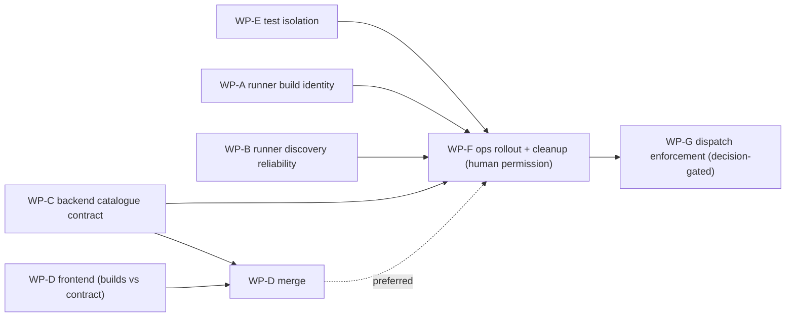

# RESPONSE — Runners are not correctly creating a catalogue

Task: `b3401f19-2897-4049-aa3c-227bcee46a4c`
Stage: response (docs-only). Inputs: bug report + `assets/image.png`, `SURVEY.md` (round 1), `RESPONSE_SURVEY.md` (answered round), `WIDE_NET_ANALYSIS.md`, `REPLICATION_GUIDE.md`, `TESTING_GUIDE.md`, plus a read-only look at the live engine state on this host (`~/.kainbain/engine/*.json`, running processes) and the code on this branch.

This file does three things:

1. Says which candidate causes in `WIDE_NET_ANALYSIS.md` are worth fixing, and adds causes found in live state that the earlier analysis missed (§2).
2. Gives a way to confirm the bug today, with no code changes (§3).
3. Splits the fix into work packages (WP-A … WP-G). It says which ones can run in parallel and which ones block others, and gives each one its own way to confirm the bug and verify the fix (§4–§6).

---

## 1. TL;DR

The screenshot is explained by **five concrete defects that compound**. Four of them can be proven from live state on this host:

| # | Symptom in the screenshot | Proven cause (live evidence) |
|---|---|---|
| 1 | `muse-ember` missing | Both local runners (`local-alpha`, `local-bravo`) advertise a **hand-pinned list** (`KAINBAIN_RUNNER_MODELS` in `~/.kainbain/runner-local-*.env`), report `modelSource: "pinned"` and `discoveryStatus: {}`. **Model discovery has never recorded a single result on them.** The runner process runs straight out of the engine's own git checkout (`/home/server/projects/kainbain/runner`), which KainBain switches between branches. The file on disk was replaced **4 s after the runner booted** with an older daemon that skips discovery whenever models are pinned. `runner/version.json` has said `0.1.0` since 2026‑10‑31, so no runner can tell that it runs stale code, and the self-updater never sees a newer version. This is why "many tickets fixed it" yet nothing changed. |
| 2 | `gemma4:31b-cloud` under an `OLLAMA-CLOUD-DIRECT` section in the **Muse** picker (and `deepseek-v4-flash:0731-cloud`) | The pin list includes ids that are **not harness-qualified** (`ollama-cloud-direct::gemma4:31b-cloud` is provider-form, `deepseek-v4-flash:0731-cloud` is bare). `catalogIngest` stamps every entry with **the runner's whole harness list** (`['antigravity','muse','pi','vibe']`) rather than the harness named in the id. `fleetModelsForHarness` then lets provider/bare ids into every section. |
| 3 | `test-fleet-model` shown as `Unavailable` | It comes from the API test suite (`api/routes/projects.alias.test.js`, `projects.modelCombination.test.js`). Those tests register runner `test-fleet-muse` against the **live** `~/.kainbain/engine/runners.json` and `fleet-catalog.json`, because neither the global test setup nor these files isolate `KAINBAIN_RUNNER_STATE_FILE` / `KAINBAIN_FLEET_CATALOG_FILE`. The snapshot never deletes entries, so the dummy row stays forever. |
| 4 | Old `Unavailable` badge rather than "N runners" | `ModelSelector.jsx` lets `fleetSnapshotBadgeNode` (the "Unavailable" verdict) win over `fleetCountBadgeNode`. The **harness** row ("Muse Code UNAVAILABLE") comes from the *backend container's* local CLI probe (`harnessAvailabilityBadgeNode` → backend `harnessDiscovery`), not from the fleet. The backend container has no `muse` binary, even though runners serve Muse. |
| 5 | Pinned models show "1 runner" even though nothing has ever verified them | `confirmRunnerModel` returns `unknown` (counted as serving) for pins when no discovery result exists, and it always does so for provider/bare-form ids. The user wants pins to be **unverified / 0 runners** (survey q3/q4/q12). |

There is a sixth, secondary defect. `server2-alpha`'s pi discovery leg fails with `ERR_MODULE_NOT_FOUND '@earendil-works/pi-coding-agent'`. Runner discovery legs lazily `import()` backend harness modules and their npm dependencies (`runner/harnessModelDiscovery.js:374,455,504,656`), and the runner install does not ship them. As a result, that runner advertises 0 models and all of its entries drift to `Unavailable`.

**The structural fix:** make the runner's *real, versioned code* do the discovery (A, B); accept only `harness::provider::model[::effort]` ids into the catalogue, with counts based on verification (C); render counts, never stored flags (D); and stop tests and ops from polluting live state (E, F).

---

## 2. Assessment of candidate causes

### 2.1 Causes from `WIDE_NET_ANALYSIS.md`

| WIDE_NET cause | Verdict | Reasoning |
|---|---|---|
| **1. Keep-previous-slice cache / snapshot never deletes** | **Partially valid, re-scoped.** | *Runner side:* keep-old is **not** what hides `muse-ember` today, because on the local runners no slice has ever been written (`discoveryStatus: {}`). A bounded staleness marker is still wanted (survey q5: "keep up to a time limit, then mark stale"), so it goes into WP-B as a small item. *Backend side:* "keep with 0 runners indefinitely" is **what the user explicitly wants** (RESPONSE_SURVEY q1), so the proposed backend TTL/retention eviction is **rejected**. It is replaced by an admin "remove permanently" action (q1 note) and by dropping the size cap (q6). |
| **2. Operator allowlist (`availableModels`) trusted as servable** | **Valid in principle, but not the live trigger.** | Every runner in `runners.json` has `operatorConfig.availableModels: null`. The live trigger is the same *pattern* through a different door: the runner-side pin (`KAINBAIN_RUNNER_MODELS`). Both doors get the same treatment in WP-C: declared ≠ verified (q3/q4). |
| **3. Grammar/filter mismatch across legs** | **Re-framed.** | The single-`:` colon issue was already fixed by `9d2b75a2`. The real grammar defect is that **non-harness-qualified ids (bare / provider-form) are accepted at all**, and then fanned out to every harness the runner serves. The user's note on q8 ("this should all be based around the `harness::model::effort` ids so it shouldn't be possible") and q7 ("block them from being saved at all") make the fix a strict canonical-id contract at ingest (WP-C) and at the runner's config (WP-B). |
| **4. Dual presentation contract (`available` flag vs runner count)** | **Valid.** | Confirmed in `ModelSelector.jsx:318-342`: the snapshot verdict wins over the count badge. The harness badge is also backend-local. Fixed in WP-D, with a small contract addition in WP-C. |

### 2.2 New causes (not in WIDE_NET), with evidence

| New cause | Evidence (read-only, this host, 2026‑11‑13 ~17:20Z) | Package |
|---|---|---|
| **N1. Runners execute mutable, unversioned code.** | The `local-bravo` process (`pid 256984`, started `2026‑11‑12 11:51:20`) has cwd `/home/server/projects/kainbain/runner`, which is the engine's project checkout (currently on branch `kb/b3401f19…`). `runner/daemon.js` and `runner/modelDiscovery.js` in that checkout have mtime `11:51:24`, 4 s *after* boot. `runner/harnessModelDiscovery.js` **does not exist** there, and the on-disk `refreshDiscoveredModels` returns early when `config.models` is pinned. `runner/version.json` = `0.1.0`, last changed `2026‑10‑31`. All runners report `versions.runner: "0.1.0"`. | WP-A, WP-F |
| **N2. Discovery has never produced a result on pinned local runners.** | `runners.json`: `local-alpha` / `local-bravo` → `modelSource: "pinned"`, `discoveryStatus: {}`, `modelProvenance: {}`; 17 models, all equal to the env pin. | WP-B (+A, F) |
| **N3. Runner discovery legs depend on backend modules and npm deps the runner install lacks.** | `server2-alpha.discoveryStatus.pi.error = ERR_MODULE_NOT_FOUND '@earendil-works/pi-coding-agent' … /runner/api/agent/harnesses/pi/piHarness.js`; `muse: MUSE_MSP_MODELS_EMPTY`. | WP-B |
| **N4. Catalogue entries inherit the runner's full harness list.** | `fleet-catalog.json`: every `local-alpha` entry has `harnesses: ['antigravity','muse','pi','vibe']`, including `ollama-cloud-direct::gemma4:31b-cloud` (form `provider`) and `deepseek-v4-flash:0731-cloud` (form `bare`). Code: `catalogIngest.js:101` (`harnesses: cleanStringList(ctx?.harnesses)`) and `fleetModelSnapshot.js:213-224`. | WP-C |
| **N5. API tests write to live engine state.** | `fleet-catalog.json` contains `muse::meta::test-fleet-model` with provenance `test-fleet-muse`. `runners.json` contains revoked runner `test-fleet-muse`. `api/testSetup.isolation.js` sets neither `KAINBAIN_RUNNER_STATE_FILE` nor `KAINBAIN_FLEET_CATALOG_FILE`. `api/isolatedTestRoots.js` sets the runner/claims/steer files but **not** the fleet catalogue, and the two offending test files use neither helper. | WP-E (+F cleanup) |
| **N6. Harness badge is the backend container's local probe.** | Screenshot: "Muse Code UNAVAILABLE" plus the hint "Install the Muse CLI…" (text from `api/agent/harnessDiscovery.js:610`). The backend runs in a container (`pid 256006`, cwd `/app`). `ModelSelector.jsx:33-44` derives the badge from the backend's discovery projection. | WP-C (contract) + WP-D |

Minor observation for the WP-C implementer to verify (not a blocker): snapshot provenance `source` is persisted as `"unknown"` for `local-alpha` entries, even though `runners.json` has `modelSource: "pinned"`. Check whether `runnerRegistry.list()` (the input to `GET /runners/models/catalogue`) passes `capabilities.modelSource` through.

### 2.3 User constraints that bind the design (from `RESPONSE_SURVEY.md`)

- q1: dropped models stay at **0 runners indefinitely**; add a way to **remove permanently**.
- q3/q4: a manual or pinned model that runners never discover is **unverified, 0 runners, never treated as served**, and is still selectable but clearly marked.
- q5: a runner's previously known models stay only **up to a time limit, then are marked stale**.
- q6: **no size limit**.
- q7: malformed / non-canonical ids are **blocked from being saved**.
- q8: wrong-harness adverts are **ignored**; ids are `harness::provider::model[::effort]`.
- q9: **always show runner counts**, with "0 runners" in grey.
- q10: health details (last scan, age) go in **Settings / admin**.
- q11: on-demand re-scan is allowed (`requestModelRediscovery` already exists).
- q12: count **only healthy runners that confirmed it recently**.
- q13: references to removed models are **kept and marked "not currently served"**.
- q14: the user explicitly does not want **dummy models in prod** or **models under the wrong harness**.

---

## 3. Confirm the bug today (no code changes, read-only)

Run these on the engine host. They only read files.

```bash
# 3.1 Which runners pin, and has discovery ever run? (expect local-* : pinned + {} )
python3 - <<'PY'
import json; d=json.load(open('/home/server/.kainbain/engine/runners.json'))
rs=d['runners'].values() if isinstance(d['runners'],dict) else d['runners']
for r in rs:
    if r.get('status')!='active': continue
    c=r['capabilities']
    print(r['runnerId'], c.get('modelSource'), 'discoveryStatus=',json.dumps(c.get('discoveryStatus'))[:300], 'version=',c.get('versions'))
PY

# 3.2 Non-harness-qualified ids + harness fan-out + test pollution in the live catalogue
python3 - <<'PY'
import json; d=json.load(open('/home/server/.kainbain/engine/fleet-catalog.json'))
for m in d['models']:
    if m['form'] in ('bare','provider') or 'test' in m['id'] or len(m['harnesses'])>1:
        print(m['id'], m['form'], m['harnesses'], m['runnerCount'], m['available'], list(m['provenance']))
PY

# 3.3 Runner code provenance: where does each runner process run from, and is the file newer than the process?
for p in $(pgrep -f 'node main.js'); do d=$(readlink /proc/$p/cwd); echo "$p $d started=$(ps -o lstart= -p $p)"; stat -c '  %y %n' $d/daemon.js; ls $d/harnessModelDiscovery.js 2>&1 | sed 's/^/  /'; done
cat runner/version.json   # 0.1.0 regardless of code

# 3.4 Test isolation gap (expect no output for both vars)
grep -n "KAINBAIN_FLEET_CATALOG_FILE\|KAINBAIN_RUNNER_STATE_FILE" api/testSetup.isolation.js
grep -n "FLEET_CATALOG" api/isolatedTestRoots.js
```

Expected today:

- 3.1 shows `local-alpha`/`local-bravo` with `pinned` and `{}`.
- 3.2 lists `deepseek-v4-flash:0731-cloud` (bare), `ollama-cloud-direct::gemma4:31b-cloud` (provider), every entry with 4 harnesses, and `muse::meta::test-fleet-model` (provenance `test-fleet-muse`).
- 3.3 shows the cwd is `/home/server/projects/kainbain/runner`, the file mtime is after process start, and `harnessModelDiscovery.js` is missing.
- 3.4 prints nothing.

The UI-level repro is the screenshot: Project Settings → AI Harness = Muse Code → Default AI model dropdown.

---

## 4. Work packages

Each package lists: **Owns** (files, so parallel packages do not collide), **Change**, **Confirm bug (before)** (a failing test or check the implementer writes first), **Done when** (acceptance).

### WP-A — Runner build identity and stale-code detection *(parallel)*

**Why:** N1. Today a runner cannot say what code it runs, so merged fixes are invisible and the updater never fires.

**Owns:** `runner/version.json`, the release/publish script that writes it (`scripts/` publish path used by `runner/updates`), `runner/daemon.js` → `factsFor().versions` **only**, `api/flow/dispatch/normalizeCapabilities.js` (versions passthrough), the runner card in Settings (`frontend/src/components/settings/…Runner…`).

**Change:**
1. Add `build` to the runner version: `{ runnerVersion, build: { sha, builtAt, dirty } }`. Stamp it at publish/bundle time. A dev runner started from a git checkout computes `sha` at boot (`git rev-parse HEAD`, plus `dirty` from `git status --porcelain runner/`).
2. Heartbeat `facts.versions` adds `build` and `bootedAtMs`. The runner also hashes its own `runner/` tree at boot. On each heartbeat it re-hashes cheaply (mtime scan) and reports `codeChangedSinceBoot: true` when files under its code dir changed after boot (the exact N1 failure).
3. The publish pipeline bumps `runnerVersion` on every release that touches `runner/**` or `api/agent/harnesses/**` (a CI check that fails the release if not), so `runner/updates` can actually offer updates.
4. Settings runner card shows build sha, and shows a warning when `build.sha` ≠ backend build sha or when `codeChangedSinceBoot` is true ("runner code changed on disk after start — restart / reinstall").

**Confirm bug (before):** a unit test asserting `factsFor()` reports a build identity → fails today. Manual: §3.3.

**Done when:** tests cover a sha in facts, `codeChangedSinceBoot` flipping after a file touch (temp dir fixture), normalizeCapabilities preserving `versions.build`, and the Settings warning rendering. Release CI rejects an unbumped version when runner code changed.

---

### WP-B — Runner discovery reliability *(parallel)*

**Why:** N2, N3, survey q5/q7. Discovery must always run, must not silently produce nothing, and must not depend on files the runner install lacks.

**Owns:** `runner/harnessModelDiscovery.js`, `runner/daemon.js` → `refreshDiscoveredModels` + boot sequence **only**, `runner/config.js` (pin validation), runner bundle manifest / packaging (the list of files and deps shipped to runners), `runner/*.test.js` for these.

**Change:**
1. **Boot self-check:** at startup, eagerly `import()` every discovery-leg module for the configured harnesses. A missing module or package becomes an explicit `discoveryStatus[h] = { ok:false, error:{ code:'LEG_MODULE_MISSING', … } }` right away, rather than surfacing on the first lazy import 12 h later. Log it loudly.
2. **Never-ran is visible:** `getDiscoveryStatus(harnessIds)` returns an entry for **every configured harness**. A harness that has not completed a round reports `{ ok:false, error:{ code:'NOT_YET_RUN' } }`, never `{}`. An outer `catch` in `refreshDiscoveredModels` records `ROUND_FAILED` on every configured harness instead of only logging.
3. **Packaging:** ship the leg dependencies with the runner bundle. Either vendor the leg's model-listing code into `runner/`, or include `@earendil-works/pi-coding-agent` (and the agy/vibe/opencode catalog modules) in the bundle's dependency manifest. Add a bundle test that imports every leg from the packaged tree.
4. **Staleness marker (q5):** each slice carries `atMs`. When `now − atMs > KAINBAIN_RUNNER_DISCOVERY_STALE_MS` (default 24 h), the slice keeps its ids but reports `stale:true` in `discoveryStatus`. WP-C then stops counting those ids as verified. **No eviction on the runner.** The catalogue keeps history (q1).
5. **Canonical pins (q7/q8):** `runner/config.js` validates `KAINBAIN_RUNNER_MODELS` / `KAINBAIN_RUNNER_MODEL`. Any id that does not parse as `harness` / `harnessReasoning` form, or whose harness is not in `KAINBAIN_RUNNER_HARNESSES`, is **dropped with a boot warning** and listed in `facts.errors`. This means `deepseek-v4-flash:0731-cloud` and `ollama-cloud-direct::gemma4:31b-cloud` can no longer be advertised.
6. Confirm (test) that a pinned runner still scans (`resolveAdvertisedModels` = pin ∪ discovered), and that `requestModelRediscovery` triggers a fresh round (q11).

**Confirm bug (before):**
- Test: config with `models:['muse::meta::a']`, discovery leg fake that throws on import → `getDiscoveryStatus(['muse'])` returns `{}` today (should name the error).
- Test: `loadConfig` with `KAINBAIN_RUNNER_MODELS=deepseek-v4-flash:0731-cloud` → accepted today (should be rejected with a warning).

**Done when:** those tests pass; a bundle-import test passes against the packaged runner tree; `discoveryStatus` always has one key per configured harness.

---

### WP-C — Backend catalogue contract: canonical ids, per-harness attribution, verified counts, lifecycle *(parallel; single owner of these files)*

**Why:** N4, N5 (lifecycle half), N6 (contract half), survey q1/q3/q4/q6/q7/q8/q12/q13.

**Owns:** `api/flow/dispatch/catalogIngest.js`, `api/flow/dispatch/fleetModelSnapshot.js`, `api/flow/dispatch/runnerModelConfirmation.js` (catalogue-facing verdicts only), `api/flow/runnerRoutes.js` (catalogue routes only), and their tests. **Dispatch (`buildFleetModelCatalog`, `runnerMatches/*`) is not touched in this package** (see WP-G).

**Change:**
1. **Canonical ids only (q7/q8):** `ingestAdvertisedId` accepts only `harness` / `harnessReasoning` forms. `bare` / `provider` forms are quarantined with reason `"not harness-qualified (want harness::provider::model[::effort])"`. Ids whose harness is not in the runner's reported harness list are quarantined with reason `"harness not served by runner <id>"`.
2. **Per-entry attribution:** `entry.harnesses = [parsed.harness]`. Stop copying the runner's harness list (`catalogIngest.js:101`, `fleetModelSnapshot.js:213-224`). Tiers stay per runner.
3. **Verified counts (q3/q4/q12):** an entry's `runnerCount` / `runnerIds` include only claim-eligible runners whose own discovery **confirmed** the id (`modelProvenance` has it, and the leg is not `stale` per WP-B). Pinned/allowlisted-but-unconfirmed claimants go to a new `declaredBy: [runnerIds]`, with `verified: runnerCount > 0`. The existing `claimedBy` (stale pins) stays.
4. **`available` is derived, not stored:** persist counts and timestamps. `available` is computed on read as `runnerCount > 0` (kept in the response for back-compat). `unavailableReason` becomes a derived human string ("0 runners — last served 3 d ago by local-alpha" / "declared by 2 runners, not verified by discovery").
5. **Lifecycle (q1/q6/q13):** keep 0-runner entries indefinitely; **remove `FLEET_SNAPSHOT_MAX_MODELS` eviction** (keep the quarantine cap). Add `remove(id)` to the store and an admin route `DELETE /runners/models/catalogue/:id` (URL-encoded id; 204, 404 when absent). If a runner advertises the id again later, it reappears. Add `DELETE /runners/models/catalogue/quarantine/:id` too. References in projects/aliases are not touched (q13): the UI shows them as "not currently served".
6. **Fleet harness counts (N6):** the catalogue response adds `harnesses: [{ id, runnerCount, runnerIds }]`, counting claim-eligible runners whose `capabilities.harnesses` includes the id.
7. **Migration on load:** `normalizeSnapshotState` moves persisted `bare` / `provider`-form entries into `quarantined` (reason as in step 1), and rewrites `harnesses` to `[parsed.harness]` for the rest. One-time and idempotent.

**Response contract (WP-D builds against this):**

```jsonc
GET /runners/models/catalogue
{
  "models": [{
    "id": "muse::meta::muse-ember", "harness": "muse", "provider": "meta",
    "model": "muse-ember", "reasoning": null, "harnesses": ["muse"], "tiers": ["T0"],
    "runnerCount": 2, "runnerIds": ["local-alpha","server2-alpha"],
    "declaredBy": [], "claimedBy": [], "verified": true,
    "available": true,              // derived: runnerCount > 0
    "unavailableReason": null,      // derived string when runnerCount == 0
    "firstSeenAtMs": 0, "lastSeenAtMs": 0, "lastServedAtMs": 0,
    "provenance": { "local-alpha": { "harnesses": ["muse"], "atMs": 0, "source": "discovered" } }
  }],
  "harnesses": [{ "id": "muse", "runnerCount": 2, "runnerIds": ["local-alpha","server2-alpha"] }],
  "quarantined": [{ "id": "deepseek-v4-flash:0731-cloud", "reason": "not harness-qualified …", "runnerIds": ["local-alpha"] }],
  "updatedAtMs": 0
}
DELETE /runners/models/catalogue/:id             -> 204 | 404   (admin)
DELETE /runners/models/catalogue/quarantine/:id  -> 204 | 404   (admin)
```

**Confirm bug (before):** in `fleetModelSnapshot.test.js`, using `fleetModelFixtures.mjs`:
- A runner with harnesses `['pi','muse']` advertising `ollama-cloud-direct::gemma4:31b-cloud` → today the entry is available with `harnesses` including `muse` (should be quarantined).
- A runner with `modelSource:'pinned'`, `discoveryStatus:{}` advertising `muse::meta::x` → today `runnerCount: 1` (should be 0 with `declaredBy:['r1']`).
- Load a persisted file containing a bare-form entry → today it stays in `models` (should migrate to quarantine).

**Done when:** those tests pass. There are route tests for both DELETEs and for `harnesses[]` counts, and no test exercises a size cap on `models`.

---

### WP-D — Frontend: count-first pickers, fleet harness badge, admin removal *(parallel against the WP-C contract; merges after WP-C)*

**Why:** Cause 4, N6, survey q9/q10/q13.

**Owns:** `frontend/src/components/common/ModelSelector.jsx`, `frontend/src/services/modelStatus.js`, `frontend/src/services/fleetModelOptions/fleetModelsForHarness.js`, `frontend/src/components/settings/ModelAliasesSection.jsx`, the Settings fleet-catalogue/admin view, and their tests.

**Change:**
1. Model rows **always** render `fleetCountBadgeNode`: "N runners" in green/neutral, "0 runners" in grey. Remove `fleetSnapshotBadgeNode` from picker rows (`ModelSelector.jsx:318-342`, `ModelAliasesSection.jsx`). `verified:false && declaredBy.length` adds a subtle "unverified" annotation (tooltip: "declared by local-alpha, not found by its discovery"). Unverified and 0-runner rows stay selectable (q4).
2. `fleetModelsForHarness`: delete the `provider` and `bare` branches. Only harness-form ids whose `parsed.harness === hid` render (defence in depth for WP-C step 1).
3. Harness dropdown badge = fleet harness count from `catalogue.harnesses` ("2 runners" / grey "0 runners"). The backend-local probe badge and install hint move to System Settings → Backend harnesses only.
4. Settings (admin): fleet-catalogue table with runnerCount, verified, declaredBy, lastServedAt/age, a per-runner discovery status (from `capabilities.discoveryStatus`, including WP-B's `NOT_YET_RUN` / `LEG_MODULE_MISSING` / `stale`), a **"Remove permanently"** button (calls the WP-C DELETE), and a quarantine list with remove (q1, q10). A "Re-scan" button uses the existing `requestModelRediscovery` command (q11).
5. Stored references to ids that are absent from the catalogue or have 0 runners render "not currently served" (q13). Never auto-clear them.

**Confirm bug (before):**
- `ModelSelector.test.jsx`: a catalogue entry `{available:false, runnerCount:0}` renders "Unavailable" today (should render "0 runners").
- `fleetModelsForHarness('muse', {'ollama-cloud-direct::gemma4:31b-cloud': {harnesses:['muse','pi']}})` returns 1 entry today (should be 0).
- The harness option for `muse` with `catalogue.harnesses=[{id:'muse',runnerCount:1}]` and backend `available:false` renders "Unavailable" today (should be "1 runner").

**Done when:** those tests pass. Test fixtures follow the WP-C contract, and once WP-C merges, one integration test runs against a real `createFleetModelSnapshotStore({filePath:null})` output.

---

### WP-E — Test isolation for engine state *(parallel, smallest, do first)*

**Why:** N5. This is the source of `test-fleet-model`, and it will re-pollute after any cleanup.

**Owns:** `api/testSetup.isolation.js`, `api/isolatedTestRoots.js`, `api/flow/resolveStatePath.js`, a new guard test.

**Change:**
1. `testSetup.isolation.js` points **every** engine state file at per-file temp paths: `KAINBAIN_RUNNER_STATE_FILE`, `KAINBAIN_CLAIM_STATE_FILE`, `KAINBAIN_STEER_STATE_FILE`, `KAINBAIN_FLEET_CATALOG_FILE`, plus any other `resolveStatePath` consumer (the `seed-demo.json` marker in `api/index.js:106`). Add `KAINBAIN_FLEET_CATALOG_FILE` to `isolatedTestRoots.js` as well.
2. **Structural guard:** `resolveStatePath` throws when `process.env.VITEST` is set and the resolved path is under `~/.kainbain/engine`. Any future store that forgets isolation then fails loudly in CI instead of writing to prod.
3. Guard test: import `api/index.js` under the standard setup, register a runner, and assert that nothing under `os.homedir()/.kainbain/engine` changed (compare mtimes before and after).

**Confirm bug (before):** §3.4 prints nothing. The guard test, written first, fails because `runners.json` / `fleet-catalog.json` mtimes change when `projects.alias.test.js` runs.

**Done when:** the guard test passes, and the full `api` suite passes with the throw-guard active.

---

### WP-F — Ops rollout and live cleanup *(blocked; needs explicit human permission — touches live runners and engine state)*

**Blocked by:** WP-A, WP-B, WP-C merged and deployed (backend image rebuilt). WP-E merged (so cleanup doesn't get re-polluted). WP-D is preferred but not required.

**Steps (runbook, to be executed by or with an operator):**
1. Install local runners from the **runner bundle** into a dedicated directory (for example `~/.kainbain/runner-install/<runnerId>/`, via the `runner/updates` mechanism). Do **not** run them from `/home/server/projects/kainbain/runner`. Update the service definitions or launch scripts for `local-alpha`, `local-bravo` (and any `local-*`).
2. Edit `~/.kainbain/runner-local-*.env`: **remove `KAINBAIN_RUNNER_MODELS`** (recommended, so discovery is the source of truth), or reduce it to harness-qualified ids only.
3. Fix `server2-alpha`'s install so the pi leg's dependency resolves (reinstall from a bundle produced after WP-B). Check the Muse MSP provider config (`MUSE_MSP_MODELS_EMPTY`).
4. Restart runners. Trigger `requestModelRediscovery` from Settings.
5. Purge pollution with the WP-C admin DELETE: `muse::meta::test-fleet-model`. Quarantined bare/provider ids can be removed or left for audit. Revoked runner `test-fleet-muse` can stay revoked or be deleted through the existing runner API.
6. Verify (see §6).

---

### WP-G — Dispatch enforcement of "unverified ≠ served" *(decision-gated; blocked by WP-F)*

Survey q3 says unverified models should "never be treated as served". WP-C applies that to the **catalogue and counts**. Applying it to **dispatch** (`buildFleetModelCatalog`, `runnerMatches`, `confirmRunnerModel` `unknown` ⇒ not claimable) would immediately break any runner that still relies on pins, so it must wait until WP-F shows every live runner reporting healthy discovery. **The human reviewer should decide** whether WP-G is wanted at all, or whether dispatch should keep trusting declarations (an operator escape hatch). This package is not required to fix the reported bug.

---

## 5. Parallelism and blocking order



| Package | Can start now? | Blocks | File-collision notes |
|---|---|---|---|
| WP-E | Yes | F | None. Merge first (smallest, prevents re-pollution in other packages' CI runs). |
| WP-A | Yes | F | Touches `runner/daemon.js` **`factsFor().versions` only**. WP-B touches `refreshDiscoveredModels`/boot only. Rebase the second one to merge. |
| WP-B | Yes | F | See WP-A. Also touches `runner/config.js` (no one else does). |
| WP-C | Yes | D merge, F | Sole owner of `catalogIngest.js`, `fleetModelSnapshot.js`, `runnerModelConfirmation.js`, catalogue routes. |
| WP-D | Yes (against the §4 WP-C contract with fixtures) | — | Merges **after** WP-C. Sole owner of the frontend files listed. |
| WP-F | No | G | Runbook only. Needs explicit operator permission. |
| WP-G | No | — | Needs a human decision first. |

So **five packages (A, B, C, D, E) can be implemented at the same time.** The only hard ordering is: D merges after C, and F runs after A, B, C, E are deployed.

---

## 6. How to verify the whole fix (end-to-end, after WP-F)

1. §3.1 now shows every active runner with `modelSource` of `discovered` or `pinned+discovered`, and a `discoveryStatus` key per configured harness with `ok:true` (or a named error code, never `{}`). `versions.build.sha` matches the deployed commit, and `codeChangedSinceBoot` is false.
2. §3.2 returns no `bare`/`provider` entries in `models`, no `test-fleet-model`, and every entry has `harnesses` of length 1 equal to its id's harness.
3. UI, Project Settings → Muse Code: the harness badge reads "N runners". The model list contains `muse::meta::muse-ember` (or whatever `muse serve` currently lists) with "N runners". It does not contain `gemma4`, `deepseek`, or `test-fleet-model`. A model a harness dropped shows grey "0 runners" and has a "Remove permanently" action in Settings.
4. Regression: remove a model from a fake leg's output → the entry stays at "0 runners" (not deleted). Admin DELETE → it is gone, and re-advertising it brings it back.
5. Run `npm test` for `runner/`, `api/flow/dispatch/`, `api/routes/projects.*`, `frontend/src/services/fleetModelOptions`, `frontend/src/components/common/ModelSelector.test.jsx`. The WP-E guard test proves no suite touched `~/.kainbain/engine`.

**Safety note:** every step in §3 and in the WP "confirm bug" items runs locally with fakes or read-only file inspection. Nothing in this document requires invoking real agents or touching prod. WP-F is the only package that changes live runners or engine state, and it is explicitly gated on human permission.

---

## 7. Explicitly rejected / deferred

- **Backend catalogue TTL / retention eviction** (WIDE_NET Layer C retention, survey "proposed" q1). Rejected: the user chose to keep entries indefinitely, with manual permanent removal.
- **Snapshot size cap** (`FLEET_SNAPSHOT_MAX_MODELS`). Rejected per q6. The quarantine cap stays as a safety bound.
- **Runner-side slice eviction**. Replaced by a `stale` marker (q5): history stays in the catalogue, and only the *verified count* drops.
- **Moving wrong-harness models to another harness / showing them in both** (q8 alternatives). Rejected: ignore and quarantine.
- **Auto-clearing project/alias references** to removed models (q13). Rejected: keep the reference and mark it.
