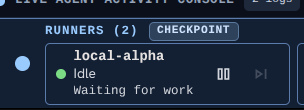

<!-- KAINBAIN AUTO-GENERATED REPORT -->
# Stage Report: merge

**Task:** Can we remove the word checkpoint from the runners bar  Just have it say runners 2. Just would be clearer and I have no ideal what that pill means in the new parrellism paradigm
**Stage Type:** `merge`
**Model:** `default`
**Duration:** 2.054s
**Status:** FAILED

### Summary of Changes
Execution failed: Task branch 'kb/b34e1939-6ee2-416d-b6a7-279920f8573c' has diverged from 'origin/kb/b34e1939-6ee2-416d-b6a7-279920f8573c' — refusing to merge a stale local branch and silently drop remote Runner work. Reconcile the task branch with 'origin/kb/b34e1939-6ee2-416d-b6a7-279920f8573c' (merge 'origin/kb/b34e1939-6ee2-416d-b6a7-279920f8573c' into 'kb/b34e1939-6ee2-416d-b6a7-279920f8573c' locally or reset to it), then retry the merge stage.

### Execution Output
```
Task branch 'kb/b34e1939-6ee2-416d-b6a7-279920f8573c' has diverged from 'origin/kb/b34e1939-6ee2-416d-b6a7-279920f8573c' — refusing to merge a stale local branch and silently drop remote Runner work. Reconcile the task branch with 'origin/kb/b34e1939-6ee2-416d-b6a7-279920f8573c' (merge 'origin/kb/b34e1939-6ee2-416d-b6a7-279920f8573c' into 'kb/b34e1939-6ee2-416d-b6a7-279920f8573c' locally or reset to it), then retry the merge stage.
```

### Modified Files
- (No files modified / inspection only)

### Verification Status
- Stage execution failed with error: Task branch 'kb/b34e1939-6ee2-416d-b6a7-279920f8573c' has diverged from 'origin/kb/b34e1939-6ee2-416d-b6a7-279920f8573c' — refusing to merge a stale local branch and silently drop remote Runner work. Reconcile the task branch with 'origin/kb/b34e1939-6ee2-416d-b6a7-279920f8573c' (merge 'origin/kb/b34e1939-6ee2-416d-b6a7-279920f8573c' into 'kb/b34e1939-6ee2-416d-b6a7-279920f8573c' locally or reset to it), then retry the merge stage.
- Triggered fallback routing.