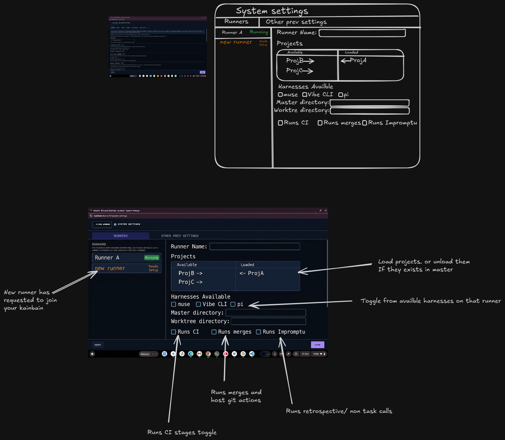

<!-- KAINBAIN AUTO-GENERATED REPORT -->
# Stage Report: automated test 2

**Task:** Replace harness tab with detailed runner settings  following this rough design replace all the harness settings(as they dont make sense anymore) to a runner configuration settings . this is all in the general settings tab
**Stage Type:** `ci`
**Model:** `default`
**Duration:** 762.079s
**Status:** FAILED

### Summary of Changes
Execution failed: CI command failed with exit code 1

### Execution Output
```

up to date, audited 117 packages in 2s

15 packages are looking for funding
  run `npm fund` for details

3 moderate severity vulnerabilities

To address all issues (including breaking changes), run:
  npm audit fix --force

Run `npm audit` for details.

> kainbain@1.0.0 test
> node scripts/run-tests.mjs

Starting full project verification...
✅ Settings duplicate check passed (30 files in 83ms)
▸ started Unit Tests (api)
▸ started Unit Tests (frontend)
▸ started Unit Tests (runner)
▸ started Linting (api)
▸ started Linting (frontend)
▸ started Frontend Build
▸ started Security Script Tests
▸ started Dependency Check
▸ started Dependency Audit Gate
▸ started Harness Self-Tests
▸ started Container Tests
⏳ still running: Unit Tests (api) (30s), Unit Tests (frontend) (30s), Dependency Check (30s)
⏳ still running: Unit Tests (api) (1m00s)
⏳ still running: Unit Tests (api) (1m30s)
⏳ still running: Unit Tests (api) (2m00s)
Running Unit Tests (api)... PASS (137s)
Running Unit Tests (frontend)... PASS (137s)
Running Unit Tests (runner)... PASS (137s)
Running Linting (api)... PASS (137s)
Running Linting (frontend)... PASS (137s)
Running Frontend Build... PASS (137s)
Running Security Script Tests... PASS (137s)
Running Dependency Check... PASS (137s)
Running Dependency Audit Gate... PASS (137s)
Running Harness Self-Tests... PASS (137s)
Running Container Tests... PASS (137s)
Fast gate complete — starting Canary Tests alone (serial phase, no shared CPUs with the unit suites)...
▸ started Canary Tests
⏳ still running: Canary Tests (30s)
⏳ still running: Canary Tests (1m00s)
⏳ still running: Canary Tests (1m30s)
⏳ still running: Canary Tests (2m00s)
⏳ still running: Canary Tests (2m30s)
⏳ still running: Canary Tests (3m00s)
⏳ still running: Canary Tests (3m30s)
⏳ still running: Canary Tests (4m00s)
⏳ still running: Canary Tests (4m30s)
⏳ still running: Canary Tests (5m00s)
⏳ still running: Canary Tests (5m30s)
⏳ still running: Canary Tests (6m00s)
⏳ still running: Canary Tests (6m30s)
⏳ still running: Canary Tests (7m00s)
⏳ still running: Canary Tests (7m30s)
⏳ still running: Canary Tests (8m00s)
⏳ still running: Canary Tests (8m30s)
⏳ still running: Canary Tests (9m00s)
⏳ still running: Canary Tests (9m30s)
⏳ still running: Canary Tests (10m00s)
Running Canary Tests... FAIL (618s)
----------------------------------------------------------------------
Details for Canary Tests:
(trimmed 113 of 233 lines; showing the tail)
  ✓   85 tests/runtime-errors.spec.js:13:5 › app renders without uncaught page errors (1.9s)
  ✓   86 tests/runtime-errors.spec.js:23:5 › app renders without console errors (2.2s)
  ✓   87 tests/settings.spec.js:60:6 › Settings save round-trip › edit, save, reload: values persist across UI and API (2.8s)
  ✓   88 tests/settings.spec.js:83:6 › Settings save round-trip › invalid input blocks the save and keeps the stored config (3.4s)
  ✓   89 tests/survey-verify.spec.js:121:7 › question-me survey verification › engine parks a question-me stage with no survey file; skip advances (2.0s)
survey timings ms: reveal=36 save=79 submit=96
  ✓   90 tests/survey-verify.spec.js:145:7 › question-me survey verification › desktop: conditional reveal, notes, save, submit advances; file stays append-only (4.1s)
  ✓   91 tests/survey-verify.spec.js:258:9 › question-me survey verification › touch context › mobile: survey renders, answers, and fits 375px (2.4s)
  ✓   92 tests/survey-verify.spec.js:289:7 › question-me survey verification › empty round advances via continue without parking (2.6s)
  ✓   93 tests/system-settings-mobile.spec.js:126:6 › System Settings screen tab bar (task 5ad55777) › tab bar renders at full height on mobile across all tabs (4.7s)
  ✓   94 tests/system-settings-mobile.spec.js:142:6 › System Settings screen tab bar (task 5ad55777) › tab bar renders at full height on a short mobile viewport (2.5s)
  ✓   95 tests/system-settings-mobile.spec.js:155:6 › System Settings screen tab bar (task 5ad55777) › scrolling the details never covers the tab bar (2.5s)
  ✓   96 tests/system-settings-mobile.spec.js:169:6 › System Settings screen tab bar (task 5ad55777) › tab bar renders at full height on desktop (3.2s)
  ✓   97 tests/system-settings-mobile.spec.js:175:6 › System Settings screen tab bar (task 5ad55777) › rotating the viewport never covers the tab bar (2.6s)
  ✓   98 tests/system-settings-mobile.spec.js:192:6 › System Settings screen tab bar (task 5ad55777) › a deep-linked tab survives a refresh and an unknown section falls back (4.0s)
  ✓   99 tests/system-settings-mobile.spec.js:221:6 › System Settings entry opens a screen, not a dialog (task cd669cc3) › no modal dialog shell remains on the settings route (2.0s)
  ✓  100 tests/system-settings-mobile.spec.js:228:6 › System Settings entry opens a screen, not a dialog (task cd669cc3) › desktop System Menu opens System Settings in a new window (2.0s)
  ✓  101 tests/system-settings-mobile.spec.js:253:6 › System Settings entry opens a screen, not a dialog (task cd669cc3) › mobile System Menu falls back to same-tab navigation (no popout trap) (2.6s)
  ✓  102 tests/task-editing.spec.js:34:6 › Task-view editing behaviors › attached image markdown is appended at the end, title line intact (3.7s)
  ✓  103 tests/task-editing.spec.js:71:6 › Task-view editing behaviors › preview/edit round-trip preserves edited content (3.8s)
  ✓  104 tests/task-errors.spec.js:93:6 › Task-view error display › long failure renders capped with a Show more/less toggle (1.7s)
  ✓  105 tests/task-inspector.spec.js:38:6 › Task inspector core behaviors › just-created task opens the goal in edit mode with context tokens (4.0s)
  ✓  106 tests/task-inspector.spec.js:57:6 › Task inspector core behaviors › preview toggle hides the editor and the context tokens, edit restores them (4.4s)
  ✓  107 tests/task-inspector.spec.js:85:6 › Task inspector core behaviors › clicking the task key copies the full task id and keeps the inspector open (4.2s)
  ✓  108 tests/task-lifecycle.spec.js:41:6 › Task Lifecycle E2E › submit -> kanban placement -> advance -> complete (3.6s)
  ✓  109 tests/task-lifecycle.spec.js:84:6 › Task Lifecycle E2E › kanban cards are draggable and columns are drop targets (3.8s)
TEST START: human stage renders Approve/Reject checkpoint controls
projectId: dbb5b4d0-e9db-4531-b0b3-ce07cf1feac2
stages count: 6
humanStage: 4 Review Plan
submitting goal: Human review 1793474103010
goal submitted, polling latestTask
task id: c253430c-7f85-4da3-bc33-969dd1ac74b3 stageId before jump: undefined
jump status: 200
Reload attempt 0 starting...
page.reload finished on attempt 0
waitForAppReadyOnProject starting on attempt 0
waitForAppReadyOnProject succeeded on attempt 0
waiting for Approve/Reject buttons...
TEST FINISHED SUCCESSFULLY
  ✓  110 tests/task-lifecycle.spec.js:108:6 › Task Lifecycle E2E › human stage renders Approve/Reject checkpoint controls (5.8s)
  ✓  111 tests/task-lifecycle.spec.js:171:6 › Task Lifecycle E2E › clicking a card opens the slide-over task inspector (3.7s)
  ✓  112 tests/task-logs.spec.js:109:6 › Agent-log readability › structured run output renders readably across feeds (6.8s)
  ✓  113 tests/task-logs.spec.js:146:6 › Agent-log readability › long lines wrap without breaking the inspector layout (3.6s)
  ✓  114 tests/task-logs.spec.js:167:6 › Agent-log readability › a fresh task shows the initialized placeholder, not a blank page (2.0s)
  ✓  115 tests/visual/dashboard.spec.js:65:8 › Dashboard Visuals › Desktop › Empty state (2.0s)
  ✓  116 tests/visual/dashboard.spec.js:82:8 › Dashboard Visuals › Desktop › Active execution (task card in canvas) (3.2s)
  ✓  117 tests/visual/dashboard.spec.js:96:8 › Dashboard Visuals › Desktop › Populated history (tasks + session tree) (3.2s)
  ✓  118 tests/visual/dashboard.spec.js:65:8 › Dashboard Visuals › Tablet › Empty state (2.2s)
  ✓  119 tests/visual/dashboard.spec.js:82:8 › Dashboard Visuals › Tablet › Active execution (task card in canvas) (3.3s)
  ✓  120 tests/visual/dashboard.spec.js:96:8 › Dashboard Visuals › Tablet › Populated history (tasks + session tree) (3.3s)
  ✓  121 tests/visual/dashboard.spec.js:65:8 › Dashboard Visuals › Mobile › Empty state (1.9s)
  ✓  122 tests/visual/dashboard.spec.js:82:8 › Dashboard Visuals › Mobile › Active execution (task card in canvas) (3.0s)
  ✓  123 tests/visual/dashboard.spec.js:96:8 › Dashboard Visuals › Mobile › Populated history (tasks + session tree) (3.1s)
  ✓  124 tests/visual/header.spec.js:23:7 › Header Visuals (task 66ad153f) › header band at Mobile 375px (2.7s)
  ✓  125 tests/visual/header.spec.js:23:7 › Header Visuals (task 66ad153f) › header band at Tablet 1024px (1.9s)
  ✓  126 tests/visual/header.spec.js:23:7 › Header Visuals (task 66ad153f) › header band at Desktop 1280px (1.7s)
  ✓  127 tests/visual/homepage.spec.js:44:7 › Homepage Visuals › visual regression - Desktop (2.2s)
  ✓  128 tests/visual/homepage.spec.js:44:7 › Homepage Visuals › visual regression - Tablet (2.2s)
  ✓  129 tests/visual/homepage.spec.js:44:7 › Homepage Visuals › visual regression - Mobile (3.6s)
  ✓  130 tests/websocket.spec.js:42:5 › frontend connects to the backend WebSocket and receives the handshake (1.8s)
  ✓  131 tests/workflow.spec.js:18:6 › Workflow E2E Tests › Task Creation: In-line add task -> verify card appears in kanban stage (4.9s)
  ✓  132 tests/workflow.spec.js:38:6 › Workflow E2E Tests › Stage types: human stage shows review checkpoint (4.1s)
  ✓  133 tests/workflow.spec.js:66:6 › Workflow E2E Tests › Now Playing bar: runner boxes own play/skip, no global engine controls (2.7s)
  ✓  134 tests/workflow.spec.js:97:6 › Workflow E2E Tests › Project isolation: switching project loads its own workflow (3.2s)
  ✓  135 tests/workflow.spec.js:114:6 › Workflow E2E Tests › Stage skills: GET /skills serves the library and the stage editor exposes the Skills panel (3.4s)


  1) tests/accessibility.spec.js:95:7 › Accessibility (WCAG 2.2 AAA + WCAG 3.0 readiness) › docs view has no axe violations 

    Test timeout of 60000ms exceeded.

    Error: page.evaluate: Target page, context or browser has been closed

       at a11y/scanHelpers.js:50

      48 | 		.waitFor({ state: "visible", timeout: 15000 })
      49 | 		.catch(() => {});
    > 50 | 	const results = await new AxeBuilder({ page }).withTags(WCAG_TAGS).analyze();
         | 	                                                                   ^
      51 | 	return results.violations ?? [];
      52 | }
      53 |
        at AxeBuilder.analyze (/home/[REDACTED]/.kainbain/runner-work/kb-b4b86592-4920-4c7e-86e3-63f004e603d9/canary-e2e/node_modules/@axe-core/playwright/dist/index.js:236:16)
        at scanAxeViolations (/home/[REDACTED]/.kainbain/runner-work/kb-b4b86592-4920-4c7e-86e3-63f004e603d9/canary-e2e/tests/a11y/scanHelpers.js:50:69)
        at assertViewClean (/home/[REDACTED]/.kainbain/runner-work/kb-b4b86592-4920-4c7e-86e3-63f004e603d9/canary-e2e/tests/a11y/scanHelpers.js:228:24)
        at /home/[REDACTED]/.kainbain/runner-work/kb-b4b86592-4920-4c7e-86e3-63f004e603d9/canary-e2e/tests/accessibility.spec.js:98:5

    Error Context: test-results/accessibility-Accessibilit-77cb9--view-has-no-axe-violations/error-context.md

  2) tests/pr-review.spec.js:150:6 › PR Review E2E › open review → comment → fail with comments → agent fix → re-review (stale) → pass → merge 

    Error: expect(received).toMatch(expected)

    Expected pattern: /^completed ::/
    Received string:  "failed :: Merge of 'kb/365d732f-0cf9-42b1-9d03-3238832a6a14' landed on 'main' but publishing it failed (git push -u origin main failed (exit 128): fatal: unable to access 'https://git.example.com/canary/pr-review-canary-1793473955714.git/': Could not resolve host: git.example.com) — the local branch is ahead "

    Call Log:
    - Timeout 30000ms exceeded while waiting on the predicate

      342 | 				{ timeout: 30000 },
      343 | 			)
    > 344 | 			.toMatch(/^completed ::/);
          | 			 ^
      345 | 		const merged = git(repoDir, ["show", "main:src/session.js"]);
      346 | 		expect(merged).toContain("if (b == null) return 0;");
      347 | 	});
        at /home/[REDACTED]/.kainbain/runner-work/kb-b4b86592-4920-4c7e-86e3-63f004e603d9/canary-e2e/tests/pr-review.spec.js:344:5

    attachment #1: screenshot (image/png) ──────────────────────────────────────────────────────────
    test-results/pr-review-PR-Review-E2E-op-06c1d-review-stale-→-pass-→-merge/test-failed-1.png
    ────────────────────────────────────────────────────────────────────────────────────────────────

    Error Context: test-results/pr-review-PR-Review-E2E-op-06c1d-review-stale-→-pass-→-merge/error-context.md

  2 failed
    tests/accessibility.spec.js:95:7 › Accessibility (WCAG 2.2 AAA + WCAG 3.0 readiness) › docs view has no axe violations 
    tests/pr-review.spec.js:150:6 › PR Review E2E › open review → comment → fail with comments → agent fix → re-review (stale) → pass → merge 
  3 did not run
  130 passed (10.3m)
----------------------------------------------------------------------

```

### Modified Files
- (No files modified / inspection only)

### Verification Status
- Stage execution failed with error: CI command failed with exit code 1
- Triggered fallback routing.