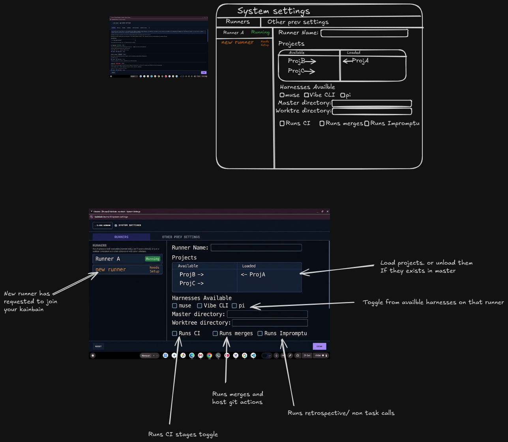

# Goal
# Replace harness tab with detailed runner settings



following this rough design replace all the harness settings(as they dont make sense anymore) to a runner configuration settings . this is all in the general settings tab

# History
- 2026-10-30T00:07:53.975Z: Created and placed in stage 'Idea'
- 2026-10-30T00:07:54.913Z: Created and checked out task branch 'kb/b4b86592-4920-4c7e-86e3-63f004e603d9' from 'main'
- 2026-10-30T00:07:59.668Z: Task details edited
- 2026-10-30T00:08:02.817Z: Task details edited
- 2026-10-30T00:08:40.507Z: Task details edited
- 2026-10-30T00:09:00.078Z: Task details edited
- 2026-10-30T00:09:04.916Z: Task details edited
- 2026-10-30T00:09:09.026Z: Task details edited
- 2026-10-30T00:09:25.068Z: Task details edited
- 2026-10-30T00:09:29.878Z: Stage report generated: ./docs/tasks/b4b86592-4920-4c7e-86e3-63f004e603d9/idea-20261030-000929.md
- 2026-10-30T00:09:29.883Z: Advanced to stage 'Requirement refinement'
- 2026-10-30T00:09:29.937Z: Task-branch ref 'kb/b4b86592-4920-4c7e-86e3-63f004e603d9' already exists — no checkout performed (human checkpoint 'Idea'; leaving 3 uncommitted paths in the tree for the next work stage)
- 2026-10-30T00:09:31.641Z: Runner local-alpha stage stage-1792362077711: started
- 2026-10-30T00:09:33.965Z: Runner local-alpha stage stage-1792362077711: prompted
- 2026-10-30T00:11:00.396Z: Runner local-alpha stage stage-1792362077711: finished
- 2026-10-30T00:11:05.400Z: Runner completed execution 03862b13-bb82-4f0d-be83-64dbf31041e5 (runner local-alpha, epoch 1, sha e67001d6b8f75070a38b4a8d95a020b0227c5d7e (unverified-remote), branch kb/b4b86592-4920-4c7e-86e3-63f004e603d9, posture T0/T1:muse:default). Lease released.
- 2026-10-30T00:11:05.404Z: Agent stage completed: Requirement refinement (via Runner local-alpha)
- 2026-10-30T00:11:05.416Z: Survey requested by the 'question-me' skill (unanswered) — awaiting human answers (via Runner local-alpha)
- 2026-10-30T00:13:57.650Z: Survey completed (answered) — advancing
- 2026-10-30T00:13:57.651Z: Advanced to stage 'Plan'
- 2026-10-30T00:14:00.696Z: Runner local-alpha stage 3: started
- 2026-10-30T00:14:04.346Z: Runner local-alpha stage 3: prompted
- 2026-10-30T00:19:15.131Z: Runner local-alpha stage 3: finished
- 2026-10-30T00:19:19.169Z: Runner completed execution b90dc0e9-073b-4df4-9cda-5725e79e4c03 (runner local-alpha, epoch 2, sha c82c51524132d348ff1ef16e66135ebf54d65e6e (unverified-remote), branch kb/b4b86592-4920-4c7e-86e3-63f004e603d9, posture T0/T1:pi:default). Lease released.
- 2026-10-30T00:19:19.170Z: Agent stage completed: Plan (via Runner local-alpha)
- 2026-10-30T00:19:19.172Z: Advanced to stage 'Check for plan'
- 2026-10-30T00:19:19.197Z: Runner local-alpha stage stage-1792361958910: started
- 2026-10-30T00:19:22.147Z: Runner local-alpha stage stage-1792361958910: prompted
- 2026-10-30T00:19:22.170Z: Runner local-alpha stage stage-1792361958910: finished
- 2026-10-30T00:19:22.186Z: Runner completed execution c78ceba1-dc94-4944-9abd-d7ea5516dbeb (runner local-alpha, epoch 3, sha c82c51524132d348ff1ef16e66135ebf54d65e6e (unverified-remote), branch kb/b4b86592-4920-4c7e-86e3-63f004e603d9, posture T0/T1:pi:default). Lease released.
- 2026-10-30T00:19:22.187Z: Agent stage completed: Check for plan (via Runner local-alpha)
- 2026-10-30T00:19:22.189Z: Advanced to stage 'Risk review'
- 2026-10-30T00:19:22.223Z: Runner local-alpha stage stage-1791738383862: started
- 2026-10-30T00:19:24.901Z: Runner local-alpha stage stage-1791738383862: prompted
- 2026-10-30T00:20:16.776Z: Runner local-alpha stage stage-1791738383862: finished
- 2026-10-30T00:20:21.432Z: Runner completed execution f0139cac-e6c2-467c-93e3-08778273685f (runner local-alpha, epoch 4, sha 62623933ee7b6650da6a367272ce8c767eedea7e (unverified-remote), branch kb/b4b86592-4920-4c7e-86e3-63f004e603d9, posture T0/T1:pi:default). Lease released.
- 2026-10-30T00:20:21.432Z: Agent stage completed: Risk review (via Runner local-alpha)
- 2026-10-30T00:20:21.437Z: Advanced to stage 'Review Plan'
- 2026-10-30T06:46:49.978Z: Stage report generated: ./docs/tasks/b4b86592-4920-4c7e-86e3-63f004e603d9/review-plan-20261030-064649.md
- 2026-10-30T06:46:49.984Z: Advanced to stage 'catchup'
- 2026-10-30T06:46:50.037Z: Task-branch ref 'kb/b4b86592-4920-4c7e-86e3-63f004e603d9' already exists — no checkout performed (human checkpoint 'Review Plan'; leaving 8 uncommitted paths in the tree for the next work stage)
- 2026-10-30T06:46:50.587Z: Runner local-alpha stage stage-1790707081501: started
- 2026-10-30T06:46:53.765Z: Runner local-alpha stage stage-1790707081501: prompted
- 2026-10-30T06:48:46.240Z: Runner local-alpha stage stage-1790707081501: finished
- 2026-10-30T06:48:50.433Z: Runner completed execution 065eabcd-b60b-47cf-8f92-319ded2b18cd (runner local-alpha, epoch 5, sha e335ac2b1956ad8b2a22fce659c4f7970930cd1b (unverified-remote), branch kb/b4b86592-4920-4c7e-86e3-63f004e603d9, posture T0/T1:pi:default). Lease released.
- 2026-10-30T06:48:50.434Z: Agent stage completed: catchup (via Runner local-alpha)
- 2026-10-30T06:48:50.442Z: Advanced to stage 'In Progress'
- 2026-10-30T06:48:50.486Z: Runner local-alpha stage 5: started
- 2026-10-30T06:48:53.528Z: Runner local-alpha stage 5: prompted
- 2026-10-30T07:18:58.626Z: Runner local-alpha stage 5: finished
- 2026-10-30T07:19:02.667Z: Runner completed execution 1b76112a-dbfd-4665-ac2c-7bab4c5e2bc2 (runner local-alpha, epoch 6, sha 118e6131ddf1fd3634e466bad5eea4badc24fb5c (unverified-remote), branch kb/b4b86592-4920-4c7e-86e3-63f004e603d9, posture T0/T1:muse:default). Lease released.
- 2026-10-30T07:19:02.670Z: Agent stage completed: In Progress (via Runner local-alpha)
- 2026-10-30T07:19:02.684Z: Advanced to stage 'Automated tests'
- 2026-10-30T07:19:02.754Z: Runner local-alpha stage stage-1787744699411: started
- 2026-10-30T07:19:05.774Z: Runner local-alpha stage stage-1787744699411: prompted
- 2026-10-30T07:30:37.953Z: Runner local-alpha stage stage-1787744699411: finished
- 2026-10-30T07:30:37.975Z: Runner completed execution 2d3d7ac4-181a-4777-87e5-339eab967f7b (runner local-alpha, epoch 7, sha 118e6131ddf1fd3634e466bad5eea4badc24fb5c (unverified-remote), branch kb/b4b86592-4920-4c7e-86e3-63f004e603d9, posture T0/T1:pi:default). Lease released.
- 2026-10-30T07:30:38.131Z: Auto-committed partial work on 'kb/b4b86592-4920-4c7e-86e3-63f004e603d9' (b744a3f) after failed stage 'Automated tests'
- 2026-10-30T07:30:38.152Z: Warning: push of 'kb/b4b86592-4920-4c7e-86e3-63f004e603d9' after failed stage 'Automated tests' failed (git push -u origin kb/b4b86592-4920-4c7e-86e3-63f004e603d9 failed (exit 128): error: cannot run ssh: No such file or directory
fatal: unable to fork) — retry still proceeds
- 2026-10-30T07:30:38.161Z: Stage failed in 'Automated tests': CI command failed with exit code 1
- 2026-10-30T07:30:38.169Z: Stage report generated: ./docs/tasks/b4b86592-4920-4c7e-86e3-63f004e603d9/automated-tests-failure-20261030-073038.md
- 2026-10-30T07:30:38.173Z: Failed back to stage 'In Progress'
- 2026-10-30T07:30:38.231Z: Runner local-alpha stage 5: started
- 2026-10-30T07:30:41.523Z: Runner local-alpha stage 5: prompted
- 2026-10-30T07:30:57.392Z: Runner local-alpha stage 5: finished
- 2026-10-30T07:31:01.393Z: Runner completed execution aefe4872-8b3d-4301-bd85-7b7215682c72 (runner local-alpha, epoch 8, sha 22ba30f38565f273c9ae86f1440f7ac9f3ebd255 (unverified-remote), branch kb/b4b86592-4920-4c7e-86e3-63f004e603d9, posture T0/T1:pi:default). Lease released.
- 2026-10-30T07:31:01.394Z: Agent stage completed: In Progress (via Runner local-alpha)
- 2026-10-30T07:31:01.399Z: Advanced to stage 'Automated tests'
- 2026-10-30T07:31:01.437Z: Runner local-alpha stage stage-1787744699411: started
- 2026-10-30T07:31:04.569Z: Runner local-alpha stage stage-1787744699411: prompted
- 2026-10-30T07:44:03.653Z: Runner local-alpha stage stage-1787744699411: finished
- 2026-10-30T07:44:03.678Z: Runner completed execution e4f2bfe9-2179-493b-819a-6cfa4f7e70f9 (runner local-alpha, epoch 9, sha 22ba30f38565f273c9ae86f1440f7ac9f3ebd255 (unverified-remote), branch kb/b4b86592-4920-4c7e-86e3-63f004e603d9, posture T0/T1:pi:default). Lease released.
- 2026-10-30T07:44:03.767Z: Auto-committed partial work on 'kb/b4b86592-4920-4c7e-86e3-63f004e603d9' (e4a4f77) after failed stage 'Automated tests'
- 2026-10-30T07:44:03.783Z: Warning: push of 'kb/b4b86592-4920-4c7e-86e3-63f004e603d9' after failed stage 'Automated tests' failed (git push -u origin kb/b4b86592-4920-4c7e-86e3-63f004e603d9 failed (exit 128): error: cannot run ssh: No such file or directory
fatal: unable to fork) — retry still proceeds
- 2026-10-30T07:44:03.786Z: Stage failed in 'Automated tests': CI command failed with exit code 1
- 2026-10-30T07:44:03.791Z: Stage report generated: ./docs/tasks/b4b86592-4920-4c7e-86e3-63f004e603d9/automated-tests-failure-20261030-074403.md
- 2026-10-30T07:44:03.795Z: Failed back to stage 'In Progress'
- 2026-10-30T07:44:03.886Z: Runner local-alpha stage 5: started
- 2026-10-30T07:44:06.864Z: Runner local-alpha stage 5: prompted
- 2026-10-30T07:51:25.959Z: Runner local-alpha stage 5: finished
- 2026-10-30T07:51:30.662Z: Runner completed execution 149fa9e8-0591-470e-8e96-212316d95b52 (runner local-alpha, epoch 10, sha cb8b0a17a053dcf986d94d4e62a1884751b6fddc (unverified-remote), branch kb/b4b86592-4920-4c7e-86e3-63f004e603d9, posture T0/T1:pi:default). Lease released.
- 2026-10-30T07:51:30.665Z: Agent stage completed: In Progress (via Runner local-alpha)
- 2026-10-30T07:51:30.684Z: Advanced to stage 'Automated tests'
- 2026-10-30T07:51:30.730Z: Runner local-alpha stage stage-1787744699411: started

# Timeline
- 2026-10-30T00:09:29.883Z: Requirement refinement | Advanced | 95.907s
- 2026-10-30T00:13:57.651Z: Plan | Advanced | 267.768s
- 2026-10-30T00:19:19.172Z: Check for plan | Advanced | 321.521s
- 2026-10-30T00:19:22.189Z: Risk review | Advanced | 3.017s
- 2026-10-30T00:20:21.437Z: Review Plan | Advanced | 59.247s
- 2026-10-30T06:46:49.984Z: catchup | Advanced | 23188.547s
- 2026-10-30T06:48:50.442Z: In Progress | Advanced | 120.458s
- 2026-10-30T07:19:02.684Z: Automated tests | Advanced | 1812.242s
- 2026-10-30T07:30:38.166Z: Automated tests | Failed | 695.482s | +624 -7
- 2026-10-30T07:30:38.173Z: In Progress | Moved | 695.489s | +0 -0
- 2026-10-30T07:31:01.399Z: Automated tests | Advanced | 23.226s | +0 -0
- 2026-10-30T07:44:03.789Z: Automated tests | Failed | 782.39s | +355 -0
- 2026-10-30T07:44:03.795Z: In Progress | Moved | 782.396s | +0 -0
- 2026-10-30T07:51:30.684Z: Automated tests | Advanced | 446.889s | +0 -0

# Log Entries
```json
[{"id":"log-8127","ts":"2026-10-30T07:44:03.796Z","feed":"main","feeds":["main"],"kind":"system","turn":null,"text":"[INFO] (10 earlier log entries evicted)","meta":{"evictedCount":10}},{"id":"log-7636","ts":"2026-10-30T00:10:44.814Z","feed":"main","feeds":["main"],"kind":"runner","turn":null,"text":"[runner local-alpha] /server/.kainbain/runner","meta":{"source":"process-log","runnerId":"local-alpha","executionId":"03862b13-bb82-4f0d-be83-64dbf31041e5","seq":7}},{"id":"log-7637","ts":"2026-10-30T00:10:44.864Z","feed":"main","feeds":["main"],"kind":"runner","turn":null,"text":"[runner local-alpha] -work/kb-b4b86592","meta":{"source":"process-log","runnerId":"local-alpha","executionId":"03862b13-bb82-4f0d-be83-64dbf31041e5","seq":8}},{"id":"log-7638","ts":"2026-10-30T00:10:44.917Z","feed":"main","feeds":["main"],"kind":"runner","turn":null,"text":"[runner local-alpha] -4920-4c7e","meta":{"source":"process-log","runnerId":"local-alpha","executionId":"03862b13-bb82-4f0d-be83-64dbf31041e5","seq":9}},{"id":"log-7639","ts":"2026-10-30T00:10:44.949Z","feed":"main","feeds":["main"],"kind":"runner","turn":null,"text":"[runner local-alpha] -86e3-63f004","meta":{"source":"process-log","runnerId":"local-alpha","executionId":"03862b13-bb82-4f0d-be83-64dbf31041e5","seq":10}},{"id":"log-7640","ts":"2026-10-30T00:10:45.014Z","feed":"main","feeds":["main"],"kind":"runner","turn":null,"text":"[runner local-alpha] e603d9/docs/tasks/b4","meta":{"source":"process-log","runnerId":"local-alpha","executionId":"03862b13-bb82-4f0d-be83-64dbf31041e5","seq":11}},{"id":"log-7641","ts":"2026-10-30T00:10:45.062Z","feed":"main","feeds":["main"],"kind":"runner","turn":null,"text":"[runner local-alpha] b86592-4920-4","meta":{"source":"process-log","runnerId":"local-alpha","executionId":"03862b13-bb82-4f0d-be83-64dbf31041e5","seq":12}},{"id":"log-7642","ts":"2026-10-30T00:10:45.113Z","feed":"main","feeds":["main"],"kind":"runner","turn":null,"text":"[runner local-alpha] c7e-86e3-","meta":{"source":"process-log","runnerId":"local-alpha","executionId":"03862b13-bb82-4f0d-be83-64dbf31041e5","seq":13}},{"id":"log-7643","ts":"2026-10-30T00:10:45.133Z","feed":"main","feeds":["main"],"kind":"runner","turn":null,"text":"[runner local-alpha] 63f004e603d9/S","meta":{"source":"process-log","runnerId":"local-alpha","executionId":"03862b13-bb82-4f0d-be83-64dbf31041e5","seq":14}},{"id":"log-7644","ts":"2026-10-30T00:10:45.214Z","feed":"main","feeds":["main"],"kind":"runner","turn":null,"text":"[runner local-alpha] URVEY.md) covering what replaces","meta":{"source":"process-log","runnerId":"local-alpha","executionId":"03862b13-bb82-4f0d-be83-64dbf31041e5","seq":15}},{"id":"log-7645","ts":"2026-10-30T00:10:45.225Z","feed":"main","feeds":["main"],"kind":"runner","turn":null,"text":"[runner local-alpha]  the old harness list, which runner details","meta":{"source":"process-log","runnerId":"local-alpha","executionId":"03862b13-bb82-4f0d-be83-64dbf31041e5","seq":16}},{"id":"log-7646","ts":"2026-10-30T00:10:45.272Z","feed":"main","feeds":["main"],"kind":"runner","turn":null,"text":"[runner local-alpha]  to include","meta":{"source":"process-log","runnerId":"local-alpha","executionId":"03862b13-bb82-4f0d-be83-64dbf31041e5","seq":17}},{"id":"log-7647","ts":"2026-10-30T00:10:45.319Z","feed":"main","feeds":["main"],"kind":"runner","turn":null,"text":"[runner local-alpha] , new","meta":{"source":"process-log","runnerId":"local-alpha","executionId":"03862b13-bb82-4f0d-be83-64dbf31041e5","seq":18}},{"id":"log-7648","ts":"2026-10-30T00:10:45.368Z","feed":"main","feeds":["main"],"kind":"runner","turn":null,"text":"[runner local-alpha] -runner join","meta":{"source":"process-log","runnerId":"local-alpha","executionId":"03862b13-bb82-4f0d-be83-64dbf31041e5","seq":19}},{"id":"log-7649","ts":"2026-10-30T00:10:45.417Z","feed":"main","feeds":["main"],"kind":"runner","turn":null,"text":"[runner local-alpha]  handling","meta":{"source":"process-log","runnerId":"local-alpha","executionId":"03862b13-bb82-4f0d-be83-64dbf31041e5","seq":20}},{"id":"log-7650","ts":"2026-10-30T00:10:45.469Z","feed":"main","feeds":["main"],"kind":"runner","turn":null,"text":"[runner local-alpha] , the project picker meaning","meta":{"source":"process-log","runnerId":"local-alpha","executionId":"03862b13-bb82-4f0d-be83-64dbf31041e5","seq":21}},{"id":"log-7651","ts":"2026-10-30T00:10:45.518Z","feed":"main","feeds":["main"],"kind":"runner","turn":null,"text":"[runner local-alpha] , the three job switches, and whether","meta":{"source":"process-log","runnerId":"local-alpha","executionId":"03862b13-bb82-4f0d-be83-64dbf31041e5","seq":22}},{"id":"log-7652","ts":"2026-10-30T00:10:45.567Z","feed":"main","feeds":["main"],"kind":"runner","turn":null,"text":"[runner local-alpha]  folder","meta":{"source":"process-log","runnerId":"local-alpha","executionId":"03862b13-bb82-4f0d-be83-64dbf31041e5","seq":23}},{"id":"log-7653","ts":"2026-10-30T00:10:45.618Z","feed":"main","feeds":["main"],"kind":"runner","turn":null,"text":"[runner local-alpha]  paths are editable.","meta":{"source":"process-log","runnerId":"local-alpha","executionId":"03862b13-bb82-4f0d-be83-64dbf31041e5","seq":24}},{"id":"log-7654","ts":"2026-10-30T00:10:45.624Z","feed":"main","feeds":["main"],"kind":"runner","turn":null,"text":"[runner local-alpha] KAINBAIN","meta":{"source":"process-log","runnerId":"local-alpha","executionId":"03862b13-bb82-4f0d-be83-64dbf31041e5","seq":25}},{"id":"log-7655","ts":"2026-10-30T00:10:45.668Z","feed":"main","feeds":["main"],"kind":"runner","turn":null,"text":"[runner local-alpha] _VERDICT: PASS","meta":{"source":"process-log","runnerId":"local-alpha","executionId":"03862b13-bb82-4f0d-be83-64dbf31041e5","seq":26}},{"id":"log-7656","ts":"2026-10-30T00:11:05.381Z","feed":"main","feeds":["main"],"kind":"runner","turn":null,"text":"[runner local-alpha] stage output: I reviewed the design sketch and the current settings screen, then wrote six plain-language questions to [SURVEY.md](/home/server/.kainbain/runner-work/kb-b4b86592-4920-4c7e-86e3-63f004e603d9/docs/tasks/b4b86592-4920-4c7e-86e3-63f004e603d9/SURVEY.md) covering what replaces the old harness list, which runner details to include, new-runner join handling, the project picker meaning, the three job switches, and whether folder paths are editable.","meta":{"source":"process-log","runnerId":"local-alpha","executionId":"03862b13-bb82-4f0d-be83-64dbf31041e5","seq":27}},{"id":"log-7657","ts":"2026-10-30T00:11:05.389Z","feed":"main","feeds":["main"],"kind":"runner","turn":null,"text":"[runner local-alpha] KAINBAIN_VERDICT: PASS","meta":{"source":"process-log","runnerId":"local-alpha","executionId":"03862b13-bb82-4f0d-be83-64dbf31041e5","seq":28}},{"id":"log-7658","ts":"2026-10-30T00:11:05.416Z","feed":"main","feeds":["main"],"kind":"system","turn":null,"text":"[INFO] question-me parked stage 'Requirement refinement' for a human survey (unanswered)","meta":{"source":"process-log"}},{"id":"log-7659","ts":"2026-10-30T00:13:57.651Z","feed":"main","feeds":["main"],"kind":"system","turn":null,"text":"[INFO] Advanced from stage 'Requirement refinement' to stage 'Plan'","meta":{"source":"process-log"}},{"id":"log-7660","ts":"2026-10-30T00:19:19.159Z","feed":"main","feeds":["main"],"kind":"runner","turn":null,"text":"[runner local-alpha] stage output: Created `docs/tasks/b4b86592-4920-4c7e-86e3-63f004e603d9/IMPLEMENTATION_PLAN.md` with a step-by-step, survey-driven plan for replacing the legacy Harness settings surface with detailed runner configuration settings. The plan covers an additive-first migration: inventory, data model/API contract, backend persistence scaffolding, frontend API + helper extraction, component refactor, tab compatibility shim, main UI replacement, testing, documentation, risks, and acceptance criteria.","meta":{"source":"process-log","runnerId":"local-alpha","executionId":"b90dc0e9-073b-4df4-9cda-5725e79e4c03","seq":0}},{"id":"log-7661","ts":"2026-10-30T00:19:19.162Z","feed":"main","feeds":["main"],"kind":"runner","turn":null,"text":"[runner local-alpha] KAINBAIN_VERDICT: PASS","meta":{"source":"process-log","runnerId":"local-alpha","executionId":"b90dc0e9-073b-4df4-9cda-5725e79e4c03","seq":1}},{"id":"log-7662","ts":"2026-10-30T00:19:19.173Z","feed":"main","feeds":["main"],"kind":"system","turn":null,"text":"[INFO] Advanced from stage 'Plan' to stage 'Check for plan'","meta":{"source":"process-log"}},{"id":"log-7663","ts":"2026-10-30T00:19:22.168Z","feed":"main","feeds":["main"],"kind":"runner","turn":null,"text":"[runner local-alpha] # Implementation Plan: Replace Harness Tab with Detailed Runner Configuration Settings","meta":{"source":"process-log","runnerId":"local-alpha","executionId":"c78ceba1-dc94-4944-9abd-d7ea5516dbeb","seq":0}},{"id":"log-7664","ts":"2026-10-30T00:19:22.182Z","feed":"main","feeds":["main"],"kind":"runner","turn":null,"text":"[runner local-alpha] **Task:** Replace the legacy Harness settings tab with a detailed Runner configuration/settings screen, following the design in `assets/untitled-scene.png`.","meta":{"source":"process-log","runnerId":"local-alpha","executionId":"c78ceba1-dc94-4944-9abd-d7ea5516dbeb","seq":1}},{"id":"log-7665","ts":"2026-10-30T00:19:22.189Z","feed":"main","feeds":["main"],"kind":"system","turn":null,"text":"[INFO] Advanced from stage 'Check for plan' to stage 'Risk review'","meta":{"source":"process-log"}},{"id":"log-7666","ts":"2026-10-30T00:20:20.966Z","feed":"main","feeds":["main"],"kind":"runner","turn":null,"text":"[runner local-alpha] stage output: Now I'll analyze the implementation plan against the reliability and risk model. Let me review the key aspects:","meta":{"source":"process-log","runnerId":"local-alpha","executionId":"f0139cac-e6c2-467c-93e3-08778273685f","seq":0}},{"id":"log-7667","ts":"2026-10-30T00:20:20.973Z","feed":"main","feeds":["main"],"kind":"runner","turn":null,"text":"[runner local-alpha] ## Analysis of Implementation Plan Compliance with Risk Model","meta":{"source":"process-log","runnerId":"local-alpha","executionId":"f0139cac-e6c2-467c-93e3-08778273685f","seq":1}},{"id":"log-7668","ts":"2026-10-30T00:20:20.978Z","feed":"main","feeds":["main"],"kind":"runner","turn":null,"text":"[runner local-alpha] ### Key Changes Proposed:","meta":{"source":"process-log","runnerId":"local-alpha","executionId":"f0139cac-e6c2-467c-93e3-08778273685f","seq":2}},{"id":"log-7669","ts":"2026-10-30T00:20:20.982Z","feed":"main","feeds":["main"],"kind":"runner","turn":null,"text":"[runner local-alpha] 1. **Remove HarnessSection** - Legacy harness on/off controls being removed","meta":{"source":"process-log","runnerId":"local-alpha","executionId":"f0139cac-e6c2-467c-93e3-08778273685f","seq":3}},{"id":"log-7670","ts":"2026-10-30T00:20:20.988Z","feed":"main","feeds":["main"],"kind":"runner","turn":null,"text":"[runner local-alpha] 2. **Add Runner Configuration Section** - New detailed runner configuration UI","meta":{"source":"process-log","runnerId":"local-alpha","executionId":"f0139cac-e6c2-467c-93e3-08778273685f","seq":4}},{"id":"log-7671","ts":"2026-10-30T00:20:20.994Z","feed":"main","feeds":["main"],"kind":"runner","turn":null,"text":"[runner local-alpha] 3. **New Data Model** - `RunnerOperatorConfig` with editable fields","meta":{"source":"process-log","runnerId":"local-alpha","executionId":"f0139cac-e6c2-467c-93e3-08778273685f","seq":5}},{"id":"log-7672","ts":"2026-10-30T00:20:21.004Z","feed":"main","feeds":["main"],"kind":"runner","turn":null,"text":"[runner local-alpha] 4. **Tab Replacement** - Replace \"Harness\" tab with \"Runner\" tab","meta":{"source":"process-log","runnerId":"local-alpha","executionId":"f0139cac-e6c2-467c-93e3-08778273685f","seq":6}},{"id":"log-7673","ts":"2026-10-30T00:20:21.007Z","feed":"main","feeds":["main"],"kind":"runner","turn":null,"text":"[runner local-alpha] ### Risk Model Assessment:","meta":{"source":"process-log","runnerId":"local-alpha","executionId":"f0139cac-e6c2-467c-93e3-08778273685f","seq":7}},{"id":"log-7674","ts":"2026-10-30T00:20:21.011Z","feed":"main","feeds":["main"],"kind":"runner","turn":null,"text":"[runner local-alpha] #### 1. **Escalation Ladder Compliance (Prevention Layer - Step 1)**","meta":{"source":"process-log","runnerId":"local-alpha","executionId":"f0139cac-e6c2-467c-93e3-08778273685f","seq":8}},{"id":"log-7675","ts":"2026-10-30T00:20:21.017Z","feed":"main","feeds":["main"],"kind":"runner","turn":null,"text":"[runner local-alpha] The implementation follows **Step 1 (Automated Scripted in-task recovery)** principles by:","meta":{"source":"process-log","runnerId":"local-alpha","executionId":"f0139cac-e6c2-467c-93e3-08778273685f","seq":9}},{"id":"log-7676","ts":"2026-10-30T00:20:21.021Z","feed":"main","feeds":["main"],"kind":"runner","turn":null,"text":"[runner local-alpha] ✅ **Preventative Design**: The changes are additive and backward compatible:","meta":{"source":"process-log","runnerId":"local-alpha","executionId":"f0139cac-e6c2-467c-93e3-08778273685f","seq":10}},{"id":"log-7677","ts":"2026-10-30T00:20:21.025Z","feed":"main","feeds":["main"],"kind":"runner","turn":null,"text":"[runner local-alpha] - Old 3-part model IDs continue to work","meta":{"source":"process-log","runnerId":"local-alpha","executionId":"f0139cac-e6c2-467c-93e3-08778273685f","seq":11}},{"id":"log-7678","ts":"2026-10-30T00:20:21.030Z","feed":"main","feeds":["main"],"kind":"runner","turn":null,"text":"[runner local-alpha] - Harness enable/auto-detect removed only when new runner config is ready","meta":{"source":"process-log","runnerId":"local-alpha","executionId":"f0139cac-e6c2-467c-93e3-08778273685f","seq":12}},{"id":"log-7679","ts":"2026-10-30T00:20:21.035Z","feed":"main","feeds":["main"],"kind":"runner","turn":null,"text":"[runner local-alpha] - No breaking changes to existing APIs","meta":{"source":"process-log","runnerId":"local-alpha","executionId":"f0139cac-e6c2-467c-93e3-08778273685f","seq":13}},{"id":"log-7680","ts":"2026-10-30T00:20:21.040Z","feed":"main","feeds":["main"],"kind":"runner","turn":null,"text":"[runner local-alpha] - Validation and defaults prevent invalid states","meta":{"source":"process-log","runnerId":"local-alpha","executionId":"f0139cac-e6c2-467c-93e3-08778273685f","seq":14}},{"id":"log-7681","ts":"2026-10-30T00:20:21.044Z","feed":"main","feeds":["main"],"kind":"runner","turn":null,"text":"[runner local-alpha] ✅ **Minimal Data Transformation**: Changes are isolated to:","meta":{"source":"process-log","runnerId":"local-alpha","executionId":"f0139cac-e6c2-467c-93e3-08778273685f","seq":15}},{"id":"log-7682","ts":"2026-10-30T00:20:21.048Z","feed":"main","feeds":["main"],"kind":"runner","turn":null,"text":"[runner local-alpha] - New `operatorConfig` field in runner record","meta":{"source":"process-log","runnerId":"local-alpha","executionId":"f0139cac-e6c2-467c-93e3-08778273685f","seq":16}},{"id":"log-7683","ts":"2026-10-30T00:20:21.057Z","feed":"main","feeds":["main"],"kind":"runner","turn":null,"text":"[runner local-alpha] - New API endpoints (`/runners/:id/config`)","meta":{"source":"process-log","runnerId":"local-alpha","executionId":"f0139cac-e6c2-467c-93e3-08778273685f","seq":17}},{"id":"log-7684","ts":"2026-10-30T00:20:21.062Z","feed":"main","feeds":["main"],"kind":"runner","turn":null,"text":"[runner local-alpha] - New UI components (replacing old ones)","meta":{"source":"process-log","runnerId":"local-alpha","executionId":"f0139cac-e6c2-467c-93e3-08778273685f","seq":18}},{"id":"log-7685","ts":"2026-10-30T00:20:21.066Z","feed":"main","feeds":["main"],"kind":"runner","turn":null,"text":"[runner local-alpha] ✅ **Force Shutdowns if Needed**: The plan includes:","meta":{"source":"process-log","runnerId":"local-alpha","executionId":"f0139cac-e6c2-467c-93e3-08778273685f","seq":19}},{"id":"log-7686","ts":"2026-10-30T00:20:21.070Z","feed":"main","feeds":["main"],"kind":"runner","turn":null,"text":"[runner local-alpha] - Compatibility shims for gradual migration","meta":{"source":"process-log","runnerId":"local-alpha","executionId":"f0139cac-e6c2-467c-93e3-08778273685f","seq":20}},{"id":"log-7687","ts":"2026-10-30T00:20:21.073Z","feed":"main","feeds":["main"],"kind":"runner","turn":null,"text":"[runner local-alpha] - Tests updated incrementally","meta":{"source":"process-log","runnerId":"local-alpha","executionId":"f0139cac-e6c2-467c-93e3-08778273685f","seq":21}},{"id":"log-7688","ts":"2026-10-30T00:20:21.077Z","feed":"main","feeds":["main"],"kind":"runner","turn":null,"text":"[runner local-alpha] - No immediate removal of old functionality","meta":{"source":"process-log","runnerId":"local-alpha","executionId":"f0139cac-e6c2-467c-93e3-08778273685f","seq":22}},{"id":"log-7689","ts":"2026-10-30T00:20:21.081Z","feed":"main","feeds":["main"],"kind":"runner","turn":null,"text":"[runner local-alpha] #### 2. **Risk Register Alignment**","meta":{"source":"process-log","runnerId":"local-alpha","executionId":"f0139cac-e6c2-467c-93e3-08778273685f","seq":23}},{"id":"log-7690","ts":"2026-10-30T00:20:21.085Z","feed":"main","feeds":["main"],"kind":"runner","turn":null,"text":"[runner local-alpha] **Existing Risk: \"Agent-Connection-Drops\" (Score: 12)**","meta":{"source":"process-log","runnerId":"local-alpha","executionId":"f0139cac-e6c2-467c-93e3-08778273685f","seq":24}},{"id":"log-7691","ts":"2026-10-30T00:20:21.089Z","feed":"main","feeds":["main"],"kind":"runner","turn":null,"text":"[runner local-alpha] - **Impact**: 3 (Availability)","meta":{"source":"process-log","runnerId":"local-alpha","executionId":"f0139cac-e6c2-467c-93e3-08778273685f","seq":25}},{"id":"log-7692","ts":"2026-10-30T00:20:21.093Z","feed":"main","feeds":["main"],"kind":"runner","turn":null,"text":"[runner local-alpha] - **Likelihood**: 4 (Almost certain)","meta":{"source":"process-log","runnerId":"local-alpha","executionId":"f0139cac-e6c2-467c-93e3-08778273685f","seq":26}},{"id":"log-7693","ts":"2026-10-30T00:20:21.099Z","feed":"main","feeds":["main"],"kind":"runner","turn":null,"text":"[runner local-alpha] - **Prevention**: \"Allow support for multiple harness\" ✅","meta":{"source":"process-log","runnerId":"local-alpha","executionId":"f0139cac-e6c2-467c-93e3-08778273685f","seq":27}},{"id":"log-7694","ts":"2026-10-30T00:20:21.103Z","feed":"main","feeds":["main"],"kind":"runner","turn":null,"text":"[runner local-alpha] The implementation **supports this prevention strategy** by:","meta":{"source":"process-log","runnerId":"local-alpha","executionId":"f0139cac-e6c2-467c-93e3-08778273685f","seq":28}},{"id":"log-7695","ts":"2026-10-30T00:20:21.107Z","feed":"main","feeds":["main"],"kind":"runner","turn":null,"text":"[runner local-alpha] - Not removing harness functionality wholesale","meta":{"source":"process-log","runnerId":"local-alpha","executionId":"f0139cac-e6c2-467c-93e3-08778273685f","seq":29}},{"id":"log-7696","ts":"2026-10-30T00:20:21.111Z","feed":"main","feeds":["main"],"kind":"runner","turn":null,"text":"[runner local-alpha] - Adding new runner configuration while keeping existing runner management","meta":{"source":"process-log","runnerId":"local-alpha","executionId":"f0139cac-e6c2-467c-93e3-08778273685f","seq":30}},{"id":"log-7697","ts":"2026-10-30T00:20:21.115Z","feed":"main","feeds":["main"],"kind":"runner","turn":null,"text":"[runner local-alpha] - Maintaining backward compatibility","meta":{"source":"process-log","runnerId":"local-alpha","executionId":"f0139cac-e6c2-467c-93e3-08778273685f","seq":31}},{"id":"log-7698","ts":"2026-10-30T00:20:21.121Z","feed":"main","feeds":["main"],"kind":"runner","turn":null,"text":"[runner local-alpha] **Existing Risk: \"UI-Workflow-Notice-Banner-Removal\" (Score: 4)**","meta":{"source":"process-log","runnerId":"local-alpha","executionId":"f0139cac-e6c2-467c-93e3-08778273685f","seq":32}},{"id":"log-7699","ts":"2026-10-30T00:20:21.125Z","feed":"main","feeds":["main"],"kind":"runner","turn":null,"text":"[runner local-alpha] - **Impact**: 2 (Integrity - potential for duplicate tasks)","meta":{"source":"process-log","runnerId":"local-alpha","executionId":"f0139cac-e6c2-467c-93e3-08778273685f","seq":33}},{"id":"log-7700","ts":"2026-10-30T00:20:21.132Z","feed":"main","feeds":["main"],"kind":"runner","turn":null,"text":"[runner local-alpha] - **Likelihood**: 2 (Narrow trigger condition)","meta":{"source":"process-log","runnerId":"local-alpha","executionId":"f0139cac-e6c2-467c-93e3-08778273685f","seq":34}},{"id":"log-7701","ts":"2026-10-30T00:20:21.139Z","feed":"main","feeds":["main"],"kind":"runner","turn":null,"text":"[runner local-alpha] The implementation **avoids this risk** by:","meta":{"source":"process-log","runnerId":"local-alpha","executionId":"f0139cac-e6c2-467c-93e3-08778273685f","seq":35}},{"id":"log-7702","ts":"2026-10-30T00:20:21.168Z","feed":"main","feeds":["main"],"kind":"runner","turn":null,"text":"[runner local-alpha] - Not removing navigation controls","meta":{"source":"process-log","runnerId":"local-alpha","executionId":"f0139cac-e6c2-467c-93e3-08778273685f","seq":36}},{"id":"log-7703","ts":"2026-10-30T00:20:21.190Z","feed":"main","feeds":["main"],"kind":"runner","turn":null,"text":"[runner local-alpha] - Keeping workflow switcher as primary navigation","meta":{"source":"process-log","runnerId":"local-alpha","executionId":"f0139cac-e6c2-467c-93e3-08778273685f","seq":37}},{"id":"log-7704","ts":"2026-10-30T00:20:21.197Z","feed":"main","feeds":["main"],"kind":"runner","turn":null,"text":"[runner local-alpha] - Making changes incremental rather than monolithic","meta":{"source":"process-log","runnerId":"local-alpha","executionId":"f0139cac-e6c2-467c-93e3-08778273685f","seq":38}},{"id":"log-7705","ts":"2026-10-30T00:20:21.211Z","feed":"main","feeds":["main"],"kind":"runner","turn":null,"text":"[runner local-alpha] #### 3. **Phase Plan Risk Mitigation**","meta":{"source":"process-log","runnerId":"local-alpha","executionId":"f0139cac-e6c2-467c-93e3-08778273685f","seq":39}},{"id":"log-7706","ts":"2026-10-30T00:20:21.215Z","feed":"main","feeds":["main"],"kind":"runner","turn":null,"text":"[runner local-alpha] The plan follows the **\"Make Change Easy, Then Make the Change\"** principle:","meta":{"source":"process-log","runnerId":"local-alpha","executionId":"f0139cac-e6c2-467c-93e3-08778273685f","seq":40}},{"id":"log-7707","ts":"2026-10-30T00:20:21.218Z","feed":"main","feeds":["main"],"kind":"runner","turn":null,"text":"[runner local-alpha] ✅ **Phase 0-2 (Research + Data Plumbing)**: Additive changes only","meta":{"source":"process-log","runnerId":"local-alpha","executionId":"f0139cac-e6c2-467c-93e3-08778273685f","seq":41}},{"id":"log-7708","ts":"2026-10-30T00:20:21.222Z","feed":"main","feeds":["main"],"kind":"runner","turn":null,"text":"[runner local-alpha] - No UI changes","meta":{"source":"process-log","runnerId":"local-alpha","executionId":"f0139cac-e6c2-467c-93e3-08778273685f","seq":42}},{"id":"log-7709","ts":"2026-10-30T00:20:21.226Z","feed":"main","feeds":["main"],"kind":"runner","turn":null,"text":"[runner local-alpha] - Backend model extended","meta":{"source":"process-log","runnerId":"local-alpha","executionId":"f0139cac-e6c2-467c-93e3-08778273685f","seq":43}},{"id":"log-7710","ts":"2026-10-30T00:20:21.230Z","feed":"main","feeds":["main"],"kind":"runner","turn":null,"text":"[runner local-alpha] - API endpoints added","meta":{"source":"process-log","runnerId":"local-alpha","executionId":"f0139cac-e6c2-467c-93e3-08778273685f","seq":44}},{"id":"log-7711","ts":"2026-10-30T00:20:21.245Z","feed":"main","feeds":["main"],"kind":"runner","turn":null,"text":"[runner local-alpha] - **Risk Level**: Minimal (Step 1)","meta":{"source":"process-log","runnerId":"local-alpha","executionId":"f0139cac-e6c2-467c-93e3-08778273685f","seq":45}},{"id":"log-7712","ts":"2026-10-30T00:20:21.260Z","feed":"main","feeds":["main"],"kind":"runner","turn":null,"text":"[runner local-alpha] ✅ **Phase 3-4 (Refactor + Compatibility)**: Mechanical changes","meta":{"source":"process-log","runnerId":"local-alpha","executionId":"f0139cac-e6c2-467c-93e3-08778273685f","seq":46}},{"id":"log-7713","ts":"2026-10-30T00:20:21.266Z","feed":"main","feeds":["main"],"kind":"runner","turn":null,"text":"[runner local-alpha] - Extract existing components","meta":{"source":"process-log","runnerId":"local-alpha","executionId":"f0139cac-e6c2-467c-93e3-08778273685f","seq":47}},{"id":"log-7714","ts":"2026-10-30T00:20:21.270Z","feed":"main","feeds":["main"],"kind":"runner","turn":null,"text":"[runner local-alpha] - Add new tab with redirect","meta":{"source":"process-log","runnerId":"local-alpha","executionId":"f0139cac-e6c2-467c-93e3-08778273685f","seq":48}},{"id":"log-7715","ts":"2026-10-30T00:20:21.274Z","feed":"main","feeds":["main"],"kind":"runner","turn":null,"text":"[runner local-alpha] - **Risk Level**: Low (Step 1-2)","meta":{"source":"process-log","runnerId":"local-alpha","executionId":"f0139cac-e6c2-467c-93e3-08778273685f","seq":49}},{"id":"log-7716","ts":"2026-10-30T00:20:21.279Z","feed":"main","feeds":["main"],"kind":"runner","turn":null,"text":"[runner local-alpha] ✅ **Phase 5-7 (Replace + Cleanup)**: Behavioral changes","meta":{"source":"process-log","runnerId":"local-alpha","executionId":"f0139cac-e6c2-467c-93e3-08778273685f","seq":50}},{"id":"log-7717","ts":"2026-10-30T00:20:21.287Z","feed":"main","feeds":["main"],"kind":"runner","turn":null,"text":"[runner local-alpha] - Remove old HarnessSection","meta":{"source":"process-log","runnerId":"local-alpha","executionId":"f0139cac-e6c2-467c-93e3-08778273685f","seq":51}},{"id":"log-7718","ts":"2026-10-30T00:20:21.295Z","feed":"main","feeds":["main"],"kind":"runner","turn":null,"text":"[runner local-alpha] - Update tests","meta":{"source":"process-log","runnerId":"local-alpha","executionId":"f0139cac-e6c2-467c-93e3-08778273685f","seq":52}},{"id":"log-7719","ts":"2026-10-30T00:20:21.299Z","feed":"main","feeds":["main"],"kind":"runner","turn":null,"text":"[runner local-alpha] - **Risk Level**: Medium (Step 2-3) - Requires careful testing","meta":{"source":"process-log","runnerId":"local-alpha","executionId":"f0139cac-e6c2-467c-93e3-08778273685f","seq":53}},{"id":"log-7720","ts":"2026-10-30T00:20:21.304Z","feed":"main","feeds":["main"],"kind":"runner","turn":null,"text":"[runner local-alpha] #### 4. **Potential Risks Identified in Implementation Plan**","meta":{"source":"process-log","runnerId":"local-alpha","executionId":"f0139cac-e6c2-467c-93e3-08778273685f","seq":54}},{"id":"log-7721","ts":"2026-10-30T00:20:21.311Z","feed":"main","feeds":["main"],"kind":"runner","turn":null,"text":"[runner local-alpha] The plan itself identifies risks that are **adequately addressed**:","meta":{"source":"process-log","runnerId":"local-alpha","executionId":"f0139cac-e6c2-467c-93e3-08778273685f","seq":55}},{"id":"log-7722","ts":"2026-10-30T00:20:21.322Z","feed":"main","feeds":["main"],"kind":"runner","turn":null,"text":"[runner local-alpha] ✅ **Backend/frontend scope ambiguity**: Plan states \"Decide backend scope in Phase 0\" - This is proper risk management","meta":{"source":"process-log","runnerId":"local-alpha","executionId":"f0139cac-e6c2-467c-93e3-08778273685f","seq":56}},{"id":"log-7723","ts":"2026-10-30T00:20:21.328Z","feed":"main","feeds":["main"],"kind":"runner","turn":null,"text":"[runner local-alpha] ✅ **Capability overwrite**: Plan explicitly states \"Operator preferences must be stored separately and merged, not overwritten\" - **Prevents data loss**","meta":{"source":"process-log","runnerId":"local-alpha","executionId":"f0139cac-e6c2-467c-93e3-08778273685f","seq":57}},{"id":"log-7724","ts":"2026-10-30T00:20:21.333Z","feed":"main","feeds":["main"],"kind":"runner","turn":null,"text":"[runner local-alpha] ✅ **Project scope persistence**: Plan acknowledges this is display-only and implies follow-up work - **No breaking changes**","meta":{"source":"process-log","runnerId":"local-alpha","executionId":"f0139cac-e6c2-467c-93e3-08778273685f","seq":58}},{"id":"log-7725","ts":"2026-10-30T00:20:21.340Z","feed":"main","feeds":["main"],"kind":"runner","turn":null,"text":"[runner local-alpha] ✅ **Job switches vs tiers**: Plan states \"Define the exact mapping in Phase 0\" - **Proper validation required**","meta":{"source":"process-log","runnerId":"local-alpha","executionId":"f0139cac-e6c2-467c-93e3-08778273685f","seq":59}},{"id":"log-7726","ts":"2026-10-30T00:20:21.344Z","feed":"main","feeds":["main"],"kind":"runner","turn":null,"text":"[runner local-alpha] ✅ **Test churn**: Plan includes compatibility shim until tests migrate - **Prevents test failures**","meta":{"source":"process-log","runnerId":"local-alpha","executionId":"f0139cac-e6c2-467c-93e3-08778273685f","seq":60}},{"id":"log-7727","ts":"2026-10-30T00:20:21.348Z","feed":"main","feeds":["main"],"kind":"runner","turn":null,"text":"[runner local-alpha] ✅ **Security**: Plan requires \"Are you sure\" confirmation for directory paths - **Prevents accidental changes**","meta":{"source":"process-log","runnerId":"local-alpha","executionId":"f0139cac-e6c2-467c-93e3-08778273685f","seq":61}},{"id":"log-7728","ts":"2026-10-30T00:20:21.353Z","feed":"main","feeds":["main"],"kind":"runner","turn":null,"text":"[runner local-alpha] #### 5. **Compliance with Reliability Principles**","meta":{"source":"process-log","runnerId":"local-alpha","executionId":"f0139cac-e6c2-467c-93e3-08778273685f","seq":62}},{"id":"log-7729","ts":"2026-10-30T00:20:21.358Z","feed":"main","feeds":["main"],"kind":"runner","turn":null,"text":"[runner local-alpha] The implementation **follows the Escalation Ladder correctly**:","meta":{"source":"process-log","runnerId":"local-alpha","executionId":"f0139cac-e6c2-467c-93e3-08778273685f","seq":63}},{"id":"log-7730","ts":"2026-10-30T00:20:21.383Z","feed":"main","feeds":["main"],"kind":"runner","turn":null,"text":"[runner local-alpha] 1. **Step 1 Prevention**: ✅ Additive changes, validation, defaults","meta":{"source":"process-log","runnerId":"local-alpha","executionId":"f0139cac-e6c2-467c-93e3-08778273685f","seq":64}},{"id":"log-7731","ts":"2026-10-30T00:20:21.387Z","feed":"main","feeds":["main"],"kind":"runner","turn":null,"text":"[runner local-alpha] 2. **Step 2 Agent Recovery**: ✅ Tests surface issues during implementation","meta":{"source":"process-log","runnerId":"local-alpha","executionId":"f0139cac-e6c2-467c-93e3-08778273685f","seq":65}},{"id":"log-7732","ts":"2026-10-30T00:20:21.392Z","feed":"main","feeds":["main"],"kind":"runner","turn":null,"text":"[runner local-alpha] 3. **Step 3 Interrupt/Resume**: ✅ Compatibility shims allow rollback","meta":{"source":"process-log","runnerId":"local-alpha","executionId":"f0139cac-e6c2-467c-93e3-08778273685f","seq":66}},{"id":"log-7733","ts":"2026-10-30T00:20:21.398Z","feed":"main","feeds":["main"],"kind":"runner","turn":null,"text":"[runner local-alpha] 4. **Step 4 Retry**: ✅ Tests can catch and retry failures","meta":{"source":"process-log","runnerId":"local-alpha","executionId":"f0139cac-e6c2-467c-93e3-08778273685f","seq":67}},{"id":"log-7734","ts":"2026-10-30T00:20:21.405Z","feed":"main","feeds":["main"],"kind":"runner","turn":null,"text":"[runner local-alpha] 5. **Step 5 Fail Task**: Not neede","meta":{"source":"process-log","runnerId":"local-alpha","executionId":"f0139cac-e6c2-467c-93e3-08778273685f","seq":68}},{"id":"log-7735","ts":"2026-10-30T00:20:21.437Z","feed":"main","feeds":["main"],"kind":"system","turn":null,"text":"[INFO] Advanced from stage 'Risk review' to stage 'Review Plan'","meta":{"source":"process-log"}},{"id":"log-7736","ts":"2026-10-30T06:46:49.985Z","feed":"main","feeds":["main"],"kind":"system","turn":null,"text":"[INFO] Advanced from stage 'Review Plan' to stage 'catchup'","meta":{"source":"process-log"}},{"id":"log-7737","ts":"2026-10-30T06:46:50.037Z","feed":"main","feeds":["main"],"kind":"system","turn":null,"text":"[GIT] Task-branch ref 'kb/b4b86592-4920-4c7e-86e3-63f004e603d9' already exists — no checkout performed (human checkpoint 'Review Plan'; leaving 8 uncommitted paths in the tree for the next work stage)","meta":{"source":"process-log"}},{"id":"log-7738","ts":"2026-10-30T06:48:50.395Z","feed":"main","feeds":["main"],"kind":"runner","turn":null,"text":"[runner local-alpha] stage output: Implemented replacement of the Harness tab with detailed Runner configuration settings:","meta":{"source":"process-log","runnerId":"local-alpha","executionId":"065eabcd-b60b-47cf-8f92-319ded2b18cd","seq":0}},{"id":"log-7739","ts":"2026-10-30T06:48:50.399Z","feed":"main","feeds":["main"],"kind":"runner","turn":null,"text":"[runner local-alpha] - Updated **settingsTabs.js** to rename the “Harness” tab to “Runners”.","meta":{"source":"process-log","runnerId":"local-alpha","executionId":"065eabcd-b60b-47cf-8f92-319ded2b18cd","seq":1}},{"id":"log-7740","ts":"2026-10-30T06:48:50.402Z","feed":"main","feeds":["main"],"kind":"runner","turn":null,"text":"[runner local-alpha] - Modified **SystemSettingsContent.jsx**:","meta":{"source":"process-log","runnerId":"local-alpha","executionId":"065eabcd-b60b-47cf-8f92-319ded2b18cd","seq":2}},{"id":"log-7741","ts":"2026-10-30T06:48:50.405Z","feed":"main","feeds":["main"],"kind":"runner","turn":null,"text":"[runner local-alpha]   - Switched default active tab to “runners”.","meta":{"source":"process-log","runnerId":"local-alpha","executionId":"065eabcd-b60b-47cf-8f92-319ded2b18cd","seq":3}},{"id":"log-7742","ts":"2026-10-30T06:48:50.408Z","feed":"main","feeds":["main"],"kind":"runner","turn":null,"text":"[runner local-alpha]   - Removed HarnessSection import and usage, retaining only RunnersSection.","meta":{"source":"process-log","runnerId":"local-alpha","executionId":"065eabcd-b60b-47cf-8f92-319ded2b18cd","seq":4}},{"id":"log-7743","ts":"2026-10-30T06:48:50.411Z","feed":"main","feeds":["main"],"kind":"runner","turn":null,"text":"[runner local-alpha]   - Commented out unused `useKainBain` import and related harness preferences.","meta":{"source":"process-log","runnerId":"local-alpha","executionId":"065eabcd-b60b-47cf-8f92-319ded2b18cd","seq":5}},{"id":"log-7744","ts":"2026-10-30T06:48:50.414Z","feed":"main","feeds":["main"],"kind":"runner","turn":null,"text":"[runner local-alpha]   - Adjusted model refresh hook to only use the enabled flag.","meta":{"source":"process-log","runnerId":"local-alpha","executionId":"065eabcd-b60b-47cf-8f92-319ded2b18cd","seq":6}},{"id":"log-7745","ts":"2026-10-30T06:48:50.417Z","feed":"main","feeds":["main"],"kind":"runner","turn":null,"text":"[runner local-alpha]   - Updated rendering logic to display Runner settings under the new tab.","meta":{"source":"process-log","runnerId":"local-alpha","executionId":"065eabcd-b60b-47cf-8f92-319ded2b18cd","seq":7}},{"id":"log-7746","ts":"2026-10-30T06:48:50.420Z","feed":"main","feeds":["main"],"kind":"runner","turn":null,"text":"[runner local-alpha] - Cleaned up unused variables and imports to resolve lint warnings.","meta":{"source":"process-log","runnerId":"local-alpha","executionId":"065eabcd-b60b-47cf-8f92-319ded2b18cd","seq":8}},{"id":"log-7747","ts":"2026-10-30T06:48:50.424Z","feed":"main","feeds":["main"],"kind":"runner","turn":null,"text":"[runner local-alpha] The System Settings now feature a “Runners” tab with comprehensive runner onboarding and management UI.","meta":{"source":"process-log","runnerId":"local-alpha","executionId":"065eabcd-b60b-47cf-8f92-319ded2b18cd","seq":9}},{"id":"log-7748","ts":"2026-10-30T06:48:50.427Z","feed":"main","feeds":["main"],"kind":"runner","turn":null,"text":"[runner local-alpha] KAINBAIN_VERDICT: PASS","meta":{"source":"process-log","runnerId":"local-alpha","executionId":"065eabcd-b60b-47cf-8f92-319ded2b18cd","seq":10}},{"id":"log-7749","ts":"2026-10-30T06:48:50.442Z","feed":"main","feeds":["main"],"kind":"system","turn":null,"text":"[INFO] Advanced from stage 'catchup' to stage 'In Progress'","meta":{"source":"process-log"}},{"id":"log-7750","ts":"2026-10-30T07:19:02.685Z","feed":"main","feeds":["main"],"kind":"system","turn":null,"text":"[INFO] Advanced from stage 'In Progress' to stage 'Automated tests'","meta":{"source":"process-log"}},{"id":"log-7751","ts":"2026-10-30T07:19:06.731Z","feed":"main","feeds":["main"],"kind":"runner","turn":null,"text":"[runner local-alpha] added 116 packages, and audited 117 packages in 870ms","meta":{"source":"process-log","runnerId":"local-alpha","executionId":"2d3d7ac4-181a-4777-87e5-339eab967f7b","seq":0}},{"id":"log-7752","ts":"2026-10-30T07:19:06.731Z","feed":"main","feeds":["main"],"kind":"runner","turn":null,"text":"[runner local-alpha] 15 packages are looking for funding","meta":{"source":"process-log","runnerId":"local-alpha","executionId":"2d3d7ac4-181a-4777-87e5-339eab967f7b","seq":1}},{"id":"log-7753","ts":"2026-10-30T07:19:06.734Z","feed":"main","feeds":["main"],"kind":"runner","turn":null,"text":"[runner local-alpha]   run `npm fund` for details","meta":{"source":"process-log","runnerId":"local-alpha","executionId":"2d3d7ac4-181a-4777-87e5-339eab967f7b","seq":2}},{"id":"log-7754","ts":"2026-10-30T07:19:06.738Z","feed":"main","feeds":["main"],"kind":"runner","turn":null,"text":"[runner local-alpha] found 0 vulnerabilities","meta":{"source":"process-log","runnerId":"local-alpha","executionId":"2d3d7ac4-181a-4777-87e5-339eab967f7b","seq":3}},{"id":"log-7755","ts":"2026-10-30T07:19:06.856Z","feed":"main","feeds":["main"],"kind":"runner","turn":null,"text":"[runner local-alpha] > kainbain@1.0.0 test","meta":{"source":"process-log","runnerId":"local-alpha","executionId":"2d3d7ac4-181a-4777-87e5-339eab967f7b","seq":4}},{"id":"log-7756","ts":"2026-10-30T07:19:06.859Z","feed":"main","feeds":["main"],"kind":"runner","turn":null,"text":"[runner local-alpha] > node scripts/run-tests.mjs","meta":{"source":"process-log","runnerId":"local-alpha","executionId":"2d3d7ac4-181a-4777-87e5-339eab967f7b","seq":5}},{"id":"log-7757","ts":"2026-10-30T07:19:06.890Z","feed":"main","feeds":["main"],"kind":"runner","turn":null,"text":"[runner local-alpha] Starting full project verification...","meta":{"source":"process-log","runnerId":"local-alpha","executionId":"2d3d7ac4-181a-4777-87e5-339eab967f7b","seq":6}},{"id":"log-7758","ts":"2026-10-30T07:19:07.289Z","feed":"main","feeds":["main"],"kind":"runner","turn":null,"text":"[runner local-alpha] Dependencies missing for canary-e2e (@axe-core/playwright, @playwright/test) — installing (npm install --prefix canary-e2e)...","meta":{"source":"process-log","runnerId":"local-alpha","executionId":"2d3d7ac4-181a-4777-87e5-339eab967f7b","seq":7}},{"id":"log-7759","ts":"2026-10-30T07:19:08.083Z","feed":"main","feeds":["main"],"kind":"runner","turn":null,"text":"[runner local-alpha] added 5 packages, and audited 6 packages in 721ms","meta":{"source":"process-log","runnerId":"local-alpha","executionId":"2d3d7ac4-181a-4777-87e5-339eab967f7b","seq":8}},{"id":"log-7760","ts":"2026-10-30T07:19:08.089Z","feed":"main","feeds":["main"],"kind":"runner","turn":null,"text":"[runner local-alpha] found 0 vulnerabilities","meta":{"source":"process-log","runnerId":"local-alpha","executionId":"2d3d7ac4-181a-4777-87e5-339eab967f7b","seq":9}},{"id":"log-7761","ts":"2026-10-30T07:19:08.113Z","feed":"main","feeds":["main"],"kind":"runner","turn":null,"text":"[runner local-alpha] Workspace dependencies installed (canary-e2e).","meta":{"source":"process-log","runnerId":"local-alpha","executionId":"2d3d7ac4-181a-4777-87e5-339eab967f7b","seq":10}},{"id":"log-7762","ts":"2026-10-30T07:19:08.574Z","feed":"main","feeds":["main"],"kind":"runner","turn":null,"text":"[runner local-alpha] ✅ Settings duplicate check passed (30 files in 82ms)","meta":{"source":"process-log","runnerId":"local-alpha","executionId":"2d3d7ac4-181a-4777-87e5-339eab967f7b","seq":11}},{"id":"log-7763","ts":"2026-10-30T07:19:08.579Z","feed":"main","feeds":["main"],"kind":"runner","turn":null,"text":"[runner local-alpha] ▸ started Unit Tests (api)","meta":{"source":"process-log","runnerId":"local-alpha","executionId":"2d3d7ac4-181a-4777-87e5-339eab967f7b","seq":12}},{"id":"log-7764","ts":"2026-10-30T07:19:08.581Z","feed":"main","feeds":["main"],"kind":"runner","turn":null,"text":"[runner local-alpha] ▸ started Unit Tests (frontend)","meta":{"source":"process-log","runnerId":"local-alpha","executionId":"2d3d7ac4-181a-4777-87e5-339eab967f7b","seq":13}},{"id":"log-7765","ts":"2026-10-30T07:19:08.591Z","feed":"main","feeds":["main"],"kind":"runner","turn":null,"text":"[runner local-alpha] ▸ started Linting (api)","meta":{"source":"process-log","runnerId":"local-alpha","executionId":"2d3d7ac4-181a-4777-87e5-339eab967f7b","seq":14}},{"id":"log-7766","ts":"2026-10-30T07:19:08.594Z","feed":"main","feeds":["main"],"kind":"runner","turn":null,"text":"[runner local-alpha] ▸ started Linting (frontend)","meta":{"source":"process-log","runnerId":"local-alpha","executionId":"2d3d7ac4-181a-4777-87e5-339eab967f7b","seq":15}},{"id":"log-7767","ts":"2026-10-30T07:19:08.601Z","feed":"main","feeds":["main"],"kind":"runner","turn":null,"text":"[runner local-alpha] ▸ started Frontend Build","meta":{"source":"process-log","runnerId":"local-alpha","executionId":"2d3d7ac4-181a-4777-87e5-339eab967f7b","seq":16}},{"id":"log-7768","ts":"2026-10-30T07:19:08.607Z","feed":"main","feeds":["main"],"kind":"runner","turn":null,"text":"[runner local-alpha] ▸ started Security Script Tests","meta":{"source":"process-log","runnerId":"local-alpha","executionId":"2d3d7ac4-181a-4777-87e5-339eab967f7b","seq":17}},{"id":"log-7769","ts":"2026-10-30T07:19:08.609Z","feed":"main","feeds":["main"],"kind":"runner","turn":null,"text":"[runner local-alpha] ▸ started Dependency Check","meta":{"source":"process-log","runnerId":"local-alpha","executionId":"2d3d7ac4-181a-4777-87e5-339eab967f7b","seq":18}},{"id":"log-7770","ts":"2026-10-30T07:19:08.611Z","feed":"main","feeds":["main"],"kind":"runner","turn":null,"text":"[runner local-alpha] logs truncated — Runner disconnected (frames 19–19 missing)","meta":{"source":"process-log","runnerId":"local-alpha"}},{"id":"log-7771","ts":"2026-10-30T07:19:08.611Z","feed":"main","feeds":["main"],"kind":"runner","turn":null,"text":"[runner local-alpha] ▸ started Harness Self-Tests","meta":{"source":"process-log","runnerId":"local-alpha","executionId":"2d3d7ac4-181a-4777-87e5-339eab967f7b","seq":20}},{"id":"log-7772","ts":"2026-10-30T07:19:08.616Z","feed":"main","feeds":["main"],"kind":"runner","turn":null,"text":"[runner local-alpha] ▸ started Container Tests","meta":{"source":"process-log","runnerId":"local-alpha","executionId":"2d3d7ac4-181a-4777-87e5-339eab967f7b","seq":21}},{"id":"log-7773","ts":"2026-10-30T07:19:38.617Z","feed":"main","feeds":["main"],"kind":"runner","turn":null,"text":"[runner local-alpha] ⏳ still running: Unit Tests (api) (30s), Unit Tests (frontend) (30s)","meta":{"source":"process-log","runnerId":"local-alpha","executionId":"2d3d7ac4-181a-4777-87e5-339eab967f7b","seq":22}},{"id":"log-7774","ts":"2026-10-30T07:20:08.622Z","feed":"main","feeds":["main"],"kind":"runner","turn":null,"text":"[runner local-alpha] ⏳ still running: Unit Tests (api) (1m00s)","meta":{"source":"process-log","runnerId":"local-alpha","executionId":"2d3d7ac4-181a-4777-87e5-339eab967f7b","seq":23}},{"id":"log-7775","ts":"2026-10-30T07:20:38.611Z","feed":"main","feeds":["main"],"kind":"runner","turn":null,"text":"[runner local-alpha] ⏳ still running: Unit Tests (api) (1m30s)","meta":{"source":"process-log","runnerId":"local-alpha","executionId":"2d3d7ac4-181a-4777-87e5-339eab967f7b","seq":24}},{"id":"log-7776","ts":"2026-10-30T07:21:08.612Z","feed":"main","feeds":["main"],"kind":"runner","turn":null,"text":"[runner local-alpha] ⏳ still running: Unit Tests (api) (2m00s)","meta":{"source":"process-log","runnerId":"local-alpha","executionId":"2d3d7ac4-181a-4777-87e5-339eab967f7b","seq":25}},{"id":"log-7777","ts":"2026-10-30T07:21:19.573Z","feed":"main","feeds":["main"],"kind":"runner","turn":null,"text":"[runner local-alpha] Running Unit Tests (api)... \u001b[0;32mPASS\u001b[0m (131s)","meta":{"source":"process-log","runnerId":"local-alpha","executionId":"2d3d7ac4-181a-4777-87e5-339eab967f7b","seq":26}},{"id":"log-7778","ts":"2026-10-30T07:21:19.575Z","feed":"main","feeds":["main"],"kind":"runner","turn":null,"text":"[runner local-alpha] Running Dependency Check... \u001b[0;32mPASS\u001b[0m (131s)","meta":{"source":"process-log","runnerId":"local-alpha","executionId":"2d3d7ac4-181a-4777-87e5-339eab967f7b","seq":27}},{"id":"log-7779","ts":"2026-10-30T07:21:19.577Z","feed":"main","feeds":["main"],"kind":"runner","turn":null,"text":"[runner local-alpha] Fast gate complete — starting Canary Tests alone (serial phase, no shared CPUs with the unit suites)...","meta":{"source":"process-log","runnerId":"local-alpha","executionId":"2d3d7ac4-181a-4777-87e5-339eab967f7b","seq":28}},{"id":"log-7780","ts":"2026-10-30T07:21:19.578Z","feed":"main","feeds":["main"],"kind":"runner","turn":null,"text":"[runner local-alpha] ▸ started Canary Tests","meta":{"source":"process-log","runnerId":"local-alpha","executionId":"2d3d7ac4-181a-4777-87e5-339eab967f7b","seq":29}},{"id":"log-7781","ts":"2026-10-30T07:21:19.580Z","feed":"main","feeds":["main"],"kind":"runner","turn":null,"text":"[runner local-alpha] logs truncated — Runner disconnected (frames 30–30 missing)","meta":{"source":"process-log","runnerId":"local-alpha"}},{"id":"log-7782","ts":"2026-10-30T07:21:19.580Z","feed":"main","feeds":["main"],"kind":"runner","turn":null,"text":"[runner local-alpha] Running Dependency Audit Gate... \u001b[0;32mPASS\u001b[0m (131s)","meta":{"source":"process-log","runnerId":"local-alpha","executionId":"2d3d7ac4-181a-4777-87e5-339eab967f7b","seq":31}},{"id":"log-7783","ts":"2026-10-30T07:21:19.583Z","feed":"main","feeds":["main"],"kind":"runner","turn":null,"text":"[runner local-alpha] Running Harness Self-Tests... \u001b[0;31mFAIL\u001b[0m (131s)","meta":{"source":"process-log","runnerId":"local-alpha","executionId":"2d3d7ac4-181a-4777-87e5-339eab967f7b","seq":32}},{"id":"log-7784","ts":"2026-10-30T07:21:19.586Z","feed":"main","feeds":["main"],"kind":"runner","turn":null,"text":"[runner local-alpha] Running Linting (api)... \u001b[0;32mPASS\u001b[0m (131s)","meta":{"source":"process-log","runnerId":"local-alpha","executionId":"2d3d7ac4-181a-4777-87e5-339eab967f7b","seq":33}},{"id":"log-7785","ts":"2026-10-30T07:21:19.587Z","feed":"main","feeds":["main"],"kind":"runner","turn":null,"text":"[runner local-alpha] ----------------------------------------------------------------------","meta":{"source":"process-log","runnerId":"local-alpha","executionId":"2d3d7ac4-181a-4777-87e5-339eab967f7b","seq":34}},{"id":"log-7786","ts":"2026-10-30T07:21:19.590Z","feed":"main","feeds":["main"],"kind":"runner","turn":null,"text":"[runner local-alpha] Running Linting (frontend)... \u001b[0;32mPASS\u001b[0m (131s)","meta":{"source":"process-log","runnerId":"local-alpha","executionId":"2d3d7ac4-181a-4777-87e5-339eab967f7b","seq":35}},{"id":"log-7787","ts":"2026-10-30T07:21:19.590Z","feed":"main","feeds":["main"],"kind":"runner","turn":null,"text":"[runner local-alpha] Details for Harness Self-Tests:","meta":{"source":"process-log","runnerId":"local-alpha","executionId":"2d3d7ac4-181a-4777-87e5-339eab967f7b","seq":36}},{"id":"log-7788","ts":"2026-10-30T07:21:19.594Z","feed":"main","feeds":["main"],"kind":"runner","turn":null,"text":"[runner local-alpha] Running Frontend Build... \u001b[0;32mPASS\u001b[0m (131s)","meta":{"source":"process-log","runnerId":"local-alpha","executionId":"2d3d7ac4-181a-4777-87e5-339eab967f7b","seq":37}},{"id":"log-7789","ts":"2026-10-30T07:21:19.595Z","feed":"main","feeds":["main"],"kind":"runner","turn":null,"text":"[runner local-alpha] (trimmed 519 of 639 lines; showing the tail)","meta":{"source":"process-log","runnerId":"local-alpha","executionId":"2d3d7ac4-181a-4777-87e5-339eab967f7b","seq":38}},{"id":"log-7790","ts":"2026-10-30T07:21:19.597Z","feed":"main","feeds":["main"],"kind":"runner","turn":null,"text":"[runner local-alpha] Running Security Script Tests... \u001b[0;32mPASS\u001b[0m (131s)","meta":{"source":"process-log","runnerId":"local-alpha","executionId":"2d3d7ac4-181a-4777-87e5-339eab967f7b","seq":39}},{"id":"log-7791","ts":"2026-10-30T07:21:19.598Z","feed":"main","feeds":["main"],"kind":"runner","turn":null,"text":"[runner local-alpha]     syscall: 'open',","meta":{"source":"process-log","runnerId":"local-alpha","executionId":"2d3d7ac4-181a-4777-87e5-339eab967f7b","seq":40}},{"id":"log-7792","ts":"2026-10-30T07:21:19.601Z","feed":"main","feeds":["main"],"kind":"runner","turn":null,"text":"[runner local-alpha]     path: '/tmp/kb-deploy-reexec-3hvksH/argv.log'","meta":{"source":"process-log","runnerId":"local-alpha","executionId":"2d3d7ac4-181a-4777-87e5-339eab967f7b","seq":41}},{"id":"log-7793","ts":"2026-10-30T07:21:19.604Z","feed":"main","feeds":["main"],"kind":"runner","turn":null,"text":"[runner local-alpha]   }","meta":{"source":"process-log","runnerId":"local-alpha","executionId":"2d3d7ac4-181a-4777-87e5-339eab967f7b","seq":42}},{"id":"log-7794","ts":"2026-10-30T07:21:19.606Z","feed":"main","feeds":["main"],"kind":"runner","turn":null,"text":"[runner local-alpha] test at tests/deploy-reexec.test.mjs:113:2","meta":{"source":"process-log","runnerId":"local-alpha","executionId":"2d3d7ac4-181a-4777-87e5-339eab967f7b","seq":43}},{"id":"log-7795","ts":"2026-10-30T07:21:19.608Z","feed":"main","feeds":["main"],"kind":"runner","turn":null,"text":"[runner local-alpha] ✖ propagates a failing unit's exit code to the caller (no vacuous PASS) (69.930134ms)","meta":{"source":"process-log","runnerId":"local-alpha","executionId":"2d3d7ac4-181a-4777-87e5-339eab967f7b","seq":44}},{"id":"log-7796","ts":"2026-10-30T07:21:19.611Z","feed":"main","feeds":["main"],"kind":"runner","turn":null,"text":"[runner local-alpha]   Error: ENOENT: no such file or directory, open '/tmp/kb-deploy-reexec-dcsEFP/argv.log'","meta":{"source":"process-log","runnerId":"local-alpha","executionId":"2d3d7ac4-181a-4777-87e5-339eab967f7b","seq":45}},{"id":"log-7797","ts":"2026-10-30T07:21:19.614Z","feed":"main","feeds":["main"],"kind":"runner","turn":null,"text":"[runner local-alpha]       at Object.readFileSync (node:fs:539:20)","meta":{"source":"process-log","runnerId":"local-alpha","executionId":"2d3d7ac4-181a-4777-87e5-339eab967f7b","seq":46}},{"id":"log-7798","ts":"2026-10-30T07:21:19.617Z","feed":"main","feeds":["main"],"kind":"runner","turn":null,"text":"[runner local-alpha]       at runWithFakeSystemdRun (file:///home/server/.kainbain/runner-work/kb-b4b86592-4920-4c7e-86e3-63f004e603d9/tests/deploy-reexec.test.mjs:94:20)","meta":{"source":"process-log","runnerId":"local-alpha","executionId":"2d3d7ac4-181a-4777-87e5-339eab967f7b","seq":47}},{"id":"log-7799","ts":"2026-10-30T07:21:19.620Z","feed":"main","feeds":["main"],"kind":"runner","turn":null,"text":"[runner local-alpha]       at TestContext.<anonymous> (file:///home/server/.kainbain/runner-work/kb-b4b86592-4920-4c7e-86e3-63f004e603d9/tests/deploy-reexec.test.mjs:114:28)","meta":{"source":"process-log","runnerId":"local-alpha","executionId":"2d3d7ac4-181a-4777-87e5-339eab967f7b","seq":48}},{"id":"log-7800","ts":"2026-10-30T07:21:19.622Z","feed":"main","feeds":["main"],"kind":"runner","turn":null,"text":"[runner local-alpha]       at Test.runInAsyncScope (node:async_hooks:226:14)","meta":{"source":"process-log","runnerId":"local-alpha","executionId":"2d3d7ac4-181a-4777-87e5-339eab967f7b","seq":49}},{"id":"log-7801","ts":"2026-10-30T07:21:19.624Z","feed":"main","feeds":["main"],"kind":"runner","turn":null,"text":"[runner local-alpha]       at Test.run (node:internal/test_runner/test:1382:25)","meta":{"source":"process-log","runnerId":"local-alpha","executionId":"2d3d7ac4-181a-4777-87e5-339eab967f7b","seq":50}},{"id":"log-7802","ts":"2026-10-30T07:21:19.627Z","feed":"main","feeds":["main"],"kind":"runner","turn":null,"text":"[runner local-alpha]       at Suite.processPendingSubtests (node:internal/test_runner/test:960:18)","meta":{"source":"process-log","runnerId":"local-alpha","executionId":"2d3d7ac4-181a-4777-87e5-339eab967f7b","seq":51}},{"id":"log-7803","ts":"2026-10-30T07:21:19.630Z","feed":"main","feeds":["main"],"kind":"runner","turn":null,"text":"[runner local-alpha]       at Test.postRun (node:internal/test_runner/test:1522:19)","meta":{"source":"process-log","runnerId":"local-alpha","executionId":"2d3d7ac4-181a-4777-87e5-339eab967f7b","seq":52}},{"id":"log-7804","ts":"2026-10-30T07:21:19.633Z","feed":"main","feeds":["main"],"kind":"runner","turn":null,"text":"[runner local-alpha]       at Test.run (node:internal/test_runner/test:1447:12)","meta":{"source":"process-log","runnerId":"local-alpha","executionId":"2d3d7ac4-181a-4777-87e5-339eab967f7b","seq":53}},{"id":"log-7805","ts":"2026-10-30T07:21:19.638Z","feed":"main","feeds":["main"],"kind":"runner","turn":null,"text":"[runner local-alpha]       at async Promise.all (index 0)","meta":{"source":"process-log","runnerId":"local-alpha","executionId":"2d3d7ac4-181a-4777-87e5-339eab967f7b","seq":54}},{"id":"log-7806","ts":"2026-10-30T07:21:19.641Z","feed":"main","feeds":["main"],"kind":"runner","turn":null,"text":"[runner local-alpha]       at async Suite.run (node:internal/test_runner/test:1869:7) {","meta":{"source":"process-log","runnerId":"local-alpha","executionId":"2d3d7ac4-181a-4777-87e5-339eab967f7b","seq":55}},{"id":"log-7807","ts":"2026-10-30T07:21:19.644Z","feed":"main","feeds":["main"],"kind":"runner","turn":null,"text":"[runner local-alpha]     errno: -2,","meta":{"source":"process-log","runnerId":"local-alpha","executionId":"2d3d7ac4-181a-4777-87e5-339eab967f7b","seq":56}},{"id":"log-7808","ts":"2026-10-30T07:21:19.647Z","feed":"main","feeds":["main"],"kind":"runner","turn":null,"text":"[runner local-alpha]     code: 'ENOENT',","meta":{"source":"process-log","runnerId":"local-alpha","executionId":"2d3d7ac4-181a-4777-87e5-339eab967f7b","seq":57}},{"id":"log-7809","ts":"2026-10-30T07:21:19.650Z","feed":"main","feeds":["main"],"kind":"runner","turn":null,"text":"[runner local-alpha]     syscall: 'open',","meta":{"source":"process-log","runnerId":"local-alpha","executionId":"2d3d7ac4-181a-4777-87e5-339eab967f7b","seq":58}},{"id":"log-7810","ts":"2026-10-30T07:21:19.653Z","feed":"main","feeds":["main"],"kind":"runner","turn":null,"text":"[runner local-alpha]     path: '/tmp/kb-deploy-reexec-dcsEFP/argv.log'","meta":{"source":"process-log","runnerId":"local-alpha","executionId":"2d3d7ac4-181a-4777-87e5-339eab967f7b","seq":59}},{"id":"log-7811","ts":"2026-10-30T07:21:19.656Z","feed":"main","feeds":["main"],"kind":"runner","turn":null,"text":"[runner local-alpha]   }","meta":{"source":"process-log","runnerId":"local-alpha","executionId":"2d3d7ac4-181a-4777-87e5-339eab967f7b","seq":60}},{"id":"log-7812","ts":"2026-10-30T07:21:19.659Z","feed":"main","feeds":["main"],"kind":"runner","turn":null,"text":"[runner local-alpha] test at tests/deploy-reexec.test.mjs:119:2","meta":{"source":"process-log","runnerId":"local-alpha","executionId":"2d3d7ac4-181a-4777-87e5-339eab967f7b","seq":61}},{"id":"log-7813","ts":"2026-10-30T07:21:19.662Z","feed":"main","feeds":["main"],"kind":"runner","turn":null,"text":"[runner local-alpha] ✖ pins KAINBAIN_OUTSIDE_CGROUP=1 in the unit env (no re-exec loop) (124.92983ms)","meta":{"source":"process-log","runnerId":"local-alpha","executionId":"2d3d7ac4-181a-4777-87e5-339eab967f7b","seq":62}},{"id":"log-7814","ts":"2026-10-30T07:21:19.666Z","feed":"main","feeds":["main"],"kind":"runner","turn":null,"text":"[runner local-alpha]   Error: ENOENT: no such file or directory, open '/tmp/kb-deploy-reexec-ZsaeyT/argv.log'","meta":{"source":"process-log","runnerId":"local-alpha","executionId":"2d3d7ac4-181a-4777-87e5-339eab967f7b","seq":63}},{"id":"log-7815","ts":"2026-10-30T07:21:19.669Z","feed":"main","feeds":["main"],"kind":"runner","turn":null,"text":"[runner local-alpha]       at Object.readFileSync (node:fs:539:20)","meta":{"source":"process-log","runnerId":"local-alpha","executionId":"2d3d7ac4-181a-4777-87e5-339eab967f7b","seq":64}},{"id":"log-7816","ts":"2026-10-30T07:21:19.672Z","feed":"main","feeds":["main"],"kind":"runner","turn":null,"text":"[runner local-alpha]       at runWithFakeSystemdRun (file:///home/server/.kainbain/runner-work/kb-b4b86592-4920-4c7e-86e3-63f004e603d9/tests/deploy-reexec.test.mjs:94:20)","meta":{"source":"process-log","runnerId":"local-alpha","executionId":"2d3d7ac4-181a-4777-87e5-339eab967f7b","seq":65}},{"id":"log-7817","ts":"2026-10-30T07:21:19.676Z","feed":"main","feeds":["main"],"kind":"runner","turn":null,"text":"[runner local-alpha]       at TestContext.<anonymous> (file:///home/server/.kainbain/runner-work/kb-b4b86592-4920-4c7e-86e3-63f004e603d9/tests/deploy-reexec.test.mjs:120:20)","meta":{"source":"process-log","runnerId":"local-alpha","executionId":"2d3d7ac4-181a-4777-87e5-339eab967f7b","seq":66}},{"id":"log-7818","ts":"2026-10-30T07:21:19.680Z","feed":"main","feeds":["main"],"kind":"runner","turn":null,"text":"[runner local-alpha]       at Test.runInAsyncScope (node:async_hooks:226:14)","meta":{"source":"process-log","runnerId":"local-alpha","executionId":"2d3d7ac4-181a-4777-87e5-339eab967f7b","seq":67}},{"id":"log-7819","ts":"2026-10-30T07:21:19.683Z","feed":"main","feeds":["main"],"kind":"runner","turn":null,"text":"[runner local-alpha]       at Test.run (node:internal/test_runner/test:1382:25)","meta":{"source":"process-log","runnerId":"local-alpha","executionId":"2d3d7ac4-181a-4777-87e5-339eab967f7b","seq":68}},{"id":"log-7820","ts":"2026-10-30T07:21:19.686Z","feed":"main","feeds":["main"],"kind":"runner","turn":null,"text":"[runner local-alpha]       at Suite.processPendingSubtests (node:internal/test_runner/test:960:18)","meta":{"source":"process-log","runnerId":"local-alpha","executionId":"2d3d7ac4-181a-4777-87e5-339eab967f7b","seq":69}},{"id":"log-7821","ts":"2026-10-30T07:21:19.689Z","feed":"main","feeds":["main"],"kind":"runner","turn":null,"text":"[runner local-alpha]       at Test.postRun (node:internal/test_runner/test:1522:19)","meta":{"source":"process-log","runnerId":"local-alpha","executionId":"2d3d7ac4-181a-4777-87e5-339eab967f7b","seq":70}},{"id":"log-7822","ts":"2026-10-30T07:21:19.692Z","feed":"main","feeds":["main"],"kind":"runner","turn":null,"text":"[runner local-alpha]       at Test.run (node:internal/test_runner/test:1447:12)","meta":{"source":"process-log","runnerId":"local-alpha","executionId":"2d3d7ac4-181a-4777-87e5-339eab967f7b","seq":71}},{"id":"log-7823","ts":"2026-10-30T07:21:19.695Z","feed":"main","feeds":["main"],"kind":"runner","turn":null,"text":"[runner local-alpha]       at async Suite.processPendingSubtests (node:internal/test_runner/test:960:7) {","meta":{"source":"process-log","runnerId":"local-alpha","executionId":"2d3d7ac4-181a-4777-87e5-339eab967f7b","seq":72}},{"id":"log-7824","ts":"2026-10-30T07:21:19.698Z","feed":"main","feeds":["main"],"kind":"runner","turn":null,"text":"[runner local-alpha]     errno: -2,","meta":{"source":"process-log","runnerId":"local-alpha","executionId":"2d3d7ac4-181a-4777-87e5-339eab967f7b","seq":73}},{"id":"log-7825","ts":"2026-10-30T07:21:19.700Z","feed":"main","feeds":["main"],"kind":"runner","turn":null,"text":"[runner local-alpha]     code: 'ENOENT',","meta":{"source":"process-log","runnerId":"local-alpha","executionId":"2d3d7ac4-181a-4777-87e5-339eab967f7b","seq":74}},{"id":"log-7826","ts":"2026-10-30T07:21:19.703Z","feed":"main","feeds":["main"],"kind":"runner","turn":null,"text":"[runner local-alpha]     syscall: 'open',","meta":{"source":"process-log","runnerId":"local-alpha","executionId":"2d3d7ac4-181a-4777-87e5-339eab967f7b","seq":75}},{"id":"log-7827","ts":"2026-10-30T07:21:19.705Z","feed":"main","feeds":["main"],"kind":"runner","turn":null,"text":"[runner local-alpha]     path: '/tmp/kb-deploy-reexec-ZsaeyT/argv.log'","meta":{"source":"process-log","runnerId":"local-alpha","executionId":"2d3d7ac4-181a-4777-87e5-339eab967f7b","seq":76}},{"id":"log-7828","ts":"2026-10-30T07:21:19.708Z","feed":"main","feeds":["main"],"kind":"runner","turn":null,"text":"[runner local-alpha]   }","meta":{"source":"process-log","runnerId":"local-alpha","executionId":"2d3d7ac4-181a-4777-87e5-339eab967f7b","seq":77}},{"id":"log-7829","ts":"2026-10-30T07:21:19.711Z","feed":"main","feeds":["main"],"kind":"runner","turn":null,"text":"[runner local-alpha] test at tests/deploy-reexec.test.mjs:127:2","meta":{"source":"process-log","runnerId":"local-alpha","executionId":"2d3d7ac4-181a-4777-87e5-339eab967f7b","seq":78}},{"id":"log-7830","ts":"2026-10-30T07:21:19.714Z","feed":"main","feeds":["main"],"kind":"runner","turn":null,"text":"[runner local-alpha] ✖ re-pins KAINBAIN_DEPLOY_ATTEMPT_ID for the transient unit (per-attempt attribution) (75.393714ms)","meta":{"source":"process-log","runnerId":"local-alpha","executionId":"2d3d7ac4-181a-4777-87e5-339eab967f7b","seq":79}},{"id":"log-7831","ts":"2026-10-30T07:21:19.717Z","feed":"main","feeds":["main"],"kind":"runner","turn":null,"text":"[runner local-alpha]   Error: ENOENT: no such file or directory, open '/tmp/kb-deploy-reexec-1KWogF/argv.log'","meta":{"source":"process-log","runnerId":"local-alpha","executionId":"2d3d7ac4-181a-4777-87e5-339eab967f7b","seq":80}},{"id":"log-7832","ts":"2026-10-30T07:21:19.720Z","feed":"main","feeds":["main"],"kind":"runner","turn":null,"text":"[runner local-alpha]       at Object.readFileSync (node:fs:539:20)","meta":{"source":"process-log","runnerId":"local-alpha","executionId":"2d3d7ac4-181a-4777-87e5-339eab967f7b","seq":81}},{"id":"log-7833","ts":"2026-10-30T07:21:19.722Z","feed":"main","feeds":["main"],"kind":"runner","turn":null,"text":"[runner local-alpha]       at runWithFakeSystemdRun (file:///home/server/.kainbain/runner-work/kb-b4b86592-4920-4c7e-86e3-63f004e603d9/tests/deploy-reexec.test.mjs:94:20)","meta":{"source":"process-log","runnerId":"local-alpha","executionId":"2d3d7ac4-181a-4777-87e5-339eab967f7b","seq":82}},{"id":"log-7834","ts":"2026-10-30T07:21:19.725Z","feed":"main","feeds":["main"],"kind":"runner","turn":null,"text":"[runner local-alpha]       at TestContext.<anonymous> (file:///home/server/.kainbain/runner-work/kb-b4b86592-4920-4c7e-86e3-63f004e603d9/tests/deploy-reexec.test.mjs:133:20)","meta":{"source":"process-log","runnerId":"local-alpha","executionId":"2d3d7ac4-181a-4777-87e5-339eab967f7b","seq":83}},{"id":"log-7835","ts":"2026-10-30T07:21:19.729Z","feed":"main","feeds":["main"],"kind":"runner","turn":null,"text":"[runner local-alpha]       at Test.runInAsyncScope (node:async_hooks:226:14)","meta":{"source":"process-log","runnerId":"local-alpha","executionId":"2d3d7ac4-181a-4777-87e5-339eab967f7b","seq":84}},{"id":"log-7836","ts":"2026-10-30T07:21:19.732Z","feed":"main","feeds":["main"],"kind":"runner","turn":null,"text":"[runner local-alpha]       at Test.run (node:internal/test_runner/test:1382:25)","meta":{"source":"process-log","runnerId":"local-alpha","executionId":"2d3d7ac4-181a-4777-87e5-339eab967f7b","seq":85}},{"id":"log-7837","ts":"2026-10-30T07:21:19.735Z","feed":"main","feeds":["main"],"kind":"runner","turn":null,"text":"[runner local-alpha]       at Suite.processPendingSubtests (node:internal/test_runner/test:960:18)","meta":{"source":"process-log","runnerId":"local-alpha","executionId":"2d3d7ac4-181a-4777-87e5-339eab967f7b","seq":86}},{"id":"log-7838","ts":"2026-10-30T07:21:19.738Z","feed":"main","feeds":["main"],"kind":"runner","turn":null,"text":"[runner local-alpha]       at Test.postRun (node:internal/test_runner/test:1522:19)","meta":{"source":"process-log","runnerId":"local-alpha","executionId":"2d3d7ac4-181a-4777-87e5-339eab967f7b","seq":87}},{"id":"log-7839","ts":"2026-10-30T07:21:19.741Z","feed":"main","feeds":["main"],"kind":"runner","turn":null,"text":"[runner local-alpha]       at Test.run (node:internal/test_runner/test:1447:12)","meta":{"source":"process-log","runnerId":"local-alpha","executionId":"2d3d7ac4-181a-4777-87e5-339eab967f7b","seq":88}},{"id":"log-7840","ts":"2026-10-30T07:21:19.744Z","feed":"main","feeds":["main"],"kind":"runner","turn":null,"text":"[runner local-alpha]       at async Suite.processPendingSubtests (node:internal/test_runner/test:960:7) {","meta":{"source":"process-log","runnerId":"local-alpha","executionId":"2d3d7ac4-181a-4777-87e5-339eab967f7b","seq":89}},{"id":"log-7841","ts":"2026-10-30T07:21:19.747Z","feed":"main","feeds":["main"],"kind":"runner","turn":null,"text":"[runner local-alpha]     errno: -2,","meta":{"source":"process-log","runnerId":"local-alpha","executionId":"2d3d7ac4-181a-4777-87e5-339eab967f7b","seq":90}},{"id":"log-7842","ts":"2026-10-30T07:21:19.749Z","feed":"main","feeds":["main"],"kind":"runner","turn":null,"text":"[runner local-alpha]     code: 'ENOENT',","meta":{"source":"process-log","runnerId":"local-alpha","executionId":"2d3d7ac4-181a-4777-87e5-339eab967f7b","seq":91}},{"id":"log-7843","ts":"2026-10-30T07:21:19.753Z","feed":"main","feeds":["main"],"kind":"runner","turn":null,"text":"[runner local-alpha]     syscall: 'open',","meta":{"source":"process-log","runnerId":"local-alpha","executionId":"2d3d7ac4-181a-4777-87e5-339eab967f7b","seq":92}},{"id":"log-7844","ts":"2026-10-30T07:21:19.755Z","feed":"main","feeds":["main"],"kind":"runner","turn":null,"text":"[runner local-alpha]     path: '/tmp/kb-deploy-reexec-1KWogF/argv.log'","meta":{"source":"process-log","runnerId":"local-alpha","executionId":"2d3d7ac4-181a-4777-87e5-339eab967f7b","seq":93}},{"id":"log-7845","ts":"2026-10-30T07:21:19.760Z","feed":"main","feeds":["main"],"kind":"runner","turn":null,"text":"[runner local-alpha]   }","meta":{"source":"process-log","runnerId":"local-alpha","executionId":"2d3d7ac4-181a-4777-87e5-339eab967f7b","seq":94}},{"id":"log-7846","ts":"2026-10-30T07:21:19.764Z","feed":"main","feeds":["main"],"kind":"runner","turn":null,"text":"[runner local-alpha] test at tests/deploy-reexec.test.mjs:140:2","meta":{"source":"process-log","runnerId":"local-alpha","executionId":"2d3d7ac4-181a-4777-87e5-339eab967f7b","seq":95}},{"id":"log-7847","ts":"2026-10-30T07:21:19.767Z","feed":"main","feeds":["main"],"kind":"runner","turn":null,"text":"[runner local-alpha] ✖ omits the attempt-id setenv on manual runs without an attempt id (67.143385ms)","meta":{"source":"process-log","runnerId":"local-alpha","executionId":"2d3d7ac4-181a-4777-87e5-339eab967f7b","seq":96}},{"id":"log-7848","ts":"2026-10-30T07:21:19.769Z","feed":"main","feeds":["main"],"kind":"runner","turn":null,"text":"[runner local-alpha]   Error: ENOENT: no such file or directory, open '/tmp/kb-deploy-reexec-0rW1Vb/argv.log'","meta":{"source":"process-log","runnerId":"local-alpha","executionId":"2d3d7ac4-181a-4777-87e5-339eab967f7b","seq":97}},{"id":"log-7849","ts":"2026-10-30T07:21:19.773Z","feed":"main","feeds":["main"],"kind":"runner","turn":null,"text":"[runner local-alpha]       at Object.readFileSync (node:fs:539:20)","meta":{"source":"process-log","runnerId":"local-alpha","executionId":"2d3d7ac4-181a-4777-87e5-339eab967f7b","seq":98}},{"id":"log-7850","ts":"2026-10-30T07:21:19.776Z","feed":"main","feeds":["main"],"kind":"runner","turn":null,"text":"[runner local-alpha]       at runWithFakeSystemdRun (file:///home/server/.kainbain/runner-work/kb-b4b86592-4920-4c7e-86e3-63f004e603d9/tests/deploy-reexec.test.mjs:94:20)","meta":{"source":"process-log","runnerId":"local-alpha","executionId":"2d3d7ac4-181a-4777-87e5-339eab967f7b","seq":99}},{"id":"log-7851","ts":"2026-10-30T07:21:19.779Z","feed":"main","feeds":["main"],"kind":"runner","turn":null,"text":"[runner local-alpha]       at TestContext.<anonymous> (file:///home/server/.kainbain/runner-work/kb-b4b86592-4920-4c7e-86e3-63f004e603d9/tests/deploy-reexec.test.mjs:141:20)","meta":{"source":"process-log","runnerId":"local-alpha","executionId":"2d3d7ac4-181a-4777-87e5-339eab967f7b","seq":100}},{"id":"log-7852","ts":"2026-10-30T07:21:19.782Z","feed":"main","feeds":["main"],"kind":"runner","turn":null,"text":"[runner local-alpha]       at Test.runInAsyncScope (node:async_hooks:226:14)","meta":{"source":"process-log","runnerId":"local-alpha","executionId":"2d3d7ac4-181a-4777-87e5-339eab967f7b","seq":101}},{"id":"log-7853","ts":"2026-10-30T07:21:19.786Z","feed":"main","feeds":["main"],"kind":"runner","turn":null,"text":"[runner local-alpha]       at Test.run (node:internal/test_runner/test:1382:25)","meta":{"source":"process-log","runnerId":"local-alpha","executionId":"2d3d7ac4-181a-4777-87e5-339eab967f7b","seq":102}},{"id":"log-7854","ts":"2026-10-30T07:21:19.903Z","feed":"main","feeds":["main"],"kind":"runner","turn":null,"text":"[runner local-alpha]       at Suite.processPendingSubtests (node:internal/test_runner/test:960:18)","meta":{"source":"process-log","runnerId":"local-alpha","executionId":"2d3d7ac4-181a-4777-87e5-339eab967f7b","seq":103}},{"id":"log-7855","ts":"2026-10-30T07:21:19.925Z","feed":"main","feeds":["main"],"kind":"runner","turn":null,"text":"[runner local-alpha]       at Test.postRun (node:internal/test_runner/test:1522:19)","meta":{"source":"process-log","runnerId":"local-alpha","executionId":"2d3d7ac4-181a-4777-87e5-339eab967f7b","seq":104}},{"id":"log-7856","ts":"2026-10-30T07:21:19.938Z","feed":"main","feeds":["main"],"kind":"runner","turn":null,"text":"[runner local-alpha]       at Test.run (node:internal/test_runner/test:1447:12)","meta":{"source":"process-log","runnerId":"local-alpha","executionId":"2d3d7ac4-181a-4777-87e5-339eab967f7b","seq":105}},{"id":"log-7857","ts":"2026-10-30T07:21:19.950Z","feed":"main","feeds":["main"],"kind":"runner","turn":null,"text":"[runner local-alpha]       at async Suite.processPendingSubtests (node:internal/test_runner/test:960:7) {","meta":{"source":"process-log","runnerId":"local-alpha","executionId":"2d3d7ac4-181a-4777-87e5-339eab967f7b","seq":106}},{"id":"log-7858","ts":"2026-10-30T07:21:19.961Z","feed":"main","feeds":["main"],"kind":"runner","turn":null,"text":"[runner local-alpha]     errno: -2,","meta":{"source":"process-log","runnerId":"local-alpha","executionId":"2d3d7ac4-181a-4777-87e5-339eab967f7b","seq":107}},{"id":"log-7859","ts":"2026-10-30T07:21:19.972Z","feed":"main","feeds":["main"],"kind":"runner","turn":null,"text":"[runner local-alpha]     code: 'ENOENT',","meta":{"source":"process-log","runnerId":"local-alpha","executionId":"2d3d7ac4-181a-4777-87e5-339eab967f7b","seq":108}},{"id":"log-7860","ts":"2026-10-30T07:21:19.982Z","feed":"main","feeds":["main"],"kind":"runner","turn":null,"text":"[runner local-alpha]     syscall: 'open',","meta":{"source":"process-log","runnerId":"local-alpha","executionId":"2d3d7ac4-181a-4777-87e5-339eab967f7b","seq":109}},{"id":"log-7861","ts":"2026-10-30T07:21:19.993Z","feed":"main","feeds":["main"],"kind":"runner","turn":null,"text":"[runner local-alpha]     path: '/tmp/kb-deploy-reexec-0rW1Vb/argv.log'","meta":{"source":"process-log","runnerId":"local-alpha","executionId":"2d3d7ac4-181a-4777-87e5-339eab967f7b","seq":110}},{"id":"log-7862","ts":"2026-10-30T07:21:20.008Z","feed":"main","feeds":["main"],"kind":"runner","turn":null,"text":"[runner local-alpha]   }","meta":{"source":"process-log","runnerId":"local-alpha","executionId":"2d3d7ac4-181a-4777-87e5-339eab967f7b","seq":111}},{"id":"log-7863","ts":"2026-10-30T07:21:20.021Z","feed":"main","feeds":["main"],"kind":"runner","turn":null,"text":"[runner local-alpha] test at tests/deploy-reexec.test.mjs:280:2","meta":{"source":"process-log","runnerId":"local-alpha","executionId":"2d3d7ac4-181a-4777-87e5-339eab967f7b","seq":112}},{"id":"log-7864","ts":"2026-10-30T07:21:20.033Z","feed":"main","feeds":["main"],"kind":"runner","turn":null,"text":"[runner local-alpha] ✖ omits --pipe from the real re-exec argv while keeping --wait (553.343294ms)","meta":{"source":"process-log","runnerId":"local-alpha","executionId":"2d3d7ac4-181a-4777-87e5-339eab967f7b","seq":113}},{"id":"log-7865","ts":"2026-10-30T07:21:20.043Z","feed":"main","feeds":["main"],"kind":"runner","turn":null,"text":"[runner local-alpha]   Error: ENOENT: no such file or directory, open '/tmp/kb-deploy-nopipe-zVuMpw/argv.log'","meta":{"source":"process-log","runnerId":"local-alpha","executionId":"2d3d7ac4-181a-4777-87e5-339eab967f7b","seq":114}},{"id":"log-7866","ts":"2026-10-30T07:21:20.054Z","feed":"main","feeds":["main"],"kind":"runner","turn":null,"text":"[runner local-alpha]       at Object.readFileSync (node:fs:539:20)","meta":{"source":"process-log","runnerId":"local-alpha","executionId":"2d3d7ac4-181a-4777-87e5-339eab967f7b","seq":115}},{"id":"log-7867","ts":"2026-10-30T07:21:20.064Z","feed":"main","feeds":["main"],"kind":"runner","turn":null,"text":"[runner local-alpha]       at runReexecCapture (file:///home/server/.kainbain/runner-work/kb-b4b86592-4920-4c7e-86e3-63f004e603d9/tests/deploy-reexec.test.mjs:312:15)","meta":{"source":"process-log","runnerId":"local-alpha","executionId":"2d3d7ac4-181a-4777-87e5-339eab967f7b","seq":116}},{"id":"log-7868","ts":"2026-10-30T07:21:20.080Z","feed":"main","feeds":["main"],"kind":"runner","turn":null,"text":"[runner local-alpha]       at TestContext.<anonymous> (file:///home/server/.kainbain/runner-work/kb-b4b86592-4920-4c7e-86e3-63f004e603d9/tests/deploy-reexec.test.mjs:317:16)","meta":{"source":"process-log","runnerId":"local-alpha","executionId":"2d3d7ac4-181a-4777-87e5-339eab967f7b","seq":117}},{"id":"log-7869","ts":"2026-10-30T07:21:20.091Z","feed":"main","feeds":["main"],"kind":"runner","turn":null,"text":"[runner local-alpha]       at Test.runInAsyncScope (node:async_hooks:226:14)","meta":{"source":"process-log","runnerId":"local-alpha","executionId":"2d3d7ac4-181a-4777-87e5-339eab967f7b","seq":118}},{"id":"log-7870","ts":"2026-10-30T07:21:20.108Z","feed":"main","feeds":["main"],"kind":"runner","turn":null,"text":"[runner local-alpha]       at Test.run (node:internal/test_runner/test:1382:25)","meta":{"source":"process-log","runnerId":"local-alpha","executionId":"2d3d7ac4-181a-4777-87e5-339eab967f7b","seq":119}},{"id":"log-7871","ts":"2026-10-30T07:21:20.117Z","feed":"main","feeds":["main"],"kind":"runner","turn":null,"text":"[runner local-alpha]       at Test.start (node:internal/test_runner/test:1242:17)","meta":{"source":"process-log","runnerId":"local-alpha","executionId":"2d3d7ac4-181a-4777-87e5-339eab967f7b","seq":120}},{"id":"log-7872","ts":"2026-10-30T07:21:20.130Z","feed":"main","feeds":["main"],"kind":"runner","turn":null,"text":"[runner local-alpha]       at node:internal/test_runner/test:1867:71","meta":{"source":"process-log","runnerId":"local-alpha","executionId":"2d3d7ac4-181a-4777-87e5-339eab967f7b","seq":121}},{"id":"log-7873","ts":"2026-10-30T07:21:20.141Z","feed":"main","feeds":["main"],"kind":"runner","turn":null,"text":"[runner local-alpha]       at node:internal/per_context/primordials:504:82","meta":{"source":"process-log","runnerId":"local-alpha","executionId":"2d3d7ac4-181a-4777-87e5-339eab967f7b","seq":122}},{"id":"log-7874","ts":"2026-10-30T07:21:20.153Z","feed":"main","feeds":["main"],"kind":"runner","turn":null,"text":"[runner local-alpha]       at new Promise (<anonymous>)","meta":{"source":"process-log","runnerId":"local-alpha","executionId":"2d3d7ac4-181a-4777-87e5-339eab967f7b","seq":123}},{"id":"log-7875","ts":"2026-10-30T07:21:20.165Z","feed":"main","feeds":["main"],"kind":"runner","turn":null,"text":"[runner local-alpha]       at new SafePromise (node:internal/per_context/primordials:478:3) {","meta":{"source":"process-log","runnerId":"local-alpha","executionId":"2d3d7ac4-181a-4777-87e5-339eab967f7b","seq":124}},{"id":"log-7876","ts":"2026-10-30T07:21:20.177Z","feed":"main","feeds":["main"],"kind":"runner","turn":null,"text":"[runner local-alpha]     errno: -2,","meta":{"source":"process-log","runnerId":"local-alpha","executionId":"2d3d7ac4-181a-4777-87e5-339eab967f7b","seq":125}},{"id":"log-7877","ts":"2026-10-30T07:21:20.187Z","feed":"main","feeds":["main"],"kind":"runner","turn":null,"text":"[runner local-alpha]     code: 'ENOENT',","meta":{"source":"process-log","runnerId":"local-alpha","executionId":"2d3d7ac4-181a-4777-87e5-339eab967f7b","seq":126}},{"id":"log-7878","ts":"2026-10-30T07:21:20.198Z","feed":"main","feeds":["main"],"kind":"runner","turn":null,"text":"[runner local-alpha]     syscall: 'open',","meta":{"source":"process-log","runnerId":"local-alpha","executionId":"2d3d7ac4-181a-4777-87e5-339eab967f7b","seq":127}},{"id":"log-7879","ts":"2026-10-30T07:21:20.210Z","feed":"main","feeds":["main"],"kind":"runner","turn":null,"text":"[runner local-alpha]     path: '/tmp/kb-deploy-nopipe-zVuMpw/argv.log'","meta":{"source":"process-log","runnerId":"local-alpha","executionId":"2d3d7ac4-181a-4777-87e5-339eab967f7b","seq":128}},{"id":"log-7880","ts":"2026-10-30T07:21:20.240Z","feed":"main","feeds":["main"],"kind":"runner","turn":null,"text":"[runner local-alpha]   }","meta":{"source":"process-log","runnerId":"local-alpha","executionId":"2d3d7ac4-181a-4777-87e5-339eab967f7b","seq":129}},{"id":"log-7881","ts":"2026-10-30T07:21:20.246Z","feed":"main","feeds":["main"],"kind":"runner","turn":null,"text":"[runner local-alpha] test at tests/deploy-reexec.test.mjs:324:2","meta":{"source":"process-log","runnerId":"local-alpha","executionId":"2d3d7ac4-181a-4777-87e5-339eab967f7b","seq":130}},{"id":"log-7882","ts":"2026-10-30T07:21:20.250Z","feed":"main","feeds":["main"],"kind":"runner","turn":null,"text":"[runner local-alpha] ✖ emits engine-visible heartbeats while the detached unit runs (63.376038ms)","meta":{"source":"process-log","runnerId":"local-alpha","executionId":"2d3d7ac4-181a-4777-87e5-339eab967f7b","seq":131}},{"id":"log-7883","ts":"2026-10-30T07:21:20.253Z","feed":"main","feeds":["main"],"kind":"runner","turn":null,"text":"[runner local-alpha]   AssertionError [ERR_ASSERTION]: deploy.sh: refusing to run from a task worktree (branch kb/*) — deploy/publish stages must run on the primary checkout","meta":{"source":"process-log","runnerId":"local-alpha","executionId":"2d3d7ac4-181a-4777-87e5-339eab967f7b","seq":132}},{"id":"log-7884","ts":"2026-10-30T07:21:20.256Z","feed":"main","feeds":["main"],"kind":"runner","turn":null,"text":"[runner local-alpha]","meta":{"source":"process-log","runnerId":"local-alpha","executionId":"2d3d7ac4-181a-4777-87e5-339eab967f7b","seq":133}},{"id":"log-7885","ts":"2026-10-30T07:21:20.259Z","feed":"main","feeds":["main"],"kind":"runner","turn":null,"text":"[runner local-alpha]","meta":{"source":"process-log","runnerId":"local-alpha","executionId":"2d3d7ac4-181a-4777-87e5-339eab967f7b","seq":134}},{"id":"log-7886","ts":"2026-10-30T07:21:20.262Z","feed":"main","feeds":["main"],"kind":"runner","turn":null,"text":"[runner local-alpha]   78 !== 0","meta":{"source":"process-log","runnerId":"local-alpha","executionId":"2d3d7ac4-181a-4777-87e5-339eab967f7b","seq":135}},{"id":"log-7887","ts":"2026-10-30T07:21:20.265Z","feed":"main","feeds":["main"],"kind":"runner","turn":null,"text":"[runner local-alpha]","meta":{"source":"process-log","runnerId":"local-alpha","executionId":"2d3d7ac4-181a-4777-87e5-339eab967f7b","seq":136}},{"id":"log-7888","ts":"2026-10-30T07:21:20.268Z","feed":"main","feeds":["main"],"kind":"runner","turn":null,"text":"[runner local-alpha]       at TestContext.<anonymous> (file:///home/server/.kainbain/runner-work/kb-b4b86592-4920-4c7e-86e3-63f004e603d9/tests/deploy-reexec.test.mjs:364:11)","meta":{"source":"process-log","runnerId":"local-alpha","executionId":"2d3d7ac4-181a-4777-87e5-339eab967f7b","seq":137}},{"id":"log-7889","ts":"2026-10-30T07:21:20.270Z","feed":"main","feeds":["main"],"kind":"runner","turn":null,"text":"[runner local-alpha]       at Test.runInAsyncScope (node:async_hooks:226:14)","meta":{"source":"process-log","runnerId":"local-alpha","executionId":"2d3d7ac4-181a-4777-87e5-339eab967f7b","seq":138}},{"id":"log-7890","ts":"2026-10-30T07:21:20.272Z","feed":"main","feeds":["main"],"kind":"runner","turn":null,"text":"[runner local-alpha]       at Test.run (node:internal/test_runner/test:1382:25)","meta":{"source":"process-log","runnerId":"local-alpha","executionId":"2d3d7ac4-181a-4777-87e5-339eab967f7b","seq":139}},{"id":"log-7891","ts":"2026-10-30T07:21:20.278Z","feed":"main","feeds":["main"],"kind":"runner","turn":null,"text":"[runner local-alpha]       at Test.start (node:internal/test_runner/test:1242:17)","meta":{"source":"process-log","runnerId":"local-alpha","executionId":"2d3d7ac4-181a-4777-87e5-339eab967f7b","seq":140}},{"id":"log-7892","ts":"2026-10-30T07:21:20.281Z","feed":"main","feeds":["main"],"kind":"runner","turn":null,"text":"[runner local-alpha]       at node:internal/test_runner/test:1867:71","meta":{"source":"process-log","runnerId":"local-alpha","executionId":"2d3d7ac4-181a-4777-87e5-339eab967f7b","seq":141}},{"id":"log-7893","ts":"2026-10-30T07:21:20.284Z","feed":"main","feeds":["main"],"kind":"runner","turn":null,"text":"[runner local-alpha]       at node:internal/per_context/primordials:504:82","meta":{"source":"process-log","runnerId":"local-alpha","executionId":"2d3d7ac4-181a-4777-87e5-339eab967f7b","seq":142}},{"id":"log-7894","ts":"2026-10-30T07:21:20.288Z","feed":"main","feeds":["main"],"kind":"runner","turn":null,"text":"[runner local-alpha]       at new Promise (<anonymous>)","meta":{"source":"process-log","runnerId":"local-alpha","executionId":"2d3d7ac4-181a-4777-87e5-339eab967f7b","seq":143}},{"id":"log-7895","ts":"2026-10-30T07:21:20.291Z","feed":"main","feeds":["main"],"kind":"runner","turn":null,"text":"[runner local-alpha]       at new SafePromise (node:internal/per_context/primordials:478:3)","meta":{"source":"process-log","runnerId":"local-alpha","executionId":"2d3d7ac4-181a-4777-87e5-339eab967f7b","seq":144}},{"id":"log-7896","ts":"2026-10-30T07:21:20.294Z","feed":"main","feeds":["main"],"kind":"runner","turn":null,"text":"[runner local-alpha]       at node:internal/per_context/primordials:504:9","meta":{"source":"process-log","runnerId":"local-alpha","executionId":"2d3d7ac4-181a-4777-87e5-339eab967f7b","seq":145}},{"id":"log-7897","ts":"2026-10-30T07:21:20.297Z","feed":"main","feeds":["main"],"kind":"runner","turn":null,"text":"[runner local-alpha]       at Array.map (<anonymous>) {","meta":{"source":"process-log","runnerId":"local-alpha","executionId":"2d3d7ac4-181a-4777-87e5-339eab967f7b","seq":146}},{"id":"log-7898","ts":"2026-10-30T07:21:20.301Z","feed":"main","feeds":["main"],"kind":"runner","turn":null,"text":"[runner local-alpha]     generatedMessage: false,","meta":{"source":"process-log","runnerId":"local-alpha","executionId":"2d3d7ac4-181a-4777-87e5-339eab967f7b","seq":147}},{"id":"log-7899","ts":"2026-10-30T07:21:20.303Z","feed":"main","feeds":["main"],"kind":"runner","turn":null,"text":"[runner local-alpha]     code: 'ERR_ASSERTION',","meta":{"source":"process-log","runnerId":"local-alpha","executionId":"2d3d7ac4-181a-4777-87e5-339eab967f7b","seq":148}},{"id":"log-7900","ts":"2026-10-30T07:21:20.306Z","feed":"main","feeds":["main"],"kind":"runner","turn":null,"text":"[runner local-alpha]     actual: 78,","meta":{"source":"process-log","runnerId":"local-alpha","executionId":"2d3d7ac4-181a-4777-87e5-339eab967f7b","seq":149}},{"id":"log-7901","ts":"2026-10-30T07:21:20.310Z","feed":"main","feeds":["main"],"kind":"runner","turn":null,"text":"[runner local-alpha]     expected: 0,","meta":{"source":"process-log","runnerId":"local-alpha","executionId":"2d3d7ac4-181a-4777-87e5-339eab967f7b","seq":150}},{"id":"log-7902","ts":"2026-10-30T07:21:20.313Z","feed":"main","feeds":["main"],"kind":"runner","turn":null,"text":"[runner local-alpha]     operator: 'strictEqual',","meta":{"source":"process-log","runnerId":"local-alpha","executionId":"2d3d7ac4-181a-4777-87e5-339eab967f7b","seq":151}},{"id":"log-7903","ts":"2026-10-30T07:21:20.316Z","feed":"main","feeds":["main"],"kind":"runner","turn":null,"text":"[runner local-alpha]     diff: 'simple'","meta":{"source":"process-log","runnerId":"local-alpha","executionId":"2d3d7ac4-181a-4777-87e5-339eab967f7b","seq":152}},{"id":"log-7904","ts":"2026-10-30T07:21:20.319Z","feed":"main","feeds":["main"],"kind":"runner","turn":null,"text":"[runner local-alpha]   }","meta":{"source":"process-log","runnerId":"local-alpha","executionId":"2d3d7ac4-181a-4777-87e5-339eab967f7b","seq":153}},{"id":"log-7905","ts":"2026-10-30T07:21:20.321Z","feed":"main","feeds":["main"],"kind":"runner","turn":null,"text":"[runner local-alpha] ----------------------------------------------------------------------","meta":{"source":"process-log","runnerId":"local-alpha","executionId":"2d3d7ac4-181a-4777-87e5-339eab967f7b","seq":154}},{"id":"log-7906","ts":"2026-10-30T07:21:20.325Z","feed":"main","feeds":["main"],"kind":"runner","turn":null,"text":"[runner local-alpha] Running Container Tests... \u001b[0;32mPASS\u001b[0m (131s)","meta":{"source":"process-log","runnerId":"local-alpha","executionId":"2d3d7ac4-181a-4777-87e5-339eab967f7b","seq":155}},{"id":"log-7907","ts":"2026-10-30T07:21:49.575Z","feed":"main","feeds":["main"],"kind":"runner","turn":null,"text":"[runner local-alpha] ⏳ still running: Canary Tests (30s)","meta":{"source":"process-log","runnerId":"local-alpha","executionId":"2d3d7ac4-181a-4777-87e5-339eab967f7b","seq":156}},{"id":"log-7908","ts":"2026-10-30T07:22:19.581Z","feed":"main","feeds":["main"],"kind":"runner","turn":null,"text":"[runner local-alpha] ⏳ still running: Canary Tests (1m00s)","meta":{"source":"process-log","runnerId":"local-alpha","executionId":"2d3d7ac4-181a-4777-87e5-339eab967f7b","seq":157}},{"id":"log-7909","ts":"2026-10-30T07:22:49.586Z","feed":"main","feeds":["main"],"kind":"runner","turn":null,"text":"[runner local-alpha] ⏳ still running: Canary Tests (1m30s)","meta":{"source":"process-log","runnerId":"local-alpha","executionId":"2d3d7ac4-181a-4777-87e5-339eab967f7b","seq":158}},{"id":"log-7910","ts":"2026-10-30T07:23:19.589Z","feed":"main","feeds":["main"],"kind":"runner","turn":null,"text":"[runner local-alpha] ⏳ still running: Canary Tests (2m00s)","meta":{"source":"process-log","runnerId":"local-alpha","executionId":"2d3d7ac4-181a-4777-87e5-339eab967f7b","seq":159}},{"id":"log-7911","ts":"2026-10-30T07:23:49.595Z","feed":"main","feeds":["main"],"kind":"runner","turn":null,"text":"[runner local-alpha] ⏳ still running: Canary Tests (2m30s)","meta":{"source":"process-log","runnerId":"local-alpha","executionId":"2d3d7ac4-181a-4777-87e5-339eab967f7b","seq":160}},{"id":"log-7912","ts":"2026-10-30T07:24:19.598Z","feed":"main","feeds":["main"],"kind":"runner","turn":null,"text":"[runner local-alpha] ⏳ still running: Canary Tests (3m00s)","meta":{"source":"process-log","runnerId":"local-alpha","executionId":"2d3d7ac4-181a-4777-87e5-339eab967f7b","seq":161}},{"id":"log-7913","ts":"2026-10-30T07:24:49.603Z","feed":"main","feeds":["main"],"kind":"runner","turn":null,"text":"[runner local-alpha] ⏳ still running: Canary Tests (3m30s)","meta":{"source":"process-log","runnerId":"local-alpha","executionId":"2d3d7ac4-181a-4777-87e5-339eab967f7b","seq":162}},{"id":"log-7914","ts":"2026-10-30T07:25:19.629Z","feed":"main","feeds":["main"],"kind":"runner","turn":null,"text":"[runner local-alpha] ⏳ still running: Canary Tests (4m00s)","meta":{"source":"process-log","runnerId":"local-alpha","executionId":"2d3d7ac4-181a-4777-87e5-339eab967f7b","seq":163}},{"id":"log-7915","ts":"2026-10-30T07:25:49.651Z","feed":"main","feeds":["main"],"kind":"runner","turn":null,"text":"[runner local-alpha] ⏳ still running: Canary Tests (4m30s)","meta":{"source":"process-log","runnerId":"local-alpha","executionId":"2d3d7ac4-181a-4777-87e5-339eab967f7b","seq":164}},{"id":"log-7916","ts":"2026-10-30T07:26:19.651Z","feed":"main","feeds":["main"],"kind":"runner","turn":null,"text":"[runner local-alpha] ⏳ still running: Canary Tests (5m00s)","meta":{"source":"process-log","runnerId":"local-alpha","executionId":"2d3d7ac4-181a-4777-87e5-339eab967f7b","seq":165}},{"id":"log-7917","ts":"2026-10-30T07:26:49.651Z","feed":"main","feeds":["main"],"kind":"runner","turn":null,"text":"[runner local-alpha] ⏳ still running: Canary Tests (5m30s)","meta":{"source":"process-log","runnerId":"local-alpha","executionId":"2d3d7ac4-181a-4777-87e5-339eab967f7b","seq":166}},{"id":"log-7918","ts":"2026-10-30T07:27:19.668Z","feed":"main","feeds":["main"],"kind":"runner","turn":null,"text":"[runner local-alpha] ⏳ still running: Canary Tests (6m00s)","meta":{"source":"process-log","runnerId":"local-alpha","executionId":"2d3d7ac4-181a-4777-87e5-339eab967f7b","seq":167}},{"id":"log-7919","ts":"2026-10-30T07:27:49.671Z","feed":"main","feeds":["main"],"kind":"runner","turn":null,"text":"[runner local-alpha] ⏳ still running: Canary Tests (6m30s)","meta":{"source":"process-log","runnerId":"local-alpha","executionId":"2d3d7ac4-181a-4777-87e5-339eab967f7b","seq":168}},{"id":"log-7920","ts":"2026-10-30T07:28:19.671Z","feed":"main","feeds":["main"],"kind":"runner","turn":null,"text":"[runner local-alpha] ⏳ still running: Canary Tests (7m00s)","meta":{"source":"process-log","runnerId":"local-alpha","executionId":"2d3d7ac4-181a-4777-87e5-339eab967f7b","seq":169}},{"id":"log-7921","ts":"2026-10-30T07:28:49.672Z","feed":"main","feeds":["main"],"kind":"runner","turn":null,"text":"[runner local-alpha] ⏳ still running: Canary Tests (7m30s)","meta":{"source":"process-log","runnerId":"local-alpha","executionId":"2d3d7ac4-181a-4777-87e5-339eab967f7b","seq":170}},{"id":"log-7922","ts":"2026-10-30T07:29:19.673Z","feed":"main","feeds":["main"],"kind":"runner","turn":null,"text":"[runner local-alpha] ⏳ still running: Canary Tests (8m00s)","meta":{"source":"process-log","runnerId":"local-alpha","executionId":"2d3d7ac4-181a-4777-87e5-339eab967f7b","seq":171}},{"id":"log-7923","ts":"2026-10-30T07:29:49.674Z","feed":"main","feeds":["main"],"kind":"runner","turn":null,"text":"[runner local-alpha] ⏳ still running: Canary Tests (8m30s)","meta":{"source":"process-log","runnerId":"local-alpha","executionId":"2d3d7ac4-181a-4777-87e5-339eab967f7b","seq":172}},{"id":"log-7924","ts":"2026-10-30T07:30:19.676Z","feed":"main","feeds":["main"],"kind":"runner","turn":null,"text":"[runner local-alpha] ⏳ still running: Canary Tests (9m00s)","meta":{"source":"process-log","runnerId":"local-alpha","executionId":"2d3d7ac4-181a-4777-87e5-339eab967f7b","seq":173}},{"id":"log-7925","ts":"2026-10-30T07:30:37.937Z","feed":"main","feeds":["main"],"kind":"runner","turn":null,"text":"[runner local-alpha] Running Canary Tests... \u001b[0;31mFAIL\u001b[0m (558s)","meta":{"source":"process-log","runnerId":"local-alpha","executionId":"2d3d7ac4-181a-4777-87e5-339eab967f7b","seq":174}},{"id":"log-7926","ts":"2026-10-30T07:30:37.938Z","feed":"main","feeds":["main"],"kind":"runner","turn":null,"text":"[runner local-alpha] (trimmed 302 of 422 lines; showing the tail)","meta":{"source":"process-log","runnerId":"local-alpha","executionId":"2d3d7ac4-181a-4777-87e5-339eab967f7b","seq":175}},{"id":"log-7927","ts":"2026-10-30T07:30:37.940Z","feed":"main","feeds":["main"],"kind":"runner","turn":null,"text":"[runner local-alpha] ----------------------------------------------------------------------","meta":{"source":"process-log","runnerId":"local-alpha","executionId":"2d3d7ac4-181a-4777-87e5-339eab967f7b","seq":176}},{"id":"log-7928","ts":"2026-10-30T07:30:37.942Z","feed":"main","feeds":["main"],"kind":"runner","turn":null,"text":"[runner local-alpha]     Call log:","meta":{"source":"process-log","runnerId":"local-alpha","executionId":"2d3d7ac4-181a-4777-87e5-339eab967f7b","seq":177}},{"id":"log-7929","ts":"2026-10-30T07:30:37.944Z","feed":"main","feeds":["main"],"kind":"runner","turn":null,"text":"[runner local-alpha] Details for Canary Tests:","meta":{"source":"process-log","runnerId":"local-alpha","executionId":"2d3d7ac4-181a-4777-87e5-339eab967f7b","seq":178}},{"id":"log-7930","ts":"2026-10-30T07:30:37.946Z","feed":"main","feeds":["main"],"kind":"runner","turn":null,"text":"[runner local-alpha]       - waiting for getByRole('tab', { name: /Files & Links/i })","meta":{"source":"process-log","runnerId":"local-alpha","executionId":"2d3d7ac4-181a-4777-87e5-339eab967f7b","seq":179}},{"id":"log-7931","ts":"2026-10-30T07:30:37.949Z","feed":"main","feeds":["main"],"kind":"runner","turn":null,"text":"[runner local-alpha]       204 | \t\t).toBeVisible();","meta":{"source":"process-log","runnerId":"local-alpha","executionId":"2d3d7ac4-181a-4777-87e5-339eab967f7b","seq":180}},{"id":"log-7932","ts":"2026-10-30T07:30:37.951Z","feed":"main","feeds":["main"],"kind":"runner","turn":null,"text":"[runner local-alpha]       205 | \t\t// Files & Links tab: paths, docs folders, git, app link.","meta":{"source":"process-log","runnerId":"local-alpha","executionId":"2d3d7ac4-181a-4777-87e5-339eab967f7b","seq":181}},{"id":"log-7933","ts":"2026-10-30T07:30:37.964Z","feed":"main","feeds":["main"],"kind":"runner","turn":null,"text":"[runner local-alpha]     > 206 | \t\tawait page.getByRole(\"tab\", { name: /Files & Links/i }).click();","meta":{"source":"process-log","runnerId":"local-alpha","executionId":"2d3d7ac4-181a-4777-87e5-339eab967f7b","seq":182}},{"id":"log-7934","ts":"2026-10-30T07:30:37.969Z","feed":"main","feeds":["main"],"kind":"runner","turn":null,"text":"[runner local-alpha]           | \t\t                                                        ^","meta":{"source":"process-log","runnerId":"local-alpha","executionId":"2d3d7ac4-181a-4777-87e5-339eab967f7b","seq":183}},{"id":"log-7935","ts":"2026-10-30T07:30:38.131Z","feed":"main","feeds":["main"],"kind":"system","turn":null,"text":"[GIT] Auto-committed partial work on 'kb/b4b86592-4920-4c7e-86e3-63f004e603d9' after failed stage 'Automated tests'","meta":{"source":"process-log"}},{"id":"log-7936","ts":"2026-10-30T07:30:38.161Z","feed":"main","feeds":["main"],"kind":"error","turn":null,"text":"[ERROR] CI command failed with exit code 1","meta":{"source":"process-log"}},{"id":"log-7937","ts":"2026-10-30T07:30:38.173Z","feed":"main","feeds":["main"],"kind":"system","turn":null,"text":"[INFO] Failed back from stage 'Automated tests' to stage 'In Progress'","meta":{"source":"process-log"}},{"id":"log-7938","ts":"2026-10-30T07:31:01.382Z","feed":"main","feeds":["main"],"kind":"runner","turn":null,"text":"[runner local-alpha] stage output: Noted — incomplete call-graph coverage advisory, no action this turn.","meta":{"source":"process-log","runnerId":"local-alpha","executionId":"aefe4872-8b3d-4301-bd85-7b7215682c72","seq":0}},{"id":"log-7939","ts":"2026-10-30T07:31:01.386Z","feed":"main","feeds":["main"],"kind":"runner","turn":null,"text":"[runner local-alpha] KAINBAIN_VERDICT: PASS","meta":{"source":"process-log","runnerId":"local-alpha","executionId":"aefe4872-8b3d-4301-bd85-7b7215682c72","seq":1}},{"id":"log-7940","ts":"2026-10-30T07:31:01.399Z","feed":"main","feeds":["main"],"kind":"system","turn":null,"text":"[INFO] Advanced from stage 'In Progress' to stage 'Automated tests'","meta":{"source":"process-log"}},{"id":"log-7941","ts":"2026-10-30T07:31:05.327Z","feed":"main","feeds":["main"],"kind":"runner","turn":null,"text":"[runner local-alpha] up to date, audited 117 packages in 677ms","meta":{"source":"process-log","runnerId":"local-alpha","executionId":"e4f2bfe9-2179-493b-819a-6cfa4f7e70f9","seq":0}},{"id":"log-7942","ts":"2026-10-30T07:31:05.327Z","feed":"main","feeds":["main"],"kind":"runner","turn":null,"text":"[runner local-alpha] 15 packages are looking for funding","meta":{"source":"process-log","runnerId":"local-alpha","executionId":"e4f2bfe9-2179-493b-819a-6cfa4f7e70f9","seq":1}},{"id":"log-7943","ts":"2026-10-30T07:31:05.329Z","feed":"main","feeds":["main"],"kind":"runner","turn":null,"text":"[runner local-alpha] found 0 vulnerabilities","meta":{"source":"process-log","runnerId":"local-alpha","executionId":"e4f2bfe9-2179-493b-819a-6cfa4f7e70f9","seq":2}},{"id":"log-7944","ts":"2026-10-30T07:31:05.334Z","feed":"main","feeds":["main"],"kind":"runner","turn":null,"text":"[runner local-alpha]   run `npm fund` for details","meta":{"source":"process-log","runnerId":"local-alpha","executionId":"e4f2bfe9-2179-493b-819a-6cfa4f7e70f9","seq":3}},{"id":"log-7945","ts":"2026-10-30T07:31:05.451Z","feed":"main","feeds":["main"],"kind":"runner","turn":null,"text":"[runner local-alpha] > kainbain@1.0.0 test","meta":{"source":"process-log","runnerId":"local-alpha","executionId":"e4f2bfe9-2179-493b-819a-6cfa4f7e70f9","seq":4}},{"id":"log-7946","ts":"2026-10-30T07:31:05.454Z","feed":"main","feeds":["main"],"kind":"runner","turn":null,"text":"[runner local-alpha] > node scripts/run-tests.mjs","meta":{"source":"process-log","runnerId":"local-alpha","executionId":"e4f2bfe9-2179-493b-819a-6cfa4f7e70f9","seq":5}},{"id":"log-7947","ts":"2026-10-30T07:31:05.487Z","feed":"main","feeds":["main"],"kind":"runner","turn":null,"text":"[runner local-alpha] Starting full project verification...","meta":{"source":"process-log","runnerId":"local-alpha","executionId":"e4f2bfe9-2179-493b-819a-6cfa4f7e70f9","seq":6}},{"id":"log-7948","ts":"2026-10-30T07:31:05.944Z","feed":"main","feeds":["main"],"kind":"runner","turn":null,"text":"[runner local-alpha] ✅ Settings duplicate check passed (30 files in 99ms)","meta":{"source":"process-log","runnerId":"local-alpha","executionId":"e4f2bfe9-2179-493b-819a-6cfa4f7e70f9","seq":7}},{"id":"log-7949","ts":"2026-10-30T07:31:05.949Z","feed":"main","feeds":["main"],"kind":"runner","turn":null,"text":"[runner local-alpha] ▸ started Unit Tests (api)","meta":{"source":"process-log","runnerId":"local-alpha","executionId":"e4f2bfe9-2179-493b-819a-6cfa4f7e70f9","seq":8}},{"id":"log-7950","ts":"2026-10-30T07:31:05.952Z","feed":"main","feeds":["main"],"kind":"runner","turn":null,"text":"[runner local-alpha] ▸ started Unit Tests (frontend)","meta":{"source":"process-log","runnerId":"local-alpha","executionId":"e4f2bfe9-2179-493b-819a-6cfa4f7e70f9","seq":9}},{"id":"log-7951","ts":"2026-10-30T07:31:05.957Z","feed":"main","feeds":["main"],"kind":"runner","turn":null,"text":"[runner local-alpha] ▸ started Linting (api)","meta":{"source":"process-log","runnerId":"local-alpha","executionId":"e4f2bfe9-2179-493b-819a-6cfa4f7e70f9","seq":10}},{"id":"log-7952","ts":"2026-10-30T07:31:05.962Z","feed":"main","feeds":["main"],"kind":"runner","turn":null,"text":"[runner local-alpha] ▸ started Linting (frontend)","meta":{"source":"process-log","runnerId":"local-alpha","executionId":"e4f2bfe9-2179-493b-819a-6cfa4f7e70f9","seq":11}},{"id":"log-7953","ts":"2026-10-30T07:31:05.966Z","feed":"main","feeds":["main"],"kind":"runner","turn":null,"text":"[runner local-alpha] ▸ started Frontend Build","meta":{"source":"process-log","runnerId":"local-alpha","executionId":"e4f2bfe9-2179-493b-819a-6cfa4f7e70f9","seq":12}},{"id":"log-7954","ts":"2026-10-30T07:31:05.970Z","feed":"main","feeds":["main"],"kind":"runner","turn":null,"text":"[runner local-alpha] ▸ started Security Script Tests","meta":{"source":"process-log","runnerId":"local-alpha","executionId":"e4f2bfe9-2179-493b-819a-6cfa4f7e70f9","seq":13}},{"id":"log-7955","ts":"2026-10-30T07:31:05.973Z","feed":"main","feeds":["main"],"kind":"runner","turn":null,"text":"[runner local-alpha] ▸ started Dependency Check","meta":{"source":"process-log","runnerId":"local-alpha","executionId":"e4f2bfe9-2179-493b-819a-6cfa4f7e70f9","seq":14}},{"id":"log-7956","ts":"2026-10-30T07:31:05.978Z","feed":"main","feeds":["main"],"kind":"runner","turn":null,"text":"[runner local-alpha] ▸ started Dependency Audit Gate","meta":{"source":"process-log","runnerId":"local-alpha","executionId":"e4f2bfe9-2179-493b-819a-6cfa4f7e70f9","seq":15}},{"id":"log-7957","ts":"2026-10-30T07:31:05.989Z","feed":"main","feeds":["main"],"kind":"runner","turn":null,"text":"[runner local-alpha] ▸ started Harness Self-Tests","meta":{"source":"process-log","runnerId":"local-alpha","executionId":"e4f2bfe9-2179-493b-819a-6cfa4f7e70f9","seq":16}},{"id":"log-7958","ts":"2026-10-30T07:31:05.992Z","feed":"main","feeds":["main"],"kind":"runner","turn":null,"text":"[runner local-alpha] ▸ started Container Tests","meta":{"source":"process-log","runnerId":"local-alpha","executionId":"e4f2bfe9-2179-493b-819a-6cfa4f7e70f9","seq":17}},{"id":"log-7959","ts":"2026-10-30T07:31:35.995Z","feed":"main","feeds":["main"],"kind":"runner","turn":null,"text":"[runner local-alpha] ⏳ still running: Unit Tests (api) (30s), Unit Tests (frontend) (30s), Frontend Build (30s), Dependency Check (30s)","meta":{"source":"process-log","runnerId":"local-alpha","executionId":"e4f2bfe9-2179-493b-819a-6cfa4f7e70f9","seq":18}},{"id":"log-7960","ts":"2026-10-30T07:32:05.993Z","feed":"main","feeds":["main"],"kind":"runner","turn":null,"text":"[runner local-alpha] ⏳ still running: Unit Tests (api) (1m00s), Unit Tests (frontend) (1m00s)","meta":{"source":"process-log","runnerId":"local-alpha","executionId":"e4f2bfe9-2179-493b-819a-6cfa4f7e70f9","seq":19}},{"id":"log-7961","ts":"2026-10-30T07:32:35.994Z","feed":"main","feeds":["main"],"kind":"runner","turn":null,"text":"[runner local-alpha] ⏳ still running: Unit Tests (api) (1m30s)","meta":{"source":"process-log","runnerId":"local-alpha","executionId":"e4f2bfe9-2179-493b-819a-6cfa4f7e70f9","seq":20}},{"id":"log-7962","ts":"2026-10-30T07:33:06.000Z","feed":"main","feeds":["main"],"kind":"runner","turn":null,"text":"[runner local-alpha] ⏳ still running: Unit Tests (api) (2m00s)","meta":{"source":"process-log","runnerId":"local-alpha","executionId":"e4f2bfe9-2179-493b-819a-6cfa4f7e70f9","seq":21}},{"id":"log-7963","ts":"2026-10-30T07:33:35.999Z","feed":"main","feeds":["main"],"kind":"runner","turn":null,"text":"[runner local-alpha] ⏳ still running: Unit Tests (api) (2m30s)","meta":{"source":"process-log","runnerId":"local-alpha","executionId":"e4f2bfe9-2179-493b-819a-6cfa4f7e70f9","seq":22}},{"id":"log-7964","ts":"2026-10-30T07:33:45.124Z","feed":"main","feeds":["main"],"kind":"runner","turn":null,"text":"[runner local-alpha] Running Unit Tests (api)... \u001b[0;32mPASS\u001b[0m (159s)","meta":{"source":"process-log","runnerId":"local-alpha","executionId":"e4f2bfe9-2179-493b-819a-6cfa4f7e70f9","seq":23}},{"id":"log-7965","ts":"2026-10-30T07:33:45.125Z","feed":"main","feeds":["main"],"kind":"runner","turn":null,"text":"[runner local-alpha] Running Dependency Check... \u001b[0;32mPASS\u001b[0m (159s)","meta":{"source":"process-log","runnerId":"local-alpha","executionId":"e4f2bfe9-2179-493b-819a-6cfa4f7e70f9","seq":24}},{"id":"log-7966","ts":"2026-10-30T07:33:45.128Z","feed":"main","feeds":["main"],"kind":"runner","turn":null,"text":"[runner local-alpha] Running Unit Tests (frontend)... \u001b[0;32mPASS\u001b[0m (159s)","meta":{"source":"process-log","runnerId":"local-alpha","executionId":"e4f2bfe9-2179-493b-819a-6cfa4f7e70f9","seq":25}},{"id":"log-7967","ts":"2026-10-30T07:33:45.128Z","feed":"main","feeds":["main"],"kind":"runner","turn":null,"text":"[runner local-alpha] ▸ started Canary Tests","meta":{"source":"process-log","runnerId":"local-alpha","executionId":"e4f2bfe9-2179-493b-819a-6cfa4f7e70f9","seq":26}},{"id":"log-7968","ts":"2026-10-30T07:33:45.129Z","feed":"main","feeds":["main"],"kind":"runner","turn":null,"text":"[runner local-alpha] Running Dependency Audit Gate... \u001b[0;32mPASS\u001b[0m (159s)","meta":{"source":"process-log","runnerId":"local-alpha","executionId":"e4f2bfe9-2179-493b-819a-6cfa4f7e70f9","seq":27}},{"id":"log-7969","ts":"2026-10-30T07:33:45.131Z","feed":"main","feeds":["main"],"kind":"runner","turn":null,"text":"[runner local-alpha] Running Linting (api)... \u001b[0;32mPASS\u001b[0m (159s)","meta":{"source":"process-log","runnerId":"local-alpha","executionId":"e4f2bfe9-2179-493b-819a-6cfa4f7e70f9","seq":28}},{"id":"log-7970","ts":"2026-10-30T07:33:45.132Z","feed":"main","feeds":["main"],"kind":"runner","turn":null,"text":"[runner local-alpha] Running Harness Self-Tests... \u001b[0;31mFAIL\u001b[0m (159s)","meta":{"source":"process-log","runnerId":"local-alpha","executionId":"e4f2bfe9-2179-493b-819a-6cfa4f7e70f9","seq":29}},{"id":"log-7971","ts":"2026-10-30T07:33:45.133Z","feed":"main","feeds":["main"],"kind":"runner","turn":null,"text":"[runner local-alpha] Running Linting (frontend)... \u001b[0;32mPASS\u001b[0m (159s)","meta":{"source":"process-log","runnerId":"local-alpha","executionId":"e4f2bfe9-2179-493b-819a-6cfa4f7e70f9","seq":30}},{"id":"log-7972","ts":"2026-10-30T07:33:45.136Z","feed":"main","feeds":["main"],"kind":"runner","turn":null,"text":"[runner local-alpha] ----------------------------------------------------------------------","meta":{"source":"process-log","runnerId":"local-alpha","executionId":"e4f2bfe9-2179-493b-819a-6cfa4f7e70f9","seq":31}},{"id":"log-7973","ts":"2026-10-30T07:33:45.136Z","feed":"main","feeds":["main"],"kind":"runner","turn":null,"text":"[runner local-alpha] Running Frontend Build... \u001b[0;32mPASS\u001b[0m (159s)","meta":{"source":"process-log","runnerId":"local-alpha","executionId":"e4f2bfe9-2179-493b-819a-6cfa4f7e70f9","seq":32}},{"id":"log-7974","ts":"2026-10-30T07:33:45.138Z","feed":"main","feeds":["main"],"kind":"runner","turn":null,"text":"[runner local-alpha] Details for Harness Self-Tests:","meta":{"source":"process-log","runnerId":"local-alpha","executionId":"e4f2bfe9-2179-493b-819a-6cfa4f7e70f9","seq":33}},{"id":"log-7975","ts":"2026-10-30T07:33:45.139Z","feed":"main","feeds":["main"],"kind":"runner","turn":null,"text":"[runner local-alpha] Running Security Script Tests... \u001b[0;32mPASS\u001b[0m (159s)","meta":{"source":"process-log","runnerId":"local-alpha","executionId":"e4f2bfe9-2179-493b-819a-6cfa4f7e70f9","seq":34}},{"id":"log-7976","ts":"2026-10-30T07:33:45.140Z","feed":"main","feeds":["main"],"kind":"runner","turn":null,"text":"[runner local-alpha] (trimmed 519 of 639 lines; showing the tail)","meta":{"source":"process-log","runnerId":"local-alpha","executionId":"e4f2bfe9-2179-493b-819a-6cfa4f7e70f9","seq":35}},{"id":"log-7977","ts":"2026-10-30T07:33:45.143Z","feed":"main","feeds":["main"],"kind":"runner","turn":null,"text":"[runner local-alpha]     syscall: 'open',","meta":{"source":"process-log","runnerId":"local-alpha","executionId":"e4f2bfe9-2179-493b-819a-6cfa4f7e70f9","seq":36}},{"id":"log-7978","ts":"2026-10-30T07:33:45.146Z","feed":"main","feeds":["main"],"kind":"runner","turn":null,"text":"[runner local-alpha]     path: '/tmp/kb-deploy-reexec-DHeoWT/argv.log'","meta":{"source":"process-log","runnerId":"local-alpha","executionId":"e4f2bfe9-2179-493b-819a-6cfa4f7e70f9","seq":37}},{"id":"log-7979","ts":"2026-10-30T07:33:45.149Z","feed":"main","feeds":["main"],"kind":"runner","turn":null,"text":"[runner local-alpha]   }","meta":{"source":"process-log","runnerId":"local-alpha","executionId":"e4f2bfe9-2179-493b-819a-6cfa4f7e70f9","seq":38}},{"id":"log-7980","ts":"2026-10-30T07:33:45.153Z","feed":"main","feeds":["main"],"kind":"runner","turn":null,"text":"[runner local-alpha] test at tests/deploy-reexec.test.mjs:113:2","meta":{"source":"process-log","runnerId":"local-alpha","executionId":"e4f2bfe9-2179-493b-819a-6cfa4f7e70f9","seq":39}},{"id":"log-7981","ts":"2026-10-30T07:33:45.156Z","feed":"main","feeds":["main"],"kind":"runner","turn":null,"text":"[runner local-alpha] ✖ propagates a failing unit's exit code to the caller (no vacuous PASS) (98.410496ms)","meta":{"source":"process-log","runnerId":"local-alpha","executionId":"e4f2bfe9-2179-493b-819a-6cfa4f7e70f9","seq":40}},{"id":"log-7982","ts":"2026-10-30T07:33:45.159Z","feed":"main","feeds":["main"],"kind":"runner","turn":null,"text":"[runner local-alpha]   Error: ENOENT: no such file or directory, open '/tmp/kb-deploy-reexec-f2j1Cw/argv.log'","meta":{"source":"process-log","runnerId":"local-alpha","executionId":"e4f2bfe9-2179-493b-819a-6cfa4f7e70f9","seq":41}},{"id":"log-7983","ts":"2026-10-30T07:33:45.161Z","feed":"main","feeds":["main"],"kind":"runner","turn":null,"text":"[runner local-alpha]       at Object.readFileSync (node:fs:539:20)","meta":{"source":"process-log","runnerId":"local-alpha","executionId":"e4f2bfe9-2179-493b-819a-6cfa4f7e70f9","seq":42}},{"id":"log-7984","ts":"2026-10-30T07:33:45.163Z","feed":"main","feeds":["main"],"kind":"runner","turn":null,"text":"[runner local-alpha]       at runWithFakeSystemdRun (file:///home/server/.kainbain/runner-work/kb-b4b86592-4920-4c7e-86e3-63f004e603d9/tests/deploy-reexec.test.mjs:94:20)","meta":{"source":"process-log","runnerId":"local-alpha","executionId":"e4f2bfe9-2179-493b-819a-6cfa4f7e70f9","seq":43}},{"id":"log-7985","ts":"2026-10-30T07:33:45.167Z","feed":"main","feeds":["main"],"kind":"runner","turn":null,"text":"[runner local-alpha]       at TestContext.<anonymous> (file:///home/server/.kainbain/runner-work/kb-b4b86592-4920-4c7e-86e3-63f004e603d9/tests/deploy-reexec.test.mjs:114:28)","meta":{"source":"process-log","runnerId":"local-alpha","executionId":"e4f2bfe9-2179-493b-819a-6cfa4f7e70f9","seq":44}},{"id":"log-7986","ts":"2026-10-30T07:33:45.170Z","feed":"main","feeds":["main"],"kind":"runner","turn":null,"text":"[runner local-alpha]       at Test.runInAsyncScope (node:async_hooks:226:14)","meta":{"source":"process-log","runnerId":"local-alpha","executionId":"e4f2bfe9-2179-493b-819a-6cfa4f7e70f9","seq":45}},{"id":"log-7987","ts":"2026-10-30T07:33:45.173Z","feed":"main","feeds":["main"],"kind":"runner","turn":null,"text":"[runner local-alpha]       at Test.run (node:internal/test_runner/test:1382:25)","meta":{"source":"process-log","runnerId":"local-alpha","executionId":"e4f2bfe9-2179-493b-819a-6cfa4f7e70f9","seq":46}},{"id":"log-7988","ts":"2026-10-30T07:33:45.177Z","feed":"main","feeds":["main"],"kind":"runner","turn":null,"text":"[runner local-alpha]       at Suite.processPendingSubtests (node:internal/test_runner/test:960:18)","meta":{"source":"process-log","runnerId":"local-alpha","executionId":"e4f2bfe9-2179-493b-819a-6cfa4f7e70f9","seq":47}},{"id":"log-7989","ts":"2026-10-30T07:33:45.180Z","feed":"main","feeds":["main"],"kind":"runner","turn":null,"text":"[runner local-alpha]       at Test.postRun (node:internal/test_runner/test:1522:19)","meta":{"source":"process-log","runnerId":"local-alpha","executionId":"e4f2bfe9-2179-493b-819a-6cfa4f7e70f9","seq":48}},{"id":"log-7990","ts":"2026-10-30T07:33:45.184Z","feed":"main","feeds":["main"],"kind":"runner","turn":null,"text":"[runner local-alpha]       at Test.run (node:internal/test_runner/test:1447:12)","meta":{"source":"process-log","runnerId":"local-alpha","executionId":"e4f2bfe9-2179-493b-819a-6cfa4f7e70f9","seq":49}},{"id":"log-7991","ts":"2026-10-30T07:33:45.187Z","feed":"main","feeds":["main"],"kind":"runner","turn":null,"text":"[runner local-alpha]       at async Promise.all (index 0)","meta":{"source":"process-log","runnerId":"local-alpha","executionId":"e4f2bfe9-2179-493b-819a-6cfa4f7e70f9","seq":50}},{"id":"log-7992","ts":"2026-10-30T07:33:45.190Z","feed":"main","feeds":["main"],"kind":"runner","turn":null,"text":"[runner local-alpha]       at async Suite.run (node:internal/test_runner/test:1869:7) {","meta":{"source":"process-log","runnerId":"local-alpha","executionId":"e4f2bfe9-2179-493b-819a-6cfa4f7e70f9","seq":51}},{"id":"log-7993","ts":"2026-10-30T07:33:45.193Z","feed":"main","feeds":["main"],"kind":"runner","turn":null,"text":"[runner local-alpha]     errno: -2,","meta":{"source":"process-log","runnerId":"local-alpha","executionId":"e4f2bfe9-2179-493b-819a-6cfa4f7e70f9","seq":52}},{"id":"log-7994","ts":"2026-10-30T07:33:45.196Z","feed":"main","feeds":["main"],"kind":"runner","turn":null,"text":"[runner local-alpha]     code: 'ENOENT',","meta":{"source":"process-log","runnerId":"local-alpha","executionId":"e4f2bfe9-2179-493b-819a-6cfa4f7e70f9","seq":53}},{"id":"log-7995","ts":"2026-10-30T07:33:45.200Z","feed":"main","feeds":["main"],"kind":"runner","turn":null,"text":"[runner local-alpha]     syscall: 'open',","meta":{"source":"process-log","runnerId":"local-alpha","executionId":"e4f2bfe9-2179-493b-819a-6cfa4f7e70f9","seq":54}},{"id":"log-7996","ts":"2026-10-30T07:33:45.202Z","feed":"main","feeds":["main"],"kind":"runner","turn":null,"text":"[runner local-alpha]     path: '/tmp/kb-deploy-reexec-f2j1Cw/argv.log'","meta":{"source":"process-log","runnerId":"local-alpha","executionId":"e4f2bfe9-2179-493b-819a-6cfa4f7e70f9","seq":55}},{"id":"log-7997","ts":"2026-10-30T07:33:45.205Z","feed":"main","feeds":["main"],"kind":"runner","turn":null,"text":"[runner local-alpha]   }","meta":{"source":"process-log","runnerId":"local-alpha","executionId":"e4f2bfe9-2179-493b-819a-6cfa4f7e70f9","seq":56}},{"id":"log-7998","ts":"2026-10-30T07:33:45.208Z","feed":"main","feeds":["main"],"kind":"runner","turn":null,"text":"[runner local-alpha] test at tests/deploy-reexec.test.mjs:119:2","meta":{"source":"process-log","runnerId":"local-alpha","executionId":"e4f2bfe9-2179-493b-819a-6cfa4f7e70f9","seq":57}},{"id":"log-7999","ts":"2026-10-30T07:33:45.211Z","feed":"main","feeds":["main"],"kind":"runner","turn":null,"text":"[runner local-alpha] ✖ pins KAINBAIN_OUTSIDE_CGROUP=1 in the unit env (no re-exec loop) (123.346897ms)","meta":{"source":"process-log","runnerId":"local-alpha","executionId":"e4f2bfe9-2179-493b-819a-6cfa4f7e70f9","seq":58}},{"id":"log-8000","ts":"2026-10-30T07:33:45.214Z","feed":"main","feeds":["main"],"kind":"runner","turn":null,"text":"[runner local-alpha]   Error: ENOENT: no such file or directory, open '/tmp/kb-deploy-reexec-MXNPQh/argv.log'","meta":{"source":"process-log","runnerId":"local-alpha","executionId":"e4f2bfe9-2179-493b-819a-6cfa4f7e70f9","seq":59}},{"id":"log-8001","ts":"2026-10-30T07:33:45.217Z","feed":"main","feeds":["main"],"kind":"runner","turn":null,"text":"[runner local-alpha]       at Object.readFileSync (node:fs:539:20)","meta":{"source":"process-log","runnerId":"local-alpha","executionId":"e4f2bfe9-2179-493b-819a-6cfa4f7e70f9","seq":60}},{"id":"log-8002","ts":"2026-10-30T07:33:45.220Z","feed":"main","feeds":["main"],"kind":"runner","turn":null,"text":"[runner local-alpha]       at runWithFakeSystemdRun (file:///home/server/.kainbain/runner-work/kb-b4b86592-4920-4c7e-86e3-63f004e603d9/tests/deploy-reexec.test.mjs:94:20)","meta":{"source":"process-log","runnerId":"local-alpha","executionId":"e4f2bfe9-2179-493b-819a-6cfa4f7e70f9","seq":61}},{"id":"log-8003","ts":"2026-10-30T07:33:45.224Z","feed":"main","feeds":["main"],"kind":"runner","turn":null,"text":"[runner local-alpha]       at TestContext.<anonymous> (file:///home/server/.kainbain/runner-work/kb-b4b86592-4920-4c7e-86e3-63f004e603d9/tests/deploy-reexec.test.mjs:120:20)","meta":{"source":"process-log","runnerId":"local-alpha","executionId":"e4f2bfe9-2179-493b-819a-6cfa4f7e70f9","seq":62}},{"id":"log-8004","ts":"2026-10-30T07:33:45.227Z","feed":"main","feeds":["main"],"kind":"runner","turn":null,"text":"[runner local-alpha]       at Test.runInAsyncScope (node:async_hooks:226:14)","meta":{"source":"process-log","runnerId":"local-alpha","executionId":"e4f2bfe9-2179-493b-819a-6cfa4f7e70f9","seq":63}},{"id":"log-8005","ts":"2026-10-30T07:33:45.229Z","feed":"main","feeds":["main"],"kind":"runner","turn":null,"text":"[runner local-alpha]       at Test.run (node:internal/test_runner/test:1382:25)","meta":{"source":"process-log","runnerId":"local-alpha","executionId":"e4f2bfe9-2179-493b-819a-6cfa4f7e70f9","seq":64}},{"id":"log-8006","ts":"2026-10-30T07:33:45.232Z","feed":"main","feeds":["main"],"kind":"runner","turn":null,"text":"[runner local-alpha]       at Suite.processPendingSubtests (node:internal/test_runner/test:960:18)","meta":{"source":"process-log","runnerId":"local-alpha","executionId":"e4f2bfe9-2179-493b-819a-6cfa4f7e70f9","seq":65}},{"id":"log-8007","ts":"2026-10-30T07:33:45.234Z","feed":"main","feeds":["main"],"kind":"runner","turn":null,"text":"[runner local-alpha]       at Test.postRun (node:internal/test_runner/test:1522:19)","meta":{"source":"process-log","runnerId":"local-alpha","executionId":"e4f2bfe9-2179-493b-819a-6cfa4f7e70f9","seq":66}},{"id":"log-8008","ts":"2026-10-30T07:33:45.236Z","feed":"main","feeds":["main"],"kind":"runner","turn":null,"text":"[runner local-alpha]       at Test.run (node:internal/test_runner/test:1447:12)","meta":{"source":"process-log","runnerId":"local-alpha","executionId":"e4f2bfe9-2179-493b-819a-6cfa4f7e70f9","seq":67}},{"id":"log-8009","ts":"2026-10-30T07:33:45.240Z","feed":"main","feeds":["main"],"kind":"runner","turn":null,"text":"[runner local-alpha]       at async Suite.processPendingSubtests (node:internal/test_runner/test:960:7) {","meta":{"source":"process-log","runnerId":"local-alpha","executionId":"e4f2bfe9-2179-493b-819a-6cfa4f7e70f9","seq":68}},{"id":"log-8010","ts":"2026-10-30T07:33:45.242Z","feed":"main","feeds":["main"],"kind":"runner","turn":null,"text":"[runner local-alpha]     errno: -2,","meta":{"source":"process-log","runnerId":"local-alpha","executionId":"e4f2bfe9-2179-493b-819a-6cfa4f7e70f9","seq":69}},{"id":"log-8011","ts":"2026-10-30T07:33:45.245Z","feed":"main","feeds":["main"],"kind":"runner","turn":null,"text":"[runner local-alpha]     code: 'ENOENT',","meta":{"source":"process-log","runnerId":"local-alpha","executionId":"e4f2bfe9-2179-493b-819a-6cfa4f7e70f9","seq":70}},{"id":"log-8012","ts":"2026-10-30T07:33:45.248Z","feed":"main","feeds":["main"],"kind":"runner","turn":null,"text":"[runner local-alpha]     syscall: 'open',","meta":{"source":"process-log","runnerId":"local-alpha","executionId":"e4f2bfe9-2179-493b-819a-6cfa4f7e70f9","seq":71}},{"id":"log-8013","ts":"2026-10-30T07:33:45.251Z","feed":"main","feeds":["main"],"kind":"runner","turn":null,"text":"[runner local-alpha]     path: '/tmp/kb-deploy-reexec-MXNPQh/argv.log'","meta":{"source":"process-log","runnerId":"local-alpha","executionId":"e4f2bfe9-2179-493b-819a-6cfa4f7e70f9","seq":72}},{"id":"log-8014","ts":"2026-10-30T07:33:45.254Z","feed":"main","feeds":["main"],"kind":"runner","turn":null,"text":"[runner local-alpha]   }","meta":{"source":"process-log","runnerId":"local-alpha","executionId":"e4f2bfe9-2179-493b-819a-6cfa4f7e70f9","seq":73}},{"id":"log-8015","ts":"2026-10-30T07:33:45.257Z","feed":"main","feeds":["main"],"kind":"runner","turn":null,"text":"[runner local-alpha] test at tests/deploy-reexec.test.mjs:127:2","meta":{"source":"process-log","runnerId":"local-alpha","executionId":"e4f2bfe9-2179-493b-819a-6cfa4f7e70f9","seq":74}},{"id":"log-8016","ts":"2026-10-30T07:33:45.260Z","feed":"main","feeds":["main"],"kind":"runner","turn":null,"text":"[runner local-alpha] ✖ re-pins KAINBAIN_DEPLOY_ATTEMPT_ID for the transient unit (per-attempt attribution) (121.757332ms)","meta":{"source":"process-log","runnerId":"local-alpha","executionId":"e4f2bfe9-2179-493b-819a-6cfa4f7e70f9","seq":75}},{"id":"log-8017","ts":"2026-10-30T07:33:45.262Z","feed":"main","feeds":["main"],"kind":"runner","turn":null,"text":"[runner local-alpha]   Error: ENOENT: no such file or directory, open '/tmp/kb-deploy-reexec-om7rE1/argv.log'","meta":{"source":"process-log","runnerId":"local-alpha","executionId":"e4f2bfe9-2179-493b-819a-6cfa4f7e70f9","seq":76}},{"id":"log-8018","ts":"2026-10-30T07:33:45.265Z","feed":"main","feeds":["main"],"kind":"runner","turn":null,"text":"[runner local-alpha]       at Object.readFileSync (node:fs:539:20)","meta":{"source":"process-log","runnerId":"local-alpha","executionId":"e4f2bfe9-2179-493b-819a-6cfa4f7e70f9","seq":77}},{"id":"log-8019","ts":"2026-10-30T07:33:45.268Z","feed":"main","feeds":["main"],"kind":"runner","turn":null,"text":"[runner local-alpha]       at runWithFakeSystemdRun (file:///home/server/.kainbain/runner-work/kb-b4b86592-4920-4c7e-86e3-63f004e603d9/tests/deploy-reexec.test.mjs:94:20)","meta":{"source":"process-log","runnerId":"local-alpha","executionId":"e4f2bfe9-2179-493b-819a-6cfa4f7e70f9","seq":78}},{"id":"log-8020","ts":"2026-10-30T07:33:45.271Z","feed":"main","feeds":["main"],"kind":"runner","turn":null,"text":"[runner local-alpha]       at TestContext.<anonymous> (file:///home/server/.kainbain/runner-work/kb-b4b86592-4920-4c7e-86e3-63f004e603d9/tests/deploy-reexec.test.mjs:133:20)","meta":{"source":"process-log","runnerId":"local-alpha","executionId":"e4f2bfe9-2179-493b-819a-6cfa4f7e70f9","seq":79}},{"id":"log-8021","ts":"2026-10-30T07:33:45.274Z","feed":"main","feeds":["main"],"kind":"runner","turn":null,"text":"[runner local-alpha]       at Test.runInAsyncScope (node:async_hooks:226:14)","meta":{"source":"process-log","runnerId":"local-alpha","executionId":"e4f2bfe9-2179-493b-819a-6cfa4f7e70f9","seq":80}},{"id":"log-8022","ts":"2026-10-30T07:33:45.276Z","feed":"main","feeds":["main"],"kind":"runner","turn":null,"text":"[runner local-alpha]       at Test.run (node:internal/test_runner/test:1382:25)","meta":{"source":"process-log","runnerId":"local-alpha","executionId":"e4f2bfe9-2179-493b-819a-6cfa4f7e70f9","seq":81}},{"id":"log-8023","ts":"2026-10-30T07:33:45.279Z","feed":"main","feeds":["main"],"kind":"runner","turn":null,"text":"[runner local-alpha]       at Suite.processPendingSubtests (node:internal/test_runner/test:960:18)","meta":{"source":"process-log","runnerId":"local-alpha","executionId":"e4f2bfe9-2179-493b-819a-6cfa4f7e70f9","seq":82}},{"id":"log-8024","ts":"2026-10-30T07:33:45.282Z","feed":"main","feeds":["main"],"kind":"runner","turn":null,"text":"[runner local-alpha]       at Test.postRun (node:internal/test_runner/test:1522:19)","meta":{"source":"process-log","runnerId":"local-alpha","executionId":"e4f2bfe9-2179-493b-819a-6cfa4f7e70f9","seq":83}},{"id":"log-8025","ts":"2026-10-30T07:33:45.285Z","feed":"main","feeds":["main"],"kind":"runner","turn":null,"text":"[runner local-alpha]       at Test.run (node:internal/test_runner/test:1447:12)","meta":{"source":"process-log","runnerId":"local-alpha","executionId":"e4f2bfe9-2179-493b-819a-6cfa4f7e70f9","seq":84}},{"id":"log-8026","ts":"2026-10-30T07:33:45.288Z","feed":"main","feeds":["main"],"kind":"runner","turn":null,"text":"[runner local-alpha]       at async Suite.processPendingSubtests (node:internal/test_runner/test:960:7) {","meta":{"source":"process-log","runnerId":"local-alpha","executionId":"e4f2bfe9-2179-493b-819a-6cfa4f7e70f9","seq":85}},{"id":"log-8027","ts":"2026-10-30T07:33:45.292Z","feed":"main","feeds":["main"],"kind":"runner","turn":null,"text":"[runner local-alpha]     errno: -2,","meta":{"source":"process-log","runnerId":"local-alpha","executionId":"e4f2bfe9-2179-493b-819a-6cfa4f7e70f9","seq":86}},{"id":"log-8028","ts":"2026-10-30T07:33:45.295Z","feed":"main","feeds":["main"],"kind":"runner","turn":null,"text":"[runner local-alpha]     code: 'ENOENT',","meta":{"source":"process-log","runnerId":"local-alpha","executionId":"e4f2bfe9-2179-493b-819a-6cfa4f7e70f9","seq":87}},{"id":"log-8029","ts":"2026-10-30T07:33:45.298Z","feed":"main","feeds":["main"],"kind":"runner","turn":null,"text":"[runner local-alpha]     syscall: 'open',","meta":{"source":"process-log","runnerId":"local-alpha","executionId":"e4f2bfe9-2179-493b-819a-6cfa4f7e70f9","seq":88}},{"id":"log-8030","ts":"2026-10-30T07:33:45.302Z","feed":"main","feeds":["main"],"kind":"runner","turn":null,"text":"[runner local-alpha]     path: '/tmp/kb-deploy-reexec-om7rE1/argv.log'","meta":{"source":"process-log","runnerId":"local-alpha","executionId":"e4f2bfe9-2179-493b-819a-6cfa4f7e70f9","seq":89}},{"id":"log-8031","ts":"2026-10-30T07:33:45.305Z","feed":"main","feeds":["main"],"kind":"runner","turn":null,"text":"[runner local-alpha]   }","meta":{"source":"process-log","runnerId":"local-alpha","executionId":"e4f2bfe9-2179-493b-819a-6cfa4f7e70f9","seq":90}},{"id":"log-8032","ts":"2026-10-30T07:33:45.307Z","feed":"main","feeds":["main"],"kind":"runner","turn":null,"text":"[runner local-alpha] test at tests/deploy-reexec.test.mjs:140:2","meta":{"source":"process-log","runnerId":"local-alpha","executionId":"e4f2bfe9-2179-493b-819a-6cfa4f7e70f9","seq":91}},{"id":"log-8033","ts":"2026-10-30T07:33:45.310Z","feed":"main","feeds":["main"],"kind":"runner","turn":null,"text":"[runner local-alpha] ✖ omits the attempt-id setenv on manual runs without an attempt id (50.61188ms)","meta":{"source":"process-log","runnerId":"local-alpha","executionId":"e4f2bfe9-2179-493b-819a-6cfa4f7e70f9","seq":92}},{"id":"log-8034","ts":"2026-10-30T07:33:45.313Z","feed":"main","feeds":["main"],"kind":"runner","turn":null,"text":"[runner local-alpha]   Error: ENOENT: no such file or directory, open '/tmp/kb-deploy-reexec-wL1Kjh/argv.log'","meta":{"source":"process-log","runnerId":"local-alpha","executionId":"e4f2bfe9-2179-493b-819a-6cfa4f7e70f9","seq":93}},{"id":"log-8035","ts":"2026-10-30T07:33:45.316Z","feed":"main","feeds":["main"],"kind":"runner","turn":null,"text":"[runner local-alpha]       at Object.readFileSync (node:fs:539:20)","meta":{"source":"process-log","runnerId":"local-alpha","executionId":"e4f2bfe9-2179-493b-819a-6cfa4f7e70f9","seq":94}},{"id":"log-8036","ts":"2026-10-30T07:33:45.320Z","feed":"main","feeds":["main"],"kind":"runner","turn":null,"text":"[runner local-alpha]       at runWithFakeSystemdRun (file:///home/server/.kainbain/runner-work/kb-b4b86592-4920-4c7e-86e3-63f004e603d9/tests/deploy-reexec.test.mjs:94:20)","meta":{"source":"process-log","runnerId":"local-alpha","executionId":"e4f2bfe9-2179-493b-819a-6cfa4f7e70f9","seq":95}},{"id":"log-8037","ts":"2026-10-30T07:33:45.323Z","feed":"main","feeds":["main"],"kind":"runner","turn":null,"text":"[runner local-alpha]       at TestContext.<anonymous> (file:///home/server/.kainbain/runner-work/kb-b4b86592-4920-4c7e-86e3-63f004e603d9/tests/deploy-reexec.test.mjs:141:20)","meta":{"source":"process-log","runnerId":"local-alpha","executionId":"e4f2bfe9-2179-493b-819a-6cfa4f7e70f9","seq":96}},{"id":"log-8038","ts":"2026-10-30T07:33:45.326Z","feed":"main","feeds":["main"],"kind":"runner","turn":null,"text":"[runner local-alpha]       at Test.runInAsyncScope (node:async_hooks:226:14)","meta":{"source":"process-log","runnerId":"local-alpha","executionId":"e4f2bfe9-2179-493b-819a-6cfa4f7e70f9","seq":97}},{"id":"log-8039","ts":"2026-10-30T07:33:45.328Z","feed":"main","feeds":["main"],"kind":"runner","turn":null,"text":"[runner local-alpha]       at Test.run (node:internal/test_runner/test:1382:25)","meta":{"source":"process-log","runnerId":"local-alpha","executionId":"e4f2bfe9-2179-493b-819a-6cfa4f7e70f9","seq":98}},{"id":"log-8040","ts":"2026-10-30T07:33:45.331Z","feed":"main","feeds":["main"],"kind":"runner","turn":null,"text":"[runner local-alpha]       at Suite.processPendingSubtests (node:internal/test_runner/test:960:18)","meta":{"source":"process-log","runnerId":"local-alpha","executionId":"e4f2bfe9-2179-493b-819a-6cfa4f7e70f9","seq":99}},{"id":"log-8041","ts":"2026-10-30T07:33:45.334Z","feed":"main","feeds":["main"],"kind":"runner","turn":null,"text":"[runner local-alpha]       at Test.postRun (node:internal/test_runner/test:1522:19)","meta":{"source":"process-log","runnerId":"local-alpha","executionId":"e4f2bfe9-2179-493b-819a-6cfa4f7e70f9","seq":100}},{"id":"log-8042","ts":"2026-10-30T07:33:45.336Z","feed":"main","feeds":["main"],"kind":"runner","turn":null,"text":"[runner local-alpha]       at Test.run (node:internal/test_runner/test:1447:12)","meta":{"source":"process-log","runnerId":"local-alpha","executionId":"e4f2bfe9-2179-493b-819a-6cfa4f7e70f9","seq":101}},{"id":"log-8043","ts":"2026-10-30T07:33:45.339Z","feed":"main","feeds":["main"],"kind":"runner","turn":null,"text":"[runner local-alpha]       at async Suite.processPendingSubtests (node:internal/test_runner/test:960:7) {","meta":{"source":"process-log","runnerId":"local-alpha","executionId":"e4f2bfe9-2179-493b-819a-6cfa4f7e70f9","seq":102}},{"id":"log-8044","ts":"2026-10-30T07:33:45.342Z","feed":"main","feeds":["main"],"kind":"runner","turn":null,"text":"[runner local-alpha]     errno: -2,","meta":{"source":"process-log","runnerId":"local-alpha","executionId":"e4f2bfe9-2179-493b-819a-6cfa4f7e70f9","seq":103}},{"id":"log-8045","ts":"2026-10-30T07:33:45.344Z","feed":"main","feeds":["main"],"kind":"runner","turn":null,"text":"[runner local-alpha]     code: 'ENOENT',","meta":{"source":"process-log","runnerId":"local-alpha","executionId":"e4f2bfe9-2179-493b-819a-6cfa4f7e70f9","seq":104}},{"id":"log-8046","ts":"2026-10-30T07:33:45.346Z","feed":"main","feeds":["main"],"kind":"runner","turn":null,"text":"[runner local-alpha]     syscall: 'open',","meta":{"source":"process-log","runnerId":"local-alpha","executionId":"e4f2bfe9-2179-493b-819a-6cfa4f7e70f9","seq":105}},{"id":"log-8047","ts":"2026-10-30T07:33:45.349Z","feed":"main","feeds":["main"],"kind":"runner","turn":null,"text":"[runner local-alpha]     path: '/tmp/kb-deploy-reexec-wL1Kjh/argv.log'","meta":{"source":"process-log","runnerId":"local-alpha","executionId":"e4f2bfe9-2179-493b-819a-6cfa4f7e70f9","seq":106}},{"id":"log-8048","ts":"2026-10-30T07:33:45.352Z","feed":"main","feeds":["main"],"kind":"runner","turn":null,"text":"[runner local-alpha]   }","meta":{"source":"process-log","runnerId":"local-alpha","executionId":"e4f2bfe9-2179-493b-819a-6cfa4f7e70f9","seq":107}},{"id":"log-8049","ts":"2026-10-30T07:33:45.355Z","feed":"main","feeds":["main"],"kind":"runner","turn":null,"text":"[runner local-alpha] test at tests/deploy-reexec.test.mjs:280:2","meta":{"source":"process-log","runnerId":"local-alpha","executionId":"e4f2bfe9-2179-493b-819a-6cfa4f7e70f9","seq":108}},{"id":"log-8050","ts":"2026-10-30T07:33:45.358Z","feed":"main","feeds":["main"],"kind":"runner","turn":null,"text":"[runner local-alpha] ✖ omits --pipe from the real re-exec argv while keeping --wait (74.869837ms)","meta":{"source":"process-log","runnerId":"local-alpha","executionId":"e4f2bfe9-2179-493b-819a-6cfa4f7e70f9","seq":109}},{"id":"log-8051","ts":"2026-10-30T07:33:45.361Z","feed":"main","feeds":["main"],"kind":"runner","turn":null,"text":"[runner local-alpha]   Error: ENOENT: no such file or directory, open '/tmp/kb-deploy-nopipe-fiytc7/argv.log'","meta":{"source":"process-log","runnerId":"local-alpha","executionId":"e4f2bfe9-2179-493b-819a-6cfa4f7e70f9","seq":110}},{"id":"log-8052","ts":"2026-10-30T07:33:45.363Z","feed":"main","feeds":["main"],"kind":"runner","turn":null,"text":"[runner local-alpha]       at Object.readFileSync (node:fs:539:20)","meta":{"source":"process-log","runnerId":"local-alpha","executionId":"e4f2bfe9-2179-493b-819a-6cfa4f7e70f9","seq":111}},{"id":"log-8053","ts":"2026-10-30T07:33:45.366Z","feed":"main","feeds":["main"],"kind":"runner","turn":null,"text":"[runner local-alpha]       at runReexecCapture (file:///home/server/.kainbain/runner-work/kb-b4b86592-4920-4c7e-86e3-63f004e603d9/tests/deploy-reexec.test.mjs:312:15)","meta":{"source":"process-log","runnerId":"local-alpha","executionId":"e4f2bfe9-2179-493b-819a-6cfa4f7e70f9","seq":112}},{"id":"log-8054","ts":"2026-10-30T07:33:45.369Z","feed":"main","feeds":["main"],"kind":"runner","turn":null,"text":"[runner local-alpha]       at TestContext.<anonymous> (file:///home/server/.kainbain/runner-work/kb-b4b86592-4920-4c7e-86e3-63f004e603d9/tests/deploy-reexec.test.mjs:317:16)","meta":{"source":"process-log","runnerId":"local-alpha","executionId":"e4f2bfe9-2179-493b-819a-6cfa4f7e70f9","seq":113}},{"id":"log-8055","ts":"2026-10-30T07:33:45.372Z","feed":"main","feeds":["main"],"kind":"runner","turn":null,"text":"[runner local-alpha]       at Test.runInAsyncScope (node:async_hooks:226:14)","meta":{"source":"process-log","runnerId":"local-alpha","executionId":"e4f2bfe9-2179-493b-819a-6cfa4f7e70f9","seq":114}},{"id":"log-8056","ts":"2026-10-30T07:33:45.375Z","feed":"main","feeds":["main"],"kind":"runner","turn":null,"text":"[runner local-alpha]       at Test.run (node:internal/test_runner/test:1382:25)","meta":{"source":"process-log","runnerId":"local-alpha","executionId":"e4f2bfe9-2179-493b-819a-6cfa4f7e70f9","seq":115}},{"id":"log-8057","ts":"2026-10-30T07:33:45.378Z","feed":"main","feeds":["main"],"kind":"runner","turn":null,"text":"[runner local-alpha]       at Test.start (node:internal/test_runner/test:1242:17)","meta":{"source":"process-log","runnerId":"local-alpha","executionId":"e4f2bfe9-2179-493b-819a-6cfa4f7e70f9","seq":116}},{"id":"log-8058","ts":"2026-10-30T07:33:45.381Z","feed":"main","feeds":["main"],"kind":"runner","turn":null,"text":"[runner local-alpha]       at node:internal/test_runner/test:1867:71","meta":{"source":"process-log","runnerId":"local-alpha","executionId":"e4f2bfe9-2179-493b-819a-6cfa4f7e70f9","seq":117}},{"id":"log-8059","ts":"2026-10-30T07:33:45.385Z","feed":"main","feeds":["main"],"kind":"runner","turn":null,"text":"[runner local-alpha]       at node:internal/per_context/primordials:504:82","meta":{"source":"process-log","runnerId":"local-alpha","executionId":"e4f2bfe9-2179-493b-819a-6cfa4f7e70f9","seq":118}},{"id":"log-8060","ts":"2026-10-30T07:33:45.388Z","feed":"main","feeds":["main"],"kind":"runner","turn":null,"text":"[runner local-alpha]       at new Promise (<anonymous>)","meta":{"source":"process-log","runnerId":"local-alpha","executionId":"e4f2bfe9-2179-493b-819a-6cfa4f7e70f9","seq":119}},{"id":"log-8061","ts":"2026-10-30T07:33:45.391Z","feed":"main","feeds":["main"],"kind":"runner","turn":null,"text":"[runner local-alpha]       at new SafePromise (node:internal/per_context/primordials:478:3) {","meta":{"source":"process-log","runnerId":"local-alpha","executionId":"e4f2bfe9-2179-493b-819a-6cfa4f7e70f9","seq":120}},{"id":"log-8062","ts":"2026-10-30T07:33:45.394Z","feed":"main","feeds":["main"],"kind":"runner","turn":null,"text":"[runner local-alpha]     errno: -2,","meta":{"source":"process-log","runnerId":"local-alpha","executionId":"e4f2bfe9-2179-493b-819a-6cfa4f7e70f9","seq":121}},{"id":"log-8063","ts":"2026-10-30T07:33:45.397Z","feed":"main","feeds":["main"],"kind":"runner","turn":null,"text":"[runner local-alpha]     code: 'ENOENT',","meta":{"source":"process-log","runnerId":"local-alpha","executionId":"e4f2bfe9-2179-493b-819a-6cfa4f7e70f9","seq":122}},{"id":"log-8064","ts":"2026-10-30T07:33:45.399Z","feed":"main","feeds":["main"],"kind":"runner","turn":null,"text":"[runner local-alpha]     syscall: 'open',","meta":{"source":"process-log","runnerId":"local-alpha","executionId":"e4f2bfe9-2179-493b-819a-6cfa4f7e70f9","seq":123}},{"id":"log-8065","ts":"2026-10-30T07:33:45.403Z","feed":"main","feeds":["main"],"kind":"runner","turn":null,"text":"[runner local-alpha]     path: '/tmp/kb-deploy-nopipe-fiytc7/argv.log'","meta":{"source":"process-log","runnerId":"local-alpha","executionId":"e4f2bfe9-2179-493b-819a-6cfa4f7e70f9","seq":124}},{"id":"log-8066","ts":"2026-10-30T07:33:45.405Z","feed":"main","feeds":["main"],"kind":"runner","turn":null,"text":"[runner local-alpha]   }","meta":{"source":"process-log","runnerId":"local-alpha","executionId":"e4f2bfe9-2179-493b-819a-6cfa4f7e70f9","seq":125}},{"id":"log-8067","ts":"2026-10-30T07:33:45.408Z","feed":"main","feeds":["main"],"kind":"runner","turn":null,"text":"[runner local-alpha] test at tests/deploy-reexec.test.mjs:324:2","meta":{"source":"process-log","runnerId":"local-alpha","executionId":"e4f2bfe9-2179-493b-819a-6cfa4f7e70f9","seq":126}},{"id":"log-8068","ts":"2026-10-30T07:33:45.411Z","feed":"main","feeds":["main"],"kind":"runner","turn":null,"text":"[runner local-alpha] ✖ emits engine-visible heartbeats while the detached unit runs (41.271135ms)","meta":{"source":"process-log","runnerId":"local-alpha","executionId":"e4f2bfe9-2179-493b-819a-6cfa4f7e70f9","seq":127}},{"id":"log-8069","ts":"2026-10-30T07:33:45.414Z","feed":"main","feeds":["main"],"kind":"runner","turn":null,"text":"[runner local-alpha]   AssertionError [ERR_ASSERTION]: deploy.sh: refusing to run from a task worktree (branch kb/*) — deploy/publish stages must run on the primary checkout","meta":{"source":"process-log","runnerId":"local-alpha","executionId":"e4f2bfe9-2179-493b-819a-6cfa4f7e70f9","seq":128}},{"id":"log-8070","ts":"2026-10-30T07:33:45.417Z","feed":"main","feeds":["main"],"kind":"runner","turn":null,"text":"[runner local-alpha]","meta":{"source":"process-log","runnerId":"local-alpha","executionId":"e4f2bfe9-2179-493b-819a-6cfa4f7e70f9","seq":129}},{"id":"log-8071","ts":"2026-10-30T07:33:45.423Z","feed":"main","feeds":["main"],"kind":"runner","turn":null,"text":"[runner local-alpha]","meta":{"source":"process-log","runnerId":"local-alpha","executionId":"e4f2bfe9-2179-493b-819a-6cfa4f7e70f9","seq":130}},{"id":"log-8072","ts":"2026-10-30T07:33:45.426Z","feed":"main","feeds":["main"],"kind":"runner","turn":null,"text":"[runner local-alpha]   78 !== 0","meta":{"source":"process-log","runnerId":"local-alpha","executionId":"e4f2bfe9-2179-493b-819a-6cfa4f7e70f9","seq":131}},{"id":"log-8073","ts":"2026-10-30T07:33:45.429Z","feed":"main","feeds":["main"],"kind":"runner","turn":null,"text":"[runner local-alpha]","meta":{"source":"process-log","runnerId":"local-alpha","executionId":"e4f2bfe9-2179-493b-819a-6cfa4f7e70f9","seq":132}},{"id":"log-8074","ts":"2026-10-30T07:33:45.432Z","feed":"main","feeds":["main"],"kind":"runner","turn":null,"text":"[runner local-alpha]       at TestContext.<anonymous> (file:///home/server/.kainbain/runner-work/kb-b4b86592-4920-4c7e-86e3-63f004e603d9/tests/deploy-reexec.test.mjs:364:11)","meta":{"source":"process-log","runnerId":"local-alpha","executionId":"e4f2bfe9-2179-493b-819a-6cfa4f7e70f9","seq":133}},{"id":"log-8075","ts":"2026-10-30T07:33:45.435Z","feed":"main","feeds":["main"],"kind":"runner","turn":null,"text":"[runner local-alpha]       at Test.runInAsyncScope (node:async_hooks:226:14)","meta":{"source":"process-log","runnerId":"local-alpha","executionId":"e4f2bfe9-2179-493b-819a-6cfa4f7e70f9","seq":134}},{"id":"log-8076","ts":"2026-10-30T07:33:45.439Z","feed":"main","feeds":["main"],"kind":"runner","turn":null,"text":"[runner local-alpha]       at Test.run (node:internal/test_runner/test:1382:25)","meta":{"source":"process-log","runnerId":"local-alpha","executionId":"e4f2bfe9-2179-493b-819a-6cfa4f7e70f9","seq":135}},{"id":"log-8077","ts":"2026-10-30T07:33:45.442Z","feed":"main","feeds":["main"],"kind":"runner","turn":null,"text":"[runner local-alpha]       at Test.start (node:internal/test_runner/test:1242:17)","meta":{"source":"process-log","runnerId":"local-alpha","executionId":"e4f2bfe9-2179-493b-819a-6cfa4f7e70f9","seq":136}},{"id":"log-8078","ts":"2026-10-30T07:33:45.445Z","feed":"main","feeds":["main"],"kind":"runner","turn":null,"text":"[runner local-alpha]       at node:internal/test_runner/test:1867:71","meta":{"source":"process-log","runnerId":"local-alpha","executionId":"e4f2bfe9-2179-493b-819a-6cfa4f7e70f9","seq":137}},{"id":"log-8079","ts":"2026-10-30T07:33:45.447Z","feed":"main","feeds":["main"],"kind":"runner","turn":null,"text":"[runner local-alpha]       at node:internal/per_context/primordials:504:82","meta":{"source":"process-log","runnerId":"local-alpha","executionId":"e4f2bfe9-2179-493b-819a-6cfa4f7e70f9","seq":138}},{"id":"log-8080","ts":"2026-10-30T07:33:45.450Z","feed":"main","feeds":["main"],"kind":"runner","turn":null,"text":"[runner local-alpha]       at new Promise (<anonymous>)","meta":{"source":"process-log","runnerId":"local-alpha","executionId":"e4f2bfe9-2179-493b-819a-6cfa4f7e70f9","seq":139}},{"id":"log-8081","ts":"2026-10-30T07:33:45.453Z","feed":"main","feeds":["main"],"kind":"runner","turn":null,"text":"[runner local-alpha]       at new SafePromise (node:internal/per_context/primordials:478:3)","meta":{"source":"process-log","runnerId":"local-alpha","executionId":"e4f2bfe9-2179-493b-819a-6cfa4f7e70f9","seq":140}},{"id":"log-8082","ts":"2026-10-30T07:33:45.456Z","feed":"main","feeds":["main"],"kind":"runner","turn":null,"text":"[runner local-alpha]       at node:internal/per_context/primordials:504:9","meta":{"source":"process-log","runnerId":"local-alpha","executionId":"e4f2bfe9-2179-493b-819a-6cfa4f7e70f9","seq":141}},{"id":"log-8083","ts":"2026-10-30T07:33:45.458Z","feed":"main","feeds":["main"],"kind":"runner","turn":null,"text":"[runner local-alpha]       at Array.map (<anonymous>) {","meta":{"source":"process-log","runnerId":"local-alpha","executionId":"e4f2bfe9-2179-493b-819a-6cfa4f7e70f9","seq":142}},{"id":"log-8084","ts":"2026-10-30T07:33:45.461Z","feed":"main","feeds":["main"],"kind":"runner","turn":null,"text":"[runner local-alpha]     generatedMessage: false,","meta":{"source":"process-log","runnerId":"local-alpha","executionId":"e4f2bfe9-2179-493b-819a-6cfa4f7e70f9","seq":143}},{"id":"log-8085","ts":"2026-10-30T07:33:45.464Z","feed":"main","feeds":["main"],"kind":"runner","turn":null,"text":"[runner local-alpha]     code: 'ERR_ASSERTION',","meta":{"source":"process-log","runnerId":"local-alpha","executionId":"e4f2bfe9-2179-493b-819a-6cfa4f7e70f9","seq":144}},{"id":"log-8086","ts":"2026-10-30T07:33:45.467Z","feed":"main","feeds":["main"],"kind":"runner","turn":null,"text":"[runner local-alpha]     actual: 78,","meta":{"source":"process-log","runnerId":"local-alpha","executionId":"e4f2bfe9-2179-493b-819a-6cfa4f7e70f9","seq":145}},{"id":"log-8087","ts":"2026-10-30T07:33:45.470Z","feed":"main","feeds":["main"],"kind":"runner","turn":null,"text":"[runner local-alpha]     expected: 0,","meta":{"source":"process-log","runnerId":"local-alpha","executionId":"e4f2bfe9-2179-493b-819a-6cfa4f7e70f9","seq":146}},{"id":"log-8088","ts":"2026-10-30T07:33:45.473Z","feed":"main","feeds":["main"],"kind":"runner","turn":null,"text":"[runner local-alpha]     operator: 'strictEqual',","meta":{"source":"process-log","runnerId":"local-alpha","executionId":"e4f2bfe9-2179-493b-819a-6cfa4f7e70f9","seq":147}},{"id":"log-8089","ts":"2026-10-30T07:33:45.477Z","feed":"main","feeds":["main"],"kind":"runner","turn":null,"text":"[runner local-alpha]     diff: 'simple'","meta":{"source":"process-log","runnerId":"local-alpha","executionId":"e4f2bfe9-2179-493b-819a-6cfa4f7e70f9","seq":148}},{"id":"log-8090","ts":"2026-10-30T07:33:45.480Z","feed":"main","feeds":["main"],"kind":"runner","turn":null,"text":"[runner local-alpha]   }","meta":{"source":"process-log","runnerId":"local-alpha","executionId":"e4f2bfe9-2179-493b-819a-6cfa4f7e70f9","seq":149}},{"id":"log-8091","ts":"2026-10-30T07:33:45.483Z","feed":"main","feeds":["main"],"kind":"runner","turn":null,"text":"[runner local-alpha] ----------------------------------------------------------------------","meta":{"source":"process-log","runnerId":"local-alpha","executionId":"e4f2bfe9-2179-493b-819a-6cfa4f7e70f9","seq":150}},{"id":"log-8092","ts":"2026-10-30T07:33:45.487Z","feed":"main","feeds":["main"],"kind":"runner","turn":null,"text":"[runner local-alpha] Running Container Tests... \u001b[0;32mPASS\u001b[0m (159s)","meta":{"source":"process-log","runnerId":"local-alpha","executionId":"e4f2bfe9-2179-493b-819a-6cfa4f7e70f9","seq":151}},{"id":"log-8093","ts":"2026-10-30T07:33:45.490Z","feed":"main","feeds":["main"],"kind":"runner","turn":null,"text":"[runner local-alpha] Fast gate complete — starting Canary Tests alone (serial phase, no shared CPUs with the unit suites)...","meta":{"source":"process-log","runnerId":"local-alpha","executionId":"e4f2bfe9-2179-493b-819a-6cfa4f7e70f9","seq":152}},{"id":"log-8094","ts":"2026-10-30T07:34:15.134Z","feed":"main","feeds":["main"],"kind":"runner","turn":null,"text":"[runner local-alpha] ⏳ still running: Canary Tests (30s)","meta":{"source":"process-log","runnerId":"local-alpha","executionId":"e4f2bfe9-2179-493b-819a-6cfa4f7e70f9","seq":153}},{"id":"log-8095","ts":"2026-10-30T07:34:45.132Z","feed":"main","feeds":["main"],"kind":"runner","turn":null,"text":"[runner local-alpha] ⏳ still running: Canary Tests (1m00s)","meta":{"source":"process-log","runnerId":"local-alpha","executionId":"e4f2bfe9-2179-493b-819a-6cfa4f7e70f9","seq":154}},{"id":"log-8096","ts":"2026-10-30T07:35:15.134Z","feed":"main","feeds":["main"],"kind":"runner","turn":null,"text":"[runner local-alpha] ⏳ still running: Canary Tests (1m30s)","meta":{"source":"process-log","runnerId":"local-alpha","executionId":"e4f2bfe9-2179-493b-819a-6cfa4f7e70f9","seq":155}},{"id":"log-8097","ts":"2026-10-30T07:35:45.142Z","feed":"main","feeds":["main"],"kind":"runner","turn":null,"text":"[runner local-alpha] ⏳ still running: Canary Tests (2m00s)","meta":{"source":"process-log","runnerId":"local-alpha","executionId":"e4f2bfe9-2179-493b-819a-6cfa4f7e70f9","seq":156}},{"id":"log-8098","ts":"2026-10-30T07:36:15.141Z","feed":"main","feeds":["main"],"kind":"runner","turn":null,"text":"[runner local-alpha] ⏳ still running: Canary Tests (2m30s)","meta":{"source":"process-log","runnerId":"local-alpha","executionId":"e4f2bfe9-2179-493b-819a-6cfa4f7e70f9","seq":157}},{"id":"log-8099","ts":"2026-10-30T07:36:45.142Z","feed":"main","feeds":["main"],"kind":"runner","turn":null,"text":"[runner local-alpha] ⏳ still running: Canary Tests (3m00s)","meta":{"source":"process-log","runnerId":"local-alpha","executionId":"e4f2bfe9-2179-493b-819a-6cfa4f7e70f9","seq":158}},{"id":"log-8100","ts":"2026-10-30T07:37:15.170Z","feed":"main","feeds":["main"],"kind":"runner","turn":null,"text":"[runner local-alpha] ⏳ still running: Canary Tests (3m30s)","meta":{"source":"process-log","runnerId":"local-alpha","executionId":"e4f2bfe9-2179-493b-819a-6cfa4f7e70f9","seq":159}},{"id":"log-8101","ts":"2026-10-30T07:37:45.201Z","feed":"main","feeds":["main"],"kind":"runner","turn":null,"text":"[runner local-alpha] ⏳ still running: Canary Tests (4m00s)","meta":{"source":"process-log","runnerId":"local-alpha","executionId":"e4f2bfe9-2179-493b-819a-6cfa4f7e70f9","seq":160}},{"id":"log-8102","ts":"2026-10-30T07:38:15.204Z","feed":"main","feeds":["main"],"kind":"runner","turn":null,"text":"[runner local-alpha] ⏳ still running: Canary Tests (4m30s)","meta":{"source":"process-log","runnerId":"local-alpha","executionId":"e4f2bfe9-2179-493b-819a-6cfa4f7e70f9","seq":161}},{"id":"log-8103","ts":"2026-10-30T07:38:45.220Z","feed":"main","feeds":["main"],"kind":"runner","turn":null,"text":"[runner local-alpha] ⏳ still running: Canary Tests (5m00s)","meta":{"source":"process-log","runnerId":"local-alpha","executionId":"e4f2bfe9-2179-493b-819a-6cfa4f7e70f9","seq":162}},{"id":"log-8104","ts":"2026-10-30T07:39:15.250Z","feed":"main","feeds":["main"],"kind":"runner","turn":null,"text":"[runner local-alpha] ⏳ still running: Canary Tests (5m30s)","meta":{"source":"process-log","runnerId":"local-alpha","executionId":"e4f2bfe9-2179-493b-819a-6cfa4f7e70f9","seq":163}},{"id":"log-8105","ts":"2026-10-30T07:39:45.250Z","feed":"main","feeds":["main"],"kind":"runner","turn":null,"text":"[runner local-alpha] ⏳ still running: Canary Tests (6m00s)","meta":{"source":"process-log","runnerId":"local-alpha","executionId":"e4f2bfe9-2179-493b-819a-6cfa4f7e70f9","seq":164}},{"id":"log-8106","ts":"2026-10-30T07:40:15.251Z","feed":"main","feeds":["main"],"kind":"runner","turn":null,"text":"[runner local-alpha] ⏳ still running: Canary Tests (6m30s)","meta":{"source":"process-log","runnerId":"local-alpha","executionId":"e4f2bfe9-2179-493b-819a-6cfa4f7e70f9","seq":165}},{"id":"log-8107","ts":"2026-10-30T07:40:45.270Z","feed":"main","feeds":["main"],"kind":"runner","turn":null,"text":"[runner local-alpha] ⏳ still running: Canary Tests (7m00s)","meta":{"source":"process-log","runnerId":"local-alpha","executionId":"e4f2bfe9-2179-493b-819a-6cfa4f7e70f9","seq":166}},{"id":"log-8108","ts":"2026-10-30T07:41:15.269Z","feed":"main","feeds":["main"],"kind":"runner","turn":null,"text":"[runner local-alpha] ⏳ still running: Canary Tests (7m30s)","meta":{"source":"process-log","runnerId":"local-alpha","executionId":"e4f2bfe9-2179-493b-819a-6cfa4f7e70f9","seq":167}},{"id":"log-8109","ts":"2026-10-30T07:41:45.270Z","feed":"main","feeds":["main"],"kind":"runner","turn":null,"text":"[runner local-alpha] ⏳ still running: Canary Tests (8m00s)","meta":{"source":"process-log","runnerId":"local-alpha","executionId":"e4f2bfe9-2179-493b-819a-6cfa4f7e70f9","seq":168}},{"id":"log-8110","ts":"2026-10-30T07:42:15.274Z","feed":"main","feeds":["main"],"kind":"runner","turn":null,"text":"[runner local-alpha] ⏳ still running: Canary Tests (8m30s)","meta":{"source":"process-log","runnerId":"local-alpha","executionId":"e4f2bfe9-2179-493b-819a-6cfa4f7e70f9","seq":169}},{"id":"log-8111","ts":"2026-10-30T07:42:45.279Z","feed":"main","feeds":["main"],"kind":"runner","turn":null,"text":"[runner local-alpha] ⏳ still running: Canary Tests (9m00s)","meta":{"source":"process-log","runnerId":"local-alpha","executionId":"e4f2bfe9-2179-493b-819a-6cfa4f7e70f9","seq":170}},{"id":"log-8112","ts":"2026-10-30T07:43:15.277Z","feed":"main","feeds":["main"],"kind":"runner","turn":null,"text":"[runner local-alpha] ⏳ still running: Canary Tests (9m30s)","meta":{"source":"process-log","runnerId":"local-alpha","executionId":"e4f2bfe9-2179-493b-819a-6cfa4f7e70f9","seq":171}},{"id":"log-8113","ts":"2026-10-30T07:43:45.278Z","feed":"main","feeds":["main"],"kind":"runner","turn":null,"text":"[runner local-alpha] ⏳ still running: Canary Tests (10m00s)","meta":{"source":"process-log","runnerId":"local-alpha","executionId":"e4f2bfe9-2179-493b-819a-6cfa4f7e70f9","seq":172}},{"id":"log-8114","ts":"2026-10-30T07:44:03.630Z","feed":"main","feeds":["main"],"kind":"runner","turn":null,"text":"[runner local-alpha] Running Canary Tests... \u001b[0;31mFAIL\u001b[0m (619s)","meta":{"source":"process-log","runnerId":"local-alpha","executionId":"e4f2bfe9-2179-493b-819a-6cfa4f7e70f9","seq":173}},{"id":"log-8115","ts":"2026-10-30T07:44:03.631Z","feed":"main","feeds":["main"],"kind":"runner","turn":null,"text":"[runner local-alpha] (trimmed 334 of 454 lines; showing the tail)","meta":{"source":"process-log","runnerId":"local-alpha","executionId":"e4f2bfe9-2179-493b-819a-6cfa4f7e70f9","seq":174}},{"id":"log-8116","ts":"2026-10-30T07:44:03.633Z","feed":"main","feeds":["main"],"kind":"runner","turn":null,"text":"[runner local-alpha] ----------------------------------------------------------------------","meta":{"source":"process-log","runnerId":"local-alpha","executionId":"e4f2bfe9-2179-493b-819a-6cfa4f7e70f9","seq":175}},{"id":"log-8117","ts":"2026-10-30T07:44:03.636Z","feed":"main","feeds":["main"],"kind":"runner","turn":null,"text":"[runner local-alpha]       - waiting for getByRole('tab', { name: /Files & Links/i })","meta":{"source":"process-log","runnerId":"local-alpha","executionId":"e4f2bfe9-2179-493b-819a-6cfa4f7e70f9","seq":176}},{"id":"log-8118","ts":"2026-10-30T07:44:03.640Z","feed":"main","feeds":["main"],"kind":"runner","turn":null,"text":"[runner local-alpha] Details for Canary Tests:","meta":{"source":"process-log","runnerId":"local-alpha","executionId":"e4f2bfe9-2179-493b-819a-6cfa4f7e70f9","seq":177}},{"id":"log-8119","ts":"2026-10-30T07:44:03.642Z","feed":"main","feeds":["main"],"kind":"runner","turn":null,"text":"[runner local-alpha]       204 | \t\t).toBeVisible();","meta":{"source":"process-log","runnerId":"local-alpha","executionId":"e4f2bfe9-2179-493b-819a-6cfa4f7e70f9","seq":178}},{"id":"log-8120","ts":"2026-10-30T07:44:03.645Z","feed":"main","feeds":["main"],"kind":"runner","turn":null,"text":"[runner local-alpha]       205 | \t\t// Files & Links tab: paths, docs folders, git, app link.","meta":{"source":"process-log","runnerId":"local-alpha","executionId":"e4f2bfe9-2179-493b-819a-6cfa4f7e70f9","seq":179}},{"id":"log-8121","ts":"2026-10-30T07:44:03.648Z","feed":"main","feeds":["main"],"kind":"runner","turn":null,"text":"[runner local-alpha]     > 206 | \t\tawait page.getByRole(\"tab\", { name: /Files & Links/i }).click();","meta":{"source":"process-log","runnerId":"local-alpha","executionId":"e4f2bfe9-2179-493b-819a-6cfa4f7e70f9","seq":180}},{"id":"log-8122","ts":"2026-10-30T07:44:03.651Z","feed":"main","feeds":["main"],"kind":"runner","turn":null,"text":"[runner local-alpha]           | \t\t                                                        ^","meta":{"source":"process-log","runnerId":"local-alpha","executionId":"e4f2bfe9-2179-493b-819a-6cfa4f7e70f9","seq":181}},{"id":"log-8123","ts":"2026-10-30T07:44:03.672Z","feed":"main","feeds":["main"],"kind":"runner","turn":null,"text":"[runner local-alpha]       207 | \t\tawait expect(","meta":{"source":"process-log","runnerId":"local-alpha","executionId":"e4f2bfe9-2179-493b-819a-6cfa4f7e70f9","seq":182}},{"id":"log-8124","ts":"2026-10-30T07:44:03.767Z","feed":"main","feeds":["main"],"kind":"system","turn":null,"text":"[GIT] Auto-committed partial work on 'kb/b4b86592-4920-4c7e-86e3-63f004e603d9' after failed stage 'Automated tests'","meta":{"source":"process-log"}},{"id":"log-8125","ts":"2026-10-30T07:44:03.786Z","feed":"main","feeds":["main"],"kind":"error","turn":null,"text":"[ERROR] CI command failed with exit code 1","meta":{"source":"process-log"}},{"id":"log-8126","ts":"2026-10-30T07:44:03.796Z","feed":"main","feeds":["main"],"kind":"system","turn":null,"text":"[INFO] Failed back from stage 'Automated tests' to stage 'In Progress'","meta":{"source":"process-log"}},{"id":"log-8128","ts":"2026-10-30T07:51:30.614Z","feed":"main","feeds":["main"],"kind":"runner","turn":null,"text":"[runner local-alpha] stage output: The implementation is already complete in this worktree. System Settings now uses a `Runners` tab whose panel renders `RunnerConfigurationSection`, with roster approval actions and a per-runner configuration form (name, Available/Loaded projects, tool toggles, Master/Worktree directories with save+confirm, and Runs CI/Runs merges/Runs Impromptu switches). Supporting backend `operatorConfig`, registry methods, routes, API client, helpers, and tests are present and passing.","meta":{"source":"process-log","runnerId":"local-alpha","executionId":"149fa9e8-0591-470e-8e96-212316d95b52","seq":0}},{"id":"log-8129","ts":"2026-10-30T07:51:30.620Z","feed":"main","feeds":["main"],"kind":"runner","turn":null,"text":"[runner local-alpha] Verification run:","meta":{"source":"process-log","runnerId":"local-alpha","executionId":"149fa9e8-0591-470e-8e96-212316d95b52","seq":1}},{"id":"log-8130","ts":"2026-10-30T07:51:30.625Z","feed":"main","feeds":["main"],"kind":"runner","turn":null,"text":"[runner local-alpha] - API unit tests: passed (64 tests)","meta":{"source":"process-log","runnerId":"local-alpha","executionId":"149fa9e8-0591-470e-8e96-212316d95b52","seq":2}},{"id":"log-8131","ts":"2026-10-30T07:51:30.631Z","feed":"main","feeds":["main"],"kind":"runner","turn":null,"text":"[runner local-alpha] - Frontend unit tests: passed (287 files, 3838 tests)","meta":{"source":"process-log","runnerId":"local-alpha","executionId":"149fa9e8-0591-470e-8e96-212316d95b52","seq":3}},{"id":"log-8132","ts":"2026-10-30T07:51:30.637Z","feed":"main","feeds":["main"],"kind":"runner","turn":null,"text":"[runner local-alpha] - Frontend lint: passed (0 errors)","meta":{"source":"process-log","runnerId":"local-alpha","executionId":"149fa9e8-0591-470e-8e96-212316d95b52","seq":4}},{"id":"log-8133","ts":"2026-10-30T07:51:30.643Z","feed":"main","feeds":["main"],"kind":"runner","turn":null,"text":"[runner local-alpha] - Frontend production build: passed","meta":{"source":"process-log","runnerId":"local-alpha","executionId":"149fa9e8-0591-470e-8e96-212316d95b52","seq":5}},{"id":"log-8134","ts":"2026-10-30T07:51:30.649Z","feed":"main","feeds":["main"],"kind":"runner","turn":null,"text":"[runner local-alpha] KAINBAIN_VERDICT: PASS","meta":{"source":"process-log","runnerId":"local-alpha","executionId":"149fa9e8-0591-470e-8e96-212316d95b52","seq":6}},{"id":"log-8135","ts":"2026-10-30T07:51:30.685Z","feed":"main","feeds":["main"],"kind":"system","turn":null,"text":"[INFO] Advanced from stage 'In Progress' to stage 'Automated tests'","meta":{"source":"process-log"}}]
```