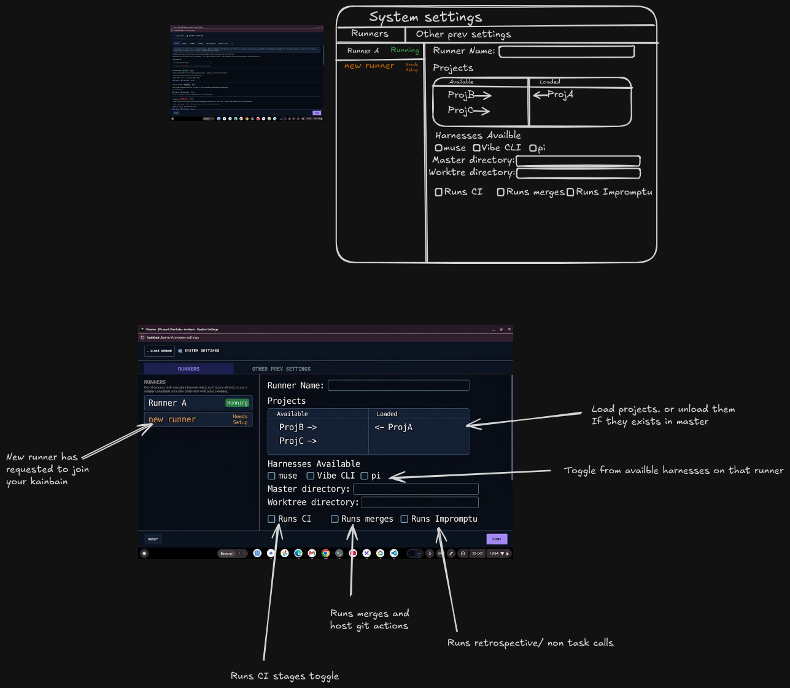

# Goal
# Replace harness tab with detailed runner settings



following this rough design replace all the harness settings(as they dont make sense anymore) to a runner configuration settings . this is all in the general settings tab

# History
- 2026-10-30T00:07:53.975Z: Created and placed in stage 'Idea'
- 2026-10-30T00:07:54.913Z: Created and checked out task branch 'kb/b4b86592-4920-4c7e-86e3-63f004e603d9' from 'main'
- 2026-10-30T00:07:59.668Z: Task details edited
- 2026-10-30T00:08:02.817Z: Task details edited
- 2026-10-30T00:08:40.507Z: Task details edited
- 2026-10-30T00:09:00.078Z: Task details edited
- 2026-10-30T00:09:04.916Z: Task details edited
- 2026-10-30T00:09:09.026Z: Task details edited
- 2026-10-30T00:09:25.068Z: Task details edited
- 2026-10-30T00:09:29.878Z: Stage report generated: ./docs/tasks/b4b86592-4920-4c7e-86e3-63f004e603d9/idea-20261030-000929.md
- 2026-10-30T00:09:29.883Z: Advanced to stage 'Requirement refinement'
- 2026-10-30T00:09:29.937Z: Task-branch ref 'kb/b4b86592-4920-4c7e-86e3-63f004e603d9' already exists — no checkout performed (human checkpoint 'Idea'; leaving 3 uncommitted paths in the tree for the next work stage)
- 2026-10-30T00:09:31.641Z: Runner local-alpha stage stage-1792362077711: started
- 2026-10-30T00:09:33.965Z: Runner local-alpha stage stage-1792362077711: prompted
- 2026-10-30T00:11:00.396Z: Runner local-alpha stage stage-1792362077711: finished
- 2026-10-30T00:11:05.400Z: Runner completed execution 03862b13-bb82-4f0d-be83-64dbf31041e5 (runner local-alpha, epoch 1, sha e67001d6b8f75070a38b4a8d95a020b0227c5d7e (unverified-remote), branch kb/b4b86592-4920-4c7e-86e3-63f004e603d9, posture T0/T1:muse:default). Lease released.
- 2026-10-30T00:11:05.404Z: Agent stage completed: Requirement refinement (via Runner local-alpha)
- 2026-10-30T00:11:05.416Z: Survey requested by the 'question-me' skill (unanswered) — awaiting human answers (via Runner local-alpha)
- 2026-10-30T00:13:57.650Z: Survey completed (answered) — advancing
- 2026-10-30T00:13:57.651Z: Advanced to stage 'Plan'
- 2026-10-30T00:14:00.696Z: Runner local-alpha stage 3: started
- 2026-10-30T00:14:04.346Z: Runner local-alpha stage 3: prompted
- 2026-10-30T00:19:15.131Z: Runner local-alpha stage 3: finished
- 2026-10-30T00:19:19.169Z: Runner completed execution b90dc0e9-073b-4df4-9cda-5725e79e4c03 (runner local-alpha, epoch 2, sha c82c51524132d348ff1ef16e66135ebf54d65e6e (unverified-remote), branch kb/b4b86592-4920-4c7e-86e3-63f004e603d9, posture T0/T1:pi:default). Lease released.
- 2026-10-30T00:19:19.170Z: Agent stage completed: Plan (via Runner local-alpha)
- 2026-10-30T00:19:19.172Z: Advanced to stage 'Check for plan'
- 2026-10-30T00:19:19.197Z: Runner local-alpha stage stage-1792361958910: started
- 2026-10-30T00:19:22.147Z: Runner local-alpha stage stage-1792361958910: prompted
- 2026-10-30T00:19:22.170Z: Runner local-alpha stage stage-1792361958910: finished
- 2026-10-30T00:19:22.186Z: Runner completed execution c78ceba1-dc94-4944-9abd-d7ea5516dbeb (runner local-alpha, epoch 3, sha c82c51524132d348ff1ef16e66135ebf54d65e6e (unverified-remote), branch kb/b4b86592-4920-4c7e-86e3-63f004e603d9, posture T0/T1:pi:default). Lease released.
- 2026-10-30T00:19:22.187Z: Agent stage completed: Check for plan (via Runner local-alpha)
- 2026-10-30T00:19:22.189Z: Advanced to stage 'Risk review'
- 2026-10-30T00:19:22.223Z: Runner local-alpha stage stage-1791738383862: started
- 2026-10-30T00:19:24.901Z: Runner local-alpha stage stage-1791738383862: prompted
- 2026-10-30T00:20:16.776Z: Runner local-alpha stage stage-1791738383862: finished
- 2026-10-30T00:20:21.432Z: Runner completed execution f0139cac-e6c2-467c-93e3-08778273685f (runner local-alpha, epoch 4, sha 62623933ee7b6650da6a367272ce8c767eedea7e (unverified-remote), branch kb/b4b86592-4920-4c7e-86e3-63f004e603d9, posture T0/T1:pi:default). Lease released.
- 2026-10-30T00:20:21.432Z: Agent stage completed: Risk review (via Runner local-alpha)
- 2026-10-30T00:20:21.437Z: Advanced to stage 'Review Plan'
- 2026-10-30T06:46:49.978Z: Stage report generated: ./docs/tasks/b4b86592-4920-4c7e-86e3-63f004e603d9/review-plan-20261030-064649.md
- 2026-10-30T06:46:49.984Z: Advanced to stage 'catchup'
- 2026-10-30T06:46:50.037Z: Task-branch ref 'kb/b4b86592-4920-4c7e-86e3-63f004e603d9' already exists — no checkout performed (human checkpoint 'Review Plan'; leaving 8 uncommitted paths in the tree for the next work stage)
- 2026-10-30T06:46:50.587Z: Runner local-alpha stage stage-1790707081501: started
- 2026-10-30T06:46:53.765Z: Runner local-alpha stage stage-1790707081501: prompted
- 2026-10-30T06:48:46.240Z: Runner local-alpha stage stage-1790707081501: finished
- 2026-10-30T06:48:50.433Z: Runner completed execution 065eabcd-b60b-47cf-8f92-319ded2b18cd (runner local-alpha, epoch 5, sha e335ac2b1956ad8b2a22fce659c4f7970930cd1b (unverified-remote), branch kb/b4b86592-4920-4c7e-86e3-63f004e603d9, posture T0/T1:pi:default). Lease released.
- 2026-10-30T06:48:50.434Z: Agent stage completed: catchup (via Runner local-alpha)
- 2026-10-30T06:48:50.442Z: Advanced to stage 'In Progress'
- 2026-10-30T06:48:50.486Z: Runner local-alpha stage 5: started
- 2026-10-30T06:48:53.528Z: Runner local-alpha stage 5: prompted
- 2026-10-30T07:18:58.626Z: Runner local-alpha stage 5: finished
- 2026-10-30T07:19:02.667Z: Runner completed execution 1b76112a-dbfd-4665-ac2c-7bab4c5e2bc2 (runner local-alpha, epoch 6, sha 118e6131ddf1fd3634e466bad5eea4badc24fb5c (unverified-remote), branch kb/b4b86592-4920-4c7e-86e3-63f004e603d9, posture T0/T1:muse:default). Lease released.
- 2026-10-30T07:19:02.670Z: Agent stage completed: In Progress (via Runner local-alpha)
- 2026-10-30T07:19:02.684Z: Advanced to stage 'Automated tests'
- 2026-10-30T07:19:02.754Z: Runner local-alpha stage stage-1787744699411: started
- 2026-10-30T07:19:05.774Z: Runner local-alpha stage stage-1787744699411: prompted
- 2026-10-30T07:30:37.953Z: Runner local-alpha stage stage-1787744699411: finished
- 2026-10-30T07:30:37.975Z: Runner completed execution 2d3d7ac4-181a-4777-87e5-339eab967f7b (runner local-alpha, epoch 7, sha 118e6131ddf1fd3634e466bad5eea4badc24fb5c (unverified-remote), branch kb/b4b86592-4920-4c7e-86e3-63f004e603d9, posture T0/T1:pi:default). Lease released.
- 2026-10-30T07:30:38.131Z: Auto-committed partial work on 'kb/b4b86592-4920-4c7e-86e3-63f004e603d9' (b744a3f) after failed stage 'Automated tests'
- 2026-10-30T07:30:38.152Z: Warning: push of 'kb/b4b86592-4920-4c7e-86e3-63f004e603d9' after failed stage 'Automated tests' failed (git push -u origin kb/b4b86592-4920-4c7e-86e3-63f004e603d9 failed (exit 128): error: cannot run ssh: No such file or directory
- 2026-10-30T07:30:38.161Z: Stage failed in 'Automated tests': CI command failed with exit code 1
- 2026-10-30T07:30:38.169Z: Stage report generated: ./docs/tasks/b4b86592-4920-4c7e-86e3-63f004e603d9/automated-tests-failure-20261030-073038.md
- 2026-10-30T07:30:38.173Z: Failed back to stage 'In Progress'
- 2026-10-30T07:30:38.231Z: Runner local-alpha stage 5: started
- 2026-10-30T07:30:41.523Z: Runner local-alpha stage 5: prompted
- 2026-10-30T07:30:57.392Z: Runner local-alpha stage 5: finished
- 2026-10-30T07:31:01.393Z: Runner completed execution aefe4872-8b3d-4301-bd85-7b7215682c72 (runner local-alpha, epoch 8, sha 22ba30f38565f273c9ae86f1440f7ac9f3ebd255 (unverified-remote), branch kb/b4b86592-4920-4c7e-86e3-63f004e603d9, posture T0/T1:pi:default). Lease released.
- 2026-10-30T07:31:01.394Z: Agent stage completed: In Progress (via Runner local-alpha)
- 2026-10-30T07:31:01.399Z: Advanced to stage 'Automated tests'
- 2026-10-30T07:31:01.437Z: Runner local-alpha stage stage-1787744699411: started
- 2026-10-30T07:31:04.569Z: Runner local-alpha stage stage-1787744699411: prompted
- 2026-10-30T07:44:03.653Z: Runner local-alpha stage stage-1787744699411: finished
- 2026-10-30T07:44:03.678Z: Runner completed execution e4f2bfe9-2179-493b-819a-6cfa4f7e70f9 (runner local-alpha, epoch 9, sha 22ba30f38565f273c9ae86f1440f7ac9f3ebd255 (unverified-remote), branch kb/b4b86592-4920-4c7e-86e3-63f004e603d9, posture T0/T1:pi:default). Lease released.
- 2026-10-30T07:44:03.767Z: Auto-committed partial work on 'kb/b4b86592-4920-4c7e-86e3-63f004e603d9' (e4a4f77) after failed stage 'Automated tests'
- 2026-10-30T07:44:03.783Z: Warning: push of 'kb/b4b86592-4920-4c7e-86e3-63f004e603d9' after failed stage 'Automated tests' failed (git push -u origin kb/b4b86592-4920-4c7e-86e3-63f004e603d9 failed (exit 128): error: cannot run ssh: No such file or directory
- 2026-10-30T07:44:03.786Z: Stage failed in 'Automated tests': CI command failed with exit code 1
- 2026-10-30T07:44:03.791Z: Stage report generated: ./docs/tasks/b4b86592-4920-4c7e-86e3-63f004e603d9/automated-tests-failure-20261030-074403.md
- 2026-10-30T07:44:03.795Z: Failed back to stage 'In Progress'
- 2026-10-30T07:44:03.886Z: Runner local-alpha stage 5: started
- 2026-10-30T07:44:06.864Z: Runner local-alpha stage 5: prompted
- 2026-10-30T07:51:25.959Z: Runner local-alpha stage 5: finished
- 2026-10-30T07:51:30.662Z: Runner completed execution 149fa9e8-0591-470e-8e96-212316d95b52 (runner local-alpha, epoch 10, sha cb8b0a17a053dcf986d94d4e62a1884751b6fddc (unverified-remote), branch kb/b4b86592-4920-4c7e-86e3-63f004e603d9, posture T0/T1:pi:default). Lease released.
- 2026-10-30T07:51:30.665Z: Agent stage completed: In Progress (via Runner local-alpha)
- 2026-10-30T07:51:30.684Z: Advanced to stage 'Automated tests'
- 2026-10-30T07:51:30.730Z: Runner local-alpha stage stage-1787744699411: started
- 2026-10-30T07:51:33.825Z: Runner local-alpha stage stage-1787744699411: prompted
- 2026-10-30T08:02:39.888Z: Runner local-alpha stage stage-1787744699411: finished
- 2026-10-30T08:02:39.910Z: Runner completed execution 35cd5355-d902-4b97-b864-5535bbb31e4d (runner local-alpha, epoch 11, sha cb8b0a17a053dcf986d94d4e62a1884751b6fddc (unverified-remote), branch kb/b4b86592-4920-4c7e-86e3-63f004e603d9, posture T0/T1:pi:default). Lease released.
- 2026-10-30T08:02:39.984Z: Auto-committed partial work on 'kb/b4b86592-4920-4c7e-86e3-63f004e603d9' (5a6d06e) after failed stage 'Automated tests'
- 2026-10-30T08:02:39.997Z: Warning: push of 'kb/b4b86592-4920-4c7e-86e3-63f004e603d9' after failed stage 'Automated tests' failed (git push -u origin kb/b4b86592-4920-4c7e-86e3-63f004e603d9 failed (exit 128): error: cannot run ssh: No such file or directory
- 2026-10-30T08:02:39.998Z: Stage failed in 'Automated tests': CI command failed with exit code 1
- 2026-10-30T08:02:40.003Z: Stage report generated: ./docs/tasks/b4b86592-4920-4c7e-86e3-63f004e603d9/automated-tests-failure-20261030-080240.md
- 2026-10-30T08:02:40.006Z: Failed back to stage 'In Progress'
- 2026-10-30T08:02:40.057Z: Runner local-alpha stage 5: started
- 2026-10-30T08:02:43.057Z: Runner local-alpha stage 5: prompted
- 2026-10-30T08:17:31.767Z: Runner local-alpha stage 5: finished
- 2026-10-30T08:17:35.649Z: Runner completed execution 8d9d304d-bcaf-4440-a8f9-700eb6826403 (runner local-alpha, epoch 12, sha 1e8b0fd4f86a9566e4b6b58d0bd9a1c5b0d00b52 (unverified-remote), branch kb/b4b86592-4920-4c7e-86e3-63f004e603d9, posture T0/T1:muse:default). Lease released.
- 2026-10-30T08:17:35.650Z: Agent stage completed: In Progress (via Runner local-alpha)
- 2026-10-30T08:17:35.657Z: Advanced to stage 'Automated tests'
- 2026-10-30T08:17:35.711Z: Runner local-alpha stage stage-1787744699411: started
- 2026-10-30T08:17:38.823Z: Runner local-alpha stage stage-1787744699411: prompted
- 2026-10-30T08:27:16.596Z: Runner local-alpha stage stage-1787744699411: finished
- 2026-10-30T08:27:16.619Z: Runner completed execution 019e36c3-9e45-4f41-afe5-0c84d6a8496e (runner local-alpha, epoch 13, sha 1e8b0fd4f86a9566e4b6b58d0bd9a1c5b0d00b52 (unverified-remote), branch kb/b4b86592-4920-4c7e-86e3-63f004e603d9, posture T0/T1:pi:default). Lease released.
- 2026-10-30T08:27:16.691Z: Auto-committed partial work on 'kb/b4b86592-4920-4c7e-86e3-63f004e603d9' (5b9241a) after failed stage 'Automated tests'
- 2026-10-30T08:27:16.703Z: Warning: push of 'kb/b4b86592-4920-4c7e-86e3-63f004e603d9' after failed stage 'Automated tests' failed (git push -u origin kb/b4b86592-4920-4c7e-86e3-63f004e603d9 failed (exit 128): error: cannot run ssh: No such file or directory
- 2026-10-30T08:27:16.706Z: Stage failed in 'Automated tests': CI command failed with exit code 1
- 2026-10-30T08:27:16.710Z: Stage report generated: ./docs/tasks/b4b86592-4920-4c7e-86e3-63f004e603d9/automated-tests-failure-20261030-082716.md
- 2026-10-30T08:27:16.713Z: Failed back to stage 'In Progress'
- 2026-10-30T08:27:16.766Z: Runner local-alpha stage 5: started
- 2026-10-30T08:27:19.940Z: Runner local-alpha stage 5: prompted
- 2026-10-30T08:56:16.282Z: Moved to stage 'Review Plan'
- 2026-10-30T08:56:16.942Z: Auto-committed partial work on 'kb/b4b86592-4920-4c7e-86e3-63f004e603d9' (b88861d) after failed stage 'Review Plan'
- 2026-10-30T08:56:16.958Z: Warning: push of 'kb/b4b86592-4920-4c7e-86e3-63f004e603d9' after failed stage 'Review Plan' failed (git push -u origin kb/b4b86592-4920-4c7e-86e3-63f004e603d9 failed (exit 128): error: cannot run ssh: No such file or directory
- 2026-10-30T08:56:16.960Z: Transient infrastructure error in 'Review Plan' (attempt 1/5, budget 5 from global config, next delay 2577ms, signal timeout): Stage timed out after 1740034ms (budget 300000ms) on stage 'Review Plan'. — retrying same stage
- 2026-10-30T09:11:10.962Z: Moved to stage 'Automated tests'
- 2026-10-30T09:11:15.707Z: Runner local-alpha stage stage-1787744699411: started
- 2026-10-30T09:11:20.129Z: Runner local-alpha stage stage-1787744699411: prompted
- 2026-10-30T09:22:29.769Z: Runner local-alpha stage stage-1787744699411: finished
- 2026-10-30T09:22:29.780Z: Runner completed execution 21bf8a96-a835-4fc1-9670-9de18a206ef8 (runner local-alpha, epoch 15, sha 1b537d1b97c22054e63a5ea38d3bd22c219e9cc7 (unverified-remote), branch kb/b4b86592-4920-4c7e-86e3-63f004e603d9, posture T0/T1:pi:default). Lease released.
- 2026-10-30T09:22:29.856Z: Auto-committed partial work on 'kb/b4b86592-4920-4c7e-86e3-63f004e603d9' (68e0bfa) after failed stage 'Automated tests'
- 2026-10-30T09:22:29.869Z: Warning: push of 'kb/b4b86592-4920-4c7e-86e3-63f004e603d9' after failed stage 'Automated tests' failed (git push -u origin kb/b4b86592-4920-4c7e-86e3-63f004e603d9 failed (exit 128): error: cannot run ssh: No such file or directory
- 2026-10-30T09:22:29.870Z: Stage failed in 'Automated tests': CI command failed with exit code 1
- 2026-10-30T09:22:29.875Z: Stage report generated: ./docs/tasks/b4b86592-4920-4c7e-86e3-63f004e603d9/automated-tests-failure-20261030-092229.md
- 2026-10-30T09:22:29.879Z: Failed back to stage 'In Progress'
- 2026-10-30T09:22:29.932Z: Runner local-alpha stage 5: started
- 2026-10-30T09:22:33.680Z: Runner local-alpha stage 5: prompted
- 2026-10-30T09:35:54.657Z: Runner local-alpha stage 5: finished
- 2026-10-30T09:35:58.989Z: Runner completed execution 80773104-6b2e-4b96-9219-51ee088339e0 (runner local-alpha, epoch 16, sha 779768b09e1e318f6b0b319157c32b28da48c450 (unverified-remote), branch kb/b4b86592-4920-4c7e-86e3-63f004e603d9, posture T0/T1:muse:default). Lease released.
- 2026-10-30T09:35:58.991Z: Agent stage completed: In Progress (via Runner local-alpha)
- 2026-10-30T09:35:59.003Z: Advanced to stage 'Automated tests'
- 2026-10-30T09:35:59.047Z: Runner local-alpha stage stage-1787744699411: started
- 2026-11-03T13:45:53.807Z: Runner server2-alpha stage stage-1787744699411: started
- 2026-11-03T13:45:59.252Z: Runner server2-alpha stage stage-1787744699411: prompted
- 2026-11-03T14:04:38.098Z: Runner server2-alpha stage stage-1787744699411: finished
- 2026-11-03T14:04:39.136Z: Runner completed execution 315c76bf-55ca-49d9-9b0b-8ef95d1e26d2 (runner server2-alpha, epoch 113, sha 856df55de3ca6fc57fc5a780ff57a7682e7f3112 (unverified-remote), branch kb/b4b86592-4920-4c7e-86e3-63f004e603d9, posture T0/T1:muse). Lease released.
- 2026-11-03T14:04:39.171Z: Warning: failed-stage auto-commit after 'Automated tests' skipped (Refusing to commit on the wrong branch: expected 'kb/b4b86592-4920-4c7e-86e3-63f004e603d9' but the working tree is on 'main'. A concurrent task likely moved HEAD; re-run the stage so it can re-establish its branch.)
- 2026-11-03T14:04:39.177Z: Stage failed in 'Automated tests': CI command failed with exit code 1
- 2026-11-03T14:04:39.186Z: Stage report generated: ./docs/tasks/b4b86592-4920-4c7e-86e3-63f004e603d9/automated-tests-failure-20261103-140439.md
- 2026-11-03T14:04:39.191Z: Failed back to stage 'In Progress'
- 2026-11-03T15:29:40.817Z: Completed

# Timeline
- 2026-10-30T00:09:29.883Z: Requirement refinement | Advanced | 95.907s
- 2026-10-30T00:13:57.651Z: Plan | Advanced | 267.768s
- 2026-10-30T00:19:19.172Z: Check for plan | Advanced | 321.521s
- 2026-10-30T00:19:22.189Z: Risk review | Advanced | 3.017s
- 2026-10-30T00:20:21.437Z: Review Plan | Advanced | 59.247s
- 2026-10-30T06:46:49.984Z: catchup | Advanced | 23188.547s
- 2026-10-30T06:48:50.442Z: In Progress | Advanced | 120.458s
- 2026-10-30T07:19:02.684Z: Automated tests | Advanced | 1812.242s
- 2026-10-30T07:30:38.166Z: Automated tests | Failed | 695.482s | +624 -7
- 2026-10-30T07:30:38.173Z: In Progress | Moved | 695.489s | +0 -0
- 2026-10-30T07:31:01.399Z: Automated tests | Advanced | 23.226s | +0 -0
- 2026-10-30T07:44:03.789Z: Automated tests | Failed | 782.39s | +355 -0
- 2026-10-30T07:44:03.795Z: In Progress | Moved | 782.396s | +0 -0
- 2026-10-30T07:51:30.684Z: Automated tests | Advanced | 446.889s | +0 -0
- 2026-10-30T08:02:40.002Z: Automated tests | Failed | 669.318s | +351 -0
- 2026-10-30T08:02:40.006Z: In Progress | Moved | 669.322s | +0 -0
- 2026-10-30T08:17:35.657Z: Automated tests | Advanced | 895.651s | +0 -0
- 2026-10-30T08:27:16.709Z: Automated tests | Failed | 581.052s | +346 -0
- 2026-10-30T08:27:16.713Z: In Progress | Moved | 581.056s | +0 -0
- 2026-10-30T08:56:16.282Z: Review Plan | Moved | 1739.569s | +0 -0
- 2026-10-30T08:56:16.960Z: Review Plan | Retrying | 0.678s | +4711 -2021
- 2026-10-30T09:11:10.962Z: Automated tests | Moved | 894.68s | +0 -0
- 2026-10-30T09:22:29.874Z: Automated tests | Failed | 678.912s | +7 -0
- 2026-10-30T09:22:29.879Z: In Progress | Moved | 678.917s | +0 -0
- 2026-10-30T09:35:59.003Z: Automated tests | Advanced | 809.124s | +0 -0
- 2026-11-03T14:04:39.182Z: Automated tests | Failed | 361720.178s | +0 -0
- 2026-11-03T14:04:39.191Z: In Progress | Moved | 361720.188s | +0 -0
- 2026-11-03T15:29:40.817Z: In Progress | Completed | 5101.626s | +0 -0

# Log Entries
```json
[{"id":"log-8127","ts":"2026-10-30T07:44:03.796Z","feed":"main","feeds":["main"],"kind":"system","turn":null,"text":"[INFO] (900 earlier log entries evicted)","meta":{"evictedCount":900}},{"id":"log-8527","ts":"2026-10-30T08:19:48.378Z","feed":"main","feeds":["main"],"kind":"runner","turn":null,"text":"[runner local-alpha]   }","meta":{"source":"process-log","runnerId":"local-alpha","executionId":"019e36c3-9e45-4f41-afe5-0c84d6a8496e","seq":148}},{"id":"log-8528","ts":"2026-10-30T08:19:48.381Z","feed":"main","feeds":["main"],"kind":"runner","turn":null,"text":"[runner local-alpha] ----------------------------------------------------------------------","meta":{"source":"process-log","runnerId":"local-alpha","executionId":"019e36c3-9e45-4f41-afe5-0c84d6a8496e","seq":149}},{"id":"log-8529","ts":"2026-10-30T08:19:48.385Z","feed":"main","feeds":["main"],"kind":"runner","turn":null,"text":"[runner local-alpha] Running Container Tests... \u001b[0;32mPASS\u001b[0m (128s)","meta":{"source":"process-log","runnerId":"local-alpha","executionId":"019e36c3-9e45-4f41-afe5-0c84d6a8496e","seq":150}},{"id":"log-8530","ts":"2026-10-30T08:19:48.388Z","feed":"main","feeds":["main"],"kind":"runner","turn":null,"text":"[runner local-alpha] Fast gate complete — starting Canary Tests alone (serial phase, no shared CPUs with the unit suites)...","meta":{"source":"process-log","runnerId":"local-alpha","executionId":"019e36c3-9e45-4f41-afe5-0c84d6a8496e","seq":151}},{"id":"log-8531","ts":"2026-10-30T08:20:18.034Z","feed":"main","feeds":["main"],"kind":"runner","turn":null,"text":"[runner local-alpha] ⏳ still running: Canary Tests (30s)","meta":{"source":"process-log","runnerId":"local-alpha","executionId":"019e36c3-9e45-4f41-afe5-0c84d6a8496e","seq":152}},{"id":"log-8532","ts":"2026-10-30T08:20:48.037Z","feed":"main","feeds":["main"],"kind":"runner","turn":null,"text":"[runner local-alpha] ⏳ still running: Canary Tests (1m00s)","meta":{"source":"process-log","runnerId":"local-alpha","executionId":"019e36c3-9e45-4f41-afe5-0c84d6a8496e","seq":153}},{"id":"log-8533","ts":"2026-10-30T08:21:18.037Z","feed":"main","feeds":["main"],"kind":"runner","turn":null,"text":"[runner local-alpha] ⏳ still running: Canary Tests (1m30s)","meta":{"source":"process-log","runnerId":"local-alpha","executionId":"019e36c3-9e45-4f41-afe5-0c84d6a8496e","seq":154}},{"id":"log-8534","ts":"2026-10-30T08:21:48.047Z","feed":"main","feeds":["main"],"kind":"runner","turn":null,"text":"[runner local-alpha] ⏳ still running: Canary Tests (2m00s)","meta":{"source":"process-log","runnerId":"local-alpha","executionId":"019e36c3-9e45-4f41-afe5-0c84d6a8496e","seq":155}},{"id":"log-8535","ts":"2026-10-30T08:22:18.046Z","feed":"main","feeds":["main"],"kind":"runner","turn":null,"text":"[runner local-alpha] ⏳ still running: Canary Tests (2m30s)","meta":{"source":"process-log","runnerId":"local-alpha","executionId":"019e36c3-9e45-4f41-afe5-0c84d6a8496e","seq":156}},{"id":"log-8536","ts":"2026-10-30T08:22:48.047Z","feed":"main","feeds":["main"],"kind":"runner","turn":null,"text":"[runner local-alpha] ⏳ still running: Canary Tests (3m00s)","meta":{"source":"process-log","runnerId":"local-alpha","executionId":"019e36c3-9e45-4f41-afe5-0c84d6a8496e","seq":157}},{"id":"log-8537","ts":"2026-10-30T08:23:18.047Z","feed":"main","feeds":["main"],"kind":"runner","turn":null,"text":"[runner local-alpha] ⏳ still running: Canary Tests (3m30s)","meta":{"source":"process-log","runnerId":"local-alpha","executionId":"019e36c3-9e45-4f41-afe5-0c84d6a8496e","seq":158}},{"id":"log-8538","ts":"2026-10-30T08:23:48.049Z","feed":"main","feeds":["main"],"kind":"runner","turn":null,"text":"[runner local-alpha] ⏳ still running: Canary Tests (4m00s)","meta":{"source":"process-log","runnerId":"local-alpha","executionId":"019e36c3-9e45-4f41-afe5-0c84d6a8496e","seq":159}},{"id":"log-8539","ts":"2026-10-30T08:24:18.052Z","feed":"main","feeds":["main"],"kind":"runner","turn":null,"text":"[runner local-alpha] ⏳ still running: Canary Tests (4m30s)","meta":{"source":"process-log","runnerId":"local-alpha","executionId":"019e36c3-9e45-4f41-afe5-0c84d6a8496e","seq":160}},{"id":"log-8540","ts":"2026-10-30T08:24:48.052Z","feed":"main","feeds":["main"],"kind":"runner","turn":null,"text":"[runner local-alpha] ⏳ still running: Canary Tests (5m00s)","meta":{"source":"process-log","runnerId":"local-alpha","executionId":"019e36c3-9e45-4f41-afe5-0c84d6a8496e","seq":161}},{"id":"log-8541","ts":"2026-10-30T08:25:18.054Z","feed":"main","feeds":["main"],"kind":"runner","turn":null,"text":"[runner local-alpha] ⏳ still running: Canary Tests (5m30s)","meta":{"source":"process-log","runnerId":"local-alpha","executionId":"019e36c3-9e45-4f41-afe5-0c84d6a8496e","seq":162}},{"id":"log-8542","ts":"2026-10-30T08:25:48.056Z","feed":"main","feeds":["main"],"kind":"runner","turn":null,"text":"[runner local-alpha] ⏳ still running: Canary Tests (6m00s)","meta":{"source":"process-log","runnerId":"local-alpha","executionId":"019e36c3-9e45-4f41-afe5-0c84d6a8496e","seq":163}},{"id":"log-8543","ts":"2026-10-30T08:26:18.057Z","feed":"main","feeds":["main"],"kind":"runner","turn":null,"text":"[runner local-alpha] ⏳ still running: Canary Tests (6m30s)","meta":{"source":"process-log","runnerId":"local-alpha","executionId":"019e36c3-9e45-4f41-afe5-0c84d6a8496e","seq":164}},{"id":"log-8544","ts":"2026-10-30T08:26:48.060Z","feed":"main","feeds":["main"],"kind":"runner","turn":null,"text":"[runner local-alpha] ⏳ still running: Canary Tests (7m00s)","meta":{"source":"process-log","runnerId":"local-alpha","executionId":"019e36c3-9e45-4f41-afe5-0c84d6a8496e","seq":165}},{"id":"log-8545","ts":"2026-10-30T08:27:16.580Z","feed":"main","feeds":["main"],"kind":"runner","turn":null,"text":"[runner local-alpha] Running Canary Tests... \u001b[0;31mFAIL\u001b[0m (449s)","meta":{"source":"process-log","runnerId":"local-alpha","executionId":"019e36c3-9e45-4f41-afe5-0c84d6a8496e","seq":166}},{"id":"log-8546","ts":"2026-10-30T08:27:16.582Z","feed":"main","feeds":["main"],"kind":"runner","turn":null,"text":"[runner local-alpha] (trimmed 92 of 212 lines; showing the tail)","meta":{"source":"process-log","runnerId":"local-alpha","executionId":"019e36c3-9e45-4f41-afe5-0c84d6a8496e","seq":167}},{"id":"log-8547","ts":"2026-10-30T08:27:16.584Z","feed":"main","feeds":["main"],"kind":"runner","turn":null,"text":"[runner local-alpha] ----------------------------------------------------------------------","meta":{"source":"process-log","runnerId":"local-alpha","executionId":"019e36c3-9e45-4f41-afe5-0c84d6a8496e","seq":168}},{"id":"log-8548","ts":"2026-10-30T08:27:16.586Z","feed":"main","feeds":["main"],"kind":"runner","turn":null,"text":"[runner local-alpha]   ✓   72 tests/pr-review.spec.js:349:6 › PR Review E2E › review page shows the branch-unsupported empty state when branch support is off (A10, D7) (1.7s)","meta":{"source":"process-log","runnerId":"local-alpha","executionId":"019e36c3-9e45-4f41-afe5-0c84d6a8496e","seq":169}},{"id":"log-8549","ts":"2026-10-30T08:27:16.587Z","feed":"main","feeds":["main"],"kind":"runner","turn":null,"text":"[runner local-alpha] Details for Canary Tests:","meta":{"source":"process-log","runnerId":"local-alpha","executionId":"019e36c3-9e45-4f41-afe5-0c84d6a8496e","seq":170}},{"id":"log-8550","ts":"2026-10-30T08:27:16.589Z","feed":"main","feeds":["main"],"kind":"runner","turn":null,"text":"[runner local-alpha]   ✓   73 tests/pr-review.spec.js:391:6 › PR Review E2E › reports tab enables line-by-line review of stage reports outside git diff (2.1s)","meta":{"source":"process-log","runnerId":"local-alpha","executionId":"019e36c3-9e45-4f41-afe5-0c84d6a8496e","seq":171}},{"id":"log-8551","ts":"2026-10-30T08:27:16.592Z","feed":"main","feeds":["main"],"kind":"runner","turn":null,"text":"[runner local-alpha]   ✓   74 tests/pr-review.spec.js:487:6 › PR Review E2E › reports tab is usable at a mobile viewport without horizontal overflow (1.7s)","meta":{"source":"process-log","runnerId":"local-alpha","executionId":"019e36c3-9e45-4f41-afe5-0c84d6a8496e","seq":172}},{"id":"log-8552","ts":"2026-10-30T08:27:16.596Z","feed":"main","feeds":["main"],"kind":"runner","turn":null,"text":"[runner local-alpha] CATALOGUE pi=null agy=[\"low\",\"medium\",\"high\"] mock=[\"low\",\"medium\",\"high\"] muse=null","meta":{"source":"process-log","runnerId":"local-alpha","executionId":"019e36c3-9e45-4f41-afe5-0c84d6a8496e","seq":173}},{"id":"log-8553","ts":"2026-10-30T08:27:16.614Z","feed":"main","feeds":["main"],"kind":"runner","turn":null,"text":"[runner local-alpha] CATALOGUE COUNTS pi=0 agy=13 mock=1","meta":{"source":"process-log","runnerId":"local-alpha","executionId":"019e36c3-9e45-4f41-afe5-0c84d6a8496e","seq":174}},{"id":"log-8554","ts":"2026-10-30T08:27:16.691Z","feed":"main","feeds":["main"],"kind":"system","turn":null,"text":"[GIT] Auto-committed partial work on 'kb/b4b86592-4920-4c7e-86e3-63f004e603d9' after failed stage 'Automated tests'","meta":{"source":"process-log"}},{"id":"log-8555","ts":"2026-10-30T08:27:16.706Z","feed":"main","feeds":["main"],"kind":"error","turn":null,"text":"[ERROR] CI command failed with exit code 1","meta":{"source":"process-log"}},{"id":"log-8556","ts":"2026-10-30T08:27:16.713Z","feed":"main","feeds":["main"],"kind":"system","turn":null,"text":"[INFO] Failed back from stage 'Automated tests' to stage 'In Progress'","meta":{"source":"process-log"}},{"id":"log-8557","ts":"2026-10-30T08:27:29.126Z","feed":"main","feeds":["main"],"kind":"runner","turn":null,"text":"[runner local-alpha] I'll start by reading the implementation plan and related","meta":{"source":"process-log","runnerId":"local-alpha","executionId":"581608bf-2772-49fd-9050-bcdd26bc8137","seq":0}},{"id":"log-8558","ts":"2026-10-30T08:27:29.205Z","feed":"main","feeds":["main"],"kind":"runner","turn":null,"text":"[runner local-alpha]  task docs.","meta":{"source":"process-log","runnerId":"local-alpha","executionId":"581608bf-2772-49fd-9050-bcdd26bc8137","seq":1}},{"id":"log-8559","ts":"2026-10-30T08:27:31.837Z","feed":"main","feeds":["main"],"kind":"runner","turn":null,"text":"[runner local-alpha] Let me check the previous failure reports and explore the repo structure.","meta":{"source":"process-log","runnerId":"local-alpha","executionId":"581608bf-2772-49fd-9050-bcdd26bc8137","seq":2}},{"id":"log-8560","ts":"2026-10-30T08:27:44.069Z","feed":"main","feeds":["main"],"kind":"runner","turn":null,"text":"[runner local-alpha] The branch already contains prior implementation work. Let me see the full diff vs","meta":{"source":"process-log","runnerId":"local-alpha","executionId":"581608bf-2772-49fd-9050-bcdd26bc8137","seq":3}},{"id":"log-8561","ts":"2026-10-30T08:27:44.102Z","feed":"main","feeds":["main"],"kind":"runner","turn":null,"text":"[runner local-alpha]  main and check what state","meta":{"source":"process-log","runnerId":"local-alpha","executionId":"581608bf-2772-49fd-9050-bcdd26bc8137","seq":4}},{"id":"log-8562","ts":"2026-10-30T08:27:44.475Z","feed":"main","feeds":["main"],"kind":"runner","turn":null,"text":"[runner local-alpha]  things are in","meta":{"source":"process-log","runnerId":"local-alpha","executionId":"581608bf-2772-49fd-9050-bcdd26bc8137","seq":5}},{"id":"log-8563","ts":"2026-10-30T08:27:44.922Z","feed":"main","feeds":["main"],"kind":"runner","turn":null,"text":"[runner local-alpha] .","meta":{"source":"process-log","runnerId":"local-alpha","executionId":"581608bf-2772-49fd-9050-bcdd26bc8137","seq":6}},{"id":"log-8564","ts":"2026-10-30T08:28:51.289Z","feed":"main","feeds":["main"],"kind":"runner","turn":null,"text":"[runner local-alpha] The deploy","meta":{"source":"process-log","runnerId":"local-alpha","executionId":"581608bf-2772-49fd-9050-bcdd26bc8137","seq":7}},{"id":"log-8565","ts":"2026-10-30T08:28:51.365Z","feed":"main","feeds":["main"],"kind":"runner","turn":null,"text":"[runner local-alpha] -reexec tests pass standalone — the CI failure may be environmental","meta":{"source":"process-log","runnerId":"local-alpha","executionId":"581608bf-2772-49fd-9050-bcdd26bc8137","seq":8}},{"id":"log-8566","ts":"2026-10-30T08:28:51.442Z","feed":"main","feeds":["main"],"kind":"runner","turn":null,"text":"[runner local-alpha] . Let me check what \"Harness Self-Tests\" runs and then","meta":{"source":"process-log","runnerId":"local-alpha","executionId":"581608bf-2772-49fd-9050-bcdd26bc8137","seq":9}},{"id":"log-8567","ts":"2026-10-30T08:28:51.519Z","feed":"main","feeds":["main"],"kind":"runner","turn":null,"text":"[runner local-alpha]  run the full test suites.","meta":{"source":"process-log","runnerId":"local-alpha","executionId":"581608bf-2772-49fd-9050-bcdd26bc8137","seq":10}},{"id":"log-8568","ts":"2026-10-30T08:29:43.960Z","feed":"main","feeds":["main"],"kind":"runner","turn":null,"text":"[runner local-alpha] All","meta":{"source":"process-log","runnerId":"local-alpha","executionId":"581608bf-2772-49fd-9050-bcdd26bc8137","seq":11}},{"id":"log-8569","ts":"2026-10-30T08:29:43.963Z","feed":"main","feeds":["main"],"kind":"runner","turn":null,"text":"[runner local-alpha] 312 harness self-tests pass locally — the CI failure isn't reproducing here. Now let me verify the actual feature implementation: frontend settings","meta":{"source":"process-log","runnerId":"local-alpha","executionId":"581608bf-2772-49fd-9050-bcdd26bc8137","seq":12}},{"id":"log-8570","ts":"2026-10-30T08:29:44.035Z","feed":"main","feeds":["main"],"kind":"runner","turn":null,"text":"[runner local-alpha]  tests, API runner tests, and lint.","meta":{"source":"process-log","runnerId":"local-alpha","executionId":"581608bf-2772-49fd-9050-bcdd26bc8137","seq":13}},{"id":"log-8571","ts":"2026-10-30T08:29:52.283Z","feed":"main","feeds":["main"],"kind":"runner","turn":null,"text":"[runner local-alpha] The tab surface is already replaced. Let me view the design image and","meta":{"source":"process-log","runnerId":"local-alpha","executionId":"581608bf-2772-49fd-9050-bcdd26bc8137","seq":14}},{"id":"log-8572","ts":"2026-10-30T08:29:52.569Z","feed":"main","feeds":["main"],"kind":"runner","turn":null,"text":"[runner local-alpha]  review the new Runner","meta":{"source":"process-log","runnerId":"local-alpha","executionId":"581608bf-2772-49fd-9050-bcdd26bc8137","seq":15}},{"id":"log-8573","ts":"2026-10-30T08:29:52.581Z","feed":"main","feeds":["main"],"kind":"runner","turn":null,"text":"[runner local-alpha] ConfigurationSection against it.","meta":{"source":"process-log","runnerId":"local-alpha","executionId":"581608bf-2772-49fd-9050-bcdd26bc8137","seq":16}},{"id":"log-8574","ts":"2026-10-30T08:29:57.741Z","feed":"main","feeds":["main"],"kind":"runner","turn":null,"text":"[runner local-alpha] The UI implementation looks complete. Now let me review","meta":{"source":"process-log","runnerId":"local-alpha","executionId":"581608bf-2772-49fd-9050-bcdd26bc8137","seq":17}},{"id":"log-8575","ts":"2026-10-30T08:29:57.827Z","feed":"main","feeds":["main"],"kind":"runner","turn":null,"text":"[runner local-alpha]  the backend pieces and helpers.","meta":{"source":"process-log","runnerId":"local-alpha","executionId":"581608bf-2772-49fd-9050-bcdd26bc8137","seq":18}},{"id":"log-8576","ts":"2026-10-30T08:30:01.022Z","feed":"main","feeds":["main"],"kind":"runner","turn":null,"text":"[runner local-alpha] Implementation","meta":{"source":"process-log","runnerId":"local-alpha","executionId":"581608bf-2772-49fd-9050-bcdd26bc8137","seq":19}},{"id":"log-8577","ts":"2026-10-30T08:30:01.244Z","feed":"main","feeds":["main"],"kind":"runner","turn":null,"text":"[runner local-alpha]  looks complete. Now","meta":{"source":"process-log","runnerId":"local-alpha","executionId":"581608bf-2772-49fd-9050-bcdd26bc8137","seq":20}},{"id":"log-8578","ts":"2026-10-30T08:30:01.252Z","feed":"main","feeds":["main"],"kind":"runner","turn":null,"text":"[runner local-alpha]  running the targeted","meta":{"source":"process-log","runnerId":"local-alpha","executionId":"581608bf-2772-49fd-9050-bcdd26bc8137","seq":21}},{"id":"log-8579","ts":"2026-10-30T08:30:01.325Z","feed":"main","feeds":["main"],"kind":"runner","turn":null,"text":"[runner local-alpha]  test suites.","meta":{"source":"process-log","runnerId":"local-alpha","executionId":"581608bf-2772-49fd-9050-bcdd26bc8137","seq":22}},{"id":"log-8580","ts":"2026-10-30T08:30:14.221Z","feed":"main","feeds":["main"],"kind":"runner","turn":null,"text":"[runner local-alpha] Targeted tests pass. Now the full unit suites and","meta":{"source":"process-log","runnerId":"local-alpha","executionId":"581608bf-2772-49fd-9050-bcdd26bc8137","seq":23}},{"id":"log-8581","ts":"2026-10-30T08:30:14.294Z","feed":"main","feeds":["main"],"kind":"runner","turn":null,"text":"[runner local-alpha]  lint.","meta":{"source":"process-log","runnerId":"local-alpha","executionId":"581608bf-2772-49fd-9050-bcdd26bc8137","seq":24}},{"id":"log-8582","ts":"2026-10-30T08:32:17.383Z","feed":"main","feeds":["main"],"kind":"runner","turn":null,"text":"[runner local-alpha] All unit tests pass (api: 5939, frontend: 3838). Now lint and build.","meta":{"source":"process-log","runnerId":"local-alpha","executionId":"581608bf-2772-49fd-9050-bcdd26bc8137","seq":25}},{"id":"log-8583","ts":"2026-10-30T08:32:31.232Z","feed":"main","feeds":["main"],"kind":"runner","turn":null,"text":"[runner local-alpha] Remaining \"","meta":{"source":"process-log","runnerId":"local-alpha","executionId":"581608bf-2772-49fd-9050-bcdd26bc8137","seq":26}},{"id":"log-8584","ts":"2026-10-30T08:32:31.235Z","feed":"main","feeds":["main"],"kind":"runner","turn":null,"text":"[runner local-alpha] harness\" references","meta":{"source":"process-log","runnerId":"local-alpha","executionId":"581608bf-2772-49fd-9050-bcdd26bc8137","seq":27}},{"id":"log-8585","ts":"2026-10-30T08:32:31.305Z","feed":"main","feeds":["main"],"kind":"runner","turn":null,"text":"[runner local-alpha]  are the unrelated model","meta":{"source":"process-log","runnerId":"local-alpha","executionId":"581608bf-2772-49fd-9050-bcdd26bc8137","seq":28}},{"id":"log-8586","ts":"2026-10-30T08:32:31.381Z","feed":"main","feeds":["main"],"kind":"runner","turn":null,"text":"[runner local-alpha] -catalogue probes (out of scope per plan non","meta":{"source":"process-log","runnerId":"local-alpha","executionId":"581608bf-2772-49fd-9050-bcdd26bc8137","seq":29}},{"id":"log-8587","ts":"2026-10-30T08:32:31.451Z","feed":"main","feeds":["main"],"kind":"runner","turn":null,"text":"[runner local-alpha] -goals). Let me check","meta":{"source":"process-log","runnerId":"local-alpha","executionId":"581608bf-2772-49fd-9050-bcdd26bc8137","seq":30}},{"id":"log-8588","ts":"2026-10-30T08:32:31.527Z","feed":"main","feeds":["main"],"kind":"runner","turn":null,"text":"[runner local-alpha]  the registry diff and run the frontend build plus canary pre","meta":{"source":"process-log","runnerId":"local-alpha","executionId":"581608bf-2772-49fd-9050-bcdd26bc8137","seq":31}},{"id":"log-8589","ts":"2026-10-30T08:32:31.609Z","feed":"main","feeds":["main"],"kind":"runner","turn":null,"text":"[runner local-alpha] flight.","meta":{"source":"process-log","runnerId":"local-alpha","executionId":"581608bf-2772-49fd-9050-bcdd26bc8137","seq":32}},{"id":"log-8590","ts":"2026-10-30T08:32:38.944Z","feed":"main","feeds":["main"],"kind":"runner","turn":null,"text":"[runner local-alpha] Build passes. Let me check canary test","meta":{"source":"process-log","runnerId":"local-alpha","executionId":"581608bf-2772-49fd-9050-bcdd26bc8137","seq":33}},{"id":"log-8591","ts":"2026-10-30T08:32:39.022Z","feed":"main","feeds":["main"],"kind":"runner","turn":null,"text":"[runner local-alpha]  feasibility and run the","meta":{"source":"process-log","runnerId":"local-alpha","executionId":"581608bf-2772-49fd-9050-bcdd26bc8137","seq":34}},{"id":"log-8592","ts":"2026-10-30T08:32:39.097Z","feed":"main","feeds":["main"],"kind":"runner","turn":null,"text":"[runner local-alpha]  docs check.","meta":{"source":"process-log","runnerId":"local-alpha","executionId":"581608bf-2772-49fd-9050-bcdd26bc8137","seq":35}},{"id":"log-8593","ts":"2026-10-30T08:32:47.479Z","feed":"main","feeds":["main"],"kind":"runner","turn":null,"text":"[runner local-alpha] Docs","meta":{"source":"process-log","runnerId":"local-alpha","executionId":"581608bf-2772-49fd-9050-bcdd26bc8137","seq":36}},{"id":"log-8594","ts":"2026-10-30T08:32:47.553Z","feed":"main","feeds":["main"],"kind":"runner","turn":null,"text":"[runner local-alpha]  check passes. Can","meta":{"source":"process-log","runnerId":"local-alpha","executionId":"581608bf-2772-49fd-9050-bcdd26bc8137","seq":37}},{"id":"log-8595","ts":"2026-10-30T08:32:47.818Z","feed":"main","feeds":["main"],"kind":"runner","turn":null,"text":"[runner local-alpha] ary auto-provisions","meta":{"source":"process-log","runnerId":"local-alpha","executionId":"581608bf-2772-49fd-9050-bcdd26bc8137","seq":38}},{"id":"log-8596","ts":"2026-10-30T08:32:47.925Z","feed":"main","feeds":["main"],"kind":"runner","turn":null,"text":"[runner local-alpha]  an","meta":{"source":"process-log","runnerId":"local-alpha","executionId":"581608bf-2772-49fd-9050-bcdd26bc8137","seq":39}},{"id":"log-8597","ts":"2026-10-30T08:32:48.005Z","feed":"main","feeds":["main"],"kind":"runner","turn":null,"text":"[runner local-alpha]  isolated scratch stack (safe, ports 3399/","meta":{"source":"process-log","runnerId":"local-alpha","executionId":"581608bf-2772-49fd-9050-bcdd26bc8137","seq":40}},{"id":"log-8598","ts":"2026-10-30T08:32:48.087Z","feed":"main","feeds":["main"],"kind":"runner","turn":null,"text":"[runner local-alpha] 5299). Let me check the settings canary spec and try running the settings-related specs.","meta":{"source":"process-log","runnerId":"local-alpha","executionId":"581608bf-2772-49fd-9050-bcdd26bc8137","seq":41}},{"id":"log-8599","ts":"2026-10-30T08:33:24.153Z","feed":"main","feeds":["main"],"kind":"runner","turn":null,"text":"[runner local-alpha] Canary settings","meta":{"source":"process-log","runnerId":"local-alpha","executionId":"581608bf-2772-49fd-9050-bcdd26bc8137","seq":42}},{"id":"log-8600","ts":"2026-10-30T08:33:24.237Z","feed":"main","feeds":["main"],"kind":"runner","turn":null,"text":"[runner local-alpha]  specs pass. Let","meta":{"source":"process-log","runnerId":"local-alpha","executionId":"581608bf-2772-49fd-9050-bcdd26bc8137","seq":43}},{"id":"log-8601","ts":"2026-10-30T08:33:24.314Z","feed":"main","feeds":["main"],"kind":"runner","turn":null,"text":"[runner local-alpha]  me try to inspect","meta":{"source":"process-log","runnerId":"local-alpha","executionId":"581608bf-2772-49fd-9050-bcdd26bc8137","seq":44}},{"id":"log-8602","ts":"2026-10-30T08:33:24.390Z","feed":"main","feeds":["main"],"kind":"runner","turn":null,"text":"[runner local-alpha]  the design image for","meta":{"source":"process-log","runnerId":"local-alpha","executionId":"581608bf-2772-49fd-9050-bcdd26bc8137","seq":45}},{"id":"log-8603","ts":"2026-10-30T08:33:24.473Z","feed":"main","feeds":["main"],"kind":"runner","turn":null,"text":"[runner local-alpha]  any missed details, and review the remaining","meta":{"source":"process-log","runnerId":"local-alpha","executionId":"581608bf-2772-49fd-9050-bcdd26bc8137","seq":46}},{"id":"log-8604","ts":"2026-10-30T08:33:24.542Z","feed":"main","feeds":["main"],"kind":"runner","turn":null,"text":"[runner local-alpha]  acceptance criteria.","meta":{"source":"process-log","runnerId":"local-alpha","executionId":"581608bf-2772-49fd-9050-bcdd26bc8137","seq":47}},{"id":"log-8605","ts":"2026-10-30T08:33:31.923Z","feed":"main","feeds":["main"],"kind":"runner","turn":null,"text":"[runner local-alpha] Backend validation","meta":{"source":"process-log","runnerId":"local-alpha","executionId":"581608bf-2772-49fd-9050-bcdd26bc8137","seq":48}},{"id":"log-8606","ts":"2026-10-30T08:33:31.989Z","feed":"main","feeds":["main"],"kind":"runner","turn":null,"text":"[runner local-alpha]  is thorough. Let me check for st","meta":{"source":"process-log","runnerId":"local-alpha","executionId":"581608bf-2772-49fd-9050-bcdd26bc8137","seq":49}},{"id":"log-8607","ts":"2026-10-30T08:33:32.622Z","feed":"main","feeds":["main"],"kind":"runner","turn":null,"text":"[runner local-alpha] ale references and deep","meta":{"source":"process-log","runnerId":"local-alpha","executionId":"581608bf-2772-49fd-9050-bcdd26bc8137","seq":50}},{"id":"log-8608","ts":"2026-10-30T08:33:33.065Z","feed":"main","feeds":["main"],"kind":"runner","turn":null,"text":"[runner local-alpha] -link handling","meta":{"source":"process-log","runnerId":"local-alpha","executionId":"581608bf-2772-49fd-9050-bcdd26bc8137","seq":51}},{"id":"log-8609","ts":"2026-10-30T08:33:33.121Z","feed":"main","feeds":["main"],"kind":"runner","turn":null,"text":"[runner local-alpha]  of the old `harness` section id.","meta":{"source":"process-log","runnerId":"local-alpha","executionId":"581608bf-2772-49fd-9050-bcdd26bc8137","seq":52}},{"id":"log-8610","ts":"2026-10-30T08:33:44.628Z","feed":"main","feeds":["main"],"kind":"runner","turn":null,"text":"[runner local-alpha] One stale doc","meta":{"source":"process-log","runnerId":"local-alpha","executionId":"581608bf-2772-49fd-9050-bcdd26bc8137","seq":53}},{"id":"log-8611","ts":"2026-10-30T08:33:44.703Z","feed":"main","feeds":["main"],"kind":"runner","turn":null,"text":"[runner local-alpha] string example remains in `settingsTabs.js` (","meta":{"source":"process-log","runnerId":"local-alpha","executionId":"581608bf-2772-49fd-9050-bcdd26bc8137","seq":54}},{"id":"log-8612","ts":"2026-10-30T08:33:44.784Z","feed":"main","feeds":["main"],"kind":"runner","turn":null,"text":"[runner local-alpha] says `['Harness', ...","meta":{"source":"process-log","runnerId":"local-alpha","executionId":"581608bf-2772-49fd-9050-bcdd26bc8137","seq":55}},{"id":"log-8613","ts":"2026-10-30T08:33:44.860Z","feed":"main","feeds":["main"],"kind":"runner","turn":null,"text":"[runner local-alpha] ]`). Let me","meta":{"source":"process-log","runnerId":"local-alpha","executionId":"581608bf-2772-49fd-9050-bcdd26bc8137","seq":56}},{"id":"log-8614","ts":"2026-10-30T08:33:44.942Z","feed":"main","feeds":["main"],"kind":"runner","turn":null,"text":"[runner local-alpha]  fix it.","meta":{"source":"process-log","runnerId":"local-alpha","executionId":"581608bf-2772-49fd-9050-bcdd26bc8137","seq":57}},{"id":"log-8615","ts":"2026-10-30T08:34:04.518Z","feed":"main","feeds":["main"],"kind":"runner","turn":null,"text":"[runner local-alpha] Let me add the","meta":{"source":"process-log","runnerId":"local-alpha","executionId":"581608bf-2772-49fd-9050-bcdd26bc8137","seq":58}},{"id":"log-8616","ts":"2026-10-30T08:34:04.595Z","feed":"main","feeds":["main"],"kind":"runner","turn":null,"text":"[runner local-alpha]  planned AGENTS-MAP","meta":{"source":"process-log","runnerId":"local-alpha","executionId":"581608bf-2772-49fd-9050-bcdd26bc8137","seq":59}},{"id":"log-8617","ts":"2026-10-30T08:34:04.671Z","feed":"main","feeds":["main"],"kind":"runner","turn":null,"text":"[runner local-alpha] .md row for the new settings files, then check what","meta":{"source":"process-log","runnerId":"local-alpha","executionId":"581608bf-2772-49fd-9050-bcdd26bc8137","seq":60}},{"id":"log-8618","ts":"2026-10-30T08:34:04.747Z","feed":"main","feeds":["main"],"kind":"runner","turn":null,"text":"[runner local-alpha]  the root `npm test`","meta":{"source":"process-log","runnerId":"local-alpha","executionId":"581608bf-2772-49fd-9050-bcdd26bc8137","seq":61}},{"id":"log-8619","ts":"2026-10-30T08:34:04.823Z","feed":"main","feeds":["main"],"kind":"runner","turn":null,"text":"[runner local-alpha]  runs.","meta":{"source":"process-log","runnerId":"local-alpha","executionId":"581608bf-2772-49fd-9050-bcdd26bc8137","seq":62}},{"id":"log-8620","ts":"2026-10-30T08:34:12.437Z","feed":"main","feeds":["main"],"kind":"runner","turn":null,"text":"[runner local-alpha] The full gate runs everything including can","meta":{"source":"process-log","runnerId":"local-alpha","executionId":"581608bf-2772-49fd-9050-bcdd26bc8137","seq":63}},{"id":"log-8621","ts":"2026-10-30T08:34:12.512Z","feed":"main","feeds":["main"],"kind":"runner","turn":null,"text":"[runner local-alpha] ary. Let me start","meta":{"source":"process-log","runnerId":"local-alpha","executionId":"581608bf-2772-49fd-9050-bcdd26bc8137","seq":64}},{"id":"log-8622","ts":"2026-10-30T08:34:12.589Z","feed":"main","feeds":["main"],"kind":"runner","turn":null,"text":"[runner local-alpha]  the full `npm test` in the background and continue","meta":{"source":"process-log","runnerId":"local-alpha","executionId":"581608bf-2772-49fd-9050-bcdd26bc8137","seq":65}},{"id":"log-8623","ts":"2026-10-30T08:34:12.669Z","feed":"main","feeds":["main"],"kind":"runner","turn":null,"text":"[runner local-alpha]  reviewing while it runs","meta":{"source":"process-log","runnerId":"local-alpha","executionId":"581608bf-2772-49fd-9050-bcdd26bc8137","seq":66}},{"id":"log-8624","ts":"2026-10-30T08:34:12.743Z","feed":"main","feeds":["main"],"kind":"runner","turn":null,"text":"[runner local-alpha] .","meta":{"source":"process-log","runnerId":"local-alpha","executionId":"581608bf-2772-49fd-9050-bcdd26bc8137","seq":67}},{"id":"log-8625","ts":"2026-10-30T08:39:12.976Z","feed":"main","feeds":["main"],"kind":"runner","turn":null,"text":"[runner local-alpha] All fast branches pass","meta":{"source":"process-log","runnerId":"local-alpha","executionId":"581608bf-2772-49fd-9050-bcdd26bc8137","seq":68}},{"id":"log-8626","ts":"2026-10-30T08:39:13.100Z","feed":"main","feeds":["main"],"kind":"runner","turn":null,"text":"[runner local-alpha] , including Harness","meta":{"source":"process-log","runnerId":"local-alpha","executionId":"581608bf-2772-49fd-9050-bcdd26bc8137","seq":69}},{"id":"log-8627","ts":"2026-10-30T08:39:13.101Z","feed":"main","feeds":["main"],"kind":"runner","turn":null,"text":"[runner local-alpha]  Self-Tests (the CI failure doesn't reproduce). Waiting for the canary phase.","meta":{"source":"process-log","runnerId":"local-alpha","executionId":"581608bf-2772-49fd-9050-bcdd26bc8137","seq":70}},{"id":"log-8628","ts":"2026-10-30T08:45:06.760Z","feed":"main","feeds":["main"],"kind":"runner","turn":null,"text":"[runner local-alpha] The","meta":{"source":"process-log","runnerId":"local-alpha","executionId":"581608bf-2772-49fd-9050-bcdd26bc8137","seq":71}},{"id":"log-8629","ts":"2026-10-30T08:45:06.898Z","feed":"main","feeds":["main"],"kind":"runner","turn":null,"text":"[runner local-alpha]  gate","meta":{"source":"process-log","runnerId":"local-alpha","executionId":"581608bf-2772-49fd-9050-bcdd26bc8137","seq":72}},{"id":"log-8630","ts":"2026-10-30T08:45:06.909Z","feed":"main","feeds":["main"],"kind":"runner","turn":null,"text":"[runner local-alpha]  exited 1 — let me see the canary failure details.","meta":{"source":"process-log","runnerId":"local-alpha","executionId":"581608bf-2772-49fd-9050-bcdd26bc8137","seq":73}},{"id":"log-8631","ts":"2026-10-30T08:45:10.502Z","feed":"main","feeds":["main"],"kind":"runner","turn":null,"text":"[runner local-alpha] 134/135 canary","meta":{"source":"process-log","runnerId":"local-alpha","executionId":"581608bf-2772-49fd-9050-bcdd26bc8137","seq":74}},{"id":"log-8632","ts":"2026-10-30T08:45:10.585Z","feed":"main","feeds":["main"],"kind":"runner","turn":null,"text":"[runner local-alpha]  tests pass; one accessibility spec timed out waiting","meta":{"source":"process-log","runnerId":"local-alpha","executionId":"581608bf-2772-49fd-9050-bcdd26bc8137","seq":75}},{"id":"log-8633","ts":"2026-10-30T08:45:10.661Z","feed":"main","feeds":["main"],"kind":"runner","turn":null,"text":"[runner local-alpha]  for a task","meta":{"source":"process-log","runnerId":"local-alpha","executionId":"581608bf-2772-49fd-9050-bcdd26bc8137","seq":76}},{"id":"log-8634","ts":"2026-10-30T08:45:10.738Z","feed":"main","feeds":["main"],"kind":"runner","turn":null,"text":"[runner local-alpha] -detail heading (looks like a load flake late in the","meta":{"source":"process-log","runnerId":"local-alpha","executionId":"581608bf-2772-49fd-9050-bcdd26bc8137","seq":77}},{"id":"log-8635","ts":"2026-10-30T08:45:10.810Z","feed":"main","feeds":["main"],"kind":"runner","turn":null,"text":"[runner local-alpha]  shard). Let me re-run that spec alone.","meta":{"source":"process-log","runnerId":"local-alpha","executionId":"581608bf-2772-49fd-9050-bcdd26bc8137","seq":78}},{"id":"log-8636","ts":"2026-10-30T08:48:12.055Z","feed":"main","feeds":["main"],"kind":"runner","turn":null,"text":"[runner local-alpha] A","meta":{"source":"process-log","runnerId":"local-alpha","executionId":"581608bf-2772-49fd-9050-bcdd26bc8137","seq":79}},{"id":"log-8637","ts":"2026-10-30T08:48:12.149Z","feed":"main","feeds":["main"],"kind":"runner","turn":null,"text":"[runner local-alpha]  different test in the same spec failed this time — suggests","meta":{"source":"process-log","runnerId":"local-alpha","executionId":"581608bf-2772-49fd-9050-bcdd26bc8137","seq":80}},{"id":"log-8638","ts":"2026-10-30T08:48:12.153Z","feed":"main","feeds":["main"],"kind":"runner","turn":null,"text":"[runner local-alpha]  flakiness. Let me inspect the","meta":{"source":"process-log","runnerId":"local-alpha","executionId":"581608bf-2772-49fd-9050-bcdd26bc8137","seq":81}},{"id":"log-8639","ts":"2026-10-30T08:48:12.221Z","feed":"main","feeds":["main"],"kind":"runner","turn":null,"text":"[runner local-alpha]  failure","meta":{"source":"process-log","runnerId":"local-alpha","executionId":"581608bf-2772-49fd-9050-bcdd26bc8137","seq":82}},{"id":"log-8640","ts":"2026-10-30T08:48:12.299Z","feed":"main","feeds":["main"],"kind":"runner","turn":null,"text":"[runner local-alpha]  context and the spec.","meta":{"source":"process-log","runnerId":"local-alpha","executionId":"581608bf-2772-49fd-9050-bcdd26bc8137","seq":83}},{"id":"log-8641","ts":"2026-10-30T08:48:24.072Z","feed":"main","feeds":["main"],"kind":"runner","turn":null,"text":"[runner local-alpha] The page renders but shows","meta":{"source":"process-log","runnerId":"local-alpha","executionId":"581608bf-2772-49fd-9050-bcdd26bc8137","seq":84}},{"id":"log-8642","ts":"2026-10-30T08:48:24.150Z","feed":"main","feeds":["main"],"kind":"runner","turn":null,"text":"[runner local-alpha]  \"Untitled Task\" instead of the goal. Let me check `createTaskViaApi","meta":{"source":"process-log","runnerId":"local-alpha","executionId":"581608bf-2772-49fd-9050-bcdd26bc8137","seq":85}},{"id":"log-8643","ts":"2026-10-30T08:48:24.225Z","feed":"main","feeds":["main"],"kind":"runner","turn":null,"text":"[runner local-alpha] ` and whether this fails on main too.","meta":{"source":"process-log","runnerId":"local-alpha","executionId":"581608bf-2772-49fd-9050-bcdd26bc8137","seq":86}},{"id":"log-8644","ts":"2026-10-30T08:49:13.950Z","feed":"main","feeds":["main"],"kind":"runner","turn":null,"text":"[runner local-alpha] The accessibility spec is unchanged from main, and no","meta":{"source":"process-log","runnerId":"local-alpha","executionId":"581608bf-2772-49fd-9050-bcdd26bc8137","seq":87}},{"id":"log-8645","ts":"2026-10-30T08:49:14.022Z","feed":"main","feeds":["main"],"kind":"runner","turn":null,"text":"[runner local-alpha]  runtime code it","meta":{"source":"process-log","runnerId":"local-alpha","executionId":"581608bf-2772-49fd-9050-bcdd26bc8137","seq":88}},{"id":"log-8646","ts":"2026-10-30T08:49:14.101Z","feed":"main","feeds":["main"],"kind":"runner","turn":null,"text":"[runner local-alpha]  exercises was touched by this branch. Let me run just the failing test in isolation","meta":{"source":"process-log","runnerId":"local-alpha","executionId":"581608bf-2772-49fd-9050-bcdd26bc8137","seq":89}},{"id":"log-8647","ts":"2026-10-30T08:49:14.295Z","feed":"main","feeds":["main"],"kind":"runner","turn":null,"text":"[runner local-alpha]  to gauge","meta":{"source":"process-log","runnerId":"local-alpha","executionId":"581608bf-2772-49fd-9050-bcdd26bc8137","seq":90}},{"id":"log-8648","ts":"2026-10-30T08:49:14.330Z","feed":"main","feeds":["main"],"kind":"runner","turn":null,"text":"[runner local-alpha]  flakiness.","meta":{"source":"process-log","runnerId":"local-alpha","executionId":"581608bf-2772-49fd-9050-bcdd26bc8137","seq":91}},{"id":"log-8649","ts":"2026-10-30T08:49:26.647Z","feed":"main","feeds":["main"],"kind":"runner","turn":null,"text":"[runner local-alpha] Passes in isolation —","meta":{"source":"process-log","runnerId":"local-alpha","executionId":"581608bf-2772-49fd-9050-bcdd26bc8137","seq":92}},{"id":"log-8650","ts":"2026-10-30T08:49:26.721Z","feed":"main","feeds":["main"],"kind":"runner","turn":null,"text":"[runner local-alpha]  a load flake. Let me confirm the other failure (waiting_human variant","meta":{"source":"process-log","runnerId":"local-alpha","executionId":"581608bf-2772-49fd-9050-bcdd26bc8137","seq":93}},{"id":"log-8651","ts":"2026-10-30T08:49:26.797Z","feed":"main","feeds":["main"],"kind":"runner","turn":null,"text":"[runner local-alpha] ) the same way.","meta":{"source":"process-log","runnerId":"local-alpha","executionId":"581608bf-2772-49fd-9050-bcdd26bc8137","seq":94}},{"id":"log-8652","ts":"2026-10-30T08:49:44.709Z","feed":"main","feeds":["main"],"kind":"runner","turn":null,"text":"[runner local-alpha] Both pass in isolation — confirmed","meta":{"source":"process-log","runnerId":"local-alpha","executionId":"581608bf-2772-49fd-9050-bcdd26bc8137","seq":95}},{"id":"log-8653","ts":"2026-10-30T08:49:44.793Z","feed":"main","feeds":["main"],"kind":"runner","turn":null,"text":"[runner local-alpha]  load flakes unrelated","meta":{"source":"process-log","runnerId":"local-alpha","executionId":"581608bf-2772-49fd-9050-bcdd26bc8137","seq":96}},{"id":"log-8654","ts":"2026-10-30T08:49:44.862Z","feed":"main","feeds":["main"],"kind":"runner","turn":null,"text":"[runner local-alpha]  to this change. Let me re-run the full accessibility spec in the background and","meta":{"source":"process-log","runnerId":"local-alpha","executionId":"581608bf-2772-49fd-9050-bcdd26bc8137","seq":97}},{"id":"log-8655","ts":"2026-10-30T08:49:44.939Z","feed":"main","feeds":["main"],"kind":"runner","turn":null,"text":"[runner local-alpha]  re-verify docs/lint after my two","meta":{"source":"process-log","runnerId":"local-alpha","executionId":"581608bf-2772-49fd-9050-bcdd26bc8137","seq":98}},{"id":"log-8656","ts":"2026-10-30T08:49:45.014Z","feed":"main","feeds":["main"],"kind":"runner","turn":null,"text":"[runner local-alpha]  edits.","meta":{"source":"process-log","runnerId":"local-alpha","executionId":"581608bf-2772-49fd-9050-bcdd26bc8137","seq":99}},{"id":"log-8657","ts":"2026-10-30T08:50:04.315Z","feed":"main","feeds":["main"],"kind":"runner","turn":null,"text":"[runner local-alpha] All checks pass. Let me commit my two small fixes on the branch, then check the","meta":{"source":"process-log","runnerId":"local-alpha","executionId":"581608bf-2772-49fd-9050-bcdd26bc8137","seq":100}},{"id":"log-8658","ts":"2026-10-30T08:50:04.391Z","feed":"main","feeds":["main"],"kind":"runner","turn":null,"text":"[runner local-alpha]  background accessibility run.","meta":{"source":"process-log","runnerId":"local-alpha","executionId":"581608bf-2772-49fd-9050-bcdd26bc8137","seq":101}},{"id":"log-8659","ts":"2026-10-30T08:52:57.878Z","feed":"main","feeds":["main"],"kind":"runner","turn":null,"text":"[runner local-alpha] Same single test fails when run","meta":{"source":"process-log","runnerId":"local-alpha","executionId":"581608bf-2772-49fd-9050-bcdd26bc8137","seq":102}},{"id":"log-8660","ts":"2026-10-30T08:52:57.954Z","feed":"main","feeds":["main"],"kind":"runner","turn":null,"text":"[runner local-alpha]  as a full file but passes alone. Let me verify","meta":{"source":"process-log","runnerId":"local-alpha","executionId":"581608bf-2772-49fd-9050-bcdd26bc8137","seq":103}},{"id":"log-8661","ts":"2026-10-30T08:52:58.030Z","feed":"main","feeds":["main"],"kind":"runner","turn":null,"text":"[runner local-alpha]  it's pre-existing on main using","meta":{"source":"process-log","runnerId":"local-alpha","executionId":"581608bf-2772-49fd-9050-bcdd26bc8137","seq":104}},{"id":"log-8662","ts":"2026-10-30T08:52:58.152Z","feed":"main","feeds":["main"],"kind":"runner","turn":null,"text":"[runner local-alpha]  a worktree with symlinked node_modules","meta":{"source":"process-log","runnerId":"local-alpha","executionId":"581608bf-2772-49fd-9050-bcdd26bc8137","seq":105}},{"id":"log-8663","ts":"2026-10-30T08:52:58.153Z","feed":"main","feeds":["main"],"kind":"runner","turn":null,"text":"[runner local-alpha] .","meta":{"source":"process-log","runnerId":"local-alpha","executionId":"581608bf-2772-49fd-9050-bcdd26bc8137","seq":106}},{"id":"log-8664","ts":"2026-10-30T08:56:16.282Z","feed":"main","feeds":["main"],"kind":"system","turn":null,"text":"[INFO] Moved from stage 'In Progress' to stage 'Review Plan'","meta":{"source":"process-log"}},{"id":"log-8665","ts":"2026-10-30T08:56:16.942Z","feed":"main","feeds":["main"],"kind":"system","turn":null,"text":"[GIT] Auto-committed partial work on 'kb/b4b86592-4920-4c7e-86e3-63f004e603d9' after failed stage 'Review Plan'","meta":{"source":"process-log"}},{"id":"log-8666","ts":"2026-10-30T08:56:16.960Z","feed":"main","feeds":["main"],"kind":"system","turn":null,"text":"[WARN] Transient infrastructure error in stage 'Review Plan' (attempt 1/5, budget 5 from global config, next delay 2577ms, signal timeout): Stage timed out after 1740034ms (budget 300000ms) on stage 'Review Plan'. — retrying same stage","meta":{"source":"process-log"}},{"id":"log-8667","ts":"2026-10-30T09:11:10.963Z","feed":"main","feeds":["main"],"kind":"system","turn":null,"text":"[INFO] Moved from stage 'Review Plan' to stage 'Automated tests'","meta":{"source":"process-log"}},{"id":"log-8668","ts":"2026-10-30T09:11:20.946Z","feed":"main","feeds":["main"],"kind":"runner","turn":null,"text":"[runner local-alpha] up to date, audited 117 packages in 742ms","meta":{"source":"process-log","runnerId":"local-alpha","executionId":"21bf8a96-a835-4fc1-9670-9de18a206ef8","seq":0}},{"id":"log-8669","ts":"2026-10-30T09:11:20.948Z","feed":"main","feeds":["main"],"kind":"runner","turn":null,"text":"[runner local-alpha] 15 packages are looking for funding","meta":{"source":"process-log","runnerId":"local-alpha","executionId":"21bf8a96-a835-4fc1-9670-9de18a206ef8","seq":1}},{"id":"log-8670","ts":"2026-10-30T09:11:20.949Z","feed":"main","feeds":["main"],"kind":"runner","turn":null,"text":"[runner local-alpha] found 0 vulnerabilities","meta":{"source":"process-log","runnerId":"local-alpha","executionId":"21bf8a96-a835-4fc1-9670-9de18a206ef8","seq":2}},{"id":"log-8671","ts":"2026-10-30T09:11:20.951Z","feed":"main","feeds":["main"],"kind":"runner","turn":null,"text":"[runner local-alpha]   run `npm fund` for details","meta":{"source":"process-log","runnerId":"local-alpha","executionId":"21bf8a96-a835-4fc1-9670-9de18a206ef8","seq":3}},{"id":"log-8672","ts":"2026-10-30T09:11:21.069Z","feed":"main","feeds":["main"],"kind":"runner","turn":null,"text":"[runner local-alpha] > kainbain@1.0.0 test","meta":{"source":"process-log","runnerId":"local-alpha","executionId":"21bf8a96-a835-4fc1-9670-9de18a206ef8","seq":4}},{"id":"log-8673","ts":"2026-10-30T09:11:21.072Z","feed":"main","feeds":["main"],"kind":"runner","turn":null,"text":"[runner local-alpha] > node scripts/run-tests.mjs","meta":{"source":"process-log","runnerId":"local-alpha","executionId":"21bf8a96-a835-4fc1-9670-9de18a206ef8","seq":5}},{"id":"log-8674","ts":"2026-10-30T09:11:21.104Z","feed":"main","feeds":["main"],"kind":"runner","turn":null,"text":"[runner local-alpha] Starting full project verification...","meta":{"source":"process-log","runnerId":"local-alpha","executionId":"21bf8a96-a835-4fc1-9670-9de18a206ef8","seq":6}},{"id":"log-8675","ts":"2026-10-30T09:11:21.441Z","feed":"main","feeds":["main"],"kind":"runner","turn":null,"text":"[runner local-alpha] ✅ Settings duplicate check passed (30 files in 86ms)","meta":{"source":"process-log","runnerId":"local-alpha","executionId":"21bf8a96-a835-4fc1-9670-9de18a206ef8","seq":7}},{"id":"log-8676","ts":"2026-10-30T09:11:21.444Z","feed":"main","feeds":["main"],"kind":"runner","turn":null,"text":"[runner local-alpha] ▸ started Unit Tests (api)","meta":{"source":"process-log","runnerId":"local-alpha","executionId":"21bf8a96-a835-4fc1-9670-9de18a206ef8","seq":8}},{"id":"log-8677","ts":"2026-10-30T09:11:21.448Z","feed":"main","feeds":["main"],"kind":"runner","turn":null,"text":"[runner local-alpha] ▸ started Unit Tests (frontend)","meta":{"source":"process-log","runnerId":"local-alpha","executionId":"21bf8a96-a835-4fc1-9670-9de18a206ef8","seq":9}},{"id":"log-8678","ts":"2026-10-30T09:11:21.450Z","feed":"main","feeds":["main"],"kind":"runner","turn":null,"text":"[runner local-alpha] ▸ started Linting (api)","meta":{"source":"process-log","runnerId":"local-alpha","executionId":"21bf8a96-a835-4fc1-9670-9de18a206ef8","seq":10}},{"id":"log-8679","ts":"2026-10-30T09:11:21.456Z","feed":"main","feeds":["main"],"kind":"runner","turn":null,"text":"[runner local-alpha] ▸ started Linting (frontend)","meta":{"source":"process-log","runnerId":"local-alpha","executionId":"21bf8a96-a835-4fc1-9670-9de18a206ef8","seq":11}},{"id":"log-8680","ts":"2026-10-30T09:11:21.458Z","feed":"main","feeds":["main"],"kind":"runner","turn":null,"text":"[runner local-alpha] ▸ started Security Script Tests","meta":{"source":"process-log","runnerId":"local-alpha","executionId":"21bf8a96-a835-4fc1-9670-9de18a206ef8","seq":12}},{"id":"log-8681","ts":"2026-10-30T09:11:21.460Z","feed":"main","feeds":["main"],"kind":"runner","turn":null,"text":"[runner local-alpha] ▸ started Frontend Build","meta":{"source":"process-log","runnerId":"local-alpha","executionId":"21bf8a96-a835-4fc1-9670-9de18a206ef8","seq":13}},{"id":"log-8682","ts":"2026-10-30T09:11:21.466Z","feed":"main","feeds":["main"],"kind":"runner","turn":null,"text":"[runner local-alpha] ▸ started Dependency Check","meta":{"source":"process-log","runnerId":"local-alpha","executionId":"21bf8a96-a835-4fc1-9670-9de18a206ef8","seq":14}},{"id":"log-8683","ts":"2026-10-30T09:11:21.469Z","feed":"main","feeds":["main"],"kind":"runner","turn":null,"text":"[runner local-alpha] ▸ started Dependency Audit Gate","meta":{"source":"process-log","runnerId":"local-alpha","executionId":"21bf8a96-a835-4fc1-9670-9de18a206ef8","seq":15}},{"id":"log-8684","ts":"2026-10-30T09:11:21.475Z","feed":"main","feeds":["main"],"kind":"runner","turn":null,"text":"[runner local-alpha] ▸ started Harness Self-Tests","meta":{"source":"process-log","runnerId":"local-alpha","executionId":"21bf8a96-a835-4fc1-9670-9de18a206ef8","seq":16}},{"id":"log-8685","ts":"2026-10-30T09:11:21.483Z","feed":"main","feeds":["main"],"kind":"runner","turn":null,"text":"[runner local-alpha] ▸ started Container Tests","meta":{"source":"process-log","runnerId":"local-alpha","executionId":"21bf8a96-a835-4fc1-9670-9de18a206ef8","seq":17}},{"id":"log-8686","ts":"2026-10-30T09:11:51.482Z","feed":"main","feeds":["main"],"kind":"runner","turn":null,"text":"[runner local-alpha] ⏳ still running: Unit Tests (api) (30s), Unit Tests (frontend) (30s), Dependency Check (30s)","meta":{"source":"process-log","runnerId":"local-alpha","executionId":"21bf8a96-a835-4fc1-9670-9de18a206ef8","seq":18}},{"id":"log-8687","ts":"2026-10-30T09:12:21.483Z","feed":"main","feeds":["main"],"kind":"runner","turn":null,"text":"[runner local-alpha] ⏳ still running: Unit Tests (api) (1m00s)","meta":{"source":"process-log","runnerId":"local-alpha","executionId":"21bf8a96-a835-4fc1-9670-9de18a206ef8","seq":19}},{"id":"log-8688","ts":"2026-10-30T09:12:51.482Z","feed":"main","feeds":["main"],"kind":"runner","turn":null,"text":"[runner local-alpha] ⏳ still running: Unit Tests (api) (1m30s)","meta":{"source":"process-log","runnerId":"local-alpha","executionId":"21bf8a96-a835-4fc1-9670-9de18a206ef8","seq":20}},{"id":"log-8689","ts":"2026-10-30T09:13:21.505Z","feed":"main","feeds":["main"],"kind":"runner","turn":null,"text":"[runner local-alpha] ⏳ still running: Unit Tests (api) (2m00s)","meta":{"source":"process-log","runnerId":"local-alpha","executionId":"21bf8a96-a835-4fc1-9670-9de18a206ef8","seq":21}},{"id":"log-8690","ts":"2026-10-30T09:13:29.158Z","feed":"main","feeds":["main"],"kind":"runner","turn":null,"text":"[runner local-alpha] Running Unit Tests (api)... \u001b[0;32mPASS\u001b[0m (128s)","meta":{"source":"process-log","runnerId":"local-alpha","executionId":"21bf8a96-a835-4fc1-9670-9de18a206ef8","seq":22}},{"id":"log-8691","ts":"2026-10-30T09:13:29.159Z","feed":"main","feeds":["main"],"kind":"runner","turn":null,"text":"[runner local-alpha] Running Dependency Check... \u001b[0;32mPASS\u001b[0m (128s)","meta":{"source":"process-log","runnerId":"local-alpha","executionId":"21bf8a96-a835-4fc1-9670-9de18a206ef8","seq":23}},{"id":"log-8692","ts":"2026-10-30T09:13:29.161Z","feed":"main","feeds":["main"],"kind":"runner","turn":null,"text":"[runner local-alpha] logs truncated — Runner disconnected (frames 24–24 missing)","meta":{"source":"process-log","runnerId":"local-alpha"}},{"id":"log-8693","ts":"2026-10-30T09:13:29.161Z","feed":"main","feeds":["main"],"kind":"runner","turn":null,"text":"[runner local-alpha] Running Dependency Audit Gate... \u001b[0;32mPASS\u001b[0m (128s)","meta":{"source":"process-log","runnerId":"local-alpha","executionId":"21bf8a96-a835-4fc1-9670-9de18a206ef8","seq":25}},{"id":"log-8694","ts":"2026-10-30T09:13:29.164Z","feed":"main","feeds":["main"],"kind":"runner","turn":null,"text":"[runner local-alpha] ▸ started Canary Tests","meta":{"source":"process-log","runnerId":"local-alpha","executionId":"21bf8a96-a835-4fc1-9670-9de18a206ef8","seq":26}},{"id":"log-8695","ts":"2026-10-30T09:13:29.165Z","feed":"main","feeds":["main"],"kind":"runner","turn":null,"text":"[runner local-alpha] Running Harness Self-Tests... \u001b[0;32mPASS\u001b[0m (128s)","meta":{"source":"process-log","runnerId":"local-alpha","executionId":"21bf8a96-a835-4fc1-9670-9de18a206ef8","seq":27}},{"id":"log-8696","ts":"2026-10-30T09:13:29.167Z","feed":"main","feeds":["main"],"kind":"runner","turn":null,"text":"[runner local-alpha] Running Linting (api)... \u001b[0;32mPASS\u001b[0m (128s)","meta":{"source":"process-log","runnerId":"local-alpha","executionId":"21bf8a96-a835-4fc1-9670-9de18a206ef8","seq":28}},{"id":"log-8697","ts":"2026-10-30T09:13:29.169Z","feed":"main","feeds":["main"],"kind":"runner","turn":null,"text":"[runner local-alpha] Running Container Tests... \u001b[0;32mPASS\u001b[0m (128s)","meta":{"source":"process-log","runnerId":"local-alpha","executionId":"21bf8a96-a835-4fc1-9670-9de18a206ef8","seq":29}},{"id":"log-8698","ts":"2026-10-30T09:13:29.171Z","feed":"main","feeds":["main"],"kind":"runner","turn":null,"text":"[runner local-alpha] Running Linting (frontend)... \u001b[0;32mPASS\u001b[0m (128s)","meta":{"source":"process-log","runnerId":"local-alpha","executionId":"21bf8a96-a835-4fc1-9670-9de18a206ef8","seq":30}},{"id":"log-8699","ts":"2026-10-30T09:13:29.172Z","feed":"main","feeds":["main"],"kind":"runner","turn":null,"text":"[runner local-alpha] Fast gate complete — starting Canary Tests alone (serial phase, no shared CPUs with the unit suites)...","meta":{"source":"process-log","runnerId":"local-alpha","executionId":"21bf8a96-a835-4fc1-9670-9de18a206ef8","seq":31}},{"id":"log-8700","ts":"2026-10-30T09:13:29.173Z","feed":"main","feeds":["main"],"kind":"runner","turn":null,"text":"[runner local-alpha] Running Frontend Build... \u001b[0;32mPASS\u001b[0m (128s)","meta":{"source":"process-log","runnerId":"local-alpha","executionId":"21bf8a96-a835-4fc1-9670-9de18a206ef8","seq":32}},{"id":"log-8701","ts":"2026-10-30T09:13:29.176Z","feed":"main","feeds":["main"],"kind":"runner","turn":null,"text":"[runner local-alpha] Running Security Script Tests... \u001b[0;32mPASS\u001b[0m (128s)","meta":{"source":"process-log","runnerId":"local-alpha","executionId":"21bf8a96-a835-4fc1-9670-9de18a206ef8","seq":33}},{"id":"log-8702","ts":"2026-10-30T09:13:59.164Z","feed":"main","feeds":["main"],"kind":"runner","turn":null,"text":"[runner local-alpha] ⏳ still running: Canary Tests (30s)","meta":{"source":"process-log","runnerId":"local-alpha","executionId":"21bf8a96-a835-4fc1-9670-9de18a206ef8","seq":34}},{"id":"log-8703","ts":"2026-10-30T09:14:29.166Z","feed":"main","feeds":["main"],"kind":"runner","turn":null,"text":"[runner local-alpha] ⏳ still running: Canary Tests (1m00s)","meta":{"source":"process-log","runnerId":"local-alpha","executionId":"21bf8a96-a835-4fc1-9670-9de18a206ef8","seq":35}},{"id":"log-8704","ts":"2026-10-30T09:14:59.168Z","feed":"main","feeds":["main"],"kind":"runner","turn":null,"text":"[runner local-alpha] ⏳ still running: Canary Tests (1m30s)","meta":{"source":"process-log","runnerId":"local-alpha","executionId":"21bf8a96-a835-4fc1-9670-9de18a206ef8","seq":36}},{"id":"log-8705","ts":"2026-10-30T09:15:29.188Z","feed":"main","feeds":["main"],"kind":"runner","turn":null,"text":"[runner local-alpha] ⏳ still running: Canary Tests (2m00s)","meta":{"source":"process-log","runnerId":"local-alpha","executionId":"21bf8a96-a835-4fc1-9670-9de18a206ef8","seq":37}},{"id":"log-8706","ts":"2026-10-30T09:15:59.185Z","feed":"main","feeds":["main"],"kind":"runner","turn":null,"text":"[runner local-alpha] ⏳ still running: Canary Tests (2m30s)","meta":{"source":"process-log","runnerId":"local-alpha","executionId":"21bf8a96-a835-4fc1-9670-9de18a206ef8","seq":38}},{"id":"log-8707","ts":"2026-10-30T09:16:29.206Z","feed":"main","feeds":["main"],"kind":"runner","turn":null,"text":"[runner local-alpha] ⏳ still running: Canary Tests (3m00s)","meta":{"source":"process-log","runnerId":"local-alpha","executionId":"21bf8a96-a835-4fc1-9670-9de18a206ef8","seq":39}},{"id":"log-8708","ts":"2026-10-30T09:16:59.235Z","feed":"main","feeds":["main"],"kind":"runner","turn":null,"text":"[runner local-alpha] ⏳ still running: Canary Tests (3m30s)","meta":{"source":"process-log","runnerId":"local-alpha","executionId":"21bf8a96-a835-4fc1-9670-9de18a206ef8","seq":40}},{"id":"log-8709","ts":"2026-10-30T09:17:29.236Z","feed":"main","feeds":["main"],"kind":"runner","turn":null,"text":"[runner local-alpha] ⏳ still running: Canary Tests (4m00s)","meta":{"source":"process-log","runnerId":"local-alpha","executionId":"21bf8a96-a835-4fc1-9670-9de18a206ef8","seq":41}},{"id":"log-8710","ts":"2026-10-30T09:17:59.239Z","feed":"main","feeds":["main"],"kind":"runner","turn":null,"text":"[runner local-alpha] ⏳ still running: Canary Tests (4m30s)","meta":{"source":"process-log","runnerId":"local-alpha","executionId":"21bf8a96-a835-4fc1-9670-9de18a206ef8","seq":42}},{"id":"log-8711","ts":"2026-10-30T09:18:29.240Z","feed":"main","feeds":["main"],"kind":"runner","turn":null,"text":"[runner local-alpha] ⏳ still running: Canary Tests (5m00s)","meta":{"source":"process-log","runnerId":"local-alpha","executionId":"21bf8a96-a835-4fc1-9670-9de18a206ef8","seq":43}},{"id":"log-8712","ts":"2026-10-30T09:18:59.240Z","feed":"main","feeds":["main"],"kind":"runner","turn":null,"text":"[runner local-alpha] ⏳ still running: Canary Tests (5m30s)","meta":{"source":"process-log","runnerId":"local-alpha","executionId":"21bf8a96-a835-4fc1-9670-9de18a206ef8","seq":44}},{"id":"log-8713","ts":"2026-10-30T09:19:29.240Z","feed":"main","feeds":["main"],"kind":"runner","turn":null,"text":"[runner local-alpha] ⏳ still running: Canary Tests (6m00s)","meta":{"source":"process-log","runnerId":"local-alpha","executionId":"21bf8a96-a835-4fc1-9670-9de18a206ef8","seq":45}},{"id":"log-8714","ts":"2026-10-30T09:19:59.244Z","feed":"main","feeds":["main"],"kind":"runner","turn":null,"text":"[runner local-alpha] ⏳ still running: Canary Tests (6m30s)","meta":{"source":"process-log","runnerId":"local-alpha","executionId":"21bf8a96-a835-4fc1-9670-9de18a206ef8","seq":46}},{"id":"log-8715","ts":"2026-10-30T09:20:29.244Z","feed":"main","feeds":["main"],"kind":"runner","turn":null,"text":"[runner local-alpha] ⏳ still running: Canary Tests (7m00s)","meta":{"source":"process-log","runnerId":"local-alpha","executionId":"21bf8a96-a835-4fc1-9670-9de18a206ef8","seq":47}},{"id":"log-8716","ts":"2026-10-30T09:20:59.244Z","feed":"main","feeds":["main"],"kind":"runner","turn":null,"text":"[runner local-alpha] ⏳ still running: Canary Tests (7m30s)","meta":{"source":"process-log","runnerId":"local-alpha","executionId":"21bf8a96-a835-4fc1-9670-9de18a206ef8","seq":48}},{"id":"log-8717","ts":"2026-10-30T09:21:29.244Z","feed":"main","feeds":["main"],"kind":"runner","turn":null,"text":"[runner local-alpha] ⏳ still running: Canary Tests (8m00s)","meta":{"source":"process-log","runnerId":"local-alpha","executionId":"21bf8a96-a835-4fc1-9670-9de18a206ef8","seq":49}},{"id":"log-8718","ts":"2026-10-30T09:21:59.248Z","feed":"main","feeds":["main"],"kind":"runner","turn":null,"text":"[runner local-alpha] ⏳ still running: Canary Tests (8m30s)","meta":{"source":"process-log","runnerId":"local-alpha","executionId":"21bf8a96-a835-4fc1-9670-9de18a206ef8","seq":50}},{"id":"log-8719","ts":"2026-10-30T09:22:29.250Z","feed":"main","feeds":["main"],"kind":"runner","turn":null,"text":"[runner local-alpha] ⏳ still running: Canary Tests (9m00s)","meta":{"source":"process-log","runnerId":"local-alpha","executionId":"21bf8a96-a835-4fc1-9670-9de18a206ef8","seq":51}},{"id":"log-8720","ts":"2026-10-30T09:22:29.754Z","feed":"main","feeds":["main"],"kind":"runner","turn":null,"text":"[runner local-alpha] Running Canary Tests... \u001b[0;31mFAIL\u001b[0m (541s)","meta":{"source":"process-log","runnerId":"local-alpha","executionId":"21bf8a96-a835-4fc1-9670-9de18a206ef8","seq":52}},{"id":"log-8721","ts":"2026-10-30T09:22:29.755Z","feed":"main","feeds":["main"],"kind":"runner","turn":null,"text":"[runner local-alpha] (trimmed 96 of 216 lines; showing the tail)","meta":{"source":"process-log","runnerId":"local-alpha","executionId":"21bf8a96-a835-4fc1-9670-9de18a206ef8","seq":53}},{"id":"log-8722","ts":"2026-10-30T09:22:29.757Z","feed":"main","feeds":["main"],"kind":"runner","turn":null,"text":"[runner local-alpha] ----------------------------------------------------------------------","meta":{"source":"process-log","runnerId":"local-alpha","executionId":"21bf8a96-a835-4fc1-9670-9de18a206ef8","seq":54}},{"id":"log-8723","ts":"2026-10-30T09:22:29.758Z","feed":"main","feeds":["main"],"kind":"runner","turn":null,"text":"[runner local-alpha]   ✓   74 tests/pr-review.spec.js:487:6 › PR Review E2E › reports tab is usable at a mobile viewport without horizontal overflow (2.4s)","meta":{"source":"process-log","runnerId":"local-alpha","executionId":"21bf8a96-a835-4fc1-9670-9de18a206ef8","seq":55}},{"id":"log-8724","ts":"2026-10-30T09:22:29.760Z","feed":"main","feeds":["main"],"kind":"runner","turn":null,"text":"[runner local-alpha] Details for Canary Tests:","meta":{"source":"process-log","runnerId":"local-alpha","executionId":"21bf8a96-a835-4fc1-9670-9de18a206ef8","seq":56}},{"id":"log-8725","ts":"2026-10-30T09:22:29.761Z","feed":"main","feeds":["main"],"kind":"runner","turn":null,"text":"[runner local-alpha] CATALOGUE pi=null agy=[\"low\",\"medium\",\"high\"] mock=[\"low\",\"medium\",\"high\"] muse=null","meta":{"source":"process-log","runnerId":"local-alpha","executionId":"21bf8a96-a835-4fc1-9670-9de18a206ef8","seq":57}},{"id":"log-8726","ts":"2026-10-30T09:22:29.764Z","feed":"main","feeds":["main"],"kind":"runner","turn":null,"text":"[runner local-alpha] CATALOGUE COUNTS pi=0 agy=13 mock=1","meta":{"source":"process-log","runnerId":"local-alpha","executionId":"21bf8a96-a835-4fc1-9670-9de18a206ef8","seq":58}},{"id":"log-8727","ts":"2026-10-30T09:22:29.767Z","feed":"main","feeds":["main"],"kind":"runner","turn":null,"text":"[runner local-alpha] RESPONSIVENESS dropdown-open frames=72 p95=16.7ms","meta":{"source":"process-log","runnerId":"local-alpha","executionId":"21bf8a96-a835-4fc1-9670-9de18a206ef8","seq":59}},{"id":"log-8728","ts":"2026-10-30T09:22:29.773Z","feed":"main","feeds":["main"],"kind":"runner","turn":null,"text":"[runner local-alpha] SAVED defaultModel=mock::mock::echo-v1::high harness=undefined","meta":{"source":"process-log","runnerId":"local-alpha","executionId":"21bf8a96-a835-4fc1-9670-9de18a206ef8","seq":60}},{"id":"log-8729","ts":"2026-10-30T09:22:29.778Z","feed":"main","feeds":["main"],"kind":"runner","turn":null,"text":"[runner local-alpha] NULL HARNESSES: Reasoning hidden for muse/vibe/opencode/codex/custom","meta":{"source":"process-log","runnerId":"local-alpha","executionId":"21bf8a96-a835-4fc1-9670-9de18a206ef8","seq":61}},{"id":"log-8730","ts":"2026-10-30T09:22:29.856Z","feed":"main","feeds":["main"],"kind":"system","turn":null,"text":"[GIT] Auto-committed partial work on 'kb/b4b86592-4920-4c7e-86e3-63f004e603d9' after failed stage 'Automated tests'","meta":{"source":"process-log"}},{"id":"log-8731","ts":"2026-10-30T09:22:29.870Z","feed":"main","feeds":["main"],"kind":"error","turn":null,"text":"[ERROR] CI command failed with exit code 1","meta":{"source":"process-log"}},{"id":"log-8732","ts":"2026-10-30T09:22:29.879Z","feed":"main","feeds":["main"],"kind":"system","turn":null,"text":"[INFO] Failed back from stage 'Automated tests' to stage 'In Progress'","meta":{"source":"process-log"}},{"id":"log-8733","ts":"2026-10-30T09:35:43.103Z","feed":"main","feeds":["main"],"kind":"runner","turn":null,"text":"[runner local-alpha] Full","meta":{"source":"process-log","runnerId":"local-alpha","executionId":"80773104-6b2e-4b96-9219-51ee088339e0","seq":0}},{"id":"log-8734","ts":"2026-10-30T09:35:43.106Z","feed":"main","feeds":["main"],"kind":"runner","turn":null,"text":"[runner local-alpha]  project gate passes: unit (","meta":{"source":"process-log","runnerId":"local-alpha","executionId":"80773104-6b2e-4b96-9219-51ee088339e0","seq":1}},{"id":"log-8735","ts":"2026-10-30T09:35:43.112Z","feed":"main","feeds":["main"],"kind":"runner","turn":null,"text":"[runner local-alpha] api +","meta":{"source":"process-log","runnerId":"local-alpha","executionId":"80773104-6b2e-4b96-9219-51ee088339e0","seq":2}},{"id":"log-8736","ts":"2026-10-30T09:35:43.203Z","feed":"main","feeds":["main"],"kind":"runner","turn":null,"text":"[runner local-alpha]  frontend), lint,","meta":{"source":"process-log","runnerId":"local-alpha","executionId":"80773104-6b2e-4b96-9219-51ee088339e0","seq":3}},{"id":"log-8737","ts":"2026-10-30T09:35:43.203Z","feed":"main","feeds":["main"],"kind":"runner","turn":null,"text":"[runner local-alpha]  build","meta":{"source":"process-log","runnerId":"local-alpha","executionId":"80773104-6b2e-4b96-9219-51ee088339e0","seq":4}},{"id":"log-8738","ts":"2026-10-30T09:35:43.306Z","feed":"main","feeds":["main"],"kind":"runner","turn":null,"text":"[runner local-alpha] , security, dependency, harness self","meta":{"source":"process-log","runnerId":"local-alpha","executionId":"80773104-6b2e-4b96-9219-51ee088339e0","seq":5}},{"id":"log-8739","ts":"2026-10-30T09:35:43.307Z","feed":"main","feeds":["main"],"kind":"runner","turn":null,"text":"[runner local-alpha] -tests, container, and can","meta":{"source":"process-log","runnerId":"local-alpha","executionId":"80773104-6b2e-4b96-9219-51ee088339e0","seq":6}},{"id":"log-8740","ts":"2026-10-30T09:35:43.342Z","feed":"main","feeds":["main"],"kind":"runner","turn":null,"text":"[runner local-alpha] ary all","meta":{"source":"process-log","runnerId":"local-alpha","executionId":"80773104-6b2e-4b96-9219-51ee088339e0","seq":7}},{"id":"log-8741","ts":"2026-10-30T09:35:43.410Z","feed":"main","feeds":["main"],"kind":"runner","turn":null,"text":"[runner local-alpha]  green —","meta":{"source":"process-log","runnerId":"local-alpha","executionId":"80773104-6b2e-4b96-9219-51ee088339e0","seq":8}},{"id":"log-8742","ts":"2026-10-30T09:35:43.511Z","feed":"main","feeds":["main"],"kind":"runner","turn":null,"text":"[runner local-alpha]  including the accessibility","meta":{"source":"process-log","runnerId":"local-alpha","executionId":"80773104-6b2e-4b96-9219-51ee088339e0","seq":9}},{"id":"log-8743","ts":"2026-10-30T09:35:43.512Z","feed":"main","feeds":["main"],"kind":"runner","turn":null,"text":"[runner local-alpha]  canary spec","meta":{"source":"process-log","runnerId":"local-alpha","executionId":"80773104-6b2e-4b96-9219-51ee088339e0","seq":10}},{"id":"log-8744","ts":"2026-10-30T09:35:43.517Z","feed":"main","feeds":["main"],"kind":"runner","turn":null,"text":"[runner local-alpha]  that flaked on the previous","meta":{"source":"process-log","runnerId":"local-alpha","executionId":"80773104-6b2e-4b96-9219-51ee088339e0","seq":11}},{"id":"log-8745","ts":"2026-10-30T09:35:43.601Z","feed":"main","feeds":["main"],"kind":"runner","turn":null,"text":"[runner local-alpha]  attempt.","meta":{"source":"process-log","runnerId":"local-alpha","executionId":"80773104-6b2e-4b96-9219-51ee088339e0","seq":12}},{"id":"log-8746","ts":"2026-10-30T09:35:43.605Z","feed":"main","feeds":["main"],"kind":"runner","turn":null,"text":"[runner local-alpha] Review found","meta":{"source":"process-log","runnerId":"local-alpha","executionId":"80773104-6b2e-4b96-9219-51ee088339e0","seq":13}},{"id":"log-8747","ts":"2026-10-30T09:35:43.606Z","feed":"main","feeds":["main"],"kind":"runner","turn":null,"text":"[runner local-alpha]  the","meta":{"source":"process-log","runnerId":"local-alpha","executionId":"80773104-6b2e-4b96-9219-51ee088339e0","seq":14}},{"id":"log-8748","ts":"2026-10-30T09:35:43.724Z","feed":"main","feeds":["main"],"kind":"runner","turn":null,"text":"[runner local-alpha]  implementation already complete with no changes","meta":{"source":"process-log","runnerId":"local-alpha","executionId":"80773104-6b2e-4b96-9219-51ee088339e0","seq":15}},{"id":"log-8749","ts":"2026-10-30T09:35:43.725Z","feed":"main","feeds":["main"],"kind":"runner","turn":null,"text":"[runner local-alpha]  needed: the legacy","meta":{"source":"process-log","runnerId":"local-alpha","executionId":"80773104-6b2e-4b96-9219-51ee088339e0","seq":16}},{"id":"log-8750","ts":"2026-10-30T09:35:43.819Z","feed":"main","feeds":["main"],"kind":"runner","turn":null,"text":"[runner local-alpha]  harness tab is","meta":{"source":"process-log","runnerId":"local-alpha","executionId":"80773104-6b2e-4b96-9219-51ee088339e0","seq":17}},{"id":"log-8751","ts":"2026-10-30T09:35:43.821Z","feed":"main","feeds":["main"],"kind":"runner","turn":null,"text":"[runner local-alpha]  replaced","meta":{"source":"process-log","runnerId":"local-alpha","executionId":"80773104-6b2e-4b96-9219-51ee088339e0","seq":18}},{"id":"log-8752","ts":"2026-10-30T09:35:43.921Z","feed":"main","feeds":["main"],"kind":"runner","turn":null,"text":"[runner local-alpha]  by the Runners screen ([","meta":{"source":"process-log","runnerId":"local-alpha","executionId":"80773104-6b2e-4b96-9219-51ee088339e0","seq":19}},{"id":"log-8753","ts":"2026-10-30T09:35:43.923Z","feed":"main","feeds":["main"],"kind":"runner","turn":null,"text":"[runner local-alpha] RunnerConfigurationSection.jsx](/","meta":{"source":"process-log","runnerId":"local-alpha","executionId":"80773104-6b2e-4b96-9219-51ee088339e0","seq":20}},{"id":"log-8754","ts":"2026-10-30T09:35:43.990Z","feed":"main","feeds":["main"],"kind":"runner","turn":null,"text":"[runner local-alpha] home/server","meta":{"source":"process-log","runnerId":"local-alpha","executionId":"80773104-6b2e-4b96-9219-51ee088339e0","seq":21}},{"id":"log-8755","ts":"2026-10-30T09:35:43.992Z","feed":"main","feeds":["main"],"kind":"runner","turn":null,"text":"[runner local-alpha] /.kainbain/runner-work","meta":{"source":"process-log","runnerId":"local-alpha","executionId":"80773104-6b2e-4b96-9219-51ee088339e0","seq":22}},{"id":"log-8756","ts":"2026-10-30T09:35:44.227Z","feed":"main","feeds":["main"],"kind":"runner","turn":null,"text":"[runner local-alpha] /kb-b4b86592-","meta":{"source":"process-log","runnerId":"local-alpha","executionId":"80773104-6b2e-4b96-9219-51ee088339e0","seq":23}},{"id":"log-8757","ts":"2026-10-30T09:35:44.228Z","feed":"main","feeds":["main"],"kind":"runner","turn":null,"text":"[runner local-alpha] logs truncated — Runner disconnected (frames 24–24 missing)","meta":{"source":"process-log","runnerId":"local-alpha"}},{"id":"log-8758","ts":"2026-10-30T09:35:44.228Z","feed":"main","feeds":["main"],"kind":"runner","turn":null,"text":"[runner local-alpha] 86e3-63f004","meta":{"source":"process-log","runnerId":"local-alpha","executionId":"80773104-6b2e-4b96-9219-51ee088339e0","seq":25}},{"id":"log-8759","ts":"2026-10-30T09:35:44.229Z","feed":"main","feeds":["main"],"kind":"runner","turn":null,"text":"[runner local-alpha] e603d9/frontend/src/components/settings","meta":{"source":"process-log","runnerId":"local-alpha","executionId":"80773104-6b2e-4b96-9219-51ee088339e0","seq":26}},{"id":"log-8760","ts":"2026-10-30T09:35:44.229Z","feed":"main","feeds":["main"],"kind":"runner","turn":null,"text":"[runner local-alpha] /RunnerConfigurationSection.jsx))","meta":{"source":"process-log","runnerId":"local-alpha","executionId":"80773104-6b2e-4b96-9219-51ee088339e0","seq":27}},{"id":"log-8761","ts":"2026-10-30T09:35:44.332Z","feed":"main","feeds":["main"],"kind":"runner","turn":null,"text":"[runner local-alpha]  covering","meta":{"source":"process-log","runnerId":"local-alpha","executionId":"80773104-6b2e-4b96-9219-51ee088339e0","seq":28}},{"id":"log-8762","ts":"2026-10-30T09:35:44.334Z","feed":"main","feeds":["main"],"kind":"runner","turn":null,"text":"[runner local-alpha]  all","meta":{"source":"process-log","runnerId":"local-alpha","executionId":"80773104-6b2e-4b96-9219-51ee088339e0","seq":29}},{"id":"log-8763","ts":"2026-10-30T09:35:44.356Z","feed":"main","feeds":["main"],"kind":"runner","turn":null,"text":"[runner local-alpha]  five","meta":{"source":"process-log","runnerId":"local-alpha","executionId":"80773104-6b2e-4b96-9219-51ee088339e0","seq":30}},{"id":"log-8764","ts":"2026-10-30T09:35:44.432Z","feed":"main","feeds":["main"],"kind":"runner","turn":null,"text":"[runner local-alpha]  survey","meta":{"source":"process-log","runnerId":"local-alpha","executionId":"80773104-6b2e-4b96-9219-51ee088339e0","seq":31}},{"id":"log-8765","ts":"2026-10-30T09:35:44.439Z","feed":"main","feeds":["main"],"kind":"runner","turn":null,"text":"[runner local-alpha]  areas (name, Available/","meta":{"source":"process-log","runnerId":"local-alpha","executionId":"80773104-6b2e-4b96-9219-51ee088339e0","seq":32}},{"id":"log-8766","ts":"2026-10-30T09:35:44.540Z","feed":"main","feeds":["main"],"kind":"runner","turn":null,"text":"[runner local-alpha] Loaded project picker, tool checkboxes","meta":{"source":"process-log","runnerId":"local-alpha","executionId":"80773104-6b2e-4b96-9219-51ee088339e0","seq":33}},{"id":"log-8767","ts":"2026-10-30T09:35:44.540Z","feed":"main","feeds":["main"],"kind":"runner","turn":null,"text":"[runner local-alpha] , Master/Worktree directory editors","meta":{"source":"process-log","runnerId":"local-alpha","executionId":"80773104-6b2e-4b96-9219-51ee088339e0","seq":34}},{"id":"log-8768","ts":"2026-10-30T09:35:44.637Z","feed":"main","feeds":["main"],"kind":"runner","turn":null,"text":"[runner local-alpha]  with two","meta":{"source":"process-log","runnerId":"local-alpha","executionId":"80773104-6b2e-4b96-9219-51ee088339e0","seq":35}},{"id":"log-8769","ts":"2026-10-30T09:35:44.639Z","feed":"main","feeds":["main"],"kind":"runner","turn":null,"text":"[runner local-alpha] -step save confirmation, three job","meta":{"source":"process-log","runnerId":"local-alpha","executionId":"80773104-6b2e-4b96-9219-51ee088339e0","seq":36}},{"id":"log-8770","ts":"2026-10-30T09:35:44.742Z","feed":"main","feeds":["main"],"kind":"runner","turn":null,"text":"[runner local-alpha] -type","meta":{"source":"process-log","runnerId":"local-alpha","executionId":"80773104-6b2e-4b96-9219-51ee088339e0","seq":37}},{"id":"log-8771","ts":"2026-10-30T09:35:44.743Z","feed":"main","feeds":["main"],"kind":"runner","turn":null,"text":"[runner local-alpha]  switches), pending","meta":{"source":"process-log","runnerId":"local-alpha","executionId":"80773104-6b2e-4b96-9219-51ee088339e0","seq":38}},{"id":"log-8772","ts":"2026-10-30T09:35:44.765Z","feed":"main","feeds":["main"],"kind":"runner","turn":null,"text":"[runner local-alpha]  runners show approve/deny with","meta":{"source":"process-log","runnerId":"local-alpha","executionId":"80773104-6b2e-4b96-9219-51ee088339e0","seq":39}},{"id":"log-8773","ts":"2026-10-30T09:35:44.844Z","feed":"main","feeds":["main"],"kind":"runner","turn":null,"text":"[runner local-alpha]  one-time credential display, operator config","meta":{"source":"process-log","runnerId":"local-alpha","executionId":"80773104-6b2e-4b96-9219-51ee088339e0","seq":40}},{"id":"log-8774","ts":"2026-10-30T09:35:44.857Z","feed":"main","feeds":["main"],"kind":"runner","turn":null,"text":"[runner local-alpha]  persists via `GET","meta":{"source":"process-log","runnerId":"local-alpha","executionId":"80773104-6b2e-4b96-9219-51ee088339e0","seq":41}},{"id":"log-8775","ts":"2026-10-30T09:35:44.946Z","feed":"main","feeds":["main"],"kind":"runner","turn":null,"text":"[runner local-alpha] /PATCH /runners/:id/config","meta":{"source":"process-log","runnerId":"local-alpha","executionId":"80773104-6b2e-4b96-9219-51ee088339e0","seq":42}},{"id":"log-8776","ts":"2026-10-30T09:35:44.948Z","feed":"main","feeds":["main"],"kind":"runner","turn":null,"text":"[runner local-alpha] ` in [runner","meta":{"source":"process-log","runnerId":"local-alpha","executionId":"80773104-6b2e-4b96-9219-51ee088339e0","seq":43}},{"id":"log-8777","ts":"2026-10-30T09:35:45.047Z","feed":"main","feeds":["main"],"kind":"runner","turn":null,"text":"[runner local-alpha] Registry.js](/home/server/.kain","meta":{"source":"process-log","runnerId":"local-alpha","executionId":"80773104-6b2e-4b96-9219-51ee088339e0","seq":44}},{"id":"log-8778","ts":"2026-10-30T09:35:45.049Z","feed":"main","feeds":["main"],"kind":"runner","turn":null,"text":"[runner local-alpha] bain/runner-work/kb-b","meta":{"source":"process-log","runnerId":"local-alpha","executionId":"80773104-6b2e-4b96-9219-51ee088339e0","seq":45}},{"id":"log-8779","ts":"2026-10-30T09:35:45.150Z","feed":"main","feeds":["main"],"kind":"runner","turn":null,"text":"[runner local-alpha] 4b86592-4920-","meta":{"source":"process-log","runnerId":"local-alpha","executionId":"80773104-6b2e-4b96-9219-51ee088339e0","seq":46}},{"id":"log-8780","ts":"2026-10-30T09:35:45.152Z","feed":"main","feeds":["main"],"kind":"runner","turn":null,"text":"[runner local-alpha] 4c7e-86e3","meta":{"source":"process-log","runnerId":"local-alpha","executionId":"80773104-6b2e-4b96-9219-51ee088339e0","seq":47}},{"id":"log-8781","ts":"2026-10-30T09:35:45.217Z","feed":"main","feeds":["main"],"kind":"runner","turn":null,"text":"[runner local-alpha] -63f004e603","meta":{"source":"process-log","runnerId":"local-alpha","executionId":"80773104-6b2e-4b96-9219-51ee088339e0","seq":48}},{"id":"log-8782","ts":"2026-10-30T09:35:45.226Z","feed":"main","feeds":["main"],"kind":"runner","turn":null,"text":"[runner local-alpha] d9/api/flow/runnerRegistry.js","meta":{"source":"process-log","runnerId":"local-alpha","executionId":"80773104-6b2e-4b96-9219-51ee088339e0","seq":49}},{"id":"log-8783","ts":"2026-10-30T09:35:45.355Z","feed":"main","feeds":["main"],"kind":"runner","turn":null,"text":"[runner local-alpha] ) and [runnerRoutes.js](/home","meta":{"source":"process-log","runnerId":"local-alpha","executionId":"80773104-6b2e-4b96-9219-51ee088339e0","seq":50}},{"id":"log-8784","ts":"2026-10-30T09:35:45.358Z","feed":"main","feeds":["main"],"kind":"runner","turn":null,"text":"[runner local-alpha] /server/.kainbain/runner","meta":{"source":"process-log","runnerId":"local-alpha","executionId":"80773104-6b2e-4b96-9219-51ee088339e0","seq":51}},{"id":"log-8785","ts":"2026-10-30T09:35:45.362Z","feed":"main","feeds":["main"],"kind":"runner","turn":null,"text":"[runner local-alpha] -work/kb-b4b86592","meta":{"source":"process-log","runnerId":"local-alpha","executionId":"80773104-6b2e-4b96-9219-51ee088339e0","seq":52}},{"id":"log-8786","ts":"2026-10-30T09:35:45.460Z","feed":"main","feeds":["main"],"kind":"runner","turn":null,"text":"[runner local-alpha] -4920-4c7e","meta":{"source":"process-log","runnerId":"local-alpha","executionId":"80773104-6b2e-4b96-9219-51ee088339e0","seq":53}},{"id":"log-8787","ts":"2026-10-30T09:35:45.461Z","feed":"main","feeds":["main"],"kind":"runner","turn":null,"text":"[runner local-alpha] -86e3-63f004","meta":{"source":"process-log","runnerId":"local-alpha","executionId":"80773104-6b2e-4b96-9219-51ee088339e0","seq":54}},{"id":"log-8788","ts":"2026-10-30T09:35:45.560Z","feed":"main","feeds":["main"],"kind":"runner","turn":null,"text":"[runner local-alpha] e603d9/api/flow/runner","meta":{"source":"process-log","runnerId":"local-alpha","executionId":"80773104-6b2e-4b96-9219-51ee088339e0","seq":55}},{"id":"log-8789","ts":"2026-10-30T09:35:45.562Z","feed":"main","feeds":["main"],"kind":"runner","turn":null,"text":"[runner local-alpha] Routes.js), old deep","meta":{"source":"process-log","runnerId":"local-alpha","executionId":"80773104-6b2e-4b96-9219-51ee088339e0","seq":56}},{"id":"log-8790","ts":"2026-10-30T09:35:45.662Z","feed":"main","feeds":["main"],"kind":"runner","turn":null,"text":"[runner local-alpha]  links fail","meta":{"source":"process-log","runnerId":"local-alpha","executionId":"80773104-6b2e-4b96-9219-51ee088339e0","seq":57}},{"id":"log-8791","ts":"2026-10-30T09:35:45.664Z","feed":"main","feeds":["main"],"kind":"runner","turn":null,"text":"[runner local-alpha]  safe","meta":{"source":"process-log","runnerId":"local-alpha","executionId":"80773104-6b2e-4b96-9219-51ee088339e0","seq":58}},{"id":"log-8792","ts":"2026-10-30T09:35:45.764Z","feed":"main","feeds":["main"],"kind":"runner","turn":null,"text":"[runner local-alpha]  to the first tab, and site docs","meta":{"source":"process-log","runnerId":"local-alpha","executionId":"80773104-6b2e-4b96-9219-51ee088339e0","seq":59}},{"id":"log-8793","ts":"2026-10-30T09:35:45.766Z","feed":"main","feeds":["main"],"kind":"runner","turn":null,"text":"[runner local-alpha]  already reference","meta":{"source":"process-log","runnerId":"local-alpha","executionId":"80773104-6b2e-4b96-9219-51ee088339e0","seq":60}},{"id":"log-8794","ts":"2026-10-30T09:35:45.867Z","feed":"main","feeds":["main"],"kind":"runner","turn":null,"text":"[runner local-alpha]  System","meta":{"source":"process-log","runnerId":"local-alpha","executionId":"80773104-6b2e-4b96-9219-51ee088339e0","seq":61}},{"id":"log-8795","ts":"2026-10-30T09:35:45.869Z","feed":"main","feeds":["main"],"kind":"runner","turn":null,"text":"[runner local-alpha]  Settings › Runners. Focused suites","meta":{"source":"process-log","runnerId":"local-alpha","executionId":"80773104-6b2e-4b96-9219-51ee088339e0","seq":62}},{"id":"log-8796","ts":"2026-10-30T09:35:45.882Z","feed":"main","feeds":["main"],"kind":"runner","turn":null,"text":"[runner local-alpha]  also pass","meta":{"source":"process-log","runnerId":"local-alpha","executionId":"80773104-6b2e-4b96-9219-51ee088339e0","seq":63}},{"id":"log-8797","ts":"2026-10-30T09:35:45.960Z","feed":"main","feeds":["main"],"kind":"runner","turn":null,"text":"[runner local-alpha] : 65 frontend and","meta":{"source":"process-log","runnerId":"local-alpha","executionId":"80773104-6b2e-4b96-9219-51ee088339e0","seq":64}},{"id":"log-8798","ts":"2026-10-30T09:35:45.970Z","feed":"main","feeds":["main"],"kind":"runner","turn":null,"text":"[runner local-alpha]  64 backend runner tests.","meta":{"source":"process-log","runnerId":"local-alpha","executionId":"80773104-6b2e-4b96-9219-51ee088339e0","seq":65}},{"id":"log-8799","ts":"2026-10-30T09:35:45.976Z","feed":"main","feeds":["main"],"kind":"runner","turn":null,"text":"[runner local-alpha] KAIN","meta":{"source":"process-log","runnerId":"local-alpha","executionId":"80773104-6b2e-4b96-9219-51ee088339e0","seq":66}},{"id":"log-8800","ts":"2026-10-30T09:35:46.072Z","feed":"main","feeds":["main"],"kind":"runner","turn":null,"text":"[runner local-alpha] BAIN_VERDICT: PASS","meta":{"source":"process-log","runnerId":"local-alpha","executionId":"80773104-6b2e-4b96-9219-51ee088339e0","seq":67}},{"id":"log-8801","ts":"2026-10-30T09:35:58.977Z","feed":"main","feeds":["main"],"kind":"runner","turn":null,"text":"[runner local-alpha] stage output: Full project gate passes: unit (api + frontend), lint, build, security, dependency, harness self-tests, container, and canary all green — including the accessibility canary spec that flaked on the previous attempt.","meta":{"source":"process-log","runnerId":"local-alpha","executionId":"80773104-6b2e-4b96-9219-51ee088339e0","seq":68}},{"id":"log-8802","ts":"2026-10-30T09:35:58.980Z","feed":"main","feeds":["main"],"kind":"runner","turn":null,"text":"[runner local-alpha] Review found the implementation already complete with no changes needed: the legacy harness tab is replaced by the Runners screen ([RunnerConfigurationSection.jsx](/home/server/.kainbain/runner-work/kb-b4b86592-4920-4c7e-86e3-63f004e603d9/frontend/src/components/settings/RunnerConfigurationSection.jsx)) covering all five survey areas (name, Available/Loaded project picker, tool checkboxes, Master/Worktree directory editors with two-step save confirmation, three job-type switches), pending runners show approve/deny with one-time credential display, operator config persists via `GET/PATCH /runners/:id/config` in [runnerRegistry.js](/home/server/.kainbain/runner-work/kb-b4b86592-4920-4c7e-86e3-63f004e603d9/api/flow/runnerRegistry.js) and [runnerRoutes.js](/home/server/.kainbain/runner-work/kb-b4b86592-4920-4c7e-86e3-63f004e603d9/api/flow/runnerRoutes.js), old deep links fail safe to the first tab, and site docs already reference System Settings › Runners. Focused suites also pass: 65 frontend and 64 backend runner tests.","meta":{"source":"process-log","runnerId":"local-alpha","executionId":"80773104-6b2e-4b96-9219-51ee088339e0","seq":69}},{"id":"log-8803","ts":"2026-10-30T09:35:58.983Z","feed":"main","feeds":["main"],"kind":"runner","turn":null,"text":"[runner local-alpha] KAINBAIN_VERDICT: PASS","meta":{"source":"process-log","runnerId":"local-alpha","executionId":"80773104-6b2e-4b96-9219-51ee088339e0","seq":70}},{"id":"log-8804","ts":"2026-10-30T09:35:59.003Z","feed":"main","feeds":["main"],"kind":"system","turn":null,"text":"[INFO] Advanced from stage 'In Progress' to stage 'Automated tests'","meta":{"source":"process-log"}},{"id":"log-7626","ts":"2026-11-03T13:46:00.870Z","feed":"main","feeds":["main"],"kind":"runner","turn":null,"text":"[runner server2-alpha] added 116 packages, and audited 117 packages in 1s","meta":{"source":"process-log","runnerId":"server2-alpha","executionId":"315c76bf-55ca-49d9-9b0b-8ef95d1e26d2","seq":0}},{"id":"log-7627","ts":"2026-11-03T13:46:00.875Z","feed":"main","feeds":["main"],"kind":"runner","turn":null,"text":"[runner server2-alpha] 15 packages are looking for funding","meta":{"source":"process-log","runnerId":"server2-alpha","executionId":"315c76bf-55ca-49d9-9b0b-8ef95d1e26d2","seq":1}},{"id":"log-7628","ts":"2026-11-03T13:46:00.878Z","feed":"main","feeds":["main"],"kind":"runner","turn":null,"text":"[runner server2-alpha] 3 moderate severity vulnerabilities","meta":{"source":"process-log","runnerId":"server2-alpha","executionId":"315c76bf-55ca-49d9-9b0b-8ef95d1e26d2","seq":2}},{"id":"log-7629","ts":"2026-11-03T13:46:00.883Z","feed":"main","feeds":["main"],"kind":"runner","turn":null,"text":"[runner server2-alpha]   run `npm fund` for details","meta":{"source":"process-log","runnerId":"server2-alpha","executionId":"315c76bf-55ca-49d9-9b0b-8ef95d1e26d2","seq":3}},{"id":"log-7630","ts":"2026-11-03T13:46:00.885Z","feed":"main","feeds":["main"],"kind":"runner","turn":null,"text":"[runner server2-alpha] To address all issues (including breaking changes), run:","meta":{"source":"process-log","runnerId":"server2-alpha","executionId":"315c76bf-55ca-49d9-9b0b-8ef95d1e26d2","seq":4}},{"id":"log-7631","ts":"2026-11-03T13:46:00.893Z","feed":"main","feeds":["main"],"kind":"runner","turn":null,"text":"[runner server2-alpha]   npm audit fix --force","meta":{"source":"process-log","runnerId":"server2-alpha","executionId":"315c76bf-55ca-49d9-9b0b-8ef95d1e26d2","seq":5}},{"id":"log-7632","ts":"2026-11-03T13:46:00.901Z","feed":"main","feeds":["main"],"kind":"runner","turn":null,"text":"[runner server2-alpha] Run `npm audit` for details.","meta":{"source":"process-log","runnerId":"server2-alpha","executionId":"315c76bf-55ca-49d9-9b0b-8ef95d1e26d2","seq":6}},{"id":"log-7633","ts":"2026-11-03T13:46:01.073Z","feed":"main","feeds":["main"],"kind":"runner","turn":null,"text":"[runner server2-alpha] > kainbain@1.0.0 test","meta":{"source":"process-log","runnerId":"server2-alpha","executionId":"315c76bf-55ca-49d9-9b0b-8ef95d1e26d2","seq":7}},{"id":"log-7634","ts":"2026-11-03T13:46:01.080Z","feed":"main","feeds":["main"],"kind":"runner","turn":null,"text":"[runner server2-alpha] Starting full project verification...","meta":{"source":"process-log","runnerId":"server2-alpha","executionId":"315c76bf-55ca-49d9-9b0b-8ef95d1e26d2","seq":8}},{"id":"log-7635","ts":"2026-11-03T13:46:01.083Z","feed":"main","feeds":["main"],"kind":"runner","turn":null,"text":"[runner server2-alpha] > node scripts/run-tests.mjs","meta":{"source":"process-log","runnerId":"server2-alpha","executionId":"315c76bf-55ca-49d9-9b0b-8ef95d1e26d2","seq":9}},{"id":"log-7636","ts":"2026-11-03T13:46:01.255Z","feed":"main","feeds":["main"],"kind":"runner","turn":null,"text":"[runner server2-alpha] Dependencies missing for api (@earendil-works/pi-coding-agent, @fastify/cors, @fastify/multipart, @fastify/static, @fastify/swagger, @fastify/swagger-ui, @fastify/websocket, @opencode-ai/sdk, adm-zip, eslint-config-prettier, fastify, semver, uuid, web-push, @vitest/coverage-v8, eslint, eslint-plugin-n, eslint-plugin-security, globals, vite, vitest) — installing (npm install --prefix api)...","meta":{"source":"process-log","runnerId":"server2-alpha","executionId":"315c76bf-55ca-49d9-9b0b-8ef95d1e26d2","seq":10}},{"id":"log-7637","ts":"2026-11-03T13:46:03.990Z","feed":"main","feeds":["main"],"kind":"runner","turn":null,"text":"[runner server2-alpha] npm warn deprecated node-domexception@1.0.0: Use your platform's native DOMException instead","meta":{"source":"process-log","runnerId":"server2-alpha","executionId":"315c76bf-55ca-49d9-9b0b-8ef95d1e26d2","seq":11}},{"id":"log-7638","ts":"2026-11-03T13:46:07.164Z","feed":"main","feeds":["main"],"kind":"runner","turn":null,"text":"[runner server2-alpha] added 346 packages, and audited 347 packages in 6s","meta":{"source":"process-log","runnerId":"server2-alpha","executionId":"315c76bf-55ca-49d9-9b0b-8ef95d1e26d2","seq":12}},{"id":"log-7639","ts":"2026-11-03T13:46:07.267Z","feed":"main","feeds":["main"],"kind":"runner","turn":null,"text":"[runner server2-alpha] logs truncated — Runner disconnected (frames 13–15 missing)","meta":{"source":"process-log","runnerId":"server2-alpha"}},{"id":"log-7640","ts":"2026-11-03T13:46:07.267Z","feed":"main","feeds":["main"],"kind":"runner","turn":null,"text":"[runner server2-alpha] Dependencies missing for frontend (@testing-library/dom, react, react-dom, react-router, @testing-library/jest-dom, @testing-library/react, @vitejs/plugin-react, autoprefixer, eslint, eslint-config-prettier, eslint-plugin-jsx-a11y, eslint-plugin-no-unsanitized, eslint-plugin-react, eslint-plugin-react-hooks, eslint-plugin-security, globals, happy-dom, jsdom, postcss, prettier, tailwindcss, vite, vitest) — installing (npm install --prefix frontend)...","meta":{"source":"process-log","runnerId":"server2-alpha","executionId":"315c76bf-55ca-49d9-9b0b-8ef95d1e26d2","seq":16}},{"id":"log-7641","ts":"2026-11-03T13:46:07.276Z","feed":"main","feeds":["main"],"kind":"runner","turn":null,"text":"[runner server2-alpha] logs truncated — Runner disconnected (frames 17–18 missing)","meta":{"source":"process-log","runnerId":"server2-alpha"}},{"id":"log-7642","ts":"2026-11-03T13:46:07.276Z","feed":"main","feeds":["main"],"kind":"runner","turn":null,"text":"[runner server2-alpha] npm warn install-scripts   @google/genai@2.21.0 (preinstall: echo 'preinstall: no-op')","meta":{"source":"process-log","runnerId":"server2-alpha","executionId":"315c76bf-55ca-49d9-9b0b-8ef95d1e26d2","seq":19}},{"id":"log-7643","ts":"2026-11-03T13:46:07.282Z","feed":"main","feeds":["main"],"kind":"runner","turn":null,"text":"[runner server2-alpha] npm warn install-scripts   protobufjs@7.6.6 (postinstall: node scripts/postinstall)","meta":{"source":"process-log","runnerId":"server2-alpha","executionId":"315c76bf-55ca-49d9-9b0b-8ef95d1e26d2","seq":20}},{"id":"log-7644","ts":"2026-11-03T13:46:07.284Z","feed":"main","feeds":["main"],"kind":"runner","turn":null,"text":"[runner server2-alpha]   npm audit fix --force","meta":{"source":"process-log","runnerId":"server2-alpha","executionId":"315c76bf-55ca-49d9-9b0b-8ef95d1e26d2","seq":21}},{"id":"log-7645","ts":"2026-11-03T13:46:07.286Z","feed":"main","feeds":["main"],"kind":"runner","turn":null,"text":"[runner server2-alpha] npm warn install-scripts","meta":{"source":"process-log","runnerId":"server2-alpha","executionId":"315c76bf-55ca-49d9-9b0b-8ef95d1e26d2","seq":22}},{"id":"log-7646","ts":"2026-11-03T13:46:07.295Z","feed":"main","feeds":["main"],"kind":"runner","turn":null,"text":"[runner server2-alpha] Run `npm audit` for details.","meta":{"source":"process-log","runnerId":"server2-alpha","executionId":"315c76bf-55ca-49d9-9b0b-8ef95d1e26d2","seq":23}},{"id":"log-7647","ts":"2026-11-03T13:46:07.296Z","feed":"main","feeds":["main"],"kind":"runner","turn":null,"text":"[runner server2-alpha] npm warn install-scripts Run `npm install-scripts ls` to review, or `npm install-scripts approve <pkg>` to allow.","meta":{"source":"process-log","runnerId":"server2-alpha","executionId":"315c76bf-55ca-49d9-9b0b-8ef95d1e26d2","seq":24}},{"id":"log-7648","ts":"2026-11-03T13:46:12.490Z","feed":"main","feeds":["main"],"kind":"runner","turn":null,"text":"[runner server2-alpha] added 418 packages, and audited 419 packages in 5s","meta":{"source":"process-log","runnerId":"server2-alpha","executionId":"315c76bf-55ca-49d9-9b0b-8ef95d1e26d2","seq":25}},{"id":"log-7649","ts":"2026-11-03T13:46:12.593Z","feed":"main","feeds":["main"],"kind":"runner","turn":null,"text":"[runner server2-alpha] 143 packages are looking for funding","meta":{"source":"process-log","runnerId":"server2-alpha","executionId":"315c76bf-55ca-49d9-9b0b-8ef95d1e26d2","seq":26}},{"id":"log-7650","ts":"2026-11-03T13:46:12.594Z","feed":"main","feeds":["main"],"kind":"runner","turn":null,"text":"[runner server2-alpha] logs truncated — Runner disconnected (frames 27–27 missing)","meta":{"source":"process-log","runnerId":"server2-alpha"}},{"id":"log-7651","ts":"2026-11-03T13:46:12.594Z","feed":"main","feeds":["main"],"kind":"runner","turn":null,"text":"[runner server2-alpha] Dependencies missing for canary-e2e (@axe-core/playwright, @playwright/test) — installing (npm install --prefix canary-e2e)...","meta":{"source":"process-log","runnerId":"server2-alpha","executionId":"315c76bf-55ca-49d9-9b0b-8ef95d1e26d2","seq":28}},{"id":"log-7652","ts":"2026-11-03T13:46:12.695Z","feed":"main","feeds":["main"],"kind":"runner","turn":null,"text":"[runner server2-alpha]   run `npm fund` for details","meta":{"source":"process-log","runnerId":"server2-alpha","executionId":"315c76bf-55ca-49d9-9b0b-8ef95d1e26d2","seq":29}},{"id":"log-7653","ts":"2026-11-03T13:46:12.758Z","feed":"main","feeds":["main"],"kind":"runner","turn":null,"text":"[runner server2-alpha] To address issues that do not require attention, run:","meta":{"source":"process-log","runnerId":"server2-alpha","executionId":"315c76bf-55ca-49d9-9b0b-8ef95d1e26d2","seq":30}},{"id":"log-7654","ts":"2026-11-03T13:46:12.765Z","feed":"main","feeds":["main"],"kind":"runner","turn":null,"text":"[runner server2-alpha]   npm audit fix","meta":{"source":"process-log","runnerId":"server2-alpha","executionId":"315c76bf-55ca-49d9-9b0b-8ef95d1e26d2","seq":31}},{"id":"log-7655","ts":"2026-11-03T13:46:12.772Z","feed":"main","feeds":["main"],"kind":"runner","turn":null,"text":"[runner server2-alpha] To address all issues (including breaking changes), run:","meta":{"source":"process-log","runnerId":"server2-alpha","executionId":"315c76bf-55ca-49d9-9b0b-8ef95d1e26d2","seq":32}},{"id":"log-7656","ts":"2026-11-03T13:46:12.780Z","feed":"main","feeds":["main"],"kind":"runner","turn":null,"text":"[runner server2-alpha]   npm audit fix --force","meta":{"source":"process-log","runnerId":"server2-alpha","executionId":"315c76bf-55ca-49d9-9b0b-8ef95d1e26d2","seq":33}},{"id":"log-7657","ts":"2026-11-03T13:46:12.787Z","feed":"main","feeds":["main"],"kind":"runner","turn":null,"text":"[runner server2-alpha] Run `npm audit` for details.","meta":{"source":"process-log","runnerId":"server2-alpha","executionId":"315c76bf-55ca-49d9-9b0b-8ef95d1e26d2","seq":34}},{"id":"log-7658","ts":"2026-11-03T13:46:13.718Z","feed":"main","feeds":["main"],"kind":"runner","turn":null,"text":"[runner server2-alpha] added 5 packages, and audited 6 packages in 1s","meta":{"source":"process-log","runnerId":"server2-alpha","executionId":"315c76bf-55ca-49d9-9b0b-8ef95d1e26d2","seq":35}},{"id":"log-7659","ts":"2026-11-03T13:46:13.719Z","feed":"main","feeds":["main"],"kind":"runner","turn":null,"text":"[runner server2-alpha] found 0 vulnerabilities","meta":{"source":"process-log","runnerId":"server2-alpha","executionId":"315c76bf-55ca-49d9-9b0b-8ef95d1e26d2","seq":36}},{"id":"log-7660","ts":"2026-11-03T13:46:13.820Z","feed":"main","feeds":["main"],"kind":"runner","turn":null,"text":"[runner server2-alpha] Workspace dependencies installed (api, frontend, canary-e2e).","meta":{"source":"process-log","runnerId":"server2-alpha","executionId":"315c76bf-55ca-49d9-9b0b-8ef95d1e26d2","seq":37}},{"id":"log-7661","ts":"2026-11-03T13:46:14.743Z","feed":"main","feeds":["main"],"kind":"runner","turn":null,"text":"[runner server2-alpha] ✅ Settings duplicate check passed (30 files in 193ms)","meta":{"source":"process-log","runnerId":"server2-alpha","executionId":"315c76bf-55ca-49d9-9b0b-8ef95d1e26d2","seq":38}},{"id":"log-7662","ts":"2026-11-03T13:46:14.746Z","feed":"main","feeds":["main"],"kind":"runner","turn":null,"text":"[runner server2-alpha] ▸ started Unit Tests (api)","meta":{"source":"process-log","runnerId":"server2-alpha","executionId":"315c76bf-55ca-49d9-9b0b-8ef95d1e26d2","seq":39}},{"id":"log-7663","ts":"2026-11-03T13:46:14.747Z","feed":"main","feeds":["main"],"kind":"runner","turn":null,"text":"[runner server2-alpha] ▸ started Unit Tests (frontend)","meta":{"source":"process-log","runnerId":"server2-alpha","executionId":"315c76bf-55ca-49d9-9b0b-8ef95d1e26d2","seq":40}},{"id":"log-7664","ts":"2026-11-03T13:46:14.750Z","feed":"main","feeds":["main"],"kind":"runner","turn":null,"text":"[runner server2-alpha] logs truncated — Runner disconnected (frames 41–41 missing)","meta":{"source":"process-log","runnerId":"server2-alpha"}},{"id":"log-7665","ts":"2026-11-03T13:46:14.750Z","feed":"main","feeds":["main"],"kind":"runner","turn":null,"text":"[runner server2-alpha] ▸ started Linting (api)","meta":{"source":"process-log","runnerId":"server2-alpha","executionId":"315c76bf-55ca-49d9-9b0b-8ef95d1e26d2","seq":42}},{"id":"log-7666","ts":"2026-11-03T13:46:14.846Z","feed":"main","feeds":["main"],"kind":"runner","turn":null,"text":"[runner server2-alpha] ▸ started Linting (frontend)","meta":{"source":"process-log","runnerId":"server2-alpha","executionId":"315c76bf-55ca-49d9-9b0b-8ef95d1e26d2","seq":43}},{"id":"log-7667","ts":"2026-11-03T13:46:14.848Z","feed":"main","feeds":["main"],"kind":"runner","turn":null,"text":"[runner server2-alpha] logs truncated — Runner disconnected (frames 44–45 missing)","meta":{"source":"process-log","runnerId":"server2-alpha"}},{"id":"log-7668","ts":"2026-11-03T13:46:14.848Z","feed":"main","feeds":["main"],"kind":"runner","turn":null,"text":"[runner server2-alpha] ▸ started Dependency Check","meta":{"source":"process-log","runnerId":"server2-alpha","executionId":"315c76bf-55ca-49d9-9b0b-8ef95d1e26d2","seq":46}},{"id":"log-7669","ts":"2026-11-03T13:46:14.851Z","feed":"main","feeds":["main"],"kind":"runner","turn":null,"text":"[runner server2-alpha] logs truncated — Runner disconnected (frames 47–47 missing)","meta":{"source":"process-log","runnerId":"server2-alpha"}},{"id":"log-7670","ts":"2026-11-03T13:46:14.851Z","feed":"main","feeds":["main"],"kind":"runner","turn":null,"text":"[runner server2-alpha] ▸ started Harness Self-Tests","meta":{"source":"process-log","runnerId":"server2-alpha","executionId":"315c76bf-55ca-49d9-9b0b-8ef95d1e26d2","seq":48}},{"id":"log-7671","ts":"2026-11-03T13:46:14.856Z","feed":"main","feeds":["main"],"kind":"runner","turn":null,"text":"[runner server2-alpha] ▸ started Container Tests","meta":{"source":"process-log","runnerId":"server2-alpha","executionId":"315c76bf-55ca-49d9-9b0b-8ef95d1e26d2","seq":49}},{"id":"log-7672","ts":"2026-11-03T13:46:44.848Z","feed":"main","feeds":["main"],"kind":"runner","turn":null,"text":"[runner server2-alpha] ⏳ still running: Unit Tests (api) (30s), Unit Tests (frontend) (30s), Linting (api) (30s), Linting (frontend) (30s), Frontend Build (30s), Dependency Check (30s), Dependency Audit Gate (30s), Harness Self-Tests (30s)","meta":{"source":"process-log","runnerId":"server2-alpha","executionId":"315c76bf-55ca-49d9-9b0b-8ef95d1e26d2","seq":50}},{"id":"log-7673","ts":"2026-11-03T13:47:14.955Z","feed":"main","feeds":["main"],"kind":"runner","turn":null,"text":"[runner server2-alpha] ⏳ still running: Unit Tests (api) (1m00s), Unit Tests (frontend) (1m00s), Linting (api) (1m00s), Linting (frontend) (1m00s), Dependency Check (1m00s)","meta":{"source":"process-log","runnerId":"server2-alpha","executionId":"315c76bf-55ca-49d9-9b0b-8ef95d1e26d2","seq":51}},{"id":"log-7674","ts":"2026-11-03T13:47:44.949Z","feed":"main","feeds":["main"],"kind":"runner","turn":null,"text":"[runner server2-alpha] ⏳ still running: Unit Tests (api) (1m30s), Linting (frontend) (1m30s)","meta":{"source":"process-log","runnerId":"server2-alpha","executionId":"315c76bf-55ca-49d9-9b0b-8ef95d1e26d2","seq":52}},{"id":"log-7675","ts":"2026-11-03T13:48:14.808Z","feed":"main","feeds":["main"],"kind":"runner","turn":null,"text":"[runner server2-alpha] ⏳ still running: Unit Tests (api) (2m00s)","meta":{"source":"process-log","runnerId":"server2-alpha","executionId":"315c76bf-55ca-49d9-9b0b-8ef95d1e26d2","seq":53}},{"id":"log-7676","ts":"2026-11-03T13:48:44.865Z","feed":"main","feeds":["main"],"kind":"runner","turn":null,"text":"[runner server2-alpha] ⏳ still running: Unit Tests (api) (2m30s)","meta":{"source":"process-log","runnerId":"server2-alpha","executionId":"315c76bf-55ca-49d9-9b0b-8ef95d1e26d2","seq":54}},{"id":"log-7699","ts":"2026-11-03T13:49:14.806Z","feed":"main","feeds":["main"],"kind":"runner","turn":null,"text":"[runner server2-alpha] ⏳ still running: Unit Tests (api) (3m00s)","meta":{"source":"process-log","runnerId":"server2-alpha","executionId":"315c76bf-55ca-49d9-9b0b-8ef95d1e26d2","seq":55}},{"id":"log-7700","ts":"2026-11-03T13:49:32.762Z","feed":"main","feeds":["main"],"kind":"runner","turn":null,"text":"[runner server2-alpha] logs truncated — Runner disconnected (frames 56–56 missing)","meta":{"source":"process-log","runnerId":"server2-alpha"}},{"id":"log-7701","ts":"2026-11-03T13:49:32.762Z","feed":"main","feeds":["main"],"kind":"runner","turn":null,"text":"[runner server2-alpha] Running Unit Tests (frontend)... \u001b[0;32mPASS\u001b[0m (198s)","meta":{"source":"process-log","runnerId":"server2-alpha","executionId":"315c76bf-55ca-49d9-9b0b-8ef95d1e26d2","seq":57}},{"id":"log-7702","ts":"2026-11-03T13:49:32.828Z","feed":"main","feeds":["main"],"kind":"runner","turn":null,"text":"[runner server2-alpha] logs truncated — Runner disconnected (frames 58–58 missing)","meta":{"source":"process-log","runnerId":"server2-alpha"}},{"id":"log-7703","ts":"2026-11-03T13:49:32.828Z","feed":"main","feeds":["main"],"kind":"runner","turn":null,"text":"[runner server2-alpha] ▸ started Canary Tests","meta":{"source":"process-log","runnerId":"server2-alpha","executionId":"315c76bf-55ca-49d9-9b0b-8ef95d1e26d2","seq":59}},{"id":"log-7704","ts":"2026-11-03T13:49:32.834Z","feed":"main","feeds":["main"],"kind":"runner","turn":null,"text":"[runner server2-alpha] Running Unit Tests (runner)... \u001b[0;32mPASS\u001b[0m (198s)","meta":{"source":"process-log","runnerId":"server2-alpha","executionId":"315c76bf-55ca-49d9-9b0b-8ef95d1e26d2","seq":60}},{"id":"log-7705","ts":"2026-11-03T13:49:32.843Z","feed":"main","feeds":["main"],"kind":"runner","turn":null,"text":"[runner server2-alpha] Running Linting (api)... \u001b[0;32mPASS\u001b[0m (198s)","meta":{"source":"process-log","runnerId":"server2-alpha","executionId":"315c76bf-55ca-49d9-9b0b-8ef95d1e26d2","seq":61}},{"id":"log-7706","ts":"2026-11-03T13:49:32.850Z","feed":"main","feeds":["main"],"kind":"runner","turn":null,"text":"[runner server2-alpha] Running Linting (frontend)... \u001b[0;32mPASS\u001b[0m (198s)","meta":{"source":"process-log","runnerId":"server2-alpha","executionId":"315c76bf-55ca-49d9-9b0b-8ef95d1e26d2","seq":62}},{"id":"log-7707","ts":"2026-11-03T13:49:32.863Z","feed":"main","feeds":["main"],"kind":"runner","turn":null,"text":"[runner server2-alpha] Running Frontend Build... \u001b[0;32mPASS\u001b[0m (198s)","meta":{"source":"process-log","runnerId":"server2-alpha","executionId":"315c76bf-55ca-49d9-9b0b-8ef95d1e26d2","seq":63}},{"id":"log-7708","ts":"2026-11-03T13:49:32.870Z","feed":"main","feeds":["main"],"kind":"runner","turn":null,"text":"[runner server2-alpha] Running Security Script Tests... \u001b[0;32mPASS\u001b[0m (198s)","meta":{"source":"process-log","runnerId":"server2-alpha","executionId":"315c76bf-55ca-49d9-9b0b-8ef95d1e26d2","seq":64}},{"id":"log-7709","ts":"2026-11-03T13:49:32.877Z","feed":"main","feeds":["main"],"kind":"runner","turn":null,"text":"[runner server2-alpha] Running Dependency Check... \u001b[0;32mPASS\u001b[0m (198s)","meta":{"source":"process-log","runnerId":"server2-alpha","executionId":"315c76bf-55ca-49d9-9b0b-8ef95d1e26d2","seq":65}},{"id":"log-7710","ts":"2026-11-03T13:49:32.884Z","feed":"main","feeds":["main"],"kind":"runner","turn":null,"text":"[runner server2-alpha] Running Dependency Audit Gate... \u001b[0;32mPASS\u001b[0m (198s)","meta":{"source":"process-log","runnerId":"server2-alpha","executionId":"315c76bf-55ca-49d9-9b0b-8ef95d1e26d2","seq":66}},{"id":"log-7711","ts":"2026-11-03T13:49:32.893Z","feed":"main","feeds":["main"],"kind":"runner","turn":null,"text":"[runner server2-alpha] Running Harness Self-Tests... \u001b[0;32mPASS\u001b[0m (198s)","meta":{"source":"process-log","runnerId":"server2-alpha","executionId":"315c76bf-55ca-49d9-9b0b-8ef95d1e26d2","seq":67}},{"id":"log-7712","ts":"2026-11-03T13:49:32.900Z","feed":"main","feeds":["main"],"kind":"runner","turn":null,"text":"[runner server2-alpha] Running Container Tests... \u001b[0;32mPASS\u001b[0m (198s)","meta":{"source":"process-log","runnerId":"server2-alpha","executionId":"315c76bf-55ca-49d9-9b0b-8ef95d1e26d2","seq":68}},{"id":"log-7714","ts":"2026-11-03T13:50:02.725Z","feed":"main","feeds":["main"],"kind":"runner","turn":null,"text":"[runner server2-alpha] ⏳ still running: Canary Tests (30s)","meta":{"source":"process-log","runnerId":"server2-alpha","executionId":"315c76bf-55ca-49d9-9b0b-8ef95d1e26d2","seq":69}},{"id":"log-7716","ts":"2026-11-03T13:50:32.899Z","feed":"main","feeds":["main"],"kind":"runner","turn":null,"text":"[runner server2-alpha] ⏳ still running: Canary Tests (1m00s)","meta":{"source":"process-log","runnerId":"server2-alpha","executionId":"315c76bf-55ca-49d9-9b0b-8ef95d1e26d2","seq":70}},{"id":"log-7718","ts":"2026-11-03T13:51:02.904Z","feed":"main","feeds":["main"],"kind":"runner","turn":null,"text":"[runner server2-alpha] ⏳ still running: Canary Tests (1m30s)","meta":{"source":"process-log","runnerId":"server2-alpha","executionId":"315c76bf-55ca-49d9-9b0b-8ef95d1e26d2","seq":71}},{"id":"log-7733","ts":"2026-11-03T13:51:32.846Z","feed":"main","feeds":["main"],"kind":"runner","turn":null,"text":"[runner server2-alpha] ⏳ still running: Canary Tests (2m00s)","meta":{"source":"process-log","runnerId":"server2-alpha","executionId":"315c76bf-55ca-49d9-9b0b-8ef95d1e26d2","seq":72}},{"id":"log-7735","ts":"2026-11-03T13:52:02.913Z","feed":"main","feeds":["main"],"kind":"runner","turn":null,"text":"[runner server2-alpha] ⏳ still running: Canary Tests (2m30s)","meta":{"source":"process-log","runnerId":"server2-alpha","executionId":"315c76bf-55ca-49d9-9b0b-8ef95d1e26d2","seq":73}},{"id":"log-7737","ts":"2026-11-03T13:52:32.917Z","feed":"main","feeds":["main"],"kind":"runner","turn":null,"text":"[runner server2-alpha] ⏳ still running: Canary Tests (3m00s)","meta":{"source":"process-log","runnerId":"server2-alpha","executionId":"315c76bf-55ca-49d9-9b0b-8ef95d1e26d2","seq":74}},{"id":"log-7739","ts":"2026-11-03T13:53:02.728Z","feed":"main","feeds":["main"],"kind":"runner","turn":null,"text":"[runner server2-alpha] ⏳ still running: Canary Tests (3m30s)","meta":{"source":"process-log","runnerId":"server2-alpha","executionId":"315c76bf-55ca-49d9-9b0b-8ef95d1e26d2","seq":75}},{"id":"log-7741","ts":"2026-11-03T13:53:32.909Z","feed":"main","feeds":["main"],"kind":"runner","turn":null,"text":"[runner server2-alpha] ⏳ still running: Canary Tests (4m00s)","meta":{"source":"process-log","runnerId":"server2-alpha","executionId":"315c76bf-55ca-49d9-9b0b-8ef95d1e26d2","seq":76}},{"id":"log-7743","ts":"2026-11-03T13:54:02.728Z","feed":"main","feeds":["main"],"kind":"runner","turn":null,"text":"[runner server2-alpha] ⏳ still running: Canary Tests (4m30s)","meta":{"source":"process-log","runnerId":"server2-alpha","executionId":"315c76bf-55ca-49d9-9b0b-8ef95d1e26d2","seq":77}},{"id":"log-7745","ts":"2026-11-03T13:54:32.973Z","feed":"main","feeds":["main"],"kind":"runner","turn":null,"text":"[runner server2-alpha] ⏳ still running: Canary Tests (5m00s)","meta":{"source":"process-log","runnerId":"server2-alpha","executionId":"315c76bf-55ca-49d9-9b0b-8ef95d1e26d2","seq":78}},{"id":"log-7747","ts":"2026-11-03T13:55:02.874Z","feed":"main","feeds":["main"],"kind":"runner","turn":null,"text":"[runner server2-alpha] ⏳ still running: Canary Tests (5m30s)","meta":{"source":"process-log","runnerId":"server2-alpha","executionId":"315c76bf-55ca-49d9-9b0b-8ef95d1e26d2","seq":79}},{"id":"log-7749","ts":"2026-11-03T13:55:32.934Z","feed":"main","feeds":["main"],"kind":"runner","turn":null,"text":"[runner server2-alpha] ⏳ still running: Canary Tests (6m00s)","meta":{"source":"process-log","runnerId":"server2-alpha","executionId":"315c76bf-55ca-49d9-9b0b-8ef95d1e26d2","seq":80}},{"id":"log-7751","ts":"2026-11-03T13:56:02.844Z","feed":"main","feeds":["main"],"kind":"runner","turn":null,"text":"[runner server2-alpha] ⏳ still running: Canary Tests (6m30s)","meta":{"source":"process-log","runnerId":"server2-alpha","executionId":"315c76bf-55ca-49d9-9b0b-8ef95d1e26d2","seq":81}},{"id":"log-7753","ts":"2026-11-03T13:56:32.723Z","feed":"main","feeds":["main"],"kind":"runner","turn":null,"text":"[runner server2-alpha] ⏳ still running: Canary Tests (7m00s)","meta":{"source":"process-log","runnerId":"server2-alpha","executionId":"315c76bf-55ca-49d9-9b0b-8ef95d1e26d2","seq":82}},{"id":"log-7755","ts":"2026-11-03T13:57:02.733Z","feed":"main","feeds":["main"],"kind":"runner","turn":null,"text":"[runner server2-alpha] ⏳ still running: Canary Tests (7m30s)","meta":{"source":"process-log","runnerId":"server2-alpha","executionId":"315c76bf-55ca-49d9-9b0b-8ef95d1e26d2","seq":83}},{"id":"log-7757","ts":"2026-11-03T13:57:32.991Z","feed":"main","feeds":["main"],"kind":"runner","turn":null,"text":"[runner server2-alpha] ⏳ still running: Canary Tests (8m00s)","meta":{"source":"process-log","runnerId":"server2-alpha","executionId":"315c76bf-55ca-49d9-9b0b-8ef95d1e26d2","seq":84}},{"id":"log-7759","ts":"2026-11-03T13:58:02.955Z","feed":"main","feeds":["main"],"kind":"runner","turn":null,"text":"[runner server2-alpha] ⏳ still running: Canary Tests (8m30s)","meta":{"source":"process-log","runnerId":"server2-alpha","executionId":"315c76bf-55ca-49d9-9b0b-8ef95d1e26d2","seq":85}},{"id":"log-7761","ts":"2026-11-03T13:58:32.766Z","feed":"main","feeds":["main"],"kind":"runner","turn":null,"text":"[runner server2-alpha] ⏳ still running: Canary Tests (9m00s)","meta":{"source":"process-log","runnerId":"server2-alpha","executionId":"315c76bf-55ca-49d9-9b0b-8ef95d1e26d2","seq":86}},{"id":"log-7763","ts":"2026-11-03T13:59:02.969Z","feed":"main","feeds":["main"],"kind":"runner","turn":null,"text":"[runner server2-alpha] ⏳ still running: Canary Tests (9m30s)","meta":{"source":"process-log","runnerId":"server2-alpha","executionId":"315c76bf-55ca-49d9-9b0b-8ef95d1e26d2","seq":87}},{"id":"log-7765","ts":"2026-11-03T13:59:32.954Z","feed":"main","feeds":["main"],"kind":"runner","turn":null,"text":"[runner server2-alpha] ⏳ still running: Canary Tests (10m00s)","meta":{"source":"process-log","runnerId":"server2-alpha","executionId":"315c76bf-55ca-49d9-9b0b-8ef95d1e26d2","seq":88}},{"id":"log-7767","ts":"2026-11-03T14:00:02.908Z","feed":"main","feeds":["main"],"kind":"runner","turn":null,"text":"[runner server2-alpha] ⏳ still running: Canary Tests (10m30s)","meta":{"source":"process-log","runnerId":"server2-alpha","executionId":"315c76bf-55ca-49d9-9b0b-8ef95d1e26d2","seq":89}},{"id":"log-7769","ts":"2026-11-03T14:00:32.914Z","feed":"main","feeds":["main"],"kind":"runner","turn":null,"text":"[runner server2-alpha] ⏳ still running: Canary Tests (11m00s)","meta":{"source":"process-log","runnerId":"server2-alpha","executionId":"315c76bf-55ca-49d9-9b0b-8ef95d1e26d2","seq":90}},{"id":"log-7771","ts":"2026-11-03T14:01:02.917Z","feed":"main","feeds":["main"],"kind":"runner","turn":null,"text":"[runner server2-alpha] ⏳ still running: Canary Tests (11m30s)","meta":{"source":"process-log","runnerId":"server2-alpha","executionId":"315c76bf-55ca-49d9-9b0b-8ef95d1e26d2","seq":91}},{"id":"log-7773","ts":"2026-11-03T14:01:32.989Z","feed":"main","feeds":["main"],"kind":"runner","turn":null,"text":"[runner server2-alpha] ⏳ still running: Canary Tests (12m00s)","meta":{"source":"process-log","runnerId":"server2-alpha","executionId":"315c76bf-55ca-49d9-9b0b-8ef95d1e26d2","seq":92}},{"id":"log-7775","ts":"2026-11-03T14:02:02.783Z","feed":"main","feeds":["main"],"kind":"runner","turn":null,"text":"[runner server2-alpha] ⏳ still running: Canary Tests (12m30s)","meta":{"source":"process-log","runnerId":"server2-alpha","executionId":"315c76bf-55ca-49d9-9b0b-8ef95d1e26d2","seq":93}},{"id":"log-7777","ts":"2026-11-03T14:02:32.777Z","feed":"main","feeds":["main"],"kind":"runner","turn":null,"text":"[runner server2-alpha] ⏳ still running: Canary Tests (13m00s)","meta":{"source":"process-log","runnerId":"server2-alpha","executionId":"315c76bf-55ca-49d9-9b0b-8ef95d1e26d2","seq":94}},{"id":"log-7779","ts":"2026-11-03T14:03:02.765Z","feed":"main","feeds":["main"],"kind":"runner","turn":null,"text":"[runner server2-alpha] ⏳ still running: Canary Tests (13m30s)","meta":{"source":"process-log","runnerId":"server2-alpha","executionId":"315c76bf-55ca-49d9-9b0b-8ef95d1e26d2","seq":95}},{"id":"log-7783","ts":"2026-11-03T14:03:32.956Z","feed":"main","feeds":["main"],"kind":"runner","turn":null,"text":"[runner server2-alpha] ⏳ still running: Canary Tests (14m00s)","meta":{"source":"process-log","runnerId":"server2-alpha","executionId":"315c76bf-55ca-49d9-9b0b-8ef95d1e26d2","seq":96}},{"id":"log-7784","ts":"2026-11-03T14:04:02.892Z","feed":"main","feeds":["main"],"kind":"runner","turn":null,"text":"[runner server2-alpha] ⏳ still running: Canary Tests (14m30s)","meta":{"source":"process-log","runnerId":"server2-alpha","executionId":"315c76bf-55ca-49d9-9b0b-8ef95d1e26d2","seq":97}},{"id":"log-7785","ts":"2026-11-03T14:04:32.861Z","feed":"main","feeds":["main"],"kind":"runner","turn":null,"text":"[runner server2-alpha] logs truncated — Runner disconnected (frames 98–98 missing)","meta":{"source":"process-log","runnerId":"server2-alpha"}},{"id":"log-7786","ts":"2026-11-03T14:04:32.861Z","feed":"main","feeds":["main"],"kind":"runner","turn":null,"text":"[runner server2-alpha] (trimmed 29 of 149 lines; showing the tail)","meta":{"source":"process-log","runnerId":"server2-alpha","executionId":"315c76bf-55ca-49d9-9b0b-8ef95d1e26d2","seq":99}},{"id":"log-7787","ts":"2026-11-03T14:04:32.904Z","feed":"main","feeds":["main"],"kind":"runner","turn":null,"text":"[runner server2-alpha] logs truncated — Runner disconnected (frames 100–100 missing)","meta":{"source":"process-log","runnerId":"server2-alpha"}},{"id":"log-7788","ts":"2026-11-03T14:04:32.904Z","feed":"main","feeds":["main"],"kind":"runner","turn":null,"text":"[runner server2-alpha] ----------------------------------------------------------------------","meta":{"source":"process-log","runnerId":"server2-alpha","executionId":"315c76bf-55ca-49d9-9b0b-8ef95d1e26d2","seq":101}},{"id":"log-7789","ts":"2026-11-03T14:04:32.909Z","feed":"main","feeds":["main"],"kind":"runner","turn":null,"text":"[runner server2-alpha] Details for Canary Tests:","meta":{"source":"process-log","runnerId":"server2-alpha","executionId":"315c76bf-55ca-49d9-9b0b-8ef95d1e26d2","seq":102}},{"id":"log-7790","ts":"2026-11-03T14:04:32.917Z","feed":"main","feeds":["main"],"kind":"runner","turn":null,"text":"[runner server2-alpha]   ✘   15 tests/accessibility.spec.js:213:7 › Accessibility (WCAG 2.2 AAA + WCAG 3.0 readiness) › keyboard: task inspector closes on Escape (7.0s)","meta":{"source":"process-log","runnerId":"server2-alpha","executionId":"315c76bf-55ca-49d9-9b0b-8ef95d1e26d2","seq":103}},{"id":"log-7791","ts":"2026-11-03T14:04:32.924Z","feed":"main","feeds":["main"],"kind":"runner","turn":null,"text":"[runner server2-alpha]   ✘   16 tests/accessibility.spec.js:245:7 › Accessibility (WCAG 2.2 AAA + WCAG 3.0 readiness) › idle engine names no task in the NowPlaying bar (7.0s)","meta":{"source":"process-log","runnerId":"server2-alpha","executionId":"315c76bf-55ca-49d9-9b0b-8ef95d1e26d2","seq":104}},{"id":"log-7792","ts":"2026-11-03T14:04:32.930Z","feed":"main","feeds":["main"],"kind":"runner","turn":null,"text":"[runner server2-alpha]   ✘   17 tests/accessibility.spec.js:274:7 › Accessibility (WCAG 2.2 AAA + WCAG 3.0 readiness) › system-settings view has no axe violations (7.0s)","meta":{"source":"process-log","runnerId":"server2-alpha","executionId":"315c76bf-55ca-49d9-9b0b-8ef95d1e26d2","seq":105}},{"id":"log-7793","ts":"2026-11-03T14:04:32.937Z","feed":"main","feeds":["main"],"kind":"runner","turn":null,"text":"[runner server2-alpha]   ✘   18 tests/accessibility.spec.js:280:7 › Accessibility (WCAG 2.2 AAA + WCAG 3.0 readiness) › system-settings deep section (models) has no axe violations (7.0s)","meta":{"source":"process-log","runnerId":"server2-alpha","executionId":"315c76bf-55ca-49d9-9b0b-8ef95d1e26d2","seq":106}},{"id":"log-7794","ts":"2026-11-03T14:04:33.067Z","feed":"main","feeds":["main"],"kind":"runner","turn":null,"text":"[runner server2-alpha]   ✘   19 tests/accessibility.spec.js:286:7 › Accessibility (WCAG 2.2 AAA + WCAG 3.0 readiness) › retrospective view has no axe violations (7.0s)","meta":{"source":"process-log","runnerId":"server2-alpha","executionId":"315c76bf-55ca-49d9-9b0b-8ef95d1e26d2","seq":107}},{"id":"log-7795","ts":"2026-11-03T14:04:33.170Z","feed":"main","feeds":["main"],"kind":"runner","turn":null,"text":"[runner server2-alpha]   ✘   20 tests/accessibility.spec.js:292:7 › Accessibility (WCAG 2.2 AAA + WCAG 3.0 readiness) › retrospective with chat panel open has no axe violations (6.9s)","meta":{"source":"process-log","runnerId":"server2-alpha","executionId":"315c76bf-55ca-49d9-9b0b-8ef95d1e26d2","seq":108}},{"id":"log-7796","ts":"2026-11-03T14:04:33.271Z","feed":"main","feeds":["main"],"kind":"runner","turn":null,"text":"[runner server2-alpha]   ✘   21 tests/accessibility.spec.js:305:7 › Accessibility (WCAG 2.2 AAA + WCAG 3.0 readiness) › task survey view has no axe violations (7.0s)","meta":{"source":"process-log","runnerId":"server2-alpha","executionId":"315c76bf-55ca-49d9-9b0b-8ef95d1e26d2","seq":109}},{"id":"log-7797","ts":"2026-11-03T14:04:33.327Z","feed":"main","feeds":["main"],"kind":"runner","turn":null,"text":"[runner server2-alpha]   ✘   22 tests/accessibility.spec.js:318:7 › Accessibility (WCAG 2.2 AAA + WCAG 3.0 readiness) › docs deep article (first-time-setup) has no axe violations (7.0s)","meta":{"source":"process-log","runnerId":"server2-alpha","executionId":"315c76bf-55ca-49d9-9b0b-8ef95d1e26d2","seq":110}},{"id":"log-7798","ts":"2026-11-03T14:04:33.337Z","feed":"main","feeds":["main"],"kind":"runner","turn":null,"text":"[runner server2-alpha]   ✘   23 tests/accessibility.spec.js:329:7 › Accessibility (WCAG 2.2 AAA + WCAG 3.0 readiness) › task detail with waiting_human status has no axe violations (6.9s)","meta":{"source":"process-log","runnerId":"server2-alpha","executionId":"315c76bf-55ca-49d9-9b0b-8ef95d1e26d2","seq":111}},{"id":"log-7799","ts":"2026-11-03T14:04:33.344Z","feed":"main","feeds":["main"],"kind":"runner","turn":null,"text":"[runner server2-alpha]   ✘   24 tests/accessibility.spec.js:352:7 › Accessibility (WCAG 2.2 AAA + WCAG 3.0 readiness) › explorer with file preview open has no axe violations (7.0s)","meta":{"source":"process-log","runnerId":"server2-alpha","executionId":"315c76bf-55ca-49d9-9b0b-8ef95d1e26d2","seq":112}},{"id":"log-7800","ts":"2026-11-03T14:04:33.351Z","feed":"main","feeds":["main"],"kind":"runner","turn":null,"text":"[runner server2-alpha]   ✘   25 tests/accessibility.spec.js:373:7 › Accessibility (WCAG 2.2 AAA + WCAG 3.0 readiness) › contrast walk exempts disabled controls (negative control) (7.0s)","meta":{"source":"process-log","runnerId":"server2-alpha","executionId":"315c76bf-55ca-49d9-9b0b-8ef95d1e26d2","seq":113}},{"id":"log-7801","ts":"2026-11-03T14:04:33.357Z","feed":"main","feeds":["main"],"kind":"runner","turn":null,"text":"[runner server2-alpha]   ✓   26 tests/app-status.spec.js:61:6 › App-status / goto-app link › files page shows the goto-app link when the API publishes a URL (2.8s)","meta":{"source":"process-log","runnerId":"server2-alpha","executionId":"315c76bf-55ca-49d9-9b0b-8ef95d1e26d2","seq":114}},{"id":"log-7802","ts":"2026-11-03T14:04:33.366Z","feed":"main","feeds":["main"],"kind":"runner","turn":null,"text":"[runner server2-alpha]   ✓   27 tests/app-status.spec.js:85:6 › App-status / goto-app link › loopback URL honors the networkHost override (2.0s)","meta":{"source":"process-log","runnerId":"server2-alpha","executionId":"315c76bf-55ca-49d9-9b0b-8ef95d1e26d2","seq":115}},{"id":"log-7803","ts":"2026-11-03T14:04:33.374Z","feed":"main","feeds":["main"],"kind":"runner","turn":null,"text":"[runner server2-alpha]   ✓   28 tests/app-status.spec.js:103:6 › App-status / goto-app link › no link renders — never a broken one — when no URL is published (2.5s)","meta":{"source":"process-log","runnerId":"server2-alpha","executionId":"315c76bf-55ca-49d9-9b0b-8ef95d1e26d2","seq":116}},{"id":"log-7804","ts":"2026-11-03T14:04:33.380Z","feed":"main","feeds":["main"],"kind":"runner","turn":null,"text":"[runner server2-alpha]   ✓   29 tests/engine-isolation.spec.js:20:6 › scratch-stack engine isolation › containment-state file resolves inside the scratch roots (15ms)","meta":{"source":"process-log","runnerId":"server2-alpha","executionId":"315c76bf-55ca-49d9-9b0b-8ef95d1e26d2","seq":117}},{"id":"log-7805","ts":"2026-11-03T14:04:33.386Z","feed":"main","feeds":["main"],"kind":"runner","turn":null,"text":"[runner server2-alpha]   ✓   30 tests/engine-isolation.spec.js:34:6 › scratch-stack engine isolation › agent stages run on the mock harness, never ambient models (12ms)","meta":{"source":"process-log","runnerId":"server2-alpha","executionId":"315c76bf-55ca-49d9-9b0b-8ef95d1e26d2","seq":118}},{"id":"log-7806","ts":"2026-11-03T14:04:33.396Z","feed":"main","feeds":["main"],"kind":"runner","turn":null,"text":"[runner server2-alpha]   ✘   31 tests/footer-overlay.spec.js:99:6 › Footer overlap consistency › Configure drawer buttons stay clickable above the collapsed activity console (1.0m)","meta":{"source":"process-log","runnerId":"server2-alpha","executionId":"315c76bf-55ca-49d9-9b0b-8ef95d1e26d2","seq":119}},{"id":"log-7807","ts":"2026-11-03T14:04:33.407Z","feed":"main","feeds":["main"],"kind":"runner","turn":null,"text":"[runner server2-alpha]   ✘   32 tests/footer-overlay.spec.js:158:6 › Footer overlap consistency › Configure drawer stays clear of an expanded activity console (1.0m)","meta":{"source":"process-log","runnerId":"server2-alpha","executionId":"315c76bf-55ca-49d9-9b0b-8ef95d1e26d2","seq":120}},{"id":"log-7808","ts":"2026-11-03T14:04:33.414Z","feed":"main","feeds":["main"],"kind":"runner","turn":null,"text":"[runner server2-alpha]   ✘   33 tests/footer-overlay.spec.js:188:6 › Footer overlap consistency › Task inspector ends above the Now Playing footer and keeps its controls clickable (1.0m)","meta":{"source":"process-log","runnerId":"server2-alpha","executionId":"315c76bf-55ca-49d9-9b0b-8ef95d1e26d2","seq":121}},{"id":"log-7809","ts":"2026-11-03T14:04:33.421Z","feed":"main","feeds":["main"],"kind":"runner","turn":null,"text":"[runner server2-alpha]   ✓   34 tests/functional.spec.js:6:6 › KainBain Functional E2E Tests › homepage loading and orchestrator cockpit (1.1s)","meta":{"source":"process-log","runnerId":"server2-alpha","executionId":"315c76bf-55ca-49d9-9b0b-8ef95d1e26d2","seq":122}},{"id":"log-7810","ts":"2026-11-03T14:04:33.427Z","feed":"main","feeds":["main"],"kind":"runner","turn":null,"text":"[runner server2-alpha]   ✓   35 tests/functional.spec.js:16:6 › KainBain Functional E2E Tests › workflow canvas renders stage columns with type badges (2.3s)","meta":{"source":"process-log","runnerId":"server2-alpha","executionId":"315c76bf-55ca-49d9-9b0b-8ef95d1e26d2","seq":123}},{"id":"log-7811","ts":"2026-11-03T14:04:33.434Z","feed":"main","feeds":["main"],"kind":"runner","turn":null,"text":"[runner server2-alpha]   ✓   36 tests/functional.spec.js:34:6 › KainBain Functional E2E Tests › now playing bar with runner fleet boxes (2.1s)","meta":{"source":"process-log","runnerId":"server2-alpha","executionId":"315c76bf-55ca-49d9-9b0b-8ef95d1e26d2","seq":124}},{"id":"log-7812","ts":"2026-11-03T14:04:33.441Z","feed":"main","feeds":["main"],"kind":"runner","turn":null,"text":"[runner server2-alpha]   ✘   37 tests/functional.spec.js:71:6 › KainBain Functional E2E Tests › right rail never overlaps the runner boxes at any supported width (19.8s)","meta":{"source":"process-log","runnerId":"server2-alpha","executionId":"315c76bf-55ca-49d9-9b0b-8ef95d1e26d2","seq":125}},{"id":"log-7813","ts":"2026-11-03T14:04:33.448Z","feed":"main","feeds":["main"],"kind":"runner","turn":null,"text":"[runner server2-alpha]   ✓   38 tests/functional.spec.js:158:6 › KainBain Functional E2E Tests › in-place column task creation (2.4s)","meta":{"source":"process-log","runnerId":"server2-alpha","executionId":"315c76bf-55ca-49d9-9b0b-8ef95d1e26d2","seq":126}},{"id":"log-7814","ts":"2026-11-03T14:04:33.455Z","feed":"main","feeds":["main"],"kind":"runner","turn":null,"text":"[runner server2-alpha]   ✓   39 tests/functional.spec.js:176:6 › KainBain Functional E2E Tests › project selector lists projects and switches (2.4s)","meta":{"source":"process-log","runnerId":"server2-alpha","executionId":"315c76bf-55ca-49d9-9b0b-8ef95d1e26d2","seq":127}},{"id":"log-7815","ts":"2026-11-03T14:04:33.462Z","feed":"main","feeds":["main"],"kind":"runner","turn":null,"text":"[runner server2-alpha]   ✓   40 tests/functional.spec.js:198:6 › KainBain Functional E2E Tests › settings tab renders per-project configuration across its tabs (1.9s)","meta":{"source":"process-log","runnerId":"server2-alpha","executionId":"315c76bf-55ca-49d9-9b0b-8ef95d1e26d2","seq":128}},{"id":"log-7816","ts":"2026-11-03T14:04:33.474Z","feed":"main","feeds":["main"],"kind":"runner","turn":null,"text":"[runner server2-alpha]   ✓   41 tests/header-responsive.spec.js:105:7 › Header responsive layout guard (task 66ad153f) › header controls neither overlap nor clip at 320px (2.7s)","meta":{"source":"process-log","runnerId":"server2-alpha","executionId":"315c76bf-55ca-49d9-9b0b-8ef95d1e26d2","seq":129}},{"id":"log-7817","ts":"2026-11-03T14:04:33.482Z","feed":"main","feeds":["main"],"kind":"runner","turn":null,"text":"[runner server2-alpha]   ✓   42 tests/header-responsive.spec.js:105:7 › Header responsive layout guard (task 66ad153f) › header controls neither overlap nor clip at 360px (3.0s)","meta":{"source":"process-log","runnerId":"server2-alpha","executionId":"315c76bf-55ca-49d9-9b0b-8ef95d1e26d2","seq":130}},{"id":"log-7818","ts":"2026-11-03T14:04:33.490Z","feed":"main","feeds":["main"],"kind":"runner","turn":null,"text":"[runner server2-alpha]   ✓   43 tests/header-responsive.spec.js:105:7 › Header responsive layout guard (task 66ad153f) › header controls neither overlap nor clip at 375px (2.6s)","meta":{"source":"process-log","runnerId":"server2-alpha","executionId":"315c76bf-55ca-49d9-9b0b-8ef95d1e26d2","seq":131}},{"id":"log-7819","ts":"2026-11-03T14:04:33.578Z","feed":"main","feeds":["main"],"kind":"runner","turn":null,"text":"[runner server2-alpha]   ✓   44 tests/header-responsive.spec.js:105:7 › Header responsive layout guard (task 66ad153f) › header controls neither overlap nor clip at 390px (2.7s)","meta":{"source":"process-log","runnerId":"server2-alpha","executionId":"315c76bf-55ca-49d9-9b0b-8ef95d1e26d2","seq":132}},{"id":"log-7820","ts":"2026-11-03T14:04:33.613Z","feed":"main","feeds":["main"],"kind":"runner","turn":null,"text":"[runner server2-alpha]   ✓   45 tests/header-responsive.spec.js:105:7 › Header responsive layout guard (task 66ad153f) › header controls neither overlap nor clip at 414px (2.5s)","meta":{"source":"process-log","runnerId":"server2-alpha","executionId":"315c76bf-55ca-49d9-9b0b-8ef95d1e26d2","seq":133}},{"id":"log-7821","ts":"2026-11-03T14:04:33.618Z","feed":"main","feeds":["main"],"kind":"runner","turn":null,"text":"[runner server2-alpha]   ✓   46 tests/header-responsive.spec.js:105:7 › Header responsive layout guard (task 66ad153f) › header controls neither overlap nor clip at 430px (2.6s)","meta":{"source":"process-log","runnerId":"server2-alpha","executionId":"315c76bf-55ca-49d9-9b0b-8ef95d1e26d2","seq":134}},{"id":"log-7822","ts":"2026-11-03T14:04:33.628Z","feed":"main","feeds":["main"],"kind":"runner","turn":null,"text":"[runner server2-alpha]   ✓   47 tests/header-responsive.spec.js:105:7 › Header responsive layout guard (task 66ad153f) › header controls neither overlap nor clip at 480px (2.5s)","meta":{"source":"process-log","runnerId":"server2-alpha","executionId":"315c76bf-55ca-49d9-9b0b-8ef95d1e26d2","seq":135}},{"id":"log-7823","ts":"2026-11-03T14:04:33.639Z","feed":"main","feeds":["main"],"kind":"runner","turn":null,"text":"[runner server2-alpha]   ✓   48 tests/header-responsive.spec.js:105:7 › Header responsive layout guard (task 66ad153f) › header controls neither overlap nor clip at 640px (2.5s)","meta":{"source":"process-log","runnerId":"server2-alpha","executionId":"315c76bf-55ca-49d9-9b0b-8ef95d1e26d2","seq":136}},{"id":"log-7824","ts":"2026-11-03T14:04:33.648Z","feed":"main","feeds":["main"],"kind":"runner","turn":null,"text":"[runner server2-alpha]   ✓   49 tests/header-responsive.spec.js:105:7 › Header responsive layout guard (task 66ad153f) › header controls neither overlap nor clip at 768px (2.8s)","meta":{"source":"process-log","runnerId":"server2-alpha","executionId":"315c76bf-55ca-49d9-9b0b-8ef95d1e26d2","seq":137}},{"id":"log-7825","ts":"2026-11-03T14:04:33.653Z","feed":"main","feeds":["main"],"kind":"runner","turn":null,"text":"[runner server2-alpha]   ✓   50 tests/header-responsive.spec.js:105:7 › Header responsive layout guard (task 66ad153f) › header controls neither overlap nor clip at 859px (3.2s)","meta":{"source":"process-log","runnerId":"server2-alpha","executionId":"315c76bf-55ca-49d9-9b0b-8ef95d1e26d2","seq":138}},{"id":"log-7826","ts":"2026-11-03T14:04:33.659Z","feed":"main","feeds":["main"],"kind":"runner","turn":null,"text":"[runner server2-alpha]   ✓   51 tests/header-responsive.spec.js:105:7 › Header responsive layout guard (task 66ad153f) › header controls neither overlap nor clip at 1024px (2.8s)","meta":{"source":"process-log","runnerId":"server2-alpha","executionId":"315c76bf-55ca-49d9-9b0b-8ef95d1e26d2","seq":139}},{"id":"log-7827","ts":"2026-11-03T14:04:33.667Z","feed":"main","feeds":["main"],"kind":"runner","turn":null,"text":"[runner server2-alpha]   ✓   52 tests/header-responsive.spec.js:105:7 › Header responsive layout guard (task 66ad153f) › header controls neither overlap nor clip at 1280px (2.6s)","meta":{"source":"process-log","runnerId":"server2-alpha","executionId":"315c76bf-55ca-49d9-9b0b-8ef95d1e26d2","seq":140}},{"id":"log-7828","ts":"2026-11-03T14:04:33.673Z","feed":"main","feeds":["main"],"kind":"runner","turn":null,"text":"[runner server2-alpha]   ✓   53 tests/homepage.spec.js:4:5 › homepage has correct title (1.9s)","meta":{"source":"process-log","runnerId":"server2-alpha","executionId":"315c76bf-55ca-49d9-9b0b-8ef95d1e26d2","seq":141}},{"id":"log-7829","ts":"2026-11-03T14:04:33.679Z","feed":"main","feeds":["main"],"kind":"runner","turn":null,"text":"[runner server2-alpha]   ✓   54 tests/homepage.spec.js:9:5 › homepage displays the orchestrator cockpit (2.1s)","meta":{"source":"process-log","runnerId":"server2-alpha","executionId":"315c76bf-55ca-49d9-9b0b-8ef95d1e26d2","seq":142}},{"id":"log-7830","ts":"2026-11-03T14:04:33.688Z","feed":"main","feeds":["main"],"kind":"runner","turn":null,"text":"[runner server2-alpha]   ✓   55 tests/mobile-responsive.spec.js:36:6 › Mobile Responsive Layout › renders mobile stage column selector tab strip (1.9s)","meta":{"source":"process-log","runnerId":"server2-alpha","executionId":"315c76bf-55ca-49d9-9b0b-8ef95d1e26d2","seq":143}},{"id":"log-7831","ts":"2026-11-03T14:04:33.693Z","feed":"main","feeds":["main"],"kind":"runner","turn":null,"text":"[runner server2-alpha]   ✓   56 tests/mobile-responsive.spec.js:50:6 › Mobile Responsive Layout › switching mobile stage tabs displays the corresponding column (2.0s)","meta":{"source":"process-log","runnerId":"server2-alpha","executionId":"315c76bf-55ca-49d9-9b0b-8ef95d1e26d2","seq":144}},{"id":"log-7832","ts":"2026-11-03T14:04:33.703Z","feed":"main","feeds":["main"],"kind":"runner","turn":null,"text":"[runner server2-alpha]   ✓   57 tests/mobile-responsive.spec.js:64:6 › Mobile Responsive Layout › slide-over inspector opens in mobile drawer mode with accessible touch controls (1.7s)","meta":{"source":"process-log","runnerId":"server2-alpha","executionId":"315c76bf-55ca-49d9-9b0b-8ef95d1e26d2","seq":145}},{"id":"log-7833","ts":"2026-11-03T14:04:33.714Z","feed":"main","feeds":["main"],"kind":"runner","turn":null,"text":"[runner server2-alpha]   ✓   58 tests/mobile-responsive.spec.js:95:6 › Mobile Responsive Layout › now playing bar is compact and controls are visible without clipping (2.0s)","meta":{"source":"process-log","runnerId":"server2-alpha","executionId":"315c76bf-55ca-49d9-9b0b-8ef95d1e26d2","seq":146}},{"id":"log-7834","ts":"2026-11-03T14:04:33.719Z","feed":"main","feeds":["main"],"kind":"runner","turn":null,"text":"[runner server2-alpha]   ✓   59 tests/mobile-responsive.spec.js:120:6 › Mobile Responsive Layout › filter pills are gone; search bar with !filters is available on mobile (task 7a411b12 + c213d3a9) (2.3s)","meta":{"source":"process-log","runnerId":"server2-alpha","executionId":"315c76bf-55ca-49d9-9b0b-8ef95d1e26d2","seq":147}},{"id":"log-7835","ts":"2026-11-03T14:04:33.725Z","feed":"main","feeds":["main"],"kind":"runner","turn":null,"text":"[runner server2-alpha]   ✓   60 tests/mobile-responsive.spec.js:149:6 › Mobile Responsive Layout › search bar with !filters and Show Completed are visible on desktop (task 7a411b12 + c213d3a9) (2.3s)","meta":{"source":"process-log","runnerId":"server2-alpha","executionId":"315c76bf-55ca-49d9-9b0b-8ef95d1e26d2","seq":148}},{"id":"log-7836","ts":"2026-11-03T14:04:33.731Z","feed":"main","feeds":["main"],"kind":"runner","turn":null,"text":"[runner server2-alpha]   ✘   61 tests/mobile-responsive.spec.js:165:6 › Mobile Responsive Layout › task cards render the compact density on mobile (task 7a411b12) (1.0m)","meta":{"source":"process-log","runnerId":"server2-alpha","executionId":"315c76bf-55ca-49d9-9b0b-8ef95d1e26d2","seq":149}},{"id":"log-7837","ts":"2026-11-03T14:04:33.737Z","feed":"main","feeds":["main"],"kind":"runner","turn":null,"text":"[runner server2-alpha]   ✓   62 tests/mobile-responsive.spec.js:217:6 › Mobile tap popups deconfliction (task e2cf55ac) › tapping the pipeline switcher opens only the menu, never a tooltip popover (2.2s)","meta":{"source":"process-log","runnerId":"server2-alpha","executionId":"315c76bf-55ca-49d9-9b0b-8ef95d1e26d2","seq":150}},{"id":"log-7838","ts":"2026-11-03T14:04:33.744Z","feed":"main","feeds":["main"],"kind":"runner","turn":null,"text":"[runner server2-alpha]   ✓   63 tests/mobile-responsive.spec.js:232:6 › Mobile tap popups deconfliction (task e2cf55ac) › tapping the task search field focuses it without popping a tooltip (2.1s)","meta":{"source":"process-log","runnerId":"server2-alpha","executionId":"315c76bf-55ca-49d9-9b0b-8ef95d1e26d2","seq":151}},{"id":"log-7839","ts":"2026-11-03T14:04:33.754Z","feed":"main","feeds":["main"],"kind":"runner","turn":null,"text":"[runner server2-alpha]   ✘   64 tests/mobile-responsive.spec.js:244:6 › Mobile tap popups deconfliction (task e2cf55ac) › tapping a card body opens the inspector and it can be closed (1.0m)","meta":{"source":"process-log","runnerId":"server2-alpha","executionId":"315c76bf-55ca-49d9-9b0b-8ef95d1e26d2","seq":152}},{"id":"log-7840","ts":"2026-11-03T14:04:33.762Z","feed":"main","feeds":["main"],"kind":"runner","turn":null,"text":"[runner server2-alpha]   ✓   65 tests/mobile-responsive.spec.js:270:6 › Mobile tap popups deconfliction (task e2cf55ac) › tapping Approve on a checkpoint card advances the task without opening the inspector (2.6s)","meta":{"source":"process-log","runnerId":"server2-alpha","executionId":"315c76bf-55ca-49d9-9b0b-8ef95d1e26d2","seq":153}},{"id":"log-7841","ts":"2026-11-03T14:04:33.773Z","feed":"main","feeds":["main"],"kind":"runner","turn":null,"text":"[runner server2-alpha]   ✓   66 tests/mobile-responsive.spec.js:348:6 › Header controls on mobile (task 66ad153f) › every header control meets the touch floor and stays on-screen (2.1s)","meta":{"source":"process-log","runnerId":"server2-alpha","executionId":"315c76bf-55ca-49d9-9b0b-8ef95d1e26d2","seq":154}},{"id":"log-7842","ts":"2026-11-03T14:04:33.781Z","feed":"main","feeds":["main"],"kind":"runner","turn":null,"text":"[runner server2-alpha]   ✓   67 tests/mobile-responsive.spec.js:375:6 › Desktop regression for tap guard (task e2cf55ac) › switcher opens its menu on click and tooltip only on hover (2.1s)","meta":{"source":"process-log","runnerId":"server2-alpha","executionId":"315c76bf-55ca-49d9-9b0b-8ef95d1e26d2","seq":155}},{"id":"log-7843","ts":"2026-11-03T14:04:33.788Z","feed":"main","feeds":["main"],"kind":"runner","turn":null,"text":"[runner server2-alpha]   ✓   68 tests/mobile-responsive.spec.js:415:6 › Mobile search bar with tags (task da91c31e) › search bar with 6 tags remains width-bounded with input and clear within viewport (2.0s)","meta":{"source":"process-log","runnerId":"server2-alpha","executionId":"315c76bf-55ca-49d9-9b0b-8ef95d1e26d2","seq":156}},{"id":"log-7844","ts":"2026-11-03T14:04:33.798Z","feed":"main","feeds":["main"],"kind":"runner","turn":null,"text":"[runner server2-alpha]   ✘   69 tests/now-playing-cross-project.spec.js:208:6 › Now Playing bar is one pipeline for all projects › bar keeps naming the running owner when switching from Project A to Project B (1.0m)","meta":{"source":"process-log","runnerId":"server2-alpha","executionId":"315c76bf-55ca-49d9-9b0b-8ef95d1e26d2","seq":157}},{"id":"log-7845","ts":"2026-11-03T14:04:33.828Z","feed":"main","feeds":["main"],"kind":"runner","turn":null,"text":"[runner server2-alpha]   ✘   70 tests/now-playing-cross-project.spec.js:305:6 › Now Playing bar is one pipeline for all projects › advancing the engine owner keeps the bar put even when another project is selected (1.0m)","meta":{"source":"process-log","runnerId":"server2-alpha","executionId":"315c76bf-55ca-49d9-9b0b-8ef95d1e26d2","seq":158}},{"id":"log-7846","ts":"2026-11-03T14:04:33.843Z","feed":"main","feeds":["main"],"kind":"runner","turn":null,"text":"[runner server2-alpha] hint: Using 'master' as the name for the initial branch. This default branch name","meta":{"source":"process-log","runnerId":"server2-alpha","executionId":"315c76bf-55ca-49d9-9b0b-8ef95d1e26d2","seq":159}},{"id":"log-7847","ts":"2026-11-03T14:04:33.849Z","feed":"main","feeds":["main"],"kind":"runner","turn":null,"text":"[runner server2-alpha] hint: will change to \"main\" in Git 3.0. To configure the initial branch name","meta":{"source":"process-log","runnerId":"server2-alpha","executionId":"315c76bf-55ca-49d9-9b0b-8ef95d1e26d2","seq":160}},{"id":"log-7848","ts":"2026-11-03T14:04:33.861Z","feed":"main","feeds":["main"],"kind":"runner","turn":null,"text":"[runner server2-alpha] hint: to use in all of your new repositories, which will suppress this warning,","meta":{"source":"process-log","runnerId":"server2-alpha","executionId":"315c76bf-55ca-49d9-9b0b-8ef95d1e26d2","seq":161}},{"id":"log-7849","ts":"2026-11-03T14:04:33.869Z","feed":"main","feeds":["main"],"kind":"runner","turn":null,"text":"[runner server2-alpha] hint: call:","meta":{"source":"process-log","runnerId":"server2-alpha","executionId":"315c76bf-55ca-49d9-9b0b-8ef95d1e26d2","seq":162}},{"id":"log-7850","ts":"2026-11-03T14:04:33.875Z","feed":"main","feeds":["main"],"kind":"runner","turn":null,"text":"[runner server2-alpha] hint:","meta":{"source":"process-log","runnerId":"server2-alpha","executionId":"315c76bf-55ca-49d9-9b0b-8ef95d1e26d2","seq":163}},{"id":"log-7851","ts":"2026-11-03T14:04:33.882Z","feed":"main","feeds":["main"],"kind":"runner","turn":null,"text":"[runner server2-alpha] hint: \tgit config --global init.defaultBranch <name>","meta":{"source":"process-log","runnerId":"server2-alpha","executionId":"315c76bf-55ca-49d9-9b0b-8ef95d1e26d2","seq":164}},{"id":"log-7852","ts":"2026-11-03T14:04:33.888Z","feed":"main","feeds":["main"],"kind":"runner","turn":null,"text":"[runner server2-alpha] hint:","meta":{"source":"process-log","runnerId":"server2-alpha","executionId":"315c76bf-55ca-49d9-9b0b-8ef95d1e26d2","seq":165}},{"id":"log-7853","ts":"2026-11-03T14:04:33.894Z","feed":"main","feeds":["main"],"kind":"runner","turn":null,"text":"[runner server2-alpha] hint: Names commonly chosen instead of 'master' are 'main', 'trunk' and","meta":{"source":"process-log","runnerId":"server2-alpha","executionId":"315c76bf-55ca-49d9-9b0b-8ef95d1e26d2","seq":166}},{"id":"log-7854","ts":"2026-11-03T14:04:33.901Z","feed":"main","feeds":["main"],"kind":"runner","turn":null,"text":"[runner server2-alpha] hint: 'development'. The just-created branch can be renamed via this command:","meta":{"source":"process-log","runnerId":"server2-alpha","executionId":"315c76bf-55ca-49d9-9b0b-8ef95d1e26d2","seq":167}},{"id":"log-7855","ts":"2026-11-03T14:04:33.920Z","feed":"main","feeds":["main"],"kind":"runner","turn":null,"text":"[runner server2-alpha] hint:","meta":{"source":"process-log","runnerId":"server2-alpha","executionId":"315c76bf-55ca-49d9-9b0b-8ef95d1e26d2","seq":168}},{"id":"log-7856","ts":"2026-11-03T14:04:33.926Z","feed":"main","feeds":["main"],"kind":"runner","turn":null,"text":"[runner server2-alpha] hint: \tgit branch -m <name>","meta":{"source":"process-log","runnerId":"server2-alpha","executionId":"315c76bf-55ca-49d9-9b0b-8ef95d1e26d2","seq":169}},{"id":"log-7857","ts":"2026-11-03T14:04:33.932Z","feed":"main","feeds":["main"],"kind":"runner","turn":null,"text":"[runner server2-alpha] hint:","meta":{"source":"process-log","runnerId":"server2-alpha","executionId":"315c76bf-55ca-49d9-9b0b-8ef95d1e26d2","seq":170}},{"id":"log-7858","ts":"2026-11-03T14:04:33.939Z","feed":"main","feeds":["main"],"kind":"runner","turn":null,"text":"[runner server2-alpha] hint: Disable this message with \"git config set advice.defaultBranchName false\"","meta":{"source":"process-log","runnerId":"server2-alpha","executionId":"315c76bf-55ca-49d9-9b0b-8ef95d1e26d2","seq":171}},{"id":"log-7859","ts":"2026-11-03T14:04:33.946Z","feed":"main","feeds":["main"],"kind":"runner","turn":null,"text":"[runner server2-alpha] warning: re-init: ignored --initial-branch=main","meta":{"source":"process-log","runnerId":"server2-alpha","executionId":"315c76bf-55ca-49d9-9b0b-8ef95d1e26d2","seq":172}},{"id":"log-7860","ts":"2026-11-03T14:04:33.954Z","feed":"main","feeds":["main"],"kind":"runner","turn":null,"text":"[runner server2-alpha] fatal: Needed a single revision","meta":{"source":"process-log","runnerId":"server2-alpha","executionId":"315c76bf-55ca-49d9-9b0b-8ef95d1e26d2","seq":173}},{"id":"log-7861","ts":"2026-11-03T14:04:33.962Z","feed":"main","feeds":["main"],"kind":"runner","turn":null,"text":"[runner server2-alpha] fatal: Needed a single revision","meta":{"source":"process-log","runnerId":"server2-alpha","executionId":"315c76bf-55ca-49d9-9b0b-8ef95d1e26d2","seq":174}},{"id":"log-7862","ts":"2026-11-03T14:04:33.969Z","feed":"main","feeds":["main"],"kind":"runner","turn":null,"text":"[runner server2-alpha] fatal: a branch named 'kb/2f46d8a3-ad1f-41a6-95bf-8814e8687420' already exists","meta":{"source":"process-log","runnerId":"server2-alpha","executionId":"315c76bf-55ca-49d9-9b0b-8ef95d1e26d2","seq":175}},{"id":"log-7863","ts":"2026-11-03T14:04:33.976Z","feed":"main","feeds":["main"],"kind":"runner","turn":null,"text":"[runner server2-alpha] Already on 'kb/2f46d8a3-ad1f-41a6-95bf-8814e8687420'","meta":{"source":"process-log","runnerId":"server2-alpha","executionId":"315c76bf-55ca-49d9-9b0b-8ef95d1e26d2","seq":176}},{"id":"log-7864","ts":"2026-11-03T14:04:33.984Z","feed":"main","feeds":["main"],"kind":"runner","turn":null,"text":"[runner server2-alpha] Switched to branch 'main'","meta":{"source":"process-log","runnerId":"server2-alpha","executionId":"315c76bf-55ca-49d9-9b0b-8ef95d1e26d2","seq":177}},{"id":"log-7865","ts":"2026-11-03T14:04:33.991Z","feed":"main","feeds":["main"],"kind":"runner","turn":null,"text":"[runner server2-alpha] Switched to branch 'kb/2f46d8a3-ad1f-41a6-95bf-8814e8687420'","meta":{"source":"process-log","runnerId":"server2-alpha","executionId":"315c76bf-55ca-49d9-9b0b-8ef95d1e26d2","seq":178}},{"id":"log-7866","ts":"2026-11-03T14:04:33.997Z","feed":"main","feeds":["main"],"kind":"runner","turn":null,"text":"[runner server2-alpha] Switched to branch 'main'","meta":{"source":"process-log","runnerId":"server2-alpha","executionId":"315c76bf-55ca-49d9-9b0b-8ef95d1e26d2","seq":179}},{"id":"log-7867","ts":"2026-11-03T14:04:34.004Z","feed":"main","feeds":["main"],"kind":"runner","turn":null,"text":"[runner server2-alpha]   ✓   71 tests/pr-review.spec.js:171:6 › PR Review E2E › open review → comment → fail with comments → agent fix → re-review (stale) → pass → merge (5.3s)","meta":{"source":"process-log","runnerId":"server2-alpha","executionId":"315c76bf-55ca-49d9-9b0b-8ef95d1e26d2","seq":180}},{"id":"log-7868","ts":"2026-11-03T14:04:34.013Z","feed":"main","feeds":["main"],"kind":"runner","turn":null,"text":"[runner server2-alpha]   ✓   72 tests/pr-review.spec.js:385:6 › PR Review E2E › review page shows the branch-unsupported empty state when branch support is off (A10, D7) (2.4s)","meta":{"source":"process-log","runnerId":"server2-alpha","executionId":"315c76bf-55ca-49d9-9b0b-8ef95d1e26d2","seq":181}},{"id":"log-7869","ts":"2026-11-03T14:04:34.021Z","feed":"main","feeds":["main"],"kind":"runner","turn":null,"text":"[runner server2-alpha]   ✘   73 tests/pr-review.spec.js:427:6 › PR Review E2E › reports tab enables line-by-line review of stage reports outside git diff (2.4s)","meta":{"source":"process-log","runnerId":"server2-alpha","executionId":"315c76bf-55ca-49d9-9b0b-8ef95d1e26d2","seq":182}},{"id":"log-7870","ts":"2026-11-03T14:04:34.026Z","feed":"main","feeds":["main"],"kind":"runner","turn":null,"text":"[runner server2-alpha]   -   74 tests/pr-review.spec.js:523:6 › PR Review E2E › reports tab is usable at a mobile viewport without horizontal overflow","meta":{"source":"process-log","runnerId":"server2-alpha","executionId":"315c76bf-55ca-49d9-9b0b-8ef95d1e26d2","seq":183}},{"id":"log-7871","ts":"2026-11-03T14:04:34.031Z","feed":"main","feeds":["main"],"kind":"runner","turn":null,"text":"[runner server2-alpha] CATALOGUE pi=null agy=[\"low\",\"medium\",\"high\"] mock=[\"low\",\"medium\",\"high\"] muse=null","meta":{"source":"process-log","runnerId":"server2-alpha","executionId":"315c76bf-55ca-49d9-9b0b-8ef95d1e26d2","seq":184}},{"id":"log-7872","ts":"2026-11-03T14:04:34.038Z","feed":"main","feeds":["main"],"kind":"runner","turn":null,"text":"[runner server2-alpha] CATALOGUE COUNTS pi=0 agy=0 mock=1","meta":{"source":"process-log","runnerId":"server2-alpha","executionId":"315c76bf-55ca-49d9-9b0b-8ef95d1e26d2","seq":185}},{"id":"log-7873","ts":"2026-11-03T14:04:34.043Z","feed":"main","feeds":["main"],"kind":"runner","turn":null,"text":"[runner server2-alpha] RESPONSIVENESS dropdown-open frames=72 p95=16.7ms","meta":{"source":"process-log","runnerId":"server2-alpha","executionId":"315c76bf-55ca-49d9-9b0b-8ef95d1e26d2","seq":186}},{"id":"log-7874","ts":"2026-11-03T14:04:34.049Z","feed":"main","feeds":["main"],"kind":"runner","turn":null,"text":"[runner server2-alpha] SAVED defaultModel=mock::mock::echo-v1::high harness=undefined","meta":{"source":"process-log","runnerId":"server2-alpha","executionId":"315c76bf-55ca-49d9-9b0b-8ef95d1e26d2","seq":187}},{"id":"log-7875","ts":"2026-11-03T14:04:34.056Z","feed":"main","feeds":["main"],"kind":"runner","turn":null,"text":"[runner server2-alpha] ANTIGRAVITY CATALOGUE EMPTY in scratch — agy levels covered by unit tests","meta":{"source":"process-log","runnerId":"server2-alpha","executionId":"315c76bf-55ca-49d9-9b0b-8ef95d1e26d2","seq":188}},{"id":"log-7876","ts":"2026-11-03T14:04:34.062Z","feed":"main","feeds":["main"],"kind":"runner","turn":null,"text":"[runner server2-alpha] NULL HARNESSES: Reasoning hidden for muse/vibe/opencode/codex/custom","meta":{"source":"process-log","runnerId":"server2-alpha","executionId":"315c76bf-55ca-49d9-9b0b-8ef95d1e26d2","seq":189}},{"id":"log-7877","ts":"2026-11-03T14:04:34.069Z","feed":"main","feeds":["main"],"kind":"runner","turn":null,"text":"[runner server2-alpha] SAVED aliases=[{\"name\":\"browser-small\",\"harness\":\"mock\",\"model\":\"mock::mock::echo-v1::medium\",\"targets\":[{\"harness\":\"mock\",\"model\":\"mock::mock::echo-v1::medium\",\"percent\":100}]}]","meta":{"source":"process-log","runnerId":"server2-alpha","executionId":"315c76bf-55ca-49d9-9b0b-8ef95d1e26d2","seq":190}},{"id":"log-7878","ts":"2026-11-03T14:04:34.074Z","feed":"main","feeds":["main"],"kind":"runner","turn":null,"text":"[runner server2-alpha] INVALID SAVE status=400 body={\"error\":\"modelAliases[0]: alias \\\"bad\\\" targets harness \\\"mock\\\" with reasoning level \\\"nope\\\", which is not supported (supported: low, medium, high)\"}","meta":{"source":"process-log","runnerId":"server2-alpha","executionId":"315c76bf-55ca-49d9-9b0b-8ef95d1e26d2","seq":191}},{"id":"log-7879","ts":"2026-11-03T14:04:34.088Z","feed":"main","feeds":["main"],"kind":"runner","turn":null,"text":"[runner server2-alpha]   ✓   75 tests/reasoning-levels-browser.spec.js:71:7 › Reasoning levels browser verification (scratch stack) › picker + aliases: levels, persistence, invalid handling, null harnesses (10.1s)","meta":{"source":"process-log","runnerId":"server2-alpha","executionId":"315c76bf-55ca-49d9-9b0b-8ef95d1e26d2","seq":192}},{"id":"log-7880","ts":"2026-11-03T14:04:34.096Z","feed":"main","feeds":["main"],"kind":"runner","turn":null,"text":"[runner server2-alpha]   ✓   76 tests/retrospective-chat.spec.js:59:6 › retrospective long-turn chat › send shows the working card, then the reply replaces it (3.4s)","meta":{"source":"process-log","runnerId":"server2-alpha","executionId":"315c76bf-55ca-49d9-9b0b-8ef95d1e26d2","seq":193}},{"id":"log-7881","ts":"2026-11-03T14:04:34.102Z","feed":"main","feeds":["main"],"kind":"runner","turn":null,"text":"[runner server2-alpha]   ✓   77 tests/retrospective-chat.spec.js:86:6 › retrospective long-turn chat › navigate away mid-turn keeps the turn and toasts with a way back (4.6s)","meta":{"source":"process-log","runnerId":"server2-alpha","executionId":"315c76bf-55ca-49d9-9b0b-8ef95d1e26d2","seq":194}},{"id":"log-7882","ts":"2026-11-03T14:04:34.109Z","feed":"main","feeds":["main"],"kind":"runner","turn":null,"text":"[runner server2-alpha]   ✓   78 tests/retrospective.spec.js:13:5 › retrospective page renders without page errors (2.5s)","meta":{"source":"process-log","runnerId":"server2-alpha","executionId":"315c76bf-55ca-49d9-9b0b-8ef95d1e26d2","seq":195}},{"id":"log-7883","ts":"2026-11-03T14:04:34.118Z","feed":"main","feeds":["main"],"kind":"runner","turn":null,"text":"[runner server2-alpha]   ✓   79 tests/retrospective.spec.js:22:5 › retrospective ?show= share link renders without page errors (3.8s)","meta":{"source":"process-log","runnerId":"server2-alpha","executionId":"315c76bf-55ca-49d9-9b0b-8ef95d1e26d2","seq":196}},{"id":"log-7884","ts":"2026-11-03T14:04:34.124Z","feed":"main","feeds":["main"],"kind":"runner","turn":null,"text":"[runner server2-alpha]   ✓   80 tests/retrospective.spec.js:51:6 › retrospective mobile layout › phone shows one pane at a time behind the tab strip (2.2s)","meta":{"source":"process-log","runnerId":"server2-alpha","executionId":"315c76bf-55ca-49d9-9b0b-8ef95d1e26d2","seq":197}},{"id":"log-7885","ts":"2026-11-03T14:04:34.131Z","feed":"main","feeds":["main"],"kind":"runner","turn":null,"text":"[runner server2-alpha]   ✓   81 tests/retrospective.spec.js:83:6 › retrospective mobile layout › phone controls keep touch-sized targets (2.2s)","meta":{"source":"process-log","runnerId":"server2-alpha","executionId":"315c76bf-55ca-49d9-9b0b-8ef95d1e26d2","seq":198}},{"id":"log-7886","ts":"2026-11-03T14:04:34.137Z","feed":"main","feeds":["main"],"kind":"runner","turn":null,"text":"[runner server2-alpha]   ✓   82 tests/retrospective.spec.js:117:6 › retrospective mobile layout › phone page owns the vertical scroll region (1.8s)","meta":{"source":"process-log","runnerId":"server2-alpha","executionId":"315c76bf-55ca-49d9-9b0b-8ef95d1e26d2","seq":199}},{"id":"log-7887","ts":"2026-11-03T14:04:34.145Z","feed":"main","feeds":["main"],"kind":"runner","turn":null,"text":"[runner server2-alpha]   ✓   83 tests/retrospective.spec.js:151:6 › retrospective mobile layout › phone page never scrolls sideways (2.3s)","meta":{"source":"process-log","runnerId":"server2-alpha","executionId":"315c76bf-55ca-49d9-9b0b-8ef95d1e26d2","seq":200}},{"id":"log-7888","ts":"2026-11-03T14:04:34.151Z","feed":"main","feeds":["main"],"kind":"runner","turn":null,"text":"[runner server2-alpha]   ✓   84 tests/retrospective.spec.js:172:6 › retrospective mobile layout › desktop hides the strip and shows all three panes (1.9s)","meta":{"source":"process-log","runnerId":"server2-alpha","executionId":"315c76bf-55ca-49d9-9b0b-8ef95d1e26d2","seq":201}},{"id":"log-7889","ts":"2026-11-03T14:04:34.158Z","feed":"main","feeds":["main"],"kind":"runner","turn":null,"text":"[runner server2-alpha]   ✓   85 tests/runtime-errors.spec.js:13:5 › app renders without uncaught page errors (2.2s)","meta":{"source":"process-log","runnerId":"server2-alpha","executionId":"315c76bf-55ca-49d9-9b0b-8ef95d1e26d2","seq":202}},{"id":"log-7890","ts":"2026-11-03T14:04:34.163Z","feed":"main","feeds":["main"],"kind":"runner","turn":null,"text":"[runner server2-alpha]   ✓   86 tests/runtime-errors.spec.js:23:5 › app renders without console errors (2.1s)","meta":{"source":"process-log","runnerId":"server2-alpha","executionId":"315c76bf-55ca-49d9-9b0b-8ef95d1e26d2","seq":203}},{"id":"log-7891","ts":"2026-11-03T14:04:34.169Z","feed":"main","feeds":["main"],"kind":"runner","turn":null,"text":"[runner server2-alpha]   ✓   87 tests/settings.spec.js:60:6 › Settings save round-trip › edit, save, reload: values persist across UI and API (2.5s)","meta":{"source":"process-log","runnerId":"server2-alpha","executionId":"315c76bf-55ca-49d9-9b0b-8ef95d1e26d2","seq":204}},{"id":"log-7892","ts":"2026-11-03T14:04:34.175Z","feed":"main","feeds":["main"],"kind":"runner","turn":null,"text":"[runner server2-alpha]   ✓   88 tests/settings.spec.js:83:6 › Settings save round-trip › invalid input blocks the save and keeps the stored config (2.9s)","meta":{"source":"process-log","runnerId":"server2-alpha","executionId":"315c76bf-55ca-49d9-9b0b-8ef95d1e26d2","seq":205}},{"id":"log-7893","ts":"2026-11-03T14:04:34.182Z","feed":"main","feeds":["main"],"kind":"runner","turn":null,"text":"[runner server2-alpha]   ✓   89 tests/survey-verify.spec.js:121:7 › question-me survey verification › engine parks a question-me stage with no survey file; skip advances (2.1s)","meta":{"source":"process-log","runnerId":"server2-alpha","executionId":"315c76bf-55ca-49d9-9b0b-8ef95d1e26d2","seq":206}},{"id":"log-7894","ts":"2026-11-03T14:04:34.194Z","feed":"main","feeds":["main"],"kind":"runner","turn":null,"text":"[runner server2-alpha] survey timings ms: reveal=66 save=77 submit=83","meta":{"source":"process-log","runnerId":"server2-alpha","executionId":"315c76bf-55ca-49d9-9b0b-8ef95d1e26d2","seq":207}},{"id":"log-7895","ts":"2026-11-03T14:04:34.199Z","feed":"main","feeds":["main"],"kind":"runner","turn":null,"text":"[runner server2-alpha]   ✓   90 tests/survey-verify.spec.js:145:7 › question-me survey verification › desktop: conditional reveal, notes, save, submit advances; file stays append-only (3.8s)","meta":{"source":"process-log","runnerId":"server2-alpha","executionId":"315c76bf-55ca-49d9-9b0b-8ef95d1e26d2","seq":208}},{"id":"log-7896","ts":"2026-11-03T14:04:34.204Z","feed":"main","feeds":["main"],"kind":"runner","turn":null,"text":"[runner server2-alpha]   ✓   91 tests/survey-verify.spec.js:258:9 › question-me survey verification › touch context › mobile: survey renders, answers, and fits 375px (5.1s)","meta":{"source":"process-log","runnerId":"server2-alpha","executionId":"315c76bf-55ca-49d9-9b0b-8ef95d1e26d2","seq":209}},{"id":"log-7897","ts":"2026-11-03T14:04:34.210Z","feed":"main","feeds":["main"],"kind":"runner","turn":null,"text":"[runner server2-alpha]   ✓   92 tests/survey-verify.spec.js:289:7 › question-me survey verification › empty round advances via continue without parking (2.0s)","meta":{"source":"process-log","runnerId":"server2-alpha","executionId":"315c76bf-55ca-49d9-9b0b-8ef95d1e26d2","seq":210}},{"id":"log-7898","ts":"2026-11-03T14:04:34.225Z","feed":"main","feeds":["main"],"kind":"runner","turn":null,"text":"[runner server2-alpha]   ✓   93 tests/system-settings-mobile.spec.js:126:6 › System Settings screen tab bar (task 5ad55777) › tab bar renders at full height on mobile across all tabs (5.2s)","meta":{"source":"process-log","runnerId":"server2-alpha","executionId":"315c76bf-55ca-49d9-9b0b-8ef95d1e26d2","seq":211}},{"id":"log-7899","ts":"2026-11-03T14:04:34.231Z","feed":"main","feeds":["main"],"kind":"runner","turn":null,"text":"[runner server2-alpha]   ✓   94 tests/system-settings-mobile.spec.js:142:6 › System Settings screen tab bar (task 5ad55777) › tab bar renders at full height on a short mobile viewport (2.4s)","meta":{"source":"process-log","runnerId":"server2-alpha","executionId":"315c76bf-55ca-49d9-9b0b-8ef95d1e26d2","seq":212}},{"id":"log-7900","ts":"2026-11-03T14:04:34.238Z","feed":"main","feeds":["main"],"kind":"runner","turn":null,"text":"[runner server2-alpha]   ✓   95 tests/system-settings-mobile.spec.js:155:6 › System Settings screen tab bar (task 5ad55777) › scrolling the details never covers the tab bar (2.7s)","meta":{"source":"process-log","runnerId":"server2-alpha","executionId":"315c76bf-55ca-49d9-9b0b-8ef95d1e26d2","seq":213}},{"id":"log-7901","ts":"2026-11-03T14:04:34.244Z","feed":"main","feeds":["main"],"kind":"runner","turn":null,"text":"[runner server2-alpha]   ✓   96 tests/system-settings-mobile.spec.js:169:6 › System Settings screen tab bar (task 5ad55777) › tab bar renders at full height on desktop (2.0s)","meta":{"source":"process-log","runnerId":"server2-alpha","executionId":"315c76bf-55ca-49d9-9b0b-8ef95d1e26d2","seq":214}},{"id":"log-7902","ts":"2026-11-03T14:04:34.251Z","feed":"main","feeds":["main"],"kind":"runner","turn":null,"text":"[runner server2-alpha]   ✓   97 tests/system-settings-mobile.spec.js:175:6 › System Settings screen tab bar (task 5ad55777) › rotating the viewport never covers the tab bar (2.9s)","meta":{"source":"process-log","runnerId":"server2-alpha","executionId":"315c76bf-55ca-49d9-9b0b-8ef95d1e26d2","seq":215}},{"id":"log-7903","ts":"2026-11-03T14:04:34.257Z","feed":"main","feeds":["main"],"kind":"runner","turn":null,"text":"[runner server2-alpha]   ✓   98 tests/system-settings-mobile.spec.js:192:6 › System Settings screen tab bar (task 5ad55777) › a deep-linked tab survives a refresh and an unknown section falls back (2.3s)","meta":{"source":"process-log","runnerId":"server2-alpha","executionId":"315c76bf-55ca-49d9-9b0b-8ef95d1e26d2","seq":216}},{"id":"log-7904","ts":"2026-11-03T14:04:34.264Z","feed":"main","feeds":["main"],"kind":"runner","turn":null,"text":"[runner server2-alpha]   ✓   99 tests/system-settings-mobile.spec.js:221:6 › System Settings entry opens a screen, not a dialog (task cd669cc3) › no modal dialog shell remains on the settings route (1.9s)","meta":{"source":"process-log","runnerId":"server2-alpha","executionId":"315c76bf-55ca-49d9-9b0b-8ef95d1e26d2","seq":217}},{"id":"log-7905","ts":"2026-11-03T14:04:34.270Z","feed":"main","feeds":["main"],"kind":"runner","turn":null,"text":"[runner server2-alpha]   ✓  100 tests/system-settings-mobile.spec.js:228:6 › System Settings entry opens a screen, not a dialog (task cd669cc3) › desktop System Menu opens System Settings in a new window (4.4s)","meta":{"source":"process-log","runnerId":"server2-alpha","executionId":"315c76bf-55ca-49d9-9b0b-8ef95d1e26d2","seq":218}},{"id":"log-7906","ts":"2026-11-03T14:04:34.277Z","feed":"main","feeds":["main"],"kind":"runner","turn":null,"text":"[runner server2-alpha]   ✓  101 tests/system-settings-mobile.spec.js:253:6 › System Settings entry opens a screen, not a dialog (task cd669cc3) › mobile System Menu falls back to same-tab navigation (no popout trap) (1.9s)","meta":{"source":"process-log","runnerId":"server2-alpha","executionId":"315c76bf-55ca-49d9-9b0b-8ef95d1e26d2","seq":219}},{"id":"log-7907","ts":"2026-11-03T14:04:34.282Z","feed":"main","feeds":["main"],"kind":"runner","turn":null,"text":"[runner server2-alpha]   ✘  102 tests/task-editing.spec.js:34:6 › Task-view editing behaviors › attached image markdown is appended at the end, title line intact (1.0m)","meta":{"source":"process-log","runnerId":"server2-alpha","executionId":"315c76bf-55ca-49d9-9b0b-8ef95d1e26d2","seq":220}},{"id":"log-7908","ts":"2026-11-03T14:04:34.291Z","feed":"main","feeds":["main"],"kind":"runner","turn":null,"text":"[runner server2-alpha] Timed out after 900000ms (branch process tree reaped)","meta":{"source":"process-log","runnerId":"server2-alpha","executionId":"315c76bf-55ca-49d9-9b0b-8ef95d1e26d2","seq":221}},{"id":"log-7909","ts":"2026-11-03T14:04:34.298Z","feed":"main","feeds":["main"],"kind":"runner","turn":null,"text":"[runner server2-alpha] ----------------------------------------------------------------------","meta":{"source":"process-log","runnerId":"server2-alpha","executionId":"315c76bf-55ca-49d9-9b0b-8ef95d1e26d2","seq":222}},{"id":"log-7910","ts":"2026-11-03T14:04:39.177Z","feed":"main","feeds":["main"],"kind":"error","turn":null,"text":"[ERROR] CI command failed with exit code 1","meta":{"source":"process-log"}},{"id":"log-7911","ts":"2026-11-03T14:04:39.191Z","feed":"main","feeds":["main"],"kind":"system","turn":null,"text":"[INFO] Failed back from stage 'Automated tests' to stage 'In Progress'","meta":{"source":"process-log"}}]
```