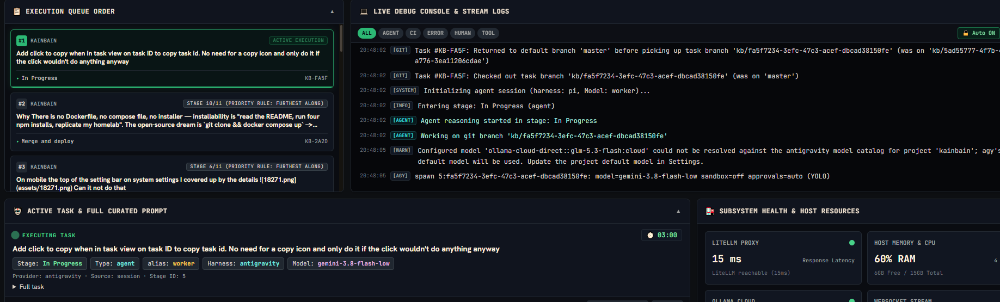

# Goal
Task



# History
- 2026-11-02T20:18:11.942Z: Created and placed in stage 'Idea'
- 2026-11-02T20:18:13.831Z: Created and checked out task branch 'kb/d1e56caa-743e-49ee-9bc9-d8a7062a92bd' from 'main'
- 2026-11-02T20:19:02.233Z: Task details edited
- 2026-11-02T20:19:11.741Z: Task details edited

# Log Entries
```json
[{"id":"log-14614","ts":"2026-11-02T20:18:13.831Z","feed":"main","feeds":["main"],"kind":"system","turn":null,"text":"[GIT] Created and checked out task branch 'kb/d1e56caa-743e-49ee-9bc9-d8a7062a92bd' from 'main'","meta":{"source":"process-log"}}]
```