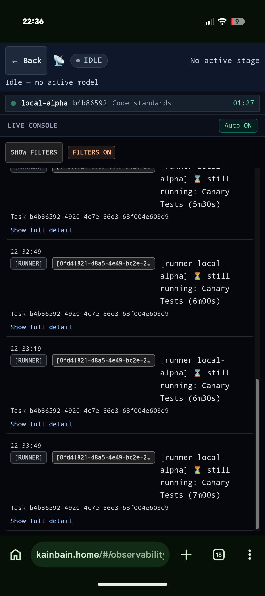

<!-- KAINBAIN AUTO-GENERATED REPORT -->
# Stage Report: Requirement refinement

**Task:** please update the top bar of the quick view logs  The idle and running section now will never display anything. I do like the tiered view for the different runners so lean into that  Just make it better
**Stage Type:** `agent`
**Model:** `worker`
**Duration:** 698193.81s
**Status:** FAILED

### Summary of Changes
Execution failed: git checkout main failed (exit 1): error: The following untracked working tree files would be overwritten by checkout:
	docs/tasks/2b990c4f-1e24-47f6-9c64-8bd239b68c83/task.md
	docs/tasks/8815d13d-e43e-45ec-b013-725c705ae59b/task.md
Please move or remove them before you switch branches.
Aborting

### Execution Output
```
git checkout main failed (exit 1): error: The following untracked working tree files would be overwritten by checkout:
	docs/tasks/2b990c4f-1e24-47f6-9c64-8bd239b68c83/task.md
	docs/tasks/8815d13d-e43e-45ec-b013-725c705ae59b/task.md
Please move or remove them before you switch branches.
Aborting
```

### Modified Files
- (No files modified / inspection only)

### Verification Status
- Stage execution failed with error: git checkout main failed (exit 1): error: The following untracked working tree files would be overwritten by checkout:
	docs/tasks/2b990c4f-1e24-47f6-9c64-8bd239b68c83/task.md
	docs/tasks/8815d13d-e43e-45ec-b013-725c705ae59b/task.md
Please move or remove them before you switch branches.
Aborting
- Triggered fallback routing.