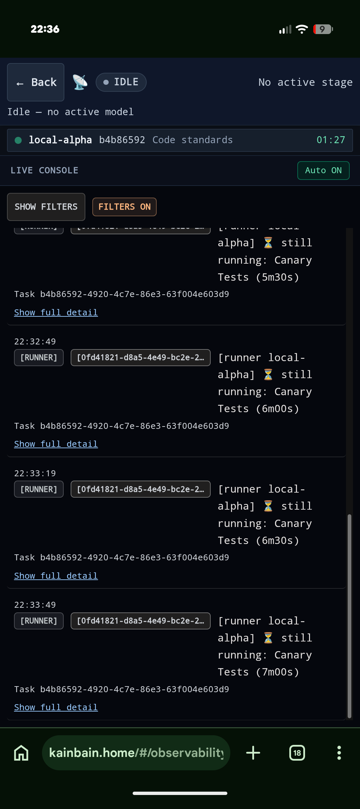

# Goal
# please update the top bar of the quick view logs


The idle and running section now will never display anything. I do like the tiered view for the different runners so lean into that 
Just make it better

# History
- 2026-10-30T22:37:11.800Z: Created and placed in stage 'Idea'
- 2026-10-30T22:37:12.898Z: Synced default branch 'main' to 'origin/main' before task-branch pickup (02d4e7d → 02d4e7d) discarded 4 tracked path(s) on 'main' (remote is authoritative; prior state in reflog)
- 2026-10-30T22:37:13.251Z: Created and checked out task branch 'kb/dc5ba91d-23c7-423f-8379-7ac2a4b46506' from 'main'
- 2026-10-30T22:37:15.878Z: Task details edited
- 2026-10-30T22:37:20.795Z: Task details edited
- 2026-10-30T22:37:23.764Z: Task details edited
- 2026-10-30T22:37:39.841Z: Task details edited
- 2026-10-30T22:37:43.119Z: Task details edited
- 2026-10-30T22:37:49.058Z: Task details edited
- 2026-10-30T22:38:01.555Z: Task details edited
- 2026-10-30T22:38:06.472Z: Stage report generated: ./docs/tasks/dc5ba91d-23c7-423f-8379-7ac2a4b46506/idea-20261030-223806.md
- 2026-10-30T22:38:06.474Z: Advanced to stage 'Requirement refinement'
- 2026-10-30T22:38:06.537Z: Task-branch ref 'kb/dc5ba91d-23c7-423f-8379-7ac2a4b46506' already exists — no checkout performed (human checkpoint 'Idea'; leaving 3 uncommitted paths in the tree for the next work stage)

# Timeline
- 2026-10-30T22:38:06.474Z: Requirement refinement | Advanced | 54.674s

# Log Entries
```json
[{"id":"log-7932","ts":"2026-10-30T22:37:12.898Z","feed":"main","feeds":["main"],"kind":"system","turn":null,"text":"[GIT] Synced default branch 'main' to 'origin/main' before task-branch pickup (02d4e7d → 02d4e7d) discarded 4 tracked path(s) on 'main' (remote is authoritative; prior state in reflog)","meta":{"source":"process-log"}},{"id":"log-7933","ts":"2026-10-30T22:37:13.251Z","feed":"main","feeds":["main"],"kind":"system","turn":null,"text":"[GIT] Created and checked out task branch 'kb/dc5ba91d-23c7-423f-8379-7ac2a4b46506' from 'main'","meta":{"source":"process-log"}},{"id":"log-7934","ts":"2026-10-30T22:38:06.474Z","feed":"main","feeds":["main"],"kind":"system","turn":null,"text":"[INFO] Advanced from stage 'Idea' to stage 'Requirement refinement'","meta":{"source":"process-log"}},{"id":"log-7935","ts":"2026-10-30T22:38:06.537Z","feed":"main","feeds":["main"],"kind":"system","turn":null,"text":"[GIT] Task-branch ref 'kb/dc5ba91d-23c7-423f-8379-7ac2a4b46506' already exists — no checkout performed (human checkpoint 'Idea'; leaving 3 uncommitted paths in the tree for the next work stage)","meta":{"source":"process-log"}}]
```