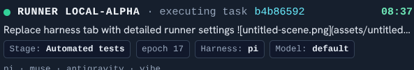

# Goal
# Can we make sure the model information is being pased through accurately



We seem to have some sort of regression when moving to the runner architecture where we are reporting default for model constantly. And like in this case reporting a model that isnt in use as its a CI stage

I want the runner to be able to accurately report (through the backend) to the ui what model choices etc it is running. And I want to make sure the general model catalogue behaviours work.

# History
- 2026-10-30T09:44:20.852Z: Created and placed in stage 'Idea'
- 2026-10-30T14:35:17.771Z: Agent stage completed: Automated tests (via Runner local-alpha)
- 2026-10-30T14:35:17.775Z: Advanced to stage 'Quick review'
- 2026-10-30T14:35:21.764Z: Runner local-alpha stage stage-1787914510327: started
- 2026-10-30T14:35:25.704Z: Runner local-alpha stage stage-1787914510327: prompted
- 2026-10-30T14:40:52.322Z: Runner local-alpha stage stage-1787914510327: finished
- 2026-10-30T14:40:57.719Z: Runner completed execution dc18dfb9-0ea3-4d1d-a659-1567967dee73 (runner local-alpha, epoch 12, sha 9dd5f257817f5ee8525e8e037781b6416bed1d0c (unverified-remote), branch kb/e3b2624a-bc24-4698-9c78-86af7f6f3b5b, posture T0/T1:pi:default). Lease released.
- 2026-10-30T14:40:57.721Z: Agent stage completed: Quick review (via Runner local-alpha)
- 2026-10-30T14:40:57.735Z: Advanced to stage 'Cleaning pass'
- 2026-10-30T14:40:57.779Z: Runner local-alpha stage stage-1791398677900: started
- 2026-10-30T14:41:01.713Z: Runner local-alpha stage stage-1791398677900: prompted
- 2026-10-30T15:17:10.998Z: Runner local-alpha stage stage-1791398677900: finished
- 2026-10-30T15:17:15.933Z: Runner completed execution 4925ee90-060e-4969-99a7-9c92c2a899a5 (runner local-alpha, epoch 13, sha 90710d8df5b9845d106bc1986137eae7546fee2e (unverified-remote), branch kb/e3b2624a-bc24-4698-9c78-86af7f6f3b5b, posture T0/T1:vibe:default). Lease released.
- 2026-10-30T15:17:15.935Z: Agent stage completed: Cleaning pass (via Runner local-alpha)
- 2026-10-30T15:17:15.952Z: Advanced to stage 'automated test 2'
- 2026-10-30T15:20:09.495Z: Runner local-alpha stage stage-1791398930309: started
- 2026-10-30T15:20:13.340Z: Runner local-alpha stage stage-1791398930309: prompted
- 2026-10-30T15:30:30.207Z: Runner local-alpha stage stage-1791398930309: finished
- 2026-10-30T15:30:30.224Z: Runner completed execution 346a0aea-958d-43ed-80eb-b12b46178ee8 (runner local-alpha, epoch 14, sha 90710d8df5b9845d106bc1986137eae7546fee2e (unverified-remote), branch kb/e3b2624a-bc24-4698-9c78-86af7f6f3b5b, posture T0/T1:pi:default). Lease released.
- 2026-10-30T15:30:30.239Z: Warning: failed-stage auto-commit after 'automated test 2' skipped (Refusing to commit on the wrong branch: expected 'kb/e3b2624a-bc24-4698-9c78-86af7f6f3b5b' but the working tree is on 'main'. A concurrent task likely moved HEAD; re-run the stage so it can re-establish its branch.)
- 2026-10-30T15:30:30.241Z: Stage failed in 'automated test 2': CI command failed with exit code 1
- 2026-10-30T15:30:30.246Z: Stage report generated: ./docs/tasks/e3b2624a-bc24-4698-9c78-86af7f6f3b5b/automated-test-2-failure-20261030-153030.md
- 2026-10-30T15:30:30.249Z: Failed back to stage 'Cleaning pass'
- 2026-10-30T15:30:30.326Z: Runner local-alpha stage stage-1791398677900: started
- 2026-10-30T15:30:33.673Z: Runner local-alpha stage stage-1791398677900: prompted
- 2026-10-30T15:37:26.008Z: Runner local-alpha stage stage-1791398677900: finished
- 2026-10-30T15:37:30.582Z: Runner completed execution 54eb3893-9447-45eb-a0de-13e9c4b28d74 (runner local-alpha, epoch 15, sha e72fb70ed248ba5917b66b92415d9325fc38ac0f (unverified-remote), branch kb/e3b2624a-bc24-4698-9c78-86af7f6f3b5b, posture T0/T1:pi:default). Lease released.
- 2026-10-30T15:37:30.583Z: Agent stage completed: Cleaning pass (via Runner local-alpha)
- 2026-10-30T15:37:30.590Z: Advanced to stage 'automated test 2'
- 2026-10-30T15:37:30.637Z: Runner local-alpha stage stage-1791398930309: started
- 2026-10-30T15:37:33.853Z: Runner local-alpha stage stage-1791398930309: prompted
- 2026-10-30T15:48:43.680Z: Runner local-alpha stage stage-1791398930309: finished
- 2026-10-30T15:48:43.699Z: Runner completed execution c8251fcf-dad3-4419-835d-5b434fb059a3 (runner local-alpha, epoch 16, sha e72fb70ed248ba5917b66b92415d9325fc38ac0f (unverified-remote), branch kb/e3b2624a-bc24-4698-9c78-86af7f6f3b5b, posture T0/T1:pi:default). Lease released.
- 2026-10-30T15:48:43.715Z: Warning: failed-stage auto-commit after 'automated test 2' skipped (Refusing to commit on the wrong branch: expected 'kb/e3b2624a-bc24-4698-9c78-86af7f6f3b5b' but the working tree is on 'main'. A concurrent task likely moved HEAD; re-run the stage so it can re-establish its branch.)
- 2026-10-30T15:48:43.716Z: Stage failed in 'automated test 2': CI command failed with exit code 1
- 2026-10-30T15:48:43.722Z: Stage report generated: ./docs/tasks/e3b2624a-bc24-4698-9c78-86af7f6f3b5b/automated-test-2-failure-20261030-154843.md
- 2026-10-30T15:48:43.725Z: Failed back to stage 'Cleaning pass'
- 2026-10-30T15:48:43.787Z: Runner local-alpha stage stage-1791398677900: started
- 2026-10-30T15:48:47.201Z: Runner local-alpha stage stage-1791398677900: prompted
- 2026-10-30T16:01:57.353Z: Runner local-alpha stage stage-1791398677900: finished
- 2026-10-30T16:02:02.736Z: Runner completed execution 3173363f-d403-4731-88b9-5bd782aabeef (runner local-alpha, epoch 17, sha 66cbe9d72ca484b711247829a01482482c04c0f9 (unverified-remote), branch kb/e3b2624a-bc24-4698-9c78-86af7f6f3b5b, posture T0/T1:muse:default). Lease released.
- 2026-10-30T16:02:02.737Z: Agent stage completed: Cleaning pass (via Runner local-alpha)
- 2026-10-30T16:02:02.749Z: Advanced to stage 'automated test 2'
- 2026-10-30T16:43:24.889Z: Runner local-alpha stage stage-1791398930309: started
- 2026-10-30T16:43:29.375Z: Runner local-alpha stage stage-1791398930309: prompted
- 2026-10-30T16:55:01.286Z: Runner local-alpha stage stage-1791398930309: finished
- 2026-10-30T16:55:01.296Z: Runner completed execution c0a9e9f5-4121-4f90-a021-aa86b14f1f61 (runner local-alpha, epoch 18, sha 66cbe9d72ca484b711247829a01482482c04c0f9 (unverified-remote), branch kb/e3b2624a-bc24-4698-9c78-86af7f6f3b5b, posture T0/T1:pi:default). Lease released.
- 2026-10-30T16:55:01.298Z: Agent stage completed: automated test 2 (via Runner local-alpha)
- 2026-10-30T16:55:01.307Z: Advanced to stage 'Code standards'
- 2026-10-30T16:55:01.370Z: Runner local-alpha stage stage-1792767028679: started
- 2026-10-30T16:55:05.283Z: Runner local-alpha stage stage-1792767028679: prompted
- 2026-10-30T16:58:02.094Z: Runner local-alpha stage stage-1792767028679: finished
- 2026-10-30T16:58:15.335Z: Runner completed execution 8dedb356-6861-4b0f-8532-302e722efdd6 (runner local-alpha, epoch 19, sha 20ca75fa733d9e683f5140d29895fc6033e6b2ce (unverified-remote), branch kb/e3b2624a-bc24-4698-9c78-86af7f6f3b5b, posture T0/T1:pi:default). Lease released.
- 2026-10-30T16:58:15.343Z: Agent stage completed: Code standards (via Runner local-alpha)
- 2026-10-30T16:58:15.357Z: Advanced to stage 'Deep Review'
- 2026-10-30T16:58:15.435Z: Runner local-alpha stage stage-1787744723298: started
- 2026-10-30T16:58:27.178Z: Runner local-alpha stage stage-1787744723298: prompted
- 2026-10-30T17:01:04.207Z: Runner local-alpha stage stage-1787744723298: finished
- 2026-10-30T17:01:10.355Z: Runner completed execution 022d42ad-70fc-42eb-98fa-521a32c669a6 (runner local-alpha, epoch 20, sha 20ca75fa733d9e683f5140d29895fc6033e6b2ce (unverified-remote), branch kb/e3b2624a-bc24-4698-9c78-86af7f6f3b5b, posture T0/T1:muse:default). Lease released.
- 2026-10-30T17:01:10.360Z: Agent stage completed: Deep Review (via Runner local-alpha)
- 2026-10-30T17:01:10.379Z: Advanced to stage 'Merge'
- 2026-10-30T17:01:12.684Z: Runner local-alpha stage stage-1788031833187: started
- 2026-10-30T17:01:19.266Z: Runner local-alpha stage stage-1788031833187: finished
- 2026-10-30T17:01:19.271Z: Runner completed execution 65f38648-f2e6-41d3-b2a0-590c4b806311 (runner local-alpha, epoch 21, branch kb/e3b2624a-bc24-4698-9c78-86af7f6f3b5b, posture T0/T1:integration:default). Lease released.
- 2026-10-30T17:01:19.297Z: Warning: failed-stage auto-commit after 'Merge' skipped (Refusing to commit on the wrong branch: expected 'kb/e3b2624a-bc24-4698-9c78-86af7f6f3b5b' but the working tree is on 'main'. A concurrent task likely moved HEAD; re-run the stage so it can re-establish its branch.)
- 2026-10-30T17:01:19.300Z: Stage failed in 'Merge': Merge conflicts in: runner/daemon.js — resolve on 'kb/e3b2624a-bc24-4698-9c78-86af7f6f3b5b' and retry the merge stage
- 2026-10-30T17:01:19.305Z: Stage report generated: ./docs/tasks/e3b2624a-bc24-4698-9c78-86af7f6f3b5b/merge-failure-20261030-170119.md
- 2026-10-30T17:01:19.313Z: Failed back to stage 'In Progress'
- 2026-10-30T17:30:27.321Z: Runner local-alpha stage 5: started
- 2026-10-30T17:30:30.912Z: Runner local-alpha stage 5: prompted
- 2026-10-30T17:45:47.652Z: Runner local-alpha stage 5: finished
- 2026-10-30T17:45:52.587Z: Runner completed execution 82d8bf1d-4130-4c29-9ace-44d51eb931a1 (runner local-alpha, epoch 22, sha ee9b7fad78cd22316dfb8f4071c39f697b76d963 (unverified-remote), branch kb/e3b2624a-bc24-4698-9c78-86af7f6f3b5b, posture T0/T1:muse:default). Lease released.
- 2026-10-30T17:45:52.589Z: Agent stage completed: In Progress (via Runner local-alpha)
- 2026-10-30T17:45:52.598Z: Advanced to stage 'Automated tests'
- 2026-10-30T17:45:52.665Z: Runner local-alpha stage stage-1787744699411: started
- 2026-10-30T17:45:56.435Z: Runner local-alpha stage stage-1787744699411: prompted
- 2026-10-30T17:56:25.836Z: Runner local-alpha stage stage-1787744699411: finished
- 2026-10-30T17:56:25.853Z: Runner completed execution 7eeb3717-d8ab-468d-a95c-d93bb6a14947 (runner local-alpha, epoch 23, sha ee9b7fad78cd22316dfb8f4071c39f697b76d963 (unverified-remote), branch kb/e3b2624a-bc24-4698-9c78-86af7f6f3b5b, posture T0/T1:pi:default). Lease released.
- 2026-10-30T17:56:25.854Z: Agent stage completed: Automated tests (via Runner local-alpha)
- 2026-10-30T17:56:25.861Z: Advanced to stage 'Quick review'
- 2026-10-30T17:56:55.466Z: Runner local-alpha stage stage-1787914510327: started
- 2026-10-30T17:56:59.409Z: Runner local-alpha stage stage-1787914510327: prompted
- 2026-10-30T18:02:27.142Z: Runner local-alpha stage stage-1787914510327: finished
- 2026-10-30T18:02:31.232Z: Runner completed execution 172ed4db-72f3-4815-a5b9-f99d780c5de8 (runner local-alpha, epoch 24, sha ee9b7fad78cd22316dfb8f4071c39f697b76d963 (unverified-remote), branch kb/e3b2624a-bc24-4698-9c78-86af7f6f3b5b, posture T0/T1:antigravity:default). Lease released.
- 2026-10-30T18:02:31.236Z: Agent stage completed: Quick review (via Runner local-alpha)
- 2026-10-30T18:02:31.250Z: Advanced to stage 'Cleaning pass'
- 2026-10-30T18:32:10.438Z: Runner local-alpha stage stage-1791398677900: started
- 2026-10-30T18:32:14.415Z: Runner local-alpha stage stage-1791398677900: prompted
- 2026-10-30T18:37:53.967Z: Runner local-alpha stage stage-1791398677900: finished
- 2026-10-30T18:37:58.832Z: Runner completed execution 286d7262-0cf8-48dc-b494-82de27eaee8d (runner local-alpha, epoch 25, sha b66ca6a68fe45a711620d8e24645dc0b9274b1ff (unverified-remote), branch kb/e3b2624a-bc24-4698-9c78-86af7f6f3b5b, posture T0/T1:muse:default). Lease released.
- 2026-10-30T18:37:58.833Z: Agent stage completed: Cleaning pass (via Runner local-alpha)
- 2026-10-30T18:37:58.843Z: Advanced to stage 'automated test 2'
- 2026-10-30T18:37:58.892Z: Runner local-alpha stage stage-1791398930309: started
- 2026-10-30T18:38:02.343Z: Runner local-alpha stage stage-1791398930309: prompted
- 2026-10-30T18:48:53.882Z: Runner local-alpha stage stage-1791398930309: finished
- 2026-10-30T18:48:53.899Z: Runner completed execution c70d2593-74a6-4685-ac99-7cd1bf412224 (runner local-alpha, epoch 26, sha b66ca6a68fe45a711620d8e24645dc0b9274b1ff (unverified-remote), branch kb/e3b2624a-bc24-4698-9c78-86af7f6f3b5b, posture T0/T1:pi:default). Lease released.
- 2026-10-30T18:48:53.916Z: Warning: failed-stage auto-commit after 'automated test 2' skipped (Refusing to commit on the wrong branch: expected 'kb/e3b2624a-bc24-4698-9c78-86af7f6f3b5b' but the working tree is on 'main'. A concurrent task likely moved HEAD; re-run the stage so it can re-establish its branch.)
- 2026-10-30T18:48:53.920Z: Stage failed in 'automated test 2': CI command failed with exit code 1
- 2026-10-30T18:48:53.925Z: Stage report generated: ./docs/tasks/e3b2624a-bc24-4698-9c78-86af7f6f3b5b/automated-test-2-failure-20261030-184853.md
- 2026-10-30T18:48:53.930Z: Failed back to stage 'Cleaning pass'
- 2026-10-30T18:48:54.028Z: Runner local-alpha stage stage-1791398677900: started
- 2026-10-30T18:48:57.650Z: Runner local-alpha stage stage-1791398677900: prompted
- 2026-10-30T18:57:50.638Z: Runner local-alpha stage stage-1791398677900: finished
- 2026-10-30T18:57:56.234Z: Runner completed execution cb2876ed-5340-4630-a344-bb216f1a6911 (runner local-alpha, epoch 27, sha e869d95e51383b26ea30d352cb2b7f62b2d09852 (unverified-remote), branch kb/e3b2624a-bc24-4698-9c78-86af7f6f3b5b, posture T0/T1:pi:default). Lease released.
- 2026-10-30T18:57:56.235Z: Agent stage completed: Cleaning pass (via Runner local-alpha)
- 2026-10-30T18:57:56.242Z: Advanced to stage 'automated test 2'
- 2026-10-30T18:57:56.306Z: Runner local-alpha stage stage-1791398930309: started
- 2026-10-30T18:58:00.430Z: Runner local-alpha stage stage-1791398930309: prompted
- 2026-10-30T19:08:49.423Z: Runner local-alpha stage stage-1791398930309: finished
- 2026-10-30T19:08:49.443Z: Runner completed execution 30027c55-8da7-45c6-ac26-229221222644 (runner local-alpha, epoch 28, sha e869d95e51383b26ea30d352cb2b7f62b2d09852 (unverified-remote), branch kb/e3b2624a-bc24-4698-9c78-86af7f6f3b5b, posture T0/T1:pi:default). Lease released.
- 2026-10-30T19:08:49.452Z: Agent stage completed: automated test 2 (via Runner local-alpha)
- 2026-10-30T19:08:49.460Z: Advanced to stage 'Code standards'
- 2026-10-30T19:19:34.220Z: Runner local-alpha stage stage-1792767028679: started
- 2026-10-30T19:19:38.117Z: Runner local-alpha stage stage-1792767028679: prompted
- 2026-10-30T19:21:54.026Z: Runner local-alpha stage stage-1792767028679: finished
- 2026-10-30T19:21:59.173Z: Runner completed execution 0a0203ea-7eae-49e6-88d8-99f1549b1fb8 (runner local-alpha, epoch 29, sha 1fc2349722d301b14758af714ec7a48310efcc87 (unverified-remote), branch kb/e3b2624a-bc24-4698-9c78-86af7f6f3b5b, posture T0/T1:pi:default). Lease released.
- 2026-10-30T19:21:59.175Z: Agent stage completed: Code standards (via Runner local-alpha)
- 2026-10-30T19:21:59.183Z: Advanced to stage 'Deep Review'
- 2026-10-30T19:21:59.229Z: Runner local-alpha stage stage-1787744723298: started
- 2026-10-30T19:22:03.433Z: Runner local-alpha stage stage-1787744723298: prompted
- 2026-10-30T19:24:38.471Z: Runner local-alpha stage stage-1787744723298: finished
- 2026-10-30T19:24:42.388Z: Runner completed execution 4ac8edcd-577b-4bed-9788-62beb69b279d (runner local-alpha, epoch 30, sha 1fc2349722d301b14758af714ec7a48310efcc87 (unverified-remote), branch kb/e3b2624a-bc24-4698-9c78-86af7f6f3b5b, posture T0/T1:muse:default). Lease released.
- 2026-10-30T19:24:42.390Z: Agent stage completed: Deep Review (via Runner local-alpha)
- 2026-10-30T19:24:42.398Z: Advanced to stage 'Merge'
- 2026-10-30T19:24:43.908Z: Runner local-alpha stage stage-1788031833187: started
- 2026-10-30T19:24:52.641Z: Runner local-alpha stage stage-1788031833187: finished
- 2026-10-30T19:24:52.645Z: Runner local-alpha verified push SHA 1fc2349 against the remote.
- 2026-10-30T19:24:52.648Z: Runner completed execution b5103729-4347-4f89-9bdb-491c15e77c04 (runner local-alpha, epoch 31, sha 1fc2349722d301b14758af714ec7a48310efcc87 (unverified-remote), branch kb/e3b2624a-bc24-4698-9c78-86af7f6f3b5b, posture T0/T1:integration:default). Lease released.
- 2026-10-30T19:24:52.648Z: Agent stage completed: Merge (via Runner local-alpha)
- 2026-10-30T19:24:52.656Z: Advanced to stage 'Publish'
- 2026-10-30T19:24:53.428Z: Pre-deploy tip sync skipped (local-ahead: local 'main' is 1 commit(s) ahead of 'origin/main' — refusing to reset so unpushed work (e.g. a landed merge) is never orphaned; proceeding on the ahead line) — deploy will park on its tip guard unless the source already matches the tip
- 2026-10-30T19:24:53.452Z: Runner local-alpha stage stage-1788031833187-deploy: started
- 2026-10-30T19:24:57.843Z: Runner local-alpha stage stage-1788031833187-deploy: prompted
- 2026-10-30T19:24:59.229Z: Runner local-alpha stage stage-1788031833187-deploy: finished
- 2026-10-30T19:24:59.250Z: Runner completed execution 55a98488-42b2-481a-b6c6-1be7790cc416 (runner local-alpha, epoch 32, sha 5386afe93d560f3da77d480534c94f4ad178ebee (unverified-remote), branch kb/e3b2624a-bc24-4698-9c78-86af7f6f3b5b, posture T0/T1:pi:default). Lease released.
- 2026-10-30T19:24:59.266Z: Warning: failed-stage auto-commit after 'Publish' skipped (Refusing to commit on the wrong branch: expected 'kb/e3b2624a-bc24-4698-9c78-86af7f6f3b5b' but the working tree is on 'main'. A concurrent task likely moved HEAD; re-run the stage so it can re-establish its branch.)
- 2026-10-30T19:24:59.268Z: Stage failed in 'Publish': CI command failed with exit code 1
- 2026-10-30T19:24:59.274Z: Stage report generated: ./docs/tasks/e3b2624a-bc24-4698-9c78-86af7f6f3b5b/publish-failure-20261030-192459.md
- 2026-10-30T19:24:59.277Z: Failed back to stage 'In Progress'
- 2026-10-30T19:45:49.599Z: Moved to stage 'Cleaning pass'
- 2026-10-30T19:45:55.099Z: Moved to stage 'Merge'
- 2026-10-30T19:57:32.701Z: Moved to stage 'Publish'
- 2026-10-30T20:31:10.832Z: Pre-deploy tip sync: refusing to check out 'main' (git checkout main failed (exit 1): error: The following untracked working tree files would be overwritten by checkout:
	docs/tasks/91257d62-f181-4ee0-ab91-f00188221c78/task.md
	docs/tasks/b4b86592-4920-4c7e-86e3-63f004e603d9/task.md
Please move or remove them before you switch branches.
Aborting) — deploy will park on its tip guard until the tree is clean
- 2026-10-30T20:31:10.852Z: Runner local-alpha stage stage-1788031833187-deploy: started
- 2026-10-30T20:31:15.131Z: Runner local-alpha stage stage-1788031833187-deploy: prompted
- 2026-10-30T20:31:15.145Z: Runner local-alpha stage stage-1788031833187-deploy: finished
- 2026-10-30T20:31:15.154Z: Runner completed execution ca61d689-109d-451c-8a87-0986f1d65688 (runner local-alpha, epoch 34, sha 2e710f76652fe45b7f4011851ab13743b1643809 (unverified-remote), branch kb/e3b2624a-bc24-4698-9c78-86af7f6f3b5b, posture T0/T1:pi). Lease released.
- 2026-10-30T20:31:15.172Z: Warning: failed-stage auto-commit after 'Publish' skipped (Refusing to commit on the wrong branch: expected 'kb/e3b2624a-bc24-4698-9c78-86af7f6f3b5b' but the working tree is on 'kb/91257d62-f181-4ee0-ab91-f00188221c78'. A concurrent task likely moved HEAD; re-run the stage so it can re-establish its branch.)
- 2026-10-30T20:31:15.178Z: Stage failed in 'Publish': CI command failed with exit code 78
- 2026-10-30T20:31:15.183Z: Stage report generated: ./docs/tasks/e3b2624a-bc24-4698-9c78-86af7f6f3b5b/publish-failure-20261030-203115.md
- 2026-10-30T20:31:15.188Z: Failed back to stage 'In Progress'

# Timeline
- 2026-10-30T09:46:19.740Z: Requirement refinement | Advanced | 118.888s | +2317 -0
- 2026-10-30T10:51:48.078Z: Plan | Advanced | 3928.338s | +0 -0
- 2026-10-30T11:39:31.394Z: Check for plan | Advanced | 2863.316s | +0 -0
- 2026-10-30T12:18:12.013Z: Risk review | Advanced | 2320.619s | +0 -0
- 2026-10-30T12:50:36.862Z: Review Plan | Advanced | 1944.849s | +0 -0
- 2026-10-30T13:14:04.506Z: catchup | Advanced | 1407.644s | +0 -0
- 2026-10-30T13:14:31.481Z: In Progress | Advanced | 26.975s | +0 -0
- 2026-10-30T13:25:59.476Z: Automated tests | Advanced | 687.995s | +0 -0
- 2026-10-30T13:38:15.307Z: Automated tests | Failed | 735.831s | +0 -0
- 2026-10-30T13:38:15.311Z: In Progress | Moved | 735.835s | +0 -0
- 2026-10-30T13:47:41.889Z: Automated tests | Advanced | 566.578s | +0 -0
- 2026-10-30T14:22:37.381Z: Automated tests | Resumed | 0m
- 2026-10-30T14:23:58.404Z: Automated tests | Resumed | 0m
- 2026-10-30T14:35:17.775Z: Quick review | Advanced | 679.371s | +0 -0
- 2026-10-30T14:40:57.735Z: Cleaning pass | Advanced | 339.96s | +0 -0
- 2026-10-30T15:17:15.952Z: automated test 2 | Advanced | 2178.217s | +0 -0
- 2026-10-30T15:30:30.244Z: automated test 2 | Failed | 794.292s | +0 -0
- 2026-10-30T15:30:30.249Z: Cleaning pass | Moved | 794.297s | +0 -0
- 2026-10-30T15:37:30.590Z: automated test 2 | Advanced | 420.341s | +0 -0
- 2026-10-30T15:48:43.720Z: automated test 2 | Failed | 673.13s | +0 -0
- 2026-10-30T15:48:43.725Z: Cleaning pass | Moved | 673.135s | +0 -0
- 2026-10-30T16:02:02.749Z: automated test 2 | Advanced | 799.024s | +0 -0
- 2026-10-30T16:55:01.307Z: Code standards | Advanced | 3178.558s | +0 -0
- 2026-10-30T16:58:15.357Z: Deep Review | Advanced | 194.05s | +0 -0
- 2026-10-30T17:01:10.379Z: Merge | Advanced | 175.022s | +0 -0
- 2026-10-30T17:01:19.304Z: Merge | Failed | 8.925s | +0 -0
- 2026-10-30T17:01:19.313Z: In Progress | Moved | 8.933s | +0 -0
- 2026-10-30T17:45:52.598Z: Automated tests | Advanced | 2673.285s | +0 -0
- 2026-10-30T17:56:25.861Z: Quick review | Advanced | 633.263s | +0 -0
- 2026-10-30T18:02:31.250Z: Cleaning pass | Advanced | 365.389s | +0 -0
- 2026-10-30T18:37:58.843Z: automated test 2 | Advanced | 2127.593s | +0 -0
- 2026-10-30T18:48:53.924Z: automated test 2 | Failed | 655.08s | +0 -0
- 2026-10-30T18:48:53.930Z: Cleaning pass | Moved | 655.087s | +0 -0
- 2026-10-30T18:57:56.242Z: automated test 2 | Advanced | 542.312s | +0 -0
- 2026-10-30T19:08:49.460Z: Code standards | Advanced | 653.218s | +0 -0
- 2026-10-30T19:21:59.183Z: Deep Review | Advanced | 789.723s | +0 -0
- 2026-10-30T19:24:42.398Z: Merge | Advanced | 163.215s | +0 -0
- 2026-10-30T19:24:52.656Z: Publish | Advanced | 10.258s | +0 -0
- 2026-10-30T19:24:59.273Z: Publish | Failed | 6.616s | +0 -0
- 2026-10-30T19:24:59.277Z: In Progress | Moved | 6.621s | +0 -0
- 2026-10-30T19:45:49.599Z: Cleaning pass | Moved | 1250.322s | +0 -0
- 2026-10-30T19:45:55.099Z: Merge | Moved | 5.5s | +0 -0
- 2026-10-30T19:57:32.701Z: Publish | Moved | 697.601s | +0 -0
- 2026-10-30T20:31:15.182Z: Publish | Failed | 2022.48s | +0 -0
- 2026-10-30T20:31:15.188Z: In Progress | Moved | 2022.487s | +0 -0

# Log Entries
```json
[{"id":"log-24484","ts":"2026-10-30T15:13:07.835Z","feed":"main","feeds":["main"],"kind":"system","turn":null,"text":"[INFO] (1153 earlier log entries evicted)","meta":{"evictedCount":1153}},{"id":"log-8030","ts":"2026-10-30T17:48:09.432Z","feed":"main","feeds":["main"],"kind":"runner","turn":null,"text":"[runner local-alpha] Running Dependency Audit Gate... \u001b[0;32mPASS\u001b[0m (132s)","meta":{"source":"process-log","runnerId":"local-alpha","executionId":"7eeb3717-d8ab-468d-a95c-d93bb6a14947","seq":32}},{"id":"log-8031","ts":"2026-10-30T17:48:09.438Z","feed":"main","feeds":["main"],"kind":"runner","turn":null,"text":"[runner local-alpha] Running Harness Self-Tests... \u001b[0;32mPASS\u001b[0m (132s)","meta":{"source":"process-log","runnerId":"local-alpha","executionId":"7eeb3717-d8ab-468d-a95c-d93bb6a14947","seq":33}},{"id":"log-8032","ts":"2026-10-30T17:48:09.441Z","feed":"main","feeds":["main"],"kind":"runner","turn":null,"text":"[runner local-alpha] Running Container Tests... \u001b[0;32mPASS\u001b[0m (132s)","meta":{"source":"process-log","runnerId":"local-alpha","executionId":"7eeb3717-d8ab-468d-a95c-d93bb6a14947","seq":34}},{"id":"log-8033","ts":"2026-10-30T17:48:09.444Z","feed":"main","feeds":["main"],"kind":"runner","turn":null,"text":"[runner local-alpha] Fast gate complete — starting Canary Tests alone (serial phase, no shared CPUs with the unit suites)...","meta":{"source":"process-log","runnerId":"local-alpha","executionId":"7eeb3717-d8ab-468d-a95c-d93bb6a14947","seq":35}},{"id":"log-8034","ts":"2026-10-30T17:48:39.407Z","feed":"main","feeds":["main"],"kind":"runner","turn":null,"text":"[runner local-alpha] ⏳ still running: Canary Tests (30s)","meta":{"source":"process-log","runnerId":"local-alpha","executionId":"7eeb3717-d8ab-468d-a95c-d93bb6a14947","seq":36}},{"id":"log-8035","ts":"2026-10-30T17:49:09.407Z","feed":"main","feeds":["main"],"kind":"runner","turn":null,"text":"[runner local-alpha] ⏳ still running: Canary Tests (1m00s)","meta":{"source":"process-log","runnerId":"local-alpha","executionId":"7eeb3717-d8ab-468d-a95c-d93bb6a14947","seq":37}},{"id":"log-8036","ts":"2026-10-30T17:49:39.410Z","feed":"main","feeds":["main"],"kind":"runner","turn":null,"text":"[runner local-alpha] ⏳ still running: Canary Tests (1m30s)","meta":{"source":"process-log","runnerId":"local-alpha","executionId":"7eeb3717-d8ab-468d-a95c-d93bb6a14947","seq":38}},{"id":"log-8037","ts":"2026-10-30T17:50:09.425Z","feed":"main","feeds":["main"],"kind":"runner","turn":null,"text":"[runner local-alpha] ⏳ still running: Canary Tests (2m00s)","meta":{"source":"process-log","runnerId":"local-alpha","executionId":"7eeb3717-d8ab-468d-a95c-d93bb6a14947","seq":39}},{"id":"log-8038","ts":"2026-10-30T17:50:39.429Z","feed":"main","feeds":["main"],"kind":"runner","turn":null,"text":"[runner local-alpha] ⏳ still running: Canary Tests (2m30s)","meta":{"source":"process-log","runnerId":"local-alpha","executionId":"7eeb3717-d8ab-468d-a95c-d93bb6a14947","seq":40}},{"id":"log-8039","ts":"2026-10-30T17:51:09.433Z","feed":"main","feeds":["main"],"kind":"runner","turn":null,"text":"[runner local-alpha] ⏳ still running: Canary Tests (3m00s)","meta":{"source":"process-log","runnerId":"local-alpha","executionId":"7eeb3717-d8ab-468d-a95c-d93bb6a14947","seq":41}},{"id":"log-8040","ts":"2026-10-30T17:51:39.433Z","feed":"main","feeds":["main"],"kind":"runner","turn":null,"text":"[runner local-alpha] ⏳ still running: Canary Tests (3m30s)","meta":{"source":"process-log","runnerId":"local-alpha","executionId":"7eeb3717-d8ab-468d-a95c-d93bb6a14947","seq":42}},{"id":"log-8041","ts":"2026-10-30T17:52:09.435Z","feed":"main","feeds":["main"],"kind":"runner","turn":null,"text":"[runner local-alpha] ⏳ still running: Canary Tests (4m00s)","meta":{"source":"process-log","runnerId":"local-alpha","executionId":"7eeb3717-d8ab-468d-a95c-d93bb6a14947","seq":43}},{"id":"log-8042","ts":"2026-10-30T17:52:39.438Z","feed":"main","feeds":["main"],"kind":"runner","turn":null,"text":"[runner local-alpha] ⏳ still running: Canary Tests (4m30s)","meta":{"source":"process-log","runnerId":"local-alpha","executionId":"7eeb3717-d8ab-468d-a95c-d93bb6a14947","seq":44}},{"id":"log-8043","ts":"2026-10-30T17:53:09.452Z","feed":"main","feeds":["main"],"kind":"runner","turn":null,"text":"[runner local-alpha] ⏳ still running: Canary Tests (5m00s)","meta":{"source":"process-log","runnerId":"local-alpha","executionId":"7eeb3717-d8ab-468d-a95c-d93bb6a14947","seq":45}},{"id":"log-8044","ts":"2026-10-30T17:53:39.450Z","feed":"main","feeds":["main"],"kind":"runner","turn":null,"text":"[runner local-alpha] ⏳ still running: Canary Tests (5m30s)","meta":{"source":"process-log","runnerId":"local-alpha","executionId":"7eeb3717-d8ab-468d-a95c-d93bb6a14947","seq":46}},{"id":"log-8045","ts":"2026-10-30T17:54:09.460Z","feed":"main","feeds":["main"],"kind":"runner","turn":null,"text":"[runner local-alpha] ⏳ still running: Canary Tests (6m00s)","meta":{"source":"process-log","runnerId":"local-alpha","executionId":"7eeb3717-d8ab-468d-a95c-d93bb6a14947","seq":47}},{"id":"log-8046","ts":"2026-10-30T17:54:39.461Z","feed":"main","feeds":["main"],"kind":"runner","turn":null,"text":"[runner local-alpha] ⏳ still running: Canary Tests (6m30s)","meta":{"source":"process-log","runnerId":"local-alpha","executionId":"7eeb3717-d8ab-468d-a95c-d93bb6a14947","seq":48}},{"id":"log-8047","ts":"2026-10-30T17:55:09.459Z","feed":"main","feeds":["main"],"kind":"runner","turn":null,"text":"[runner local-alpha] ⏳ still running: Canary Tests (7m00s)","meta":{"source":"process-log","runnerId":"local-alpha","executionId":"7eeb3717-d8ab-468d-a95c-d93bb6a14947","seq":49}},{"id":"log-8048","ts":"2026-10-30T17:55:39.461Z","feed":"main","feeds":["main"],"kind":"runner","turn":null,"text":"[runner local-alpha] ⏳ still running: Canary Tests (7m30s)","meta":{"source":"process-log","runnerId":"local-alpha","executionId":"7eeb3717-d8ab-468d-a95c-d93bb6a14947","seq":50}},{"id":"log-8049","ts":"2026-10-30T17:56:09.462Z","feed":"main","feeds":["main"],"kind":"runner","turn":null,"text":"[runner local-alpha] ⏳ still running: Canary Tests (8m00s)","meta":{"source":"process-log","runnerId":"local-alpha","executionId":"7eeb3717-d8ab-468d-a95c-d93bb6a14947","seq":51}},{"id":"log-8050","ts":"2026-10-30T17:56:25.824Z","feed":"main","feeds":["main"],"kind":"runner","turn":null,"text":"[runner local-alpha] Running Canary Tests... \u001b[0;32mPASS\u001b[0m (496s)","meta":{"source":"process-log","runnerId":"local-alpha","executionId":"7eeb3717-d8ab-468d-a95c-d93bb6a14947","seq":52}},{"id":"log-8051","ts":"2026-10-30T17:56:25.861Z","feed":"main","feeds":["main"],"kind":"system","turn":null,"text":"[INFO] Advanced from stage 'Automated tests' to stage 'Quick review'","meta":{"source":"process-log"}},{"id":"log-8062","ts":"2026-10-30T17:57:05.848Z","feed":"main","feeds":["main"],"kind":"runner","turn":null,"text":"[runner local-alpha] [AGY] step (step ?)","meta":{"source":"process-log","runnerId":"local-alpha","executionId":"172ed4db-72f3-4815-a5b9-f99d780c5de8","seq":0}},{"id":"log-8063","ts":"2026-10-30T18:02:31.186Z","feed":"main","feeds":["main"],"kind":"runner","turn":null,"text":"[runner local-alpha] stage output: I have started running `npm run test:unit` to verify the test suite. While it executes in the background, I am analyzing the git history and prior stage reports.","meta":{"source":"process-log","runnerId":"local-alpha","executionId":"172ed4db-72f3-4815-a5b9-f99d780c5de8","seq":1}},{"id":"log-8064","ts":"2026-10-30T18:02:31.191Z","feed":"main","feeds":["main"],"kind":"runner","turn":null,"text":"[runner local-alpha] ### Background Task Started","meta":{"source":"process-log","runnerId":"local-alpha","executionId":"172ed4db-72f3-4815-a5b9-f99d780c5de8","seq":2}},{"id":"log-8065","ts":"2026-10-30T18:02:31.196Z","feed":"main","feeds":["main"],"kind":"runner","turn":null,"text":"[runner local-alpha] - **Task ID:** `4efffe85-0765-422b-8646-d0e220e6e488/task-46` (`npm run test:unit`)","meta":{"source":"process-log","runnerId":"local-alpha","executionId":"172ed4db-72f3-4815-a5b9-f99d780c5de8","seq":3}},{"id":"log-8066","ts":"2026-10-30T18:02:31.200Z","feed":"main","feeds":["main"],"kind":"runner","turn":null,"text":"[runner local-alpha] - Awaiting completion to assess the current test suite status.","meta":{"source":"process-log","runnerId":"local-alpha","executionId":"172ed4db-72f3-4815-a5b9-f99d780c5de8","seq":4}},{"id":"log-8067","ts":"2026-10-30T18:02:31.205Z","feed":"main","feeds":["main"],"kind":"runner","turn":null,"text":"[runner local-alpha] Reviewed previous reports, plan, and codebase changes. The implementation fulfills the core goal and followed the plan, but the branch currently has an unresolved merge conflict with `origin/main` in [runner/daemon.js](file:///home/server/.kainbain/runner-work/kb-e3b2624a-bc24-4698-9c78-86af7f6f3b5b/runner/daemon.js) and [api/flow/dispatch/selectRunnerForTask.test.js](file:///home/server/.kainbain/runner-work/kb-e3b2624a-bc24-4698-9c78-86af7f6f3b5b/api/flow/dispatch/selectRunnerForTask.test.js), which blocked the merge stage (reported in [merge-failure-20261030-170119.md](file:///home/server/.kainbain/runner-work/kb-e3b2624a-bc24-4698-9c78-86af7f6f3b5b/docs/tasks/e3b2624a-bc24-4698-9c78-86af7f6f3b5b/merge-failure-20261030-170119.md)).","meta":{"source":"process-log","runnerId":"local-alpha","executionId":"172ed4db-72f3-4815-a5b9-f99d780c5de8","seq":5}},{"id":"log-8068","ts":"2026-10-30T18:02:31.211Z","feed":"main","feeds":["main"],"kind":"runner","turn":null,"text":"[runner local-alpha] KAINBAIN_VERDICT: FAIL","meta":{"source":"process-log","runnerId":"local-alpha","executionId":"172ed4db-72f3-4815-a5b9-f99d780c5de8","seq":6}},{"id":"log-8069","ts":"2026-10-30T18:02:31.216Z","feed":"main","feeds":["main"],"kind":"runner","turn":null,"text":"[runner local-alpha] KAINBAIN_REASON: Merge conflict with origin/main in runner/daemon.js and api/flow/dispatch/selectRunnerForTask.test.js prevents integration. Commit ee40e4d from main added resolveCiWorkdir and customBranch handling to CI stage execution in runner/daemon.js where post-fix posture formatting was also applied, and added a test to selectRunnerForTask.test.js.","meta":{"source":"process-log","runnerId":"local-alpha","executionId":"172ed4db-72f3-4815-a5b9-f99d780c5de8","seq":7}},{"id":"log-8070","ts":"2026-10-30T18:02:31.222Z","feed":"main","feeds":["main"],"kind":"runner","turn":null,"text":"[runner local-alpha] KAINBAIN_FIX: Merge origin/main into kb/e3b2624a-bc24-4698-9c78-86af7f6f3b5b, resolving conflicts by combining main's resolveCiWorkdir logic with the formatPosture({ tiers: config.tiers, harness: servingHarnessId, model: null }) reporting on CI completion, and keeping both test cases in selectRunnerForTask.test.js. Verify with npm run test:unit and push.","meta":{"source":"process-log","runnerId":"local-alpha","executionId":"172ed4db-72f3-4815-a5b9-f99d780c5de8","seq":8}},{"id":"log-8071","ts":"2026-10-30T18:02:31.250Z","feed":"main","feeds":["main"],"kind":"system","turn":null,"text":"[INFO] Advanced from stage 'Quick review' to stage 'Cleaning pass'","meta":{"source":"process-log"}},{"id":"log-8185","ts":"2026-10-30T18:37:47.464Z","feed":"main","feeds":["main"],"kind":"runner","turn":null,"text":"[runner local-alpha] Cleanup complete","meta":{"source":"process-log","runnerId":"local-alpha","executionId":"286d7262-0cf8-48dc-b494-82de27eaee8d","seq":0}},{"id":"log-8186","ts":"2026-10-30T18:37:47.465Z","feed":"main","feeds":["main"],"kind":"runner","turn":null,"text":"[runner local-alpha] . The","meta":{"source":"process-log","runnerId":"local-alpha","executionId":"286d7262-0cf8-48dc-b494-82de27eaee8d","seq":1}},{"id":"log-8187","ts":"2026-10-30T18:37:47.465Z","feed":"main","feeds":["main"],"kind":"runner","turn":null,"text":"[runner local-alpha]  branch now merges","meta":{"source":"process-log","runnerId":"local-alpha","executionId":"286d7262-0cf8-48dc-b494-82de27eaee8d","seq":2}},{"id":"log-8188","ts":"2026-10-30T18:37:47.466Z","feed":"main","feeds":["main"],"kind":"runner","turn":null,"text":"[runner local-alpha] logs truncated — Runner disconnected (frames 3–3 missing)","meta":{"source":"process-log","runnerId":"local-alpha"}},{"id":"log-8189","ts":"2026-10-30T18:37:47.466Z","feed":"main","feeds":["main"],"kind":"runner","turn":null,"text":"[runner local-alpha]  and the model-reporting contract is hardened","meta":{"source":"process-log","runnerId":"local-alpha","executionId":"286d7262-0cf8-48dc-b494-82de27eaee8d","seq":4}},{"id":"log-8190","ts":"2026-10-30T18:37:47.467Z","feed":"main","feeds":["main"],"kind":"runner","turn":null,"text":"[runner local-alpha] :","meta":{"source":"process-log","runnerId":"local-alpha","executionId":"286d7262-0cf8-48dc-b494-82de27eaee8d","seq":5}},{"id":"log-8191","ts":"2026-10-30T18:37:47.468Z","feed":"main","feeds":["main"],"kind":"runner","turn":null,"text":"[runner local-alpha]  agent stages report","meta":{"source":"process-log","runnerId":"local-alpha","executionId":"286d7262-0cf8-48dc-b494-82de27eaee8d","seq":6}},{"id":"log-8192","ts":"2026-10-30T18:37:47.469Z","feed":"main","feeds":["main"],"kind":"runner","turn":null,"text":"[runner local-alpha]  the exact dispatched model, CI/","meta":{"source":"process-log","runnerId":"local-alpha","executionId":"286d7262-0cf8-48dc-b494-82de27eaee8d","seq":7}},{"id":"log-8193","ts":"2026-10-30T18:37:47.470Z","feed":"main","feeds":["main"],"kind":"runner","turn":null,"text":"[runner local-alpha] merge/integr","meta":{"source":"process-log","runnerId":"local-alpha","executionId":"286d7262-0cf8-48dc-b494-82de27eaee8d","seq":8}},{"id":"log-8194","ts":"2026-10-30T18:37:47.471Z","feed":"main","feeds":["main"],"kind":"runner","turn":null,"text":"[runner local-alpha] ate stages report nothing, and the engine","meta":{"source":"process-log","runnerId":"local-alpha","executionId":"286d7262-0cf8-48dc-b494-82de27eaee8d","seq":9}},{"id":"log-8195","ts":"2026-10-30T18:37:47.472Z","feed":"main","feeds":["main"],"kind":"runner","turn":null,"text":"[runner local-alpha] logs truncated — Runner disconnected (frames 10–11 missing)","meta":{"source":"process-log","runnerId":"local-alpha"}},{"id":"log-8196","ts":"2026-10-30T18:37:47.472Z","feed":"main","feeds":["main"],"kind":"runner","turn":null,"text":"[runner local-alpha]  and backend","meta":{"source":"process-log","runnerId":"local-alpha","executionId":"286d7262-0cf8-48dc-b494-82de27eaee8d","seq":12}},{"id":"log-8197","ts":"2026-10-30T18:37:47.473Z","feed":"main","feeds":["main"],"kind":"runner","turn":null,"text":"[runner local-alpha]  ingest layers","meta":{"source":"process-log","runnerId":"local-alpha","executionId":"286d7262-0cf8-48dc-b494-82de27eaee8d","seq":13}},{"id":"log-8198","ts":"2026-10-30T18:37:47.474Z","feed":"main","feeds":["main"],"kind":"runner","turn":null,"text":"[runner local-alpha]  so","meta":{"source":"process-log","runnerId":"local-alpha","executionId":"286d7262-0cf8-48dc-b494-82de27eaee8d","seq":14}},{"id":"log-8199","ts":"2026-10-30T18:37:47.474Z","feed":"main","feeds":["main"],"kind":"runner","turn":null,"text":"[runner local-alpha]  pre-fix Runners degrade to hidden pills","meta":{"source":"process-log","runnerId":"local-alpha","executionId":"286d7262-0cf8-48dc-b494-82de27eaee8d","seq":15}},{"id":"log-8200","ts":"2026-10-30T18:37:47.475Z","feed":"main","feeds":["main"],"kind":"runner","turn":null,"text":"[runner local-alpha]  mid","meta":{"source":"process-log","runnerId":"local-alpha","executionId":"286d7262-0cf8-48dc-b494-82de27eaee8d","seq":16}},{"id":"log-8201","ts":"2026-10-30T18:37:47.476Z","feed":"main","feeds":["main"],"kind":"runner","turn":null,"text":"[runner local-alpha] -rollout instead of fake ones.","meta":{"source":"process-log","runnerId":"local-alpha","executionId":"286d7262-0cf8-48dc-b494-82de27eaee8d","seq":17}},{"id":"log-8202","ts":"2026-10-30T18:37:47.476Z","feed":"main","feeds":["main"],"kind":"runner","turn":null,"text":"[runner local-alpha] Files","meta":{"source":"process-log","runnerId":"local-alpha","executionId":"286d7262-0cf8-48dc-b494-82de27eaee8d","seq":18}},{"id":"log-8203","ts":"2026-10-30T18:37:47.478Z","feed":"main","feeds":["main"],"kind":"runner","turn":null,"text":"[runner local-alpha]  changed: [runner","meta":{"source":"process-log","runnerId":"local-alpha","executionId":"286d7262-0cf8-48dc-b494-82de27eaee8d","seq":19}},{"id":"log-8204","ts":"2026-10-30T18:37:47.478Z","feed":"main","feeds":["main"],"kind":"runner","turn":null,"text":"[runner local-alpha] /daemon.js](/home/server","meta":{"source":"process-log","runnerId":"local-alpha","executionId":"286d7262-0cf8-48dc-b494-82de27eaee8d","seq":20}},{"id":"log-8205","ts":"2026-10-30T18:37:47.479Z","feed":"main","feeds":["main"],"kind":"runner","turn":null,"text":"[runner local-alpha] /.kainbain/runner-work","meta":{"source":"process-log","runnerId":"local-alpha","executionId":"286d7262-0cf8-48dc-b494-82de27eaee8d","seq":21}},{"id":"log-8206","ts":"2026-10-30T18:37:47.479Z","feed":"main","feeds":["main"],"kind":"runner","turn":null,"text":"[runner local-alpha] /kb-e3b2624a","meta":{"source":"process-log","runnerId":"local-alpha","executionId":"286d7262-0cf8-48dc-b494-82de27eaee8d","seq":22}},{"id":"log-8207","ts":"2026-10-30T18:37:47.480Z","feed":"main","feeds":["main"],"kind":"runner","turn":null,"text":"[runner local-alpha] -bc24-4698-9","meta":{"source":"process-log","runnerId":"local-alpha","executionId":"286d7262-0cf8-48dc-b494-82de27eaee8d","seq":23}},{"id":"log-8208","ts":"2026-10-30T18:37:47.480Z","feed":"main","feeds":["main"],"kind":"runner","turn":null,"text":"[runner local-alpha] c78-86af7f6","meta":{"source":"process-log","runnerId":"local-alpha","executionId":"286d7262-0cf8-48dc-b494-82de27eaee8d","seq":24}},{"id":"log-8209","ts":"2026-10-30T18:37:47.481Z","feed":"main","feeds":["main"],"kind":"runner","turn":null,"text":"[runner local-alpha] f3b5b/runner/","meta":{"source":"process-log","runnerId":"local-alpha","executionId":"286d7262-0cf8-48dc-b494-82de27eaee8d","seq":25}},{"id":"log-8210","ts":"2026-10-30T18:37:47.482Z","feed":"main","feeds":["main"],"kind":"runner","turn":null,"text":"[runner local-alpha] daemon.js) (merge resolution","meta":{"source":"process-log","runnerId":"local-alpha","executionId":"286d7262-0cf8-48dc-b494-82de27eaee8d","seq":26}},{"id":"log-8211","ts":"2026-10-30T18:37:47.482Z","feed":"main","feeds":["main"],"kind":"runner","turn":null,"text":"[runner local-alpha]  keeping","meta":{"source":"process-log","runnerId":"local-alpha","executionId":"286d7262-0cf8-48dc-b494-82de27eaee8d","seq":27}},{"id":"log-8212","ts":"2026-10-30T18:37:47.483Z","feed":"main","feeds":["main"],"kind":"runner","turn":null,"text":"[runner local-alpha]  both `","meta":{"source":"process-log","runnerId":"local-alpha","executionId":"286d7262-0cf8-48dc-b494-82de27eaee8d","seq":28}},{"id":"log-8213","ts":"2026-10-30T18:37:47.483Z","feed":"main","feeds":["main"],"kind":"runner","turn":null,"text":"[runner local-alpha] resolveCiWorkdir` plumbing","meta":{"source":"process-log","runnerId":"local-alpha","executionId":"286d7262-0cf8-48dc-b494-82de27eaee8d","seq":29}},{"id":"log-8214","ts":"2026-10-30T18:37:47.484Z","feed":"main","feeds":["main"],"kind":"runner","turn":null,"text":"[runner local-alpha]  and model","meta":{"source":"process-log","runnerId":"local-alpha","executionId":"286d7262-0cf8-48dc-b494-82de27eaee8d","seq":30}},{"id":"log-8215","ts":"2026-10-30T18:37:47.484Z","feed":"main","feeds":["main"],"kind":"runner","turn":null,"text":"[runner local-alpha] -less CI","meta":{"source":"process-log","runnerId":"local-alpha","executionId":"286d7262-0cf8-48dc-b494-82de27eaee8d","seq":31}},{"id":"log-8216","ts":"2026-10-30T18:37:47.485Z","feed":"main","feeds":["main"],"kind":"runner","turn":null,"text":"[runner local-alpha]  posture), [shared/servingModelFor","meta":{"source":"process-log","runnerId":"local-alpha","executionId":"286d7262-0cf8-48dc-b494-82de27eaee8d","seq":32}},{"id":"log-8217","ts":"2026-10-30T18:37:47.486Z","feed":"main","feeds":["main"],"kind":"runner","turn":null,"text":"[runner local-alpha] .js](/home/server/.kainb","meta":{"source":"process-log","runnerId":"local-alpha","executionId":"286d7262-0cf8-48dc-b494-82de27eaee8d","seq":33}},{"id":"log-8218","ts":"2026-10-30T18:37:47.487Z","feed":"main","feeds":["main"],"kind":"runner","turn":null,"text":"[runner local-alpha] ain/runner-work/kb-e3","meta":{"source":"process-log","runnerId":"local-alpha","executionId":"286d7262-0cf8-48dc-b494-82de27eaee8d","seq":34}},{"id":"log-8219","ts":"2026-10-30T18:37:47.487Z","feed":"main","feeds":["main"],"kind":"runner","turn":null,"text":"[runner local-alpha] b2624a-bc24-","meta":{"source":"process-log","runnerId":"local-alpha","executionId":"286d7262-0cf8-48dc-b494-82de27eaee8d","seq":35}},{"id":"log-8220","ts":"2026-10-30T18:37:47.488Z","feed":"main","feeds":["main"],"kind":"runner","turn":null,"text":"[runner local-alpha] 4698-9c78-86","meta":{"source":"process-log","runnerId":"local-alpha","executionId":"286d7262-0cf8-48dc-b494-82de27eaee8d","seq":36}},{"id":"log-8221","ts":"2026-10-30T18:37:47.489Z","feed":"main","feeds":["main"],"kind":"runner","turn":null,"text":"[runner local-alpha] af7f6f3b5","meta":{"source":"process-log","runnerId":"local-alpha","executionId":"286d7262-0cf8-48dc-b494-82de27eaee8d","seq":37}},{"id":"log-8222","ts":"2026-10-30T18:37:47.490Z","feed":"main","feeds":["main"],"kind":"runner","turn":null,"text":"[runner local-alpha] b/shared/servingModelFor.js)","meta":{"source":"process-log","runnerId":"local-alpha","executionId":"286d7262-0cf8-48dc-b494-82de27eaee8d","seq":38}},{"id":"log-8223","ts":"2026-10-30T18:37:47.490Z","feed":"main","feeds":["main"],"kind":"runner","turn":null,"text":"[runner local-alpha]  (sentinel handling","meta":{"source":"process-log","runnerId":"local-alpha","executionId":"286d7262-0cf8-48dc-b494-82de27eaee8d","seq":39}},{"id":"log-8224","ts":"2026-10-30T18:37:47.491Z","feed":"main","feeds":["main"],"kind":"runner","turn":null,"text":"[runner local-alpha]  +","meta":{"source":"process-log","runnerId":"local-alpha","executionId":"286d7262-0cf8-48dc-b494-82de27eaee8d","seq":40}},{"id":"log-8225","ts":"2026-10-30T18:37:47.492Z","feed":"main","feeds":["main"],"kind":"runner","turn":null,"text":"[runner local-alpha]  accurate docs","meta":{"source":"process-log","runnerId":"local-alpha","executionId":"286d7262-0cf8-48dc-b494-82de27eaee8d","seq":41}},{"id":"log-8226","ts":"2026-10-30T18:37:47.492Z","feed":"main","feeds":["main"],"kind":"runner","turn":null,"text":"[runner local-alpha] ), [api/flow/executionLedger.js","meta":{"source":"process-log","runnerId":"local-alpha","executionId":"286d7262-0cf8-48dc-b494-82de27eaee8d","seq":42}},{"id":"log-8227","ts":"2026-10-30T18:37:47.493Z","feed":"main","feeds":["main"],"kind":"runner","turn":null,"text":"[runner local-alpha] ](/home/server/.kainbain","meta":{"source":"process-log","runnerId":"local-alpha","executionId":"286d7262-0cf8-48dc-b494-82de27eaee8d","seq":43}},{"id":"log-8228","ts":"2026-10-30T18:37:47.494Z","feed":"main","feeds":["main"],"kind":"runner","turn":null,"text":"[runner local-alpha] logs truncated — Runner disconnected (frames 44–44 missing)","meta":{"source":"process-log","runnerId":"local-alpha"}},{"id":"log-8229","ts":"2026-10-30T18:37:47.495Z","feed":"main","feeds":["main"],"kind":"runner","turn":null,"text":"[runner local-alpha] 2624a-bc24-469","meta":{"source":"process-log","runnerId":"local-alpha","executionId":"286d7262-0cf8-48dc-b494-82de27eaee8d","seq":45}},{"id":"log-8230","ts":"2026-10-30T18:37:47.496Z","feed":"main","feeds":["main"],"kind":"runner","turn":null,"text":"[runner local-alpha] 8-9c78-86af","meta":{"source":"process-log","runnerId":"local-alpha","executionId":"286d7262-0cf8-48dc-b494-82de27eaee8d","seq":46}},{"id":"log-8231","ts":"2026-10-30T18:37:47.497Z","feed":"main","feeds":["main"],"kind":"runner","turn":null,"text":"[runner local-alpha] 7f6f3b5b","meta":{"source":"process-log","runnerId":"local-alpha","executionId":"286d7262-0cf8-48dc-b494-82de27eaee8d","seq":47}},{"id":"log-8232","ts":"2026-10-30T18:37:47.498Z","feed":"main","feeds":["main"],"kind":"runner","turn":null,"text":"[runner local-alpha] /api/flow/executionLedger.js) (","meta":{"source":"process-log","runnerId":"local-alpha","executionId":"286d7262-0cf8-48dc-b494-82de27eaee8d","seq":48}},{"id":"log-8233","ts":"2026-10-30T18:37:47.498Z","feed":"main","feeds":["main"],"kind":"runner","turn":null,"text":"[runner local-alpha] ingest guard","meta":{"source":"process-log","runnerId":"local-alpha","executionId":"286d7262-0cf8-48dc-b494-82de27eaee8d","seq":49}},{"id":"log-8234","ts":"2026-10-30T18:37:47.499Z","feed":"main","feeds":["main"],"kind":"runner","turn":null,"text":"[runner local-alpha] ), plus","meta":{"source":"process-log","runnerId":"local-alpha","executionId":"286d7262-0cf8-48dc-b494-82de27eaee8d","seq":50}},{"id":"log-8235","ts":"2026-10-30T18:37:47.500Z","feed":"main","feeds":["main"],"kind":"runner","turn":null,"text":"[runner local-alpha]  regression tests in `","meta":{"source":"process-log","runnerId":"local-alpha","executionId":"286d7262-0cf8-48dc-b494-82de27eaee8d","seq":51}},{"id":"log-8236","ts":"2026-10-30T18:37:47.501Z","feed":"main","feeds":["main"],"kind":"runner","turn":null,"text":"[runner local-alpha] runnerPosture.test.js`/`","meta":{"source":"process-log","runnerId":"local-alpha","executionId":"286d7262-0cf8-48dc-b494-82de27eaee8d","seq":52}},{"id":"log-8237","ts":"2026-10-30T18:37:47.502Z","feed":"main","feeds":["main"],"kind":"runner","turn":null,"text":"[runner local-alpha] executionLedger.test.js`,","meta":{"source":"process-log","runnerId":"local-alpha","executionId":"286d7262-0cf8-48dc-b494-82de27eaee8d","seq":53}},{"id":"log-8238","ts":"2026-10-30T18:37:47.503Z","feed":"main","feeds":["main"],"kind":"runner","turn":null,"text":"[runner local-alpha]  both dispatch","meta":{"source":"process-log","runnerId":"local-alpha","executionId":"286d7262-0cf8-48dc-b494-82de27eaee8d","seq":54}},{"id":"log-8239","ts":"2026-10-30T18:37:47.504Z","feed":"main","feeds":["main"],"kind":"runner","turn":null,"text":"[runner local-alpha]  tests","meta":{"source":"process-log","runnerId":"local-alpha","executionId":"286d7262-0cf8-48dc-b494-82de27eaee8d","seq":55}},{"id":"log-8240","ts":"2026-10-30T18:37:47.505Z","feed":"main","feeds":["main"],"kind":"runner","turn":null,"text":"[runner local-alpha]  kept, and doc","meta":{"source":"process-log","runnerId":"local-alpha","executionId":"286d7262-0cf8-48dc-b494-82de27eaee8d","seq":56}},{"id":"log-8241","ts":"2026-10-30T18:37:47.505Z","feed":"main","feeds":["main"],"kind":"runner","turn":null,"text":"[runner local-alpha]  notes in `runner/README.md` and","meta":{"source":"process-log","runnerId":"local-alpha","executionId":"286d7262-0cf8-48dc-b494-82de27eaee8d","seq":57}},{"id":"log-8242","ts":"2026-10-30T18:37:47.506Z","feed":"main","feeds":["main"],"kind":"runner","turn":null,"text":"[runner local-alpha] logs truncated — Runner disconnected (frames 58–58 missing)","meta":{"source":"process-log","runnerId":"local-alpha"}},{"id":"log-8243","ts":"2026-10-30T18:37:47.506Z","feed":"main","feeds":["main"],"kind":"runner","turn":null,"text":"[runner local-alpha] .md`.","meta":{"source":"process-log","runnerId":"local-alpha","executionId":"286d7262-0cf8-48dc-b494-82de27eaee8d","seq":59}},{"id":"log-8244","ts":"2026-10-30T18:37:47.507Z","feed":"main","feeds":["main"],"kind":"runner","turn":null,"text":"[runner local-alpha]  Verified:","meta":{"source":"process-log","runnerId":"local-alpha","executionId":"286d7262-0cf8-48dc-b494-82de27eaee8d","seq":60}},{"id":"log-8245","ts":"2026-10-30T18:37:47.508Z","feed":"main","feeds":["main"],"kind":"runner","turn":null,"text":"[runner local-alpha]  full backend","meta":{"source":"process-log","runnerId":"local-alpha","executionId":"286d7262-0cf8-48dc-b494-82de27eaee8d","seq":61}},{"id":"log-8246","ts":"2026-10-30T18:37:47.509Z","feed":"main","feeds":["main"],"kind":"runner","turn":null,"text":"[runner local-alpha]  suite green, catalogue","meta":{"source":"process-log","runnerId":"local-alpha","executionId":"286d7262-0cf8-48dc-b494-82de27eaee8d","seq":62}},{"id":"log-8247","ts":"2026-10-30T18:37:47.509Z","feed":"main","feeds":["main"],"kind":"runner","turn":null,"text":"[runner local-alpha] /dispatch suites","meta":{"source":"process-log","runnerId":"local-alpha","executionId":"286d7262-0cf8-48dc-b494-82de27eaee8d","seq":63}},{"id":"log-8248","ts":"2026-10-30T18:37:47.511Z","feed":"main","feeds":["main"],"kind":"runner","turn":null,"text":"[runner local-alpha]  green","meta":{"source":"process-log","runnerId":"local-alpha","executionId":"286d7262-0cf8-48dc-b494-82de27eaee8d","seq":64}},{"id":"log-8249","ts":"2026-10-30T18:37:47.512Z","feed":"main","feeds":["main"],"kind":"runner","turn":null,"text":"[runner local-alpha]  (161 tests","meta":{"source":"process-log","runnerId":"local-alpha","executionId":"286d7262-0cf8-48dc-b494-82de27eaee8d","seq":65}},{"id":"log-8250","ts":"2026-10-30T18:37:47.514Z","feed":"main","feeds":["main"],"kind":"runner","turn":null,"text":"[runner local-alpha] logs truncated — Runner disconnected (frames 66–66 missing)","meta":{"source":"process-log","runnerId":"local-alpha"}},{"id":"log-8251","ts":"2026-10-30T18:37:47.514Z","feed":"main","feeds":["main"],"kind":"runner","turn":null,"text":"[runner local-alpha]  (61),","meta":{"source":"process-log","runnerId":"local-alpha","executionId":"286d7262-0cf8-48dc-b494-82de27eaee8d","seq":67}},{"id":"log-8252","ts":"2026-10-30T18:37:47.515Z","feed":"main","feeds":["main"],"kind":"runner","turn":null,"text":"[runner local-alpha]  runner daemon+client green (53),","meta":{"source":"process-log","runnerId":"local-alpha","executionId":"286d7262-0cf8-48dc-b494-82de27eaee8d","seq":68}},{"id":"log-8253","ts":"2026-10-30T18:37:47.516Z","feed":"main","feeds":["main"],"kind":"runner","turn":null,"text":"[runner local-alpha] logs truncated — Runner disconnected (frames 69–69 missing)","meta":{"source":"process-log","runnerId":"local-alpha"}},{"id":"log-8254","ts":"2026-10-30T18:37:47.516Z","feed":"main","feeds":["main"],"kind":"runner","turn":null,"text":"[runner local-alpha]  tree clean with","meta":{"source":"process-log","runnerId":"local-alpha","executionId":"286d7262-0cf8-48dc-b494-82de27eaee8d","seq":70}},{"id":"log-8255","ts":"2026-10-30T18:37:47.517Z","feed":"main","feeds":["main"],"kind":"runner","turn":null,"text":"[runner local-alpha]  `git merge main` reporting","meta":{"source":"process-log","runnerId":"local-alpha","executionId":"286d7262-0cf8-48dc-b494-82de27eaee8d","seq":71}},{"id":"log-8256","ts":"2026-10-30T18:37:47.518Z","feed":"main","feeds":["main"],"kind":"runner","turn":null,"text":"[runner local-alpha]  already","meta":{"source":"process-log","runnerId":"local-alpha","executionId":"286d7262-0cf8-48dc-b494-82de27eaee8d","seq":72}},{"id":"log-8257","ts":"2026-10-30T18:37:47.518Z","feed":"main","feeds":["main"],"kind":"runner","turn":null,"text":"[runner local-alpha]  up to date.","meta":{"source":"process-log","runnerId":"local-alpha","executionId":"286d7262-0cf8-48dc-b494-82de27eaee8d","seq":73}},{"id":"log-8258","ts":"2026-10-30T18:37:47.520Z","feed":"main","feeds":["main"],"kind":"runner","turn":null,"text":"[runner local-alpha] _VERDICT: PASS","meta":{"source":"process-log","runnerId":"local-alpha","executionId":"286d7262-0cf8-48dc-b494-82de27eaee8d","seq":74}},{"id":"log-8259","ts":"2026-10-30T18:37:47.524Z","feed":"main","feeds":["main"],"kind":"runner","turn":null,"text":"[runner local-alpha] KAINBAIN","meta":{"source":"process-log","runnerId":"local-alpha","executionId":"286d7262-0cf8-48dc-b494-82de27eaee8d","seq":75}},{"id":"log-8260","ts":"2026-10-30T18:37:58.821Z","feed":"main","feeds":["main"],"kind":"runner","turn":null,"text":"[runner local-alpha] stage output: Cleanup complete. The branch now merges cleanly with main, and the model-reporting contract is hardened: agent stages report the exact dispatched model, CI/merge/integrate stages report nothing, and the engine-wide `\"default\"` sentinel counts as no model at both the Runner helper and backend ingest layers so pre-fix Runners degrade to hidden pills mid-rollout instead of fake ones.","meta":{"source":"process-log","runnerId":"local-alpha","executionId":"286d7262-0cf8-48dc-b494-82de27eaee8d","seq":76}},{"id":"log-8261","ts":"2026-10-30T18:37:58.823Z","feed":"main","feeds":["main"],"kind":"runner","turn":null,"text":"[runner local-alpha] Files changed: [runner/daemon.js](/home/server/.kainbain/runner-work/kb-e3b2624a-bc24-4698-9c78-86af7f6f3b5b/runner/daemon.js) (merge resolution keeping both `resolveCiWorkdir` plumbing and model-less CI posture), [shared/servingModelFor.js](/home/server/.kainbain/runner-work/kb-e3b2624a-bc24-4698-9c78-86af7f6f3b5b/shared/servingModelFor.js) (sentinel handling + accurate docs), [api/flow/executionLedger.js](/home/server/.kainbain/runner-work/kb-e3b2624a-bc24-4698-9c78-86af7f6f3b5b/api/flow/executionLedger.js) (ingest guard), plus regression tests in `runnerPosture.test.js`/`executionLedger.test.js`, both dispatch tests kept, and doc notes in `runner/README.md` and `docs/KB Architecture.md`. Verified: full backend suite green, catalogue/dispatch suites green (161 tests), frontend widget suites green (61), runner daemon+client green (53), lint 0 errors, working tree clean with `git merge main` reporting already up to date.","meta":{"source":"process-log","runnerId":"local-alpha","executionId":"286d7262-0cf8-48dc-b494-82de27eaee8d","seq":77}},{"id":"log-8262","ts":"2026-10-30T18:37:58.826Z","feed":"main","feeds":["main"],"kind":"runner","turn":null,"text":"[runner local-alpha] KAINBAIN_VERDICT: PASS","meta":{"source":"process-log","runnerId":"local-alpha","executionId":"286d7262-0cf8-48dc-b494-82de27eaee8d","seq":78}},{"id":"log-8263","ts":"2026-10-30T18:37:58.843Z","feed":"main","feeds":["main"],"kind":"system","turn":null,"text":"[INFO] Advanced from stage 'Cleaning pass' to stage 'automated test 2'","meta":{"source":"process-log"}},{"id":"log-8264","ts":"2026-10-30T18:38:03.356Z","feed":"main","feeds":["main"],"kind":"runner","turn":null,"text":"[runner local-alpha] up to date, audited 117 packages in 938ms","meta":{"source":"process-log","runnerId":"local-alpha","executionId":"c70d2593-74a6-4685-ac99-7cd1bf412224","seq":0}},{"id":"log-8265","ts":"2026-10-30T18:38:03.361Z","feed":"main","feeds":["main"],"kind":"runner","turn":null,"text":"[runner local-alpha] 15 packages are looking for funding","meta":{"source":"process-log","runnerId":"local-alpha","executionId":"c70d2593-74a6-4685-ac99-7cd1bf412224","seq":1}},{"id":"log-8266","ts":"2026-10-30T18:38:03.363Z","feed":"main","feeds":["main"],"kind":"runner","turn":null,"text":"[runner local-alpha] found 0 vulnerabilities","meta":{"source":"process-log","runnerId":"local-alpha","executionId":"c70d2593-74a6-4685-ac99-7cd1bf412224","seq":2}},{"id":"log-8267","ts":"2026-10-30T18:38:03.366Z","feed":"main","feeds":["main"],"kind":"runner","turn":null,"text":"[runner local-alpha]   run `npm fund` for details","meta":{"source":"process-log","runnerId":"local-alpha","executionId":"c70d2593-74a6-4685-ac99-7cd1bf412224","seq":3}},{"id":"log-8268","ts":"2026-10-30T18:38:03.491Z","feed":"main","feeds":["main"],"kind":"runner","turn":null,"text":"[runner local-alpha] > kainbain@1.0.0 test","meta":{"source":"process-log","runnerId":"local-alpha","executionId":"c70d2593-74a6-4685-ac99-7cd1bf412224","seq":4}},{"id":"log-8269","ts":"2026-10-30T18:38:03.494Z","feed":"main","feeds":["main"],"kind":"runner","turn":null,"text":"[runner local-alpha] > node scripts/run-tests.mjs","meta":{"source":"process-log","runnerId":"local-alpha","executionId":"c70d2593-74a6-4685-ac99-7cd1bf412224","seq":5}},{"id":"log-8270","ts":"2026-10-30T18:38:03.527Z","feed":"main","feeds":["main"],"kind":"runner","turn":null,"text":"[runner local-alpha] Starting full project verification...","meta":{"source":"process-log","runnerId":"local-alpha","executionId":"c70d2593-74a6-4685-ac99-7cd1bf412224","seq":6}},{"id":"log-8271","ts":"2026-10-30T18:38:03.860Z","feed":"main","feeds":["main"],"kind":"runner","turn":null,"text":"[runner local-alpha] ✅ Settings duplicate check passed (30 files in 81ms)","meta":{"source":"process-log","runnerId":"local-alpha","executionId":"c70d2593-74a6-4685-ac99-7cd1bf412224","seq":7}},{"id":"log-8272","ts":"2026-10-30T18:38:03.863Z","feed":"main","feeds":["main"],"kind":"runner","turn":null,"text":"[runner local-alpha] ▸ started Unit Tests (api)","meta":{"source":"process-log","runnerId":"local-alpha","executionId":"c70d2593-74a6-4685-ac99-7cd1bf412224","seq":8}},{"id":"log-8273","ts":"2026-10-30T18:38:03.867Z","feed":"main","feeds":["main"],"kind":"runner","turn":null,"text":"[runner local-alpha] ▸ started Unit Tests (frontend)","meta":{"source":"process-log","runnerId":"local-alpha","executionId":"c70d2593-74a6-4685-ac99-7cd1bf412224","seq":9}},{"id":"log-8274","ts":"2026-10-30T18:38:03.871Z","feed":"main","feeds":["main"],"kind":"runner","turn":null,"text":"[runner local-alpha] ▸ started Unit Tests (runner)","meta":{"source":"process-log","runnerId":"local-alpha","executionId":"c70d2593-74a6-4685-ac99-7cd1bf412224","seq":10}},{"id":"log-8275","ts":"2026-10-30T18:38:03.874Z","feed":"main","feeds":["main"],"kind":"runner","turn":null,"text":"[runner local-alpha] ▸ started Linting (api)","meta":{"source":"process-log","runnerId":"local-alpha","executionId":"c70d2593-74a6-4685-ac99-7cd1bf412224","seq":11}},{"id":"log-8276","ts":"2026-10-30T18:38:03.878Z","feed":"main","feeds":["main"],"kind":"runner","turn":null,"text":"[runner local-alpha] ▸ started Linting (frontend)","meta":{"source":"process-log","runnerId":"local-alpha","executionId":"c70d2593-74a6-4685-ac99-7cd1bf412224","seq":12}},{"id":"log-8277","ts":"2026-10-30T18:38:03.884Z","feed":"main","feeds":["main"],"kind":"runner","turn":null,"text":"[runner local-alpha] ▸ started Frontend Build","meta":{"source":"process-log","runnerId":"local-alpha","executionId":"c70d2593-74a6-4685-ac99-7cd1bf412224","seq":13}},{"id":"log-8278","ts":"2026-10-30T18:38:03.888Z","feed":"main","feeds":["main"],"kind":"runner","turn":null,"text":"[runner local-alpha] ▸ started Security Script Tests","meta":{"source":"process-log","runnerId":"local-alpha","executionId":"c70d2593-74a6-4685-ac99-7cd1bf412224","seq":14}},{"id":"log-8279","ts":"2026-10-30T18:38:03.890Z","feed":"main","feeds":["main"],"kind":"runner","turn":null,"text":"[runner local-alpha] ▸ started Dependency Check","meta":{"source":"process-log","runnerId":"local-alpha","executionId":"c70d2593-74a6-4685-ac99-7cd1bf412224","seq":15}},{"id":"log-8280","ts":"2026-10-30T18:38:03.896Z","feed":"main","feeds":["main"],"kind":"runner","turn":null,"text":"[runner local-alpha] ▸ started Dependency Audit Gate","meta":{"source":"process-log","runnerId":"local-alpha","executionId":"c70d2593-74a6-4685-ac99-7cd1bf412224","seq":16}},{"id":"log-8281","ts":"2026-10-30T18:38:03.898Z","feed":"main","feeds":["main"],"kind":"runner","turn":null,"text":"[runner local-alpha] ▸ started Harness Self-Tests","meta":{"source":"process-log","runnerId":"local-alpha","executionId":"c70d2593-74a6-4685-ac99-7cd1bf412224","seq":17}},{"id":"log-8282","ts":"2026-10-30T18:38:03.908Z","feed":"main","feeds":["main"],"kind":"runner","turn":null,"text":"[runner local-alpha] ▸ started Container Tests","meta":{"source":"process-log","runnerId":"local-alpha","executionId":"c70d2593-74a6-4685-ac99-7cd1bf412224","seq":18}},{"id":"log-8283","ts":"2026-10-30T18:38:33.908Z","feed":"main","feeds":["main"],"kind":"runner","turn":null,"text":"[runner local-alpha] ⏳ still running: Unit Tests (api) (30s), Unit Tests (frontend) (30s), Linting (frontend) (30s), Dependency Check (30s)","meta":{"source":"process-log","runnerId":"local-alpha","executionId":"c70d2593-74a6-4685-ac99-7cd1bf412224","seq":19}},{"id":"log-8284","ts":"2026-10-30T18:39:03.907Z","feed":"main","feeds":["main"],"kind":"runner","turn":null,"text":"[runner local-alpha] ⏳ still running: Unit Tests (api) (1m00s)","meta":{"source":"process-log","runnerId":"local-alpha","executionId":"c70d2593-74a6-4685-ac99-7cd1bf412224","seq":20}},{"id":"log-8285","ts":"2026-10-30T18:39:33.931Z","feed":"main","feeds":["main"],"kind":"runner","turn":null,"text":"[runner local-alpha] ⏳ still running: Unit Tests (api) (1m30s)","meta":{"source":"process-log","runnerId":"local-alpha","executionId":"c70d2593-74a6-4685-ac99-7cd1bf412224","seq":21}},{"id":"log-8286","ts":"2026-10-30T18:40:03.915Z","feed":"main","feeds":["main"],"kind":"runner","turn":null,"text":"[runner local-alpha] ⏳ still running: Unit Tests (api) (2m00s)","meta":{"source":"process-log","runnerId":"local-alpha","executionId":"c70d2593-74a6-4685-ac99-7cd1bf412224","seq":22}},{"id":"log-8287","ts":"2026-10-30T18:40:13.900Z","feed":"main","feeds":["main"],"kind":"runner","turn":null,"text":"[runner local-alpha] logs truncated — Runner disconnected (frames 23–23 missing)","meta":{"source":"process-log","runnerId":"local-alpha"}},{"id":"log-8288","ts":"2026-10-30T18:40:13.900Z","feed":"main","feeds":["main"],"kind":"runner","turn":null,"text":"[runner local-alpha] Running Security Script Tests... \u001b[0;32mPASS\u001b[0m (130s)","meta":{"source":"process-log","runnerId":"local-alpha","executionId":"c70d2593-74a6-4685-ac99-7cd1bf412224","seq":24}},{"id":"log-8289","ts":"2026-10-30T18:40:13.901Z","feed":"main","feeds":["main"],"kind":"runner","turn":null,"text":"[runner local-alpha] Fast gate complete — starting Canary Tests alone (serial phase, no shared CPUs with the unit suites)...","meta":{"source":"process-log","runnerId":"local-alpha","executionId":"c70d2593-74a6-4685-ac99-7cd1bf412224","seq":25}},{"id":"log-8290","ts":"2026-10-30T18:40:13.903Z","feed":"main","feeds":["main"],"kind":"runner","turn":null,"text":"[runner local-alpha] logs truncated — Runner disconnected (frames 26–26 missing)","meta":{"source":"process-log","runnerId":"local-alpha"}},{"id":"log-8291","ts":"2026-10-30T18:40:13.903Z","feed":"main","feeds":["main"],"kind":"runner","turn":null,"text":"[runner local-alpha] ▸ started Canary Tests","meta":{"source":"process-log","runnerId":"local-alpha","executionId":"c70d2593-74a6-4685-ac99-7cd1bf412224","seq":27}},{"id":"log-8292","ts":"2026-10-30T18:40:13.904Z","feed":"main","feeds":["main"],"kind":"runner","turn":null,"text":"[runner local-alpha] Running Unit Tests (frontend)... \u001b[0;32mPASS\u001b[0m (130s)","meta":{"source":"process-log","runnerId":"local-alpha","executionId":"c70d2593-74a6-4685-ac99-7cd1bf412224","seq":28}},{"id":"log-8293","ts":"2026-10-30T18:40:13.907Z","feed":"main","feeds":["main"],"kind":"runner","turn":null,"text":"[runner local-alpha] Running Unit Tests (runner)... \u001b[0;32mPASS\u001b[0m (130s)","meta":{"source":"process-log","runnerId":"local-alpha","executionId":"c70d2593-74a6-4685-ac99-7cd1bf412224","seq":29}},{"id":"log-8294","ts":"2026-10-30T18:40:13.909Z","feed":"main","feeds":["main"],"kind":"runner","turn":null,"text":"[runner local-alpha] Running Dependency Audit Gate... \u001b[0;32mPASS\u001b[0m (130s)","meta":{"source":"process-log","runnerId":"local-alpha","executionId":"c70d2593-74a6-4685-ac99-7cd1bf412224","seq":30}},{"id":"log-8295","ts":"2026-10-30T18:40:13.909Z","feed":"main","feeds":["main"],"kind":"runner","turn":null,"text":"[runner local-alpha] Running Linting (api)... \u001b[0;32mPASS\u001b[0m (130s)","meta":{"source":"process-log","runnerId":"local-alpha","executionId":"c70d2593-74a6-4685-ac99-7cd1bf412224","seq":31}},{"id":"log-8296","ts":"2026-10-30T18:40:13.911Z","feed":"main","feeds":["main"],"kind":"runner","turn":null,"text":"[runner local-alpha] Running Harness Self-Tests... \u001b[0;31mFAIL\u001b[0m (130s)","meta":{"source":"process-log","runnerId":"local-alpha","executionId":"c70d2593-74a6-4685-ac99-7cd1bf412224","seq":32}},{"id":"log-8297","ts":"2026-10-30T18:40:13.912Z","feed":"main","feeds":["main"],"kind":"runner","turn":null,"text":"[runner local-alpha] Running Linting (frontend)... \u001b[0;32mPASS\u001b[0m (130s)","meta":{"source":"process-log","runnerId":"local-alpha","executionId":"c70d2593-74a6-4685-ac99-7cd1bf412224","seq":33}},{"id":"log-8298","ts":"2026-10-30T18:40:13.915Z","feed":"main","feeds":["main"],"kind":"runner","turn":null,"text":"[runner local-alpha] ----------------------------------------------------------------------","meta":{"source":"process-log","runnerId":"local-alpha","executionId":"c70d2593-74a6-4685-ac99-7cd1bf412224","seq":34}},{"id":"log-8299","ts":"2026-10-30T18:40:13.915Z","feed":"main","feeds":["main"],"kind":"runner","turn":null,"text":"[runner local-alpha] Running Frontend Build... \u001b[0;32mPASS\u001b[0m (130s)","meta":{"source":"process-log","runnerId":"local-alpha","executionId":"c70d2593-74a6-4685-ac99-7cd1bf412224","seq":35}},{"id":"log-8300","ts":"2026-10-30T18:40:13.917Z","feed":"main","feeds":["main"],"kind":"runner","turn":null,"text":"[runner local-alpha] Details for Harness Self-Tests:","meta":{"source":"process-log","runnerId":"local-alpha","executionId":"c70d2593-74a6-4685-ac99-7cd1bf412224","seq":36}},{"id":"log-8301","ts":"2026-10-30T18:40:13.920Z","feed":"main","feeds":["main"],"kind":"runner","turn":null,"text":"[runner local-alpha] (trimmed 402 of 522 lines; showing the tail)","meta":{"source":"process-log","runnerId":"local-alpha","executionId":"c70d2593-74a6-4685-ac99-7cd1bf412224","seq":37}},{"id":"log-8302","ts":"2026-10-30T18:40:13.922Z","feed":"main","feeds":["main"],"kind":"runner","turn":null,"text":"[runner local-alpha] Dependencies missing for canary-e2e (@playwright/test) — installing (npm install --prefix canary-e2e)...","meta":{"source":"process-log","runnerId":"local-alpha","executionId":"c70d2593-74a6-4685-ac99-7cd1bf412224","seq":38}},{"id":"log-8303","ts":"2026-10-30T18:40:13.925Z","feed":"main","feeds":["main"],"kind":"runner","turn":null,"text":"[runner local-alpha] Workspace dependencies installed (frontend, canary-e2e).","meta":{"source":"process-log","runnerId":"local-alpha","executionId":"c70d2593-74a6-4685-ac99-7cd1bf412224","seq":39}},{"id":"log-8304","ts":"2026-10-30T18:40:13.928Z","feed":"main","feeds":["main"],"kind":"runner","turn":null,"text":"[runner local-alpha] Dependencies missing for frontend (react) — installing (npm install --prefix frontend)...","meta":{"source":"process-log","runnerId":"local-alpha","executionId":"c70d2593-74a6-4685-ac99-7cd1bf412224","seq":40}},{"id":"log-8305","ts":"2026-10-30T18:40:13.931Z","feed":"main","feeds":["main"],"kind":"runner","turn":null,"text":"[runner local-alpha] ▶ buildBranches","meta":{"source":"process-log","runnerId":"local-alpha","executionId":"c70d2593-74a6-4685-ac99-7cd1bf412224","seq":41}},{"id":"log-8306","ts":"2026-10-30T18:40:13.933Z","feed":"main","feeds":["main"],"kind":"runner","turn":null,"text":"[runner local-alpha]   ✔ builds the twelve canonical branches in order when bash and docker exist (43.392946ms)","meta":{"source":"process-log","runnerId":"local-alpha","executionId":"c70d2593-74a6-4685-ac99-7cd1bf412224","seq":42}},{"id":"log-8307","ts":"2026-10-30T18:40:13.935Z","feed":"main","feeds":["main"],"kind":"runner","turn":null,"text":"[runner local-alpha]   ✔ every branch spawns a binary with argv (never a shell string) (8.898519ms)","meta":{"source":"process-log","runnerId":"local-alpha","executionId":"c70d2593-74a6-4685-ac99-7cd1bf412224","seq":43}},{"id":"log-8308","ts":"2026-10-30T18:40:13.938Z","feed":"main","feeds":["main"],"kind":"runner","turn":null,"text":"[runner local-alpha]   ✔ unit tests run at normal priority, the rest low (4.987212ms)","meta":{"source":"process-log","runnerId":"local-alpha","executionId":"c70d2593-74a6-4685-ac99-7cd1bf412224","seq":44}},{"id":"log-8309","ts":"2026-10-30T18:40:13.941Z","feed":"main","feeds":["main"],"kind":"runner","turn":null,"text":"[runner local-alpha]   ✖ runs the runner contract suites through node --test with every runner test file named (4.691567ms)","meta":{"source":"process-log","runnerId":"local-alpha","executionId":"c70d2593-74a6-4685-ac99-7cd1bf412224","seq":45}},{"id":"log-8310","ts":"2026-10-30T18:40:13.943Z","feed":"main","feeds":["main"],"kind":"runner","turn":null,"text":"[runner local-alpha]   ✔ reports SKIP (non-fatal) for Security Script Tests without bash (1.233124ms)","meta":{"source":"process-log","runnerId":"local-alpha","executionId":"c70d2593-74a6-4685-ac99-7cd1bf412224","seq":46}},{"id":"log-8311","ts":"2026-10-30T18:40:13.947Z","feed":"main","feeds":["main"],"kind":"runner","turn":null,"text":"[runner local-alpha]   ✔ reports SKIP (non-fatal) for Container Tests without a docker daemon (0.506424ms)","meta":{"source":"process-log","runnerId":"local-alpha","executionId":"c70d2593-74a6-4685-ac99-7cd1bf412224","seq":47}},{"id":"log-8312","ts":"2026-10-30T18:40:13.949Z","feed":"main","feeds":["main"],"kind":"runner","turn":null,"text":"[runner local-alpha]   ✔ reports SKIP (non-fatal) for Dependency Check without the depcheck binary (2.118841ms)","meta":{"source":"process-log","runnerId":"local-alpha","executionId":"c70d2593-74a6-4685-ac99-7cd1bf412224","seq":48}},{"id":"log-8313","ts":"2026-10-30T18:40:13.952Z","feed":"main","feeds":["main"],"kind":"runner","turn":null,"text":"[runner local-alpha]   ✔ keeps Dependency Check runnable (low priority, via npm) when the binary exists (0.80533ms)","meta":{"source":"process-log","runnerId":"local-alpha","executionId":"c70d2593-74a6-4685-ac99-7cd1bf412224","seq":49}},{"id":"log-8314","ts":"2026-10-30T18:40:13.956Z","feed":"main","feeds":["main"],"kind":"runner","turn":null,"text":"[runner local-alpha]   ✔ container tests run the docker suite through node --test (0.235201ms)","meta":{"source":"process-log","runnerId":"local-alpha","executionId":"c70d2593-74a6-4685-ac99-7cd1bf412224","seq":50}},{"id":"log-8315","ts":"2026-10-30T18:40:13.959Z","feed":"main","feeds":["main"],"kind":"runner","turn":null,"text":"[runner local-alpha]   ✔ harness self-tests run the ported node suites (not the old shell one) (1.927127ms)","meta":{"source":"process-log","runnerId":"local-alpha","executionId":"c70d2593-74a6-4685-ac99-7cd1bf412224","seq":51}},{"id":"log-8316","ts":"2026-10-30T18:40:13.963Z","feed":"main","feeds":["main"],"kind":"runner","turn":null,"text":"[runner local-alpha]   ✔ includes Canary Tests by default (npm test parity with deploy.sh --prod) (0.238041ms)","meta":{"source":"process-log","runnerId":"local-alpha","executionId":"c70d2593-74a6-4685-ac99-7cd1bf412224","seq":52}},{"id":"log-8317","ts":"2026-10-30T18:40:13.966Z","feed":"main","feeds":["main"],"kind":"runner","turn":null,"text":"[runner local-alpha]   ✔ omits Canary Tests when opted out (withCanary: false — --no-canary / KAINBAIN_SKIP_CANARY=1) (0.381553ms)","meta":{"source":"process-log","runnerId":"local-alpha","executionId":"c70d2593-74a6-4685-ac99-7cd1bf412224","seq":53}},{"id":"log-8318","ts":"2026-10-30T18:40:13.968Z","feed":"main","feeds":["main"],"kind":"runner","turn":null,"text":"[runner local-alpha]   ✔ spawns Canary Tests last as npm run test:canary (1.190432ms)","meta":{"source":"process-log","runnerId":"local-alpha","executionId":"c70d2593-74a6-4685-ac99-7cd1bf412224","seq":54}},{"id":"log-8319","ts":"2026-10-30T18:40:13.971Z","feed":"main","feeds":["main"],"kind":"runner","turn":null,"text":"[runner local-alpha] ✖ buildBranches (85.262835ms)","meta":{"source":"process-log","runnerId":"local-alpha","executionId":"c70d2593-74a6-4685-ac99-7cd1bf412224","seq":55}},{"id":"log-8320","ts":"2026-10-30T18:40:13.974Z","feed":"main","feeds":["main"],"kind":"runner","turn":null,"text":"[runner local-alpha] ▶ splitGatePhases","meta":{"source":"process-log","runnerId":"local-alpha","executionId":"c70d2593-74a6-4685-ac99-7cd1bf412224","seq":56}},{"id":"log-8321","ts":"2026-10-30T18:40:13.977Z","feed":"main","feeds":["main"],"kind":"runner","turn":null,"text":"[runner local-alpha]   ✔ runs Canary Tests in the serial phase after the fast overlap window (2.436203ms)","meta":{"source":"process-log","runnerId":"local-alpha","executionId":"c70d2593-74a6-4685-ac99-7cd1bf412224","seq":57}},{"id":"log-8322","ts":"2026-10-30T18:40:13.979Z","feed":"main","feeds":["main"],"kind":"runner","turn":null,"text":"[runner local-alpha]   ✔ leaves an opted-out gate as one fast phase with no canary phase (0.436106ms)","meta":{"source":"process-log","runnerId":"local-alpha","executionId":"c70d2593-74a6-4685-ac99-7cd1bf412224","seq":58}},{"id":"log-8323","ts":"2026-10-30T18:40:13.982Z","feed":"main","feeds":["main"],"kind":"runner","turn":null,"text":"[runner local-alpha] ✔ splitGatePhases (5.658533ms)","meta":{"source":"process-log","runnerId":"local-alpha","executionId":"c70d2593-74a6-4685-ac99-7cd1bf412224","seq":59}},{"id":"log-8324","ts":"2026-10-30T18:40:13.985Z","feed":"main","feeds":["main"],"kind":"runner","turn":null,"text":"[runner local-alpha] ▶ resolveCanary","meta":{"source":"process-log","runnerId":"local-alpha","executionId":"c70d2593-74a6-4685-ac99-7cd1bf412224","seq":60}},{"id":"log-8325","ts":"2026-10-30T18:40:13.988Z","feed":"main","feeds":["main"],"kind":"runner","turn":null,"text":"[runner local-alpha]   ✔ runs canary by default (parity with deploy.sh --prod) (0.227364ms)","meta":{"source":"process-log","runnerId":"local-alpha","executionId":"c70d2593-74a6-4685-ac99-7cd1bf412224","seq":61}},{"id":"log-8326","ts":"2026-10-30T18:40:13.991Z","feed":"main","feeds":["main"],"kind":"runner","turn":null,"text":"[runner local-alpha]   ✔ accepts the legacy --canary opt-in as a no-op (0.088543ms)","meta":{"source":"process-log","runnerId":"local-alpha","executionId":"c70d2593-74a6-4685-ac99-7cd1bf412224","seq":62}},{"id":"log-8327","ts":"2026-10-30T18:40:13.995Z","feed":"main","feeds":["main"],"kind":"runner","turn":null,"text":"[runner local-alpha]   ✔ opts out via --no-canary (0.11836ms)","meta":{"source":"process-log","runnerId":"local-alpha","executionId":"c70d2593-74a6-4685-ac99-7cd1bf412224","seq":63}},{"id":"log-8328","ts":"2026-10-30T18:40:13.998Z","feed":"main","feeds":["main"],"kind":"runner","turn":null,"text":"[runner local-alpha]   ✔ opts out via KAINBAIN_SKIP_CANARY=1 (the deploy emergency opt-out) (0.098509ms)","meta":{"source":"process-log","runnerId":"local-alpha","executionId":"c70d2593-74a6-4685-ac99-7cd1bf412224","seq":64}},{"id":"log-8329","ts":"2026-10-30T18:40:14.001Z","feed":"main","feeds":["main"],"kind":"runner","turn":null,"text":"[runner local-alpha]   ✔ treats other KAINBAIN_SKIP_CANARY values as unset (0.079472ms)","meta":{"source":"process-log","runnerId":"local-alpha","executionId":"c70d2593-74a6-4685-ac99-7cd1bf412224","seq":65}},{"id":"log-8330","ts":"2026-10-30T18:40:14.005Z","feed":"main","feeds":["main"],"kind":"runner","turn":null,"text":"[runner local-alpha]   ✔ skip flags win over the legacy opt-in flags (0.369292ms)","meta":{"source":"process-log","runnerId":"local-alpha","executionId":"c70d2593-74a6-4685-ac99-7cd1bf412224","seq":66}},{"id":"log-8331","ts":"2026-10-30T18:40:14.008Z","feed":"main","feeds":["main"],"kind":"runner","turn":null,"text":"[runner local-alpha] ✔ resolveCanary (2.24252ms)","meta":{"source":"process-log","runnerId":"local-alpha","executionId":"c70d2593-74a6-4685-ac99-7cd1bf412224","seq":67}},{"id":"log-8332","ts":"2026-10-30T18:40:14.010Z","feed":"main","feeds":["main"],"kind":"runner","turn":null,"text":"[runner local-alpha] ▶ depcheckAvailable","meta":{"source":"process-log","runnerId":"local-alpha","executionId":"c70d2593-74a6-4685-ac99-7cd1bf412224","seq":68}},{"id":"log-8333","ts":"2026-10-30T18:40:14.013Z","feed":"main","feeds":["main"],"kind":"runner","turn":null,"text":"[runner local-alpha]   ✔ reports true when the root tree carries the posix binary (0.956693ms)","meta":{"source":"process-log","runnerId":"local-alpha","executionId":"c70d2593-74a6-4685-ac99-7cd1bf412224","seq":69}},{"id":"log-8334","ts":"2026-10-30T18:40:14.015Z","feed":"main","feeds":["main"],"kind":"runner","turn":null,"text":"[runner local-alpha]   ✔ reports true when the root tree carries the Windows binary (0.923251ms)","meta":{"source":"process-log","runnerId":"local-alpha","executionId":"c70d2593-74a6-4685-ac99-7cd1bf412224","seq":70}},{"id":"log-8335","ts":"2026-10-30T18:40:14.019Z","feed":"main","feeds":["main"],"kind":"runner","turn":null,"text":"[runner local-alpha]   ✔ reports false when the platform's binary name is missing (0.654367ms)","meta":{"source":"process-log","runnerId":"local-alpha","executionId":"c70d2593-74a6-4685-ac99-7cd1bf412224","seq":71}},{"id":"log-8336","ts":"2026-10-30T18:40:14.022Z","feed":"main","feeds":["main"],"kind":"runner","turn":null,"text":"[runner local-alpha]   ✔ reports false when the root tree has no binaries at all (4.054921ms)","meta":{"source":"process-log","runnerId":"local-alpha","executionId":"c70d2593-74a6-4685-ac99-7cd1bf412224","seq":72}},{"id":"log-8337","ts":"2026-10-30T18:40:14.024Z","feed":"main","feeds":["main"],"kind":"runner","turn":null,"text":"[runner local-alpha] ✔ depcheckAvailable (8.351995ms)","meta":{"source":"process-log","runnerId":"local-alpha","executionId":"c70d2593-74a6-4685-ac99-7cd1bf412224","seq":73}},{"id":"log-8338","ts":"2026-10-30T18:40:14.027Z","feed":"main","feeds":["main"],"kind":"runner","turn":null,"text":"[runner local-alpha] ▶ workspaceDepsInstalled","meta":{"source":"process-log","runnerId":"local-alpha","executionId":"c70d2593-74a6-4685-ac99-7cd1bf412224","seq":74}},{"id":"log-8339","ts":"2026-10-30T18:40:14.030Z","feed":"main","feeds":["main"],"kind":"runner","turn":null,"text":"[runner local-alpha]   ✔ reports installed when every workspace dependency resolves (2.631647ms)","meta":{"source":"process-log","runnerId":"local-alpha","executionId":"c70d2593-74a6-4685-ac99-7cd1bf412224","seq":75}},{"id":"log-8340","ts":"2026-10-30T18:40:14.033Z","feed":"main","feeds":["main"],"kind":"runner","turn":null,"text":"[runner local-alpha]   ✔ names the missing modules per package when node_modules is absent (fresh runner clone) (2.586091ms)","meta":{"source":"process-log","runnerId":"local-alpha","executionId":"c70d2593-74a6-4685-ac99-7cd1bf412224","seq":76}},{"id":"log-8341","ts":"2026-10-30T18:40:14.036Z","feed":"main","feeds":["main"],"kind":"runner","turn":null,"text":"[runner local-alpha]   ✔ reports not installed when a package manifest is unreadable (5.177634ms)","meta":{"source":"process-log","runnerId":"local-alpha","executionId":"c70d2593-74a6-4685-ac99-7cd1bf412224","seq":77}},{"id":"log-8342","ts":"2026-10-30T18:40:14.039Z","feed":"main","feeds":["main"],"kind":"runner","turn":null,"text":"[runner local-alpha] ✔ workspaceDepsInstalled (10.63178ms)","meta":{"source":"process-log","runnerId":"local-alpha","executionId":"c70d2593-74a6-4685-ac99-7cd1bf412224","seq":78}},{"id":"log-8343","ts":"2026-10-30T18:40:14.042Z","feed":"main","feeds":["main"],"kind":"runner","turn":null,"text":"[runner local-alpha] ▶ ensureWorkspaceDeps","meta":{"source":"process-log","runnerId":"local-alpha","executionId":"c70d2593-74a6-4685-ac99-7cd1bf412224","seq":79}},{"id":"log-8344","ts":"2026-10-30T18:40:14.045Z","feed":"main","feeds":["main"],"kind":"runner","turn":null,"text":"[runner local-alpha]   ✔ provisions api and frontend but never touches canary when canary is opted out (2.580647ms)","meta":{"source":"process-log","runnerId":"local-alpha","executionId":"c70d2593-74a6-4685-ac99-7cd1bf412224","seq":80}},{"id":"log-8345","ts":"2026-10-30T18:40:14.048Z","feed":"main","feeds":["main"],"kind":"runner","turn":null,"text":"[runner local-alpha]   ✔ does not spawn when every workspace dependency is already present (0.830003ms)","meta":{"source":"process-log","runnerId":"local-alpha","executionId":"c70d2593-74a6-4685-ac99-7cd1bf412224","seq":81}},{"id":"log-8346","ts":"2026-10-30T18:40:14.051Z","feed":"main","feeds":["main"],"kind":"runner","turn":null,"text":"[runner local-alpha]   ✔ installs each missing package through npm and re-verifies (1.251273ms)","meta":{"source":"process-log","runnerId":"local-alpha","executionId":"c70d2593-74a6-4685-ac99-7cd1bf412224","seq":82}},{"id":"log-8347","ts":"2026-10-30T18:40:14.054Z","feed":"main","feeds":["main"],"kind":"runner","turn":null,"text":"[runner local-alpha]   ✔ fails loudly when an install exits non-zero (never a silent skip) (0.7773ms)","meta":{"source":"process-log","runnerId":"local-alpha","executionId":"c70d2593-74a6-4685-ac99-7cd1bf412224","seq":83}},{"id":"log-8348","ts":"2026-10-30T18:40:14.056Z","feed":"main","feeds":["main"],"kind":"runner","turn":null,"text":"[runner local-alpha] ✔ ensureWorkspaceDeps (5.725373ms)","meta":{"source":"process-log","runnerId":"local-alpha","executionId":"c70d2593-74a6-4685-ac99-7cd1bf412224","seq":84}},{"id":"log-8349","ts":"2026-10-30T18:40:14.059Z","feed":"main","feeds":["main"],"kind":"runner","turn":null,"text":"[runner local-alpha] ▶ pruneStaleTestDirectories","meta":{"source":"process-log","runnerId":"local-alpha","executionId":"c70d2593-74a6-4685-ac99-7cd1bf412224","seq":85}},{"id":"log-8350","ts":"2026-10-30T18:40:14.062Z","feed":"main","feeds":["main"],"kind":"runner","turn":null,"text":"[runner local-alpha]   ✔ removes old directories matching test prefixes and preserves young or unrelated entries (0.768789ms)","meta":{"source":"process-log","runnerId":"local-alpha","executionId":"c70d2593-74a6-4685-ac99-7cd1bf412224","seq":86}},{"id":"log-8351","ts":"2026-10-30T18:40:14.065Z","feed":"main","feeds":["main"],"kind":"runner","turn":null,"text":"[runner local-alpha]   ✔ returns zero and does not throw when directory does not exist (0.234044ms)","meta":{"source":"process-log","runnerId":"local-alpha","executionId":"c70d2593-74a6-4685-ac99-7cd1bf412224","seq":87}},{"id":"log-8352","ts":"2026-10-30T18:40:14.068Z","feed":"main","feeds":["main"],"kind":"runner","turn":null,"text":"[runner local-alpha] ✔ pruneStaleTestDirectories (1.138578ms)","meta":{"source":"process-log","runnerId":"local-alpha","executionId":"c70d2593-74a6-4685-ac99-7cd1bf412224","seq":88}},{"id":"log-8353","ts":"2026-10-30T18:40:14.071Z","feed":"main","feeds":["main"],"kind":"runner","turn":null,"text":"[runner local-alpha] ▶ installSteps","meta":{"source":"process-log","runnerId":"local-alpha","executionId":"c70d2593-74a6-4685-ac99-7cd1bf412224","seq":89}},{"id":"log-8354","ts":"2026-10-30T18:40:14.074Z","feed":"main","feeds":["main"],"kind":"runner","turn":null,"text":"[runner local-alpha]   ✔ installs root, api, frontend, then canary-e2e in order (17.660672ms)","meta":{"source":"process-log","runnerId":"local-alpha","executionId":"c70d2593-74a6-4685-ac99-7cd1bf412224","seq":90}},{"id":"log-8355","ts":"2026-10-30T18:40:14.077Z","feed":"main","feeds":["main"],"kind":"runner","turn":null,"text":"[runner local-alpha] ✔ installSteps (27.753163ms)","meta":{"source":"process-log","runnerId":"local-alpha","executionId":"c70d2593-74a6-4685-ac99-7cd1bf412224","seq":91}},{"id":"log-8356","ts":"2026-10-30T18:40:14.080Z","feed":"main","feeds":["main"],"kind":"runner","turn":null,"text":"[runner local-alpha] ▶ installSteps npmrc","meta":{"source":"process-log","runnerId":"local-alpha","executionId":"c70d2593-74a6-4685-ac99-7cd1bf412224","seq":92}},{"id":"log-8357","ts":"2026-10-30T18:40:14.083Z","feed":"main","feeds":["main"],"kind":"runner","turn":null,"text":"[runner local-alpha]   ✔ every install dir resolves legacy-peer-deps the way npm actually reads it (41.531734ms)","meta":{"source":"process-log","runnerId":"local-alpha","executionId":"c70d2593-74a6-4685-ac99-7cd1bf412224","seq":93}},{"id":"log-8358","ts":"2026-10-30T18:40:14.086Z","feed":"main","feeds":["main"],"kind":"runner","turn":null,"text":"[runner local-alpha]   ✔ root .npmrc documents the per-dir mirrors (31.019817ms)","meta":{"source":"process-log","runnerId":"local-alpha","executionId":"c70d2593-74a6-4685-ac99-7cd1bf412224","seq":94}},{"id":"log-8359","ts":"2026-10-30T18:40:14.089Z","feed":"main","feeds":["main"],"kind":"runner","turn":null,"text":"[runner local-alpha] ✔ installSteps npmrc (129.345841ms)","meta":{"source":"process-log","runnerId":"local-alpha","executionId":"c70d2593-74a6-4685-ac99-7cd1bf412224","seq":95}},{"id":"log-8360","ts":"2026-10-30T18:40:14.092Z","feed":"main","feeds":["main"],"kind":"runner","turn":null,"text":"[runner local-alpha] ▶ playwrightAttempts","meta":{"source":"process-log","runnerId":"local-alpha","executionId":"c70d2593-74a6-4685-ac99-7cd1bf412224","seq":96}},{"id":"log-8361","ts":"2026-10-30T18:40:14.096Z","feed":"main","feeds":["main"],"kind":"runner","turn":null,"text":"[runner local-alpha]   ✔ tries system deps first on linux, then the browser alone (55.138095ms)","meta":{"source":"process-log","runnerId":"local-alpha","executionId":"c70d2593-74a6-4685-ac99-7cd1bf412224","seq":97}},{"id":"log-8362","ts":"2026-10-30T18:40:14.099Z","feed":"main","feeds":["main"],"kind":"runner","turn":null,"text":"[runner local-alpha]   ✔ installs the browser alone on macOS and Windows (81.944495ms)","meta":{"source":"process-log","runnerId":"local-alpha","executionId":"c70d2593-74a6-4685-ac99-7cd1bf412224","seq":98}},{"id":"log-8363","ts":"2026-10-30T18:40:14.102Z","feed":"main","feeds":["main"],"kind":"runner","turn":null,"text":"[runner local-alpha] ✔ playwrightAttempts (137.37251ms)","meta":{"source":"process-log","runnerId":"local-alpha","executionId":"c70d2593-74a6-4685-ac99-7cd1bf412224","seq":99}},{"id":"log-8364","ts":"2026-10-30T18:40:14.105Z","feed":"main","feeds":["main"],"kind":"runner","turn":null,"text":"[runner local-alpha] ▶ npxExecutable","meta":{"source":"process-log","runnerId":"local-alpha","executionId":"c70d2593-74a6-4685-ac99-7cd1bf412224","seq":100}},{"id":"log-8365","ts":"2026-10-30T18:40:14.108Z","feed":"main","feeds":["main"],"kind":"runner","turn":null,"text":"[runner local-alpha]   ✔ uses npx.cmd on Windows, npx elsewhere (0.863255ms)","meta":{"source":"process-log","runnerId":"local-alpha","executionId":"c70d2593-74a6-4685-ac99-7cd1bf412224","seq":101}},{"id":"log-8366","ts":"2026-10-30T18:40:14.111Z","feed":"main","feeds":["main"],"kind":"runner","turn":null,"text":"[runner local-alpha] ✔ npxExecutable (1.118118ms)","meta":{"source":"process-log","runnerId":"local-alpha","executionId":"c70d2593-74a6-4685-ac99-7cd1bf412224","seq":102}},{"id":"log-8367","ts":"2026-10-30T18:40:14.114Z","feed":"main","feeds":["main"],"kind":"runner","turn":null,"text":"[runner local-alpha] ▶ browserInstallTargets","meta":{"source":"process-log","runnerId":"local-alpha","executionId":"c70d2593-74a6-4685-ac99-7cd1bf412224","seq":103}},{"id":"log-8368","ts":"2026-10-30T18:40:14.117Z","feed":"main","feeds":["main"],"kind":"runner","turn":null,"text":"[runner local-alpha]   ✔ installs the root browser first, then the canary-e2e browser (0.391418ms)","meta":{"source":"process-log","runnerId":"local-alpha","executionId":"c70d2593-74a6-4685-ac99-7cd1bf412224","seq":104}},{"id":"log-8369","ts":"2026-10-30T18:40:14.120Z","feed":"main","feeds":["main"],"kind":"runner","turn":null,"text":"[runner local-alpha]   ✔ keeps Linux --with-deps on the root target and browser-only on canary (13.328707ms)","meta":{"source":"process-log","runnerId":"local-alpha","executionId":"c70d2593-74a6-4685-ac99-7cd1bf412224","seq":105}},{"id":"log-8370","ts":"2026-10-30T18:40:14.123Z","feed":"main","feeds":["main"],"kind":"runner","turn":null,"text":"[runner local-alpha]   ✔ installs the browser alone for every target on macOS and Windows (2.525777ms)","meta":{"source":"process-log","runnerId":"local-alpha","executionId":"c70d2593-74a6-4685-ac99-7cd1bf412224","seq":106}},{"id":"log-8371","ts":"2026-10-30T18:40:14.125Z","feed":"main","feeds":["main"],"kind":"runner","turn":null,"text":"[runner local-alpha] ✔ browserInstallTargets (16.547555ms)","meta":{"source":"process-log","runnerId":"local-alpha","executionId":"c70d2593-74a6-4685-ac99-7cd1bf412224","seq":107}},{"id":"log-8372","ts":"2026-10-30T18:40:14.129Z","feed":"main","feeds":["main"],"kind":"runner","turn":null,"text":"[runner local-alpha] [projectStore] recreated missing docs symlink for 'Sanity': '/tmp/kainbain-sanity-projects-DsBSdw/Sanity/docs' -> '/tmp/kainbain-sanity-notes-aDMyoV/Sanity'","meta":{"source":"process-log","runnerId":"local-alpha","executionId":"c70d2593-74a6-4685-ac99-7cd1bf412224","seq":108}},{"id":"log-8373","ts":"2026-10-30T18:40:14.132Z","feed":"main","feeds":["main"],"kind":"runner","turn":null,"text":"[runner local-alpha] [projectStore] recreated missing docs symlink for 'Sanity': '/tmp/kainbain-sanity-projects-PlSgzQ/Sanity/docs' -> '/tmp/kainbain-sanity-notes-eqGm4Y/Sanity'","meta":{"source":"process-log","runnerId":"local-alpha","executionId":"c70d2593-74a6-4685-ac99-7cd1bf412224","seq":109}},{"id":"log-8374","ts":"2026-10-30T18:40:14.134Z","feed":"main","feeds":["main"],"kind":"runner","turn":null,"text":"[runner local-alpha] [projectStore] '/tmp/kainbain-sanity-projects-PlSgzQ/Sanity/docs' is a real directory shadowing the notes space '/tmp/kainbain-sanity-notes-eqGm4Y/Sanity' — task lists read the shadow copy, so most tasks are hidden. Merge any newer files from the shadow 'docs/tasks/' into the notes space, then replace '/tmp/kainbain-sanity-projects-PlSgzQ/Sanity/docs' with a symlink to '/tmp/kainbain-sanity-notes-eqGm4Y/Sanity'.","meta":{"source":"process-log","runnerId":"local-alpha","executionId":"c70d2593-74a6-4685-ac99-7cd1bf412224","seq":110}},{"id":"log-8375","ts":"2026-10-30T18:40:14.137Z","feed":"main","feeds":["main"],"kind":"runner","turn":null,"text":"[runner local-alpha] [projectStore] recreated missing docs symlink for 'Sanity': '/tmp/kainbain-sanity-projects-qSSl9W/Sanity/docs' -> '/tmp/kainbain-sanity-notes-LDDtiF/Sanity'","meta":{"source":"process-log","runnerId":"local-alpha","executionId":"c70d2593-74a6-4685-ac99-7cd1bf412224","seq":111}},{"id":"log-8376","ts":"2026-10-30T18:40:14.140Z","feed":"main","feeds":["main"],"kind":"runner","turn":null,"text":"[runner local-alpha] [projectStore] recreated missing docs symlink for 'Sanity': '/tmp/kainbain-sanity-projects-yZb0PR/Sanity/docs' -> '/tmp/kainbain-sanity-notes-uOx7vs/Sanity'","meta":{"source":"process-log","runnerId":"local-alpha","executionId":"c70d2593-74a6-4685-ac99-7cd1bf412224","seq":112}},{"id":"log-8377","ts":"2026-10-30T18:40:14.143Z","feed":"main","feeds":["main"],"kind":"runner","turn":null,"text":"[runner local-alpha] [projectStore] '/tmp/kainbain-sanity-projects-yZb0PR/Sanity/docs' is a real directory shadowing the notes space '/tmp/kainbain-sanity-notes-uOx7vs/Sanity' — task lists read the shadow copy, so most tasks are hidden. Merge any newer files from the shadow 'docs/tasks/' into the notes space, then replace '/tmp/kainbain-sanity-projects-yZb0PR/Sanity/docs' with a symlink to '/tmp/kainbain-sanity-notes-uOx7vs/Sanity'.","meta":{"source":"process-log","runnerId":"local-alpha","executionId":"c70d2593-74a6-4685-ac99-7cd1bf412224","seq":113}},{"id":"log-8378","ts":"2026-10-30T18:40:14.146Z","feed":"main","feeds":["main"],"kind":"runner","turn":null,"text":"[runner local-alpha] [projectStore] recreated missing docs symlink for 'Sanity': '/tmp/kainbain-sanity-projects-sB2wtb/Sanity/docs' -> '/tmp/kainbain-sanity-notes-DjAi5e/Sanity'","meta":{"source":"process-log","runnerId":"local-alpha","executionId":"c70d2593-74a6-4685-ac99-7cd1bf412224","seq":114}},{"id":"log-8379","ts":"2026-10-30T18:40:14.149Z","feed":"main","feeds":["main"],"kind":"runner","turn":null,"text":"[runner local-alpha] [projectStore] recreated missing docs symlink for 'Sanity': '/tmp/kainbain-sanity-projects-qgih6K/Sanity/docs' -> '/tmp/kainbain-sanity-notes-i4Xpq4/Sanity'","meta":{"source":"process-log","runnerId":"local-alpha","executionId":"c70d2593-74a6-4685-ac99-7cd1bf412224","seq":115}},{"id":"log-8380","ts":"2026-10-30T18:40:14.152Z","feed":"main","feeds":["main"],"kind":"runner","turn":null,"text":"[runner local-alpha] [projectStore] '/tmp/kainbain-sanity-projects-qgih6K/Sanity/docs' is a real directory shadowing the notes space '/tmp/kainbain-sanity-notes-i4Xpq4/Sanity' — task lists read the shadow copy, so most tasks are hidden. Merge any newer files from the shadow 'docs/tasks/' into the notes space, then replace '/tmp/kainbain-sanity-projects-qgih6K/Sanity/docs' with a symlink to '/tmp/kainbain-sanity-notes-i4Xpq4/Sanity'.","meta":{"source":"process-log","runnerId":"local-alpha","executionId":"c70d2593-74a6-4685-ac99-7cd1bf412224","seq":116}},{"id":"log-8381","ts":"2026-10-30T18:40:14.155Z","feed":"main","feeds":["main"],"kind":"runner","turn":null,"text":"[runner local-alpha] ▶ checkStorageSanity","meta":{"source":"process-log","runnerId":"local-alpha","executionId":"c70d2593-74a6-4685-ac99-7cd1bf412224","seq":117}},{"id":"log-8382","ts":"2026-10-30T18:40:14.158Z","feed":"main","feeds":["main"],"kind":"runner","turn":null,"text":"[runner local-alpha]   ✔ restores every seeded task and arms the shadow detector (43.615057ms)","meta":{"source":"process-log","runnerId":"local-alpha","executionId":"c70d2593-74a6-4685-ac99-7cd1bf412224","seq":118}},{"id":"log-8383","ts":"2026-10-30T18:40:14.161Z","feed":"main","feeds":["main"],"kind":"runner","turn":null,"text":"[runner local-alpha]   ✔ leaves no fixture residue in the OS temp dir (385.943681ms)","meta":{"source":"process-log","runnerId":"local-alpha","executionId":"c70d2593-74a6-4685-ac99-7cd1bf412224","seq":119}},{"id":"log-8384","ts":"2026-10-30T18:40:14.164Z","feed":"main","feeds":["main"],"kind":"runner","turn":null,"text":"[runner local-alpha] ✔ checkStorageSanity (440.517519ms)","meta":{"source":"process-log","runnerId":"local-alpha","executionId":"c70d2593-74a6-4685-ac99-7cd1bf412224","seq":120}},{"id":"log-8385","ts":"2026-10-30T18:40:14.167Z","feed":"main","feeds":["main"],"kind":"runner","turn":null,"text":"[runner local-alpha] ▶ isMainModule","meta":{"source":"process-log","runnerId":"local-alpha","executionId":"c70d2593-74a6-4685-ac99-7cd1bf412224","seq":121}},{"id":"log-8386","ts":"2026-10-30T18:40:14.170Z","feed":"main","feeds":["main"],"kind":"runner","turn":null,"text":"[runner local-alpha]   ✔ matches URL-encoded entry paths (space decodes via fileURLToPath, not pathname) (0.457095ms)","meta":{"source":"process-log","runnerId":"local-alpha","executionId":"c70d2593-74a6-4685-ac99-7cd1bf412224","seq":122}},{"id":"log-8387","ts":"2026-10-30T18:40:14.173Z","feed":"main","feeds":["main"],"kind":"runner","turn":null,"text":"[runner local-alpha]   ✔ rejects a missing entry path or a different file (0.231383ms)","meta":{"source":"process-log","runnerId":"local-alpha","executionId":"c70d2593-74a6-4685-ac99-7cd1bf412224","seq":123}},{"id":"log-8388","ts":"2026-10-30T18:40:14.176Z","feed":"main","feeds":["main"],"kind":"runner","turn":null,"text":"[runner local-alpha]   ✔ fires on direct run: node scripts/storage-sanity.mjs prints PASS (1415.452278ms)","meta":{"source":"process-log","runnerId":"local-alpha","executionId":"c70d2593-74a6-4685-ac99-7cd1bf412224","seq":124}},{"id":"log-8389","ts":"2026-10-30T18:40:14.179Z","feed":"main","feeds":["main"],"kind":"runner","turn":null,"text":"[runner local-alpha] ✔ isMainModule (1416.436069ms)","meta":{"source":"process-log","runnerId":"local-alpha","executionId":"c70d2593-74a6-4685-ac99-7cd1bf412224","seq":125}},{"id":"log-8390","ts":"2026-10-30T18:40:14.181Z","feed":"main","feeds":["main"],"kind":"runner","turn":null,"text":"[runner local-alpha] ▶ countNotesTasks","meta":{"source":"process-log","runnerId":"local-alpha","executionId":"c70d2593-74a6-4685-ac99-7cd1bf412224","seq":126}},{"id":"log-8391","ts":"2026-10-30T18:40:14.183Z","feed":"main","feeds":["main"],"kind":"runner","turn":null,"text":"[runner local-alpha]   ✔ counts only folders holding a task.md (3.272016ms)","meta":{"source":"process-log","runnerId":"local-alpha","executionId":"c70d2593-74a6-4685-ac99-7cd1bf412224","seq":127}},{"id":"log-8392","ts":"2026-10-30T18:40:14.186Z","feed":"main","feeds":["main"],"kind":"runner","turn":null,"text":"[runner local-alpha]   ✔ returns 0 when the notes space has no tasks dir (0.527809ms)","meta":{"source":"process-log","runnerId":"local-alpha","executionId":"c70d2593-74a6-4685-ac99-7cd1bf412224","seq":128}},{"id":"log-8393","ts":"2026-10-30T18:40:14.189Z","feed":"main","feeds":["main"],"kind":"runner","turn":null,"text":"[runner local-alpha] ✔ countNotesTasks (4.067401ms)","meta":{"source":"process-log","runnerId":"local-alpha","executionId":"c70d2593-74a6-4685-ac99-7cd1bf412224","seq":129}},{"id":"log-8394","ts":"2026-10-30T18:40:14.192Z","feed":"main","feeds":["main"],"kind":"runner","turn":null,"text":"[runner local-alpha] ℹ tests 313","meta":{"source":"process-log","runnerId":"local-alpha","executionId":"c70d2593-74a6-4685-ac99-7cd1bf412224","seq":130}},{"id":"log-8395","ts":"2026-10-30T18:40:14.195Z","feed":"main","feeds":["main"],"kind":"runner","turn":null,"text":"[runner local-alpha] ℹ suites 80","meta":{"source":"process-log","runnerId":"local-alpha","executionId":"c70d2593-74a6-4685-ac99-7cd1bf412224","seq":131}},{"id":"log-8396","ts":"2026-10-30T18:40:14.198Z","feed":"main","feeds":["main"],"kind":"runner","turn":null,"text":"[runner local-alpha] ℹ pass 312","meta":{"source":"process-log","runnerId":"local-alpha","executionId":"c70d2593-74a6-4685-ac99-7cd1bf412224","seq":132}},{"id":"log-8397","ts":"2026-10-30T18:40:14.201Z","feed":"main","feeds":["main"],"kind":"runner","turn":null,"text":"[runner local-alpha] ℹ fail 1","meta":{"source":"process-log","runnerId":"local-alpha","executionId":"c70d2593-74a6-4685-ac99-7cd1bf412224","seq":133}},{"id":"log-8398","ts":"2026-10-30T18:40:14.204Z","feed":"main","feeds":["main"],"kind":"runner","turn":null,"text":"[runner local-alpha] ℹ cancelled 0","meta":{"source":"process-log","runnerId":"local-alpha","executionId":"c70d2593-74a6-4685-ac99-7cd1bf412224","seq":134}},{"id":"log-8399","ts":"2026-10-30T18:40:14.207Z","feed":"main","feeds":["main"],"kind":"runner","turn":null,"text":"[runner local-alpha] ℹ skipped 0","meta":{"source":"process-log","runnerId":"local-alpha","executionId":"c70d2593-74a6-4685-ac99-7cd1bf412224","seq":135}},{"id":"log-8400","ts":"2026-10-30T18:40:14.211Z","feed":"main","feeds":["main"],"kind":"runner","turn":null,"text":"[runner local-alpha] ℹ todo 0","meta":{"source":"process-log","runnerId":"local-alpha","executionId":"c70d2593-74a6-4685-ac99-7cd1bf412224","seq":136}},{"id":"log-8401","ts":"2026-10-30T18:40:14.214Z","feed":"main","feeds":["main"],"kind":"runner","turn":null,"text":"[runner local-alpha] ℹ duration_ms 29459.542112","meta":{"source":"process-log","runnerId":"local-alpha","executionId":"c70d2593-74a6-4685-ac99-7cd1bf412224","seq":137}},{"id":"log-8402","ts":"2026-10-30T18:40:14.217Z","feed":"main","feeds":["main"],"kind":"runner","turn":null,"text":"[runner local-alpha] ✖ failing tests:","meta":{"source":"process-log","runnerId":"local-alpha","executionId":"c70d2593-74a6-4685-ac99-7cd1bf412224","seq":138}},{"id":"log-8403","ts":"2026-10-30T18:40:14.219Z","feed":"main","feeds":["main"],"kind":"runner","turn":null,"text":"[runner local-alpha] test at tests/run-tests.test.mjs:69:2","meta":{"source":"process-log","runnerId":"local-alpha","executionId":"c70d2593-74a6-4685-ac99-7cd1bf412224","seq":139}},{"id":"log-8404","ts":"2026-10-30T18:40:14.222Z","feed":"main","feeds":["main"],"kind":"runner","turn":null,"text":"[runner local-alpha] ✖ runs the runner contract suites through node --test with every runner test file named (4.691567ms)","meta":{"source":"process-log","runnerId":"local-alpha","executionId":"c70d2593-74a6-4685-ac99-7cd1bf412224","seq":140}},{"id":"log-8405","ts":"2026-10-30T18:40:14.225Z","feed":"main","feeds":["main"],"kind":"runner","turn":null,"text":"[runner local-alpha]   AssertionError [ERR_ASSERTION]: runner/ciBranchWorkdir.test.js is on disk but not in the gate branch — name it in scripts/run-tests.mjs","meta":{"source":"process-log","runnerId":"local-alpha","executionId":"c70d2593-74a6-4685-ac99-7cd1bf412224","seq":141}},{"id":"log-8406","ts":"2026-10-30T18:40:14.228Z","feed":"main","feeds":["main"],"kind":"runner","turn":null,"text":"[runner local-alpha]       at TestContext.<anonymous> (file:///home/server/.kainbain/runner-work/kb-e3b2624a-bc24-4698-9c78-86af7f6f3b5b/tests/run-tests.test.mjs:88:11)","meta":{"source":"process-log","runnerId":"local-alpha","executionId":"c70d2593-74a6-4685-ac99-7cd1bf412224","seq":142}},{"id":"log-8407","ts":"2026-10-30T18:40:14.231Z","feed":"main","feeds":["main"],"kind":"runner","turn":null,"text":"[runner local-alpha]       at Test.runInAsyncScope (node:async_hooks:226:14)","meta":{"source":"process-log","runnerId":"local-alpha","executionId":"c70d2593-74a6-4685-ac99-7cd1bf412224","seq":143}},{"id":"log-8408","ts":"2026-10-30T18:40:14.233Z","feed":"main","feeds":["main"],"kind":"runner","turn":null,"text":"[runner local-alpha]       at Test.run (node:internal/test_runner/test:1382:25)","meta":{"source":"process-log","runnerId":"local-alpha","executionId":"c70d2593-74a6-4685-ac99-7cd1bf412224","seq":144}},{"id":"log-8409","ts":"2026-10-30T18:40:14.236Z","feed":"main","feeds":["main"],"kind":"runner","turn":null,"text":"[runner local-alpha]       at Suite.processPendingSubtests (node:internal/test_runner/test:960:18)","meta":{"source":"process-log","runnerId":"local-alpha","executionId":"c70d2593-74a6-4685-ac99-7cd1bf412224","seq":145}},{"id":"log-8410","ts":"2026-10-30T18:40:14.239Z","feed":"main","feeds":["main"],"kind":"runner","turn":null,"text":"[runner local-alpha]       at Test.postRun (node:internal/test_runner/test:1522:19)","meta":{"source":"process-log","runnerId":"local-alpha","executionId":"c70d2593-74a6-4685-ac99-7cd1bf412224","seq":146}},{"id":"log-8411","ts":"2026-10-30T18:40:14.242Z","feed":"main","feeds":["main"],"kind":"runner","turn":null,"text":"[runner local-alpha]       at Test.run (node:internal/test_runner/test:1447:12)","meta":{"source":"process-log","runnerId":"local-alpha","executionId":"c70d2593-74a6-4685-ac99-7cd1bf412224","seq":147}},{"id":"log-8412","ts":"2026-10-30T18:40:14.244Z","feed":"main","feeds":["main"],"kind":"runner","turn":null,"text":"[runner local-alpha]       at async Suite.processPendingSubtests (node:internal/test_runner/test:960:7) {","meta":{"source":"process-log","runnerId":"local-alpha","executionId":"c70d2593-74a6-4685-ac99-7cd1bf412224","seq":148}},{"id":"log-8413","ts":"2026-10-30T18:40:14.247Z","feed":"main","feeds":["main"],"kind":"runner","turn":null,"text":"[runner local-alpha]     generatedMessage: false,","meta":{"source":"process-log","runnerId":"local-alpha","executionId":"c70d2593-74a6-4685-ac99-7cd1bf412224","seq":149}},{"id":"log-8414","ts":"2026-10-30T18:40:14.250Z","feed":"main","feeds":["main"],"kind":"runner","turn":null,"text":"[runner local-alpha]     code: 'ERR_ASSERTION',","meta":{"source":"process-log","runnerId":"local-alpha","executionId":"c70d2593-74a6-4685-ac99-7cd1bf412224","seq":150}},{"id":"log-8415","ts":"2026-10-30T18:40:14.253Z","feed":"main","feeds":["main"],"kind":"runner","turn":null,"text":"[runner local-alpha]     actual: false,","meta":{"source":"process-log","runnerId":"local-alpha","executionId":"c70d2593-74a6-4685-ac99-7cd1bf412224","seq":151}},{"id":"log-8416","ts":"2026-10-30T18:40:14.256Z","feed":"main","feeds":["main"],"kind":"runner","turn":null,"text":"[runner local-alpha]     expected: true,","meta":{"source":"process-log","runnerId":"local-alpha","executionId":"c70d2593-74a6-4685-ac99-7cd1bf412224","seq":152}},{"id":"log-8417","ts":"2026-10-30T18:40:14.259Z","feed":"main","feeds":["main"],"kind":"runner","turn":null,"text":"[runner local-alpha]     operator: '==',","meta":{"source":"process-log","runnerId":"local-alpha","executionId":"c70d2593-74a6-4685-ac99-7cd1bf412224","seq":153}},{"id":"log-8418","ts":"2026-10-30T18:40:14.262Z","feed":"main","feeds":["main"],"kind":"runner","turn":null,"text":"[runner local-alpha]     diff: 'simple'","meta":{"source":"process-log","runnerId":"local-alpha","executionId":"c70d2593-74a6-4685-ac99-7cd1bf412224","seq":154}},{"id":"log-8419","ts":"2026-10-30T18:40:14.265Z","feed":"main","feeds":["main"],"kind":"runner","turn":null,"text":"[runner local-alpha]   }","meta":{"source":"process-log","runnerId":"local-alpha","executionId":"c70d2593-74a6-4685-ac99-7cd1bf412224","seq":155}},{"id":"log-8420","ts":"2026-10-30T18:40:14.268Z","feed":"main","feeds":["main"],"kind":"runner","turn":null,"text":"[runner local-alpha] ----------------------------------------------------------------------","meta":{"source":"process-log","runnerId":"local-alpha","executionId":"c70d2593-74a6-4685-ac99-7cd1bf412224","seq":156}},{"id":"log-8421","ts":"2026-10-30T18:40:14.270Z","feed":"main","feeds":["main"],"kind":"runner","turn":null,"text":"[runner local-alpha] Running Container Tests... \u001b[0;32mPASS\u001b[0m (130s)","meta":{"source":"process-log","runnerId":"local-alpha","executionId":"c70d2593-74a6-4685-ac99-7cd1bf412224","seq":157}},{"id":"log-8422","ts":"2026-10-30T18:40:43.903Z","feed":"main","feeds":["main"],"kind":"runner","turn":null,"text":"[runner local-alpha] ⏳ still running: Canary Tests (30s)","meta":{"source":"process-log","runnerId":"local-alpha","executionId":"c70d2593-74a6-4685-ac99-7cd1bf412224","seq":158}},{"id":"log-8423","ts":"2026-10-30T18:41:13.905Z","feed":"main","feeds":["main"],"kind":"runner","turn":null,"text":"[runner local-alpha] ⏳ still running: Canary Tests (1m00s)","meta":{"source":"process-log","runnerId":"local-alpha","executionId":"c70d2593-74a6-4685-ac99-7cd1bf412224","seq":159}},{"id":"log-8424","ts":"2026-10-30T18:41:43.907Z","feed":"main","feeds":["main"],"kind":"runner","turn":null,"text":"[runner local-alpha] ⏳ still running: Canary Tests (1m30s)","meta":{"source":"process-log","runnerId":"local-alpha","executionId":"c70d2593-74a6-4685-ac99-7cd1bf412224","seq":160}},{"id":"log-8425","ts":"2026-10-30T18:42:13.913Z","feed":"main","feeds":["main"],"kind":"runner","turn":null,"text":"[runner local-alpha] ⏳ still running: Canary Tests (2m00s)","meta":{"source":"process-log","runnerId":"local-alpha","executionId":"c70d2593-74a6-4685-ac99-7cd1bf412224","seq":161}},{"id":"log-8426","ts":"2026-10-30T18:42:43.909Z","feed":"main","feeds":["main"],"kind":"runner","turn":null,"text":"[runner local-alpha] ⏳ still running: Canary Tests (2m30s)","meta":{"source":"process-log","runnerId":"local-alpha","executionId":"c70d2593-74a6-4685-ac99-7cd1bf412224","seq":162}},{"id":"log-8427","ts":"2026-10-30T18:43:13.911Z","feed":"main","feeds":["main"],"kind":"runner","turn":null,"text":"[runner local-alpha] ⏳ still running: Canary Tests (3m00s)","meta":{"source":"process-log","runnerId":"local-alpha","executionId":"c70d2593-74a6-4685-ac99-7cd1bf412224","seq":163}},{"id":"log-8428","ts":"2026-10-30T18:43:43.913Z","feed":"main","feeds":["main"],"kind":"runner","turn":null,"text":"[runner local-alpha] ⏳ still running: Canary Tests (3m30s)","meta":{"source":"process-log","runnerId":"local-alpha","executionId":"c70d2593-74a6-4685-ac99-7cd1bf412224","seq":164}},{"id":"log-8429","ts":"2026-10-30T18:44:13.915Z","feed":"main","feeds":["main"],"kind":"runner","turn":null,"text":"[runner local-alpha] ⏳ still running: Canary Tests (4m00s)","meta":{"source":"process-log","runnerId":"local-alpha","executionId":"c70d2593-74a6-4685-ac99-7cd1bf412224","seq":165}},{"id":"log-8430","ts":"2026-10-30T18:44:43.917Z","feed":"main","feeds":["main"],"kind":"runner","turn":null,"text":"[runner local-alpha] ⏳ still running: Canary Tests (4m30s)","meta":{"source":"process-log","runnerId":"local-alpha","executionId":"c70d2593-74a6-4685-ac99-7cd1bf412224","seq":166}},{"id":"log-8431","ts":"2026-10-30T18:45:13.917Z","feed":"main","feeds":["main"],"kind":"runner","turn":null,"text":"[runner local-alpha] ⏳ still running: Canary Tests (5m00s)","meta":{"source":"process-log","runnerId":"local-alpha","executionId":"c70d2593-74a6-4685-ac99-7cd1bf412224","seq":167}},{"id":"log-8432","ts":"2026-10-30T18:45:43.918Z","feed":"main","feeds":["main"],"kind":"runner","turn":null,"text":"[runner local-alpha] ⏳ still running: Canary Tests (5m30s)","meta":{"source":"process-log","runnerId":"local-alpha","executionId":"c70d2593-74a6-4685-ac99-7cd1bf412224","seq":168}},{"id":"log-8433","ts":"2026-10-30T18:46:13.923Z","feed":"main","feeds":["main"],"kind":"runner","turn":null,"text":"[runner local-alpha] ⏳ still running: Canary Tests (6m00s)","meta":{"source":"process-log","runnerId":"local-alpha","executionId":"c70d2593-74a6-4685-ac99-7cd1bf412224","seq":169}},{"id":"log-8434","ts":"2026-10-30T18:46:43.921Z","feed":"main","feeds":["main"],"kind":"runner","turn":null,"text":"[runner local-alpha] ⏳ still running: Canary Tests (6m30s)","meta":{"source":"process-log","runnerId":"local-alpha","executionId":"c70d2593-74a6-4685-ac99-7cd1bf412224","seq":170}},{"id":"log-8435","ts":"2026-10-30T18:47:13.922Z","feed":"main","feeds":["main"],"kind":"runner","turn":null,"text":"[runner local-alpha] ⏳ still running: Canary Tests (7m00s)","meta":{"source":"process-log","runnerId":"local-alpha","executionId":"c70d2593-74a6-4685-ac99-7cd1bf412224","seq":171}},{"id":"log-8436","ts":"2026-10-30T18:47:43.927Z","feed":"main","feeds":["main"],"kind":"runner","turn":null,"text":"[runner local-alpha] ⏳ still running: Canary Tests (7m30s)","meta":{"source":"process-log","runnerId":"local-alpha","executionId":"c70d2593-74a6-4685-ac99-7cd1bf412224","seq":172}},{"id":"log-8437","ts":"2026-10-30T18:48:13.927Z","feed":"main","feeds":["main"],"kind":"runner","turn":null,"text":"[runner local-alpha] ⏳ still running: Canary Tests (8m00s)","meta":{"source":"process-log","runnerId":"local-alpha","executionId":"c70d2593-74a6-4685-ac99-7cd1bf412224","seq":173}},{"id":"log-8438","ts":"2026-10-30T18:48:43.930Z","feed":"main","feeds":["main"],"kind":"runner","turn":null,"text":"[runner local-alpha] ⏳ still running: Canary Tests (8m30s)","meta":{"source":"process-log","runnerId":"local-alpha","executionId":"c70d2593-74a6-4685-ac99-7cd1bf412224","seq":174}},{"id":"log-8439","ts":"2026-10-30T18:48:53.869Z","feed":"main","feeds":["main"],"kind":"runner","turn":null,"text":"[runner local-alpha] Running Canary Tests... \u001b[0;32mPASS\u001b[0m (520s)","meta":{"source":"process-log","runnerId":"local-alpha","executionId":"c70d2593-74a6-4685-ac99-7cd1bf412224","seq":175}},{"id":"log-8440","ts":"2026-10-30T18:48:53.920Z","feed":"main","feeds":["main"],"kind":"error","turn":null,"text":"[ERROR] CI command failed with exit code 1","meta":{"source":"process-log"}},{"id":"log-8441","ts":"2026-10-30T18:48:53.930Z","feed":"main","feeds":["main"],"kind":"system","turn":null,"text":"[INFO] Failed back from stage 'automated test 2' to stage 'Cleaning pass'","meta":{"source":"process-log"}},{"id":"log-8444","ts":"2026-10-30T18:57:56.228Z","feed":"main","feeds":["main"],"kind":"runner","turn":null,"text":"[runner local-alpha] stage output: I verified the model-reporting fix end to end: the runner now reports the dispatched assignment’s model (or `null` for CI/merge/integration stages) via the shared `servingModelFor` and `formatPosture` helpers, backend ingest and monitor preserve `null`, and frontend pills already guard on truthy model. I also registered the previously orphaned `runner/ciBranchWorkdir.test.js` in the run gate so the Harness Self-Tests contract suite stays green, and re-ran runner, API, and frontend unit tests plus lint (all passing).","meta":{"source":"process-log","runnerId":"local-alpha","executionId":"cb2876ed-5340-4630-a344-bb216f1a6911","seq":0}},{"id":"log-8445","ts":"2026-10-30T18:57:56.230Z","feed":"main","feeds":["main"],"kind":"runner","turn":null,"text":"[runner local-alpha] KAINBAIN_VERDICT: PASS","meta":{"source":"process-log","runnerId":"local-alpha","executionId":"cb2876ed-5340-4630-a344-bb216f1a6911","seq":1}},{"id":"log-8446","ts":"2026-10-30T18:57:56.242Z","feed":"main","feeds":["main"],"kind":"system","turn":null,"text":"[INFO] Advanced from stage 'Cleaning pass' to stage 'automated test 2'","meta":{"source":"process-log"}},{"id":"log-8447","ts":"2026-10-30T18:58:01.282Z","feed":"main","feeds":["main"],"kind":"runner","turn":null,"text":"[runner local-alpha] up to date, audited 117 packages in 766ms","meta":{"source":"process-log","runnerId":"local-alpha","executionId":"30027c55-8da7-45c6-ac26-229221222644","seq":0}},{"id":"log-8448","ts":"2026-10-30T18:58:01.284Z","feed":"main","feeds":["main"],"kind":"runner","turn":null,"text":"[runner local-alpha] 15 packages are looking for funding","meta":{"source":"process-log","runnerId":"local-alpha","executionId":"30027c55-8da7-45c6-ac26-229221222644","seq":1}},{"id":"log-8449","ts":"2026-10-30T18:58:01.290Z","feed":"main","feeds":["main"],"kind":"runner","turn":null,"text":"[runner local-alpha] found 0 vulnerabilities","meta":{"source":"process-log","runnerId":"local-alpha","executionId":"30027c55-8da7-45c6-ac26-229221222644","seq":2}},{"id":"log-8450","ts":"2026-10-30T18:58:01.292Z","feed":"main","feeds":["main"],"kind":"runner","turn":null,"text":"[runner local-alpha]   run `npm fund` for details","meta":{"source":"process-log","runnerId":"local-alpha","executionId":"30027c55-8da7-45c6-ac26-229221222644","seq":3}},{"id":"log-8451","ts":"2026-10-30T18:58:01.449Z","feed":"main","feeds":["main"],"kind":"runner","turn":null,"text":"[runner local-alpha] > kainbain@1.0.0 test","meta":{"source":"process-log","runnerId":"local-alpha","executionId":"30027c55-8da7-45c6-ac26-229221222644","seq":4}},{"id":"log-8452","ts":"2026-10-30T18:58:01.452Z","feed":"main","feeds":["main"],"kind":"runner","turn":null,"text":"[runner local-alpha] > node scripts/run-tests.mjs","meta":{"source":"process-log","runnerId":"local-alpha","executionId":"30027c55-8da7-45c6-ac26-229221222644","seq":5}},{"id":"log-8453","ts":"2026-10-30T18:58:01.487Z","feed":"main","feeds":["main"],"kind":"runner","turn":null,"text":"[runner local-alpha] Starting full project verification...","meta":{"source":"process-log","runnerId":"local-alpha","executionId":"30027c55-8da7-45c6-ac26-229221222644","seq":6}},{"id":"log-8454","ts":"2026-10-30T18:58:01.770Z","feed":"main","feeds":["main"],"kind":"runner","turn":null,"text":"[runner local-alpha] ✅ Settings duplicate check passed (30 files in 85ms)","meta":{"source":"process-log","runnerId":"local-alpha","executionId":"30027c55-8da7-45c6-ac26-229221222644","seq":7}},{"id":"log-8455","ts":"2026-10-30T18:58:01.773Z","feed":"main","feeds":["main"],"kind":"runner","turn":null,"text":"[runner local-alpha] ▸ started Unit Tests (api)","meta":{"source":"process-log","runnerId":"local-alpha","executionId":"30027c55-8da7-45c6-ac26-229221222644","seq":8}},{"id":"log-8456","ts":"2026-10-30T18:58:01.777Z","feed":"main","feeds":["main"],"kind":"runner","turn":null,"text":"[runner local-alpha] ▸ started Unit Tests (frontend)","meta":{"source":"process-log","runnerId":"local-alpha","executionId":"30027c55-8da7-45c6-ac26-229221222644","seq":9}},{"id":"log-8457","ts":"2026-10-30T18:58:01.780Z","feed":"main","feeds":["main"],"kind":"runner","turn":null,"text":"[runner local-alpha] ▸ started Unit Tests (runner)","meta":{"source":"process-log","runnerId":"local-alpha","executionId":"30027c55-8da7-45c6-ac26-229221222644","seq":10}},{"id":"log-8458","ts":"2026-10-30T18:58:01.784Z","feed":"main","feeds":["main"],"kind":"runner","turn":null,"text":"[runner local-alpha] ▸ started Linting (api)","meta":{"source":"process-log","runnerId":"local-alpha","executionId":"30027c55-8da7-45c6-ac26-229221222644","seq":11}},{"id":"log-8459","ts":"2026-10-30T18:58:01.788Z","feed":"main","feeds":["main"],"kind":"runner","turn":null,"text":"[runner local-alpha] ▸ started Linting (frontend)","meta":{"source":"process-log","runnerId":"local-alpha","executionId":"30027c55-8da7-45c6-ac26-229221222644","seq":12}},{"id":"log-8460","ts":"2026-10-30T18:58:01.795Z","feed":"main","feeds":["main"],"kind":"runner","turn":null,"text":"[runner local-alpha] ▸ started Frontend Build","meta":{"source":"process-log","runnerId":"local-alpha","executionId":"30027c55-8da7-45c6-ac26-229221222644","seq":13}},{"id":"log-8461","ts":"2026-10-30T18:58:01.797Z","feed":"main","feeds":["main"],"kind":"runner","turn":null,"text":"[runner local-alpha] ▸ started Security Script Tests","meta":{"source":"process-log","runnerId":"local-alpha","executionId":"30027c55-8da7-45c6-ac26-229221222644","seq":14}},{"id":"log-8462","ts":"2026-10-30T18:58:01.799Z","feed":"main","feeds":["main"],"kind":"runner","turn":null,"text":"[runner local-alpha] ▸ started Dependency Check","meta":{"source":"process-log","runnerId":"local-alpha","executionId":"30027c55-8da7-45c6-ac26-229221222644","seq":15}},{"id":"log-8463","ts":"2026-10-30T18:58:01.808Z","feed":"main","feeds":["main"],"kind":"runner","turn":null,"text":"[runner local-alpha] ▸ started Harness Self-Tests","meta":{"source":"process-log","runnerId":"local-alpha","executionId":"30027c55-8da7-45c6-ac26-229221222644","seq":16}},{"id":"log-8464","ts":"2026-10-30T18:58:01.810Z","feed":"main","feeds":["main"],"kind":"runner","turn":null,"text":"[runner local-alpha] ▸ started Dependency Audit Gate","meta":{"source":"process-log","runnerId":"local-alpha","executionId":"30027c55-8da7-45c6-ac26-229221222644","seq":17}},{"id":"log-8465","ts":"2026-10-30T18:58:01.817Z","feed":"main","feeds":["main"],"kind":"runner","turn":null,"text":"[runner local-alpha] ▸ started Container Tests","meta":{"source":"process-log","runnerId":"local-alpha","executionId":"30027c55-8da7-45c6-ac26-229221222644","seq":18}},{"id":"log-8466","ts":"2026-10-30T18:58:31.820Z","feed":"main","feeds":["main"],"kind":"runner","turn":null,"text":"[runner local-alpha] ⏳ still running: Unit Tests (api) (30s), Unit Tests (frontend) (30s), Dependency Check (30s)","meta":{"source":"process-log","runnerId":"local-alpha","executionId":"30027c55-8da7-45c6-ac26-229221222644","seq":19}},{"id":"log-8467","ts":"2026-10-30T18:59:01.820Z","feed":"main","feeds":["main"],"kind":"runner","turn":null,"text":"[runner local-alpha] ⏳ still running: Unit Tests (api) (1m00s)","meta":{"source":"process-log","runnerId":"local-alpha","executionId":"30027c55-8da7-45c6-ac26-229221222644","seq":20}},{"id":"log-8468","ts":"2026-10-30T18:59:31.822Z","feed":"main","feeds":["main"],"kind":"runner","turn":null,"text":"[runner local-alpha] ⏳ still running: Unit Tests (api) (1m30s)","meta":{"source":"process-log","runnerId":"local-alpha","executionId":"30027c55-8da7-45c6-ac26-229221222644","seq":21}},{"id":"log-8469","ts":"2026-10-30T19:00:01.822Z","feed":"main","feeds":["main"],"kind":"runner","turn":null,"text":"[runner local-alpha] ⏳ still running: Unit Tests (api) (2m00s)","meta":{"source":"process-log","runnerId":"local-alpha","executionId":"30027c55-8da7-45c6-ac26-229221222644","seq":22}},{"id":"log-8470","ts":"2026-10-30T19:00:09.681Z","feed":"main","feeds":["main"],"kind":"runner","turn":null,"text":"[runner local-alpha] Running Unit Tests (api)... \u001b[0;32mPASS\u001b[0m (128s)","meta":{"source":"process-log","runnerId":"local-alpha","executionId":"30027c55-8da7-45c6-ac26-229221222644","seq":23}},{"id":"log-8471","ts":"2026-10-30T19:00:09.682Z","feed":"main","feeds":["main"],"kind":"runner","turn":null,"text":"[runner local-alpha] Running Linting (frontend)... \u001b[0;32mPASS\u001b[0m (128s)","meta":{"source":"process-log","runnerId":"local-alpha","executionId":"30027c55-8da7-45c6-ac26-229221222644","seq":24}},{"id":"log-8472","ts":"2026-10-30T19:00:09.683Z","feed":"main","feeds":["main"],"kind":"runner","turn":null,"text":"[runner local-alpha] Running Unit Tests (frontend)... \u001b[0;32mPASS\u001b[0m (128s)","meta":{"source":"process-log","runnerId":"local-alpha","executionId":"30027c55-8da7-45c6-ac26-229221222644","seq":25}},{"id":"log-8473","ts":"2026-10-30T19:00:09.684Z","feed":"main","feeds":["main"],"kind":"runner","turn":null,"text":"[runner local-alpha] Running Frontend Build... \u001b[0;32mPASS\u001b[0m (128s)","meta":{"source":"process-log","runnerId":"local-alpha","executionId":"30027c55-8da7-45c6-ac26-229221222644","seq":26}},{"id":"log-8474","ts":"2026-10-30T19:00:09.686Z","feed":"main","feeds":["main"],"kind":"runner","turn":null,"text":"[runner local-alpha] Running Unit Tests (runner)... \u001b[0;32mPASS\u001b[0m (128s)","meta":{"source":"process-log","runnerId":"local-alpha","executionId":"30027c55-8da7-45c6-ac26-229221222644","seq":27}},{"id":"log-8475","ts":"2026-10-30T19:00:09.688Z","feed":"main","feeds":["main"],"kind":"runner","turn":null,"text":"[runner local-alpha] Running Security Script Tests... \u001b[0;32mPASS\u001b[0m (128s)","meta":{"source":"process-log","runnerId":"local-alpha","executionId":"30027c55-8da7-45c6-ac26-229221222644","seq":28}},{"id":"log-8476","ts":"2026-10-30T19:00:09.688Z","feed":"main","feeds":["main"],"kind":"runner","turn":null,"text":"[runner local-alpha] ▸ started Canary Tests","meta":{"source":"process-log","runnerId":"local-alpha","executionId":"30027c55-8da7-45c6-ac26-229221222644","seq":29}},{"id":"log-8477","ts":"2026-10-30T19:00:09.689Z","feed":"main","feeds":["main"],"kind":"runner","turn":null,"text":"[runner local-alpha] Running Linting (api)... \u001b[0;32mPASS\u001b[0m (128s)","meta":{"source":"process-log","runnerId":"local-alpha","executionId":"30027c55-8da7-45c6-ac26-229221222644","seq":30}},{"id":"log-8478","ts":"2026-10-30T19:00:09.690Z","feed":"main","feeds":["main"],"kind":"runner","turn":null,"text":"[runner local-alpha] Running Dependency Check... \u001b[0;32mPASS\u001b[0m (128s)","meta":{"source":"process-log","runnerId":"local-alpha","executionId":"30027c55-8da7-45c6-ac26-229221222644","seq":31}},{"id":"log-8479","ts":"2026-10-30T19:00:09.693Z","feed":"main","feeds":["main"],"kind":"runner","turn":null,"text":"[runner local-alpha] Running Dependency Audit Gate... \u001b[0;32mPASS\u001b[0m (128s)","meta":{"source":"process-log","runnerId":"local-alpha","executionId":"30027c55-8da7-45c6-ac26-229221222644","seq":32}},{"id":"log-8480","ts":"2026-10-30T19:00:09.696Z","feed":"main","feeds":["main"],"kind":"runner","turn":null,"text":"[runner local-alpha] Running Harness Self-Tests... \u001b[0;32mPASS\u001b[0m (128s)","meta":{"source":"process-log","runnerId":"local-alpha","executionId":"30027c55-8da7-45c6-ac26-229221222644","seq":33}},{"id":"log-8481","ts":"2026-10-30T19:00:09.698Z","feed":"main","feeds":["main"],"kind":"runner","turn":null,"text":"[runner local-alpha] Running Container Tests... \u001b[0;32mPASS\u001b[0m (128s)","meta":{"source":"process-log","runnerId":"local-alpha","executionId":"30027c55-8da7-45c6-ac26-229221222644","seq":34}},{"id":"log-8482","ts":"2026-10-30T19:00:09.701Z","feed":"main","feeds":["main"],"kind":"runner","turn":null,"text":"[runner local-alpha] Fast gate complete — starting Canary Tests alone (serial phase, no shared CPUs with the unit suites)...","meta":{"source":"process-log","runnerId":"local-alpha","executionId":"30027c55-8da7-45c6-ac26-229221222644","seq":35}},{"id":"log-8483","ts":"2026-10-30T19:00:39.690Z","feed":"main","feeds":["main"],"kind":"runner","turn":null,"text":"[runner local-alpha] ⏳ still running: Canary Tests (30s)","meta":{"source":"process-log","runnerId":"local-alpha","executionId":"30027c55-8da7-45c6-ac26-229221222644","seq":36}},{"id":"log-8484","ts":"2026-10-30T19:01:09.691Z","feed":"main","feeds":["main"],"kind":"runner","turn":null,"text":"[runner local-alpha] ⏳ still running: Canary Tests (1m00s)","meta":{"source":"process-log","runnerId":"local-alpha","executionId":"30027c55-8da7-45c6-ac26-229221222644","seq":37}},{"id":"log-8485","ts":"2026-10-30T19:01:39.692Z","feed":"main","feeds":["main"],"kind":"runner","turn":null,"text":"[runner local-alpha] ⏳ still running: Canary Tests (1m30s)","meta":{"source":"process-log","runnerId":"local-alpha","executionId":"30027c55-8da7-45c6-ac26-229221222644","seq":38}},{"id":"log-8486","ts":"2026-10-30T19:02:09.702Z","feed":"main","feeds":["main"],"kind":"runner","turn":null,"text":"[runner local-alpha] ⏳ still running: Canary Tests (2m00s)","meta":{"source":"process-log","runnerId":"local-alpha","executionId":"30027c55-8da7-45c6-ac26-229221222644","seq":39}},{"id":"log-8487","ts":"2026-10-30T19:02:39.703Z","feed":"main","feeds":["main"],"kind":"runner","turn":null,"text":"[runner local-alpha] ⏳ still running: Canary Tests (2m30s)","meta":{"source":"process-log","runnerId":"local-alpha","executionId":"30027c55-8da7-45c6-ac26-229221222644","seq":40}},{"id":"log-8488","ts":"2026-10-30T19:03:09.706Z","feed":"main","feeds":["main"],"kind":"runner","turn":null,"text":"[runner local-alpha] ⏳ still running: Canary Tests (3m00s)","meta":{"source":"process-log","runnerId":"local-alpha","executionId":"30027c55-8da7-45c6-ac26-229221222644","seq":41}},{"id":"log-8489","ts":"2026-10-30T19:03:39.711Z","feed":"main","feeds":["main"],"kind":"runner","turn":null,"text":"[runner local-alpha] ⏳ still running: Canary Tests (3m30s)","meta":{"source":"process-log","runnerId":"local-alpha","executionId":"30027c55-8da7-45c6-ac26-229221222644","seq":42}},{"id":"log-8490","ts":"2026-10-30T19:04:09.711Z","feed":"main","feeds":["main"],"kind":"runner","turn":null,"text":"[runner local-alpha] ⏳ still running: Canary Tests (4m00s)","meta":{"source":"process-log","runnerId":"local-alpha","executionId":"30027c55-8da7-45c6-ac26-229221222644","seq":43}},{"id":"log-8491","ts":"2026-10-30T19:04:39.712Z","feed":"main","feeds":["main"],"kind":"runner","turn":null,"text":"[runner local-alpha] ⏳ still running: Canary Tests (4m30s)","meta":{"source":"process-log","runnerId":"local-alpha","executionId":"30027c55-8da7-45c6-ac26-229221222644","seq":44}},{"id":"log-8492","ts":"2026-10-30T19:05:09.716Z","feed":"main","feeds":["main"],"kind":"runner","turn":null,"text":"[runner local-alpha] ⏳ still running: Canary Tests (5m00s)","meta":{"source":"process-log","runnerId":"local-alpha","executionId":"30027c55-8da7-45c6-ac26-229221222644","seq":45}},{"id":"log-8493","ts":"2026-10-30T19:05:39.713Z","feed":"main","feeds":["main"],"kind":"runner","turn":null,"text":"[runner local-alpha] ⏳ still running: Canary Tests (5m30s)","meta":{"source":"process-log","runnerId":"local-alpha","executionId":"30027c55-8da7-45c6-ac26-229221222644","seq":46}},{"id":"log-8494","ts":"2026-10-30T19:06:09.714Z","feed":"main","feeds":["main"],"kind":"runner","turn":null,"text":"[runner local-alpha] ⏳ still running: Canary Tests (6m00s)","meta":{"source":"process-log","runnerId":"local-alpha","executionId":"30027c55-8da7-45c6-ac26-229221222644","seq":47}},{"id":"log-8495","ts":"2026-10-30T19:06:39.716Z","feed":"main","feeds":["main"],"kind":"runner","turn":null,"text":"[runner local-alpha] ⏳ still running: Canary Tests (6m30s)","meta":{"source":"process-log","runnerId":"local-alpha","executionId":"30027c55-8da7-45c6-ac26-229221222644","seq":48}},{"id":"log-8496","ts":"2026-10-30T19:07:09.718Z","feed":"main","feeds":["main"],"kind":"runner","turn":null,"text":"[runner local-alpha] ⏳ still running: Canary Tests (7m00s)","meta":{"source":"process-log","runnerId":"local-alpha","executionId":"30027c55-8da7-45c6-ac26-229221222644","seq":49}},{"id":"log-8497","ts":"2026-10-30T19:07:39.720Z","feed":"main","feeds":["main"],"kind":"runner","turn":null,"text":"[runner local-alpha] ⏳ still running: Canary Tests (7m30s)","meta":{"source":"process-log","runnerId":"local-alpha","executionId":"30027c55-8da7-45c6-ac26-229221222644","seq":50}},{"id":"log-8498","ts":"2026-10-30T19:08:09.723Z","feed":"main","feeds":["main"],"kind":"runner","turn":null,"text":"[runner local-alpha] ⏳ still running: Canary Tests (8m00s)","meta":{"source":"process-log","runnerId":"local-alpha","executionId":"30027c55-8da7-45c6-ac26-229221222644","seq":51}},{"id":"log-8499","ts":"2026-10-30T19:08:39.722Z","feed":"main","feeds":["main"],"kind":"runner","turn":null,"text":"[runner local-alpha] ⏳ still running: Canary Tests (8m30s)","meta":{"source":"process-log","runnerId":"local-alpha","executionId":"30027c55-8da7-45c6-ac26-229221222644","seq":52}},{"id":"log-8500","ts":"2026-10-30T19:08:49.409Z","feed":"main","feeds":["main"],"kind":"runner","turn":null,"text":"[runner local-alpha] Running Canary Tests... \u001b[0;32mPASS\u001b[0m (520s)","meta":{"source":"process-log","runnerId":"local-alpha","executionId":"30027c55-8da7-45c6-ac26-229221222644","seq":53}},{"id":"log-8501","ts":"2026-10-30T19:08:49.460Z","feed":"main","feeds":["main"],"kind":"system","turn":null,"text":"[INFO] Advanced from stage 'automated test 2' to stage 'Code standards'","meta":{"source":"process-log"}},{"id":"log-8554","ts":"2026-10-30T19:21:59.057Z","feed":"main","feeds":["main"],"kind":"runner","turn":null,"text":"[runner local-alpha] stage output: I've reviewed the changes on this branch and compared them to master. The issue has been successfully resolved.","meta":{"source":"process-log","runnerId":"local-alpha","executionId":"0a0203ea-7eae-49e6-88d8-99f1549b1fb8","seq":0}},{"id":"log-8555","ts":"2026-10-30T19:21:59.060Z","feed":"main","feeds":["main"],"kind":"runner","turn":null,"text":"[runner local-alpha] ## Summary of Investigation","meta":{"source":"process-log","runnerId":"local-alpha","executionId":"0a0203ea-7eae-49e6-88d8-99f1549b1fb8","seq":1}},{"id":"log-8556","ts":"2026-10-30T19:21:59.063Z","feed":"main","feeds":["main"],"kind":"runner","turn":null,"text":"[runner local-alpha] **Problem**: The runner architecture had a regression where it was reporting \"default\" for model constantly and sometimes reporting a model that isn't in use (like in CI stages).","meta":{"source":"process-log","runnerId":"local-alpha","executionId":"0a0203ea-7eae-49e6-88d8-99f1549b1fb8","seq":2}},{"id":"log-8557","ts":"2026-10-30T19:21:59.066Z","feed":"main","feeds":["main"],"kind":"runner","turn":null,"text":"[runner local-alpha] **Root Cause**: The model reporting logic was duplicated and inconsistent between the runner and backend, with hardcoded `\"default\"` values being sent to the UI.","meta":{"source":"process-log","runnerId":"local-alpha","executionId":"0a0203ea-7eae-49e6-88d8-99f1549b1fb8","seq":3}},{"id":"log-8558","ts":"2026-10-30T19:21:59.068Z","feed":"main","feeds":["main"],"kind":"runner","turn":null,"text":"[runner local-alpha] ## Changes Made (All Compliant with KB Code Standards)","meta":{"source":"process-log","runnerId":"local-alpha","executionId":"0a0203ea-7eae-49e6-88d8-99f1549b1fb8","seq":4}},{"id":"log-8559","ts":"2026-10-30T19:21:59.071Z","feed":"main","feeds":["main"],"kind":"runner","turn":null,"text":"[runner local-alpha] ### 1. Created Canonical Shared Functions","meta":{"source":"process-log","runnerId":"local-alpha","executionId":"0a0203ea-7eae-49e6-88d8-99f1549b1fb8","seq":5}},{"id":"log-8560","ts":"2026-10-30T19:21:59.074Z","feed":"main","feeds":["main"],"kind":"runner","turn":null,"text":"[runner local-alpha] - **`shared/servingModelFor.js`**: Single source of truth for determining which model an assignment serves","meta":{"source":"process-log","runnerId":"local-alpha","executionId":"0a0203ea-7eae-49e6-88d8-99f1549b1fb8","seq":6}},{"id":"log-8561","ts":"2026-10-30T19:21:59.077Z","feed":"main","feeds":["main"],"kind":"runner","turn":null,"text":"[runner local-alpha]   - Non-LLM stages (ci/script/deploy/command/merge/integrate/integration/human) always return `null`","meta":{"source":"process-log","runnerId":"local-alpha","executionId":"0a0203ea-7eae-49e6-88d8-99f1549b1fb8","seq":7}},{"id":"log-8562","ts":"2026-10-30T19:21:59.080Z","feed":"main","feeds":["main"],"kind":"runner","turn":null,"text":"[runner local-alpha]   - Dispatch task's required model wins if present","meta":{"source":"process-log","runnerId":"local-alpha","executionId":"0a0203ea-7eae-49e6-88d8-99f1549b1fb8","seq":8}},{"id":"log-8563","ts":"2026-10-30T19:21:59.083Z","feed":"main","feeds":["main"],"kind":"runner","turn":null,"text":"[runner local-alpha]   - Runner's configured default is the fallback","meta":{"source":"process-log","runnerId":"local-alpha","executionId":"0a0203ea-7eae-49e6-88d8-99f1549b1fb8","seq":9}},{"id":"log-8564","ts":"2026-10-30T19:21:59.086Z","feed":"main","feeds":["main"],"kind":"runner","turn":null,"text":"[runner local-alpha]   - Never returns the literal \"default\" sentinel","meta":{"source":"process-log","runnerId":"local-alpha","executionId":"0a0203ea-7eae-49e6-88d8-99f1549b1fb8","seq":10}},{"id":"log-8565","ts":"2026-10-30T19:21:59.088Z","feed":"main","feeds":["main"],"kind":"runner","turn":null,"text":"[runner local-alpha]   - Full JSDoc with @example tags as per standards","meta":{"source":"process-log","runnerId":"local-alpha","executionId":"0a0203ea-7eae-49e6-88d8-99f1549b1fb8","seq":11}},{"id":"log-8566","ts":"2026-10-30T19:21:59.091Z","feed":"main","feeds":["main"],"kind":"runner","turn":null,"text":"[runner local-alpha] - **`shared/formatPosture.js`**: Canonical function for formatting posture strings","meta":{"source":"process-log","runnerId":"local-alpha","executionId":"0a0203ea-7eae-49e6-88d8-99f1549b1fb8","seq":12}},{"id":"log-8567","ts":"2026-10-30T19:21:59.094Z","feed":"main","feeds":["main"],"kind":"runner","turn":null,"text":"[runner local-alpha]   - Omits model segment when null/blank","meta":{"source":"process-log","runnerId":"local-alpha","executionId":"0a0203ea-7eae-49e6-88d8-99f1549b1fb8","seq":13}},{"id":"log-8568","ts":"2026-10-30T19:21:59.096Z","feed":"main","feeds":["main"],"kind":"runner","turn":null,"text":"[runner local-alpha]   - Always returns well-formed strings (no stray \"::\" or \"null\" text)","meta":{"source":"process-log","runnerId":"local-alpha","executionId":"0a0203ea-7eae-49e6-88d8-99f1549b1fb8","seq":14}},{"id":"log-8569","ts":"2026-10-30T19:21:59.099Z","feed":"main","feeds":["main"],"kind":"runner","turn":null,"text":"[runner local-alpha]   - Full JSDoc documentation","meta":{"source":"process-log","runnerId":"local-alpha","executionId":"0a0203ea-7eae-49e6-88d8-99f1549b1fb8","seq":15}},{"id":"log-8570","ts":"2026-10-30T19:21:59.101Z","feed":"main","feeds":["main"],"kind":"runner","turn":null,"text":"[runner local-alpha] ### 2. Updated Runner Components","meta":{"source":"process-log","runnerId":"local-alpha","executionId":"0a0203ea-7eae-49e6-88d8-99f1549b1fb8","seq":16}},{"id":"log-8571","ts":"2026-10-30T19:21:59.104Z","feed":"main","feeds":["main"],"kind":"runner","turn":null,"text":"[runner local-alpha] - **`runner/daemon.js`**: Changed from hardcoded `config.model || \"default\"` to use `servingModelFor()` and `formatPosture()`","meta":{"source":"process-log","runnerId":"local-alpha","executionId":"0a0203ea-7eae-49e6-88d8-99f1549b1fb8","seq":17}},{"id":"log-8572","ts":"2026-10-30T19:21:59.107Z","feed":"main","feeds":["main"],"kind":"runner","turn":null,"text":"[runner local-alpha] - **`runner/client.js`**: Properly handles `model: null` by omitting it from wire body entirely","meta":{"source":"process-log","runnerId":"local-alpha","executionId":"0a0203ea-7eae-49e6-88d8-99f1549b1fb8","seq":18}},{"id":"log-8573","ts":"2026-10-30T19:21:59.110Z","feed":"main","feeds":["main"],"kind":"runner","turn":null,"text":"[runner local-alpha] - **`runner/README.md`**: Documented the model reporting contract","meta":{"source":"process-log","runnerId":"local-alpha","executionId":"0a0203ea-7eae-49e6-88d8-99f1549b1fb8","seq":19}},{"id":"log-8574","ts":"2026-10-30T19:21:59.113Z","feed":"main","feeds":["main"],"kind":"runner","turn":null,"text":"[runner local-alpha] ### 3. Updated Backend","meta":{"source":"process-log","runnerId":"local-alpha","executionId":"0a0203ea-7eae-49e6-88d8-99f1549b1fb8","seq":20}},{"id":"log-8575","ts":"2026-10-30T19:21:59.116Z","feed":"main","feeds":["main"],"kind":"runner","turn":null,"text":"[runner local-alpha] - **`api/flow/runnerPosture.js`**: New barrel file re-exporting shared functions for backend use","meta":{"source":"process-log","runnerId":"local-alpha","executionId":"0a0203ea-7eae-49e6-88d8-99f1549b1fb8","seq":21}},{"id":"log-8576","ts":"2026-10-30T19:21:59.119Z","feed":"main","feeds":["main"],"kind":"runner","turn":null,"text":"[runner local-alpha] ### 4. Comprehensive Testing","meta":{"source":"process-log","runnerId":"local-alpha","executionId":"0a0203ea-7eae-49e6-88d8-99f1549b1fb8","seq":22}},{"id":"log-8577","ts":"2026-10-30T19:21:59.122Z","feed":"main","feeds":["main"],"kind":"runner","turn":null,"text":"[runner local-alpha] - **`runner/daemon.test.js`**: 46 tests including servingModelFor and formatPosture edge cases","meta":{"source":"process-log","runnerId":"local-alpha","executionId":"0a0203ea-7eae-49e6-88d8-99f1549b1fb8","seq":23}},{"id":"log-8578","ts":"2026-10-30T19:21:59.125Z","feed":"main","feeds":["main"],"kind":"runner","turn":null,"text":"[runner local-alpha] - **`runner/client.test.js`**: 7 tests verifying wire format contract","meta":{"source":"process-log","runnerId":"local-alpha","executionId":"0a0203ea-7eae-49e6-88d8-99f1549b1fb8","seq":24}},{"id":"log-8579","ts":"2026-10-30T19:21:59.128Z","feed":"main","feeds":["main"],"kind":"runner","turn":null,"text":"[runner local-alpha] - All tests passing ✅","meta":{"source":"process-log","runnerId":"local-alpha","executionId":"0a0203ea-7eae-49e6-88d8-99f1549b1fb8","seq":25}},{"id":"log-8580","ts":"2026-10-30T19:21:59.131Z","feed":"main","feeds":["main"],"kind":"runner","turn":null,"text":"[runner local-alpha] ## KB Code Standards Compliance","meta":{"source":"process-log","runnerId":"local-alpha","executionId":"0a0203ea-7eae-49e6-88d8-99f1549b1fb8","seq":26}},{"id":"log-8581","ts":"2026-10-30T19:21:59.133Z","feed":"main","feeds":["main"],"kind":"runner","turn":null,"text":"[runner local-alpha] ✅ **User understandable language**: Clear function names, descriptive JSDoc comments explaining WHY not just WHAT","meta":{"source":"process-log","runnerId":"local-alpha","executionId":"0a0203ea-7eae-49e6-88d8-99f1549b1fb8","seq":27}},{"id":"log-8582","ts":"2026-10-30T19:21:59.136Z","feed":"main","feeds":["main"],"kind":"runner","turn":null,"text":"[runner local-alpha] ✅ **Functional over OO**: Pure functions, no classes, clear input/output contracts","meta":{"source":"process-log","runnerId":"local-alpha","executionId":"0a0203ea-7eae-49e6-88d8-99f1549b1fb8","seq":28}},{"id":"log-8583","ts":"2026-10-30T19:21:59.139Z","feed":"main","feeds":["main"],"kind":"runner","turn":null,"text":"[runner local-alpha] ✅ **Co-location**: Shared functions in `shared/` accessible to both runner and api","meta":{"source":"process-log","runnerId":"local-alpha","executionId":"0a0203ea-7eae-49e6-88d8-99f1549b1fb8","seq":29}},{"id":"log-8584","ts":"2026-10-30T19:21:59.142Z","feed":"main","feeds":["main"],"kind":"runner","turn":null,"text":"[runner local-alpha] ✅ **Tested**: 53 tests across 2 test files, all passing, covering edge cases","meta":{"source":"process-log","runnerId":"local-alpha","executionId":"0a0203ea-7eae-49e6-88d8-99f1549b1fb8","seq":30}},{"id":"log-8585","ts":"2026-10-30T19:21:59.145Z","feed":"main","feeds":["main"],"kind":"runner","turn":null,"text":"[runner local-alpha] ✅ **Fast iteration**: Focused, minimal changes with clear documentation","meta":{"source":"process-log","runnerId":"local-alpha","executionId":"0a0203ea-7eae-49e6-88d8-99f1549b1fb8","seq":31}},{"id":"log-8586","ts":"2026-10-30T19:21:59.148Z","feed":"main","feeds":["main"],"kind":"runner","turn":null,"text":"[runner local-alpha] ## Verification","meta":{"source":"process-log","runnerId":"local-alpha","executionId":"0a0203ea-7eae-49e6-88d8-99f1549b1fb8","seq":32}},{"id":"log-8587","ts":"2026-10-30T19:21:59.151Z","feed":"main","feeds":["main"],"kind":"runner","turn":null,"text":"[runner local-alpha] The changes ensure:","meta":{"source":"process-log","runnerId":"local-alpha","executionId":"0a0203ea-7eae-49e6-88d8-99f1549b1fb8","seq":33}},{"id":"log-8588","ts":"2026-10-30T19:21:59.154Z","feed":"main","feeds":["main"],"kind":"runner","turn":null,"text":"[runner local-alpha] - CI stages report no model (null) → posture strings like `T0:pi` without trailing `:model` segment","meta":{"source":"process-log","runnerId":"local-alpha","executionId":"0a0203ea-7eae-49e6-88d8-99f1549b1fb8","seq":34}},{"id":"log-8589","ts":"2026-10-30T19:21:59.156Z","feed":"main","feeds":["main"],"kind":"runner","turn":null,"text":"[runner local-alpha] - Agent stages report the correct model → posture strings like `T0:pi:kimi-k3:cloud`","meta":{"source":"process-log","runnerId":"local-alpha","executionId":"0a0203ea-7eae-49e6-88d8-99f1549b1fb8","seq":35}},{"id":"log-8590","ts":"2026-10-30T19:21:59.159Z","feed":"main","feeds":["main"],"kind":"runner","turn":null,"text":"[runner local-alpha] - The model is never the literal \"default\" sentinel","meta":{"source":"process-log","runnerId":"local-alpha","executionId":"0a0203ea-7eae-49e6-88d8-99f1549b1fb8","seq":36}},{"id":"log-8591","ts":"2026-10-30T19:21:59.162Z","feed":"main","feeds":["main"],"kind":"runner","turn":null,"text":"[runner local-alpha] - Wire format omits model field entirely when null (not sent as null/\"\"/\"default\")","meta":{"source":"process-log","runnerId":"local-alpha","executionId":"0a0203ea-7eae-49e6-88d8-99f1549b1fb8","seq":37}},{"id":"log-8592","ts":"2026-10-30T19:21:59.165Z","feed":"main","feeds":["main"],"kind":"runner","turn":null,"text":"[runner local-alpha] - Runner and backend use identical logic (shared functions) → no drift possible","meta":{"source":"process-log","runnerId":"local-alpha","executionId":"0a0203ea-7eae-49e6-88d8-99f1549b1fb8","seq":38}},{"id":"log-8593","ts":"2026-10-30T19:21:59.168Z","feed":"main","feeds":["main"],"kind":"runner","turn":null,"text":"[runner local-alpha] KAINBAIN_VERDICT: PASS","meta":{"source":"process-log","runnerId":"local-alpha","executionId":"0a0203ea-7eae-49e6-88d8-99f1549b1fb8","seq":39}},{"id":"log-8594","ts":"2026-10-30T19:21:59.183Z","feed":"main","feeds":["main"],"kind":"system","turn":null,"text":"[INFO] Advanced from stage 'Code standards' to stage 'Deep Review'","meta":{"source":"process-log"}},{"id":"log-8595","ts":"2026-10-30T19:24:03.304Z","feed":"main","feeds":["main"],"kind":"runner","turn":null,"text":"[runner local-alpha] Reviewed the model-pas","meta":{"source":"process-log","runnerId":"local-alpha","executionId":"4ac8edcd-577b-4bed-9788-62beb69b279d","seq":0}},{"id":"log-8596","ts":"2026-10-30T19:24:03.350Z","feed":"main","feeds":["main"],"kind":"runner","turn":null,"text":"[runner local-alpha] sthrough change","meta":{"source":"process-log","runnerId":"local-alpha","executionId":"4ac8edcd-577b-4bed-9788-62beb69b279d","seq":1}},{"id":"log-8597","ts":"2026-10-30T19:24:03.351Z","feed":"main","feeds":["main"],"kind":"runner","turn":null,"text":"[runner local-alpha]  against the","meta":{"source":"process-log","runnerId":"local-alpha","executionId":"4ac8edcd-577b-4bed-9788-62beb69b279d","seq":2}},{"id":"log-8598","ts":"2026-10-30T19:24:03.364Z","feed":"main","feeds":["main"],"kind":"runner","turn":null,"text":"[runner local-alpha]  survey, implementation plan, and prior","meta":{"source":"process-log","runnerId":"local-alpha","executionId":"4ac8edcd-577b-4bed-9788-62beb69b279d","seq":3}},{"id":"log-8599","ts":"2026-10-30T19:24:03.382Z","feed":"main","feeds":["main"],"kind":"runner","turn":null,"text":"[runner local-alpha]  failure reports,","meta":{"source":"process-log","runnerId":"local-alpha","executionId":"4ac8edcd-577b-4bed-9788-62beb69b279d","seq":4}},{"id":"log-8600","ts":"2026-10-30T19:24:03.402Z","feed":"main","feeds":["main"],"kind":"runner","turn":null,"text":"[runner local-alpha]  and","meta":{"source":"process-log","runnerId":"local-alpha","executionId":"4ac8edcd-577b-4bed-9788-62beb69b279d","seq":5}},{"id":"log-8601","ts":"2026-10-30T19:24:03.447Z","feed":"main","feeds":["main"],"kind":"runner","turn":null,"text":"[runner local-alpha]  re-ran","meta":{"source":"process-log","runnerId":"local-alpha","executionId":"4ac8edcd-577b-4bed-9788-62beb69b279d","seq":6}},{"id":"log-8602","ts":"2026-10-30T19:24:03.449Z","feed":"main","feeds":["main"],"kind":"runner","turn":null,"text":"[runner local-alpha]  the","meta":{"source":"process-log","runnerId":"local-alpha","executionId":"4ac8edcd-577b-4bed-9788-62beb69b279d","seq":7}},{"id":"log-8603","ts":"2026-10-30T19:24:03.451Z","feed":"main","feeds":["main"],"kind":"runner","turn":null,"text":"[runner local-alpha]  focused gates myself. The","meta":{"source":"process-log","runnerId":"local-alpha","executionId":"4ac8edcd-577b-4bed-9788-62beb69b279d","seq":8}},{"id":"log-8604","ts":"2026-10-30T19:24:03.460Z","feed":"main","feeds":["main"],"kind":"runner","turn":null,"text":"[runner local-alpha]  branch fixes the reported","meta":{"source":"process-log","runnerId":"local-alpha","executionId":"4ac8edcd-577b-4bed-9788-62beb69b279d","seq":9}},{"id":"log-8605","ts":"2026-10-30T19:24:03.474Z","feed":"main","feeds":["main"],"kind":"runner","turn":null,"text":"[runner local-alpha]  regression: the","meta":{"source":"process-log","runnerId":"local-alpha","executionId":"4ac8edcd-577b-4bed-9788-62beb69b279d","seq":10}},{"id":"log-8606","ts":"2026-10-30T19:24:03.489Z","feed":"main","feeds":["main"],"kind":"runner","turn":null,"text":"[runner local-alpha]  Runner now reports the","meta":{"source":"process-log","runnerId":"local-alpha","executionId":"4ac8edcd-577b-4bed-9788-62beb69b279d","seq":11}},{"id":"log-8607","ts":"2026-10-30T19:24:03.502Z","feed":"main","feeds":["main"],"kind":"runner","turn":null,"text":"[runner local-alpha]  dispatched `requirements.model","meta":{"source":"process-log","runnerId":"local-alpha","executionId":"4ac8edcd-577b-4bed-9788-62beb69b279d","seq":12}},{"id":"log-8608","ts":"2026-10-30T19:24:03.516Z","feed":"main","feeds":["main"],"kind":"runner","turn":null,"text":"[runner local-alpha] ` via a","meta":{"source":"process-log","runnerId":"local-alpha","executionId":"4ac8edcd-577b-4bed-9788-62beb69b279d","seq":13}},{"id":"log-8609","ts":"2026-10-30T19:24:03.527Z","feed":"main","feeds":["main"],"kind":"runner","turn":null,"text":"[runner local-alpha]  single shared","meta":{"source":"process-log","runnerId":"local-alpha","executionId":"4ac8edcd-577b-4bed-9788-62beb69b279d","seq":14}},{"id":"log-8610","ts":"2026-10-30T19:24:03.542Z","feed":"main","feeds":["main"],"kind":"runner","turn":null,"text":"[runner local-alpha]  `","meta":{"source":"process-log","runnerId":"local-alpha","executionId":"4ac8edcd-577b-4bed-9788-62beb69b279d","seq":15}},{"id":"log-8611","ts":"2026-10-30T19:24:03.555Z","feed":"main","feeds":["main"],"kind":"runner","turn":null,"text":"[runner local-alpha] servingModelFor`/`","meta":{"source":"process-log","runnerId":"local-alpha","executionId":"4ac8edcd-577b-4bed-9788-62beb69b279d","seq":16}},{"id":"log-8612","ts":"2026-10-30T19:24:03.569Z","feed":"main","feeds":["main"],"kind":"runner","turn":null,"text":"[runner local-alpha] formatPosture` source","meta":{"source":"process-log","runnerId":"local-alpha","executionId":"4ac8edcd-577b-4bed-9788-62beb69b279d","seq":17}},{"id":"log-8613","ts":"2026-10-30T19:24:03.582Z","feed":"main","feeds":["main"],"kind":"runner","turn":null,"text":"[runner local-alpha]  of truth, CI/merge/in","meta":{"source":"process-log","runnerId":"local-alpha","executionId":"4ac8edcd-577b-4bed-9788-62beb69b279d","seq":18}},{"id":"log-8614","ts":"2026-10-30T19:24:03.595Z","feed":"main","feeds":["main"],"kind":"runner","turn":null,"text":"[runner local-alpha] tegrate stages report no","meta":{"source":"process-log","runnerId":"local-alpha","executionId":"4ac8edcd-577b-4bed-9788-62beb69b279d","seq":19}},{"id":"log-8615","ts":"2026-10-30T19:24:03.609Z","feed":"main","feeds":["main"],"kind":"runner","turn":null,"text":"[runner local-alpha]  model,","meta":{"source":"process-log","runnerId":"local-alpha","executionId":"4ac8edcd-577b-4bed-9788-62beb69b279d","seq":20}},{"id":"log-8616","ts":"2026-10-30T19:24:03.636Z","feed":"main","feeds":["main"],"kind":"runner","turn":null,"text":"[runner local-alpha]  dispatch","meta":{"source":"process-log","runnerId":"local-alpha","executionId":"4ac8edcd-577b-4bed-9788-62beb69b279d","seq":21}},{"id":"log-8617","ts":"2026-10-30T19:24:03.639Z","feed":"main","feeds":["main"],"kind":"runner","turn":null,"text":"[runner local-alpha]  refuses non","meta":{"source":"process-log","runnerId":"local-alpha","executionId":"4ac8edcd-577b-4bed-9788-62beb69b279d","seq":22}},{"id":"log-8618","ts":"2026-10-30T19:24:03.651Z","feed":"main","feeds":["main"],"kind":"runner","turn":null,"text":"[runner local-alpha] -advertised","meta":{"source":"process-log","runnerId":"local-alpha","executionId":"4ac8edcd-577b-4bed-9788-62beb69b279d","seq":23}},{"id":"log-8619","ts":"2026-10-30T19:24:03.664Z","feed":"main","feeds":["main"],"kind":"runner","turn":null,"text":"[runner local-alpha]  models with `NO_MODEL`, and the","meta":{"source":"process-log","runnerId":"local-alpha","executionId":"4ac8edcd-577b-4bed-9788-62beb69b279d","seq":24}},{"id":"log-8620","ts":"2026-10-30T19:24:03.690Z","feed":"main","feeds":["main"],"kind":"runner","turn":null,"text":"[runner local-alpha]  compact","meta":{"source":"process-log","runnerId":"local-alpha","executionId":"4ac8edcd-577b-4bed-9788-62beb69b279d","seq":25}},{"id":"log-8621","ts":"2026-10-30T19:24:03.693Z","feed":"main","feeds":["main"],"kind":"runner","turn":null,"text":"[runner local-alpha]  Runners view shows harness/model","meta":{"source":"process-log","runnerId":"local-alpha","executionId":"4ac8edcd-577b-4bed-9788-62beb69b279d","seq":26}},{"id":"log-8622","ts":"2026-10-30T19:24:03.704Z","feed":"main","feeds":["main"],"kind":"runner","turn":null,"text":"[runner local-alpha]  pills while hiding them","meta":{"source":"process-log","runnerId":"local-alpha","executionId":"4ac8edcd-577b-4bed-9788-62beb69b279d","seq":27}},{"id":"log-8623","ts":"2026-10-30T19:24:03.732Z","feed":"main","feeds":["main"],"kind":"runner","turn":null,"text":"[runner local-alpha]  for model","meta":{"source":"process-log","runnerId":"local-alpha","executionId":"4ac8edcd-577b-4bed-9788-62beb69b279d","seq":28}},{"id":"log-8624","ts":"2026-10-30T19:24:03.734Z","feed":"main","feeds":["main"],"kind":"runner","turn":null,"text":"[runner local-alpha] -less stages. Verified green","meta":{"source":"process-log","runnerId":"local-alpha","executionId":"4ac8edcd-577b-4bed-9788-62beb69b279d","seq":29}},{"id":"log-8625","ts":"2026-10-30T19:24:03.745Z","feed":"main","feeds":["main"],"kind":"runner","turn":null,"text":"[runner local-alpha]  in","meta":{"source":"process-log","runnerId":"local-alpha","executionId":"4ac8edcd-577b-4bed-9788-62beb69b279d","seq":30}},{"id":"log-8626","ts":"2026-10-30T19:24:03.757Z","feed":"main","feeds":["main"],"kind":"runner","turn":null,"text":"[runner local-alpha]  this session","meta":{"source":"process-log","runnerId":"local-alpha","executionId":"4ac8edcd-577b-4bed-9788-62beb69b279d","seq":31}},{"id":"log-8627","ts":"2026-10-30T19:24:03.769Z","feed":"main","feeds":["main"],"kind":"runner","turn":null,"text":"[runner local-alpha] : [","meta":{"source":"process-log","runnerId":"local-alpha","executionId":"4ac8edcd-577b-4bed-9788-62beb69b279d","seq":32}},{"id":"log-8628","ts":"2026-10-30T19:24:03.784Z","feed":"main","feeds":["main"],"kind":"runner","turn":null,"text":"[runner local-alpha] runner/daemon.test","meta":{"source":"process-log","runnerId":"local-alpha","executionId":"4ac8edcd-577b-4bed-9788-62beb69b279d","seq":33}},{"id":"log-8629","ts":"2026-10-30T19:24:03.799Z","feed":"main","feeds":["main"],"kind":"runner","turn":null,"text":"[runner local-alpha] .js](/home","meta":{"source":"process-log","runnerId":"local-alpha","executionId":"4ac8edcd-577b-4bed-9788-62beb69b279d","seq":34}},{"id":"log-8630","ts":"2026-10-30T19:24:03.861Z","feed":"main","feeds":["main"],"kind":"runner","turn":null,"text":"[runner local-alpha] /server/.kainbain/runner","meta":{"source":"process-log","runnerId":"local-alpha","executionId":"4ac8edcd-577b-4bed-9788-62beb69b279d","seq":35}},{"id":"log-8631","ts":"2026-10-30T19:24:03.862Z","feed":"main","feeds":["main"],"kind":"runner","turn":null,"text":"[runner local-alpha] -work/kb-e3b2624","meta":{"source":"process-log","runnerId":"local-alpha","executionId":"4ac8edcd-577b-4bed-9788-62beb69b279d","seq":36}},{"id":"log-8632","ts":"2026-10-30T19:24:03.865Z","feed":"main","feeds":["main"],"kind":"runner","turn":null,"text":"[runner local-alpha] a-bc24-4698-","meta":{"source":"process-log","runnerId":"local-alpha","executionId":"4ac8edcd-577b-4bed-9788-62beb69b279d","seq":37}},{"id":"log-8633","ts":"2026-10-30T19:24:03.868Z","feed":"main","feeds":["main"],"kind":"runner","turn":null,"text":"[runner local-alpha] 9c78-86af7f","meta":{"source":"process-log","runnerId":"local-alpha","executionId":"4ac8edcd-577b-4bed-9788-62beb69b279d","seq":38}},{"id":"log-8634","ts":"2026-10-30T19:24:03.959Z","feed":"main","feeds":["main"],"kind":"runner","turn":null,"text":"[runner local-alpha] 6f3b5b/runner","meta":{"source":"process-log","runnerId":"local-alpha","executionId":"4ac8edcd-577b-4bed-9788-62beb69b279d","seq":39}},{"id":"log-8635","ts":"2026-10-30T19:24:03.962Z","feed":"main","feeds":["main"],"kind":"runner","turn":null,"text":"[runner local-alpha] /daemon.test.js) + client","meta":{"source":"process-log","runnerId":"local-alpha","executionId":"4ac8edcd-577b-4bed-9788-62beb69b279d","seq":40}},{"id":"log-8636","ts":"2026-10-30T19:24:03.964Z","feed":"main","feeds":["main"],"kind":"runner","turn":null,"text":"[runner local-alpha]  (53 pass), backend dispatch/","meta":{"source":"process-log","runnerId":"local-alpha","executionId":"4ac8edcd-577b-4bed-9788-62beb69b279d","seq":41}},{"id":"log-8637","ts":"2026-10-30T19:24:03.966Z","feed":"main","feeds":["main"],"kind":"runner","turn":null,"text":"[runner local-alpha] ledger/posture suites","meta":{"source":"process-log","runnerId":"local-alpha","executionId":"4ac8edcd-577b-4bed-9788-62beb69b279d","seq":42}},{"id":"log-8638","ts":"2026-10-30T19:24:03.968Z","feed":"main","feeds":["main"],"kind":"runner","turn":null,"text":"[runner local-alpha]  (64 and","meta":{"source":"process-log","runnerId":"local-alpha","executionId":"4ac8edcd-577b-4bed-9788-62beb69b279d","seq":43}},{"id":"log-8639","ts":"2026-10-30T19:24:03.970Z","feed":"main","feeds":["main"],"kind":"runner","turn":null,"text":"[runner local-alpha]  284 pass), [PerRunnerTasks","meta":{"source":"process-log","runnerId":"local-alpha","executionId":"4ac8edcd-577b-4bed-9788-62beb69b279d","seq":44}},{"id":"log-8640","ts":"2026-10-30T19:24:03.973Z","feed":"main","feeds":["main"],"kind":"runner","turn":null,"text":"[runner local-alpha] Widget.test.jsx](/home/server/.k","meta":{"source":"process-log","runnerId":"local-alpha","executionId":"4ac8edcd-577b-4bed-9788-62beb69b279d","seq":45}},{"id":"log-8641","ts":"2026-10-30T19:24:03.976Z","feed":"main","feeds":["main"],"kind":"runner","turn":null,"text":"[runner local-alpha] ainbain/runner-work/kb","meta":{"source":"process-log","runnerId":"local-alpha","executionId":"4ac8edcd-577b-4bed-9788-62beb69b279d","seq":46}},{"id":"log-8642","ts":"2026-10-30T19:24:03.980Z","feed":"main","feeds":["main"],"kind":"runner","turn":null,"text":"[runner local-alpha] -e3b2624a-bc","meta":{"source":"process-log","runnerId":"local-alpha","executionId":"4ac8edcd-577b-4bed-9788-62beb69b279d","seq":47}},{"id":"log-8643","ts":"2026-10-30T19:24:03.988Z","feed":"main","feeds":["main"],"kind":"runner","turn":null,"text":"[runner local-alpha] 24-4698-9c78","meta":{"source":"process-log","runnerId":"local-alpha","executionId":"4ac8edcd-577b-4bed-9788-62beb69b279d","seq":48}},{"id":"log-8644","ts":"2026-10-30T19:24:04.005Z","feed":"main","feeds":["main"],"kind":"runner","turn":null,"text":"[runner local-alpha] -86af7f6f3","meta":{"source":"process-log","runnerId":"local-alpha","executionId":"4ac8edcd-577b-4bed-9788-62beb69b279d","seq":49}},{"id":"log-8645","ts":"2026-10-30T19:24:04.013Z","feed":"main","feeds":["main"],"kind":"runner","turn":null,"text":"[runner local-alpha] b5b/frontend/src/components/observ","meta":{"source":"process-log","runnerId":"local-alpha","executionId":"4ac8edcd-577b-4bed-9788-62beb69b279d","seq":50}},{"id":"log-8646","ts":"2026-10-30T19:24:04.028Z","feed":"main","feeds":["main"],"kind":"runner","turn":null,"text":"[runner local-alpha] ability/widgets/PerRunnerTasksWidget.test","meta":{"source":"process-log","runnerId":"local-alpha","executionId":"4ac8edcd-577b-4bed-9788-62beb69b279d","seq":51}},{"id":"log-8647","ts":"2026-10-30T19:24:04.052Z","feed":"main","feeds":["main"],"kind":"runner","turn":null,"text":"[runner local-alpha] .jsx) (82 pass), jsdoc","meta":{"source":"process-log","runnerId":"local-alpha","executionId":"4ac8edcd-577b-4bed-9788-62beb69b279d","seq":52}},{"id":"log-8648","ts":"2026-10-30T19:24:04.057Z","feed":"main","feeds":["main"],"kind":"runner","turn":null,"text":"[runner local-alpha] -bas","meta":{"source":"process-log","runnerId":"local-alpha","executionId":"4ac8edcd-577b-4bed-9788-62beb69b279d","seq":53}},{"id":"log-8649","ts":"2026-10-30T19:24:04.072Z","feed":"main","feeds":["main"],"kind":"runner","turn":null,"text":"[runner local-alpha] eline and gate-shape tests, lint with","meta":{"source":"process-log","runnerId":"local-alpha","executionId":"4ac8edcd-577b-4bed-9788-62beb69b279d","seq":54}},{"id":"log-8650","ts":"2026-10-30T19:24:04.083Z","feed":"main","feeds":["main"],"kind":"runner","turn":null,"text":"[runner local-alpha]  0 errors, and docs","meta":{"source":"process-log","runnerId":"local-alpha","executionId":"4ac8edcd-577b-4bed-9788-62beb69b279d","seq":55}},{"id":"log-8651","ts":"2026-10-30T19:24:04.097Z","feed":"main","feeds":["main"],"kind":"runner","turn":null,"text":"[runner local-alpha]  check","meta":{"source":"process-log","runnerId":"local-alpha","executionId":"4ac8edcd-577b-4bed-9788-62beb69b279d","seq":56}},{"id":"log-8652","ts":"2026-10-30T19:24:04.125Z","feed":"main","feeds":["main"],"kind":"runner","turn":null,"text":"[runner local-alpha] . Prior CI failures are accounted","meta":{"source":"process-log","runnerId":"local-alpha","executionId":"4ac8edcd-577b-4bed-9788-62beb69b279d","seq":57}},{"id":"log-8653","ts":"2026-10-30T19:24:04.134Z","feed":"main","feeds":["main"],"kind":"runner","turn":null,"text":"[runner local-alpha]  for: the jsdoc-baseline failure","meta":{"source":"process-log","runnerId":"local-alpha","executionId":"4ac8edcd-577b-4bed-9788-62beb69b279d","seq":58}},{"id":"log-8654","ts":"2026-10-30T19:24:04.141Z","feed":"main","feeds":["main"],"kind":"runner","turn":null,"text":"[runner local-alpha]  is fixed by the added","meta":{"source":"process-log","runnerId":"local-alpha","executionId":"4ac8edcd-577b-4bed-9788-62beb69b279d","seq":59}},{"id":"log-8655","ts":"2026-10-30T19:24:04.278Z","feed":"main","feeds":["main"],"kind":"runner","turn":null,"text":"[runner local-alpha]  `@example` tags","meta":{"source":"process-log","runnerId":"local-alpha","executionId":"4ac8edcd-577b-4bed-9788-62beb69b279d","seq":60}},{"id":"log-8656","ts":"2026-10-30T19:24:04.279Z","feed":"main","feeds":["main"],"kind":"runner","turn":null,"text":"[runner local-alpha] , the fl","meta":{"source":"process-log","runnerId":"local-alpha","executionId":"4ac8edcd-577b-4bed-9788-62beb69b279d","seq":61}},{"id":"log-8657","ts":"2026-10-30T19:24:04.283Z","feed":"main","feeds":["main"],"kind":"runner","turn":null,"text":"[runner local-alpha] aky canary accessibility timeouts passed","meta":{"source":"process-log","runnerId":"local-alpha","executionId":"4ac8edcd-577b-4bed-9788-62beb69b279d","seq":62}},{"id":"log-8658","ts":"2026-10-30T19:24:04.286Z","feed":"main","feeds":["main"],"kind":"runner","turn":null,"text":"[runner local-alpha]  on","meta":{"source":"process-log","runnerId":"local-alpha","executionId":"4ac8edcd-577b-4bed-9788-62beb69b279d","seq":63}},{"id":"log-8659","ts":"2026-10-30T19:24:04.288Z","feed":"main","feeds":["main"],"kind":"runner","turn":null,"text":"[runner local-alpha]  the latest full run, the merge conflict","meta":{"source":"process-log","runnerId":"local-alpha","executionId":"4ac8edcd-577b-4bed-9788-62beb69b279d","seq":64}},{"id":"log-8660","ts":"2026-10-30T19:24:04.290Z","feed":"main","feeds":["main"],"kind":"runner","turn":null,"text":"[runner local-alpha]  is resolved, and the unnamed-run","meta":{"source":"process-log","runnerId":"local-alpha","executionId":"4ac8edcd-577b-4bed-9788-62beb69b279d","seq":65}},{"id":"log-8661","ts":"2026-10-30T19:24:04.292Z","feed":"main","feeds":["main"],"kind":"runner","turn":null,"text":"[runner local-alpha] ner-test gate","meta":{"source":"process-log","runnerId":"local-alpha","executionId":"4ac8edcd-577b-4bed-9788-62beb69b279d","seq":66}},{"id":"log-8662","ts":"2026-10-30T19:24:04.296Z","feed":"main","feeds":["main"],"kind":"runner","turn":null,"text":"[runner local-alpha]  failure is fixed by the explicit `Unit","meta":{"source":"process-log","runnerId":"local-alpha","executionId":"4ac8edcd-577b-4bed-9788-62beb69b279d","seq":67}},{"id":"log-8663","ts":"2026-10-30T19:24:04.298Z","feed":"main","feeds":["main"],"kind":"runner","turn":null,"text":"[runner local-alpha]  Tests (runner)` branch.","meta":{"source":"process-log","runnerId":"local-alpha","executionId":"4ac8edcd-577b-4bed-9788-62beb69b279d","seq":68}},{"id":"log-8664","ts":"2026-10-30T19:24:04.300Z","feed":"main","feeds":["main"],"kind":"runner","turn":null,"text":"[runner local-alpha]  Docs","meta":{"source":"process-log","runnerId":"local-alpha","executionId":"4ac8edcd-577b-4bed-9788-62beb69b279d","seq":69}},{"id":"log-8665","ts":"2026-10-30T19:24:04.302Z","feed":"main","feeds":["main"],"kind":"runner","turn":null,"text":"[runner local-alpha]  were updated in [KB","meta":{"source":"process-log","runnerId":"local-alpha","executionId":"4ac8edcd-577b-4bed-9788-62beb69b279d","seq":70}},{"id":"log-8666","ts":"2026-10-30T19:24:04.304Z","feed":"main","feeds":["main"],"kind":"runner","turn":null,"text":"[runner local-alpha]  Architecture](/","meta":{"source":"process-log","runnerId":"local-alpha","executionId":"4ac8edcd-577b-4bed-9788-62beb69b279d","seq":71}},{"id":"log-8667","ts":"2026-10-30T19:24:04.375Z","feed":"main","feeds":["main"],"kind":"runner","turn":null,"text":"[runner local-alpha] home/server/.kainbain/run","meta":{"source":"process-log","runnerId":"local-alpha","executionId":"4ac8edcd-577b-4bed-9788-62beb69b279d","seq":72}},{"id":"log-8668","ts":"2026-10-30T19:24:04.377Z","feed":"main","feeds":["main"],"kind":"runner","turn":null,"text":"[runner local-alpha] ner-work/kb-e3b262","meta":{"source":"process-log","runnerId":"local-alpha","executionId":"4ac8edcd-577b-4bed-9788-62beb69b279d","seq":73}},{"id":"log-8669","ts":"2026-10-30T19:24:04.379Z","feed":"main","feeds":["main"],"kind":"runner","turn":null,"text":"[runner local-alpha] 4a-bc24-4698","meta":{"source":"process-log","runnerId":"local-alpha","executionId":"4ac8edcd-577b-4bed-9788-62beb69b279d","seq":74}},{"id":"log-8670","ts":"2026-10-30T19:24:04.381Z","feed":"main","feeds":["main"],"kind":"runner","turn":null,"text":"[runner local-alpha] -9c78-86af7","meta":{"source":"process-log","runnerId":"local-alpha","executionId":"4ac8edcd-577b-4bed-9788-62beb69b279d","seq":75}},{"id":"log-8671","ts":"2026-10-30T19:24:04.382Z","feed":"main","feeds":["main"],"kind":"runner","turn":null,"text":"[runner local-alpha] f6f3b5b/docs","meta":{"source":"process-log","runnerId":"local-alpha","executionId":"4ac8edcd-577b-4bed-9788-62beb69b279d","seq":76}},{"id":"log-8672","ts":"2026-10-30T19:24:04.384Z","feed":"main","feeds":["main"],"kind":"runner","turn":null,"text":"[runner local-alpha] /KB%","meta":{"source":"process-log","runnerId":"local-alpha","executionId":"4ac8edcd-577b-4bed-9788-62beb69b279d","seq":77}},{"id":"log-8673","ts":"2026-10-30T19:24:04.395Z","feed":"main","feeds":["main"],"kind":"runner","turn":null,"text":"[runner local-alpha] 20Architecture.md) and [runner/README","meta":{"source":"process-log","runnerId":"local-alpha","executionId":"4ac8edcd-577b-4bed-9788-62beb69b279d","seq":78}},{"id":"log-8674","ts":"2026-10-30T19:24:04.409Z","feed":"main","feeds":["main"],"kind":"runner","turn":null,"text":"[runner local-alpha] .md](/home/server/.kainb","meta":{"source":"process-log","runnerId":"local-alpha","executionId":"4ac8edcd-577b-4bed-9788-62beb69b279d","seq":79}},{"id":"log-8675","ts":"2026-10-30T19:24:04.476Z","feed":"main","feeds":["main"],"kind":"runner","turn":null,"text":"[runner local-alpha] ain/runner-work/kb-e3","meta":{"source":"process-log","runnerId":"local-alpha","executionId":"4ac8edcd-577b-4bed-9788-62beb69b279d","seq":80}},{"id":"log-8676","ts":"2026-10-30T19:24:04.578Z","feed":"main","feeds":["main"],"kind":"runner","turn":null,"text":"[runner local-alpha] b2624a-bc24-","meta":{"source":"process-log","runnerId":"local-alpha","executionId":"4ac8edcd-577b-4bed-9788-62beb69b279d","seq":81}},{"id":"log-8677","ts":"2026-10-30T19:24:04.580Z","feed":"main","feeds":["main"],"kind":"runner","turn":null,"text":"[runner local-alpha] 4698-9c78-86","meta":{"source":"process-log","runnerId":"local-alpha","executionId":"4ac8edcd-577b-4bed-9788-62beb69b279d","seq":82}},{"id":"log-8678","ts":"2026-10-30T19:24:04.582Z","feed":"main","feeds":["main"],"kind":"runner","turn":null,"text":"[runner local-alpha] af7f6f3b5","meta":{"source":"process-log","runnerId":"local-alpha","executionId":"4ac8edcd-577b-4bed-9788-62beb69b279d","seq":83}},{"id":"log-8679","ts":"2026-10-30T19:24:04.585Z","feed":"main","feeds":["main"],"kind":"runner","turn":null,"text":"[runner local-alpha] b/runner/README.md); the one","meta":{"source":"process-log","runnerId":"local-alpha","executionId":"4ac8edcd-577b-4bed-9788-62beb69b279d","seq":84}},{"id":"log-8680","ts":"2026-10-30T19:24:04.616Z","feed":"main","feeds":["main"],"kind":"runner","turn":null,"text":"[runner local-alpha] -function","meta":{"source":"process-log","runnerId":"local-alpha","executionId":"4ac8edcd-577b-4bed-9788-62beb69b279d","seq":85}},{"id":"log-8681","ts":"2026-10-30T19:24:04.619Z","feed":"main","feeds":["main"],"kind":"runner","turn":null,"text":"[runner local-alpha] -per-file warnings","meta":{"source":"process-log","runnerId":"local-alpha","executionId":"4ac8edcd-577b-4bed-9788-62beb69b279d","seq":86}},{"id":"log-8682","ts":"2026-10-30T19:24:04.677Z","feed":"main","feeds":["main"],"kind":"runner","turn":null,"text":"[runner local-alpha]  are pre","meta":{"source":"process-log","runnerId":"local-alpha","executionId":"4ac8edcd-577b-4bed-9788-62beb69b279d","seq":87}},{"id":"log-8683","ts":"2026-10-30T19:24:04.678Z","feed":"main","feeds":["main"],"kind":"runner","turn":null,"text":"[runner local-alpha] -existing main","meta":{"source":"process-log","runnerId":"local-alpha","executionId":"4ac8edcd-577b-4bed-9788-62beb69b279d","seq":88}},{"id":"log-8684","ts":"2026-10-30T19:24:04.679Z","feed":"main","feeds":["main"],"kind":"runner","turn":null,"text":"[runner local-alpha]  files untouched","meta":{"source":"process-log","runnerId":"local-alpha","executionId":"4ac8edcd-577b-4bed-9788-62beb69b279d","seq":89}},{"id":"log-8685","ts":"2026-10-30T19:24:04.702Z","feed":"main","feeds":["main"],"kind":"runner","turn":null,"text":"[runner local-alpha]  by this branch.","meta":{"source":"process-log","runnerId":"local-alpha","executionId":"4ac8edcd-577b-4bed-9788-62beb69b279d","seq":90}},{"id":"log-8686","ts":"2026-10-30T19:24:04.705Z","feed":"main","feeds":["main"],"kind":"runner","turn":null,"text":"[runner local-alpha] KAINBAIN","meta":{"source":"process-log","runnerId":"local-alpha","executionId":"4ac8edcd-577b-4bed-9788-62beb69b279d","seq":91}},{"id":"log-8687","ts":"2026-10-30T19:24:04.720Z","feed":"main","feeds":["main"],"kind":"runner","turn":null,"text":"[runner local-alpha] _VERDICT: PASS","meta":{"source":"process-log","runnerId":"local-alpha","executionId":"4ac8edcd-577b-4bed-9788-62beb69b279d","seq":92}},{"id":"log-8688","ts":"2026-10-30T19:24:42.382Z","feed":"main","feeds":["main"],"kind":"runner","turn":null,"text":"[runner local-alpha] stage output: Reviewed the model-passthrough change against the survey, implementation plan, and prior failure reports, and re-ran the focused gates myself. The branch fixes the reported regression: the Runner now reports the dispatched `requirements.model` via a single shared `servingModelFor`/`formatPosture` source of truth, CI/merge/integrate stages report no model, dispatch refuses non-advertised models with `NO_MODEL`, and the compact Runners view shows harness/model pills while hiding them for model-less stages. Verified green in this session: [runner/daemon.test.js](/home/server/.kainbain/runner-work/kb-e3b2624a-bc24-4698-9c78-86af7f6f3b5b/runner/daemon.test.js) + client (53 pass), backend dispatch/ledger/posture suites (64 and 284 pass), [PerRunnerTasksWidget.test.jsx](/home/server/.kainbain/runner-work/kb-e3b2624a-bc24-4698-9c78-86af7f6f3b5b/frontend/src/components/observability/widgets/PerRunnerTasksWidget.test.jsx) (82 pass), jsdoc-baseline and gate-shape tests, lint with 0 errors, and docs check. Prior CI failures are accounted for: the jsdoc-baseline failure is fixed by the added `@example` tags, the flaky canary accessibility timeouts passed on the latest full run, the merge conflict is resolved, and the unnamed-runner-test gate failure is fixed by the explicit `Unit Tests (runner)` branch. Docs were updated in [KB Architecture](/home/server/.kainbain/runner-work/kb-e3b2624a-bc24-4698-9c78-86af7f6f3b5b/docs/KB%20Architecture.md) and [runner/README.md](/home/server/.kainbain/runner-work/kb-e3b2624a-bc24-4698-9c78-86af7f6f3b5b/runner/README.md); the one-function-per-file warnings are pre-existing main files untouched by this branch.","meta":{"source":"process-log","runnerId":"local-alpha","executionId":"4ac8edcd-577b-4bed-9788-62beb69b279d","seq":93}},{"id":"log-8689","ts":"2026-10-30T19:24:42.384Z","feed":"main","feeds":["main"],"kind":"runner","turn":null,"text":"[runner local-alpha] KAINBAIN_VERDICT: PASS","meta":{"source":"process-log","runnerId":"local-alpha","executionId":"4ac8edcd-577b-4bed-9788-62beb69b279d","seq":94}},{"id":"log-8690","ts":"2026-10-30T19:24:42.398Z","feed":"main","feeds":["main"],"kind":"system","turn":null,"text":"[INFO] Advanced from stage 'Deep Review' to stage 'Merge'","meta":{"source":"process-log"}},{"id":"log-8691","ts":"2026-10-30T19:24:47.924Z","feed":"main","feeds":["main"],"kind":"runner","turn":null,"text":"[runner local-alpha] [integrate] merging origin/kb/e3b2624a-bc24-4698-9c78-86af7f6f3b5b into main","meta":{"source":"process-log","runnerId":"local-alpha","executionId":"b5103729-4347-4f89-9bdb-491c15e77c04","seq":0}},{"id":"log-8692","ts":"2026-10-30T19:24:52.656Z","feed":"main","feeds":["main"],"kind":"system","turn":null,"text":"[INFO] Advanced from stage 'Merge' to stage 'Publish'","meta":{"source":"process-log"}},{"id":"log-8693","ts":"2026-10-30T19:24:53.428Z","feed":"main","feeds":["main"],"kind":"assistant","turn":null,"text":"[DEPLOY] Pre-deploy tip sync skipped (local-ahead: local 'main' is 1 commit(s) ahead of 'origin/main' — refusing to reset so unpushed work (e.g. a landed merge) is never orphaned; proceeding on the ahead line) — deploy will park on its tip guard unless the source already matches the tip","meta":{"source":"process-log"}},{"id":"log-8694","ts":"2026-10-30T19:24:57.972Z","feed":"main","feeds":["main"],"kind":"runner","turn":null,"text":"[runner local-alpha] 2026-10-30T19:24:57Z 🚀 Starting deployment process (mode=prod fast=false)...","meta":{"source":"process-log","runnerId":"local-alpha","executionId":"55a98488-42b2-481a-b6c6-1be7790cc416","seq":0}},{"id":"log-8695","ts":"2026-10-30T19:24:58.017Z","feed":"main","feeds":["main"],"kind":"runner","turn":null,"text":"[runner local-alpha] 2026-10-30T19:24:58Z ⚠️ ./docs is a REAL directory shadowing the notes space '/home/server/apps/notes/silverbullet/space/Projects/Personal/KainBain' — task lists read the shadow copy, so most tasks are hidden in the UI. Merge newer files from ./docs/tasks/ into the notes space, then replace ./docs with a symlink to '/home/server/apps/notes/silverbullet/space/Projects/Personal/KainBain'.","meta":{"source":"process-log","runnerId":"local-alpha","executionId":"55a98488-42b2-481a-b6c6-1be7790cc416","seq":1}},{"id":"log-8696","ts":"2026-10-30T19:24:59.177Z","feed":"main","feeds":["main"],"kind":"runner","turn":null,"text":"[runner local-alpha] 2026-10-30T19:24:59Z ❌ Deploy source is diverged from the integration tip (origin/main): HEAD 5386afe vs tip 1fc2349. Refusing to ship unmerged/unpushed code — sync the deploy source to 'origin/main' (pre-deploy tip sync, or fetch + checkout/reset) and retry; a genuine retry re-runs the deploy.","meta":{"source":"process-log","runnerId":"local-alpha","executionId":"55a98488-42b2-481a-b6c6-1be7790cc416","seq":2}},{"id":"log-8697","ts":"2026-10-30T19:24:59.268Z","feed":"main","feeds":["main"],"kind":"error","turn":null,"text":"[ERROR] CI command failed with exit code 1","meta":{"source":"process-log"}},{"id":"log-8698","ts":"2026-10-30T19:24:59.277Z","feed":"main","feeds":["main"],"kind":"system","turn":null,"text":"[INFO] Failed back from stage 'Publish' to stage 'In Progress'","meta":{"source":"process-log"}},{"id":"log-8706","ts":"2026-10-30T19:45:49.599Z","feed":"main","feeds":["main"],"kind":"system","turn":null,"text":"[INFO] Moved from stage 'In Progress' to stage 'Cleaning pass'","meta":{"source":"process-log"}},{"id":"log-8707","ts":"2026-10-30T19:45:55.099Z","feed":"main","feeds":["main"],"kind":"system","turn":null,"text":"[INFO] Moved from stage 'Cleaning pass' to stage 'Merge'","meta":{"source":"process-log"}},{"id":"log-7626","ts":"2026-10-30T19:57:32.703Z","feed":"main","feeds":["main"],"kind":"system","turn":null,"text":"[INFO] Moved from stage 'Merge' to stage 'Publish'","meta":{"source":"process-log"}},{"id":"log-7682","ts":"2026-10-30T20:31:10.832Z","feed":"main","feeds":["main"],"kind":"assistant","turn":null,"text":"[DEPLOY] Pre-deploy tip sync: refusing to check out 'main' (git checkout main failed (exit 1): error: The following untracked working tree files would be overwritten by checkout:\n\tdocs/tasks/91257d62-f181-4ee0-ab91-f00188221c78/task.md\n\tdocs/tasks/b4b86592-4920-4c7e-86e3-63f004e603d9/task.md\nPlease move or remove them before you switch branches.\nAborting) — deploy will park on its tip guard until the tree is clean","meta":{"source":"process-log"}},{"id":"log-7683","ts":"2026-10-30T20:31:15.144Z","feed":"main","feeds":["main"],"kind":"runner","turn":null,"text":"[runner local-alpha] deploy.sh: refusing to run from a task worktree (branch kb/*) — deploy/publish stages must run on the primary checkout","meta":{"source":"process-log","runnerId":"local-alpha","executionId":"ca61d689-109d-451c-8a87-0986f1d65688","seq":0}},{"id":"log-7684","ts":"2026-10-30T20:31:15.178Z","feed":"main","feeds":["main"],"kind":"error","turn":null,"text":"[ERROR] CI command failed with exit code 78","meta":{"source":"process-log"}},{"id":"log-7685","ts":"2026-10-30T20:31:15.188Z","feed":"main","feeds":["main"],"kind":"system","turn":null,"text":"[INFO] Failed back from stage 'Publish' to stage 'In Progress'","meta":{"source":"process-log"}}]
```