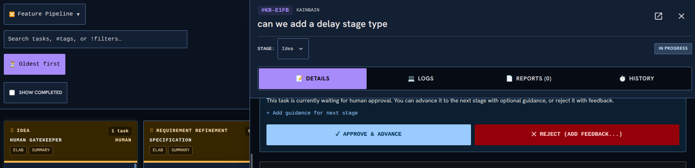

<!-- KAINBAIN AUTO-GENERATED REPORT -->
# Stage Report: Automated tests

**Task:** Can we make the task page overlap the top bar and stop squishing the top bar  As can be seen in the image when the task view is big it causes the search bar to take too muchh space up. I think what would be good is to have the search level bar static and let the task bar cover things up (The togglings and show completed arent essential to have on screen always. )  This means we can reclaim more task space
**Stage Type:** `ci`
**Model:** `default`
**Duration:** 160.365s
**Status:** FAILED

### Summary of Changes
Execution failed: CI command failed with exit code 1

### Execution Output
```

added 117 packages, and audited 118 packages in 1s

14 packages are looking for funding
  run `npm fund` for details

found 0 vulnerabilities

> kainbain@1.0.0 test
> node scripts/run-tests.mjs

Starting full project verification...
✅ Settings duplicate check passed (32 files in 95ms)
▸ started Unit Tests (api)
▸ started Unit Tests (frontend)
▸ started Unit Tests (runner)
▸ started Linting (api)
▸ started Linting (frontend)
▸ started Frontend Build
▸ started Security Script Tests
▸ started Dependency Check
▸ started Dependency Audit Gate
▸ started Harness Self-Tests
▸ started Container Tests
⏳ still running: Unit Tests (api) (30s), Unit Tests (frontend) (30s), Dependency Check (30s), Harness Self-Tests (30s)
⏳ still running: Unit Tests (api) (1m00s)
⏳ still running: Unit Tests (api) (1m30s)
⏳ still running: Unit Tests (api) (2m00s)
⏳ still running: Unit Tests (api) (2m30s)
Running Unit Tests (api)... PASS (152s)
Running Unit Tests (frontend)... PASS (152s)
Running Unit Tests (runner)... PASS (152s)
Running Linting (api)... PASS (152s)
Running Linting (frontend)... PASS (152s)
Running Frontend Build... PASS (152s)
Running Security Script Tests... PASS (152s)
Running Dependency Check... PASS (152s)
Running Dependency Audit Gate... PASS (152s)
Running Harness Self-Tests... PASS (152s)
Running Container Tests... PASS (152s)
Fast gate complete — starting Canary Tests alone (serial phase, no shared CPUs with the unit suites)...
▸ started Canary Tests
Running Canary Tests... FAIL (0s)
----------------------------------------------------------------------
Details for Canary Tests:

> kainbain@1.0.0 test:canary
> npm run test --prefix canary-e2e --


> canary-e2e@1.0.0 test
> node ../scripts/canary-preflight.mjs && playwright test

canary-preflight: Port 3399 is held by pid(s) 1926898, which did not match the expected process signature; refusing to terminate them. Stop the process yourself (or set PORT / VITE_PORT) and retry.
canary-preflight: port 5299 already free
----------------------------------------------------------------------

```

### Modified Files
- (No files modified / inspection only)

### Verification Status
- Stage execution failed with error: CI command failed with exit code 1
- Triggered fallback routing.