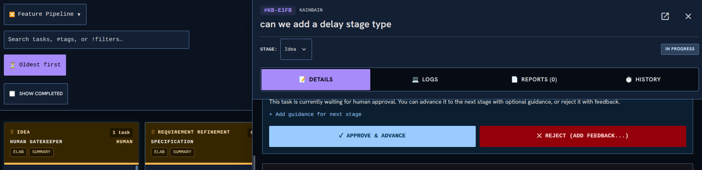

<!-- KAINBAIN AUTO-GENERATED REPORT -->
# Stage Report: Automated tests

**Task:** Can we make the task page overlap the top bar and stop squishing the top bar  As can be seen in the image when the task view is big it causes the search bar to take too muchh space up. I think what would be good is to have the search level bar static and let the task bar cover things up (The togglings and show completed arent essential to have on screen always. )  This means we can reclaim more task space
**Stage Type:** `ci`
**Model:** `default`
**Duration:** 2818.707s
**Status:** FAILED

### Summary of Changes
Execution failed: CI command failed with exit code 1

### Execution Output
```

up to date, audited 118 packages in 770ms

14 packages are looking for funding
  run `npm fund` for details

found 0 vulnerabilities

> kainbain@1.0.0 test
> node scripts/run-tests.mjs

Starting full project verification...
✅ Settings duplicate check passed (32 files in 161ms)
▸ started Unit Tests (api)
▸ started Unit Tests (frontend)
▸ started Unit Tests (runner)
▸ started Linting (api)
▸ started Linting (frontend)
▸ started Frontend Build
▸ started Security Script Tests
▸ started Dependency Check
▸ started Dependency Audit Gate
▸ started Harness Self-Tests
▸ started Container Tests
⏳ still running: Unit Tests (api) (30s), Unit Tests (frontend) (30s), Linting (api) (30s), Linting (frontend) (30s), Frontend Build (30s), Dependency Check (30s), Dependency Audit Gate (30s), Harness Self-Tests (30s)
⏳ still running: Unit Tests (api) (1m00s), Unit Tests (frontend) (1m00s), Linting (api) (1m00s), Dependency Check (1m00s)
⏳ still running: Unit Tests (api) (1m30s)
⏳ still running: Unit Tests (api) (2m00s)
⏳ still running: Unit Tests (api) (2m30s)
⏳ still running: Unit Tests (api) (3m00s)
Running Unit Tests (api)... PASS (200s)
Running Unit Tests (frontend)... PASS (200s)
Running Unit Tests (runner)... PASS (200s)
Running Linting (api)... PASS (200s)
Running Linting (frontend)... PASS (200s)
Running Frontend Build... PASS (200s)
Running Security Script Tests... PASS (200s)
Running Dependency Check... PASS (200s)
Running Dependency Audit Gate... PASS (200s)
Running Harness Self-Tests... PASS (200s)
Running Container Tests... PASS (200s)
Fast gate complete — starting Canary Tests alone (serial phase, no shared CPUs with the unit suites)...
▸ started Canary Tests
⏳ still running: Canary Tests (30s)
⏳ still running: Canary Tests (1m00s)
⏳ still running: Canary Tests (1m30s)
⏳ still running: Canary Tests (2m00s)
⏳ still running: Canary Tests (2m30s)
⏳ still running: Canary Tests (3m00s)
⏳ still running: Canary Tests (3m30s)
⏳ still running: Canary Tests (4m00s)
⏳ still running: Canary Tests (4m30s)
⏳ still running: Canary Tests (5m00s)
⏳ still running: Canary Tests (5m30s)
⏳ still running: Canary Tests (6m00s)
⏳ still running: Canary Tests (6m30s)
⏳ still running: Canary Tests (7m00s)
⏳ still running: Canary Tests (7m30s)
⏳ still running: Canary Tests (8m00s)
⏳ still running: Canary Tests (8m30s)
⏳ still running: Canary Tests (9m00s)
⏳ still running: Canary Tests (9m30s)
⏳ still running: Canary Tests (10m00s)
⏳ still running: Canary Tests (10m30s)
⏳ still running: Canary Tests (11m00s)
⏳ still running: Canary Tests (11m30s)
⏳ still running: Canary Tests (12m00s)
⏳ still running: Canary Tests (12m30s)
⏳ still running: Canary Tests (13m00s)
⏳ still running: Canary Tests (13m30s)
⏳ still running: Canary Tests (14m00s)
⏳ still running: Canary Tests (14m30s)
⏳ still running: Canary Tests (15m00s)
⏳ still running: Canary Tests (15m30s)
⏳ still running: Canary Tests (16m00s)
⏳ still running: Canary Tests (16m30s)
⏳ still running: Canary Tests (17m00s)
⏳ still running: Canary Tests (17m30s)
⏳ still running: Canary Tests (18m00s)
⏳ still running: Canary Tests (18m30s)
⏳ still running: Canary Tests (19m00s)
⏳ still running: Canary Tests (19m30s)
⏳ still running: Canary Tests (20m00s)
⏳ still running: Canary Tests (20m30s)
⏳ still running: Canary Tests (21m00s)
⏳ still running: Canary Tests (21m30s)
⏳ still running: Canary Tests (22m00s)
Running Canary Tests... FAIL (1350s)
----------------------------------------------------------------------
Details for Canary Tests:
(trimmed 450 of 570 lines; showing the tail)

    Test timeout of 60000ms exceeded.

    Error: expect(locator).toBeVisible() failed

    Locator: getByRole('button', { name: /Project/i }).first()
    Expected: visible
    Error: element(s) not found

    Call log:
      - Expect "toBeVisible" getByRole('button', { name: /Project/i }).first() with timeout 60000ms
      - waiting for getByRole('button', { name: /Project/i }).first()
      - Test timeout of 60000ms exceeded.


       at helpers.js:61

      59 | 	}
      60 | 	await expect(page).toHaveTitle(/Kainbain/);
    > 61 | 	await expect(page.getByRole("button", { name: /Project/i }).first()).toBeVisible({
         | 	                                                                     ^
      62 | 		timeout: APP_READY_TIMEOUT_MS,
      63 | 	});
      64 | }
        at waitForAppReady (/home/[REDACTED]/.kainbain/runner-work/kb-f56e9878-3677-4c0b-9f0b-9ad8fb6cffc9/canary-e2e/tests/helpers.js:61:71)
        at waitForAppReadyOnProject (/home/[REDACTED]/.kainbain/runner-work/kb-f56e9878-3677-4c0b-9f0b-9ad8fb6cffc9/canary-e2e/tests/helpers.js:104:2)
        at submitGoal (/home/[REDACTED]/.kainbain/runner-work/kb-f56e9878-3677-4c0b-9f0b-9ad8fb6cffc9/canary-e2e/tests/task-lifecycle.spec.js:31:2)
        at /home/[REDACTED]/.kainbain/runner-work/kb-f56e9878-3677-4c0b-9f0b-9ad8fb6cffc9/canary-e2e/tests/task-lifecycle.spec.js:90:3

    attachment #1: screenshot (image/png) ──────────────────────────────────────────────────────────
    test-results/task-lifecycle-Task-Lifecy-7db7d-nd-columns-are-drop-targets/test-failed-1.png
    ────────────────────────────────────────────────────────────────────────────────────────────────

    Error Context: test-results/task-lifecycle-Task-Lifecy-7db7d-nd-columns-are-drop-targets/error-context.md

  9) tests/task-lifecycle.spec.js:233:6 › Task Lifecycle E2E › clicking a card opens the slide-over task inspector 

    Test timeout of 60000ms exceeded.

    Error: expect(locator).toBeVisible() failed

    Locator: getByRole('button', { name: /Project/i }).first()
    Expected: visible
    Error: element(s) not found

    Call log:
      - Expect "toBeVisible" getByRole('button', { name: /Project/i }).first() with timeout 60000ms
      - waiting for getByRole('button', { name: /Project/i }).first()
      - Test timeout of 60000ms exceeded.


       at helpers.js:61

      59 | 	}
      60 | 	await expect(page).toHaveTitle(/Kainbain/);
    > 61 | 	await expect(page.getByRole("button", { name: /Project/i }).first()).toBeVisible({
         | 	                                                                     ^
      62 | 		timeout: APP_READY_TIMEOUT_MS,
      63 | 	});
      64 | }
        at waitForAppReady (/home/[REDACTED]/.kainbain/runner-work/kb-f56e9878-3677-4c0b-9f0b-9ad8fb6cffc9/canary-e2e/tests/helpers.js:61:71)
        at waitForAppReadyOnProject (/home/[REDACTED]/.kainbain/runner-work/kb-f56e9878-3677-4c0b-9f0b-9ad8fb6cffc9/canary-e2e/tests/helpers.js:104:2)
        at submitGoal (/home/[REDACTED]/.kainbain/runner-work/kb-f56e9878-3677-4c0b-9f0b-9ad8fb6cffc9/canary-e2e/tests/task-lifecycle.spec.js:31:2)
        at /home/[REDACTED]/.kainbain/runner-work/kb-f56e9878-3677-4c0b-9f0b-9ad8fb6cffc9/canary-e2e/tests/task-lifecycle.spec.js:236:3

    attachment #1: screenshot (image/png) ──────────────────────────────────────────────────────────
    test-results/task-lifecycle-Task-Lifecy-47fe1-e-slide-over-task-inspector/test-failed-1.png
    ────────────────────────────────────────────────────────────────────────────────────────────────

    Error Context: test-results/task-lifecycle-Task-Lifecy-47fe1-e-slide-over-task-inspector/error-context.md

  10) tests/workflow.spec.js:38:6 › Workflow E2E Tests › Stage types: human stage shows review checkpoint 

    Test timeout of 60000ms exceeded.

    Error: expect(locator).toBeVisible() failed

    Locator: getByRole('button', { name: /Project/i }).first()
    Expected: visible
    Error: element(s) not found

    Call log:
      - Expect "toBeVisible" getByRole('button', { name: /Project/i }).first() with timeout 60000ms
      - waiting for getByRole('button', { name: /Project/i }).first()
      - Test timeout of 60000ms exceeded.


       at helpers.js:61

      59 | 	}
      60 | 	await expect(page).toHaveTitle(/Kainbain/);
    > 61 | 	await expect(page.getByRole("button", { name: /Project/i }).first()).toBeVisible({
         | 	                                                                     ^
      62 | 		timeout: APP_READY_TIMEOUT_MS,
      63 | 	});
      64 | }
        at waitForAppReady (/home/[REDACTED]/.kainbain/runner-work/kb-f56e9878-3677-4c0b-9f0b-9ad8fb6cffc9/canary-e2e/tests/helpers.js:61:71)
        at waitForAppReadyOnProject (/home/[REDACTED]/.kainbain/runner-work/kb-f56e9878-3677-4c0b-9f0b-9ad8fb6cffc9/canary-e2e/tests/helpers.js:104:2)
        at /home/[REDACTED]/.kainbain/runner-work/kb-f56e9878-3677-4c0b-9f0b-9ad8fb6cffc9/canary-e2e/tests/workflow.spec.js:58:3

    attachment #1: screenshot (image/png) ──────────────────────────────────────────────────────────
    test-results/workflow-Workflow-E2E-Test-56497-age-shows-review-checkpoint/test-failed-1.png
    ────────────────────────────────────────────────────────────────────────────────────────────────

    Error Context: test-results/workflow-Workflow-E2E-Test-56497-age-shows-review-checkpoint/error-context.md

  Slow test file: tests/accessibility.spec.js (7.1m)
  Consider running tests from slow files in parallel. See: https://playwright.dev/docs/test-parallel
  10 failed
    tests/footer-overlay.spec.js:188:6 › Footer overlap consistency › Task inspector ends above the Now Playing footer and keeps its controls clickable 
    tests/task-editing.spec.js:34:6 › Task-view editing behaviors › attached image markdown is appended at the end, title line intact 
    tests/task-editing.spec.js:71:6 › Task-view editing behaviors › preview/edit round-trip preserves edited content 
    tests/task-inspector.spec.js:45:6 › Task inspector core behaviors › just-created task opens the goal in edit mode with context tokens 
    tests/task-inspector.spec.js:92:6 › Task inspector core behaviors › clicking the task key copies the full task id and keeps the inspector open 
    tests/task-inspector.spec.js:124:6 › Task inspector core behaviors › inspector width adjusts via the splitter, keyboard, and persists 
    tests/task-inspector.spec.js:200:7 › Task inspector core behaviors › desktop overlay geometry (task f56e9878) › open inspector overlaps the board without squishing the toolbar 
    tests/task-lifecycle.spec.js:85:6 › Task Lifecycle E2E › kanban cards are draggable and columns are drop targets 
    tests/task-lifecycle.spec.js:233:6 › Task Lifecycle E2E › clicking a card opens the slide-over task inspector 
    tests/workflow.spec.js:38:6 › Workflow E2E Tests › Stage types: human stage shows review checkpoint 
  130 passed (22.5m)
----------------------------------------------------------------------

```

### Modified Files
- (No files modified / inspection only)

### Verification Status
- Stage execution failed with error: CI command failed with exit code 1
- Triggered fallback routing.