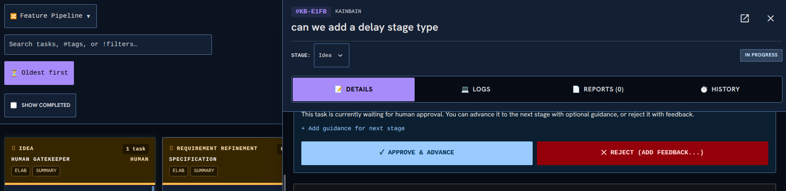

<!-- KAINBAIN AUTO-GENERATED REPORT -->
# Stage Report: Automated tests

**Task:** Can we make the task page overlap the top bar and stop squishing the top bar  As can be seen in the image when the task view is big it causes the search bar to take too muchh space up. I think what would be good is to have the search level bar static and let the task bar cover things up (The togglings and show completed arent essential to have on screen always. )  This means we can reclaim more task space
**Stage Type:** `ci`
**Model:** `default`
**Duration:** 1035.22s
**Status:** FAILED

### Summary of Changes
Execution failed: CI command failed with exit code 1

### Execution Output
```

up to date, audited 118 packages in 962ms

14 packages are looking for funding
  run `npm fund` for details

found 0 vulnerabilities

> kainbain@1.0.0 test
> node scripts/run-tests.mjs

Starting full project verification...
✅ Settings duplicate check passed (32 files in 127ms)
▸ started Unit Tests (api)
▸ started Unit Tests (frontend)
▸ started Unit Tests (runner)
▸ started Linting (api)
▸ started Linting (frontend)
▸ started Frontend Build
▸ started Security Script Tests
▸ started Dependency Check
▸ started Dependency Audit Gate
▸ started Harness Self-Tests
▸ started Container Tests
⏳ still running: Unit Tests (api) (30s), Unit Tests (frontend) (30s), Frontend Build (30s), Dependency Check (30s), Harness Self-Tests (30s)
⏳ still running: Unit Tests (api) (1m00s), Unit Tests (frontend) (1m00s)
⏳ still running: Unit Tests (api) (1m30s)
⏳ still running: Unit Tests (api) (2m00s)
⏳ still running: Unit Tests (api) (2m30s)
Running Unit Tests (api)... PASS (177s)
Running Unit Tests (frontend)... PASS (177s)
Running Unit Tests (runner)... PASS (177s)
Running Linting (api)... PASS (177s)
Running Linting (frontend)... PASS (177s)
Running Frontend Build... PASS (177s)
Running Security Script Tests... PASS (177s)
Running Dependency Check... PASS (177s)
Running Dependency Audit Gate... PASS (177s)
Running Harness Self-Tests... PASS (177s)
Running Container Tests... PASS (177s)
Fast gate complete — starting Canary Tests alone (serial phase, no shared CPUs with the unit suites)...
▸ started Canary Tests
⏳ still running: Canary Tests (30s)
⏳ still running: Canary Tests (1m00s)
⏳ still running: Canary Tests (1m30s)
⏳ still running: Canary Tests (2m00s)
⏳ still running: Canary Tests (2m30s)
⏳ still running: Canary Tests (3m00s)
⏳ still running: Canary Tests (3m30s)
⏳ still running: Canary Tests (4m00s)
⏳ still running: Canary Tests (4m30s)
⏳ still running: Canary Tests (5m00s)
⏳ still running: Canary Tests (5m30s)
⏳ still running: Canary Tests (6m00s)
⏳ still running: Canary Tests (6m30s)
⏳ still running: Canary Tests (7m00s)
⏳ still running: Canary Tests (7m30s)
⏳ still running: Canary Tests (8m00s)
⏳ still running: Canary Tests (8m30s)
⏳ still running: Canary Tests (9m00s)
⏳ still running: Canary Tests (9m30s)
⏳ still running: Canary Tests (10m00s)
⏳ still running: Canary Tests (10m30s)
⏳ still running: Canary Tests (11m00s)
⏳ still running: Canary Tests (11m30s)
⏳ still running: Canary Tests (12m00s)
⏳ still running: Canary Tests (12m30s)
⏳ still running: Canary Tests (13m00s)
⏳ still running: Canary Tests (13m30s)
⏳ still running: Canary Tests (14m00s)
Running Canary Tests... FAIL (850s)
----------------------------------------------------------------------
Details for Canary Tests:
(trimmed 107 of 227 lines; showing the tail)
Switched to branch 'kb/dea2c24d-44b7-43c2-94fd-a5f0b294249b'
Switched to branch 'main'
  ✓   73 tests/pr-review.spec.js:171:6 › PR Review E2E › open review → comment → fail with comments → agent fix → re-review (stale) → pass → merge (5.2s)
  ✓   74 tests/pr-review.spec.js:385:6 › PR Review E2E › review page shows the branch-unsupported empty state when branch support is off (A10, D7) (2.3s)
  ✓   75 tests/pr-review.spec.js:427:6 › PR Review E2E › reports tab enables block-anchored review of stage reports outside git diff (2.0s)
  ✓   76 tests/pr-review.spec.js:529:6 › PR Review E2E › reports tab is usable at a mobile viewport without horizontal overflow (2.2s)
CATALOGUE pi=null agy=["low","medium","high"] mock=["low","medium","high"] muse=null
CATALOGUE COUNTS pi=0 agy=0 mock=1
RESPONSIVENESS dropdown-open frames=72 p95=16.7ms
SAVED defaultModel=mock::mock::echo-v1::high harness=undefined
ANTIGRAVITY CATALOGUE EMPTY in scratch — agy levels covered by unit tests
NULL HARNESSES: Reasoning hidden for muse/vibe/opencode/codex/custom
SAVED aliases=[{"name":"browser-small","harness":"mock","model":"mock::mock::echo-v1::medium","targets":[{"harness":"mock","model":"mock::mock::echo-v1::medium","percent":100}]}]
INVALID SAVE status=400 body={"error":"modelAliases[0]: alias \"bad\" targets harness \"mock\" with reasoning level \"nope\", which is not supported (supported: low, medium, high)"}
  ✓   77 tests/reasoning-levels-browser.spec.js:71:7 › Reasoning levels browser verification (scratch stack) › picker + aliases: levels, persistence, invalid handling, null harnesses (7.6s)
  ✓   78 tests/retrospective-chat.spec.js:59:6 › retrospective long-turn chat › send shows the working card, then the reply replaces it (3.3s)
  ✓   79 tests/retrospective-chat.spec.js:86:6 › retrospective long-turn chat › navigate away mid-turn keeps the turn and toasts with a way back (4.6s)
  ✓   80 tests/retrospective.spec.js:13:5 › retrospective page renders without page errors (2.4s)
  ✓   81 tests/retrospective.spec.js:22:5 › retrospective ?show= share link renders without page errors (1.9s)
  ✓   82 tests/retrospective.spec.js:51:6 › retrospective mobile layout › phone shows one pane at a time behind the tab strip (2.1s)
  ✓   83 tests/retrospective.spec.js:83:6 › retrospective mobile layout › phone controls keep touch-sized targets (2.0s)
  ✓   84 tests/retrospective.spec.js:117:6 › retrospective mobile layout › phone page owns the vertical scroll region (1.9s)
  ✓   85 tests/retrospective.spec.js:151:6 › retrospective mobile layout › phone page never scrolls sideways (1.8s)
  ✓   86 tests/retrospective.spec.js:172:6 › retrospective mobile layout › desktop hides the strip and shows all three panes (2.3s)
  ✓   87 tests/runtime-errors.spec.js:13:5 › app renders without uncaught page errors (1.9s)
  ✓   88 tests/runtime-errors.spec.js:23:5 › app renders without console errors (2.2s)
  ✓   89 tests/settings.spec.js:60:6 › Settings save round-trip › edit, save, reload: values persist across UI and API (2.7s)
  ✓   90 tests/settings.spec.js:83:6 › Settings save round-trip › invalid input blocks the save and keeps the stored config (3.1s)
  ✓   91 tests/survey-verify.spec.js:122:7 › question-me survey verification › engine parks a question-me stage with no survey file; skip advances (2.2s)
survey timings ms: reveal=67 save=66 submit=82
  ✓   92 tests/survey-verify.spec.js:146:7 › question-me survey verification › desktop: conditional reveal, notes, save, submit advances; file stays append-only (4.1s)
  ✓   93 tests/survey-verify.spec.js:259:9 › question-me survey verification › touch context › mobile: survey renders, answers, and fits 375px (2.0s)
  ✓   94 tests/survey-verify.spec.js:290:7 › question-me survey verification › empty round advances via continue without parking (2.0s)
  ✓   95 tests/survey-verify.spec.js:317:7 › question-me survey verification › image questions: mock generation at park, pick one, chosen picture persisted (2.2s)
  ✓   96 tests/system-settings-mobile.spec.js:127:6 › System Settings screen tab bar (task 5ad55777) › tab bar renders at full height on mobile across all tabs (5.9s)
  ✓   97 tests/system-settings-mobile.spec.js:143:6 › System Settings screen tab bar (task 5ad55777) › tab bar renders at full height on a short mobile viewport (2.3s)
  ✓   98 tests/system-settings-mobile.spec.js:156:6 › System Settings screen tab bar (task 5ad55777) › scrolling the details never covers the tab bar (2.8s)
  ✓   99 tests/system-settings-mobile.spec.js:170:6 › System Settings screen tab bar (task 5ad55777) › tab bar renders at full height on desktop (2.2s)
  ✓  100 tests/system-settings-mobile.spec.js:176:6 › System Settings screen tab bar (task 5ad55777) › rotating the viewport never covers the tab bar (3.0s)
  ✓  101 tests/system-settings-mobile.spec.js:193:6 › System Settings screen tab bar (task 5ad55777) › a deep-linked tab survives a refresh and an unknown section falls back (2.8s)
  ✓  102 tests/system-settings-mobile.spec.js:222:6 › System Settings entry opens a screen, not a dialog (task cd669cc3) › no modal dialog shell remains on the settings route (2.1s)
  ✓  103 tests/system-settings-mobile.spec.js:229:6 › System Settings entry opens a screen, not a dialog (task cd669cc3) › desktop System Menu opens System Settings in a new window (2.1s)
  ✓  104 tests/system-settings-mobile.spec.js:254:6 › System Settings entry opens a screen, not a dialog (task cd669cc3) › mobile System Menu falls back to same-tab navigation (no popout trap) (2.1s)
  ✓  105 tests/task-editing.spec.js:35:6 › Task-view editing behaviors › attached image markdown is appended at the end, title line intact (5.6s)
  ✓  106 tests/task-editing.spec.js:72:6 › Task-view editing behaviors › preview/edit round-trip preserves edited content (5.5s)
  ✓  107 tests/task-errors.spec.js:93:6 › Task-view error display › long failure renders capped with a Show more/less toggle (2.1s)
  ✓  108 tests/task-inspector.spec.js:46:6 › Task inspector core behaviors › just-created task opens the goal in edit mode with context tokens (5.6s)
  ✓  109 tests/task-inspector.spec.js:65:6 › Task inspector core behaviors › preview toggle hides the editor and the context tokens, edit restores them (20.8s)
  ✓  110 tests/task-inspector.spec.js:93:6 › Task inspector core behaviors › clicking the task key copies the full task id and keeps the inspector open (5.4s)
  ✓  111 tests/task-inspector.spec.js:125:6 › Task inspector core behaviors › inspector width adjusts via the splitter, keyboard, and persists (6.0s)
  ✘  112 tests/task-inspector.spec.js:201:7 › Task inspector core behaviors › desktop overlay geometry (task f56e9878) › open inspector overlaps the board without squishing the toolbar (6.8s)
  ✓  113 tests/task-lifecycle.spec.js:43:6 › Task Lifecycle E2E › submit -> kanban placement -> advance -> complete (5.6s)
  ✓  114 tests/task-lifecycle.spec.js:86:6 › Task Lifecycle E2E › kanban cards are draggable and columns are drop targets (5.9s)
TEST START: human stage renders Approve/Reject checkpoint controls
projectId: f66659fe-5664-484c-8669-a5d0d6fc82d1
stages count: 6
humanStage: 4 Review Plan
submitting goal: Human review 1794345221578
goal submitted, polling latestTask
task id: 31ae146b-1d78-4dea-8da6-95d65d8bb8c6 stageId before jump: undefined
jump status: 200
Reload attempt 0 starting...
page.reload finished on attempt 0
waitForAppReadyOnProject starting on attempt 0
waitForAppReadyOnProject succeeded on attempt 0
waiting for Approve/Reject buttons...
TEST FINISHED SUCCESSFULLY
  ✓  115 tests/task-lifecycle.spec.js:110:6 › Task Lifecycle E2E › human stage renders Approve/Reject checkpoint controls (6.6s)
  ✓  116 tests/task-lifecycle.spec.js:234:6 › Task Lifecycle E2E › clicking a card opens the slide-over task inspector (5.4s)
  ✓  117 tests/task-logs.spec.js:109:6 › Agent-log readability › structured run output renders readably across feeds (2.8s)
  ✓  118 tests/task-logs.spec.js:146:6 › Agent-log readability › long lines wrap without breaking the inspector layout (2.2s)
  ✓  119 tests/task-logs.spec.js:167:6 › Agent-log readability › a fresh task shows the initialized placeholder, not a blank page (2.6s)
  ✓  120 tests/visual/dashboard.spec.js:66:8 › Dashboard Visuals › Desktop › Empty state (2.5s)
  ✓  121 tests/visual/dashboard.spec.js:83:8 › Dashboard Visuals › Desktop › Active execution (task card in canvas) (3.7s)
  ✓  122 tests/visual/dashboard.spec.js:97:8 › Dashboard Visuals › Desktop › Populated history (tasks + session tree) (4.0s)
  ✓  123 tests/visual/dashboard.spec.js:66:8 › Dashboard Visuals › Tablet › Empty state (2.2s)
  ✓  124 tests/visual/dashboard.spec.js:83:8 › Dashboard Visuals › Tablet › Active execution (task card in canvas) (4.1s)
  ✓  125 tests/visual/dashboard.spec.js:97:8 › Dashboard Visuals › Tablet › Populated history (tasks + session tree) (3.6s)
  ✓  126 tests/visual/dashboard.spec.js:66:8 › Dashboard Visuals › Mobile › Empty state (2.6s)
  ✓  127 tests/visual/dashboard.spec.js:83:8 › Dashboard Visuals › Mobile › Active execution (task card in canvas) (3.5s)
  ✓  128 tests/visual/dashboard.spec.js:97:8 › Dashboard Visuals › Mobile › Populated history (tasks + session tree) (3.5s)
  ✓  129 tests/visual/header.spec.js:23:7 › Header Visuals (task 66ad153f) › header band at Mobile 375px (2.1s)
  ✓  130 tests/visual/header.spec.js:23:7 › Header Visuals (task 66ad153f) › header band at Tablet 1024px (2.2s)
  ✓  131 tests/visual/header.spec.js:23:7 › Header Visuals (task 66ad153f) › header band at Desktop 1280px (2.1s)
  ✓  132 tests/visual/homepage.spec.js:44:7 › Homepage Visuals › visual regression - Desktop (2.5s)
  ✓  133 tests/visual/homepage.spec.js:44:7 › Homepage Visuals › visual regression - Tablet (3.4s)
  ✓  134 tests/visual/homepage.spec.js:44:7 › Homepage Visuals › visual regression - Mobile (2.1s)
  ✓  135 tests/websocket.spec.js:42:5 › frontend connects to the backend WebSocket and receives the handshake (2.3s)
  ✓  136 tests/workflow.spec.js:19:6 › Workflow E2E Tests › Task Creation: In-line add task -> verify card appears in kanban stage (3.1s)
  ✓  137 tests/workflow.spec.js:39:6 › Workflow E2E Tests › Stage types: human stage shows review checkpoint (5.5s)
  ✓  138 tests/workflow.spec.js:67:6 › Workflow E2E Tests › Now Playing bar: runner boxes own play/skip, no global engine controls (3.0s)
  ✓  139 tests/workflow.spec.js:98:6 › Workflow E2E Tests › Project isolation: switching project loads its own workflow (2.9s)
  ✓  140 tests/workflow.spec.js:115:6 › Workflow E2E Tests › Stage skills: GET /skills serves the library and the stage editor exposes the Skills panel (3.4s)


  1) tests/task-inspector.spec.js:201:7 › Task inspector core behaviors › desktop overlay geometry (task f56e9878) › open inspector overlaps the board without squishing the toolbar 

    Error: page.goto: Target page, context or browser has been closed

       at helpers.js:74

      72 | 		if (!TRANSIENT_NAVIGATION_RE.test(err?.message || "")) throw err;
      73 | 		await new Promise((r) => setTimeout(r, 1000));
    > 74 | 		await page.goto(APP_URL, { waitUntil: "domcontentloaded" });
         | 		           ^
      75 | 	}
      76 | }
      77 |
        at gotoApp (/home/[REDACTED]/.kainbain/runner-work/kb-f56e9878-3677-4c0b-9f0b-9ad8fb6cffc9/canary-e2e/tests/helpers.js:74:14)
        at waitForAppReady (/home/[REDACTED]/.kainbain/runner-work/kb-f56e9878-3677-4c0b-9f0b-9ad8fb6cffc9/canary-e2e/tests/helpers.js:100:4)
        at waitForAppReadyOnProject (/home/[REDACTED]/.kainbain/runner-work/kb-f56e9878-3677-4c0b-9f0b-9ad8fb6cffc9/canary-e2e/tests/helpers.js:187:2)
        at /home/[REDACTED]/.kainbain/runner-work/kb-f56e9878-3677-4c0b-9f0b-9ad8fb6cffc9/canary-e2e/tests/task-inspector.spec.js:209:4

    Error Context: test-results/task-inspector-Task-inspec-75a03-thout-squishing-the-toolbar/error-context.md

  Slow test file: tests/accessibility.spec.js (6.8m)
  Consider running tests from slow files in parallel. See: https://playwright.dev/docs/test-parallel
  1 failed
    tests/task-inspector.spec.js:201:7 › Task inspector core behaviors › desktop overlay geometry (task f56e9878) › open inspector overlaps the board without squishing the toolbar 
  139 passed (14.1m)
----------------------------------------------------------------------

```

### Modified Files
- (No files modified / inspection only)

### Verification Status
- Stage execution failed with error: CI command failed with exit code 1
- Triggered fallback routing.