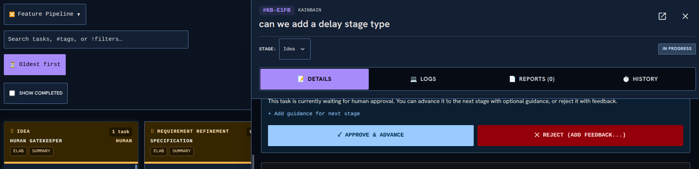

<!-- KAINBAIN AUTO-GENERATED REPORT -->
# Stage Report: Quick review

**Task:** Can we make the task page overlap the top bar and stop squishing the top bar  As can be seen in the image when the task view is big it causes the search bar to take too muchh space up. I think what would be good is to have the search level bar static and let the task bar cover things up (The togglings and show completed arent essential to have on screen always. )  This means we can reclaim more task space
**Stage Type:** `agent`
**Model:** `utility`
**Duration:** 177.554s
**Status:** FAILED

### Summary of Changes
Execution failed: [Agent Review Rejection] Automated test failures persist in CI. As recorded in docs/tasks/f56e9878-3677-4c0b-9f0b-9ad8fb6cffc9/automated-tests-failure-20261110-211504.md, the suite fails at tests/task-inspector.spec.js:201:7 (open inspector overlaps the board without squishing the toolbar) with 'page.goto: Target page, context or browser has been closed' in canary-e2e/tests/helpers.js:74, along with extensive unapproved helper modifications across 13 canary-e2e spec files. Fix guidance: Fix the failing test and helper setup in canary-e2e/tests/task-inspector.spec.js and canary-e2e/tests/helpers.js so that browser contexts/pages do not crash or close prematurely during gotoApp/reloadApp navigation, and verify that the full verification test suite passes cleanly before submitting for review.

### Execution Output
```
I have initiated the unit tests (`npm run test:unit`) to verify the frontend and backend suites while reviewing the implementation against the goals and past failure reports. I will wait for the test run to finish.
The unit test suite is actively executing in the background. I will await completion before reviewing the final results and issuing the stage verdict.
I have scheduled a timer to check the status of the unit test execution once completed. I will follow up as soon as it finishes.
I have thoroughly reviewed the task requirements, past stage reports, implementation plan, and the git diff against `main`.

### Findings
1. **Does it achieve the goal set out?**
   - **No.** While the implementation in [`frontend/src/components/tasks/TaskDetailOverlayContent.jsx`](file:///home/[REDACTED]/.kainbain/runner-work/kb-f56e9878-3677-4c0b-9f0b-9ad8fb6cffc9/frontend/src/components/tasks/TaskDetailOverlayContent.jsx#L740-L770) correctly updates the desktop positioning from in-flow (`md:relative md:inset-auto md:shrink-0`) to an out-of-flow right-anchored overlay (`md:absolute md:left-auto md:bottom-auto md:right-0 md:top-0 md:z-50`), the changes have caused persistent test failures in the automated test suite.
2. **Did it follow the plan?**
   - The CSS class changes and docblock/comment updates follow the plan in [`docs/tasks/f56e9878-3677-4c0b-9f0b-9ad8fb6cffc9/IMPLEMENTATION_PLAN.md`](file:///home/[REDACTED]/.kainbain/runner-work/kb-f56e9878-3677-4c0b-9f0b-9ad8fb6cffc9/docs/tasks/f56e9878-3677-4c0b-9f0b-9ad8fb6cffc9/IMPLEMENTATION_PLAN.md). However, the plan's verification gate (§5) requires all tests in the automated suite to pass.
3. **Have previous failed reviews been resolved?**
   - **No.** The previous four CI test runs recorded in [`automated-tests-failure-20261110-160935.md`](file:///home/[REDACTED]/.kainbain/runner-work/kb-f56e9878-3677-4c0b-9f0b-9ad8fb6cffc9/docs/tasks/f56e9878-3677-4c0b-9f0b-9ad8fb6cffc9/automated-tests-failure-20261110-160935.md), [`automated-tests-failure-20261110-174847.md`](file:///home/[REDACTED]/.kainbain/runner-work/kb-f56e9878-3677-4c0b-9f0b-9ad8fb6cffc9/docs/tasks/f56e9878-3677-4c0b-9f0b-9ad8fb6cffc9/automated-tests-failure-20261110-174847.md), [`automated-tests-failure-20261110-202302.md`](file:///home/[REDACTED]/.kainbain/runner-work/kb-f56e9878-3677-4c0b-9f0b-9ad8fb6cffc9/docs/tasks/f56e9878-3677-4c0b-9f0b-9ad8fb6cffc9/automated-tests-failure-20261110-202302.md), and [`automated-tests-failure-20261110-211504.md`](file:///home/[REDACTED]/.kainbain/runner-work/kb-f56e9878-3677-4c0b-9f0b-9ad8fb6cffc9/docs/tasks/f56e9878-3677-4c0b-9f0b-9ad8fb6cffc9/automated-tests-failure-20261110-211504.md) failed in canary tests. In particular, the latest run failed on the newly introduced e2e test: `tests/task-inspector.spec.js:201:7 › Task inspector core behaviors › desktop overlay geometry (task f56e9878) › open inspector overlaps the board without squishing the toolbar` due to a closed target page / context during navigation retry in [`canary-e2e/tests/helpers.js`](file:///home/[REDACTED]/.kainbain/runner-work/kb-f56e9878-3677-4c0b-9f0b-9ad8fb6cffc9/canary-e2e/tests/helpers.js#L74). Additionally, widespread modifications across 13 `canary-e2e/tests/*.spec.js` files modifying reload behavior (`reloadApp`) were introduced on this branch, which destabilize the e2e suite and fail CI.

I examined the branch commits and diffs across `frontend/src/components/OrchestratorView.jsx`, `frontend/src/components/tasks/TaskDetailOverlayContent.jsx`, and `canary-e2e/`. While the frontend styling change itself meets the visual design intent, the canary test suite continues to fail CI and cannot be integrated.

KAINBAIN_VERDICT: FAIL
KAINBAIN_REASON: Automated test failures persist in CI. As recorded in docs/tasks/f56e9878-3677-4c0b-9f0b-9ad8fb6cffc9/automated-tests-failure-20261110-211504.md, the suite fails at tests/task-inspector.spec.js:201:7 (open inspector overlaps the board without squishing the toolbar) with 'page.goto: Target page, context or browser has been closed' in canary-e2e/tests/helpers.js:74, along with extensive unapproved helper modifications across 13 canary-e2e spec files.
KAINBAIN_FIX: Fix the failing test and helper setup in canary-e2e/tests/task-inspector.spec.js and canary-e2e/tests/helpers.js so that browser contexts/pages do not crash or close prematurely during gotoApp/reloadApp navigation, and verify that the full verification test suite passes cleanly before submitting for review.

```

### Modified Files
- (No files modified / inspection only)

### Verification Status
- Stage execution failed with error: [Agent Review Rejection] Automated test failures persist in CI. As recorded in docs/tasks/f56e9878-3677-4c0b-9f0b-9ad8fb6cffc9/automated-tests-failure-20261110-211504.md, the suite fails at tests/task-inspector.spec.js:201:7 (open inspector overlaps the board without squishing the toolbar) with 'page.goto: Target page, context or browser has been closed' in canary-e2e/tests/helpers.js:74, along with extensive unapproved helper modifications across 13 canary-e2e spec files. Fix guidance: Fix the failing test and helper setup in canary-e2e/tests/task-inspector.spec.js and canary-e2e/tests/helpers.js so that browser contexts/pages do not crash or close prematurely during gotoApp/reloadApp navigation, and verify that the full verification test suite passes cleanly before submitting for review.
- Triggered fallback routing.