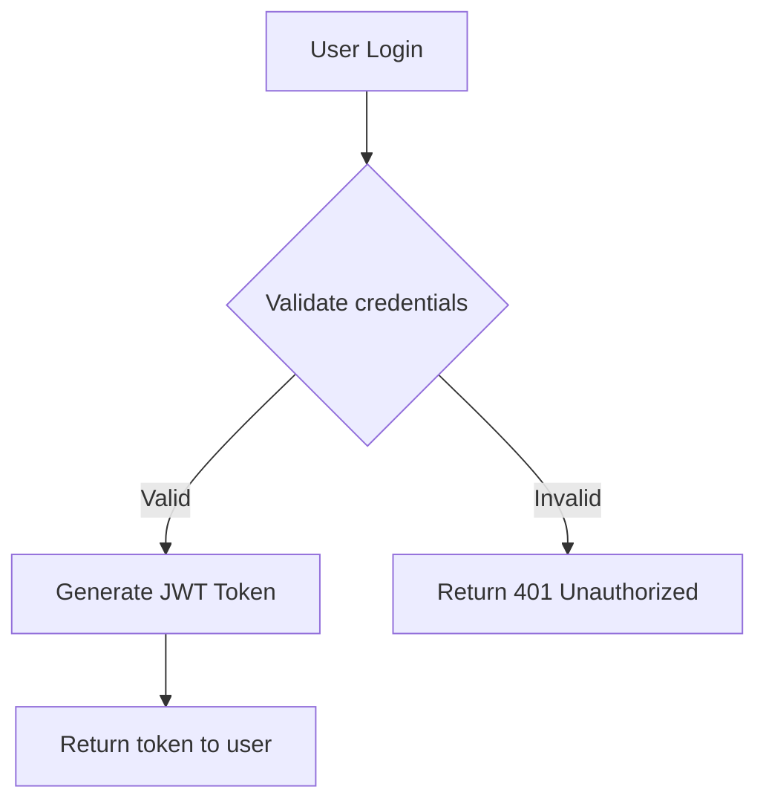

# Creating New Tickets (KainBain)

Use this skill to turn findings from the current task into actionable,
discrete KainBain tasks ("tickets") in a chosen project, pipeline (workflow),
and stage. The flow is deliberately two-stage so tickets land as readable
markdown documents: **draft one `.md` file per ticket first, then send that
file's exact contents via the API.** Stage 1 requires ordinary filesystem
work in the current task's task directory; Stage 2 happens over the KainBain
HTTP API.

**Resolved targets for this run:**

- Target project: `{{targetProject}}`
- Target workflow: `{{targetWorkflow}}`
- Target stage: `{{targetStage}}`
- API base: `{{kbApiBase}}`
- Task directory: `{{taskDocs}}`

## 1. Resolve the ids first (names are case-insensitive but ids are exact)

1. `GET {{kbApiBase}}/projects` → find the project whose `name` or `slug`
   matches `{{targetProject}}`; take its `id`. If none matches, the target
   project does not exist — report that and stop; do NOT guess an id.
2. `GET {{kbApiBase}}/projects/<projectId>/workflows` → find the workflow
   matching `{{targetWorkflow}}` (its `id` is needed verbatim).
3. Inside that workflow, resolve `{{targetStage}}` to a stage `id`. Stage
   names may also be passed directly as `stageId` to `POST /tasks`
   (`resolveStage` matches by id **or** name, case-insensitively) — but
   resolving to the exact id is preferred for auditability.

## 2. Deduplicate before creating (guardrail)

Call `GET {{kbApiBase}}/tasks?workflowId=<workflowId>` (add `projectId` when
the task store does not default to the target project) and check the open
tasks. Do NOT create a ticket for a finding that already has an open task in
the same stage with substantially the same goal. Cap the run at **10 new
tickets**; if more findings qualify, create the 10 highest-value ones and
report the remainder instead of flooding the pipeline.

## 3. Two-stage creation (draft, then send)

### Stage 1 — Draft each ticket as its own markdown file

For **every** qualifying finding (even tiny ones), write one markdown file
under `{{taskDocs}}drafts/` (create the directory first — it is additive and
never conflicts with engine artifacts). Suggested name: `draft-<slug>.md`,
one file per ticket, where `<slug>` is a short kebab-case summary. Keep the
current task's normal report files untouched.

Use this template, scaling sections down for trivial tickets but always keeping
the first `# <title>` line:

```markdown
# <imperative title>

## Context
<what triggered this work, links to the finding / failing check>

## Steps
1. <first concrete action>
2. <next action>

## Acceptance criteria
- [ ] <observable, testable outcome>
- [ ] <second outcome>

## Notes / examples
<code, tables, mermaid diagrams, or image references as needed>
```

**This skill specifically enables beautiful, readable tasks!** The KainBain task
viewer renders markdown beautifully, supporting:

- **Headings** (##, ###) for clear structure
- **Bullet lists** and **numbered lists** for steps and criteria
- **Fenced code blocks** with syntax highlighting
- **Mermaid diagrams** (flowcharts, sequence diagrams, class diagrams, etc.)
- **Tables** for structured data
- **Images** (local assets or absolute URLs)
- **Bold**, *italic*, and `inline code` formatting

**Example of a well-formatted ticket draft:**

```markdown
# Implement user authentication API

## Context
Discovered during security audit (see automated-tests-failure-20261114-045255.md)
that the application lacks proper authentication. This was flagged by the
security scanner as a high-priority issue.

## Steps
1. Create new `auth` service module
2. Implement JWT token generation and validation
3. Add authentication middleware to API routes
4. Write unit tests for authentication logic
5. Update API documentation

## Acceptance criteria
- [ ] JWT tokens are generated with proper expiration
- [ ] Authentication middleware validates tokens correctly
- [ ] Unit tests cover all authentication scenarios
- [ ] API documentation includes authentication section
- [ ] Security scan passes with no critical issues

## Implementation details

### Code structure
```typescript
// auth/service.ts
export class AuthService {
  async login(credentials: LoginDto): Promise<TokenResponse> { ... }
  async validateToken(token: string): Promise<User> { ... }
}
```

### API endpoints
```http
POST /api/auth/login
Content-Type: application/json

{
  "username": "user@example.com",
  "password": "secret123"
}
```

### Mermaid flow diagram


### Related findings
- Security scan report: [link to report]
- CVE database: CVE-2023-12345

### Screenshot reference

```

Headings, bullet lists, tables, fenced code blocks, ` ```mermaid ` diagrams,
and `` image references are all supported by the task goal
view — prefer a well-structured document over a paragraph. A broken diagram
degrades to readable source rather than a blank hole.

### Stage 2 — Send the draft via the API

Read the draft file back and send it verbatim. `POST {{kbApiBase}}/tasks`
with a JSON body built from that file:

```json
{
  "projectId": "<target project id>",
  "title": "<the draft's first line, verbatim, including the leading #>",
  "goal": "<the EXACT contents of {{taskDocs}}drafts/<slug>.md>",
  "stageId": "<target stage id or exact name>",
  "workflowId": "<target workflow id>",
  "blockedBy": ["<blocker task id>", "<blocker task id>"],
  "idempotencyKey": "<deterministic key>",
  "execute": false
}
```

Rules while sending:

- **`blockedBy` (always state it explicitly)** – an array of **same-project** task
  IDs this new ticket must wait on before it can advance. Reuse the listing from
  §2 to pick real ids; **never guess an id**. Set it to `[]` when nothing blocks
  and say `blockers: none` in the stage report (per the ask). The API returns
  HTTP 400 on self-block (`Task cannot block itself`), an unknown id, or a
  dependency cycle; blockers that are failed/cancelled keep the dependent blocked.
- **`goal` must equal the draft file byte-for-byte (exact file content).** Do not re-wrap, collapse,
  or reformat while sending; the first line of the file doubles as the title
  first line (`# <title>`), and the `title` field and the goal's first line must
  match. The `title` field is a concise, imperative, verb-first summary; the
  formatter derives display titles from the goal's first line
  (`formatTaskTitleFirstLine`: first line, leading `# ` stripped, falls back to
  `Untitled Task`), so the first line must stay on one line.
- **Images follow create → upload → patch ordering.** A task id does not exist
  until after `POST /tasks`, so if a draft references local images, create the
  task with text-only refs first, then `POST /projects/<projectId>/tasks/<taskId>/images`
  for each image, and only after every upload succeeds `PATCH /tasks/<taskId>`
  with a `goal` that contains the returned `assets/<name>` references. Never
  guess filenames; reuse the names returned by the upload response. Absolute
  URLs pass through unchanged. Note: `PATCH /tasks/:id` trims leading/trailing
  whitespace from the goal (create does not) — after an image-ref patch, compare
  against the trimmed draft, not the raw file bytes.
- `idempotencyKey` is REQUIRED: derive it deterministically, e.g.
  `sha256(finding-summary + targetStage + currentTaskId).slice(0, 32)` — a
  retry of the same finding must not create a second ticket.
- Leave `execute` false unless the finding is explicitly ready for immediate
  agent execution; tickets land in the target stage for the pipeline to process.
- Never target the stage that is CURRENTLY executing this task (recursion
  guard): re-entering the running stage would loop the pipeline back onto
  itself.

## 4. Verify each creation

A successful response returns the created task with `id` and `status`.
Verify by re-reading `GET {{kbApiBase}}/tasks/<id>?projectId=<projectId>`:
confirm `currentStageId` matches the target stage, that `blockedBy` matches the
decision recorded for that finding (ids or `[]`), that the goal's first line is
the mandated title, and that the fetched `goal` equals the draft file written
in Stage 1 — byte-for-byte for a plain create, or against the edge-trimmed
draft after an image-ref `PATCH` (see the note above). Report every created
ticket id, title, stage, and blocker ids (`blockers: none` when empty) in the
stage report so operators can audit the fan-out.

## Guardrails (always apply)

- Always write the Stage 1 draft file first, then send it in Stage 2.
- Draft one markdown file per ticket under `{{taskDocs}}drafts/`, even tiny tickets.
- Dedupe before create; never duplicate an existing open ticket.
- Hard cap: at most 10 tickets per run.
- Never create a ticket targeting the currently executing stage.
- Always send a deterministic `idempotencyKey`.
- Always acknowledge blockers explicitly: `blockedBy: [...]` (ids) or `[]`, plus
  one stage-report line naming them (`blockers: <ids>` or `blockers: none`).
  Never guess a blocker id.
- Every goal opens with a title line in the `# <title>` form; never open with a
  plain paragraph.
- If ids cannot be resolved (unknown project/workflow/stage), stop and report
  the miss instead of guessing.
- Tickets are created with `execute:false` by default; only set `execute:true`
  when the finding is verified and ready for autonomous execution.

## KB_config keyword reference metadata (for skill authors)

The `targetProject` / `targetWorkflow` / `targetStage` keywords in
`KB_config.json` carry optional metadata that tells the stage editor to render
them as dropdowns populated from KainBain's known data instead of free-text
inputs:

- `"kbRef": "project" | "workflow" | "stage"` — the keyword's value domain.
- `"dependsOn": "<otherKeyword>"` — the parent keyword whose selection scopes
  this one (project → workflow → stage).

Selecting from a dropdown stores the canonical entity **id**; the values are
resolved against KainBain's live data and validated when the stage is saved
(`PUT /projects/:id/workflow` rejects unknown references with a descriptive
400). Free text still works: the editor offers an "Enter value manually…"
fallback, and legacy stored values (names, slugs, `{{project}}`) keep working
exactly as before. See `docs/KB Architecture.md` → "Skill keyword reference
metadata" for the full contract.
